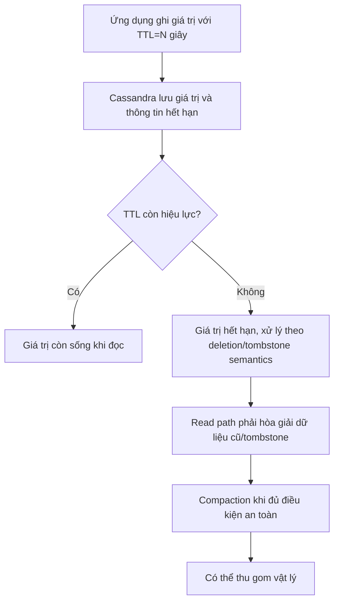

# TTL theo chính sách lưu giữ và dữ liệu có tuổi khác nhau

Dữ liệu chuỗi thời gian (*time-series data*) liên tục tăng theo từng phút, giây hoặc sự kiện. Một hệ thống học tập có thể ghi tiến độ, hoạt động của học viên, chỉ số thiết bị trong phòng học, nhật ký bài giảng và các tín hiệu vận hành. Không phải dữ liệu nào cũng phải tồn tại mãi mãi: bản ghi đo nhiệt độ có thể chỉ cần 30 ngày, payload chẩn đoán có thể chỉ cần 3 ngày, còn sự kiện phục vụ báo cáo có thể cần lưu 12 tháng hoặc lâu hơn.

**Apache Cassandra** cung cấp **Time To Live (TTL)** để một giá trị tự hết hiệu lực sau số giây được chỉ định. Nhưng TTL **không phải** một cơ chế xóa vật lý ngay tức thì, cũng không tự đồng nhất với “tuổi của sự kiện” được lưu trong cột kiểu `timestamp`. Đặc biệt, khi dữ liệu có **tuổi khác nhau** — mới phát sinh, gửi trễ, backfill lịch sử, các cột có thời hạn riêng hoặc cùng bảng có nhiều chính sách retention — cách đặt TTL tác động đến cả tính đúng đắn của kết quả đọc, tombstone, compaction, chi phí lưu trữ và hiệu năng.

Bài học thuộc chương **Dữ liệu thời gian** của module **SPRING_DATA_CASSANDRA**. Phạm vi module là truy cập Apache Cassandra bằng Spring Data Cassandra với entity mapping, repository, `CassandraTemplate` và CQL; học thiết kế bảng theo truy vấn, partition key, consistency, paging và kiểm soát hiệu năng trong hệ dữ liệu phân tán. Trọng tâm của bài là **“TTL theo chính sách lưu giữ và dữ liệu có tuổi khác nhau”**: chọn mốc tính hạn lưu, áp dụng TTL cho dữ liệu mới và dữ liệu lịch sử, lựa chọn schema/compaction phù hợp, quan sát và kiểm thử bằng Cassandra thật.

> **Nguyên tắc chính:** phải tách rõ **thời điểm sự kiện xảy ra**, **thời điểm nhận/ghi vào Cassandra**, **write timestamp của mutation** và **thời điểm một giá trị hết TTL**. Chọn nhầm mốc thời gian có thể làm dữ liệu đến trễ sống lâu quá quy định hoặc dữ liệu còn cần bị xóa sớm.

## 1. Mục tiêu học tập

Sau bài này, bạn có thể:

1. Giải thích TTL là **thời hạn của giá trị được ghi**, không mặc nhiên là thời hạn dựa trên clustering column.
2. Phân biệt `event_time`, `ingested_at`, `WRITETIME(column)` và `TTL(column)`.
3. Định nghĩa chính sách giữ dữ liệu **theo lúc ghi nhận** và **theo thời điểm sự kiện**.
4. Xử lý đúng các sự kiện **đến trễ**, **backfill** và **replay** mà không vô tình gia hạn dữ liệu.
5. Viết `INSERT ... USING TTL`, `UPDATE ... USING TTL` và đọc `TTL(column)` từ CQL.
6. Hiểu `default_time_to_live` của bảng, sự khác biệt với TTL tường minh và ý nghĩa của `TTL 0`.
7. Phân biệt các regular columns trong cùng hàng có TTL khác nhau với TTL của toàn hàng.
8. Thiết kế bảng theo **time bucket** và nhiều cấp độ retention, tránh partition quá lớn.
9. Biết vai trò của **tombstone, gc_grace_seconds, repair, compaction** và TWCS.
10. Triển khai ghi TTL bằng Java Driver trong ứng dụng Spring Data Cassandra.
11. Tổ chức truy vấn/paging để không thường xuyên đi qua dữ liệu đã hết hạn.
12. Tạo integration test và kế hoạch migration/rollout cho thay đổi retention.

## 2. Tình huống: dữ liệu đo từ thiết bị phòng học

Một nền tảng vận hành phòng học nhận telemetry từ thiết bị theo từng phút. Mỗi sự kiện có:

- `tenant_id`: đơn vị sở hữu.
- `device_id`: thiết bị.
- `recorded_at`: lúc phép đo xảy ra tại nguồn.
- `event_id`: định danh ổn định của phép đo.
- `temperature_c`: nhiệt độ.
- `battery_pct`: phần trăm pin.
- `alert_code`: mã cảnh báo.
- `raw_payload`: chuỗi payload chẩn đoán có thể lớn.

Yêu cầu sản phẩm ví dụ:

| Dữ liệu | Chính sách | Mục đích |
| --- | --- | --- |
| Payload chẩn đoán thô | Giữ tối đa **3 ngày từ lúc sự kiện xảy ra** | Điều tra lỗi vừa phát sinh |
| Chỉ số đo tổng quan | Giữ **30 ngày từ lúc sự kiện xảy ra** | Biểu đồ và phân tích gần đây |
| Tổng hợp theo ngày | Giữ **365 ngày** | Báo cáo dài hạn |
| Danh mục thiết bị và quyền truy cập | Không áp dụng TTL này | Metadata vận hành |

Các con số chỉ để minh họa cách thiết kế; chính sách thật phải được quyết định từ nhu cầu sản phẩm, pháp lý, bảo mật và chi phí.

### 2.1. Bảng time-series cho một thiết bị theo ngày

```sql
CREATE TABLE IF NOT EXISTS learning.telemetry_by_device_day (
    tenant_id uuid,
    device_id uuid,
    bucket_day date,
    recorded_at timestamp,
    event_id uuid,
    temperature_c double,
    battery_pct int,
    alert_code text,
    raw_payload text,
    PRIMARY KEY ((tenant_id, device_id, bucket_day),
                 recorded_at, event_id)
) WITH CLUSTERING ORDER BY (recorded_at DESC, event_id ASC);
```

Phân tích khóa:

| Cột | Vai trò | Lý do |
| --- | --- | --- |
| `tenant_id` | Partition key 1 | Cô lập dữ liệu tenant |
| `device_id` | Partition key 2 | Một hướng đọc cho thiết bị |
| `bucket_day` | Partition key 3 | Phân vùng theo ngày, giới hạn kích thước partition |
| `recorded_at` | Clustering 1 | Sắp xếp phép đo mới nhất trước |
| `event_id` | Clustering 2 | Phân biệt phép đo cùng timestamp |
| Các cột đo/cảnh báo | Regular columns | Có thể áp dụng TTL theo từng lần ghi |

Với schema này, hai bản ghi của cùng thiết bị nhưng khác `bucket_day` thuộc **hai partition khác nhau**. Một query đọc một ngày phải bind đầy đủ `(tenant_id, device_id, bucket_day)`.

### 2.2. Câu query hợp lệ

```sql
SELECT recorded_at, event_id, temperature_c,
       battery_pct, alert_code
FROM learning.telemetry_by_device_day
WHERE tenant_id = ?
  AND device_id = ?
  AND bucket_day = ?
  AND recorded_at >= ?
  AND recorded_at < ?;
```

Đây là truy vấn đã biết đường đọc theo partition + clustering range. Nó không phải scan toàn cluster. Nhưng **đúng partition key chưa đủ** để tránh mọi chi phí đọc nếu partition quá nóng hoặc có nhiều tombstone do TTL.

## 3. Bốn mốc thời gian không được trộn lẫn

Một telemetry event đến lúc 10:00 nhưng xảy ra lúc 09:00 có nhiều mốc khác nhau:

```text
recorded_at / event time:
    2026-11-25 09:00:00 UTC

received_at / ingestion time:
    2026-11-25 10:00:00 UTC

write timestamp của temperature_c:
    số microsecond từ Unix epoch dùng cho Cassandra LWW

TTL / expiration:
    thời hạn còn lại tính bằng giây cho giá trị đã ghi
```

| Khái niệm | Lưu ở đâu? | Dùng làm gì? |
| --- | --- | --- |
| **Event time** | Cột `recorded_at` | Sắp xếp/truy vấn theo thời điểm nghiệp vụ |
| **Ingestion time** | Có thể ở metadata/log hoặc regular column khác | Quan sát độ trễ xử lý và policy giữ từ lúc nhận |
| **Write timestamp** | Metadata mutation Cassandra; đọc được bằng `WRITETIME(column)` với cột hỗ trợ | Last-write-wins khi hòa giải replica/cell |
| **TTL/expiration** | Metadata sống/hết hạn của giá trị | Xác định khi nào giá trị không còn được đọc như dữ liệu sống |

Kiểu CQL `timestamp` biểu diễn một mốc thời gian dữ liệu (thông thường độ phân giải millisecond), còn `WRITETIME` trả một số **microsecond từ Unix epoch** cho regular column. `TTL(column)` trả **số giây còn lại**, không phải epoch timestamp.

### 3.1. Việc ghi lúc 10:00 không làm event time thành 10:00

Nếu một phép đo có `recorded_at=09:00` được gửi trễ và ghi lúc 10:00, clustering key vẫn là **09:00**. TTL theo mặc định của mutation ghi lúc 10:00 không tự biết policy “giữ 30 ngày tính từ 09:00”.

Đây là khác biệt quan trọng nhất khi dữ liệu có tuổi khác nhau.

### 3.2. Write timestamp không phải TTL

Một cột có thể có:

```text
recorded_at = 2026-11-25T09:00:00Z
WRITETIME(temperature_c) = 1795597200000000
TTL(temperature_c) = 2591990 seconds
```

Các số chỉ là minh họa. `WRITETIME` biểu diễn phiên bản của mutation; `TTL` biểu diễn thời gian còn sống. Không suy ra policy retention chỉ bằng một trong hai giá trị.

## 4. TTL của Cassandra hoạt động thế nào?

Khi thực hiện mutation hỗ trợ TTL, Cassandra lưu thời hạn sống cho các giá trị liên quan. Sau khi hết hạn, giá trị đó **không còn được xem là live data** trong truy vấn. Tuy nhiên, dữ liệu và dấu xóa có thể tiếp tục hiện diện trong SSTables cho đến khi đủ điều kiện thu gom.

Luồng khái quát:



Ba điểm cần giữ:

1. **TTL tính bằng giây**, không phải millisecond.
2. TTL áp dụng cho **các giá trị/cell được ghi** theo statement, không phải toàn keyspace một cách tự động.
3. **Hết hạn logic khác với thu hồi vật lý ngay.** Tombstone, replication, repair và compaction vẫn quan trọng.

### 4.1. Khi nào bắt đầu đếm TTL?

Với cách dùng thông thường, TTL gắn với việc **ghi mutation**, không phải tự đếm từ cột `recorded_at`. Nếu cần retention theo event time, ứng dụng phải tính **remaining TTL** từ deadline nghiệp vụ trước khi ghi, hoặc chọn cách lưu khác.

### 4.2. Primary key không “tự có TTL”

`tenant_id`, `device_id`, `bucket_day`, `recorded_at` và `event_id` tạo danh tính/hướng truy vấn. Đừng suy ra rằng những cột khóa cũng được quản lý TTL như regular values.

Một row có thể chỉ còn một phần giá trị đang sống nếu các regular columns có thời hạn khác nhau. Việc một row còn hiện hay không còn tùy thông tin liveness và những mutation đã ghi; không nên chỉ dùng row count để đo chính xác số cell còn sống.

### 4.3. TTL và counter là hai cơ chế khác nhau

Counter columns không hỗ trợ TTL như regular data. Nếu muốn số sự kiện trong ngày và tự hết hạn, cần xem xét mô hình bảng thường/tổng hợp, time buckets, retention workflow; không ghi `UPDATE counter ... USING TTL`.

## 5. CQL: ghi với TTL tường minh

Cú pháp `INSERT`:

```sql
INSERT INTO learning.telemetry_by_device_day (
    tenant_id, device_id, bucket_day,
    recorded_at, event_id,
    temperature_c, battery_pct, alert_code
) VALUES (?, ?, ?, ?, ?, ?, ?, ?)
USING TTL ?;
```

Tham số cuối là **TTL giây**, ví dụ:

```text
3 ngày  = 3 * 24 * 3600  = 259200 giây
30 ngày = 30 * 24 * 3600 = 2592000 giây
```

Nếu một measurement event mới được gửi ngay khi phát sinh, `USING TTL 2592000` có thể tương đương gần đúng “giữ 30 ngày từ sự kiện”. Nhưng tương đương này mất đi khi **event đến trễ**.

### 5.1. UPDATE với TTL

Có thể cập nhật một regular column kèm thời hạn riêng:

```sql
UPDATE learning.telemetry_by_device_day
USING TTL ?
SET raw_payload = ?
WHERE tenant_id = ?
  AND device_id = ?
  AND bucket_day = ?
  AND recorded_at = ?
  AND event_id = ?;
```

Chỉ các giá trị được mutation này cập nhật chịu chính sách TTL tương ứng; việc đổi `raw_payload` **không tự đặt lại** thời hạn của `temperature_c` nếu statement không ghi cột đó.

### 5.2. Đọc TTL hiện tại

```sql
SELECT recorded_at,
       event_id,
       temperature_c,
       TTL(temperature_c) AS temperature_ttl_seconds,
       raw_payload,
       TTL(raw_payload) AS payload_ttl_seconds,
       WRITETIME(temperature_c) AS temperature_write_ts
FROM learning.telemetry_by_device_day
WHERE tenant_id = ?
  AND device_id = ?
  AND bucket_day = ?
  AND recorded_at = ?
  AND event_id = ?;
```

Ý nghĩa:

- `TTL(temperature_c)`: số giây còn lại nếu giá trị có TTL còn sống.
- `TTL(raw_payload)`: TTL riêng của payload, có thể khác chỉ số đo.
- `WRITETIME(temperature_c)`: write timestamp microsecond của giá trị đo còn đọc được.
- Không lấy `TTL(recorded_at)` làm cách đo thời hạn từ primary key; `recorded_at` là clustering key.
- Khi một cột không tồn tại, đã hết hạn hoặc không có TTL, **`NULL` cần được diễn giải theo tình huống**, không mặc định tất cả đều có cùng nguyên nhân.

Không dùng `TTL(column)` như một nhật ký lịch sử xóa: nó không liệt kê mọi mutation từng ghi, chỉ cho biết trạng thái TTL có thể quan sát ở lần đọc.

### 5.3. Không dùng TTL để thay thế WHERE

TTL không phải access path. Câu query:

```sql
-- Không tự trở thành truy vấn hiệu quả vì các row có TTL.
SELECT *
FROM learning.telemetry_by_device_day
WHERE alert_code = 'OVERHEAT'
ALLOW FILTERING;
```

vẫn có thể quét rộng và tốn tài nguyên. Nếu cần xem cảnh báo theo trạng thái/tenant trong khoảng thời gian, thiết kế **bảng đọc riêng** theo query hoặc dùng công nghệ tìm kiếm phù hợp.

## 6. Chính sách A: giữ từ lúc ghi nhận (ingestion-based retention)

Đây là chính sách đơn giản:

> “Mỗi phép đo được giữ **30 ngày sau khi dịch vụ lưu vào Cassandra**.”

Với event ghi lúc `2026-11-25T10:00Z`:

```text
write/ingestion = 2026-11-25T10:00Z
TTL = 30 ngày
deadline xấp xỉ = 2026-12-25T10:00Z
```

Ứng dụng dùng TTL cố định:

```sql
INSERT INTO learning.telemetry_by_device_day (
    tenant_id, device_id, bucket_day,
    recorded_at, event_id, temperature_c
) VALUES (?, ?, ?, ?, ?, ?)
USING TTL 2592000;
```

### 6.1. Ưu điểm

- Cấu hình tương đối đơn giản.
- Mọi giá trị mới ghi có cùng thời hạn tính từ lúc nhập.
- Dễ vận hành với workload append-only, độ trễ truyền nhận thấp.
- Phù hợp nếu yêu cầu thật sự là “giữ N ngày sau khi hệ thống nhận”.

### 6.2. Hạn chế

Sự kiện xảy ra **30 ngày trước** nhưng hôm nay mới backfill vẫn có thể tồn tại thêm **30 ngày nữa** kể từ khi nhập. Nếu policy pháp lý/nghiệp vụ là “không giữ dữ liệu quá 30 ngày kể từ lúc xảy ra”, đây là sai lệch.

Ví dụ:

```text
event time  = 2026-10-26
ingest time = 2026-11-25
TTL         = 30 ngày

Hết hạn xấp xỉ = 2026-12-25
Tuổi sự kiện khi hết hạn xấp xỉ = 60 ngày.
```

Chính sách ingestion-based **không sai**, nhưng phải được đặt đúng tên và đúng yêu cầu.

## 7. Chính sách B: giữ từ lúc sự kiện xảy ra (event-based retention)

Yêu cầu khác:

> “Mỗi phép đo chỉ được truy cập trong **30 ngày kể từ `recorded_at`**, bất kể đến sớm hay muộn.”

Định nghĩa:

```text
expiresAt = recordedAt + retentionDuration
remainingTTL = expiresAt - timeOfWrite
```

Khi ghi vào Cassandra, tính **số giây TTL còn lại**. Nếu deadline đã qua, **không ghi giá trị đó** vào bảng retention này.

### 7.1. Ví dụ đến trễ 2 ngày

```text
recorded_at = 2026-11-23T10:00:00Z
ingested_at = 2026-11-25T10:00:00Z
retention   = 30 ngày

expires_at  = 2026-12-23T10:00:00Z
remaining   = 28 ngày
USING TTL   ≈ 2419200 giây
```

Dùng TTL 30 ngày nguyên vẹn cho event đến trễ sẽ gia hạn hai ngày ngoài policy.

### 7.2. Ví dụ sự kiện đã quá hạn

```text
recorded_at = 2026-10-01T10:00:00Z
ingested_at = 2026-11-25T10:00:00Z
retention   = 30 ngày

expires_at  = 2026-10-31T10:00:00Z
remaining   = âm
```

Nếu policy yêu cầu loại bỏ sau 30 ngày, ứng dụng **bỏ qua phép đo hết hạn** hoặc xử lý theo một kho lưu khác được cho phép, thay vì đặt TTL âm hoặc tự đổi sang một TTL mới lớn hơn.

### 7.3. Vì sao phải tính ở tầng ứng dụng?

CQL `USING TTL` nhận số giây, không tự tham chiếu giá trị của clustering key `recorded_at` để suy ra hạn dùng. Ứng dụng, ingestion pipeline hoặc một batch processor phải chuyển chính sách nghiệp vụ thành TTL cụ thể.

### 7.4. Độ chính xác và sai lệch đồng hồ

TTL nguyên giây, trong khi `Instant` có độ chính xác nano; khi quy đổi phải chọn chính sách làm tròn. Clock của app, coordinator và replicas cũng có thể lệch.

Do đó:

- Chọn một `Clock` được inject/testable.
- Thống nhất timezone theo UTC cho xử lý mốc thời gian.
- Xác định policy làm tròn lên/xuống đến giây.
- Chừa tolerance phù hợp nếu nghiệp vụ cần thời điểm hết hạn chính xác.
- Không hứa TTL tạo một SLA xóa vật lý đúng từng millisecond.
- Nếu có quy định xóa nghiêm ngặt, thiết kế thêm lớp kiểm soát truy cập/physical deletion, backup và audit.

## 8. Hàm Java tính remaining TTL từ deadline

Một helper có thể dùng `java.time`:

```java
import java.time.Clock;
import java.time.Duration;
import java.time.Instant;
import java.util.Objects;
import java.util.OptionalInt;

public final class RetentionTtlPolicy {

    private RetentionTtlPolicy() {}

    /**
     * TTL tính từ event time. Nếu đã quá hạn thì không ghi.
     *
     * policyMaxSeconds phải phù hợp Cassandra version và
     * giới hạn retention đã cấu hình của sản phẩm.
     */
    public static OptionalInt remainingTtlSeconds(
            Instant recordedAt,
            Duration retention,
            Clock clock,
            int policyMaxSeconds) {

        Objects.requireNonNull(recordedAt, "recordedAt");
        Objects.requireNonNull(retention, "retention");
        Objects.requireNonNull(clock, "clock");

        if (retention.isNegative() || retention.isZero()) {
            throw new IllegalArgumentException(
                "retention must be positive");
        }
        if (policyMaxSeconds < 1) {
            throw new IllegalArgumentException(
                "policyMaxSeconds must be positive");
        }

        Instant expiresAt = recordedAt.plus(retention);
        Duration remaining =
            Duration.between(clock.instant(), expiresAt);

        if (remaining.isZero() || remaining.isNegative()) {
            return OptionalInt.empty();
        }

        // Làm tròn lên nếu còn phần giây lẻ.
        long seconds = remaining.getSeconds();
        if (remaining.getNano() != 0) {
            seconds = Math.addExact(seconds, 1L);
        }

        if (seconds > policyMaxSeconds) {
            throw new IllegalArgumentException(
                "TTL exceeds retention policy maximum");
        }

        return OptionalInt.of(Math.toIntExact(seconds));
    }
}
```

### 8.1. Tại sao không nhân số millisecond với 1.000?

`USING TTL` nhận **giây**, khác với:

- `Instant.toEpochMilli()`: số millisecond Unix epoch.
- `Statement.setQueryTimestamp(long)`: write timestamp microsecond.
- `WRITETIME(column)`: microsecond.
- `TTL(column)`: số giây còn lại.

Không truyền một giá trị epoch timestamp hoặc microsecond vào tham số TTL. Nếu lấy `expiresAt.toEpochMilli()` làm TTL, bạn sẽ yêu cầu một khoảng thời gian cực lớn và có thể bị server từ chối.

### 8.2. Vì sao OptionalInt.empty() không phải TTL=0?

Trong helper, `OptionalInt.empty()` biểu diễn **deadline đã qua → bỏ mutation**. Nó không có nghĩa gửi `USING TTL 0`.

Tùy phiên bản/config, `TTL 0` có ý nghĩa **xóa/override TTL để giá trị không hết hạn**, tức ngược hẳn mục tiêu “đã hết hạn, không lưu nữa”. Không dùng số 0 như một cách gửi event đã hết hạn cho Cassandra.

### 8.3. Giới hạn TTL thực tế

Cassandra có các giới hạn TTL/expiration liên quan thời gian lưu và phiên bản triển khai. Đặc biệt, những phiên bản/phân phối có xử lý giới hạn mốc thời gian (bao gồm các vấn đề/overflow theo mốc 2038) khác nhau.

Hãy đặt `policyMaxSeconds` theo **hợp đồng dữ liệu và giới hạn của cluster thật**, không tin rằng mọi số `int` dương là TTL hợp lệ trên mọi phiên bản.

## 9. Ghi telemetry bằng Java Driver trong ứng dụng Spring

Ví dụ DAO dùng `CqlSession` và `PreparedStatement` để bảo đảm TTL được bind rõ ràng.

### 9.1. Bản ghi sự kiện

```java
import java.time.Instant;
import java.util.UUID;

public record TelemetryEvent(
        UUID tenantId,
        UUID deviceId,
        Instant recordedAt,
        UUID eventId,
        double temperatureC,
        Integer batteryPct,
        String alertCode) {
}
```

`bucketDay` được tính từ `recordedAt` theo UTC, không lấy ngày của server lúc nhận nếu bảng có partition theo event day.

### 9.2. DAO với TTL tính theo event time

```java
import java.time.Clock;
import java.time.Duration;
import java.time.LocalDate;
import java.time.ZoneOffset;
import java.util.Objects;
import java.util.OptionalInt;
import java.util.UUID;

import com.datastax.oss.driver.api.core.CqlSession;
import com.datastax.oss.driver.api.core.cql.PreparedStatement;

public final class TelemetryRetentionDao {

    private static final int MAX_POLICY_TTL_SECONDS =
        30 * 24 * 3600;

    private final CqlSession session;
    private final Clock clock;
    private final PreparedStatement insert;

    public TelemetryRetentionDao(CqlSession session, Clock clock) {
        this.session = Objects.requireNonNull(session);
        this.clock = Objects.requireNonNull(clock);

        this.insert = session.prepare("""
            INSERT INTO learning.telemetry_by_device_day (
                tenant_id, device_id, bucket_day,
                recorded_at, event_id, temperature_c,
                battery_pct, alert_code
            ) VALUES (?, ?, ?, ?, ?, ?, ?, ?)
            USING TTL ?
            """);
    }

    /** false = event đã quá retention, không ghi. */
    public boolean insertIfWithinRetention(
            TelemetryEvent event) {

        Objects.requireNonNull(event, "event");
        Objects.requireNonNull(event.tenantId());
        Objects.requireNonNull(event.deviceId());
        Objects.requireNonNull(event.recordedAt());
        Objects.requireNonNull(event.eventId());

        OptionalInt ttl =
            RetentionTtlPolicy.remainingTtlSeconds(
                event.recordedAt(),
                Duration.ofDays(30),
                clock,
                MAX_POLICY_TTL_SECONDS
            );

        if (ttl.isEmpty()) {
            return false;
        }

        LocalDate day = event.recordedAt()
            .atZone(ZoneOffset.UTC)
            .toLocalDate();

        session.execute(insert.bind(
            event.tenantId(),
            event.deviceId(),
            day,
            event.recordedAt(),
            event.eventId(),
            event.temperatureC(),
            event.batteryPct(),
            event.alertCode(),
            ttl.getAsInt()
        ));

        return true;
    }
}
```

Đây là một DAO minh họa bên trong Spring Boot; `CqlSession` và `Clock` nên do dependency injection/lifecycle của ứng dụng quản lý. DTO cần authorization, validation và policy trường null ở service.

### 9.3. Những chi tiết phải kiểm soát

1. `eventId` **ổn định giữa retry**; không sinh UUID mới khi cùng event được gửi lại.
2. `bucket_day` dùng **event time UTC** thống nhất ở writer và reader.
3. TTL tính tại lúc ghi từ **deadline không đổi**.
4. Trước khi gửi, kiểm tra event **không quá hạn**.
5. Nếu event đã có dữ liệu, một mutation replay có thể thay đổi write timestamp/TTL trên các cột được ghi.
6. `null` trong các field optional không được hiểu máy móc là “không sửa” ở mọi CQL write path.
7. Ghi vào nhiều bảng projection cần idempotency/reconciliation; TTL giống nhau không tạo transaction đa bảng.
8. Ví dụ dùng API đồng bộ để minh họa rõ mutation; trong WebFlux/luồng async, thay bằng `executeAsync` hoặc adapter phù hợp, không chặn event loop.

### 9.4. Tại sao chỉ trả boolean chưa đủ cho production?

`false` biểu diễn “event đã hết hạn và được bỏ qua theo policy”. Nhưng những lỗi Cassandra như timeout, unavailable, schema mismatch **không phải lý do tương đương** để trả false.

Trong hệ thống thực nên dùng result type rõ hơn, ví dụ:

```java
public enum IngestOutcome {
    WRITTEN,
    EXPIRED_SKIPPED
}
```

Còn exception cần được propagate/ghi nhận theo error policy; không nuốt lỗi thành “đã hết hạn”. Nếu có retry, giữ nguyên event ID và expiration deadline.

## 10. Dữ liệu có tuổi khác nhau: cùng TTL hay khác TTL?

Hãy xét ba sự kiện cùng được nhận lúc `2026-11-25T10:00Z`:

| Event | `recorded_at` | Tuổi khi nhập | TTL theo ingestion 30 ngày | Remaining TTL theo event 30 ngày |
| --- | --- | --- | --- | --- |
| A | 2026-11-25T09:59Z | 1 phút | 30 ngày | ~29 ngày 23 giờ 59 phút |
| B | 2026-11-20T10:00Z | 5 ngày | 30 ngày | 25 ngày |
| C | 2026-10-01T10:00Z | Hơn 30 ngày | 30 ngày | **Đã hết hạn; bỏ qua** |

Nếu hợp đồng là “giữ 30 ngày từ event time”, dùng TTL cố định 30 ngày cho cả A/B/C làm sai chính sách. Đặc biệt C sẽ tồn tại thêm 30 ngày dù đã quá hạn.

### 10.1. Không sửa chính sách bằng cách đổi clustering key

Đổi `recorded_at` thành thời điểm ingestion sẽ làm sự kiện B/C đứng sai thứ tự trên biểu đồ, phá business semantics và khiến pagination khó hiểu. Nếu cần cả hai mốc, **lưu tách riêng**; đừng đánh tráo event time để TTL có vẻ đúng.

### 10.2. Dữ liệu đến rất trễ nhưng vẫn trong hạn

Khi event còn vài giây trước khi hết hạn, bạn có thể:

- Ghi với TTL nhỏ nhất có chủ đích (ví dụ 1 giây) nếu vẫn cần quan sát.
- Bỏ qua theo một **ngưỡng xử lý tối thiểu** (policy được tài liệu hóa) nếu chi phí ghi/tombstone không đáng.
- Gửi sang pipeline audit riêng nếu có nghĩa vụ bắt buộc ghi nhận.

Không tùy ý đặt TTL 30 ngày chỉ vì remaining TTL gần bằng 0. Đó là **gia hạn thời gian giữ** không được cho phép.

### 10.3. Backfill nhiều tháng

Một job backfill nên phân loại:

```text
eventTime >= now - 30 days:
    tính remaining TTL rồi ghi.

eventTime < now - 30 days:
    không ghi vào bảng retention 30 ngày.

eventTime thuộc chính sách báo cáo 365 ngày:
    ghi sang bảng tổng hợp/nhóm retention khác nếu phù hợp.
```

**Không đồng nghĩa “đọc file lịch sử vào Cassandra” là phải nhập mọi row**. Pipeline cần áp dụng đúng chính sách retention trước khi gửi mutation.

## 11. TTL khác nhau giữa các cột trong cùng một hàng

Cassandra cho phép các regular values có thời hạn khác nhau khi chúng được ghi bởi những mutation khác nhau hoặc theo các statement khác nhau.

Ví dụ:

- `temperature_c` và `battery_pct`: 30 ngày.
- `raw_payload`: 3 ngày.
- `alert_code`: 30 ngày.

### 11.1. INSERT phép đo với TTL 30 ngày

```sql
INSERT INTO learning.telemetry_by_device_day (
    tenant_id, device_id, bucket_day,
    recorded_at, event_id,
    temperature_c, battery_pct, alert_code
) VALUES (?, ?, ?, ?, ?, ?, ?, ?)
USING TTL ?;
```

Tham số TTL được tính **remaining TTL 30 ngày từ event time**, không phải luôn bằng `2592000`.

### 11.2. UPDATE payload với TTL 3 ngày

```sql
UPDATE learning.telemetry_by_device_day
USING TTL ?
SET raw_payload = ?
WHERE tenant_id = ?
  AND device_id = ?
  AND bucket_day = ?
  AND recorded_at = ?
  AND event_id = ?;
```

Tham số TTL là **remaining TTL 3 ngày từ cùng event time**. Nếu raw payload đã quá hạn lúc nhập, **không chạy UPDATE này**.

### 11.3. Đọc sau bốn ngày

Giả sử tất cả được ghi đúng deadline policy và không bị cập nhật nữa:

```text
Thời điểm T = event time + 4 ngày:

temperature_c: còn sống (policy 30 ngày).
battery_pct:    còn sống (policy 30 ngày).
alert_code:     còn sống (policy 30 ngày).
raw_payload:    đã hết hạn (policy 3 ngày).
```

Một query `SELECT *` có thể thấy cùng logical row với `raw_payload` không còn giá trị đọc được. **Đừng mặc định row biến mất ngay khi cột có TTL ngắn nhất hết hạn.**

### 11.4. Tại sao cần chú ý row liveness?

Cassandra lưu thông tin liveness của hàng và các cell tùy loại mutation. Khi các cột không cùng TTL, một row có thể được nhìn thấy với tập giá trị khác trước.

Điều đó ảnh hưởng:

- DTO Java dùng primitive `double`/`int` không biểu diễn null.
- Các API mặc định mọi field đều phải tồn tại.
- Validation của mapper.
- Các truy vấn projection chỉ chọn một vài cột.
- Số row sống được quan sát và số tombstone/cell expired phải quét.

Nên dùng wrapper `Double`/`Integer` ở các vị trí mà trường có thể vắng mặt và xác định contract rõ. Không dùng các giá trị `0` mặc định để che sự khác biệt giữa **“không có dữ liệu”** và **“đo được số 0”**.

## 12. Phân biệt TTL khi dùng INSERT, UPDATE và ghi lại dữ liệu cũ

TTL **gắn với các giá trị mà mutation ghi**, nên một thay đổi tưởng nhỏ cũng có thể gia hạn expiration.

### 12.1. Cập nhật một cột có TTL mới

```sql
UPDATE learning.telemetry_by_device_day
USING TTL 259200
SET raw_payload = ?
WHERE tenant_id = ?
  AND device_id = ?
  AND bucket_day = ?
  AND recorded_at = ?
  AND event_id = ?;
```

Đoạn này làm giá trị `raw_payload` mới có TTL **3 ngày từ mutation mới**, không tự biết payload nguyên thủy đã được tạo từ ba ngày trước.

Nếu mục tiêu là giữ theo event time, **phải tính TTL còn lại**. Không gọi một method `refreshPayload(...)` dùng TTL cố định mà không có chủ đích gia hạn.

### 12.2. UPDATE không đụng cột khác

Ví dụ cập nhật `alert_code`:

```sql
UPDATE learning.telemetry_by_device_day
USING TTL ?
SET alert_code = ?
WHERE tenant_id = ?
  AND device_id = ?
  AND bucket_day = ?
  AND recorded_at = ?
  AND event_id = ?;
```

Nó không cần tự đổi TTL của `temperature_c` hoặc `raw_payload` nếu không ghi lại các cột đó.

### 12.3. Ghi NULL có thể tạo tombstone

Một API PATCH không gửi `raw_payload` **khác** với request yêu cầu xóa `raw_payload`. Nếu code ghi:

```sql
UPDATE learning.telemetry_by_device_day
SET raw_payload = null
WHERE tenant_id = ?
  AND device_id = ?
  AND bucket_day = ?
  AND recorded_at = ?
  AND event_id = ?;
```

đó là deletion semantics ở Cassandra, có thể tạo tombstone. Không dùng `NULL` để biểu thị “không thay đổi”. Khi cần bỏ qua cột, phát `UPDATE` chỉ những cột được sửa hoặc dùng UNSET qua API hỗ trợ.

### 12.4. Replay cùng khóa không tự giữ nguyên TTL ban đầu

Nếu mỗi lần ingest lại dùng `USING TTL 2592000`, dữ liệu cùng event ID có thể được **gia hạn thêm 30 ngày** sau mỗi lần replay. Khi policy yêu cầu deadline bất biến:

- Tạo `expiresAt` từ `recordedAt` và retention.
- Tính lại remaining TTL cho mỗi lần thực thi.
- Giữ primary key/event ID ổn định.
- Có dedup/checkpoint nếu retry/backfill có side effects.
- Theo dõi update timestamp/TTL nếu nhiều writer cạnh tranh.

## 13. default_time_to_live ở mức bảng

Cassandra hỗ trợ table option `default_time_to_live` để đặt TTL mặc định cho dữ liệu được ghi vào bảng.

Ví dụ bảng telemetry mà **mọi giá trị** mặc định giữ 30 ngày **từ lúc ghi**:

```sql
CREATE TABLE IF NOT EXISTS learning.telemetry_30d_by_device_day (
    tenant_id uuid,
    device_id uuid,
    bucket_day date,
    recorded_at timestamp,
    event_id uuid,
    temperature_c double,
    battery_pct int,
    PRIMARY KEY ((tenant_id, device_id, bucket_day),
                 recorded_at, event_id)
) WITH CLUSTERING ORDER BY (recorded_at DESC, event_id ASC)
  AND default_time_to_live = 2592000;
```

Nếu một INSERT/UPDATE không chỉ định TTL, dữ liệu được ghi có thể nhận **TTL mặc định của bảng** theo rules/version Cassandra.

### 13.1. TTL table default không hiểu event time

`default_time_to_live = 2592000` là một **số giây cố định**. Nó không so sánh `recorded_at` với ngày hiện tại để bỏ qua event quá hạn.

Nếu bảng nhận data trễ:

```text
recordedAt = 2026-10-01
writeAt    = 2026-11-25
table default TTL = 30 days

Giữ từ lúc ghi => có thể sống đến cuối tháng 12,
dù theo event time đã quá 30 ngày.
```

Vì vậy, với **retention theo event time**, thường phải tính TTL tường minh hoặc tách pipeline/schema sao cho semantics được duy trì.

### 13.2. Explicit TTL và default TTL

Một statement có `USING TTL N` có thể **ghi đè TTL mặc định** cho những giá trị được ghi theo statement đó, tùy quy tắc CQL và phiên bản. Cần kiểm tra hành vi thực tế khi dùng default TTL kết hợp nhiều loại writer.

### 13.3. TTL 0 không có nghĩa “hết hạn ngay”

```sql
-- CẢNH BÁO: không sử dụng để đánh dấu event đã hết hạn.
INSERT INTO learning.telemetry_30d_by_device_day (
    tenant_id, device_id, bucket_day,
    recorded_at, event_id, temperature_c
) VALUES (?, ?, ?, ?, ?, ?)
USING TTL 0;
```

Theo semantics CQL trong các phiên bản Cassandra phổ biến, **TTL 0 dùng để không áp dụng/xóa TTL** cho các giá trị đang ghi, bao gồm khi muốn override default table TTL. Nó **không** đồng nghĩa giữ 0 giây rồi xóa ngay.

Vì vậy:

- Event đã quá deadline → **bỏ mutation**.
- Muốn dữ liệu vĩnh viễn → mới cân nhắc TTL 0 với policy xác thực.
- Muốn thay đổi default TTL → migration config/DDL và kiểm tra write paths.

Đừng dùng `0` để thay thế `OptionalInt.empty()` của helper ở phần 8.

### 13.4. Thay default TTL không sửa lại lịch sử

Khi thay table option `default_time_to_live`, không giả định Cassandra đi qua và viết lại toàn bộ TTL của dữ liệu đã có. Nó ảnh hưởng chính sách mặc định cho những mutation liên quan về sau; TTL/expiration đã ghi trước đó cần được xem là metadata của từng giá trị.

Muốn thay retention cho dữ liệu lịch sử là một **migration policy**, không chỉ một lệnh `ALTER TABLE`.

## 14. Nhiều nhóm tuổi dữ liệu: khi nào tách bảng?

Có hai hướng chính.

### 14.1. Một bảng có các cột TTL khác nhau

Phù hợp khi:

- Thường xuyên đọc các cột cùng nhau.
- Chênh lệch thời hạn không quá phức tạp.
- Query theo cùng partition key và event time.
- Chấp nhận cột hết hạn sớm thành null/missing.
- Đã benchmark tombstone/compaction với TTL hỗn hợp.

Nhược điểm: cùng logical row có nhiều expiration deadlines, SSTables khó được xem là “expired hoàn toàn”, và read path có thể phải đi qua nhiều expired cells.

### 14.2. Tách thành bảng theo retention class

Ví dụ:

```sql
CREATE TABLE IF NOT EXISTS learning.telemetry_core_30d (
    tenant_id uuid,
    device_id uuid,
    bucket_day date,
    recorded_at timestamp,
    event_id uuid,
    temperature_c double,
    battery_pct int,
    alert_code text,
    PRIMARY KEY ((tenant_id, device_id, bucket_day),
                 recorded_at, event_id)
) WITH CLUSTERING ORDER BY (recorded_at DESC, event_id ASC);

CREATE TABLE IF NOT EXISTS learning.telemetry_payload_3d (
    tenant_id uuid,
    device_id uuid,
    bucket_day date,
    recorded_at timestamp,
    event_id uuid,
    raw_payload text,
    PRIMARY KEY ((tenant_id, device_id, bucket_day),
                 recorded_at, event_id)
) WITH CLUSTERING ORDER BY (recorded_at DESC, event_id ASC);
```

Lợi ích:

- Mỗi bảng có chính sách TTL và vòng đời rõ hơn.
- Query không cần payload không đọc bảng payload.
- Dễ chọn compaction strategy phù hợp riêng.
- Có thể giảm tình trạng expired payload xen vào read path của core data.
- Dễ áp dụng retention/bảo mật khác nhau.

Đánh đổi:

- Write amplification: một event có thể ghi hai bảng.
- API cần join ở application nếu muốn cả core và payload.
- Hai bảng **không tự có transaction ACID** xuyên partition.
- Cần idempotency/reconciliation khi chỉ một trong hai ghi thành công.
- Có thêm schema, monitoring, migration và chi phí lưu trữ.

Không có quy tắc “cứ TTL khác nhau là luôn phải tách bảng”. Chọn theo **query pattern, khối lượng, độ chênh TTL và benchmark thực tế**.

### 14.3. Bảng tổng hợp 365 ngày là một read model khác

Bảng giữ số liệu dài hạn nên lưu **aggregate theo ngày/thiết bị** thay vì giữ payload raw 365 ngày nếu sản phẩm chỉ cần biểu đồ tổng quan:

```sql
CREATE TABLE IF NOT EXISTS learning.telemetry_daily_rollup (
    tenant_id uuid,
    device_id uuid,
    month_bucket date,
    day date,
    reading_count bigint,
    avg_temperature_c double,
    max_temperature_c double,
    PRIMARY KEY ((tenant_id, device_id, month_bucket), day)
) WITH CLUSTERING ORDER BY (day DESC);
```

Đây là bảng thường chứa kết quả đã tổng hợp. `reading_count bigint` **không phải counter** và chỉ đúng nếu pipeline tính/toàn vẹn số liệu tương ứng. Một event nguồn đến trễ có thể yêu cầu tính lại aggregate hoặc cập nhật đúng version; việc dữ liệu gốc hết TTL không tự sửa rollup.

## 15. Time bucket: dữ liệu mới và dữ liệu cũ thuộc partition nào?

Schema `telemetry_by_device_day` đưa `bucket_day` vào partition key. Điều đó giúp:

- Giới hạn số sự kiện trong một partition nếu event rate có thể dự đoán.
- Query một ngày định vị đúng partition.
- Không đọc toàn bộ lịch sử của thiết bị chỉ để hiển thị hôm nay.
- Tách các partition cũ ít dùng khỏi hot partitions.
- Có cơ sở xây API cursor xuyên các ngày.

Nhưng **TTL không quyết định bucket**. Bucket phải được tính từ mốc thời gian nghiệp vụ đã chọn.

### 15.1. Chọn bucket từ event time

```java
import java.time.Instant;
import java.time.LocalDate;
import java.time.ZoneOffset;

public static LocalDate eventDayUtc(Instant recordedAt) {
    return recordedAt.atZone(ZoneOffset.UTC).toLocalDate();
}
```

Event xảy ra 23:58 UTC nhưng đến server ngày hôm sau vẫn được lưu trong **partition của ngày sự kiện**. Nếu lấy `LocalDate.now()` theo clock của server, dữ liệu đến trễ bị phân bố sai và UI đọc theo recordedAt có thể thiếu dữ liệu.

### 15.2. Bucket theo ngày không luôn đủ nhỏ

Nếu một thiết bị phát 1 triệu measurements trong một ngày, partition theo ngày có thể vẫn rất lớn. Có thể dùng:

- Bucket theo giờ.
- Shard theo hash ID khi workload cực nóng.
- Giảm tần suất sampling.
- Tách raw feed và aggregate.
- Giới hạn retention theo đúng nhu cầu.

Đừng chọn “một giờ” hay “một ngày” chỉ từ thói quen. Cần tính **event rate × row size × retention**, đồng thời đo partition size và p95/p99.

### 15.3. Retention dài hơn có thể cần partition khác

Một dashboard 30 ngày không nên query 30 partition mỗi lần nếu UI chỉ cần 20 phép đo gần nhất. Có thể đọc từ bucket mới nhất, nếu chưa đủ mới lùi về bucket trước, dừng khi đủ hoặc đạt budget. Một báo cáo dài hạn nên đọc **rollup table** thay vì truy hồi hàng triệu raw records.

## 16. Paging qua nhiều bucket và dữ liệu hết TTL

Một request:

```http
GET /tenants/T1/devices/D1/telemetry?limit=20&cursor=...
```

có thể cần lấy 20 measurement gần nhất từ nhiều bucket ngày.

Quy trình:

1. Xác định hôm nay hoặc ngày bắt đầu đã được xác thực.
2. Query partition của ngày đó với `LIMIT`/page size hợp lý.
3. Nếu thiếu dữ liệu sống, đọc page tiếp theo của **cùng bucket** bằng paging state tương ứng.
4. Nếu bucket hết, chuyển sang bucket trước đó.
5. Không đọc quá thời hạn retention đã được phép.
6. Dừng khi đủ 20 results hoặc đạt cost/deadline budget.
7. Trả cursor ứng dụng có ngày bucket, paging state và query identity.

### 16.1. Không dùng raw paging state giữa hai bucket

Cassandra paging state gắn với query và bind values. Khi `bucket_day` đổi từ `2026-11-25` sang `2026-11-24`, đó là **partition khác**.

**Không truyền paging state của bucket A cho bucket B**. Cursor HTTP phải quản lý khi nào kết thúc một bucket rồi bắt đầu bucket kế tiếp.

### 16.2. Page ít hàng sống không phải kết thúc

TTL có thể khiến một page chỉ có ít hàng còn sống, trong khi Cassandra cần xử lý tombstones. Đừng suy ra:

```java
boolean done = items.size() < pageSize;
```

Cần dùng thông tin continuation của driver, ví dụ `AsyncResultSet.hasMorePages()` hoặc paging state trong API đồng bộ phù hợp. Nếu một page rỗng nhưng vẫn có continuation, phải tiếp tục có kiểm soát hoặc trả empty page với token; không cắt mất phần dữ liệu còn lại.

### 16.3. Không cắt giữa page rồi phát token page kế

Nếu page đã fetch 50 rows nhưng HTTP chỉ trả 20 và lấy raw paging state của page tiếp theo, 30 hàng còn lại trong page hiện tại có thể bị **bỏ qua**.

Phải thiết kế cursor ứng dụng có buffer/offset trong page hoặc dùng query/page size/contract không cắt giữa page. Đây là vấn đề quan trọng khi TTL làm số rows còn sống thay đổi theo thời gian.

### 16.4. Paging không có snapshot kéo dài

Trong khi user xem trang 1 rồi 2:

- TTL của một số cột/hàng có thể hết hạn.
- Event mới có thể được ghi.
- Backfill có thể thêm dữ liệu vào bucket cũ.
- Concurrent updates có thể thay giá trị.

Paging state không tạo một ảnh chụp transaction bất biến. Nếu báo cáo yêu cầu snapshot lịch sử chính xác, cần một **read model/snapshot nghiệp vụ** khác.

## 17. Tombstone: hệ quả tự nhiên của TTL

TTL không loại bỏ ngay byte dữ liệu trong SSTables. Khi giá trị hết hạn, Cassandra cần đối xử với nó như deleted data theo các quy tắc hòa giải.

Ví dụ:

```text
Day 1:
  10.000 telemetry values được ghi TTL 3 ngày.

Day 4:
  Các giá trị hết hạn logic.
  Query không trả chúng như live values.
  Nhưng SSTables/metadata xóa vẫn có thể tồn tại.

Sau đó:
  Compaction kiểm tra điều kiện an toàn mới thu gom vật lý.
```

Điều này giải thích vì sao:

- TTL hết nhưng disk không giảm ngay.
- Query `LIMIT 20` có thể chậm khi phải đi qua nhiều expired cells.
- Một bảng nhiều TTL xen kẽ có thể giữ SSTables lâu hơn mong đợi.
- Read latency p99 có thể tăng theo tuổi dữ liệu.
- Tombstone warnings là tín hiệu cần điều tra, không phải một lỗi có thể giải quyết bằng cách nâng threshold.

### 17.1. Ngưỡng cảnh báo và bảo vệ

Các bản Cassandra phổ biến có những cấu hình như:

- `tombstone_warn_threshold`.
- `tombstone_failure_threshold`.

Giá trị mặc định/cách tính và hành vi phụ thuộc version/distribution. Không dùng một con số lấy từ tài liệu khác phiên bản làm mặc định production.

Nếu cảnh báo tăng, hãy điều tra **partition size, TTL mix, compaction strategy, SSTables per read và access path** trước khi nâng ngưỡng.

### 17.2. Không dùng DELETE thủ công sau khi hết TTL

Một scheduled job:

```text
SELECT tất cả row đã quá 30 ngày.
DELETE từng row.
```

không chắc giảm chi phí. Nó có thể tạo **thêm delete mutations/tombstones**, tăng scan và write amplification.

Hãy thiết kế retention ở lúc ghi, phân bố dữ liệu theo bucket và để compaction thực hiện cleanup an toàn; chỉ dùng explicit DELETE khi có lý do nghiệp vụ/bảo mật và đã hiểu hậu quả.

## 18. gc_grace_seconds và repair: an toàn trước khi dọn vật lý

Trong Cassandra có replication, một replica có thể offline khi dữ liệu hết hạn/xóa. Nếu tombstone được thu gom quá sớm trong khi replica cũ chưa được đồng bộ, dữ liệu cũ có nguy cơ **xuất hiện trở lại** (*zombie data*).

Một kịch bản:

```mermaid
sequenceDiagram
    participant App as Application
    participant A as Replica A
    participant B as Replica B
    participant C as Replica C

    App->>A: Write event với TTL
    A-->>B: Replicate
    A-->>C: Replicate
    Note over C: C offline trong một giai đoạn
    Note over A,B: Giá trị hết hạn, có deletion semantics
    Note over A,B: Thu gom tombstone quá sớm là rủi ro
    Note over C: C quay lại với dữ liệu cũ
    Note over A,B,C: Cần chính sách repair/GC an toàn
```

`gc_grace_seconds` liên quan khoảng thời gian giữ deletion information trước khi có thể thu gom theo điều kiện nhất định. Nó **không** phải công tắc “xóa ngay khi TTL hết”.

### 18.1. Repair khác compaction

- **Repair:** giúp đồng bộ dữ liệu giữa các replicas, đặc biệt để xử lý node vắng mặt.
- **Compaction:** hợp nhất SSTables và có thể thu gom tombstone/dữ liệu cũ khi an toàn.
- **TTL:** quy định khi giá trị không còn live theo thời hạn.
- **gc_grace:** liên quan bảo vệ deletion reconciliation theo thời gian và điều kiện server.

Bốn cơ chế này giải quyết **bốn câu hỏi khác nhau**.

### 18.2. Không tự giảm gc_grace_seconds về 0

Giảm `gc_grace_seconds` có thể thay đổi cơ hội cleanup, nhưng cũng làm tăng rủi ro khi replica bỏ lỡ deletion. Các cơ chế repair-based tombstone GC và những thay đổi theo phiên bản cần được đánh giá riêng.

**Không đưa giá trị `gc_grace_seconds = 0` như cấu hình khuyến nghị chung** cho tất cả time-series TTL tables. Cần xem replication factor, node downtime, repair schedule, backup/restore và server version.

### 18.3. TTL không thay retention trên backup

Ngay cả khi giá trị không còn được query từ bảng chính, snapshots, backups, CDC/event logs, external stores hoặc dữ liệu export có thể còn lưu bản sao. Nếu retention là nghĩa vụ pháp lý/bảo mật, cần áp dụng chính sách tới **toàn bộ vòng đời dữ liệu**, không chỉ CQL `USING TTL`.

## 19. TimeWindowCompactionStrategy (TWCS) và dữ liệu có tuổi khác nhau

**TWCS** thường được cân nhắc cho dữ liệu time-series có đặc điểm:

- Append-heavy, ít update/delete lại dữ liệu cũ.
- Write timestamps gần với thứ tự thời gian thực tế.
- TTL tương đối đồng nhất trong mỗi bảng.
- Expiration có thể gom theo các cửa sổ thời gian.
- Ít late-arriving/out-of-order writes tạo overlap giữa nhiều thế hệ dữ liệu.

Ví dụ table option minh họa:

```sql
CREATE TABLE IF NOT EXISTS learning.telemetry_twcs_example (
    tenant_id uuid,
    device_id uuid,
    bucket_day date,
    recorded_at timestamp,
    event_id uuid,
    temperature_c double,
    PRIMARY KEY ((tenant_id, device_id, bucket_day),
                 recorded_at, event_id)
) WITH CLUSTERING ORDER BY (recorded_at DESC, event_id ASC)
  AND default_time_to_live = 2592000
  AND compaction = {
      'class': 'TimeWindowCompactionStrategy',
      'compaction_window_unit': 'DAYS',
      'compaction_window_size': '1'
  };
```

Cú pháp/option phải được xác nhận trên **Cassandra version đang dùng** trước khi đưa vào migration production.

### 19.1. TWCS giúp gì?

TWCS nhóm các SSTables theo time windows. Với dữ liệu theo thời gian, TTL tương đồng và write pattern phù hợp, những SSTables chứa dữ liệu hết hạn hoàn toàn có thể dễ được xem xét để loại bỏ khi thỏa điều kiện an toàn.

Nó thường hiệu quả hơn một chiến lược không xét đặc tính thời gian **trong workload phù hợp**, nhưng không đảm bảo mọi TTL table sẽ tự sạch ngay sau đúng N ngày.

### 19.2. “Tuổi” của SSTable không đơn thuần theo recorded_at

**Không tự giả định TWCS dùng cột `recorded_at` để xếp cửa sổ.** Compaction xem xét timestamps/metadata của các mutation/SSTables, không phải một scheduler đọc clustering key và tự phân loại mỗi event theo tuổi nghiệp vụ.

Một job backfill event tháng trước nhưng ghi hôm nay có thể tác động khác một mutation có write timestamp tháng trước; khi dùng client-side custom timestamps còn cần kiểm tra tác động lên TWCS/expiration và LWW.

### 19.3. TTL khác nhau gây khó gì cho TWCS?

Giả sử một SSTable chứa:

```text
50% giá trị TTL 3 ngày
50% giá trị TTL 30 ngày
```

Khi qua ngày 4, một nửa giá trị hết hạn nhưng **nửa còn lại vẫn sống**. SSTable không phải “hoàn toàn expired”, làm khả năng thu gom trọn SSTable khác với trường hợp tất cả giá trị cùng 3 ngày.

Đây là lý do một số workload nên tách **payload_3d** và **core_30d** ra hai bảng để TTL đồng nhất hơn.

### 19.4. Backfill và update dữ liệu cũ có thể phá kỳ vọng

- Event đến trễ được ghi vào partition ngày cũ.
- UPDATE lên cell cũ tạo write timestamp mới.
- Ghi dữ liệu non-TTL vào bảng chủ yếu TTL.
- Các mutation với TTL khác nhau nằm cùng các SSTables.
- Dữ liệu đến không đúng thứ tự nhiều ngày.
- Xóa dữ liệu cũ bằng hàng loạt DELETE.

Những pattern trên có thể giảm lợi ích expected của TWCS. Đừng chỉ nhìn từ “TimeWindow” rồi kết luận đó là đáp án tối ưu.

### 19.5. Chọn compaction strategy dựa trên phép đo

So sánh TWCS với chiến lược đang dùng như STCS/LCS hay tùy chọn phù hợp phiên bản bằng:

- Read/write p95/p99.
- SSTables per read.
- Disk usage theo nhiều chu kỳ TTL.
- Compaction pending tasks/I/O.
- Tombstone-scanned distributions.
- Repair duration/lag.
- Late-arriving events rate.
- Độ đồng nhất TTL trong SSTables.

Không đổi strategy đồng loạt hoặc chạy major compaction bừa bãi trên production khi chưa có canary/rollback plan.

## 20. Quan sát TTL và expiration trên Cassandra

CQL có thể quan sát TTL của regular columns:

```sql
SELECT recorded_at, event_id,
       TTL(temperature_c) AS temp_ttl,
       TTL(raw_payload) AS payload_ttl,
       WRITETIME(temperature_c) AS temp_write_ts
FROM learning.telemetry_by_device_day
WHERE tenant_id = ?
  AND device_id = ?
  AND bucket_day = ?
  AND recorded_at = ?
  AND event_id = ?;
```

### 20.1. Diễn giải đúng

| Kết quả | Có thể suy ra | Không được suy ra |
| --- | --- | --- |
| `temp_ttl = 100` | Giá trị đang có ~100 giây TTL còn lại tại lúc đọc | Dữ liệu vật lý sẽ bị xóa sau đúng 100 giây |
| `temp_ttl = NULL` | Không quan sát thấy TTL còn lại cho cột ở query này | Chắc chắn giá trị chưa bao giờ có TTL |
| `payload_ttl < temp_ttl` | Hai cột có thời hạn khác nhau hiện tại | Hai cột đã được ghi trong cùng mutation |
| `WRITETIME` thay đổi | Version mutation thắng đã thay đổi | Event time nghiệp vụ đã thay đổi |
| Query không có row | Không có hàng đang đọc được theo query | Không có tombstone/SSTable/backup nào tồn tại |

### 20.2. Từ metric đến vấn đề thực tế

Quan sát:

| Chỉ số | Tình huống |
| --- | --- |
| Retention-lag / expired-but-present in projections | Pipeline hoặc read model khác chưa áp dụng policy |
| Late-arrival age histogram | Nhiều event đến trễ khiến remaining TTL ngắn |
| Rejected-expired events | Có bao nhiêu event bị bỏ vì đã quá hạn |
| TTL distribution theo bảng | Dữ liệu có tuổi/TTL rất khác nhau |
| Tombstone warnings | Read quét quá nhiều expired/deleted values |
| Read latency p95/p99 | TTL mix/partition có làm chậm hot query? |
| SSTables per read | Có nhiều phiên bản/overlap cần hòa giải? |
| Compaction backlog | TTL expired values chưa được thu gom hiệu quả |
| Disk footprint theo tuổi dữ liệu | Retention/storage có đạt mục tiêu? |
| Repair completion | Tombstone GC có nền tảng an toàn? |

### 20.3. nodetool

Trên Cassandra node, có thể dùng:

```text
nodetool tablestats learning.telemetry_by_device_day
nodetool tablehistograms learning telemetry_by_device_day
nodetool compactionstats
```

Các lệnh cung cấp thống kê ở mức node/table theo phiên bản hỗ trợ. Chúng không phải một bản ghi đầy đủ cho từng event; cần đối chiếu với query fingerprints, telemetry ingest và logs.

### 20.4. Đừng log raw payload và raw paging state

Payload thiết bị/học viên có thể nhạy cảm, và paging token có thể chứa thông tin nội bộ. Để giám sát, dùng query ID có cardinality thấp, tenant category đã được ẩn danh nếu cần, TTL policy ID, độ trễ, số events và error class.

## 21. Time-series retention, consistency và retry

### 21.1. Consistency không quyết định lúc hết hạn nghiệp vụ

`LOCAL_ONE`, `LOCAL_QUORUM` và các mức khác quy định số replica xác nhận/được tham gia theo replication factor/datacenter. Chúng **không chuyển** TTL ingestion-based thành event-based.

Với clock skew giữa nodes, replica lag hoặc write timestamp khác nhau, dữ liệu có thể được quan sát khác nhau ở những thời điểm ngắn. Cần đồng bộ đồng hồ và chọn consistency theo SLA, nhưng **logic expiration deadline** vẫn phải rõ ở tầng ingestion.

### 21.2. Retry có thể gia hạn TTL

Nếu retry một `INSERT ... USING TTL 2592000` sau nhiều giờ, lần ghi lại có thể làm expiration mới khác so với mục tiêu ban đầu. Với event-based retention, tính lại **remaining TTL** mỗi lần dựa trên deadline bất biến.

Tuy nhiên, nếu một mutation có timestamp mới cạnh tranh với mutation cũ hoặc tombstone, LWW và expiration vẫn có thể tạo tình huống phức tạp. Không suy ra rằng “cùng event ID + cùng giá trị” làm retry luôn hoàn toàn không có tác dụng phụ.

### 21.3. Không tự dùng event time làm write timestamp

Một giải pháp sai thường gặp:

```text
"Muốn TTL tính từ thời điểm sự kiện:
 hãy đặt USING TIMESTAMP = eventTimeMicros
 và USING TTL = 30 ngày."
```

Không nên coi đây là cách chuẩn để thực thi retention từ event time. Write timestamp dùng **hòa giải LWW**, khác expiration policy; dùng timestamp lịch sử có thể làm dữ liệu backfill **thua một phiên bản mới hơn** mà không xuất hiện, hoặc tương tác bất ngờ với tombstone/compaction.

Cách dễ kiểm soát hơn là tính **remaining TTL** từ `expiresAt` và giữ write timestamp policy phù hợp toàn hệ thống.

### 21.4. Nếu cần một deadline lưu giữ có độ chính xác cao

TTL được biểu diễn bằng giây và ảnh hưởng bởi clock/replication/compaction. Đối với yêu cầu “không được trả dữ liệu sau mốc X chính xác đến millisecond”, chỉ dựa vào Cassandra TTL có thể không đủ.

Có thể lưu/kiểm tra `expiresAt` ở tầng truy cập hoặc áp dụng một authorization/business filter, đồng thời có retention và physical deletion plan toàn hệ thống. Lớp này **bổ sung** cho TTL, không nên thay thế việc quản lý dữ liệu vật lý dài hạn nếu cần xóa thật.

## 22. Kiểm thử TTL với Cassandra thật

Mock repository không mô phỏng được TTL expiry, tombstone, SSTables, compaction hoặc consistency của Cassandra. Cần **integration test** trên Cassandra thật, ví dụ Testcontainers.

### 22.1. Test chức năng với TTL ngắn

Chuẩn bị một bảng fixture/test key:

1. Chọn `tenantId`, `deviceId`, `eventId` mới.
2. Ghi `temperature_c` với TTL ngắn (ví dụ 3 giây).
3. Ghi `raw_payload` với TTL ngắn hơn hoặc dài hơn.
4. Đọc `TTL(column)` ngay sau ghi; xác minh còn thời hạn và đơn vị giây.
5. Poll có timeout để kiểm tra cột đã hết hạn không còn live value.
6. Kiểm tra cột khác còn sống khi TTL của nó chưa hết.
7. Không kết luận dung lượng SSTable giảm ngay sau expiration.
8. Dọn fixture có kiểm soát hoặc dùng keyspace/container test riêng.

**Không để sleep vô hạn**. Nếu dùng Awaitility, đặt time budget, interval và không assert chính xác số TTL từng giây vì scheduling/network có dao động.

### 22.2. Java Driver test snippet

Đoạn thân integration test:

```java
import java.time.Instant;
import java.time.LocalDate;
import java.time.ZoneOffset;
import java.util.UUID;

import com.datastax.oss.driver.api.core.cql.SimpleStatement;

UUID tenantId = UUID.randomUUID();
UUID deviceId = UUID.randomUUID();
UUID eventId = UUID.randomUUID();

Instant recordedAt = Instant.parse(
    "2026-11-25T09:00:00Z");
LocalDate day = recordedAt.atZone(ZoneOffset.UTC).toLocalDate();

session.execute(SimpleStatement.newInstance(
    """
    INSERT INTO learning.telemetry_by_device_day (
        tenant_id, device_id, bucket_day,
        recorded_at, event_id, temperature_c
    ) VALUES (?, ?, ?, ?, ?, ?)
    USING TTL ?
    """,
    tenantId, deviceId, day, recordedAt, eventId,
    24.5d, 3
));

// Đọc TTL(temperature_c) từ khóa đầy đủ.
// Poll với timeout đến khi regular value hết hiệu lực.
// Không suy ra SSTable đã được compact chỉ từ SELECT.
```

Đây là snippet trong class test đã có `session` và schema. Test cần imports/fixture/lifecycle phù hợp; không phải source Java đầy đủ.

### 22.3. Test helper với Clock cố định

Helper `RetentionTtlPolicy` có thể được unit test không cần Cassandra:

```java
import java.time.Clock;
import java.time.Duration;
import java.time.Instant;
import java.time.ZoneOffset;

Instant now = Instant.parse("2026-11-25T10:00:00Z");
Clock fixed = Clock.fixed(now, ZoneOffset.UTC);

// Event cách hiện tại 2 ngày => remaining TTL 28 ngày.
Instant eventTime = now.minus(Duration.ofDays(2));

int ttl = RetentionTtlPolicy.remainingTtlSeconds(
    eventTime,
    Duration.ofDays(30),
    fixed,
    30 * 24 * 3600
).orElseThrow();

assertThat(ttl).isEqualTo(28 * 24 * 3600);

// Event đã quá 30 ngày => bỏ qua.
assertThat(RetentionTtlPolicy.remainingTtlSeconds(
    now.minus(Duration.ofDays(31)),
    Duration.ofDays(30),
    fixed,
    30 * 24 * 3600
)).isEmpty();
```

Đoạn này giả định có AssertJ và chạy trong test phù hợp. Dùng `Clock.fixed` làm phép kiểm tra deterministic; không nên dùng sleep để “đo” logic cộng thời gian của helper.

### 22.4. Ma trận kiểm thử tối thiểu

| Ca test | Kết quả cần xác minh |
| --- | --- |
| Event mới, TTL 30 ngày | TTL được bind đúng đơn vị |
| Event trễ 2 ngày | Remaining TTL xấp xỉ 28 ngày |
| Event quá 30 ngày | Không ghi vào bảng retention |
| Event chỉ còn vài trăm ms | Làm tròn giây theo policy rõ ràng |
| Cột 3 ngày + cột 30 ngày | Cột ngắn hết trước, cột dài còn |
| Update một cột | Không tự refresh TTL cột khác |
| Replay cùng event ID | Không tạo row mới do primary key thay đổi |
| Replay sau nhiều ngày | Không gia hạn deadline trái policy |
| `TTL 0` với table default TTL | Kiểm chứng semantics theo server version |
| `default_time_to_live` đổi | Không giả định rewrite lịch sử |
| Query một bucket | Không đọc nhầm dữ liệu ngày khác |
| Page ít live rows | Continuation được xử lý đúng |
| Backfill out-of-order | Clustering theo event time, không theo ingest time |
| TWCS + TTL đồng nhất | Đo SSTables/compaction qua chu kỳ hợp lý |
| TWCS + TTL hỗn hợp | Đo tác động, không chỉ assert syntax |
| Replica offline/repair | Chỉ test trên topology phù hợp |
| Dữ liệu cá nhân/backup | Xem xét cả retention ngoài bảng Cassandra |

### 22.5. Testcontainers một node có giới hạn

Testcontainers rất hữu ích cho CQL, TTL và entity mapping. Tuy nhiên, một node **không thể tái hiện đầy đủ**:

- Replication factor > 1 và repair.
- Clock skew giữa replica/coordinator.
- Network partitions.
- Tombstone resurrection scenarios.
- p99 của cluster production nhiều TB.
- Tác động compaction qua nhiều tháng retention.

Cần benchmark/chaos test trên cluster cô lập có topology đại diện nếu mục tiêu là đánh giá hiệu năng và an toàn vận hành.

## 23. Migration khi thay đổi chính sách giữ dữ liệu

Giả sử hệ thống từng giữ raw telemetry **90 ngày từ ingestion**, nay muốn giữ **30 ngày từ event time**.

Chỉ đổi hằng số `USING TTL` của writer mới sẽ **không làm toàn bộ dữ liệu cũ lập tức tuân thủ policy mới**.

Một migration cần:

1. Xác định phạm vi bảng, event types và nguồn sao chép dữ liệu.
2. Chốt chính sách mới và effective date.
3. Đánh giá dữ liệu cũ theo **event age**: cái nào quá 30 ngày?
4. Tạo schema/bảng retention mới nếu cần tách class.
5. Sửa writer/backfill/retry để tính remaining TTL từ event time.
6. Sửa reader/cursor để không vô tình trả dữ liệu quá hạn đang còn sống vật lý.
7. Đối soát dữ liệu giữa bảng cũ và bảng mới.
8. Lập kế hoạch xóa/retire dữ liệu cũ an toàn, kể cả snapshots/backup.
9. Kiểm thử compaction/repair trên topology phù hợp.
10. Rollout theo canary, đo storage/read latency/warnings.
11. Giữ rollback plan không làm vi phạm retention nghiêm ngặt.
12. Tài liệu hóa chủ sở hữu policy và deadline.

### 23.1. Đừng sửa retention bằng UPDATE tất cả hàng nếu không cần

Một full-table scan rồi UPDATE TTL cho từng cell có thể gây:

- Write amplification khổng lồ.
- Tombstone/compaction pressure.
- Thay đổi write timestamps và kết quả LWW.
- Tải cao trên hot partitions.
- Không có transaction rollback giữa hàng triệu rows.
- Phá hành vi TWCS mong muốn vì cập nhật lại dữ liệu cũ.

Cân nhắc mô hình **new table + dual-write có hạn + backfill có kiểm soát + cutover** khi quy mô đủ lớn. Không phải migration nào cũng cần phương án này; chọn dựa trên dữ liệu và rủi ro.

### 23.2. Sửa reader trước khi dọn vật lý

Nếu retention có ý nghĩa “không trả dữ liệu đã quá hạn cho client”, một giai đoạn chuyển đổi có thể cần reader thêm **giới hạn thời gian nghiệp vụ** để không lộ dữ liệu cũ còn live vì TTL cũ.

Đồng thời phải xử lý physical deletion theo policy, vì “không hiển thị qua API” **không đồng nghĩa đã xóa khỏi ổ đĩa/backups**.

## 24. Lỗi thường gặp và hướng xử lý

| Triệu chứng | Nguyên nhân khả dĩ | Hướng xử lý |
| --- | --- | --- |
| Event tháng trước vẫn còn sống 30 ngày sau backfill | Dùng TTL cố định từ ingestion | Tính remaining TTL từ event time |
| Event đã quá hạn được insert | Không kiểm tra deadline trước ghi | Skip/route theo retention policy |
| `TTL 0` làm giá trị tồn tại mãi | Hiểu nhầm 0 là hết hạn ngay | Không ghi nếu deadline đã qua |
| Cột payload hết nhưng cột đo vẫn có | TTL khác nhau theo cell | Mapper/API xử lý partial row |
| Payload được gia hạn khi replay | UPDATE TTL cố định mỗi lần | Dùng deadline bất biến/remaining TTL |
| CQL `TTL(recorded_at)` không hợp lệ | Đọc TTL của primary key | Đọc TTL trên regular column |
| `WRITETIME` bị dùng làm event time | Nhầm mutation version với business timestamp | Tách và ghi event/ingest time |
| TTL hết nhưng disk không giảm | SSTables và compaction/gc-grace | Xem compaction/repair/tombstone |
| Query `LIMIT 20` vẫn chậm | Quét nhiều expired cells/tombstones | Thu hẹp bucket/range, sửa retention |
| Bật TWCS nhưng SSTables tồn tại lâu | TTL mix, non-TTL, late updates/backfill | Đánh giá workload/strategy |
| Partition quá lớn dù có TTL | Bucket quá rộng hoặc event rate cao | Bucket nhỏ hơn/shard/read model |
| Query không đủ partition key | Access path sai | Thiết kế query-driven table |
| Paging mất dữ liệu giữa hai bucket | Dùng sai raw paging state | Cursor quản lý bucket + state |
| Cùng event ở hai partition khác nhau | Bucket dựa ingest time khi retry | Dùng recordedAt + UTC thống nhất |
| `repository.save` làm TTL không như kỳ vọng | Abstraction/write options khác policy | Kiểm tra CQL thực, dùng explicit TTL |
| Đổi table default TTL mà dữ liệu cũ chưa biến mất | Default mới không rewrite lịch sử | Migration rõ ràng |
| Giảm gc_grace để dọn sớm | Nguy cơ zombie data | Review repair, replica downtime và version |
| Retention nghiêm ngặt nhưng backup vẫn giữ dữ liệu | Chỉ đặt TTL bảng chính | Chính sách backup/snapshot/delete |
| Counter TTL bị từ chối | Counter không hỗ trợ TTL | Chọn bảng thường/bucket/aggregate |
| Dùng custom write timestamp để backdate TTL | Nhầm timestamp LWW với expiration | Tính remaining TTL từ deadline |
| Tăng tombstone thresholds cho hết warning | Che tải thực tế | Đo read path, sửa schema/lifecycle |

### 24.1. Quy trình debug

1. Xác định policy thật là **từ event time hay ingestion time**.
2. Đọc `recorded_at`, thời điểm ghi và retention class của một event cụ thể.
3. Kiểm tra CQL có `USING TTL` hay chỉ dùng `default_time_to_live`.
4. Kiểm tra `TTL(column)`, `WRITETIME(column)` ở một regular column còn sống.
5. Kiểm tra retry/backfill có **gia hạn** expiration hay không.
6. Xác định có các cột TTL khác nhau trong cùng row không.
7. Đo partition size, read p95/p99 và tombstone warnings.
8. Kiểm tra compaction strategy, SSTables, `gc_grace_seconds` và repair.
9. Kiểm tra dữ liệu ở các bucket khác hoặc các bảng projection.
10. Tái hiện với `Clock.fixed` và Cassandra test; chỉnh policy rồi đo lại.

## 25. Bài tập thực hành

Cho bảng:

```sql
CREATE TABLE learning.activity_events_by_student_day (
    tenant_id uuid,
    student_id uuid,
    event_day date,
    event_at timestamp,
    event_id uuid,
    event_type text,
    raw_context text,
    duration_ms bigint,
    PRIMARY KEY ((tenant_id, student_id, event_day),
                 event_at, event_id)
) WITH CLUSTERING ORDER BY (event_at DESC, event_id ASC);
```

Yêu cầu:

- `raw_context` chỉ được lưu **2 ngày từ event time**.
- `event_type` và `duration_ms` lưu **14 ngày từ event time**.
- Báo cáo tổng hợp theo tuần lưu **1 năm**.
- Event có thể đến trễ 1–20 ngày.
- Một số events được replay do hệ thống message queue at-least-once.

Hãy trả lời:

1. Partition key của bảng là gì?
2. Vì sao `event_day` phải được lấy từ `event_at` thay vì thời gian nhập?
3. Nếu event hôm nay được nhập ngay, TTL cho `duration_ms` gần bằng bao nhiêu giây?
4. Nếu event đã 3 ngày tuổi, `raw_context` nên có remaining TTL bao nhiêu?
5. Nếu event đã 3 ngày tuổi, `duration_ms` còn sống theo policy bao lâu?
6. Nếu event đã 18 ngày tuổi, có nên ghi nó vào bảng raw retention 14 ngày không?
7. `USING TTL 1209600` có tự biết `event_at` đã qua 4 ngày không?
8. So sánh ingestion-based và event-based retention với event đến trễ 10 ngày.
9. `TTL(event_type)` trả đơn vị gì?
10. `WRITETIME(duration_ms)` trả đơn vị gì và dùng làm gì?
11. Tại sao `TTL(event_at)` không phù hợp cho thiết kế này?
12. Có thể dùng `USING TTL 0` để “đánh dấu hết hạn ngay” không?
13. Khi `raw_context` hết hạn nhưng `event_type` còn, row có thể được đọc như thế nào?
14. Nếu entity Java dùng `long durationMs` mà cột đã hết hạn, cần thận trọng gì?
15. Khi replay event sau một tuần, vì sao TTL 14 ngày cố định có thể làm sai policy?
16. Dùng `Clock.fixed` giúp test remaining TTL như thế nào?
17. Vì sao không nên tự dùng `USING TIMESTAMP = eventTimeMicros` để giải quyết TTL?
18. `default_time_to_live` ở bảng có tự áp retention từ event time không?
19. Khi sửa `default_time_to_live`, dữ liệu đã ghi có được rewrite tự động không?
20. Khi nào nên tách bảng `raw_context_2d` khỏi bảng `activity_core_14d`?
21. Nếu event rate rất cao, bucket theo ngày có thể vẫn gây vấn đề gì?
22. Query qua nhiều ngày phải quản lý paging state thế nào?
23. Vì sao `LIMIT 20` có thể vẫn quét nhiều tombstone?
24. TWCS phù hợp khi dữ liệu có write pattern nào?
25. TTL 2 ngày và 14 ngày lẫn trong một SSTable có thể ảnh hưởng cleanup ra sao?
26. Vì sao hạ `gc_grace_seconds` quá thấp có thể nguy hiểm?
27. Nếu dùng `LOCAL_QUORUM`, nó có biến retention ingestion thành event-based không?
28. Backfill 100.000 event cũ nên phân loại dữ liệu theo tuổi trước khi ghi như thế nào?
29. Báo cáo một năm có nên được xây từ toàn bộ raw event mỗi request không?
30. Một integration test cần xác minh TTL của hai cột riêng như thế nào?
31. Tại sao Testcontainers một node không đủ chứng minh repair/tombstone GC production?
32. Nếu yêu cầu pháp lý là xóa dữ liệu, còn phải xét những nơi lưu nào ngoài bảng Cassandra?
33. Khi chuyển retention 14 ngày xuống 7 ngày, vì sao chỉ đổi hằng số writer là chưa đủ?
34. Dashboard nào giúp phát hiện nhiều event đến trễ hoặc bị skip do quá hạn?
35. Các tiêu chí nào quyết định một hay nhiều bảng với TTL khác nhau?

**Hướng giải:** Policy tính từ event time phải dùng **`expiresAt = eventAt + retention`**, rồi tính `remainingTTL` khi ghi. Event quá deadline thì không ghi vào bảng retention ấy. `raw_context` 2 ngày có thể đã hết hạn khi event mới đến, trong khi `duration_ms` 14 ngày vẫn còn. TTL là giây của regular cell, không phải epoch của primary key. TTL hết không đồng nghĩa xóa vật lý; compaction/TWCS/repair và thiết kế bucket quyết định hiệu năng.

## 26. Checklist trước khi triển khai

- [ ] Đã định nghĩa rõ **retention từ event time** hay **retention từ ingestion time**.
- [ ] `event_time` và `ingestion_time` không bị đánh đồng.
- [ ] Biết `WRITETIME` là mutation timestamp, không phải tuổi nghiệp vụ.
- [ ] TTL được truyền bằng **giây** và đúng giới hạn phiên bản.
- [ ] Với event-based policy, đã tính **expiresAt** và **remaining TTL**.
- [ ] Event quá deadline không được gửi với `TTL 0`.
- [ ] Có quy tắc làm tròn giây, clock skew và UTC.
- [ ] Late-arriving events/backfill/replay đều áp đúng policy.
- [ ] Primary key/event ID ổn định khi retry.
- [ ] Bucket dùng event time thống nhất giữa writer và reader.
- [ ] Không có partition lớn/hot vượt budget.
- [ ] Các cột TTL khác nhau được xem xét ở mapper/API.
- [ ] Dữ liệu nhạy cảm TTL ngắn có luồng ghi/đọc riêng khi phù hợp.
- [ ] Không ghi NULL khi mục tiêu là giữ nguyên field.
- [ ] Không dùng `save()` không kiểm soát để refresh TTL hàng loạt.
- [ ] Phân biệt `default_time_to_live` với explicit TTL.
- [ ] Đã kiểm tra semantics `TTL 0` theo Cassandra version.
- [ ] Đã đánh giá retention khi thay đổi table default TTL.
- [ ] Query có đầy đủ partition key và clustering range hợp lệ.
- [ ] Cursor không tái dùng raw paging state ở bucket khác.
- [ ] Không suy ra hết kết quả chỉ từ page nhỏ/rỗng.
- [ ] Có metric về late arrival, expired skip, TTL distribution.
- [ ] Đã theo dõi tombstone warnings, SSTables/read và p95/p99.
- [ ] Compaction strategy phù hợp TTL mix/update pattern.
- [ ] Nếu dùng TWCS, đã đánh giá out-of-order writes và SSTable expiration.
- [ ] Không giảm `gc_grace_seconds` mà thiếu repair/offline risk assessment.
- [ ] Có lifecycle retention cho snapshots/backups/external stores.
- [ ] Migration thay retention có kế hoạch dữ liệu cũ.
- [ ] Có unit test `Clock.fixed` và integration test Cassandra thật.
- [ ] Không khẳng định đã QA vận hành chỉ vì CQL đã thực thi thành công.

## 27. Ghi nhớ

**TTL của Cassandra là thời hạn của giá trị được ghi, không tự là tuổi của sự kiện.** Khi yêu cầu giữ dữ liệu N ngày **từ event time**, ứng dụng cần tính `expiresAt` và **remaining TTL** tại thời điểm nhập; event đã quá hạn phải được bỏ qua hoặc xử lý theo chính sách khác. Dùng TTL cố định từ ingestion có thể làm dữ liệu đến trễ tồn tại quá lâu.

**Các regular columns trong cùng row có thể có TTL khác nhau.** Một payload 3 ngày có thể hết hạn trước chỉ số đo 30 ngày, tạo partial rows và tombstones. Cân nhắc tách bảng theo retention class nếu điều đó làm read path, bảo mật và compaction dễ kiểm soát hơn; không phải mọi workload đều cần tách.

**TTL hết hạn logic không đồng nghĩa dữ liệu biến mất vật lý.** Tombstone, gc_grace, repair, SSTables và compaction/TWCS tiếp tục ảnh hưởng đến hiệu năng và an toàn dữ liệu. Time bucket, clustering, paging và monitoring phải được thiết kế theo query; không dùng TTL hoặc Reactor/driver abstraction để che một read model không phù hợp.

### Tài liệu tham khảo

- [Apache Cassandra — Time To Live (TTL)](https://cassandra.apache.org/doc/stable/cassandra/managing/operating/ttl.html)
- [Apache Cassandra — CQL Data Manipulation](https://cassandra.apache.org/doc/stable/cassandra/developing/cql/dml.html)
- [Apache Cassandra — CQL Functions: TTL and WRITETIME](https://cassandra.apache.org/doc/stable/cassandra/developing/cql/functions.html)
- [Apache Cassandra — Tombstones](https://cassandra.apache.org/doc/stable/cassandra/managing/operating/compaction/tombstones.html)
- [Apache Cassandra — TimeWindowCompactionStrategy](https://cassandra.apache.org/doc/stable/cassandra/managing/operating/compaction/twcs.html)
- [Apache Cassandra — Repair](https://cassandra.apache.org/doc/stable/cassandra/managing/operating/repair.html)
- [Apache Cassandra Java Driver 4 — Prepared Statements](https://docs.datastax.com/en/developer/java-driver/4.17/manual/core/statements/prepared/)
- [Spring Data Cassandra — CassandraTemplate](https://docs.spring.io/spring-data/cassandra/reference/cassandra/template.html)
- [Spring Data Cassandra — Mapping](https://docs.spring.io/spring-data/cassandra/reference/object-mapping.html)
- [Spring Data Cassandra — Repository Query Methods](https://docs.spring.io/spring-data/cassandra/reference/cassandra/repositories/query-methods.html)
