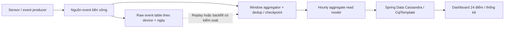
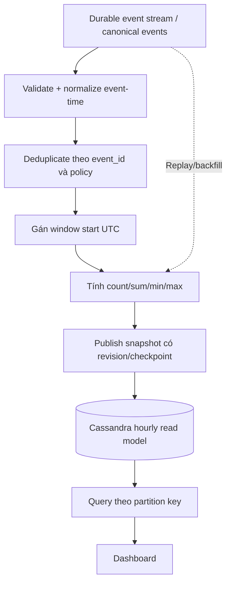

# Tổng hợp trước theo cửa sổ phục vụ truy vấn thống kê

Với **Spring Data Cassandra**, việc ghi từng sự kiện đo đạc rất tự nhiên: thiết bị gửi nhiệt độ, hệ thống nhận click hoặc dịch vụ phát sinh một log có thời điểm. Nhưng khi dashboard hỏi **“trung bình mỗi giờ trong bảy ngày”, “tổng giao dịch hôm qua”** hoặc **“số lần lỗi theo cửa sổ năm phút”**, đọc lại hàng triệu event rồi tính toán trên mỗi request thường không còn phù hợp.

**Tổng hợp trước theo cửa sổ** (*windowed pre-aggregation*) là cách biến dòng sự kiện chi tiết thành các bản ghi thống kê có phạm vi thời gian rõ ràng: một dòng cho mỗi giờ, mỗi năm phút hoặc mỗi ngày, tùy hợp đồng truy vấn. Trong Apache Cassandra, cách làm này đặc biệt hữu ích vì cơ sở dữ liệu được thiết kế **theo đường truy cập và partition key**: Cassandra không phải một kho OLAP có thể tùy ý `GROUP BY` trên toàn cluster với chi phí thấp.

Bài học thuộc chương **Dữ liệu thời gian** của module `SPRING_DATA_CASSANDRA`. Ta sẽ thiết kế bảng sự kiện gốc và bảng tổng hợp, phân biệt *event time* với *processing time*, chọn cửa sổ, xử lý sự kiện trễ và trùng, ghi snapshot thống kê an toàn, đọc qua `CqlTemplate`/Spring Data và đánh giá hiệu năng, tính nhất quán, paging cùng vòng đời dữ liệu.

## 1. Vì sao thống kê thời gian cần bảng đọc riêng?

Giả sử một tenant có hàng nghìn thiết bị. Mỗi thiết bị gửi một mẫu nhiệt độ mỗi giây. Một màn hình cần biểu đồ **24 điểm theo giờ** của một thiết bị trong ngày UTC, kèm số mẫu, tổng giá trị, nhỏ nhất, lớn nhất và trung bình.

Hai chiến lược:

| Chiến lược | Truy vấn đọc dữ liệu gì? | Chi phí chính |
| --- | --- | --- |
| **Tính lúc đọc** | Toàn bộ event thô trong 24 giờ, rồi `count/sum/min/max` ở service | Số hàng và bytes tỷ lệ với số event; CPU đọc/tổng hợp lặp lại |
| **Tổng hợp trước** | Tối đa 24 hàng hourly summary đã materialize | Phát sinh xử lý và ghi bổ sung trong pipeline; cần đối soát cập nhật |

Nếu thiết bị phát một mẫu/giây, một ngày có thể chứa **86.400 mẫu**, trong khi biểu đồ theo giờ chỉ cần **24 điểm**. Đây là ví dụ để hiểu số lượng hàng, **không phải benchmark tốc độ Cassandra**: hiệu năng còn phụ thuộc partition size, cấu trúc SSTable, replication, số thiết bị và tải đồng thời.

Tổng hợp trước **không tự giảm chi phí ingest**; dữ liệu vẫn phải được đọc/xử lý ít nhất một lần để tính số liệu. Lợi ích chính là chuyển phép tính lặp của mỗi người xem dashboard sang một **pipeline có thể điều độ**, phục vụ nhiều request từ cùng kết quả đã tính.



Một **read model tổng hợp** là dữ liệu phái sinh. Nên xác định rõ đâu là **nguồn sự thật** có thể tái dựng và đâu là bảng tối ưu cho truy vấn. Chỉ có counter hoặc bảng summary mà không còn event/nguồn chuẩn thì rất khó điều tra số liệu bị cộng trùng hoặc bỏ sót sau lỗi mạng.

## 2. Chọn đúng loại cửa sổ thời gian

Một *window* được định nghĩa bởi **ranh giới thời gian** và quy tắc gán event vào window.

| Kiểu cửa sổ | Ví dụ | Cách lưu/đọc |
| --- | --- | --- |
| **Tumbling** (không chồng lấn) | `[10:00,11:00)`, `[11:00,12:00)` | Mỗi event thuộc **đúng một cửa sổ giờ**, dễ cộng dồn và rollup |
| **Hopping** (bước nhảy nhỏ hơn độ dài) | Cửa sổ 60 phút, cập nhật mỗi 15 phút | Một event có thể thuộc nhiều cửa sổ; cần tính chi phí nhân bản |
| **Sliding** (trượt theo thời điểm truy vấn) | “60 phút gần nhất” tại 10:37 | Có thể đọc các bucket phút và cộng lại; cần xử lý phần cửa sổ biên |
| **Session** | Gom event tới khi im lặng 30 phút | Ranh giới phụ thuộc dòng dữ liệu, khó hơn khi event đến trễ |

Bài này lấy **tumbling hourly windows theo UTC** làm thiết kế chính. Mỗi window dùng khoảng **nửa mở** `[start, end)`: mốc bắt đầu được tính, mốc kết thúc thuộc window kế tiếp. Nhờ vậy một event đúng `11:00:00Z` không bị đếm vào cả giờ 10 lẫn giờ 11.

Một truy vấn cần “60 phút gần nhất” tại `10:37` **không tương đương** đọc nguyên hai hourly buckets `09:00` và `10:00`; kết quả đó bao gồm dữ liệu ngoài khoảng `[09:37,10:37)`. Nếu yêu cầu chính xác đến phút, nên lưu bucket phút, đọc event ở rìa hoặc dùng pipeline sliding window được thiết kế riêng.

### Cách chọn độ rộng window

- **Độ phân giải UI:** biểu đồ 24 điểm/ngày → bucket giờ là ứng viên rõ ràng.
- **Độ trễ cập nhật:** cảnh báo lỗi trong năm phút cần bucket nhỏ hoặc pipeline streaming riêng.
- **Tần suất và hot key:** quá nhiều mutation tới một window duy nhất có thể tạo contention.
- **Số hàng trả về:** một năm theo bucket phút ≈ 525.600 hàng cho mỗi chuỗi; không nên mặc định một API đọc hết.
- **Độ trễ event:** event đến sau nhiều giờ có thể yêu cầu sửa window cũ, kéo theo rollup ngày/tháng.
- **Retention:** độ phân giải cao giữ ít ngày, độ phân giải thấp có thể giữ lâu hơn.

Không có bucket tối ưu cho mọi use case. Bắt đầu bằng **hợp đồng truy vấn và SLA**, rồi chọn loại và kích thước window phù hợp.

## 3. Event time khác processing time

Giả sử thiết bị đo lúc **10:59:58Z** nhưng mất mạng, đến **11:03:20Z** mới gửi. Event nên thuộc cửa sổ nào?

- Theo **event time**: cửa sổ `[10:00,11:00)`.
- Theo **processing time**: cửa sổ `[11:00,12:00)`.

Với một biểu đồ phản ánh **thời điểm đo thực**, thông thường cần dùng *event time*. Với báo cáo “số yêu cầu server xử lý ở mỗi giờ”, *processing time* có thể phù hợp. Phải viết rõ nguồn thời gian trong định nghĩa metric.

```text
10:00                    11:00                    12:00 UTC
|-------------------------|-------------------------|
           ^ event thực tế 10:59:58
                                 ^ xử lý tại 11:03:20

Window theo event time: [10:00, 11:00)
Window theo processing time: [11:00, 12:00)
```

### Chuẩn hóa bằng UTC, không dùng timezone mặc định

Trong Java, một phép gán giờ đơn giản là:

```java
import java.time.Instant;
import java.time.LocalDate;
import java.time.ZoneOffset;
import java.time.temporal.ChronoUnit;

Instant occurredAt = event.occurredAt(); // nguồn thời gian đã xác thực
Instant hourStart = occurredAt.truncatedTo(ChronoUnit.HOURS);
LocalDate bucketDay = hourStart.atZone(ZoneOffset.UTC).toLocalDate();
```

Mọi producer/worker/reader phải thống nhất:

1. **Time zone của bucket**, ví dụ UTC thay vì `ZoneId.systemDefault()`.
2. **Độ chính xác** của thời điểm: CQL `timestamp` lưu mốc ở độ chính xác millisecond; nếu event chứa nanosecond, cần chính sách làm tròn/cắt nhất quán.
3. **Ranh giới `[start,end)`** và cách xử lý event đúng nửa đêm.
4. **Sự kiện thiếu timestamp hoặc clock của thiết bị lệch:** reject, dùng server time hay gắn cờ chất lượng, không im lặng thay đổi định nghĩa thống kê.

Nếu báo cáo có nghĩa “ngày địa phương của khách hàng” (ví dụ ngày tại `Asia/Ho_Chi_Minh`), đó là một hợp đồng khác. Không đổi UTC sang ngày local ngay trong đường ingest một cách tùy tiện; phải xét timezone, DST của những khu vực áp dụng và nhu cầu tái tính khi timezone cấu hình thay đổi.

## 4. Bảng lưu sự kiện gốc để truy xuất và tái dựng

Một bảng raw event theo tenant, thiết bị và ngày UTC:

```sql
CREATE TABLE sensor_event_by_device_day (
    tenant_id     text,
    device_id     text,
    event_day     date,
    occurred_at   timestamp,
    event_id      uuid,
    metric_name   text,
    sample_value  decimal,
    PRIMARY KEY ((tenant_id, device_id, event_day),
                 occurred_at, event_id)
) WITH CLUSTERING ORDER BY (occurred_at DESC, event_id DESC);
```

Ví dụ đọc dữ liệu chi tiết để kiểm chứng một cửa sổ:

```sql
SELECT occurred_at, event_id, metric_name, sample_value
FROM sensor_event_by_device_day
WHERE tenant_id = ?
  AND device_id = ?
  AND event_day = ?
  AND occurred_at >= ?
  AND occurred_at < ?;
```

Truy vấn chỉ chọn một partition ngày của một thiết bị, rồi giới hạn bằng clustering key `occurred_at`. Nó **không tự lọc hiệu quả theo `metric_name`** vì đây là cột thường. Nếu một thiết bị phát nhiều metric và việc đọc từng metric riêng là đường nóng, cân nhắc đưa `metric_name` vào partition key của một bảng raw khác hoặc read model phù hợp.

**Cần lưu ý trùng lặp:** `event_id` là thành phần clustering key nhưng primary key ở ví dụ còn gồm `occurred_at`. Hai lần gửi cùng event ID với **hai timestamp khác nhau** có thể tạo hai hàng. Nếu yêu cầu deduplicate toàn hệ, cần canonical event ID và cơ chế dedup/nguồn log đáng tin; một `INSERT` vào raw table này không tự bảo đảm event uniqueness trên mọi partition.

Trong hệ có lưu lượng lớn, bucket ngày có thể tạo **partition quá rộng**. Khi đó phải đo kích thước partition, event/s và retention, rồi cân nhắc bucket theo giờ hoặc thêm shard có kiểm soát. Không chọn bucket chỉ dựa trên tên `time-series`.

## 5. Bảng tổng hợp theo giờ: read model chính

Giả sử dashboard truy vấn **một metric của một thiết bị trong một ngày**. Thiết kế summary theo đúng đường đọc đó:

```sql
CREATE TABLE metric_hourly_by_device_day (
    tenant_id         text,
    device_id         text,
    metric_name       text,
    bucket_day        date,
    hour_start        timestamp,
    event_count       bigint,
    sum_value         decimal,
    min_value         decimal,
    max_value         decimal,
    source_checkpoint text,
    revision          bigint,
    PRIMARY KEY ((tenant_id, device_id, metric_name, bucket_day),
                 hour_start)
) WITH CLUSTERING ORDER BY (hour_start ASC);
```

Giải thích các cột:

| Trường | Vai trò |
| --- | --- |
| `tenant_id, device_id, metric_name, bucket_day` | **Partition key ghép** định tuyến một chuỗi thống kê theo thiết bị/metric/ngày |
| `hour_start` | **Clustering key**, mốc bắt đầu mỗi cửa sổ giờ UTC |
| `event_count` | Số event hợp lệ, duy nhất theo định nghĩa metric |
| `sum_value` | Tổng các mẫu số học trong window |
| `min_value, max_value` | Cực trị trong window, không nhất thiết có khi window rỗng |
| `source_checkpoint` | Mốc/nguồn dữ liệu mà projector đã tính, có phạm vi xác định |
| `revision` | Phiên bản snapshot phục vụ kiểm soát ghi cạnh tranh |

Với thiết kế này, một ngày có **tối đa 24 hàng hourly** cho một tổ hợp tenant/device/metric, thay vì phải đọc mọi event gốc khi mở biểu đồ. Cột thống kê dùng `bigint`/`decimal` **thông thường**, **không phải kiểu CQL `counter`**. Vì thế projector có thể xuất bản **kết quả tuyệt đối** cho một window khi tái tính từ nguồn tin cậy.

Ví dụ một hàng kết quả:

```text
tenant_id = tenant-a
device_id = sensor-7
metric_name = temperature
bucket_day = 2026-11-25
hour_start = 2026-11-25T10:00:00Z
event_count = 60
sum_value = 1500.0
min_value = 21.5
max_value = 28.1
source_checkpoint = stream-3/offset-98765
revision = 4
```

Giá trị trung bình của giờ này là `1500.0 / 60 = 25.0`. `source_checkpoint` chỉ là **ví dụ nhãn checkpoint**; thứ tự/khả năng so sánh giữa offsets thuộc những partition stream khác nhau phải do pipeline quy định, không dùng so sánh chuỗi ngẫu nhiên để quyết định dữ liệu nào mới hơn.

### CQL đọc theo cửa sổ trong một partition

```sql
SELECT hour_start, event_count, sum_value,
       min_value, max_value, source_checkpoint, revision
FROM metric_hourly_by_device_day
WHERE tenant_id = ?
  AND device_id = ?
  AND metric_name = ?
  AND bucket_day = ?
  AND hour_start >= ?
  AND hour_start < ?
LIMIT 24;
```

Đây là query hợp với schema: **đủ toàn bộ partition key**, điều kiện range hợp lệ trên clustering key. `LIMIT 24` chỉ giới hạn số hàng trả về; không tự biến một truy vấn thiếu partition key thành hiệu quả. Nếu cần 48 giờ băng qua hai ngày UTC, service phải đọc các partition ngày liên quan và ghép kết quả theo thời gian.

## 6. Lưu những thống kê nào để rollup không sai?

Với window `w`, đặt tập event hợp lệ, duy nhất là `E_w`. Các đại lượng cơ bản:

\[
N_w = |E_w|, \qquad
S_w = \sum_{e\in E_w} x_e, \qquad
\bar{x}_w = \frac{S_w}{N_w}\quad(N_w>0)
\]

Ví dụ có hai giờ:

| Giờ | Số mẫu `N` | Tổng `S` | Trung bình |
| --- | ---: | ---: | ---: |
| 10:00–11:00 | 60 | 1.500 | 25 |
| 11:00–12:00 | 30 | 900 | 30 |

Trung bình đúng của cả hai giờ:

\[
\bar{x}_{2h}=\frac{1500+900}{60+30}
=\frac{2400}{90}\approx26{,}67
\]

**Không lấy `(25+30)/2 = 27,5`** nếu hai giờ có số mẫu khác nhau. Khi rollup từ giờ sang ngày, phải **cộng tổng và số mẫu rồi mới chia**, không lấy trung bình cộng đơn giản của các trung bình con.

Các phép tổng hợp có thể gộp theo nhóm:

| Thống kê lớn hơn | Cách gộp từ window nhỏ |
| --- | --- |
| Count | Cộng `event_count` |
| Sum | Cộng `sum_value` |
| Average | `SUM(sum_value) / SUM(event_count)` |
| Minimum | Lấy `MIN(min_value)` của các window có dữ liệu |
| Maximum | Lấy `MAX(max_value)` của các window có dữ liệu |
| Distinct users | **Không** cộng `distinct_count` nếu cùng user xuất hiện ở nhiều window |
| Median/p95/p99 | **Không** lấy trung bình các median/p95 để có percentile chính xác |

Các thống kê như *distinct*, percentile hoặc histogram cần **cấu trúc phái sinh có tính merge phù hợp** (ví dụ sketch/histogram có định nghĩa độ chính xác) hoặc phải tính lại từ raw events. Không hứa kết quả chính xác tuyệt đối chỉ vì mỗi window đã lưu một số `p95`.

### Sự kiện bị sửa/xóa làm cực trị khó hơn

Nếu chỉ append event mới, `min/max` có thể cập nhật từ các mẫu mới. Nhưng nếu event từng giữ giá trị nhỏ nhất bị **thu hồi hoặc sửa**, không thể suy ra `min` mới chỉ bằng cách trừ một delta khỏi số cũ. Cần tái tính cửa sổ từ nguồn hợp lệ hoặc duy trì cấu trúc dữ liệu phức tạp hơn. Đây là lý do nên có **khả năng rebuild summary**.

## 7. Pipeline tổng hợp trước có checkpoint và ranh giới rõ

Một pipeline đáng tin cậy không chỉ lấy event rồi `UPDATE count = count + 1`. Nó cần xác định **sự kiện đã xử lý, trạng thái window và mốc đã công bố**:



Một cách triển khai có thể dùng stream processor giữ state theo key/window, batch job cho window đã đóng hoặc một worker micro-batch tái tính các cửa sổ bị tác động. Công cụ cụ thể không quan trọng bằng các bất biến:

1. Event ID/khóa event phải **ổn định giữa retry**.
2. Mỗi event hợp lệ được đưa vào **đúng window theo chính sách**.
3. Window có **revision/checkpoint** để nhận diện kết quả đã phát hành.
4. Khi xử lý lặp, hệ phải có cách **tái công bố cùng kết quả** hoặc đối soát mà không cộng trùng.
5. Một window được sửa vì event đến trễ phải cập nhật các **rollup cấp cao** chịu ảnh hưởng.
6. Việc xử lý lỗi/timeout không được âm thầm bỏ event hoặc giả định Cassandra đã ghi thành công.

**Đừng đồng nhất ACK của Cassandra với ACK của message broker.** Một pipeline có thể chết sau khi ghi summary nhưng trước khi checkpoint nguồn event; nếu phát lại một delta không idempotent, summary bị cộng hai lần. Ngược lại, checkpoint quá sớm có thể làm mất số liệu phái sinh.

## 8. Tái tính và ghi snapshot tuyệt đối thay vì cộng delta mù

Giả sử window 10:00–11:00 được tính từ tập event hợp lệ có ID duy nhất:

```text
Batch lần 1: N=100, S=2520, revision=1, checkpoint=C1
Batch lần 2: có event đến trễ → N=101, S=2549, revision=2, checkpoint=C2
```

Nếu projector ghi **giá trị tuyệt đối** `N=101,S=2549` của cùng một window vào bảng scalar thường, việc tái chạy tính toán từ cùng nguồn có thể tạo lại **cùng kết quả nghiệp vụ**. Nhưng vẫn phải bảo vệ trước **projector cũ ghi đè snapshot mới**, vì Cassandra hòa giải scalar cells theo write timestamp; không nên suy từ “batch này có checkpoint cao hơn” rằng tất cả mutation tự có thứ tự đúng.

### Tạo window lần đầu bằng conditional insert

```sql
INSERT INTO metric_hourly_by_device_day
    (tenant_id, device_id, metric_name, bucket_day, hour_start,
     event_count, sum_value, min_value, max_value,
     source_checkpoint, revision)
VALUES (?, ?, ?, ?, ?, ?, ?, ?, ?, ?, ?)
IF NOT EXISTS;
```

### Sửa window với version/optimistic locking

```sql
UPDATE metric_hourly_by_device_day
SET event_count = ?,
    sum_value = ?,
    min_value = ?,
    max_value = ?,
    source_checkpoint = ?,
    revision = ?
WHERE tenant_id = ?
  AND device_id = ?
  AND metric_name = ?
  AND bucket_day = ?
  AND hour_start = ?
IF revision = ?;
```

Giả sử `revision` đang là 1, projector muốn công bố phiên bản 2. Nó gửi các giá trị tuyệt đối cùng `IF revision = 1`, và **phải kiểm tra `[applied]`** của LWT:

- `true`: snapshot phiên bản mới được áp dụng theo điều kiện.
- `false`: đã có một thay đổi cạnh tranh; đọc lại revision/checkpoint và quyết định retry hay bỏ kết quả cũ.
- Timeout: kết quả chưa xác định; đọc và đối soát, không giả định cập nhật đã thất bại.

Đây là **mẫu conditional publish**, không phải transaction gồm nhiều window/bảng. `revision` phải được duy trì **đơn điệu theo từng key**, không đơn giản lấy `now()` của các host khác nhau. Checkpoint phải gắn với **phạm vi nguồn tương ứng**; offset của các partition stream độc lập không thể tự so sánh như một số phiên bản toàn hệ.

Nếu tải cập nhật window rất lớn, **LWT trên mọi sự kiện** sẽ tạo contention/latency không cần thiết. Có thể gộp thay đổi trong một worker trước, giảm tần suất xuất bản snapshot và dùng một writer logic trên mỗi key/window; vẫn cần chiến lược recovery khi writer chuyển chủ.

## 9. Dùng Cassandra counter khi thống kê gần đúng được chấp nhận

Một phương án nhẹ hơn là cộng delta trực tiếp vào counter table:

```sql
CREATE TABLE metric_hour_counter_by_device_day (
    tenant_id    text,
    device_id    text,
    metric_name  text,
    bucket_day   date,
    hour_start   timestamp,
    event_count  counter,
    sum_scaled   counter,
    PRIMARY KEY ((tenant_id, device_id, metric_name, bucket_day),
                 hour_start)
);
```

Trong đó `sum_scaled` có thể là số nguyên đã nhân hệ số, ví dụ lưu độ C `25,34` thành `2534` theo scale 100 **nếu miền giá trị và giới hạn overflow đã được thiết kế**. Counter không có kiểu `decimal counter`; mọi non-key column trong counter table phải là counter.

```sql
UPDATE metric_hour_counter_by_device_day
SET event_count = event_count + 1,
    sum_scaled = sum_scaled + ?
WHERE tenant_id = ?
  AND device_id = ?
  AND metric_name = ?
  AND bucket_day = ?
  AND hour_start = ?;
```

**Đánh đổi cốt lõi:** counter mutation **không idempotent**. Một request cộng delta đã được áp dụng nhưng bị mất ACK rồi bị retry có thể tính cùng event hai lần. Một lần `INSERT event IF NOT EXISTS` trong bảng khác rồi `UPDATE counter` vẫn **không tạo transaction atomic hai bảng**; crash giữa hai bước có thể để lại event đã ghi nhưng count chưa cập nhật.

| Đặc điểm | Snapshot scalar có version | Counter delta |
| --- | --- | --- |
| Ghi gì? | Tổng/count tuyệt đối của một window | Thay đổi `+delta` |
| Replay cùng tập event | Có thể rebuild và xuất bản lại có kiểm soát | Dễ tăng trùng nếu replay mutation |
| `min/max` | Lưu được như scalar thường | Không tính trực tiếp bằng phép cộng counter |
| TTL của giá trị tổng hợp | Có thể cấu hình theo chính sách, cần kiểm chứng cập nhật | Counter **không hỗ trợ TTL** |
| LWT/CAS trên số đã tính | Dùng được trên bảng thường | Không dùng `IF` trực tiếp cho counter update |
| Tải ghi | Tùy batch/window revisions; CAS có chi phí | Nhiều increment có thể tạo hot key |

Nên dùng **snapshot có thể tái dựng** nếu yêu cầu chính xác cao, late events/corrections thường xuyên hoặc cần version. Counter có thể phù hợp cho metric cộng dồn chấp nhận sai số được quy định rõ, nhưng **không phải nguồn sự thật thanh toán/tồn kho/quota**.

## 10. Đọc hourly summary bằng `CqlTemplate`

`CqlTemplate` cho phép chọn chính xác các cột summary và map trực tiếp sang DTO mà không cần lấy toàn bộ entity. Ví dụ Java Driver 4 và Spring Data Cassandra:

```java
import java.math.BigDecimal;
import java.time.Instant;
import java.time.LocalDate;
import java.time.ZoneOffset;
import java.util.List;

import com.datastax.oss.driver.api.core.cql.SimpleStatement;
import org.springframework.data.cassandra.core.cql.CqlTemplate;

public record HourlyMetric(
        Instant hourStart,
        long eventCount,
        BigDecimal sumValue,
        BigDecimal minValue,
        BigDecimal maxValue,
        String checkpoint,
        long revision) {}

public final class HourlyMetricReader {
    private final CqlTemplate cql;

    public HourlyMetricReader(CqlTemplate cql) {
        this.cql = cql;
    }

    public List<HourlyMetric> readOneDay(
            String tenantId, String deviceId, String metricName,
            LocalDate day, Instant fromInclusive, Instant toExclusive) {

        if (tenantId == null || tenantId.isBlank()
                || deviceId == null || deviceId.isBlank()
                || metricName == null || metricName.isBlank()
                || day == null || fromInclusive == null
                || toExclusive == null
                || !fromInclusive.isBefore(toExclusive)) {
            throw new IllegalArgumentException("Thông số đọc không hợp lệ");
        }

        Instant dayStart = day.atStartOfDay(ZoneOffset.UTC).toInstant();
        Instant nextDayStart = day.plusDays(1)
                .atStartOfDay(ZoneOffset.UTC).toInstant();
        if (fromInclusive.isBefore(dayStart)
                || toExclusive.isAfter(nextDayStart)) {
            throw new IllegalArgumentException("Range phải thuộc một ngày UTC");
        }

        SimpleStatement stmt = SimpleStatement.builder(
                "SELECT hour_start, event_count, sum_value, " +
                "min_value, max_value, source_checkpoint, revision " +
                "FROM metric_hourly_by_device_day " +
                "WHERE tenant_id = ? AND device_id = ? " +
                "AND metric_name = ? AND bucket_day = ? " +
                "AND hour_start >= ? AND hour_start < ? LIMIT 24")
                .addPositionalValues(tenantId, deviceId, metricName,
                        day, fromInclusive, toExclusive)
                .setPageSize(24)
                .build();

        return cql.query(stmt, (row, rowNum) ->
                new HourlyMetric(
                        row.getInstant("hour_start"),
                        row.getLong("event_count"),
                        row.getBigDecimal("sum_value"),
                        row.getBigDecimal("min_value"),
                        row.getBigDecimal("max_value"),
                        row.getString("source_checkpoint"),
                        row.getLong("revision")));
    }
}
```

Đây là ví dụ method hoàn chỉnh ở tầng đọc (giả sử `CqlTemplate` được Spring quản lý, keyspace/session chọn đúng và schema đã tồn tại). `tenantId` phải được xác thực theo quyền người dùng; không tin một giá trị tenant tự do từ client. `LIMIT 24` là giới hạn 24 window/hour trong ngày, còn `setPageSize(24)` chỉ là **fetch page size của driver**, không tạo cơ chế offset cho API.

Truy vấn băng qua ngày cần **chia thành các query theo `bucket_day`** rồi merge phía service. Không dùng `ALLOW FILTERING` để tránh điều kiện partition key.

### Tính tổng và trung bình từ nhiều window

```java
import java.math.BigDecimal;
import java.math.RoundingMode;
import java.util.List;
import java.util.Optional;

public record WindowSummary(
        long count, BigDecimal total, BigDecimal average) {}

public static Optional<WindowSummary> summarize(
        List<HourlyMetric> rows) {
    long count = 0;
    BigDecimal total = BigDecimal.ZERO;
    for (HourlyMetric row : rows) {
        count = Math.addExact(count, row.eventCount());
        total = total.add(row.sumValue());
    }
    if (count == 0) {
        return Optional.empty();
    }
    BigDecimal average = total.divide(
            BigDecimal.valueOf(count), 3, RoundingMode.HALF_UP);
    return Optional.of(new WindowSummary(count, total, average));
}
```

Khi `count=0`, không nên trả `average=0` như thể đã quan sát mẫu bằng 0; hãy biểu diễn **không có dữ liệu**. Ví dụ giả định `sum_value` khác null với các window đã được ghi; pipeline phải xác minh invariant này và test dữ liệu legacy/migration.

## 11. Khi nào dùng repository và `CassandraTemplate`?

Với Spring Data Cassandra, có thể ánh xạ bảng summary bằng `@PrimaryKeyClass` và `@Table` khi ứng dụng muốn tái sử dụng mapping/converter.

```java
import java.io.Serializable;
import java.time.Instant;
import java.time.LocalDate;
import org.springframework.data.cassandra.core.cql.Ordering;
import org.springframework.data.cassandra.core.mapping.PrimaryKeyClass;
import org.springframework.data.cassandra.core.mapping.PrimaryKeyColumn;
import org.springframework.data.cassandra.core.mapping.PrimaryKeyType;

@PrimaryKeyClass
public class HourlyKey implements Serializable {
    @PrimaryKeyColumn(name = "tenant_id", ordinal = 0,
            type = PrimaryKeyType.PARTITIONED)
    private String tenantId;

    @PrimaryKeyColumn(name = "device_id", ordinal = 1,
            type = PrimaryKeyType.PARTITIONED)
    private String deviceId;

    @PrimaryKeyColumn(name = "metric_name", ordinal = 2,
            type = PrimaryKeyType.PARTITIONED)
    private String metricName;

    @PrimaryKeyColumn(name = "bucket_day", ordinal = 3,
            type = PrimaryKeyType.PARTITIONED)
    private LocalDate bucketDay;

    @PrimaryKeyColumn(name = "hour_start", ordinal = 4,
            type = PrimaryKeyType.CLUSTERED,
            ordering = Ordering.ASCENDING)
    private Instant hourStart;

    public HourlyKey() {}
    // Bổ sung constructor, getters/setters, equals() và hashCode().
}
```

```java
import java.math.BigDecimal;
import org.springframework.data.cassandra.core.mapping.Column;
import org.springframework.data.cassandra.core.mapping.PrimaryKey;
import org.springframework.data.cassandra.core.mapping.Table;

@Table("metric_hourly_by_device_day")
public class HourlyMetricEntity {
    @PrimaryKey
    private HourlyKey key;

    @Column("event_count")
    private Long eventCount;

    @Column("sum_value")
    private BigDecimal sumValue;

    @Column("min_value")
    private BigDecimal minValue;

    @Column("max_value")
    private BigDecimal maxValue;

    @Column("source_checkpoint")
    private String sourceCheckpoint;

    @Column("revision")
    private Long revision;

    public HourlyMetricEntity() {}
    // Bổ sung constructor và getters/setters theo mapping thực tế.
}
```

Các đoạn trên là **khung mapping**, chưa phải source Java hoàn chỉnh. Repository có thể cung cấp các query method cho summary, nhưng `repository.save(entity)` **không tự kiểm tra version/checkpoint**. Nếu nhiều projector có thể ghi cùng window, hãy dùng conditional CQL/LWT cụ thể hoặc cơ chế optimistic locking được cấu hình và kiểm chứng trên phiên bản Spring Data Cassandra dự án.

Một `Long revision` bình thường chỉ là cột dữ liệu; tên `revision` không làm Spring Data tự tăng hay kiểm tra CAS. Tương tự, `CassandraTemplate` có thể giúp chọn entity bằng khóa, nhưng **không giải quyết tính idempotent của toàn pipeline sự kiện**.

## 12. Sự kiện đến trễ, đến sai thứ tự và watermark

Một event có thể được phát lúc 10:50, đến hệ thống 11:15 hoặc thậm chí ngày hôm sau. Nếu projector đóng window ngay tại 11:00 theo đồng hồ xử lý, những event đến muộn có thể bị bỏ sót.

**Watermark** là khái niệm trong xử lý stream để thể hiện một ước lượng về **tiến độ event time** của dữ liệu đã nhận. Chẳng hạn chọn allowed lateness 10 phút: có thể công bố kết quả tạm thời của window 10:00–11:00 rồi chờ đến khi watermark vượt một ngưỡng thích hợp mới coi cửa sổ đủ ổn định theo chính sách.

```text
Window event-time:        [10:00, 11:00)
Event nhận sớm:           10:05, 10:30, 10:59
Event nhận tại 11:04:     occurred_at = 10:58  (đến trễ)
Event nhận tại 11:45:     occurred_at = 10:42  (rất trễ)

Chính sách:
- Trước đóng window: cập nhật bản provisional.
- Trễ trong mức cho phép: tính lại và tăng revision.
- Rất trễ: backfill/correction riêng hoặc reject có audit.
```

Watermark **không phải tính năng tự động của bảng Cassandra**. Nó thuộc pipeline xử lý event và cần được định nghĩa theo phân vùng nguồn, idle partition, khả năng reorder và chính sách nghiệp vụ. Với nhiều producer, một clock nhanh không có nghĩa mọi event ở các producer khác đều đã đến.

### Công bố trạng thái provisional và final

Service có thể công khai metadata “đang cập nhật”/“đã chốt” bên ngoài bảng summary, hoặc thêm trạng thái thuộc kế hoạch schema nếu contract UI cần. Đừng tự mặc định rằng hàng `hour_start=10:00` đã là **final** chỉ vì đồng hồ hiện tại qua 11:00.

Khi một correction xuất hiện sau khi đã rollup ngày, cần:

1. Tái tính hourly snapshot chịu ảnh hưởng từ nguồn event.
2. Tái tính daily summary dựa trên các hourly snapshots đúng revision hoặc trực tiếp từ nguồn chuẩn.
3. Công bố phiên bản mới theo thứ tự an toàn, tránh dashboard trộn hourly mới với daily cũ mà không có nhãn độ mới.
4. Có log/checkpoint để xác định công việc correction đã hoàn tất hay chưa.

Nếu không hỗ trợ sửa sau hạn, phải diễn đạt rõ rằng đó là **cửa sổ được chốt theo chính sách với khả năng thiếu event trễ**, không gọi là thống kê tuyệt đối đúng trong mọi tình huống.

## 13. Rollup nhiều cấp: giờ → ngày → tháng

Một trang lịch sử hai năm không nên đọc `24 × 365 × 2` hàng hourly mỗi lần chỉ để hiển thị hai điểm theo năm. Có thể tạo thêm các **read models tổng hợp theo cấp**:

| Độ phân giải | Ví dụ khóa truy cập | Phục vụ | Retention minh họa |
| --- | --- | --- | --- |
| Raw events | Tenant + device + ngày + thời điểm | Điều tra sự kiện, đối soát | 7–30 ngày nếu nguồn chuẩn khác vẫn tồn tại |
| Hourly | Tenant + device + metric + ngày | Biểu đồ 24 điểm/ngày, 7 ngày | 90 ngày |
| Daily | Tenant + device + metric + tháng | Biểu đồ 30 điểm/tháng | 2 năm |
| Monthly | Tenant + device + metric + năm | Báo cáo dài hạn | Theo yêu cầu nghiệp vụ |

Những con số retention là **ví dụ**, không phải quy định chung. Nếu event raw được xóa sau 7 ngày nhưng sự kiện trễ có thể đến sau 30 ngày, hệ thống cần nguồn bền vững khác hoặc quy tắc correction; nếu không, không còn khả năng tái dựng đầy đủ.

Khi rollup theo ngày, chỉ cộng **24 cửa sổ hourly không chồng lấn** của cùng ngày UTC, với chính sách về những window thiếu/đang mở. Khi rollup theo tháng, không lấy trung bình các daily average; dùng **tổng sum/count** và kiểm tra window nào còn provisional.

### Không trộn full bucket với partial bucket

Giả sử dashboard hỏi `[10:20,12:15)`, nhưng chỉ có hourly summary `[10:00,11:00)`, `[11:00,12:00)`, `[12:00,13:00)`. Việc cộng toàn bộ ba hàng sẽ tính thêm dữ liệu **ngoài khoảng yêu cầu**.

Có ba lựa chọn rõ ràng:

- Đổi contract API thành **chỉ nhận ranh giới giờ** và trả đúng full windows.
- Lưu độ phân giải nhỏ hơn (ví dụ 5 phút) và chỉ cộng các bucket phù hợp, vẫn cần xử lý phần biên.
- Dùng các hourly window đầy đủ ở giữa và truy vấn raw events để tính **hai đoạn rìa** nếu chi phí chấp nhận được.

Không âm thầm trả một phép tổng hợp gần đúng rồi gắn nhãn “tổng chính xác” nếu API yêu cầu đúng đến từng phút.

## 14. Partition key, số partition và rủi ro hot key

Thiết kế `metric_hourly_by_device_day` hữu ích cho **một tenant + một device + một metric + một ngày**. Nó không tự phục vụ rẻ truy vấn **“tổng tất cả thiết bị trong tenant này”**: muốn tính bằng cách quét tất cả device partitions có thể tạo fan-out lớn.

Nếu dashboard tenant-level là đường nóng, tạo **read model riêng** theo tenant/metric/ngày hoặc tenant/nhóm thiết bị/bucket với quy tắc tổng hợp tương ứng. Đây là **nhân bản dữ liệu có chủ đích**, không phải một truy vấn `GROUP BY` tùy ý.

Một tenant có hàng triệu thiết bị hoặc hàng chục nghìn event/giây có thể tạo **hot bucket** nếu tất cả update liên tục dồn vào một partition/row summary. Các cách giảm áp lực:

1. **Micro-batch** nhiều event cùng window rồi xuất bản snapshot theo chu kỳ có giới hạn.
2. **Sharding có kiểm soát** cho bước tích lũy nếu throughput yêu cầu, sau đó merge các shard trước khi publish read model cuối.
3. Phân tách **per-device/per-tenant** và tránh một khóa global nhận mọi mutation.
4. Giới hạn số cửa sổ được mở/cập nhật đồng thời cho mỗi tenant/worker.
5. Đo `p95/p99`, số mutation/key, partition size, read bytes và tốc độ compaction trước khi thêm shard.

Sharding làm giảm contention trên một khóa nhưng tăng **fan-out đọc, logic merge và độ phức tạp recovery**. Cùng một event phải luôn định tuyến tới shard theo quy tắc có thể tái lập khi replay, hoặc có hệ thống dedup/checkpoint để không đếm trùng.

## 15. TTL, compaction và vòng đời của dữ liệu tổng hợp

Dữ liệu thời gian thường được giữ theo cấp độ: raw chi tiết giữ ngắn, hourly/daily rollups giữ dài. Cassandra hỗ trợ TTL trên scalar cells, nhưng **hết TTL không có nghĩa file trên đĩa biến mất tức thì**. Dữ liệu hết hạn cần đi qua cơ chế tombstone/compaction.

### Những điều cần thiết kế

- **Retention theo bucket:** event/day nào cần giữ, thời điểm nào có thể xóa và quyền tái dựng từ nguồn chuẩn.
- **TTL khi upsert:** nếu sửa summary liên tục, thời điểm hết hạn của từng cell có thể thay đổi theo write/TTL policy. Cần tránh một row chỉ còn vài cột hoặc dữ liệu bị hết hạn không đồng bộ.
- **Late updates:** window đã cũ nhưng được cập nhật muộn phải phù hợp chính sách retention; đừng làm sống lại dữ liệu đáng lẽ đã hết hạn mà không có chủ đích.
- **Tombstone và repair:** lượng lớn TTL/delete tăng công việc đọc/compaction; `gc_grace_seconds` và lịch repair cần được thiết kế theo topology, không hạ về 0 để “dọn nhanh” một cách thiếu đánh giá.
- **Compaction strategy:** TWCS có thể hữu ích với workload ghi theo thời gian, gần append-only và TTL tương đối đồng nhất; bảng summary **cập nhật lặp lại cửa sổ cũ** có pattern khác, nên phải thử và chọn compaction strategy theo workload thật.

Một đặc điểm quan trọng: **counter table không hỗ trợ TTL thông thường**. Nếu chọn counter cho dữ liệu tổng hợp và cần retention tự động theo ngày, phải dùng bucket/cleanup có kế hoạch thay vì giả định `USING TTL` hoạt động.

## 16. Consistency, paging và tính đúng đắn của thống kê

Các read/write CL như `LOCAL_ONE` và `LOCAL_QUORUM` ảnh hưởng số replica cần đáp ứng, latency và khả năng quan sát dữ liệu mới. Nhưng **tăng CL không sửa được** việc một event bị cộng hai lần, một projector ghi snapshot cũ hoặc định nghĩa window UTC sai.

Đối với dashboard:

- **Đọc 24 hàng của một ngày** thường không cần cursor nhiều trang, nhưng vẫn phải giới hạn query và kiểm tra partition.
- **Đọc 90 ngày** đòi hỏi nhiều partition ngày, có ngân sách fan-out và cách ghép kết quả; `LIMIT 24` trên từng partition không giới hạn tổng số request.
- **Paging state** của driver không phải snapshot giao dịch xuyên nhiều partition/window.
- **Ghi revision bằng LWT** trên từng window không tạo transaction nguyên tử cho toàn bộ ngày, toàn bộ metric hay bảng hourly + daily.
- **Nhiều datacenter:** write thành công với `LOCAL_QUORUM` ở DC A không tự bảo đảm dashboard đọc `LOCAL_QUORUM` ở DC B thấy revision mới ngay lập tức.
- **Bảo mật:** tenant từ ngữ cảnh xác thực phải ràng buộc truy vấn; không dùng dữ liệu của tenant khác để “làm đầy” khoảng thời gian thiếu.

Khi cần thống kê được kiểm toán, nên trả kèm **checkpoint/revision hoặc thời điểm dữ liệu tính đến**, chính sách provisional/final và phiên bản định nghĩa metric, thay vì chỉ trả một con số không có ngữ cảnh độ mới.

## 17. Ma trận kiểm thử cho windowed pre-aggregation

| Mã | Kịch bản | Điều cần xác minh |
| --- | --- | --- |
| W01 | Event lúc `10:00:00Z` | Vào window `[10:00,11:00)` |
| W02 | Event lúc `11:00:00Z` | Chỉ vào window `[11:00,12:00)` |
| W03 | Event `10:59:58Z` xử lý lúc 11:03 | Vẫn gán vào giờ 10 theo event time |
| W04 | Cùng `event_id` replay hai lần | Snapshot tính từ nguồn dedup **không tăng count hai lần** |
| W05 | Projector chết sau publish nhưng trước checkpoint | Replay/rebuild không cộng delta trùng |
| W06 | Hai projector cùng xuất bản một window | Revision/CAS ngăn bản cũ ghi đè mới theo quy tắc đã định |
| W07 | Event trễ sửa giá trị min/max | Window được tái tính từ nguồn đúng, không suy ra min mới bằng phép trừ |
| W08 | Trung bình hai giờ có số mẫu khác nhau | `SUM(sum)/SUM(count)`, không average của average |
| W09 | Range qua nửa đêm UTC | Service đọc đúng hai partition `bucket_day` |
| W10 | Range không trùng full hourly windows | API xử lý rìa theo contract, không cộng thừa |
| W11 | Snapshot bị đọc trước khi hội tụ replica | Thể hiện CL/độ mới và không gắn nhãn final sai |
| W12 | Raw data hết TTL, window có correction | Chính sách từ chối/tái dựng bằng nguồn khác được kiểm chứng |
| W13 | Một tenant quá nhiều event vào cùng bucket | Đo hot key, contention, độ trễ và khả năng micro-batch |
| W14 | Summary row vắng/giá trị null do schema cũ | Phân biệt không có dữ liệu với tổng bằng 0 và lỗi mapping |

**Test unit** phù hợp với gán window UTC, phép tính sum/count/average và dedup function. **Integration test** cần Cassandra thật để kiểm tra primary key, CQL, Java mapping và conditional writes. **Fault test** cần môi trường phù hợp để thử timeout, retry, sự kiện đến trễ và nhiều writer; một mock repository không chứng minh được hành vi phân tán.

### Ví dụ kiểm thử ranh giới window bằng JUnit 5

```java
import static org.junit.jupiter.api.Assertions.assertEquals;
import java.time.Instant;
import java.time.LocalDate;
import java.time.ZoneOffset;
import java.time.temporal.ChronoUnit;
import org.junit.jupiter.api.Test;

class WindowAssignmentTest {

    static Instant hourlyStart(Instant eventTime) {
        return eventTime.truncatedTo(ChronoUnit.HOURS);
    }

    @Test
    void endBoundaryBelongsToNextHour() {
        Instant last = Instant.parse("2026-11-25T10:59:59Z");
        Instant boundary = Instant.parse("2026-11-25T11:00:00Z");

        assertEquals(Instant.parse("2026-11-25T10:00:00Z"),
                hourlyStart(last));
        assertEquals(Instant.parse("2026-11-25T11:00:00Z"),
                hourlyStart(boundary));
    }

    @Test
    void midnightGoesToNewUtcDay() {
        Instant start = hourlyStart(
                Instant.parse("2026-11-26T00:00:00Z"));
        LocalDate day = start.atZone(ZoneOffset.UTC).toLocalDate();
        assertEquals(LocalDate.of(2026, 11, 26), day);
    }
}
```

Test này chỉ xác minh **quy tắc thời gian Java**, chưa chứng minh pipeline đã chống trùng event hoặc dữ liệu Cassandra đã được publish đúng. Cần kiểm thử riêng các bước xác thực, dedup, ghi summary, checkpoint và phục hồi.

## 18. Các sai lầm thường gặp

| Sai lầm | Vấn đề | Cách xử lý |
| --- | --- | --- |
| Mỗi lần mở dashboard đọc toàn bộ raw events rồi tính `AVG` | Đọc lặp nhiều hàng và tốn CPU | Pre-aggregate theo cửa sổ hợp use case |
| Dùng `GROUP BY` như SQL OLAP trên nhiều partition Cassandra | Không có khả năng nhóm tùy ý rẻ trên toàn cluster | Thiết kế materialized read model theo access pattern |
| Dùng giờ nhận message thay cho event-time mà không có contract | Event trễ rơi sai window | Định nghĩa nguồn thời gian và watermark |
| Window `[start,end]` đóng hai đầu | Event ở biên bị tính hai lần | Dùng khoảng nửa mở `[start,end)` |
| Lấy trung bình daily từ trung bình hourly trực tiếp | Sai khi số lượng mẫu khác nhau | Lưu và rollup từ sum + count |
| Cộng các giá trị p95 hoặc distinct count của nhiều window | Sai ngữ nghĩa thống kê | Dùng cấu trúc merge được hoặc tái tính |
| Upsert scalar snapshot không có version giữa nhiều projector | Snapshot cũ có thể thắng do ghi cạnh tranh | Single writer theo key hoặc revision/CAS |
| Counter + ledger được coi là exactly-once | Hai bảng không có commit nguyên tử | Nguồn event bền vững và reconciliation |
| Sự kiện đến trễ chỉ update hourly | Daily/monthly rollup cũ vẫn sai | Phát hành correction tới các cấp liên quan |
| Dùng hourly buckets để tính 60 phút trượt bất kỳ | Tính thừa ở hai cửa sổ biên | Minute buckets hoặc đọc raw cho phần rìa |
| Tenant-level query fan-out qua mọi device | Chi phí đọc tăng theo số thiết bị | Bảng tổng hợp riêng cho tenant/metric |
| Dùng TWCS cho mọi bảng summary | Frequent updates khác workload append-only | Chọn compaction theo thực nghiệm |
| `LIMIT 24` được coi là một trang cho 90 ngày | Giới hạn áp dụng trên từng query, không trên toàn API | Thiết kế ngân sách partition và pagination |
| Xóa raw sớm hơn khả năng correction mà không còn nguồn | Không thể tái dựng thống kê | Retention phối hợp với watermark/replay |

## 19. Checklist triển khai

1. **Viết câu hỏi thống kê:** cần số điểm/độ phân giải, range, tenant/device/metric nào?
2. **Chọn cửa sổ:** tumbling hay sliding/hopping, `[start,end)`, UTC hoặc timezone nghiệp vụ rõ.
3. **Xác định nguồn sự thật:** event ID ổn định, dedup và đường replay/backfill.
4. **Thiết kế partition key:** bảng raw và hourly/daily read model theo đúng query.
5. **Chọn thước đo có thể gộp:** count, sum, min/max; phân biệt average, distinct, percentile.
6. **Định nghĩa provisional/final:** watermark, allowed lateness và cơ chế correction.
7. **Chọn chiến lược xuất bản:** snapshot tuyệt đối có revision/checkpoint; counter delta chỉ khi chấp nhận giới hạn idempotency.
8. **Kiểm soát concurrency:** version/CAS hoặc single writer logic theo key/window.
9. **Xử lý nhiều cấp rollup:** cập nhật hourly/daily có cơ chế đối soát và gắn độ mới.
10. **Giới hạn đọc:** số partition, `LIMIT`, `pageSize`, range và fan-out API.
11. **Đánh giá hot key/retention:** micro-batch, shard, TTL, compaction và repair.
12. **Kiểm thử thực tế:** ranh giới giờ/ngày, replay, timeout, event trễ, out-of-order và cluster.
13. **Theo dõi chất lượng dữ liệu:** source lag, số window provisional, revision conflicts, reconciliation drift và p95/p99.

## 20. Bài tập tình huống

**Tình huống A — Trung bình sai.** Giờ 10 có 10 mẫu trung bình 20; giờ 11 có 90 mẫu trung bình 30. Lấy trung bình hai số `20` và `30` được 25. Đúng hay sai?

**Gợi ý:** Sai cho toàn bộ 100 mẫu. Trung bình có trọng số là `(10×20 + 90×30)/100 = 29`. Lưu `sum_value` và `event_count`, cộng rồi chia.

**Tình huống B — Event đến trễ.** Sensor đo tại 10:58 nhưng gửi lúc 11:20; dashboard giờ 10 đã hiển thị. Hệ thống cần gì để không đánh mất event?

**Gợi ý:** Phân biệt event time, watermark/allowed lateness, cơ chế mở lại/rebuild window và tăng revision; nếu đã rollup ngày thì cần correction tương ứng.

**Tình huống C — Retry sau ACK bị mất.** Projector cập nhật counter `event_count += 1`, Cassandra áp dụng nhưng response thất lạc, projector retry. Số đếm sẽ như thế nào?

**Gợi ý:** Có thể tăng 2 cho một event. Counter không tự dedup theo event ID; cần nguồn tin cậy và thiết kế snapshot/reconciliation hoặc hợp đồng sai số.

**Tình huống D — Hai projector.** Worker A giữ snapshot revision 4, worker B đã publish revision 5. A vẫn chạy `UPDATE` scalar không điều kiện. Nguy cơ gì?

**Gợi ý:** A có thể ghi đè giá trị mới nếu timestamp mutation phù hợp. Phải dùng conditional publish theo revision hoặc cơ chế single-writer, kiểm tra `[applied]`.

**Tình huống E — Khoảng 90 phút.** API muốn `[10:15,11:45)`; hệ thống chỉ có hàng hourly 10:00–11:00 và 11:00–12:00. Cộng toàn bộ hai hàng có đúng không?

**Gợi ý:** Không. Nó tính cả 10:00–10:15 và 11:45–12:00. Cần bucket nhỏ hoặc đọc raw ở biên, hay đổi hợp đồng API.

**Tình huống F — Nhiều thiết bị.** Bảng hourly partition theo device, nhưng màn hình sản phẩm cần trung bình toàn tenant trên một triệu device. Đọc một triệu partition mỗi lần có hợp lý?

**Gợi ý:** Không phải đường đọc nóng dễ dự đoán. Thiết kế thêm read model tổng hợp theo tenant/metric/bucket, tính weighted average từ sum/count và có kế hoạch xử lý hot key.

**Tình huống G — Chỉ còn rollup.** Raw events đã hết TTL sau bảy ngày; sau hai tuần phát hiện một event có giá trị sai, cần sửa min/max của một giờ cũ. Có thể luôn sửa chính xác từ `count/sum/min/max` không?

**Gợi ý:** Không, đặc biệt khi giá trị sai là cực trị. Cần nguồn event bền vững khác hoặc chính sách giới hạn correction/retention rõ ràng.

## Kết luận

**Tổng hợp trước theo cửa sổ** giúp biến số lượng lớn event Cassandra thành **những read model nhỏ, có partition key và clustering order phục vụ đúng truy vấn thống kê**. Thiết kế tốt cần giữ **count + sum** để tạo trung bình đúng, định nghĩa window `[start,end)` theo nguồn thời gian nhất quán và xử lý event trễ/correction theo checkpoint hoặc revision. Chỉ chọn counter delta khi đã hiểu rằng retry có thể làm cộng trùng và counter không phải nguồn sự thật exactly-once.

Trong Spring Data Cassandra, trình tự hợp lý là **định nghĩa truy vấn → chọn window/timezone → thiết kế bảng raw và summary → dedup + checkpoint → publish snapshot có kiểm soát → đọc giới hạn theo partition → kiểm thử replay/late events → theo dõi hiệu năng và đối soát**. Khi những yếu tố đó nhất quán, dashboard có thể đọc vài chục hàng thay vì quét hàng trăm nghìn sự kiện, đồng thời vẫn có khả năng lý giải và phục hồi con số được công bố.
