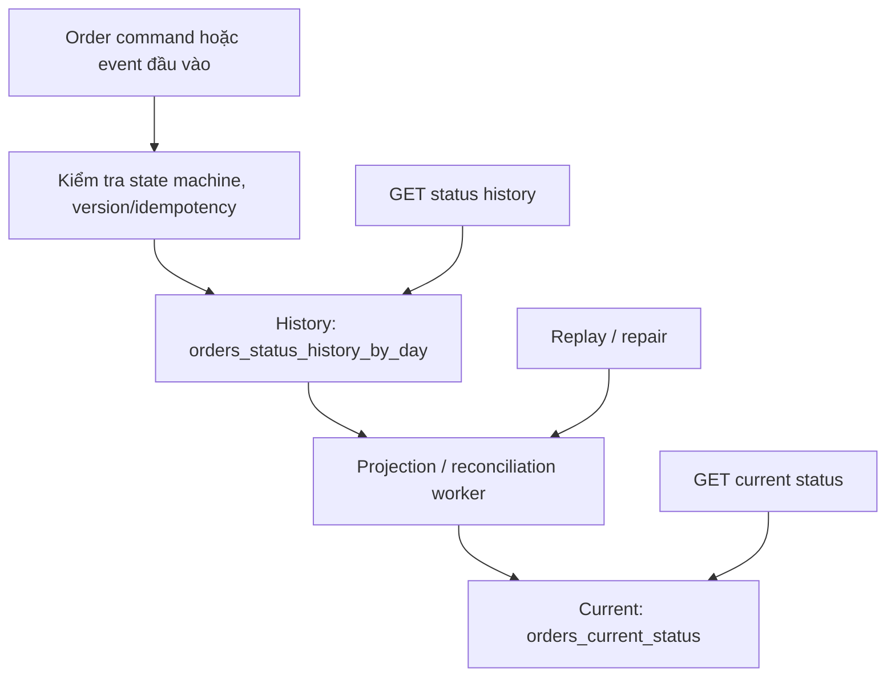

# Thiết kế lịch sử trạng thái và góc nhìn hiện tại ở bảng riêng

Trong hệ thống đơn hàng, giao vận hoặc thiết bị IoT, một thực thể thường có **trạng thái hiện tại** và **lịch sử các lần thay đổi trạng thái**. Hai nhu cầu đọc nghe có vẻ liên quan nhưng yêu cầu hai cách tổ chức dữ liệu khác nhau:

- Màn hình chi tiết cần trả lời nhanh: “Đơn hàng này **đang** ở trạng thái nào?”
- Màn hình theo dõi cần trả lời: “Trạng thái đã thay đổi **khi nào, theo thứ tự nào, bởi ai và từ gì sang gì**?”

Apache Cassandra được thiết kế để truy vấn hiệu quả khi biết partition key. Vì thế, với **Spring Data Cassandra**, một cách tiếp cận phổ biến là lưu **history table** có nhiều bản ghi theo thời gian, đồng thời duy trì **current-state table** chứa bản tóm tắt mới nhất của mỗi thực thể. Đây là hình thức **phi chuẩn hóa có chủ đích theo access pattern**, không phải cơ chế JOIN tự động.

Bài thuộc chương **Dữ liệu thời gian** của module **SPRING_DATA_CASSANDRA**. Ta sẽ thiết kế primary key, time bucket và clustering order; ghi lịch sử gần như append-only; duy trì góc nhìn hiện tại bằng version và LWT; xử lý sự kiện đến muộn, retry, mất kết nối, TTL, replay và kiểm thử hai đường đọc.

> **Ranh giới quan trọng:** Hai bảng Cassandra **không tự động thuộc một giao dịch ACID xuyên partition**. Dù ứng dụng ghi chúng bằng hai statement hay một logged batch, reader vẫn có thể nhìn thấy trạng thái trung gian. Phải quyết định **nguồn sự thật**, hợp đồng nhất quán và cơ chế sửa sai lệch trước khi đưa vào production.

## 1. Bắt đầu từ hai câu truy vấn, không bắt đầu từ entity

Giả sử một đơn hàng có các trạng thái:

```text
CREATED → CONFIRMED → PACKED → SHIPPED → DELIVERED
             ↘ CANCELLED (theo các điều kiện nghiệp vụ)
```

Người dùng cần hai API:

```http
GET /tenants/shop-42/orders/{orderId}/status
GET /tenants/shop-42/orders/{orderId}/history?day=2026-11-25
```

Ở đường đọc thứ nhất, ta đã biết `tenant_id` và `order_id`, cần **tối đa một row**. Ở đường thứ hai, cần **nhiều event theo thời gian**, có thể phân trang và truy vấn theo một bucket ngày.

| Access pattern | Dữ liệu cần | Khóa tìm kiếm | Thứ tự |
| --- | --- | --- | --- |
| Trạng thái hiện tại | `status`, `version`, `last_changed_at` | `tenant_id` + `order_id` | Không cần sắp xếp. |
| Lịch sử trong một ngày | Các lần chuyển trạng thái và actor | `tenant_id` + `order_id` + `event_day` | Mới trước hoặc cũ trước. |
| Tra cứu một event | `event_id`, version, payload | Phải biết **đường khóa** tương ứng hoặc có bảng tra cứu khác | Không cần. |
| Lịch sử nhiều tháng | Nhiều bucket của đơn | Danh sách bucket theo phạm vi thời gian | Ứng dụng điều phối các trang/bucket. |

Một bảng chỉ có `PRIMARY KEY (order_id)` không phù hợp để lưu **nhiều lần thay đổi** có cùng ID. Ngược lại, truy vấn “lấy trạng thái mới nhất” bằng cách luôn quét history, sắp xếp và chọn row đầu tiên có thể gây phức tạp khi event đến muộn hoặc history được bucket theo ngày.

**Nguyên tắc thiết kế:** Lưu bản ghi cho **sự kiện đã xảy ra** ở history và lưu **kết quả đã được tính tới thời điểm hiện tại** ở current.

## 2. Lịch sử sự kiện và trạng thái hiện tại khác nhau thế nào?

Một event lịch sử có thể biểu diễn:

```json
{
  "eventId": "aaaaaaaa-aaaa-aaaa-aaaa-aaaaaaaaaaaa",
  "tenantId": "shop-42",
  "orderId": "11111111-1111-1111-1111-111111111111",
  "aggregateVersion": 4,
  "fromStatus": "PACKED",
  "toStatus": "SHIPPED",
  "occurredAt": "2026-11-25T09:15:00Z",
  "recordedAt": "2026-11-25T09:15:02Z",
  "actorId": "warehouse-worker-7"
}
```

Bản current sau khi xử lý event này:

```json
{
  "tenantId": "shop-42",
  "orderId": "11111111-1111-1111-1111-111111111111",
  "status": "SHIPPED",
  "version": 4,
  "lastEventId": "aaaaaaaa-aaaa-aaaa-aaaa-aaaaaaaaaaaa",
  "lastChangedAt": "2026-11-25T09:15:00Z"
}
```

**History** trả lời “điều gì đã xảy ra” và lưu các event riêng. **Current** trả lời “trạng thái được hệ thống chấp nhận mới nhất theo quy tắc phiên bản là gì”.

Cần phân biệt ít nhất ba loại thời gian:

- `occurred_at`: thời điểm sự kiện có ý nghĩa nghiệp vụ xảy ra; có thể đến từ thiết bị hoặc service khác.
- `recorded_at`: thời điểm hệ thống tiếp nhận/ghi nhận sự kiện, phục vụ kiểm tra độ trễ.
- **Cassandra write timestamp**: metadata dùng hòa giải các lần ghi, không tự đồng nghĩa event time hay thứ tự nghiệp vụ.

Một event có `occurred_at` muộn nhất **không nhất thiết** là event phải thắng khi cập nhật current. Đồng hồ thiết bị có thể lệch, event có thể đến trễ, và business state machine phải có quy tắc rõ ràng.

### 2.1. Sơ đồ hai đường đọc



Sơ đồ minh họa một lựa chọn **history là nguồn sự thật**. Có kiến trúc khác dùng current là nguồn sự thật và ghi event bằng outbox/CDC. Không chọn cả hai là “nguồn sự thật độc lập” nếu chưa có quy tắc giải quyết xung đột.

## 3. Thiết kế bảng history: partition key, bucket và clustering

Ta dùng bảng theo **tenant + order + ngày sự kiện**, trong đó một event là một row.

```sql
-- Keyspace commerce giả định đã được tạo với replication phù hợp.
CREATE TABLE commerce.orders_status_history_by_day (
    tenant_id text,
    order_id uuid,
    event_day date,
    occurred_at timestamp,
    event_id uuid,
    aggregate_version bigint,
    from_status text,
    to_status text,
    recorded_at timestamp,
    actor_id text,
    reason text,
    PRIMARY KEY (
        (tenant_id, order_id, event_day),
        occurred_at,
        event_id
    )
) WITH CLUSTERING ORDER BY (
    occurred_at DESC,
    event_id ASC
);
```

**Ý nghĩa primary key:**

| Thành phần | Vai trò | Lý do |
| --- | --- | --- |
| `tenant_id` | Thành phần partition key | Phân tách đường truy cập theo tenant. |
| `order_id` | Thành phần partition key | Truy vấn chính là lịch sử **một đơn**, không phải mọi đơn cùng tenant. |
| `event_day` | Thành phần partition key/bucket | Giới hạn độ lớn partition và định vị theo ngày. |
| `occurred_at` | Clustering column đầu | Trong một bucket, sắp thời gian giảm dần. |
| `event_id` | Clustering column thứ hai | Phân biệt hai event trùng timestamp và tạo thứ tự ổn định bổ sung. |
| `aggregate_version` | Cột dữ liệu thường | Xác định thứ tự nghiệp vụ để project current; không nhất thiết bằng thứ tự thời gian. |

Với `PRIMARY KEY ((tenant_id, order_id, event_day), occurred_at, event_id)`, Cassandra phân tán theo **toàn bộ partition key ghép**; clustering columns xác định thứ tự lưu/đọc **bên trong partition**.

### 3.1. Truy vấn lịch sử theo một ngày

```sql
SELECT event_id, aggregate_version, occurred_at,
       from_status, to_status, actor_id, reason
FROM commerce.orders_status_history_by_day
WHERE tenant_id = 'shop-42'
  AND order_id = 11111111-1111-1111-1111-111111111111
  AND event_day = '2026-11-25'
LIMIT 50;
```

Cassandra có thể định vị đúng partition và trả hàng theo clustering order đã khai báo, **mới trước theo `occurred_at` trong một ngày**.

Với một partition xác định, có thể dùng `ORDER BY occurred_at ASC` theo các ràng buộc clustering order của CQL và phiên bản server nếu cần hướng ngược. Nhưng **không có một `ORDER BY` toàn cục tự động trải qua nhiều partition/ngày**.

### 3.2. Chọn bucket theo dữ liệu, không theo thói quen

`event_day` là bucket ngày (ví dụ tính từ `occurred_at` ở UTC). Nếu một đơn chỉ đổi trạng thái vài lần, partition theo order có thể vốn đã nhỏ; ngày là một cách giới hạn rõ ràng, nhưng cũng làm query toàn lịch sử phức tạp hơn.

| Lưu lượng thực tế | Cân nhắc |
| --- | --- |
| Vài chục event cho mỗi đơn trong toàn vòng đời | Một partition theo `tenant_id + order_id` có thể đủ; bucket ngày không phải bắt buộc. |
| Hàng nghìn event/đơn/ngày | Bucket ngày hoặc giờ giúp giới hạn partition. |
| Dòng telemetry/event liên tục theo thiết bị | Có thể cần bucket giờ hoặc shard bổ sung, nhưng tăng số partition cần đọc. |
| Truy vấn chủ yếu theo “30 ngày gần nhất” | Chọn bucket tương ứng với truy vấn, lập kế hoạch đọc nhiều bucket. |

Không có ngưỡng “mọi partition Cassandra phải nhỏ hơn đúng N MB” áp dụng cho mọi workload. Hãy đo kích thước trung bình, p95/p99, số row/partition, latency và tombstone count.

### 3.3. Định nghĩa event_day phải bất biến

Ứng dụng cần thống nhất:

```java
import java.time.Instant;
import java.time.LocalDate;
import java.time.ZoneOffset;

LocalDate bucket = LocalDate.ofInstant(occurredAt, ZoneOffset.UTC);
```

Không lấy `LocalDate.now()` tại thời điểm consumer xử lý nếu yêu cầu bucket theo **event time**. Một sự kiện xảy ra hôm qua nhưng xử lý hôm nay phải vào bucket **hôm qua** theo định nghĩa này.

Nếu nghiệp vụ dùng ngày địa phương thay UTC, cần chỉ rõ `ZoneId`, xử lý DST/timezone và bảo đảm mọi writer/replay dùng **cùng quy tắc**, tránh một event nhảy bucket khi retry.

## 4. Thiết kế bảng current: một row cho một thực thể

Bảng hiện tại có partition key gồm **tenant + order**, không cần clustering.

```sql
CREATE TABLE commerce.orders_current_status (
    tenant_id text,
    order_id uuid,
    status text,
    version bigint,
    last_event_id uuid,
    last_changed_at timestamp,
    projected_at timestamp,
    PRIMARY KEY ((tenant_id, order_id))
);
```

Ví dụ đọc trạng thái hiện tại:

```sql
SELECT status, version, last_event_id, last_changed_at, projected_at
FROM commerce.orders_current_status
WHERE tenant_id = 'shop-42'
  AND order_id = 11111111-1111-1111-1111-111111111111;
```

Đây là truy vấn một partition, một row. Không cần tìm `MAX(occurred_at)` hay quét nhiều bucket history để phục vụ màn hình hiện tại.

Cấu trúc trường:

- `status`: trạng thái mới nhất đã được chấp nhận theo protocol.
- `version`: thứ tự nghiệp vụ tăng đơn điệu cho **một đơn**.
- `last_event_id`: dấu vết event đã tạo trạng thái current.
- `last_changed_at`: thời điểm thay đổi trạng thái theo business event.
- `projected_at`: thời điểm projection được cập nhật, hữu ích để đo độ trễ.

**Cảnh báo:** `projected_at` không phải “Cassandra write timestamp của mọi cell”, cũng không phải bằng chứng mọi replica đã hội tụ. Nó là giá trị do ứng dụng ghi trong mutation.

### 4.1. Vì sao không đặt current vào cùng history table?

Nếu lưu history và current bằng các hàng khác nhau trong cùng partition, ứng dụng vẫn phải phân biệt row types, thứ tự, TTL và update hot row. Việc tách bảng:

- Làm rõ đường đọc: current luôn một row; history là nhiều row.
- Cho phép **TTL/compaction khác nhau**: history có thể giữ 90 ngày, current còn sống cho đến khi đơn kết thúc.
- Giảm việc đọc nhiều event chỉ để lấy status.
- Cho phép rebuild current từ nguồn lịch sử nếu giữ đủ dữ liệu.
- Có thêm **write amplification** và nghĩa vụ đồng bộ.

Tách bảng là một quyết định phục vụ truy vấn, **không tự tạo transaction giữa hai bảng**.

## 5. Khóa idempotency và version: trật tự nghiệp vụ không dựa vào đồng hồ

Để xử lý event đến trễ hoặc duplicate, mỗi thay đổi trạng thái nên có:

```java
import java.time.Instant;
import java.time.LocalDate;
import java.time.ZoneOffset;
import java.util.UUID;

public record OrderStatusEvent(
    String tenantId,
    UUID orderId,
    UUID eventId,
    long aggregateVersion,
    String fromStatus,
    String toStatus,
    Instant occurredAt,
    Instant recordedAt,
    String actorId
) {
    public LocalDate eventDayUtc() {
        return LocalDate.ofInstant(occurredAt, ZoneOffset.UTC);
    }
}
```

Các bất biến quan trọng:

1. **`eventId` là ID của một sự kiện logic**, ổn định qua retry/replay.
2. **`aggregateVersion` tăng theo thứ tự thay đổi đã được chấp nhận trên cùng order**, không dùng timestamp của thiết bị làm version.
3. Cùng `eventId` không được mang payload khác giữa các lần phát lại.
4. `event_day`, `occurred_at` và `event_id` dùng làm key **không đổi khi retry**.
5. Nếu event chỉ mô tả một phép delta (“cộng số lượng”, “trừ tồn kho”), phải đảm bảo xử lý theo đúng thứ tự. Nếu event chứa trạng thái đầy đủ, có thể có chính sách bỏ qua sự kiện cũ, nhưng vẫn cần quy tắc nghiệp vụ.

**Không tự cấp `aggregateVersion` từ `System.currentTimeMillis()` hoặc `Instant.now()`.** Clock skew và nhiều writer đồng thời sẽ làm sai thứ tự; cần một owner/protocol version rõ ràng.

### 5.1. Event ID trong clustering key có giới hạn uniqueness

Vì history key gồm `tenant_id + order_id + event_day + occurred_at + event_id`, một `eventId` duy nhất **chỉ được chống trùng khi các thành phần key khác cũng giống nhau**.

Một retry dùng cùng event ID nhưng đổi `occurred_at` hoặc `event_day` có thể tạo **hàng thứ hai**. Nếu cần **unique eventId ở cấp hệ thống**, hãy bổ sung bảng idempotency/cơ chế xác thực event identity có khóa phù hợp, hoặc ràng buộc từ producer. Chỉ viết `IF NOT EXISTS` trên **một full primary key** không chứng minh uniqueness trên mọi bucket.

## 6. Ghi history: append-only là quy ước nghiệp vụ

Cassandra `INSERT` vào một full primary key đã tồn tại có thể mang ngữ nghĩa **upsert**. Vì vậy, muốn giữ history **không bị ghi đè**, phải thiết kế quy tắc:

- Mỗi event có full key bất biến.
- Các client không được `UPDATE` hoặc `DELETE` event tùy ý.
- Quyền truy cập hạn chế: service ingest được insert, service đọc chỉ có quyền select, repair có quyền riêng.
- Nếu yêu cầu **chỉ chấp nhận event mới khi key chưa tồn tại**, dùng `INSERT ... IF NOT EXISTS` và kiểm tra kết quả.
- TTL retention/xóa theo chính sách phải được định nghĩa rõ; không gọi “append-only vĩnh viễn” nếu history bị TTL sau 90 ngày.

Ví dụ:

```sql
INSERT INTO commerce.orders_status_history_by_day (
    tenant_id, order_id, event_day, occurred_at, event_id,
    aggregate_version, from_status, to_status, recorded_at, actor_id
) VALUES (
    'shop-42',
    11111111-1111-1111-1111-111111111111,
    '2026-11-25',
    '2026-11-25T09:15:00Z',
    aaaaaaaa-aaaa-aaaa-aaaa-aaaaaaaaaaaa,
    4, 'PACKED', 'SHIPPED',
    '2026-11-25T09:15:02Z',
    'warehouse-worker-7'
) IF NOT EXISTS;
```

`IF NOT EXISTS` dùng **LWT**, có chi phí lớn hơn insert thường. Không bật LWT cho tất cả sự kiện chỉ vì thiếu kế hoạch idempotency. Nếu producer đảm bảo full key ổn định và upsert lặp đúng payload là chấp nhận được, write thường có thể phù hợp hơn; nhưng vẫn phải xem TTL, timestamp và sự kiện trùng.

### 6.1. Trạng thái khi IF NOT EXISTS không áp dụng

Kết quả `[applied] = false` nghĩa là full key đã có hàng theo điều kiện tại thời điểm LWT, **không tự chứng minh payload cũ bằng payload mới**. Một consumer đúng phải đọc/so sánh event đã lưu hoặc dựa trên cơ chế dedupe bảo đảm trước đó:

- Nếu cùng event ID/key/payload → retry có thể xem là duplicate đã ghi.
- Nếu cùng key nhưng payload khác → **conflict/invariant violation**, không âm thầm bỏ qua.
- Nếu timeout → chưa biết LWT đã được áp dụng hay chưa, cần đối soát.

## 7. Ghi current: dùng LWT để tránh event cũ ghi đè event mới

Không dựa vào “event có `occurred_at` lớn hơn” để cập nhật current. Một event mới hơn về business version nhưng timestamp nhỏ hơn vẫn phải được xử lý theo hợp đồng.

### 7.1. Tạo current lần đầu

Giả sử event đầu tiên của order có version 1:

```sql
INSERT INTO commerce.orders_current_status (
    tenant_id, order_id, status, version,
    last_event_id, last_changed_at, projected_at
) VALUES (
    'shop-42',
    11111111-1111-1111-1111-111111111111,
    'CREATED',
    1,
    bbbbbbbb-bbbb-bbbb-bbbb-bbbbbbbbbbbb,
    '2026-11-25T08:00:00Z',
    '2026-11-25T08:00:01Z'
) IF NOT EXISTS;
```

Nếu hàng đã tồn tại, `[applied] = false`. Đừng ghi đè current bằng một `INSERT` không điều kiện chỉ để “cho qua lần đầu”.

### 7.2. Chuyển từ version n sang n+1

Giả sử current đang ở `version = 3`, sự kiện tiếp theo có version 4:

```sql
UPDATE commerce.orders_current_status
SET status = 'SHIPPED',
    version = 4,
    last_event_id = aaaaaaaa-aaaa-aaaa-aaaa-aaaaaaaaaaaa,
    last_changed_at = '2026-11-25T09:15:00Z',
    projected_at = '2026-11-25T09:15:02Z'
WHERE tenant_id = 'shop-42'
  AND order_id = 11111111-1111-1111-1111-111111111111
IF version = 3;
```

**Cassandra kiểm tra `IF version = 3` bằng LWT.** Nếu một worker khác đã nâng current lên 4 thì statement không áp dụng; cần đọc lại và phân loại duplicate, out-of-order hoặc conflict.

| Version trong current | Event được xử lý | Cách hiểu |
| ---: | ---: | --- |
| 3 | 4 | Có thể áp dụng chuyển 3 → 4. |
| 4 | 4 | Event có thể đã xử lý; kiểm tra `last_event_id` và payload. |
| 5 | 4 | Event đến trễ; không ghi lùi trạng thái. |
| 2 | 4 | Thiếu version 3; phải xử lý gap/đợi/replay nếu bắt buộc tuần tự. |
| Chưa có row | 1 | Thử `INSERT ... IF NOT EXISTS`. |
| Chưa có row | 4 | Thiếu những event trước hoặc cần quy trình snapshot/bootstrap được định nghĩa rõ. |

**Không tự động “nhảy” từ version 2 sang 4** khi event là delta hoặc các business transition yêu cầu đi theo chuỗi. Với snapshot event chứa toàn bộ state và chính sách cho phép bỏ qua trung gian, có thể có mô hình “accept latest version”, nhưng phải thiết kế CAS tương ứng và đối soát lịch sử. Bài này chọn mô hình **version tăng liên tục** để ví dụ dễ kiểm chứng.

### 7.3. IF EXISTS không đủ cho optimistic concurrency

`UPDATE ... IF EXISTS` chỉ kiểm tra **hàng có tồn tại**, không kiểm tra `version`. Hai worker đều có thể update cùng row trong khi thỏa `IF EXISTS` và một ghi sau cùng chiến thắng theo timestamp/protocol.

Muốn phát hiện bản chụp stale, cần **`IF version = expectedVersion`** hoặc cơ chế điều kiện nghiệp vụ tương ứng. `LOCAL_QUORUM` của ghi thường chỉ là ngưỡng replica, không thay CAS.

## 8. Event đến trễ, duplicate và thứ tự thay đổi

Xét luồng event:

```text
Order 1111...
    version 1: CREATED
    version 2: CONFIRMED
    version 3: PACKED
    version 4: SHIPPED
    version 5: DELIVERED
```

Giả sử consumer nhận `v5` trước `v4` do message broker retry hoặc network delay.

- **History table** vẫn có thể ghi event theo full key của nó; clustering sắp theo `occurred_at`, không tự dựa vào version.
- **Current table** không được cho `v5` áp dụng bằng cách ghi đè không điều kiện khi mới có v3, nếu thiết kế bắt buộc xử lý liên tiếp.
- Worker có thể **buffer/requeue v5**, sau khi v4 được áp dụng mới xử lý v5.
- Nếu v4 không bao giờ đến, cần có cơ chế **gap detection**, dead-letter và reconciliation, không chờ vô thời hạn.

```mermaid
sequenceDiagram
    participant B as Event broker
    participant P as Projection worker
    participant C as Current table
    B-->>P: Event v5 (đến trước)
    P->>C: SELECT current.version
    C-->>P: version = 3
    Note over P: Gap: thiếu v4, không ghi v5
    B-->>P: Event v4
    P->>C: UPDATE ... IF version = 3
    C-->>P: applied=true; current=v4
    P->>C: UPDATE v5 IF version = 4
    C-->>P: applied=true; current=v5
```

### 8.1. Hai loại thứ tự cần phân biệt

- **Thứ tự hiển thị history:** thường theo `occurred_at` để người dùng thấy timeline.
- **Thứ tự trạng thái được chấp nhận:** theo `aggregate_version`/state machine để không bị event trễ làm lùi trạng thái.

Nếu thiết bị có clock sai, `occurred_at` của v5 có thể nhỏ hơn v4. Khi đó query history theo thời gian và trình tự version không hoàn toàn giống nhau; UI nên hiển thị version hoặc giải thích cách sắp xếp.

### 8.2. Nhiều actor cùng yêu cầu đổi trạng thái

Hai service cùng đọc current `version=3` rồi gửi yêu cầu thay đổi. Nếu cả hai tự tạo event `version=4` mà không có owner version duy nhất, lịch sử có thể chứa **hai event mang cùng version**.

Vì vậy phải có bước quyết định chuyển trạng thái một cách nhất quán: state machine coordinator, CAS trên current, một log/processor tuần tự theo aggregate, hoặc protocol đặt thứ tự khác được chứng minh. **Không kỳ vọng primary key của history tự cấp số version duy nhất.**

## 9. Chọn nguồn sự thật: history-first hay current-first?

Có hai hướng chính, không nên trộn vô thức.

### 9.1. Mô hình A — History/event log là nguồn sự thật

1. Service chấp nhận command qua bước validation và phân bổ event ID/version theo protocol.
2. Ghi event bền vững vào history hoặc một durable event log.
3. Projection worker đọc event và cập nhật current.
4. Nếu worker thất bại, **replay event** để xây lại current.
5. API current chấp nhận **eventual consistency** hoặc có cơ chế “đợi projection đạt version X” khi cần read-your-write.

Ưu điểm: audit/replay rõ ràng nếu event history đầy đủ và bất biến. Đổi lại, current có thể **lag** và hệ thống phải vận hành consumer, checkpoint, replay/backfill.

**Điểm cần giải quyết:** Một bảng history bucket theo ngày không tự cung cấp một **stream toàn cục** có thứ tự và khả năng replay hiệu quả. Cần nguồn event bền vững/CDC/poller được thiết kế rõ, không giả định Cassandra tự push mọi INSERT tới một consumer theo version.

### 9.2. Mô hình B — Current là nguồn sự thật khi xử lý command

1. Service đọc current và quyết định transition hợp lệ.
2. Ghi current có điều kiện `IF version = ?`.
3. Sau khi current được cập nhật, phát event lịch sử qua **outbox/durable workflow**.
4. Worker hoặc pipeline bổ sung history và các bảng đọc.
5. Theo dõi event thiếu, đối soát và phát lại.

Ưu điểm: quyết định trạng thái hiện tại có thể được xác nhận ở đường command nhanh hơn. Rủi ro: **ghi current thành công nhưng phát event không thành công**, khiến history thiếu dấu vết. Muốn audit đầy đủ, cần giải pháp durable phù hợp; Cassandra không tự tạo một SQL outbox transaction ACID đa partition.

### 9.3. Ma trận lựa chọn

| Tiêu chí | History-first | Current-first |
| --- | --- | --- |
| Nguồn xác định trạng thái | Event log/chuỗi event được chấp nhận | Current row và CAS state machine |
| Độ trễ current | Phụ thuộc projection lag | Có thể cập nhật ngay trong command |
| Tái tạo current | Replay history/log đủ dữ liệu | Cần log/snapshot nếu muốn tái tạo |
| Rủi ro ghi một phần | Event đã có, current chưa theo kịp | Current đã đổi, history/outbox chưa có |
| Hợp đồng API | Có thể trả accepted + version/cursor | Có thể trả trạng thái sau CAS |
| Yêu cầu vận hành | Durable event, checkpoint, replay | Reliable event publication, audit reconciliation |

**Không có phương án “miễn phí consistency”.** Kiến trúc phải mô tả cụ thể điều gì xảy ra khi một câu CQL thành công và câu tiếp theo thất bại.

## 10. Dual write và logged batch không giải quyết mọi vấn đề

Ví dụ service ghi history rồi current bằng hai request CQL:

```text
INSERT history → ACK
UPDATE current IF version=3 → timeout
```

Có ít nhất ba khả năng:

- History đã có, current chưa cập nhật.
- Current đã cập nhật nhưng response bị thất lạc.
- Một writer khác đã cập nhật current, khiến điều kiện không thỏa.

Nếu một service dùng `@Transactional` quanh hai phương thức Spring Data Cassandra, **không được mặc định hai request trở thành transaction ACID đa partition**.

### 10.1. Có nên dùng LOGGED BATCH?

Cassandra `BEGIN LOGGED BATCH` có batchlog giúp **eventual application** của các mutation đã được chấp nhận theo cơ chế của nó, nhưng:

- **Không cung cấp snapshot isolation** xuyên các bảng/partition.
- Không tự giải quyết thứ tự event/version hoặc business state machine.
- Không tự bảo vệ side effect ngoài Cassandra (Kafka, email, thanh toán).
- Không nên coi batch timeout là “tất cả mutation đã rollback”.
- LWT/conditional batch có các giới hạn riêng; **không giả định có thể atomic CAS current và INSERT history ở hai partition bất kỳ** bằng một conditional batch.

Trong ví dụ, history và current thuộc **hai bảng và hai partition khác nhau**; mô hình event-driven + idempotent projection/reconciliation thường minh bạch hơn về lỗi và phục hồi.

### 10.2. Ma trận lỗi và cách khôi phục

| Trường hợp | History | Current | Hành động |
| --- | --- | --- | --- |
| Event chưa được ghi | Chưa có | Chưa cập nhật | Retry ingest theo ID ổn định nếu an toàn. |
| Event ghi xong, projection chưa chạy | Có event | Version cũ | Consumer replay/project event. |
| Projection CAS timeout | Có event | **Không chắc chắn** | Đọc current, so version/event ID; retry idempotent nếu cần. |
| Event v4 đến hai lần | Cùng event | Có thể đã v4/v5 | Nhận duplicate và bỏ qua khi đã chứng minh payload khớp. |
| Event v3 đến sau v5 | Có đủ lịch sử | Đã v5 | Không ghi lùi current. |
| Current đã đổi, history thiếu trong current-first | Thiếu event | Version mới | Durable event recovery/reconciliation; cảnh báo audit. |
| Hai event cùng version nhưng payload khác | Có conflict logic | Không rõ writer hợp lệ | Dừng projection phần đó, điều tra invariant. |

**Retry phải dựa trên mục tiêu trạng thái**, không chỉ dựa vào loại exception. Timeout client không chứng minh mutation chưa xảy ra.

## 11. Spring Data Cassandra mapping cho hai bảng

Tầng mapping nên phản ánh **khóa của mỗi đường đọc**, thay vì cố dùng chung một entity có cùng `@PrimaryKey` cho cả history và current.

### 11.1. Current entity với khóa ghép

```java
import java.io.Serializable;
import java.util.Objects;
import java.util.UUID;

import org.springframework.data.cassandra.core.mapping.PrimaryKeyClass;
import org.springframework.data.cassandra.core.mapping.PrimaryKeyColumn;
import org.springframework.data.cassandra.core.mapping.PrimaryKeyType;

@PrimaryKeyClass
public class OrderKey implements Serializable {

    @PrimaryKeyColumn(name = "tenant_id", ordinal = 0,
            type = PrimaryKeyType.PARTITIONED)
    private String tenantId;

    @PrimaryKeyColumn(name = "order_id", ordinal = 1,
            type = PrimaryKeyType.PARTITIONED)
    private UUID orderId;

    public OrderKey() {}

    public OrderKey(String tenantId, UUID orderId) {
        this.tenantId = tenantId;
        this.orderId = orderId;
    }

    public String getTenantId() { return tenantId; }
    public UUID getOrderId() { return orderId; }

    @Override
    public boolean equals(Object obj) {
        if (this == obj) return true;
        if (!(obj instanceof OrderKey)) return false;
        OrderKey other = (OrderKey) obj;
        return Objects.equals(tenantId, other.tenantId)
            && Objects.equals(orderId, other.orderId);
    }

    @Override
    public int hashCode() {
        return Objects.hash(tenantId, orderId);
    }
}
```

```java
import java.time.Instant;
import java.util.UUID;

import org.springframework.data.cassandra.core.mapping.Column;
import org.springframework.data.cassandra.core.mapping.PrimaryKey;
import org.springframework.data.cassandra.core.mapping.Table;

@Table("orders_current_status")
public class CurrentOrderStatus {

    @PrimaryKey
    private OrderKey key;

    @Column("status")
    private String status;

    @Column("version")
    private Long version;

    @Column("last_event_id")
    private UUID lastEventId;

    @Column("last_changed_at")
    private Instant lastChangedAt;

    @Column("projected_at")
    private Instant projectedAt;

    public CurrentOrderStatus() {}

    public OrderKey getKey() { return key; }
    public void setKey(OrderKey value) { key = value; }
    public String getStatus() { return status; }
    public void setStatus(String value) { status = value; }
    public Long getVersion() { return version; }
    public void setVersion(Long value) { version = value; }
    public UUID getLastEventId() { return lastEventId; }
    public void setLastEventId(UUID value) { lastEventId = value; }
    public Instant getLastChangedAt() { return lastChangedAt; }
    public void setLastChangedAt(Instant value) { lastChangedAt = value; }
    public Instant getProjectedAt() { return projectedAt; }
    public void setProjectedAt(Instant value) { projectedAt = value; }
}
```

Repository:

```java
import org.springframework.data.cassandra.repository.CassandraRepository;

public interface CurrentOrderStatusRepository
        extends CassandraRepository<CurrentOrderStatus, OrderKey> {
}
```

`findById(new OrderKey(tenant, orderId))` tra đúng full primary key của current table. Không dùng mỗi `UUID` làm generic ID nếu entity có composite partition key.

### 11.2. History entity cũng cần key khác

History có **full key gồm năm thành phần**, có thể ánh xạ bằng một `@PrimaryKeyClass` riêng:

```java
@PrimaryKeyClass
public class OrderStatusHistoryKey implements java.io.Serializable {

    @PrimaryKeyColumn(name = "tenant_id", ordinal = 0,
        type = PrimaryKeyType.PARTITIONED)
    private String tenantId;

    @PrimaryKeyColumn(name = "order_id", ordinal = 1,
        type = PrimaryKeyType.PARTITIONED)
    private java.util.UUID orderId;

    @PrimaryKeyColumn(name = "event_day", ordinal = 2,
        type = PrimaryKeyType.PARTITIONED)
    private java.time.LocalDate eventDay;

    @PrimaryKeyColumn(name = "occurred_at", ordinal = 3,
        type = PrimaryKeyType.CLUSTERED)
    private java.time.Instant occurredAt;

    @PrimaryKeyColumn(name = "event_id", ordinal = 4,
        type = PrimaryKeyType.CLUSTERED)
    private java.util.UUID eventId;

    // Thêm constructor, getter/setter, equals/hashCode.
}
```

Ví dụ này tập trung **khóa và thứ tự các thành phần**; khi dùng thật phải hoàn thiện entity `@Table`, fields cho event và `equals/hashCode` của key để mapping ổn định.

Có thể dùng `CqlTemplate` để đọc history thành DTO thay vì tạo entity cho mọi event. Chọn abstraction theo access pattern và độ phức tạp của mapping, không bắt buộc “mỗi bảng phải có repository”.

## 12. CqlTemplate: truy vấn current/history rõ khóa

Ví dụ đọc current qua `CqlTemplate`:

```java
import java.util.UUID;
import org.springframework.data.cassandra.core.cql.CqlTemplate;
import org.springframework.stereotype.Service;

@Service
public class OrderStatusReader {

    private final CqlTemplate cql;

    public OrderStatusReader(CqlTemplate cql) {
        this.cql = cql;
    }

    public String currentStatus(String tenantId, UUID orderId) {
        return cql.query(
            "SELECT status FROM commerce.orders_current_status " +
            "WHERE tenant_id=? AND order_id=?",
            rs -> rs.next() ? rs.getString("status") : null,
            tenantId, orderId
        );
    }
}
```

Ở đây `?` là positional bind marker trong CQL, không phải `?0` của repository `@Query`. Đường đọc chỉ dùng **full partition key**; không nối giá trị tenant vào chuỗi CQL.

Truy vấn history thành danh sách DTO có giới hạn:

```java
import java.time.Instant;
import java.time.LocalDate;
import java.util.List;
import java.util.UUID;

public record StatusHistoryItem(
    UUID eventId,
    long version,
    Instant occurredAt,
    String fromStatus,
    String toStatus
) {}

public List<StatusHistoryItem> historyForDay(
        String tenantId, UUID orderId, LocalDate day) {
    return cql.query(
        "SELECT event_id, aggregate_version, occurred_at, " +
        "from_status, to_status " +
        "FROM commerce.orders_status_history_by_day " +
        "WHERE tenant_id=? AND order_id=? AND event_day=? LIMIT 50",
        (row, rowNum) -> new StatusHistoryItem(
            row.getUuid("event_id"),
            row.getLong("aggregate_version"),
            row.getInstant("occurred_at"),
            row.getString("from_status"),
            row.getString("to_status")
        ),
        tenantId, orderId, day
    );
}
```

Đoạn thứ hai minh họa một method trong cùng service có field `CqlTemplate cql`. Khi triển khai, cần kiểm tra API `query` và row accessors đúng phiên bản, cũng như xử lý trường hợp `aggregate_version` thiếu/null ở dữ liệu legacy.

**Đừng cho API tự nhận `day` từ input rồi quên kiểm tra quyền tenant.** Xác thực tenant/order trước khi trả history, vì URL có ID không phải bằng chứng người gọi có quyền đọc.

## 13. Java driver và LWT: đường ghi projection có kiểm soát

Khi cần kiểm soát `IF NOT EXISTS`/`IF version`, driver 4.x và `ResultSet.wasApplied()` giúp nhìn rõ kết quả. Ví dụ sau là **phần cốt lõi của worker projection**, giả định event đã được cấp version đúng bởi một protocol tin cậy.

### 13.1. Append history với kết quả điều kiện

```java
import java.util.UUID;

import com.datastax.oss.driver.api.core.CqlSession;
import com.datastax.oss.driver.api.core.DefaultConsistencyLevel;
import com.datastax.oss.driver.api.core.cql.SimpleStatement;

public boolean appendHistory(CqlSession session, OrderStatusEvent event) {
    SimpleStatement statement = SimpleStatement.builder(
            "INSERT INTO commerce.orders_status_history_by_day " +
            "(tenant_id, order_id, event_day, occurred_at, event_id, " +
            "aggregate_version, from_status, to_status, recorded_at, actor_id) " +
            "VALUES (?, ?, ?, ?, ?, ?, ?, ?, ?, ?) IF NOT EXISTS")
        .addPositionalValues(
            event.tenantId(), event.orderId(), event.eventDayUtc(),
            event.occurredAt(), event.eventId(), event.aggregateVersion(),
            event.fromStatus(), event.toStatus(),
            event.recordedAt(), event.actorId()
        )
        .setConsistencyLevel(DefaultConsistencyLevel.LOCAL_QUORUM)
        .setSerialConsistencyLevel(DefaultConsistencyLevel.LOCAL_SERIAL)
        .build();

    return session.execute(statement).wasApplied();
}
```

`false` là **condition false**, không phải timeout. Khi `false`, cần so sánh event cũ với payload mới. Khi `session.execute` ném exception, không tự suy ra event chưa được lưu: LWT có thể đã áp dụng nhưng client mất response.

### 13.2. Tạo current lần đầu

```java
import java.time.Instant;

public boolean createCurrentIfAbsent(
        CqlSession session, OrderStatusEvent event) {
    if (event.aggregateVersion() != 1) {
        throw new IllegalArgumentException("Initial event must be version 1");
    }

    SimpleStatement statement = SimpleStatement.builder(
            "INSERT INTO commerce.orders_current_status " +
            "(tenant_id, order_id, status, version, last_event_id, " +
            "last_changed_at, projected_at) " +
            "VALUES (?, ?, ?, ?, ?, ?, ?) IF NOT EXISTS")
        .addPositionalValues(
            event.tenantId(), event.orderId(), event.toStatus(),
            event.aggregateVersion(), event.eventId(),
            event.occurredAt(), Instant.now()
        )
        .setConsistencyLevel(DefaultConsistencyLevel.LOCAL_QUORUM)
        .setSerialConsistencyLevel(DefaultConsistencyLevel.LOCAL_SERIAL)
        .build();

    return session.execute(statement).wasApplied();
}
```

`Instant.now()` ở `projected_at` phục vụ metrics; khi retry, có thể khác nhau nhưng **không được dùng làm thứ tự nghiệp vụ**. Nếu cần giá trị projected_at bất biến qua retry, xác định nó từ một command/projection attempt ID.

### 13.3. Áp dụng event kế tiếp bằng compare-and-set

```java
public boolean applyNextVersion(
        CqlSession session, OrderStatusEvent event) {
    if (event.aggregateVersion() <= 1) {
        throw new IllegalArgumentException("Use create for version 1");
    }

    long expected = event.aggregateVersion() - 1;

    SimpleStatement statement = SimpleStatement.builder(
            "UPDATE commerce.orders_current_status " +
            "SET status=?, version=?, last_event_id=?, " +
            "last_changed_at=?, projected_at=? " +
            "WHERE tenant_id=? AND order_id=? IF version=?")
        .addPositionalValues(
            event.toStatus(), event.aggregateVersion(), event.eventId(),
            event.occurredAt(), java.time.Instant.now(),
            event.tenantId(), event.orderId(), expected
        )
        .setConsistencyLevel(DefaultConsistencyLevel.LOCAL_QUORUM)
        .setSerialConsistencyLevel(DefaultConsistencyLevel.LOCAL_SERIAL)
        .build();

    return session.execute(statement).wasApplied();
}
```

Trong snippet này, `false` có thể có nhiều lý do:

- Event đã được xử lý.
- Current version mới hơn.
- Current version cũ hơn nhưng **thiếu event trước đó**.
- Current không tồn tại.
- Nhiều worker đang tranh chấp.

Do đó caller **phải đọc current và phân loại**, không cứ `false` là retry ngay hoặc ném “Cassandra lỗi”.

### 13.4. Không coi ba method là một transaction

`appendHistory(...)`, `createCurrentIfAbsent(...)` và `applyNextVersion(...)` được minh họa tách riêng. Một worker production cần một protocol bền vững để đảm bảo sự kiện đã được ghi được đưa vào projection, có checkpoint, retry, dead-letter và reconciliation.

**Không gọi ba method nối tiếp rồi trả lời “atomically committed”**. Nếu crash sau append và trước projection, history có thể có event nhưng current vẫn cũ. Chính khả năng replay mới giải quyết khoảng trống này ở mức ứng dụng.

## 14. TTL, tombstone và retention: hai bảng nên có chính sách khác nhau

History thường tăng liên tục, current chỉ có một row/đơn. Vì thế **TTL nên được quyết định riêng**.

Ví dụ history chỉ cần giữ 90 ngày:

```sql
-- Chỉ là một chính sách minh họa cho bảng history mới.
CREATE TABLE commerce.orders_status_history_90d_by_day (
    tenant_id text,
    order_id uuid,
    event_day date,
    occurred_at timestamp,
    event_id uuid,
    aggregate_version bigint,
    to_status text,
    PRIMARY KEY ((tenant_id, order_id, event_day), occurred_at, event_id)
) WITH CLUSTERING ORDER BY (occurred_at DESC, event_id ASC)
  AND default_time_to_live = 7776000;
```

`7776000` giây bằng 90 ngày theo quy tắc 24 giờ/ngày. **Đây là bảng minh họa riêng, không phải lệnh tự ý ALTER bảng đã được sử dụng**.

Đối với current:

- Thường **không đặt TTL ngắn** nếu đơn cần được truy vấn cho đến khi hoàn tất vòng đời.
- Nếu cần xóa current theo retention, phải có quy trình riêng, không để current mất trước khi history được xử lý/rebuild.
- Tránh partial update khiến `version` hết TTL còn `status` vẫn sống: khi đó CAS/optimistic locking không còn phản ánh trạng thái đáng tin cậy.
- Nếu current được ghi lại nhiều lần, TTL mới của các cell được ghi có thể thay đổi; phải biết `default_time_to_live` và `USING TTL` đang dùng.

### 14.1. Tombstone không biến mất ngay khi TTL hết hạn

Khi TTL của history hết hạn, Cassandra xử lý dữ liệu như đã bị xóa về mặt logic, có **tombstone/expiration metadata** liên quan. Việc thu hồi trên disk phụ thuộc compaction, điều kiện an toàn, repair và `gc_grace_seconds`.

Không đặt `gc_grace_seconds=0` bừa bãi để “dọn nhanh”; replica bỏ lỡ xóa và không được repair có thể dẫn tới zombie data khi tombstone bị loại bỏ sai lúc.

Với time-series có TTL tương đối đồng nhất và dữ liệu ít bị sửa, **TimeWindowCompactionStrategy (TWCS)** có thể đáng đánh giá. Nhưng TWCS không tự chữa các trường hợp:

- Cập nhật sự kiện cũ ngoài cửa sổ thời gian.
- Dữ liệu không TTL trộn với dữ liệu TTL ngắn trong cùng SSTable/window.
- Tombstone còn điều kiện ngăn thu hồi.
- Partition quá lớn hoặc query quét nhiều bucket.

**Không tự động chọn TWCS cho bảng current**: current là bảng mutable, thường được update liên tục, có workload khác history append-oriented.

### 14.2. TTL history ảnh hưởng khả năng replay

Nếu history giữ 90 ngày, sau ngày 91 có thể **không còn đủ toàn bộ chuỗi event** để tái tạo current từ đầu. Muốn rebuild, phải có ít nhất một trong các cơ chế:

- Snapshot/checkpoint bền vững kèm version, có thể replay những event sau snapshot.
- Event log dài hạn/archival ở hệ thống khác.
- Quy tắc nghiệp vụ chỉ yêu cầu rebuild trong retention window.
- Đường nguồn sự thật khác có đầy đủ trạng thái.

Không quảng bá “current luôn rebuild được từ history” khi đã định nghĩa TTL xóa mất các event lịch sử cần thiết.

## 15. Phân trang history và tra cứu nhiều bucket

Mặc dù Cassandra hỗ trợ paging, **paging state áp dụng cho một statement cụ thể** chứ không tự chuyển qua nhiều partition ngày.

### 15.1. Một bucket theo ngày

```sql
SELECT occurred_at, event_id, aggregate_version, to_status
FROM commerce.orders_status_history_by_day
WHERE tenant_id = 'shop-42'
  AND order_id = 11111111-1111-1111-1111-111111111111
  AND event_day = '2026-11-25';
```

Đặt driver page size và trả `nextCursor` dạng opaque; không dùng `OFFSET`. Nếu API cho phép cursor từ client, cần ràng buộc nó với tenant/order/day/query fingerprint và bảo vệ toàn vẹn để tránh cursor của tenant này bị dùng cho tenant khác.

### 15.2. Một tuần hoặc nhiều tháng

Nếu query yêu cầu toàn tuần:

1. Xác định danh sách bucket ngày trong phạm vi cần đọc.
2. Truy vấn lần lượt hoặc fan-out có giới hạn theo **full partition key**.
3. Trong từng bucket, dùng paging state riêng.
4. Merge dữ liệu theo `occurred_at/event_id` hoặc `aggregate_version` tùy hợp đồng.
5. Trả cursor **tổng hợp** chứa bucket hiện tại và paging state tương ứng, có ràng buộc phân quyền.
6. Giới hạn số bucket, dữ liệu và concurrency; không scan mọi partition trong cluster.

Không viết `ORDER BY occurred_at DESC` trên toàn bộ các ngày rồi kỳ vọng Cassandra sắp xếp liên partition. Tương tự, không tạo một bảng current bằng cách mỗi lần chọn `MAX(occurred_at)` trên mọi bucket.

## 16. Rebuild current từ history: kiểm tra version, gaps và checkpoint

Một phép rebuild an toàn nên có quy trình:

1. **Chọn nguồn sự thật đáng tin:** full event log hoặc history còn đủ dữ liệu + snapshot.
2. Xác định tập order/tenant cần rebuild, version bắt đầu và phạm vi bucket.
3. Đọc event theo **version nghiệp vụ**; nếu history sắp theo `occurred_at`, cần sắp xếp/reconstruct trong ứng dụng hoặc có index/query table phục vụ version.
4. Xác minh không thiếu version bắt buộc, không có hai event khác payload cùng version.
5. Áp dụng transition theo state machine, kiểm soát idempotency và retry.
6. Ghi current bằng CAS/snapshot switch protocol, không ghi đè mất thay đổi live khi hệ thống tiếp tục nhận event.
7. Chạy song song source live events và backfill theo protocol checkpoint để tránh khoảng trống.
8. Đối soát version, status, last_event_id và kiểm chứng dữ liệu sau rebuild.
9. Theo dõi lag, lỗi, deadline và ngưỡng tải; có kế hoạch rollback.

### 16.1. Vấn đề backfill đang chạy thì có sự kiện mới

Ví dụ:

```text
Backfill đọc được lịch sử đến v100.
Trong lúc đó, worker live đã project current đến v105.
Backfill ghi UPDATE current = v100 không điều kiện.
→ Current bị lùi trạng thái.
```

Giải pháp không phải tăng timestamp CQL cho backfill. Thay vào đó, **CAS theo version**, staging table + chuyển giao kiểm soát hoặc protocol replay đến watermark đã chốt giúp tránh ghi lùi.

Nếu thiếu event v103 trong history vì TTL/ingestion failure, không nên giả vờ current v105 được xây từ “full history” mà không có bằng chứng.

## 17. Kiểm thử hai đường đọc và lỗi đồng bộ

Một test tích hợp tốt cần xác minh **đúng ngữ nghĩa nghiệp vụ** thay vì chỉ xem hai câu INSERT không ném exception.

### 17.1. Ma trận kịch bản

| Kịch bản | Lịch sử mong đợi | Current mong đợi |
| --- | --- | --- |
| Event đầu tiên v1 | Có một event v1. | Tạo current v1 với `IF NOT EXISTS`. |
| Event v2 hợp lệ | Thêm event v2. | Chuyển v1 → v2 bằng CAS. |
| Replay event v2 với cùng key/payload | Không thêm event logic mới. | Không tăng version lần nữa. |
| Event v4 đến khi current v2 | History có thể lưu event v4. | Giữ v2, báo gap v3. |
| Event v3 đến sau đó | History có v3. | Áp dụng v3 rồi v4 theo thứ tự. |
| Event v2 đến khi current v4 | Có thể giữ event lịch sử đã ghi. | **Không quay về v2.** |
| History write thành công, projector ngừng | Event vẫn còn. | Current cũ; sau recovery phải bắt kịp. |
| CAS update timeout | Event còn. | Kết quả **chưa chắc chắn**; đọc lại version/event ID. |
| Cùng version với hai payload khác nhau | Conflict cần báo. | Không tùy ý chọn event có timestamp lớn hơn. |
| Quá TTL history | Event cũ có thể đã hết hạn. | Current giữ theo retention của riêng nó. |

### 17.2. JUnit minh họa driver/statement với LWT

```java
import static org.junit.jupiter.api.Assertions.*;

import java.time.Instant;
import java.util.UUID;

import com.datastax.oss.driver.api.core.CqlSession;
import com.datastax.oss.driver.api.core.cql.SimpleStatement;

import org.junit.jupiter.api.Test;
import org.springframework.beans.factory.annotation.Autowired;
import org.springframework.boot.test.context.SpringBootTest;

@SpringBootTest
class CurrentStatusCasIntegrationTest {

    @Autowired
    CqlSession session;

    @Test
    void cannotApplySameVersionTwice() {
        String tenant = "tenant-test";
        UUID orderId = UUID.randomUUID();
        UUID firstEvent = UUID.randomUUID();

        boolean created = session.execute(
            SimpleStatement.builder(
                "INSERT INTO commerce.orders_current_status " +
                "(tenant_id, order_id, status, version, last_event_id) " +
                "VALUES (?, ?, ?, ?, ?) IF NOT EXISTS")
                .addPositionalValues(
                    tenant, orderId, "CREATED", 1L, firstEvent)
                .build()
        ).wasApplied();

        assertTrue(created);

        boolean moved = session.execute(
            SimpleStatement.builder(
                "UPDATE commerce.orders_current_status " +
                "SET status=?, version=?, last_event_id=? " +
                "WHERE tenant_id=? AND order_id=? IF version=?")
                .addPositionalValues(
                    "CONFIRMED", 2L, UUID.randomUUID(),
                    tenant, orderId, 1L)
                .build()
        ).wasApplied();

        boolean duplicate = session.execute(
            SimpleStatement.builder(
                "UPDATE commerce.orders_current_status " +
                "SET status=?, version=?, last_event_id=? " +
                "WHERE tenant_id=? AND order_id=? IF version=?")
                .addPositionalValues(
                    "CANCELLED", 2L, UUID.randomUUID(),
                    tenant, orderId, 1L)
                .build()
        ).wasApplied();

        assertTrue(moved);
        assertFalse(duplicate);

        var row = session.execute(
            SimpleStatement.builder(
                "SELECT status, version " +
                "FROM commerce.orders_current_status " +
                "WHERE tenant_id=? AND order_id=?")
                .addPositionalValues(tenant, orderId)
                .build()
        ).one();

        assertNotNull(row);
        assertEquals("CONFIRMED", row.getString("status"));
        assertEquals(2L, row.getLong("version"));
    }
}
```

Test này chứng minh **CAS với version trên current table** ở cluster test được cấu hình. Nó **chưa** tự chứng minh history và current atomic, không kiểm tra fault-injection nhiều node, và chưa xác minh pipeline replay của ứng dụng. Cần bổ sung test với sự kiện v3/v4 đến đảo thứ tự và dừng projector thật.

### 17.3. Kiểm thử sự kiện đến muộn

Kịch bản:

1. Seed current v1.
2. Append history v2 và v3 với ID cố định.
3. Cố project v3 khi current v1 → `IF version=2` trả false; đánh dấu gap.
4. Project v2 → success.
5. Project v3 → success.
6. Gửi lại v2 → current không đổi.
7. Đọc history theo bucket và xác nhận event không bị tạo bản ghi logic thứ hai.
8. Đọc current theo full key và kiểm tra v3, status và last_event_id.

Không viết assertion “v3 phải chạy thành công ngay vì occurredAt lớn nhất” khi protocol yêu cầu version liên tiếp.

## 18. Hiệu năng và chỉ số vận hành

Hai bảng có lợi ích đọc nhưng tăng số ghi và trách nhiệm đồng bộ.

| Nhóm | Chỉ số/kiểm tra |
| --- | --- |
| Current reads | p50/p95/p99 latency theo `(tenant_id, order_id)`, error rate, CL. |
| History reads | Page size, rows per bucket, số bucket/truy vấn, bytes đọc, tombstones. |
| Writes | Write amplification, p95/p99 latency, LWT contention, timeout, retry. |
| Projection | `current.version` so với version mới nhất ở source, lag seconds, backlog, DLQ. |
| Correctness | Duplicate event, missing version, event khác payload cùng version, gap tồn đọng. |
| Storage | Partition sizes, SSTable count, compaction, disk growth, TTL expirations. |
| Recovery | Thời gian replay, backlog sau node downtime, repair/checkpoint progress. |
| Security | Truy vấn xuyên tenant, quyền của consumer, audit truy cập history. |

**Đừng chỉ đo throughput của một `SELECT` theo order ID rồi kết luận history table sẽ chịu được tải sản phẩm.** Workload thực tế có thể đọc 30 ngày nhiều bucket, hoặc một order có nhiều event cùng thời điểm; phải benchmark đúng access pattern.

### 18.1. Khi nào cần thêm bảng thứ ba?

Nếu sản phẩm cần “mọi đơn vừa chuyển `SHIPPED` của tenant hôm nay”, hai bảng hiện tại **không có primary key phù hợp** cho query đó. Không thêm `ALLOW FILTERING` trên current.

Có thể thiết kế một bảng theo `(tenant_id, status, day)` với clustering thích hợp và **pipeline projection riêng**, nhưng lại tăng write amplification và phải xử lý xóa/di chuyển row khi status đổi. Chỉ thêm đường đọc khi đã biết truy vấn quan trọng và SLA.

## 19. Những lỗi thường gặp

| Sai lầm | Hậu quả | Cách xử lý |
| --- | --- | --- |
| Chỉ lưu history rồi đọc “latest” bằng quét toàn thời gian | Đắt, khó phân trang đa bucket. | Current table theo full key. |
| Chỉ lưu current, không có log/snapshot | Không audit/rebuild được lịch sử. | Xác định event log, retention và replay. |
| History partition theo `tenant_id` đơn độc | Tenant lớn tạo hot/large partition. | Bucket theo order/time và đo tải. |
| Dùng `occurred_at` làm version nghiệp vụ | Clock skew/out-of-order làm current lùi. | Version tăng đơn điệu theo aggregate. |
| Replay sinh `event_id` hoặc `event_day` mới | Một event thành nhiều row. | Key bất biến qua retry. |
| Dùng `INSERT` thường và tưởng chống trùng tự động | Cùng full key có thể bị ghi đè. | Idempotency contract hoặc `IF NOT EXISTS` khi cần. |
| `IF NOT EXISTS=false` rồi bỏ qua mọi trường hợp | Có thể che event trùng key nhưng khác payload. | So sánh payload/giám sát conflict. |
| Chỉ `IF EXISTS` cho current update | Không chống stale version. | CAS `IF version=?`. |
| UPDATE current không điều kiện khi replay | Backfill/event cũ ghi lùi current. | Version CAS, watermark và reconciliation. |
| Dùng logged batch như transaction SQL | Reader có thể thấy partial; timeout vẫn unknown. | Durable workflow và repair. |
| Gắn TTL cho current bằng retention history | Version/status có thể biến mất quá sớm. | Chính sách TTL riêng cho mỗi bảng. |
| Đặt TTL history nhưng hứa rebuild từ đầu | Mất event cũ, replay thiếu dữ liệu. | Snapshot/archive/checkpoint. |
| Truy vấn nhiều bucket và nghĩ CQL ORDER BY toàn cục | Không có global sorted stream tự động. | Merge/paging có giới hạn ở ứng dụng. |
| Áp dụng v5 khi current v3 mà không xét gap | Delta/state machine có thể sai. | Xử lý v4 trước hoặc protocol latest-state đã được thiết kế. |
| Không phân quyền tenant khi đọc theo orderId | Có nguy cơ lộ trạng thái/lịch sử. | Kiểm tra quyền, khóa và scope cursor. |
| Polling/replay không có deadline | Backlog, retry storm, hot partition. | Bounded concurrency, DLQ, observability. |

## 20. Bài tập tình huống

**A — Thiết kế khóa.** Một đơn có 20 event/ngày; API luôn đọc history một ngày. Vì sao `PRIMARY KEY ((tenant_id, order_id, event_day), occurred_at, event_id)` phù hợp hơn khóa chỉ có `tenant_id`?

**B — Current.** Vì sao không lấy current bằng cách đọc `ORDER BY occurred_at DESC LIMIT 1` ở mỗi lần mở trang? Điều gì xảy ra khi history chia theo nhiều bucket ngày?

**C — Đến muộn.** Current `version=6`, event `version=5` đến sau. Có nên ghi status trong event v5 vào current không?

**D — Thiếu version.** Consumer nhận v9 khi current đang v7. Nếu event mô tả phép delta, vì sao không nên nhảy thẳng v9?

**E — Trùng sự kiện.** Một event giữ nguyên `event_id` nhưng retry với `occurred_at` mới. Cassandra có bảo đảm cùng full key để không tạo hai row không?

**F — Dual-write timeout.** History insert thành công nhưng current CAS timeout. Có thể tuyên bố current chưa cập nhật không? Phải đối soát gì?

**G — Batch.** Logged batch ghi hai bảng có tạo snapshot transaction cho mọi reader không? Nếu không, kiến trúc nào giúp khôi phục current sau crash?

**H — TTL.** History TTL 90 ngày, current giữ lâu dài. Sau 120 ngày, có thể rebuild current hoàn toàn từ history đang sống không?

**I — Một thứ tự hay hai thứ tự?** Event v5 có `occurred_at` nhỏ hơn v4 do thiết bị sai giờ. History theo thời gian và current theo version sẽ khác nhau thế nào?

**J — Thêm query mới.** Cần tìm mọi đơn `SHIPPED` trong một tenant hôm nay. Có thể dùng hai bảng đã thiết kế mà không quét lớn không? Cần cân nhắc gì?

**K — Backfill.** Trong lúc backfill đến v100, worker live đã lên v105. Vì sao `UPDATE current SET version=100` là nguy hiểm?

**L — Kiểm thử.** `UPDATE ... IF version = 7` trả `[applied]=false`. Có thể kết luận Cassandra lỗi không? Phân loại những nguyên nhân nào?

### Gợi ý đáp án

1. Mỗi partition định vị đúng một đơn trong một bucket ngày, giảm hot partition và giúp đọc theo clustering order.
2. History bucket theo ngày không có thứ tự toàn cục giữa các partition; current table cho một row ổn định theo key.
3. Không. Giữ current v6 và nhận biết duplicate/late event; có thể giữ event trong history.
4. Có thể thiếu transition v8 cần áp dụng trước, dẫn đến state machine hoặc delta sai.
5. Không. Full key đã đổi, có thể tạo row khác. Phải cố định mọi thành phần khóa và có protocol uniqueness event.
6. Không. Timeout có thể xảy ra sau khi CAS đã áp dụng. Đọc current version, last_event_id, status và đối chiếu event trước khi retry.
7. Không có isolation tổng quát xuyên partition; dùng source event bền vững, projector idempotent, replay/checkpoint và reconciliation.
8. Không nhất thiết. Event cũ đã hết TTL; cần snapshot, archive hoặc source log khác.
9. History theo `occurred_at` có thể sắp v5 trước/sau v4 sai thứ tự nghiệp vụ, còn current phải áp dụng theo `aggregate_version`.
10. Hai bảng không được thiết kế cho truy vấn đó; có thể thêm query table theo status/tenant/day hoặc index phù hợp sau khi đo và đánh giá chi phí đồng bộ.
11. Ghi không điều kiện sẽ làm trạng thái quay lui; phải dùng CAS/version hoặc staged rebuild/watermark.
12. Không; có thể là duplicate, event cũ, gap, hàng không tồn tại hoặc writer khác vừa áp dụng. Đọc state/version để phân loại.

**Ghi nhớ:** History và current là **hai góc nhìn được tối ưu cho hai truy vấn khác nhau**. History dùng partition key/bucket + clustering để lưu các lần thay đổi theo thời gian; current dùng full key của thực thể để đọc ngay trạng thái mới nhất. Phải có **event identity ổn định, thứ tự version rõ ràng, xử lý sự kiện trễ và LWT nếu cần chống ghi đè**. Hai bảng không tự đồng bộ nguyên tử: muốn hệ thống đáng tin, phải chọn nguồn sự thật, tổ chức projection/replay/reconciliation, cân nhắc TTL và đo cả độ trễ đọc lẫn **projection lag**.

### Tài liệu tham khảo theo phiên bản

- [Apache Cassandra — Data modeling](https://cassandra.apache.org/doc/stable/cassandra/developing/data-modeling/index.html)
- [Apache Cassandra — CQL DML, conditional updates](https://cassandra.apache.org/doc/stable/cassandra/developing/cql/dml.html)
- [Apache Cassandra — Time Window Compaction Strategy](https://cassandra.apache.org/doc/stable/cassandra/managing/operating/compaction/twcs.html)
- [Apache Cassandra — Repair và tombstones](https://cassandra.apache.org/doc/stable/cassandra/managing/operating/repair.html)
- [Spring Data Cassandra — Object Mapping](https://docs.spring.io/spring-data/cassandra/reference/cassandra/mapping.html)
- [Spring Data Cassandra — CQL Template](https://docs.spring.io/spring-data/cassandra/reference/cassandra/cql-template.html)
- [Spring Data Cassandra — Repository support](https://docs.spring.io/spring-data/cassandra/reference/cassandra/repositories.html)
