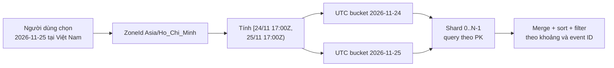
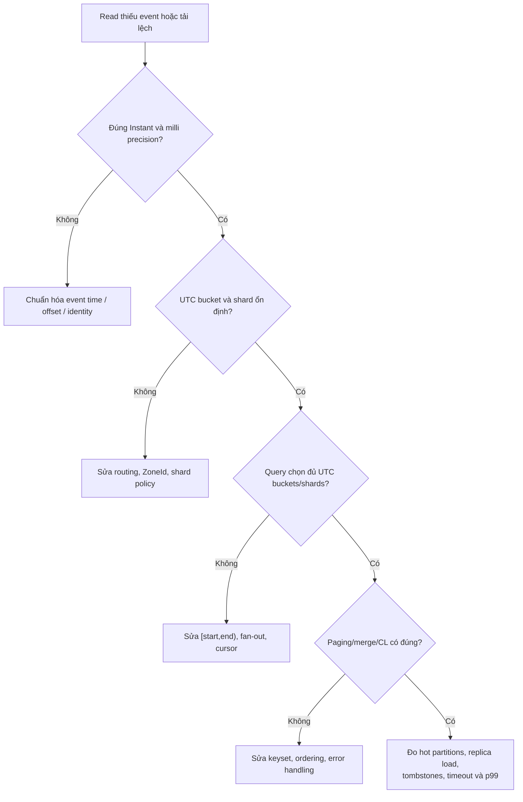

# Kiểm thử phân bố tải, thay đổi múi giờ và ranh giới ngày

## 1. Bài toán: dữ liệu thời gian có thể “đúng lúc ghi” nhưng sai khi đọc

Một nền tảng IoT nhận dữ liệu nhiệt độ từ hàng nghìn cảm biến. Mỗi sự kiện có ID, thời điểm phát sinh và giá trị đo. API có hai yêu cầu:

- Ghi liên tục với tốc độ cao, không để một cảm biến nóng làm nghẽn phần lớn cụm Cassandra.
- Hiển thị dữ liệu của **một ngày theo múi giờ người dùng**, kể cả khi ngày đó cắt qua hai ngày UTC hoặc có thay đổi giờ mùa hè (*daylight saving time*, DST).

Một thiết kế có vẻ ổn khi chạy trên máy lập trình viên vẫn có thể sai ở production:

1. Dùng `LocalDate.now()` theo múi giờ server để chọn partition, khiến writer ở hai vùng ghi vào hai bucket khác nhau.
2. Query `2026-11-25` theo ngày UTC dù người dùng muốn **ngày 25/11 tại Việt Nam**.
3. Đọc từ `00:00` tới `23:59:59`, bỏ mất giá trị có mili giây từ `23:59:59.001` đến `23:59:59.999`.
4. Dùng `plus(Duration.ofDays(1))` để tìm hết ngày tại vùng có DST: ngày chuyển giờ có thể chỉ 23 hoặc đến 25 giờ.
5. Bucket theo sensor nhưng không chia shard; một sensor có tải gấp nghìn lần các sensor khác tạo hot partition.
6. Chạy test với khóa ngẫu nhiên đều, kết luận cluster cân bằng, trong khi workload thật có một tenant hoặc sensor chiếm 80% traffic.

**Bài học này là về kiểm thử các tính chất đó**, không chỉ về cách tạo bảng time-series.

Trong module `SPRING_DATA_CASSANDRA`, ta kết hợp **Apache Cassandra**, Spring Data entity mapping, repository, `CassandraTemplate`, truy vấn CQL, partition key, consistency level, paging và quan sát hiệu năng để đưa ra quyết định có thể chứng minh bằng test.

### Kết quả học tập

Sau bài, bạn có thể:

- Lập mô hình thời gian tách biệt `Instant`, `LocalDate`, `ZoneId` và bucket key.
- Thiết kế partition theo **sensor + UTC bucket + shard**, xác định hậu quả của chọn kích thước bucket.
- Tạo truy vấn một ngày theo giờ địa phương bằng khoảng `[startInclusive, endExclusive)` và quét đúng những UTC buckets giao với khoảng đó.
- Viết kiểm thử cho ngày thường, đêm giao ngày, chuyển giờ DST, thay đổi múi giờ profile và event tới muộn.
- Sinh workload skewed/hot-key để kiểm tra phân bố tải, kích thước partition, số shard, read fan-out và tail latency.
- Kiểm tra độ chính xác mili giây của CQL `timestamp`, duplicate event ID, paging, consistency và các race khi dữ liệu đang được ghi.
- Phân biệt benchmark client, đo partition distribution và khả năng chịu lỗi của cluster; không kết luận từ một bài test RF=1.

> Các ví dụ dùng Java 17, Spring Data Cassandra và Java Driver 4.x theo cách thông dụng. Cấu hình cụm, hành vi driver và schema cần được xác minh trên **phiên bản triển khai thực tế**. Bài chưa thực thi Gradle/Docker hay vòng Content QA chuyên môn.

## 2. Định nghĩa thời gian trước khi định nghĩa partition key

### 2.1. Bốn đại lượng thường bị gộp nhầm

| Đại lượng | Ví dụ | Ý nghĩa |
| --- | --- | --- |
| **Thời điểm tuyệt đối** `Instant` | `2026-11-24T17:30:00Z` | Một mốc trên trục thời gian UTC; phù hợp cho `event_at`. |
| **Ngày lịch** `LocalDate` | `2026-11-25` | Một nhãn ngày không mang múi giờ; ý nghĩa phụ thuộc business zone. |
| **Múi giờ có quy tắc** `ZoneId` | `Asia/Ho_Chi_Minh`, `Europe/Berlin` | Chứa offset và lịch thay đổi offset trong thời gian. |
| **UTC bucket key** | `2026-11-24` | Nhãn partition tính từ `event_at` theo UTC, không phải ngày người dùng nhìn thấy. |

Cùng một `Instant` có thể thuộc ngày khác nhau tùy `ZoneId`:

```java
import java.time.Instant;
import java.time.ZoneId;
import java.time.ZoneOffset;

Instant instant = Instant.parse("2026-11-24T17:30:00Z");

System.out.println(instant.atZone(ZoneOffset.UTC).toLocalDate());
// 2026-11-24

System.out.println(
    instant.atZone(ZoneId.of("Asia/Ho_Chi_Minh")).toLocalDate()
);
// 2026-11-25
```

Cassandra `timestamp` lưu một thời điểm (độ chính xác mili giây), **không lưu ZoneId gốc**. Nếu ứng dụng cần nhớ thiết bị đã gửi timestamp kèm offset nào, lưu thêm metadata riêng. Không thể khôi phục chính xác `Asia/Ho_Chi_Minh` hay `Europe/Berlin` từ một `timestamp` đơn lẻ.

### 2.2. UTC là quy ước lưu trữ; business time zone là quy ước truy vấn

Ta chọn trong bài:

- `event_at`: `Instant` đã chuẩn hóa tới **mili giây**.
- `bucket_day`: `event_at` chuyển sang `UTC` rồi lấy `LocalDate`.
- `requestedDay`: ngày mà người dùng chọn trên màn hình.
- `requestedZone`: `ZoneId` của ngữ cảnh truy vấn, ví dụ `Asia/Ho_Chi_Minh`.
- `startInclusive/endExclusive`: hai `Instant` xác định toàn bộ ngày địa phương.
- `shard`: giá trị ổn định tính từ ID sự kiện, giới hạn theo số shard đã quy định.

**Lợi ích:** Khi người dùng đổi múi giờ trong profile, bản ghi **không cần chuyển sang partition khác**. API chỉ cần tính lại khoảng thời gian UTC tương ứng và chọn các UTC bucket liên quan.

**Đánh đổi:** Một ngày địa phương có thể chạm hai, đôi khi nhiều hơn, ngày UTC. API phải fan-out có kiểm soát sang các bucket/shard cần thiết rồi merge kết quả. Không được giả định “một local day = một Cassandra partition”.

### 2.3. Không lấy thời gian ingest thay event time một cách vô ý

```text
event_at     = thiết bị đo lúc 23:59:59.900
received_at  = server nhận lúc 00:00:02.100 hôm sau
bucket_day   = ngày UTC của event_at (theo policy đã chọn)
```

Nếu writer lấy `LocalDate.now()`, sự kiện đến muộn sẽ bị lưu sai bucket. Nếu nghiệp vụ muốn phân vùng theo **processing time** thay vì event time thì đó là thiết kế khác, phải ghi rõ và test riêng. Không trộn hai chính sách trong cùng một bảng.

## 3. Schema Cassandra theo truy vấn của sensor và UTC bucket

### 3.1. Keyspace lab

```sql
-- Chỉ dành cho lab một node trong data center dc1.
CREATE KEYSPACE IF NOT EXISTS learning
WITH replication = {
    'class': 'NetworkTopologyStrategy',
    'dc1': 1
};
```

Trong production, replication factor phải theo số node, data center và chính sách chịu lỗi thực tế. `RF=1` không chứng minh được read/write quorum của `RF=3` hoặc tình huống node offline.

### 3.2. Bảng đọc dữ liệu của một sensor theo khoảng thời gian

```sql
CREATE TABLE IF NOT EXISTS learning.telemetry_by_sensor_utc_day (
    tenant_id uuid,
    sensor_id uuid,
    bucket_day date,
    shard int,
    event_at timestamp,
    event_id uuid,
    event_type text,
    reading double,
    received_at timestamp,
    PRIMARY KEY (
        (tenant_id, sensor_id, bucket_day, shard),
        event_at,
        event_id
    )
) WITH CLUSTERING ORDER BY (
    event_at DESC,
    event_id ASC
)
AND default_time_to_live = 0;
```

Giải thích:

| Cột | Vai trò | Lưu ý kiểm thử |
| --- | --- | --- |
| `tenant_id` | Thành phần partition key | Phân quyền tenant phải kiểm tra ở application. |
| `sensor_id` | Thành phần partition key | Tải của sensor nóng không được đánh đồng với tải trung bình tenant. |
| `bucket_day` | Thành phần partition key | **Ngày UTC của event_at**, không phải ngày local. |
| `shard` | Thành phần partition key | Phân tải một sensor/day thành nhiều partitions. |
| `event_at` | Clustering key, giảm dần | Sắp theo thời điểm; CQL `timestamp` chuẩn mili giây. |
| `event_id` | Clustering key thứ hai | Phân biệt hai event tại cùng mili giây; ID ổn định khi retry. |
| `event_type`, `reading` | Dữ liệu | Giá trị đo và loại event, không lọc tùy ý bằng `ALLOW FILTERING`. |
| `received_at` | Metadata ingest | Dùng đo lag/late arrival, không quyết định bucket nếu policy dùng event time. |

Vì tập test cần quan sát chính xác boundary mà không bị dữ liệu biến mất, bảng lab dùng `default_time_to_live = 0`. Khi chuyển sang retention 7/30/90 ngày, phải kiểm thử thêm TTL/tombstone và compaction.

### 3.3. Một CQL INSERT hợp lệ

```sql
INSERT INTO learning.telemetry_by_sensor_utc_day (
    tenant_id, sensor_id, bucket_day, shard,
    event_at, event_id, event_type, reading, received_at
) VALUES (
    11111111-1111-1111-1111-111111111111,
    22222222-2222-2222-2222-222222222222,
    '2026-11-24',
    0,
    '2026-11-24T17:30:00.000Z',
    33333333-3333-3333-3333-333333333333,
    'TEMPERATURE',
    28.4,
    '2026-11-24T17:30:01.000Z'
);
```

Đây là sự kiện **17:30 UTC ngày 24/11**, tức **00:30 ngày 25/11 tại Việt Nam**. Vì vậy `bucket_day = '2026-11-24'` là **đúng** theo chính sách UTC-bucket, dù trang UI ngày 25/11 sẽ hiển thị nó.

### 3.4. Query luôn có đủ partition key

```sql
SELECT event_at, event_id, event_type, reading, received_at
FROM learning.telemetry_by_sensor_utc_day
WHERE tenant_id = 11111111-1111-1111-1111-111111111111
  AND sensor_id = 22222222-2222-2222-2222-222222222222
  AND bucket_day = '2026-11-24'
  AND shard = 0
  AND event_at >= '2026-11-24T17:00:00.000Z'
  AND event_at <  '2026-11-25T17:00:00.000Z'
LIMIT 100;
```

Đây mới là **một phần** của truy vấn “ngày 25/11 tại Việt Nam”: còn cần đọc UTC bucket ngày 25/11, và các `shard` khác nếu có.

**Không bỏ `bucket_day` hoặc `shard` để Cassandra tự scan nhiều partition**. Ứng dụng phải xác định trước các bucket và số shard, điều phối query rồi merge. Nếu cần truy vấn mọi sensor của tenant theo ngày, đó là một **query pattern khác** và nên có bảng read model được thiết kế riêng.

## 4. Ngày địa phương là một khoảng nửa mở, không phải mốc 23:59:59

### 4.1. Quy tắc đúng

Với `LocalDate day` và `ZoneId zone`:

```java
Instant start = day.atStartOfDay(zone).toInstant();
Instant end = day.plusDays(1).atStartOfDay(zone).toInstant();
```

Khoảng truy vấn là:

\[
[start,\ end)
\]

nghĩa là `event_at >= start` và `event_at < end`.

Nhờ vậy, một event ở **chính xác thời điểm bắt đầu ngày sau** không bị đếm hai lần, còn event ở `23:59:59.999` của ngày hiện tại vẫn được nhận.

### 4.2. Vì sao không dùng BETWEEN end-of-day?

```sql
-- Không khuyến nghị: end-of-day hardcoded dễ mất mili giây.
WHERE event_at >= '2026-11-25T00:00:00Z'
  AND event_at <= '2026-11-25T23:59:59Z';
```

Câu trên còn sai nếu business day theo `Asia/Ho_Chi_Minh` chứ không phải UTC. Thay vào đó, tính start/end theo `ZoneId`, chuyển thành `Instant` và bind vào CQL với toán tử `>=`/`<`.

### 4.3. Ngày 25/11/2026 theo múi giờ Việt Nam

Việt Nam sử dụng `Asia/Ho_Chi_Minh` với offset +07:00 tại thời điểm ví dụ. Khoảng local day:

```text
Ngày được chọn: 2026-11-25, Asia/Ho_Chi_Minh

Bắt đầu: 2026-11-25 00:00 +07:00
       = 2026-11-24T17:00:00Z

Kết thúc: 2026-11-26 00:00 +07:00
        = 2026-11-25T17:00:00Z

Khoảng UTC: [2026-11-24T17:00:00Z,
             2026-11-25T17:00:00Z)
```

Một ngày local này giao với **hai bucket UTC**: `2026-11-24` và `2026-11-25`.

### 4.4. Sơ đồ đọc xuyên ranh giới UTC



Số shard và số bucket quyết định số truy vấn con tiềm năng. Vì vậy phân tải ghi bằng shard phải được cân đối với **read fan-out**.

## 5. Thay đổi múi giờ không có nghĩa đổi Instant đã ghi

### 5.1. Người dùng chuyển từ Việt Nam sang Berlin

Một event có:

```text
event_at = 2026-11-24T23:30:00Z
```

Tùy múi giờ hiển thị:

- Ở `Asia/Ho_Chi_Minh`: `2026-11-25 06:30`, thuộc **ngày 25/11**.
- Ở `Europe/Berlin` sau khi đã hết giờ mùa hè: `2026-11-25 00:30`, cũng thuộc ngày 25/11.
- Ở `America/Los_Angeles`: thời điểm đó thuộc **ngày 24/11** theo local time.

**Cùng một event**, nhưng phân loại “ngày trên màn hình” thay đổi theo zone. Trong schema UTC-bucket, khóa partition **không đổi**. Dữ liệu chỉ được **lọc và trình bày khác** theo `ZoneId` của request.

### 5.2. Chính sách có thể lựa chọn

| Chính sách | Ý nghĩa | Điều phải test |
| --- | --- | --- |
| **Đọc theo zone hiện tại của người dùng** | Cùng event có thể đổi local date khi user đổi zone. | Khi đổi profile zone, query trả tập event theo ngày mới; không phải chuyển row. |
| **Gắn zone lịch sử lúc event phát sinh** | Event giữ ngày nghiệp vụ theo quy tắc ở thời điểm ghi. | Lưu `source_zone_id`/business date hoặc policy version riêng; đọc lại không dựa vào profile hiện tại. |
| **Ngày kế toán cố định** | Ví dụ mọi tenant chốt theo một zone riêng. | Rule chọn zone/version từ tenant policy, không dùng device/server default. |
| **Báo cáo theo UTC** | Không lệ thuộc zone người dùng, ổn định qua DST. | Query đúng UTC day và UI gắn nhãn UTC rõ ràng. |

Không có một chính sách đúng cho mọi nghiệp vụ. **Điều cần kiểm thử là hợp đồng đã chọn**, không chỉ kiểm tra code có gọi `atZone(...)` hay không.

### 5.3. Tại sao ZoneId.systemDefault() nguy hiểm?

```java
// SAI trong code định tuyến partition theo chính sách ổn định:
LocalDate bucket = instant.atZone(
    ZoneId.systemDefault()
).toLocalDate();
```

Kết quả phụ thuộc máy chạy: laptop Việt Nam, pod ở UTC, máy build ở Mỹ có thể chọn các bucket khác nhau. Không dùng `TimeZone.setDefault(...)` trong test tích hợp song song để mô phỏng nhiều zone; trạng thái này thuộc phạm vi JVM và dễ gây flaky tests.

Thay bằng tham số tường minh:

```java
public LocalDate utcBucket(Instant eventAt) {
    return eventAt.atZone(ZoneOffset.UTC).toLocalDate();
}

public LocalDate businessDay(Instant eventAt, ZoneId businessZone) {
    return eventAt.atZone(businessZone).toLocalDate();
}
```

Test bằng cách truyền các `ZoneId` khác nhau; không cần thay timezone toàn process.

## 6. DST: ngày có thể dài 23 hoặc 25 giờ

### 6.1. Chuyển sang giờ mùa hè tại Berlin

Ở `Europe/Berlin`, năm 2026:

- Ngày **29/03/2026** chuyển sang DST, nên ngày local kéo dài **23 giờ**.
- Ngày **25/10/2026** trở về giờ chuẩn, nên ngày local kéo dài **25 giờ**.

Hai ngày đó **không thể** diễn tả bằng “bắt đầu local day + đúng 24 giờ”.

| Ngày Berlin | Start UTC | End UTC (exclusive) | Thời lượng |
| --- | --- | --- | ---: |
| 2026-03-28 | `2026-03-27T23:00:00Z` | `2026-03-28T23:00:00Z` | 24 giờ |
| **2026-03-29** | `2026-03-28T23:00:00Z` | `2026-03-29T22:00:00Z` | **23 giờ** |
| **2026-10-25** | `2026-10-24T22:00:00Z` | `2026-10-25T23:00:00Z` | **25 giờ** |
| 2026-10-26 | `2026-10-25T23:00:00Z` | `2026-10-26T23:00:00Z` | 24 giờ |

Các thời điểm là kỳ vọng với quy tắc timezone hiện hành trong Java tzdb cho vùng/ngày đã nêu. Khi quy định múi giờ quốc gia thay đổi hoặc JDK/tzdb được cập nhật, cần kiểm tra lại dữ liệu lịch sử và policy reproducibility.

### 6.2. Cách tính đúng, không cộng 24 giờ

```java
import java.time.Duration;
import java.time.Instant;
import java.time.LocalDate;
import java.time.ZoneId;

ZoneId berlin = ZoneId.of("Europe/Berlin");

LocalDate springDay = LocalDate.of(2026, 3, 29);
Instant springStart = springDay.atStartOfDay(berlin).toInstant();
Instant springEnd = springDay.plusDays(1)
    .atStartOfDay(berlin).toInstant();

System.out.println(Duration.between(springStart, springEnd).toHours());
// 23

LocalDate autumnDay = LocalDate.of(2026, 10, 25);
Instant autumnStart = autumnDay.atStartOfDay(berlin).toInstant();
Instant autumnEnd = autumnDay.plusDays(1)
    .atStartOfDay(berlin).toInstant();

System.out.println(Duration.between(autumnStart, autumnEnd).toHours());
// 25
```

Nếu `end = start.plus(Duration.ofDays(1))`, ở hai ngày trên sẽ cho **một ranh giới sai** so với local midnight tiếp theo.

### 6.3. Local time không tồn tại hoặc xuất hiện hai lần

Ở Berlin:

- `2026-03-29 02:30` là **local wall-clock time không tồn tại** vì đồng hồ nhảy từ 02:00 lên 03:00.
- `2026-10-25 02:30` xảy ra **hai lần**, tương ứng hai offset khác nhau.

Chỉ lưu chuỗi `"2026-10-25T02:30"` mà không có zone/offset sẽ **mơ hồ**. Để ghi một event đúng, ưu tiên đầu vào có offset hoặc thời điểm tuyệt đối:

```text
2026-10-25T02:30:00+02:00 -> 2026-10-25T00:30:00Z
2026-10-25T02:30:00+01:00 -> 2026-10-25T01:30:00Z
```

Chúng có cùng local clock text nhưng là **hai Instant khác nhau**. Với input local date-time không offset, API phải định nghĩa policy: từ chối ambiguous/gap, hoặc yêu cầu caller chọn offset cụ thể. Không âm thầm đoán và làm mất dữ liệu.

### 6.4. Query boundary không được mất cả “giờ lặp lại”

Ngày 25/10/2026 ở Berlin phải trả cả hai event `02:30` trên nếu chúng thuộc ngày đó. Dùng khoảng `[startOfDay(berlin), startOfNextDay(berlin))` theo `Instant` sẽ chứa **cả hai**. Filter chuỗi `"02:00"` theo local time không thể phân biệt chúng.

## 7. Quyết định shard theo tải thay vì theo thói quen

### 7.1. Tại sao bucket ngày vẫn có thể nóng?

Một partition `(tenant_id, sensor_id, bucket_day)` đủ hợp lý với sensor phát 1 sự kiện/phút (khoảng 1.440 event/ngày). Nhưng một sensor đo liên tục hàng nghìn lần/giây có thể khiến một ngày chứa hàng triệu event. Hậu quả:

- Một tập replica phải phục vụ phần lớn writes cho partition đó.
- Partition lớn làm chậm đọc range/paging, tăng I/O và thời gian compaction.
- Memory/GC, SSTable reads và tombstone scans có thể tăng.
- Một sensor quá nóng không được “cân bằng” chỉ bằng việc tăng RF hoặc chuyển `LOCAL_ONE` thành `LOCAL_QUORUM`.

Tách thêm `shard` vào **partition key** là một chiến lược phân tán writes, đổi lấy read fan-out. Với dữ liệu time-series, cũng có thể rút bucket từ **ngày sang giờ**; cần đo cả số partitions tạo ra và patterns đọc.

### 7.2. Shard phải tính ổn định từ identity sự kiện

```java
package com.example.telemetry;

import java.util.UUID;

public final class StableShard {

    private StableShard() {
    }

    public static int of(UUID eventId, int shardCount) {
        if (eventId == null || shardCount <= 0) {
            throw new IllegalArgumentException(
                "eventId va shardCount phai hop le"
            );
        }

        long folded = eventId.getMostSignificantBits()
            ^ eventId.getLeastSignificantBits();

        return (int) Math.floorMod(folded, (long) shardCount);
    }
}
```

Đây là một thuật toán **ổn định theo UUID bits** cho mục đích minh họa. Nó không dùng tên pod, `ThreadLocalRandom` tại mỗi lần retry hay round-robin như một phần của key. Nếu cùng `eventId` được gửi lại, shard tính ra phải **giống nhau**.

Cần biết:

- Nếu event ID có phân bố không đều, shard dựa trên bits cũng có thể bị lệch; phải đo bằng ID distribution thực.
- `shardCount` là **một phần của phiên bản routing**; thay nó có thể khiến cùng event ID được đặt ở shard khác khi replay.
- Test phải kiểm tra stability trên nhiều JVM/ngôn ngữ nếu các producer không cùng Java. Dùng test vectors đã cố định.
- Không dùng `Math.abs(hash) % N` nếu hash có thể là giá trị âm cực tiểu (`Long.MIN_VALUE`).
- `shard` là key ứng dụng; Cassandra còn hash **toàn partition key** thành token để định tuyến tới node/replica.

### 7.3. Chọn nhiều shard không miễn phí

| Kiểu | Lợi ích | Chi phí đọc/vận hành |
| --- | --- | --- |
| `shard=0` duy nhất | Một partition mỗi sensor/day, query ít fan-out. | Có thể nóng nếu sensor ghi rất nhiều. |
| `shardCount=4` | Tải sensor/day chia qua tối đa 4 partitions. | Query cả ngày cần đọc tối đa 4 partition cho mỗi UTC bucket. |
| `shardCount=16` | Giảm tải trên một partition trong trường hợp ghi phân bố đều. | Fan-out 16×; cache, response merge và deadline phức tạp hơn. |
| Bucket giờ + ít shard | Giảm kích thước mỗi partition thời gian. | Đọc ngày cần nhiều buckets; event đến muộn phải truy cập bucket cũ. |

**Không có một số shard “đúng” chung.** Chọn từ số event/giây, bytes/event, read distribution, SLA và kết quả load test trên cluster tương tự production.

### 7.4. Tăng shard count cần chiến lược migration

Nếu từ ngày 01/12 đổi `N=4` sang `N=8`, các event cũ dùng 4 shards và event mới có thể dùng 8 shards. Một query ngày 30/11 phải biết số shard của ngày đó. Nếu một ngày có cả hai routing versions do rollout nhiều writer, query cần biết các phiên bản có hiệu lực hoặc có data migration/reconciliation.

Thiết kế rõ:

1. Version của routing policy, ngày/epoch áp dụng.
2. Khả năng đọc cả data cũ và mới.
3. Idempotency khi retry event cũ qua code mới.
4. Quy trình đồng bộ producer/consumer và rollback.
5. Test không bỏ sót event ở ranh giới deploy.

Nếu business yêu cầu **một event một hàng**, không thể bỏ qua vấn đề “cùng ID chuyển shard” khi thay `N`.

## 8. Java: lập kế hoạch UTC buckets cho một ngày local

### 8.1. Planner không phụ thuộc clock của server

Một helper chịu trách nhiệm **chuyển ngày nghiệp vụ thành khoảng Instant và các UTC dates liên quan**:

```java
package com.example.telemetry.time;

import java.time.Instant;
import java.time.LocalDate;
import java.time.ZoneId;
import java.time.ZoneOffset;
import java.util.ArrayList;
import java.util.List;
import java.util.Objects;

public final class UtcDayPlanner {

    private UtcDayPlanner() {
    }

    public record Window(
        LocalDate requestedDay,
        ZoneId zone,
        Instant startInclusive,
        Instant endExclusive,
        List<LocalDate> utcBuckets
    ) {
    }

    public static Window forLocalDay(
            LocalDate day, ZoneId zone) {

        Objects.requireNonNull(day, "day");
        Objects.requireNonNull(zone, "zone");

        Instant start = day.atStartOfDay(zone).toInstant();
        Instant end = day.plusDays(1)
            .atStartOfDay(zone).toInstant();

        if (!start.isBefore(end)) {
            // Ranh gioi bat thuong theo quy tac zone lich su
            // (vi du ngay da bi bo qua). Can policy nghiep vu.
            throw new IllegalArgumentException(
                "Ngay dia phuong khong co khoang thoi gian hop le"
            );
        }

        LocalDate first = start
            .atZone(ZoneOffset.UTC).toLocalDate();

        LocalDate last = end.minusNanos(1)
            .atZone(ZoneOffset.UTC).toLocalDate();

        List<LocalDate> buckets = new ArrayList<>();
        for (LocalDate cursor = first;
                !cursor.isAfter(last);
                cursor = cursor.plusDays(1)) {
            buckets.add(cursor);
        }

        return new Window(
            day, zone, start, end, List.copyOf(buckets)
        );
    }
}
```

`end.minusNanos(1)` chỉ dùng để xác định **ngày UTC cuối cùng giao với khoảng nửa mở**, không dùng làm giới hạn `<=` cho CQL. Trong query vẫn sử dụng `event_at < endExclusive` để tránh lặp và sai mili giây.

Vì các luật zone có thể thay đổi qua lịch sử, planner kiểm tra trường hợp local date không có khoảng thời gian sống. Trong ứng dụng có yêu cầu truy vấn ngày từng bị bỏ qua, cần một **policy rõ** (trả empty, báo lỗi, hoặc sử dụng lịch kế toán khác), không tự gán 24 giờ.

### 8.2. Ví dụ minh họa planner

```java
var vn = UtcDayPlanner.forLocalDay(
    LocalDate.of(2026, 11, 25),
    ZoneId.of("Asia/Ho_Chi_Minh")
);

System.out.println(vn.startInclusive());
// 2026-11-24T17:00:00Z

System.out.println(vn.endExclusive());
// 2026-11-25T17:00:00Z

System.out.println(vn.utcBuckets());
// [2026-11-24, 2026-11-25]
```

Với Berlin DST, `Window` cũng chứa đúng `start/end` để một ngày 23 giờ hoặc 25 giờ vẫn được bao phủ. **Không cần giả định mỗi ngày có đúng 86.400 giây**.

### 8.3. Cẩn trọng với số bucket khi truy vấn khoảng lớn

Helper ở trên dành cho **một local day**. Nếu API cho phép ngày bắt đầu và ngày kết thúc cách nhau nhiều tháng, không nên tạo danh sách mọi bucket rồi lập tức gửi hàng nghìn query đồng thời.

Đặt:

- Giới hạn khoảng ngày cho interactive API.
- Giới hạn số buckets × shards × sensors mỗi request.
- Phân trang ở cấp API hoặc chuyển sang job export.
- Concurrency cap và cancellation/deadline.
- Truy vấn bảng aggregated riêng cho dashboard dài hạn.

## 9. Java: xác định bucket và độ chính xác khi ingest

### 9.1. DTO event immutable

```java
package com.example.telemetry.ingest;

import java.time.Instant;
import java.util.UUID;

public record TelemetryEvent(
    UUID tenantId,
    UUID sensorId,
    UUID eventId,
    Instant eventAt,
    String eventType,
    double reading,
    Instant receivedAt
) {
}
```

### 9.2. Routing policy tập trung

```java
package com.example.telemetry.ingest;

import java.time.Instant;
import java.time.LocalDate;
import java.time.ZoneOffset;
import java.util.Objects;

import com.example.telemetry.StableShard;

public final class TelemetryRouting {

    private final int shardCount;

    public TelemetryRouting(int shardCount) {
        if (shardCount <= 0) {
            throw new IllegalArgumentException(
                "shardCount phai duong"
            );
        }
        this.shardCount = shardCount;
    }

    public record Destination(
        LocalDate utcDay,
        int shard,
        Instant cqlEventAt
    ) {
    }

    public Destination forEvent(TelemetryEvent event) {
        Objects.requireNonNull(event, "event");

        if (event.tenantId() == null
                || event.sensorId() == null
                || event.eventId() == null
                || event.eventAt() == null
                || event.receivedAt() == null
                || event.eventType() == null
                || !Double.isFinite(event.reading())) {
            throw new IllegalArgumentException(
                "Thong tin event bat buoc khong hop le"
            );
        }

        // Cassandra timestamp co do chinh xac mili giay.
        Instant normalizedAt = Instant.ofEpochMilli(
            event.eventAt().toEpochMilli()
        );

        LocalDate utcDay = normalizedAt
            .atZone(ZoneOffset.UTC).toLocalDate();

        int shard = StableShard.of(
            event.eventId(), shardCount
        );

        return new Destination(utcDay, shard, normalizedAt);
    }
}
```

Điều kiện quyết định idempotency:

- Retry cùng `eventId` và `eventAt` phải ra **cùng bucket và shard**.
- Nếu producer thay `eventAt` hoặc cấp `eventId` mới khi retry, hệ thống có thể tạo **hàng thứ hai**.
- Nếu hai event khác ID có `eventAt` cùng mili giây, clustering key `event_id` giúp phân biệt.
- Java `Instant` có thể chứa nanoseconds nhưng CQL `timestamp` chỉ lưu milliseconds; chuẩn hóa **trước khi tính bucket, dedup và so sánh**.
- `reading` là CQL `double`: phù hợp đo cảm biến thông thường nhưng không phù hợp giá trị tiền tệ cần độ chính xác thập phân; khi cần dùng `decimal`/`BigDecimal` theo nghiệp vụ.
- `receivedAt` phục vụ lag, không làm đổi `utcDay` nếu policy dựa trên event time.

### 9.3. Tránh lẫn lộn source timezone string

Nếu producer gửi:

```json
{
  "occurredAt": "2026-11-25T00:30:00+07:00"
}
```

đầu vào phải được parse thành cùng `Instant`:

```java
import java.time.OffsetDateTime;

Instant eventAt = OffsetDateTime.parse(
    "2026-11-25T00:30:00+07:00"
).toInstant();

// 2026-11-24T17:30:00Z
```

Không cắt chuỗi lấy `"2026-11-25"` để định tuyến vào UTC bucket. Nếu producer chỉ gửi `LocalDateTime` không offset/ZoneId, API phải định nghĩa zone hoặc từ chối vì không thể suy ra Instant đáng tin cậy.

## 10. Spring Data Cassandra: entity mapping giữ nguyên ý nghĩa key

### 10.1. Entity với composite partition key và clustering

```java
package com.example.telemetry.entity;

import java.time.Instant;
import java.time.LocalDate;
import java.util.UUID;

import org.springframework.data.cassandra.core.cql.Ordering;
import org.springframework.data.cassandra.core.mapping.Column;
import org.springframework.data.cassandra.core.mapping.PrimaryKeyColumn;
import org.springframework.data.cassandra.core.mapping.PrimaryKeyType;
import org.springframework.data.cassandra.core.mapping.Table;

@Table("telemetry_by_sensor_utc_day")
public class TelemetryRow {

    @PrimaryKeyColumn(
        name = "tenant_id", ordinal = 0,
        type = PrimaryKeyType.PARTITIONED)
    private UUID tenantId;

    @PrimaryKeyColumn(
        name = "sensor_id", ordinal = 1,
        type = PrimaryKeyType.PARTITIONED)
    private UUID sensorId;

    @PrimaryKeyColumn(
        name = "bucket_day", ordinal = 2,
        type = PrimaryKeyType.PARTITIONED)
    private LocalDate bucketDay;

    @PrimaryKeyColumn(
        name = "shard", ordinal = 3,
        type = PrimaryKeyType.PARTITIONED)
    private Integer shard;

    @PrimaryKeyColumn(
        name = "event_at", ordinal = 0,
        type = PrimaryKeyType.CLUSTERED,
        ordering = Ordering.DESCENDING)
    private Instant eventAt;

    @PrimaryKeyColumn(
        name = "event_id", ordinal = 1,
        type = PrimaryKeyType.CLUSTERED,
        ordering = Ordering.ASCENDING)
    private UUID eventId;

    @Column("event_type")
    private String eventType;

    private Double reading;

    @Column("received_at")
    private Instant receivedAt;

    protected TelemetryRow() {
    }

    public TelemetryRow(
            UUID tenantId, UUID sensorId,
            LocalDate bucketDay, int shard,
            Instant eventAt, UUID eventId,
            String eventType, double reading,
            Instant receivedAt) {
        this.tenantId = tenantId;
        this.sensorId = sensorId;
        this.bucketDay = bucketDay;
        this.shard = shard;
        this.eventAt = eventAt;
        this.eventId = eventId;
        this.eventType = eventType;
        this.reading = reading;
        this.receivedAt = receivedAt;
    }

    public UUID getTenantId() { return tenantId; }
    public UUID getSensorId() { return sensorId; }
    public LocalDate getBucketDay() { return bucketDay; }
    public Integer getShard() { return shard; }
    public Instant getEventAt() { return eventAt; }
    public UUID getEventId() { return eventId; }
    public String getEventType() { return eventType; }
    public Double getReading() { return reading; }
    public Instant getReceivedAt() { return receivedAt; }
}
```

Cần hiểu entity mapping chỉ phản ánh key đã thiết kế; annotation **không tự bảo đảm phân phối tải**. Nếu writer đặt `bucketDay` từ server timezone hoặc `shard` sai, Spring Data vẫn có thể ghi một hàng hợp lệ theo schema nhưng sai mô hình nghiệp vụ.

### 10.2. Lưu qua CassandraTemplate

```java
package com.example.telemetry.ingest;

import org.springframework.data.cassandra.core.CassandraTemplate;
import org.springframework.stereotype.Service;

import com.example.telemetry.entity.TelemetryRow;

@Service
public class TelemetryWriter {

    private final CassandraTemplate template;
    private final TelemetryRouting routing;

    public TelemetryWriter(
            CassandraTemplate template,
            TelemetryRouting routing) {
        this.template = template;
        this.routing = routing;
    }

    public void insert(TelemetryEvent event) {
        TelemetryRouting.Destination dest =
            routing.forEvent(event);

        TelemetryRow row = new TelemetryRow(
            event.tenantId(), event.sensorId(),
            dest.utcDay(), dest.shard(),
            dest.cqlEventAt(), event.eventId(),
            event.eventType(), event.reading(),
            event.receivedAt()
        );

        template.insert(row);
    }
}
```

`TelemetryRouting` nên được cấu hình làm Spring bean theo shard policy của tenant/sensor. Đoạn ví dụ chưa hiển thị bean configuration, validation authorization hoặc retry; những phần này cần bổ sung khi đưa vào ứng dụng.

**Cảnh báo:** `template.insert(row)` thông thường không có nghĩa “chèn nếu event chưa tồn tại”. Cassandra write có semantics upsert theo primary key; khi cần ngăn cùng ID nhưng payload khác, thiết kế `INSERT ... IF NOT EXISTS`/LWT hoặc dedup ở tầng ingest, và đo chi phí.

### 10.3. Repository theo MapId để lấy entity

```java
package com.example.telemetry.repository;

import org.springframework.data.cassandra.core.mapping.MapId;
import org.springframework.data.cassandra.repository.CassandraRepository;

import com.example.telemetry.entity.TelemetryRow;

public interface TelemetryRepository
        extends CassandraRepository<TelemetryRow, MapId> {
}
```

Với các field `@PrimaryKeyColumn` trực tiếp, `MapId` là một lựa chọn thể hiện ID gồm nhiều thành phần. Một repository method không có đầy đủ partition key hoặc muốn tự tạo cross-bucket scan cần xem lại query pattern, không đơn giản đổi tên method derived query.

## 11. Query một ngày địa phương qua nhiều UTC bucket và shard

### 11.1. Mẫu CQL cho một bucket/shard

```sql
SELECT event_at, event_id, event_type, reading, received_at
FROM learning.telemetry_by_sensor_utc_day
WHERE tenant_id = ?
  AND sensor_id = ?
  AND bucket_day = ?
  AND shard = ?
  AND event_at >= ?
  AND event_at < ?;
```

Các `?` được bind theo thứ tự: `tenantId`, `sensorId`, `utcDay`, `shard`, `startInstant`, `endInstant`.

Do query có đủ partition key, Cassandra có thể sử dụng clustering range mà không cần `ALLOW FILTERING`.

### 11.2. Prepared query dùng Java Driver 4.x

```java
package com.example.telemetry.query;

import java.time.Instant;
import java.time.LocalDate;
import java.util.UUID;

import com.datastax.oss.driver.api.core.CqlSession;
import com.datastax.oss.driver.api.core.DefaultConsistencyLevel;
import com.datastax.oss.driver.api.core.cql.BoundStatement;
import com.datastax.oss.driver.api.core.cql.PreparedStatement;

public final class TelemetryRangeGateway {

    private final CqlSession session;
    private final PreparedStatement range;

    public TelemetryRangeGateway(CqlSession session) {
        this.session = session;
        this.range = session.prepare(
            "SELECT event_at, event_id, event_type, reading, received_at " +
            "FROM learning.telemetry_by_sensor_utc_day " +
            "WHERE tenant_id = ? AND sensor_id = ? " +
            "AND bucket_day = ? AND shard = ? " +
            "AND event_at >= ? AND event_at < ?"
        );
    }

    public BoundStatement boundRange(
            UUID tenantId, UUID sensorId,
            LocalDate utcDay, int shard,
            Instant start, Instant end) {

        return range.bind(
            tenantId, sensorId, utcDay, shard, start, end
        )
        .setConsistencyLevel(DefaultConsistencyLevel.LOCAL_QUORUM)
        .setPageSize(100)
        .setIdempotent(true);
    }
}
```

`LOCAL_QUORUM` và `pageSize(100)` chỉ minh họa; chọn theo RF/CL/SLO và đặc điểm tải thực tế. Một câu query thành công có thể cần **nhiều fetch pages** để đọc hết range; một `ResultSet` hoặc `AsyncResultSet.currentPage()` không tự là toàn bộ partition.

### 11.3. Quy tắc lập kế hoạch query

```text
Input:
  tenantId
  sensorId
  requestedDay = 2026-11-25
  requestedZone = Asia/Ho_Chi_Minh
  shardCount = 4

Planner:
  start = 2026-11-24T17:00:00Z
  end   = 2026-11-25T17:00:00Z
  UTC buckets = {2026-11-24, 2026-11-25}

Subqueries:
  (bucket24, shard0..3) -> 4 queries
  (bucket25, shard0..3) -> 4 queries

Total possible queries = 2 buckets * 4 shards = 8
```

Không gửi 8 query đồng thời bằng mọi giá: cần giới hạn in-flight request theo tenant, thời hạn HTTP, số IDs sensor và số buckets. Với một dashboard đọc hàng nghìn sensors, fan-out có thể là hàng vạn truy vấn; hãy xây rollup/bảng theo truy vấn khác.

## 12. Kiểm thử đơn vị phần thời gian: nhanh, xác định, không phụ thuộc DB

### 12.1. Nguyên tắc xây fixtures

Một test tốt **không gọi thời gian hiện tại** để quyết định expected output. Dùng các `Instant.parse(...)` và `LocalDate.of(...)` cố định. Đặt ZoneId tường minh.

Các mốc cần có:

- Ngay trước UTC midnight: `23:59:59.999Z`.
- Ngay tại UTC midnight: `00:00:00.000Z`.
- Ngay trước local midnight Việt Nam: `16:59:59.999Z`.
- Ngay tại local midnight Việt Nam: `17:00:00.000Z`.
- Ngày Berlin chuyển DST mùa xuân 29/03/2026.
- Ngày Berlin trở lại giờ chuẩn 25/10/2026.
- User đổi ZoneId, nhưng eventAt/bucket UTC không đổi.
- Sự kiện có nanosecond nhưng Cassandra timestamp chỉ giữ milli.
- Event tới muộn nhưng `receivedAt` không thay bucket từ `eventAt`.

### 12.2. JUnit 5: ngày Việt Nam giao hai bucket UTC

```java
import static org.junit.jupiter.api.Assertions.*;

import java.time.Instant;
import java.time.LocalDate;
import java.time.ZoneId;
import java.util.List;

import org.junit.jupiter.api.Test;

import com.example.telemetry.time.UtcDayPlanner;

class UtcDayPlannerTest {

    @Test
    void vietnameseDayCrossesTwoUtcDateBuckets() {
        var window = UtcDayPlanner.forLocalDay(
            LocalDate.of(2026, 11, 25),
            ZoneId.of("Asia/Ho_Chi_Minh")
        );

        assertEquals(
            Instant.parse("2026-11-24T17:00:00Z"),
            window.startInclusive()
        );
        assertEquals(
            Instant.parse("2026-11-25T17:00:00Z"),
            window.endExclusive()
        );
        assertEquals(
            List.of(
                LocalDate.of(2026, 11, 24),
                LocalDate.of(2026, 11, 25)
            ),
            window.utcBuckets()
        );
    }

    @Test
    void endIsExclusiveAndBoundaryBelongsToNextDay() {
        var day25 = UtcDayPlanner.forLocalDay(
            LocalDate.of(2026, 11, 25),
            ZoneId.of("Asia/Ho_Chi_Minh")
        );

        Instant before = Instant.parse(
            "2026-11-25T16:59:59.999Z"
        );
        Instant boundary = Instant.parse(
            "2026-11-25T17:00:00.000Z"
        );

        assertTrue(!before.isBefore(day25.startInclusive())
            && before.isBefore(day25.endExclusive()));

        assertFalse(boundary.isBefore(day25.endExclusive()));
        assertEquals(
            boundary,
            UtcDayPlanner.forLocalDay(
                LocalDate.of(2026, 11, 26),
                ZoneId.of("Asia/Ho_Chi_Minh")
            ).startInclusive()
        );
    }
}
```

Với cùng loại test, có thể kiểm tra khoảng ngày liền kề không có gap và không overlap:

```text
end(day D, zone Z) == start(day D+1, zone Z)
```

Quy tắc này đúng với cách xác định ranh giới bằng `atStartOfDay` ngay cả khi có DST trong đa số ngày bình thường; đối với local dates từng bị loại bỏ hoàn toàn bởi thay đổi timezone lịch sử, phải áp dụng policy đã định nghĩa.

### 12.3. JUnit 5: kiểm tra ngày Berlin dài 23/25 giờ

```java
import static org.junit.jupiter.api.Assertions.*;

import java.time.Duration;
import java.time.Instant;
import java.time.LocalDate;
import java.time.ZoneId;

import org.junit.jupiter.api.Test;

import com.example.telemetry.time.UtcDayPlanner;

class DstWindowTest {

    private final ZoneId berlin = ZoneId.of("Europe/Berlin");

    @Test
    void springForwardDayHas23Hours() {
        var w = UtcDayPlanner.forLocalDay(
            LocalDate.of(2026, 3, 29), berlin
        );

        assertEquals(
            Instant.parse("2026-03-28T23:00:00Z"),
            w.startInclusive()
        );
        assertEquals(
            Instant.parse("2026-03-29T22:00:00Z"),
            w.endExclusive()
        );
        assertEquals(
            23,
            Duration.between(
                w.startInclusive(), w.endExclusive()
            ).toHours()
        );
    }

    @Test
    void fallBackDayHas25Hours() {
        var w = UtcDayPlanner.forLocalDay(
            LocalDate.of(2026, 10, 25), berlin
        );

        assertEquals(
            Instant.parse("2026-10-24T22:00:00Z"),
            w.startInclusive()
        );
        assertEquals(
            Instant.parse("2026-10-25T23:00:00Z"),
            w.endExclusive()
        );
        assertEquals(
            25,
            Duration.between(
                w.startInclusive(), w.endExclusive()
            ).toHours()
        );
    }
}
```

Test dữ liệu DST này nên được giữ như **regression test** qua các lần nâng cấp JDK/tzdb hoặc thay chính sách timezone nghiệp vụ.

## 13. Kiểm thử giờ địa phương không tồn tại và giờ lặp lại

### 13.1. Kiểm tra valid offsets trước khi parse thành Instant

Nếu API nhận `LocalDateTime` cùng tên vùng, cần biết thời điểm ấy hợp lệ/duy nhất hay không. Khi đồng hồ nhảy tới trong mùa xuân, một số phút theo giờ địa phương **không tồn tại**; khi đồng hồ lùi lại, cùng phút có thể xuất hiện **hai lần**.

```java
package com.example.telemetry.time;

import java.time.LocalDateTime;
import java.time.ZoneId;
import java.time.ZoneOffset;
import java.util.List;

public final class LocalTimeValidator {

    private LocalTimeValidator() {
    }

    public static ZoneOffset requireUnambiguous(
            LocalDateTime local, ZoneId zone) {

        List<ZoneOffset> offsets =
            zone.getRules().getValidOffsets(local);

        if (offsets.isEmpty()) {
            throw new IllegalArgumentException(
                "Local time khong ton tai do chuyen mui gio"
            );
        }

        if (offsets.size() > 1) {
            throw new IllegalArgumentException(
                "Local time mo ho: can offset cu the"
            );
        }

        return offsets.get(0);
    }
}
```

Nếu chỉ có một valid offset, chuyển bằng `local.atOffset(offset).toInstant()`. Với local datetime có hai offset, caller cần **chọn offset** hoặc gửi `OffsetDateTime`; không tự chọn lần xuất hiện thứ nhất.

### 13.2. Kiểm thử gap và overlap

```java
import static org.junit.jupiter.api.Assertions.*;

import java.time.LocalDateTime;
import java.time.ZoneId;
import java.time.Instant;
import java.util.List;

import org.junit.jupiter.api.Test;

class AmbiguousLocalTimeTest {

    private final ZoneId berlin = ZoneId.of("Europe/Berlin");

    @Test
    void springGapHasNoValidOffset() {
        var local = LocalDateTime.of(2026, 3, 29, 2, 30);
        assertTrue(berlin.getRules()
            .getValidOffsets(local).isEmpty());
    }

    @Test
    void autumnOverlapHasTwoValidOffsets() {
        var local = LocalDateTime.of(2026, 10, 25, 2, 30);
        var offsets = berlin.getRules().getValidOffsets(local);

        assertEquals(2, offsets.size());

        List<Instant> instants = offsets.stream()
            .map(offset -> local.atOffset(offset).toInstant())
            .toList();

        assertEquals(
            List.of(
                Instant.parse("2026-10-25T00:30:00Z"),
                Instant.parse("2026-10-25T01:30:00Z")
            ),
            instants
        );
    }
}
```

Test không chỉ kiểm tra số rows mà còn phải kiểm tra **hai Instants khác nhau** được lưu, cùng ngày business Berlin và không bị dedup vì chung chuỗi `"02:30"`.

### 13.3. Test với múi giờ không có DST

`Asia/Ho_Chi_Minh` không có DST tại thời điểm ví dụ năm 2026. Nhưng không từ đó suy ra mọi `ZoneId` hoặc toàn bộ lịch sử của vùng đều có ngày 24 giờ.

```java
var zone = ZoneId.of("Asia/Ho_Chi_Minh");
var window = UtcDayPlanner.forLocalDay(
    LocalDate.of(2026, 11, 25), zone
);

assertEquals(
    24,
    java.time.Duration.between(
        window.startInclusive(), window.endExclusive()
    ).toHours()
);
```

Test Việt Nam kiểm tra **dịch ngày UTC**; test Berlin kiểm tra **DST**. Hai loại lỗi rất khác nhau.

## 14. Kiểm thử đổi ZoneId của người dùng và chính sách lịch sử

### 14.1. Thay đổi múi giờ profile không thay khóa Cassandra

Giả sử một event:

```text
event_at     = 2026-11-25T02:00:00.000Z
bucket_day   = 2026-11-25
shard        = 2
event_id     = E
```

Khi user đổi zone từ `Asia/Ho_Chi_Minh` sang `America/Los_Angeles`:

- Ở Việt Nam, event thuộc **ngày 25/11**.
- Ở Los Angeles (PST tại mốc ví dụ), event thuộc **ngày 24/11**.
- `bucket_day` và `shard` đã lưu **không đổi**.
- Query ngày 25/11 phải tính lại khoảng UTC theo zone mới; có thể không còn event E.
- Query ngày 24/11 theo zone mới có thể chứa E.

```java
import static org.junit.jupiter.api.Assertions.*;
import java.time.Instant;
import java.time.ZoneId;
import java.time.ZoneOffset;
import java.time.LocalDate;

Instant at = Instant.parse("2026-11-25T02:00:00Z");

assertEquals(
    LocalDate.of(2026, 11, 25),
    at.atZone(ZoneId.of("Asia/Ho_Chi_Minh")).toLocalDate()
);
assertEquals(
    LocalDate.of(2026, 11, 24),
    at.atZone(ZoneId.of("America/Los_Angeles")).toLocalDate()
);
assertEquals(
    LocalDate.of(2026, 11, 25),
    at.atZone(ZoneOffset.UTC).toLocalDate()
);
```

### 14.2. Giữ zone cố định trong một lượt phân trang

Một lỗi tinh vi:

```text
Page 1: user zone = Asia/Ho_Chi_Minh
  -> [24/11 17:00Z, 25/11 17:00Z)

User đổi profile zone.

Page 2: user zone = America/Los_Angeles
  -> khoảng UTC khác hoàn toàn
```

Nếu cursor chỉ chứa `page=2` mà không giữ **zone, requestedDay, khoảng thời gian và routing version**, hai trang có thể bỏ sót hoặc trùng event.

Chính sách an toàn:

1. Snapshot tham số `requestedDay`, `ZoneId`, `start/end` và shard policy ở đầu request.
2. Cursor phải gắn với query identity và authorization context.
3. Nếu muốn áp dụng zone mới, bắt đầu **một query mới**, không nối paging state cũ.
4. Không tin client tự đưa zone/cursor chưa được kiểm tra, ký token và giới hạn tuổi thọ.
5. Cursor không tạo snapshot bất biến; inserts/TTL giữa các lần đọc vẫn có thể đổi tập kết quả.

### 14.3. Khi cần ổn định lịch sử qua cập nhật tzdb

`ZoneId` chứa luật timezone từ tzdb của môi trường chạy. Một chính phủ có thể sửa luật offset; nâng JDK/tzdb có thể đổi cách chuyển một số ngày trong quá khứ/tương lai.

Nếu báo cáo kế toán/pháp lý phải tái lập:

- Xác định business date được **chốt khi event xảy ra** hay luôn tính lại bằng rule hiện tại.
- Nếu phải chốt, lưu `business_date`, `business_zone_id` và policy version trong read model phù hợp.
- Không sửa partition UTC của một event chỉ vì profile zone đổi.
- Chạy regression tests fixed Instants khi nâng JDK/tzdb.
- Có kế hoạch migration/đối soát nếu pháp luật đổi lịch ngày.

Một offset `+07:00` **không thay thế** tên `ZoneId` có lịch sử quy tắc; offset chỉ mô tả một thời điểm.

## 15. Kiểm thử 00:00, nanosecond và event tới muộn

### 15.1. Bốn thời điểm sát local midnight Việt Nam

| Event UTC | Ngày Việt Nam | Thuộc query 25/11? | UTC bucket |
| --- | --- | --- | --- |
| `2026-11-24T16:59:59.999Z` | 24/11 23:59:59.999 | Không | 2026-11-24 |
| `2026-11-24T17:00:00.000Z` | 25/11 00:00:00.000 | **Có** | 2026-11-24 |
| `2026-11-25T16:59:59.999Z` | 25/11 23:59:59.999 | **Có** | 2026-11-25 |
| `2026-11-25T17:00:00.000Z` | 26/11 00:00:00.000 | Không | 2026-11-25 |

Một truy vấn `WHERE bucket_day = '2026-11-25'` đơn lẻ **không** trả đủ ngày Việt Nam 25/11.

### 15.2. Độ chính xác của Cassandra timestamp

`Instant` có nanoseconds, trong khi CQL `timestamp` dùng milliseconds. Hai giá trị:

```text
2026-11-25T00:00:00.123456789Z
2026-11-25T00:00:00.123999999Z
```

có thể cùng được lưu thành `2026-11-25T00:00:00.123Z` nếu chuẩn hóa tới milli.

Vì vậy:

- Chuẩn hóa `eventAt` trước khi tạo key, so sánh duplicate, hoặc đặt query bounds.
- Có `event_id` để phân biệt events khác nhau nhưng trùng milli.
- Không dựa vào sự khác nhau ở nanoseconds để coi chúng có clustering key khác khi `event_id` cũng trùng.
- Test cả mốc trước Unix epoch nếu nghiệp vụ có dữ liệu lịch sử.
- Dùng cùng policy truncation/rounding ở mọi writer và read-side cursor.

### 15.3. Tách event time với ingestion time

```text
eventAt    = 2026-11-24T23:59:59.999Z
receivedAt = 2026-11-25T00:00:10.000Z
bucketDay  = 2026-11-24
```

Event đến muộn hơn 10 giây nhưng vẫn được ghi vào bucket UTC 24/11. Test writer trước/sau midnight rồi so `bucketDay` với `eventAt`, **không phải `receivedAt`**.

Với event được backfill sau nhiều ngày, metadata `receivedAt` là hiện tại nhưng bucket theo event time vẫn thuộc ngày lịch sử. Nếu bảng có TTL, TTL từ lúc ghi không tự khởi đầu tại `eventAt`.

### 15.4. Replay không tự đồng nghĩa unique insert

Cùng `eventId`, `eventAt` và routing version giúp retry nhắm đúng primary key; nhưng Cassandra `INSERT` thông thường là upsert. Nếu retry payload khác, dữ liệu có thể bị ghi đè theo write timestamp/LWW. Khi cần một ID bất biến, cần conditional insert/dedup ở tầng ingest và kiểm thử `[applied]`.

## 16. Chỉ số phân bố tải: đếm partition, đo replica và đo đọc

### 16.1. Ba tầng đo lường

**Tầng ứng dụng:**

- Số event của từng tenant/sensor/UTC bucket/shard.
- Kích thước bytes và rows của partition; write throughput trên hot key.
- p50/p95/p99/max events per partition.
- Số UTC buckets × shards cần đọc mỗi business day.

**Tầng Cassandra:**

- Token assignment của toàn partition key trên ring và replica placement theo RF.
- Node CPU, GC, disk/network, read/write latency, pending compaction.
- Hot partitions dù dung lượng đĩa mỗi node nhìn có vẻ cân đối.
- Tombstone scans, SSTable reads và replica timeouts.

**Tầng service:**

- In-flight driver requests, queue depth, bounded concurrency.
- Read/write p95/p99, error rate, retry count.
- Số subqueries một page UI, chi phí merge, memory/cursor size.

Không kết luận cluster cân bằng chỉ vì histogram partition trong Java đẹp; token/replica topology và RF vẫn quyết định node nào xử lý. Ngược lại, ổ đĩa các node tương tự không chứng minh không tồn tại hot key.

### 16.2. Những phép đo nên có

Từ `Map<PartitionKey, Long>` chứa số event:

- `distinctPartitionCount`.
- `maxPartitionEvents` và `p95/p99PartitionEvents`.
- `max / average`, tỷ lệ event thuộc nhóm 1% partition nóng nhất.
- Histogram từng shard của **sensor nóng nhất**.
- Tốc độ ghi trong cửa sổ 1 phút/5 phút thay vì chỉ tổng ngày.
- Read fan-out và p99 khi tăng shard count.

Tăng shard giúp write phân tán nhưng cũng làm query ngày có nhiều streams phải đọc; cần kiểm tra cả hai chiều.

### 16.3. Ước lượng trước khi làm benchmark

Một sensor có `1.000 events/s` trong 24 giờ tạo **86.400.000 events/day**. Nếu payload trung bình khoảng 300 bytes ứng dụng, tổng payload đã hơn 25 GB/ngày **trước replication, SSTable overhead và compaction**. Đây là dấu hiệu cần cân nhắc bucket giờ và nhiều shard, không thể mặc định một partition mỗi ngày.

Đây là phép tính minh họa, **không phải benchmark dung lượng Cassandra**. Các giá trị thật còn phụ thuộc compression, kiểu dữ liệu, index, RF và compaction.

## 17. Sinh workload lệch tải có thể tái hiện

### 17.1. Một sensor nóng chiếm 80% lưu lượng

Bộ sinh dưới đây dùng ID ổn định, 100.000 events, trong đó 80.000 thuộc một sensor; phần còn lại chia cho 500 sensors.

```java
package com.example.telemetry.load;

import java.nio.charset.StandardCharsets;
import java.time.Instant;
import java.time.LocalDate;
import java.time.ZoneOffset;
import java.util.HashMap;
import java.util.Map;
import java.util.UUID;

import com.example.telemetry.StableShard;

public final class SkewedFixture {

    public record Partition(
        UUID tenantId,
        UUID sensorId,
        LocalDate utcDay,
        int shard
    ) {
    }

    private static UUID stableId(String text) {
        return UUID.nameUUIDFromBytes(
            text.getBytes(StandardCharsets.UTF_8)
        );
    }

    public static Map<Partition, Long> build(
            int eventCount, int hotPercent, int shards) {

        if (eventCount < 0 || hotPercent < 0
                || hotPercent > 100 || shards <= 0) {
            throw new IllegalArgumentException("Fixture sai");
        }

        UUID tenant = stableId("tenant-A");
        UUID hotSensor = stableId("sensor-HOT");
        Instant start = Instant.parse(
            "2026-11-25T00:00:00Z"
        );

        Map<Partition, Long> counts = new HashMap<>();
        int hotCount = (int) (
            (long) eventCount * hotPercent / 100L
        );

        for (int i = 0; i < eventCount; i++) {
            UUID sensor = i < hotCount
                ? hotSensor
                : stableId("sensor-" + (i % 500));

            UUID eventId = stableId("event-" + i);

            long msIntoDay =
                Math.floorMod(i * 7919L, 86_400_000L);

            Instant eventAt =
                start.plusMillis(msIntoDay);

            Partition key = new Partition(
                tenant,
                sensor,
                eventAt.atZone(ZoneOffset.UTC).toLocalDate(),
                StableShard.of(eventId, shards)
            );

            counts.merge(key, 1L, Long::sum);
        }

        return counts;
    }
}
```

Fixture này tạo skew có chủ ý; không tuyên bố nó đại diện mọi phân bố production. Dùng đầu vào thực đã ẩn danh để bổ sung những trường hợp ID có entropy không đều.

### 17.2. Test hot sensor được chia qua 8 shard

```java
import static org.junit.jupiter.api.Assertions.*;

import java.nio.charset.StandardCharsets;
import java.util.Map;
import java.util.UUID;

import org.junit.jupiter.api.Test;
import com.example.telemetry.load.SkewedFixture;

class ShardDistributionTest {

    @Test
    void hotSensorShouldSpreadAcrossEightShards() {
        var counts = SkewedFixture.build(100_000, 80, 8);

        UUID hot = UUID.nameUUIDFromBytes(
            "sensor-HOT".getBytes(StandardCharsets.UTF_8)
        );

        long total = counts.entrySet().stream()
            .filter(e -> e.getKey().sensorId().equals(hot))
            .mapToLong(Map.Entry::getValue)
            .sum();

        long largest = counts.entrySet().stream()
            .filter(e -> e.getKey().sensorId().equals(hot))
            .mapToLong(Map.Entry::getValue)
            .max().orElse(0);

        assertEquals(80_000L, total);

        // N=8: ky vong trung binh 12,5%/shard.
        // Nguong hoc tap rong 20%; khong phai SLO chung.
        assertTrue(largest <= total / 5);
    }
}
```

Kết quả phân bố phụ thuộc input event ID và thuật toán routing; benchmark thực tế phải kiểm tra histogram và node/replica load, không chỉ một assertion với test fixture cố định.

### 17.3. So sánh shardCount=1 và shardCount=8

- N=1: hot sensor có thể dồn 80.000 events vào **một partition/ngày**.
- N=8: có thể chia hot sensor ra tối đa **tám partition/ngày**.
- Nhưng query toàn ngày cho sensor đó phải kiểm tra tới 8 shards trên mỗi UTC bucket.

**Điều cần chứng minh:** max partition size và write p99 giảm **đồng thời** read fan-out/p99 vẫn trong budget.

### 17.4. Các kịch bản skew khác

1. **Hot tenant:** 1% tenants tạo 90% lưu lượng.
2. **Midnight burst:** 50% events vào 10 phút giao ngày.
3. **Historical backfill:** hàng triệu events về cùng bucket cũ.
4. **Reconnect:** hàng nghìn thiết bị offline gửi dữ liệu cùng lúc.
5. **Zone-switch:** nhiều user đổi zone, query đọc tập UTC bucket khác.
6. **Ordered/low-entropy IDs:** hash shard có thể không phân bố như UUID ngẫu nhiên.
7. **Read-hot sensor:** writes phân đều nhưng dashboard tập trung vào vài sensor.
8. **Routing version rollout:** writer N=4 và N=8 cùng tồn tại.

Uniform random keys là **baseline**, không phải đại diện production.

## 18. Ma trận benchmark và kiểm soát biến

| Kịch bản | Biến được kiểm tra | Metric chính |
| --- | --- | --- |
| **Uniform** | 1.000 sensors, tải đều, shard=1 | Node/replica distribution, p95/p99. |
| **Hot sensor** | 80% writes trên một sensor | Hot partition và tail latency. |
| **Shard comparison** | Cùng events với 1/4/8/16 shards | Max partition rows, read fan-out. |
| **Hour bucket** | Chuyển bucket ngày sang giờ | Partition size và số query đọc ngày. |
| **Local midnight** | Burst quanh 00:00 Việt Nam | Đúng UTC buckets/range, lỗi thiếu/đúp. |
| **Berlin DST** | Ngày dài 23/25 giờ, gap/overlap | Ngày và event IDs trả về đúng. |
| **Late arrival** | 10% events trễ 1 ngày, số ít trễ 30 ngày | Bucket cũ, TTL, compaction. |
| **Replay** | Retry cùng event identity | Key/routing ổn định, không nhân đôi. |
| **Read-heavy** | Một dashboard đọc nhiều sensors | Subqueries, paging và p99. |
| **Failure** | Thử trên cluster nhiều replica | Timeouts, CL và recovery. |

### 18.1. Giữ biến nền giống nhau

Khi so các phương án:

- Cùng `event IDs`, event time, payload sizes, tenant/sensor distribution.
- Cùng Cassandra version, RF, local DC, CL, compression và driver config.
- Cùng arrival rate, concurrency, timeout/retry policy.
- Cùng phương pháp warm-up và nhiều lần đo.
- Ghi **tỷ lệ lỗi** cùng latency: p99 thấp nhưng nhiều requests timeout không phải kết quả tốt.
- Không dùng cluster RF=1 để suy ra latency/availability của RF=3 multi-DC.

### 18.2. Một bản ghi benchmark nên có

```text
scenario_name
event_count
target_events_per_second
accepted_events_per_second
tenant_count
sensor_count
distinct_partitions
max_events_per_partition
p95_partition_events
shard_count
read_subqueries_per_request
write_p95_ms / write_p99_ms
read_p95_ms / read_p99_ms
timeout_rate
retry_count
node_cpu / disk / network
replica_read_write_latency
```

Đo theo cửa sổ 1 phút, 5 phút và 1 giờ để không dùng tổng ngày che burst ở midnight.

## 19. Kết quả đọc đa bucket/shard: merge và paging

### 19.1. Thứ tự trong một partition chưa phải thứ tự toàn cục

Với clustering `event_at DESC, event_id ASC`, mỗi partition có thứ tự theo khóa. Nhưng nếu một ngày local chạm hai UTC buckets và tám shards, ứng dụng cần merge.

```text
(bucket24, shard0): 23:59Z, 23:30Z
(bucket24, shard1): 23:58Z, 23:10Z
(bucket25, shard0): 00:15Z, 00:01Z
(bucket25, shard1): 00:10Z, 00:02Z
```

Đối với tập dữ liệu nhỏ, có thể sort:

```java
Comparator<TelemetryRow> newestFirst =
    Comparator.comparing(TelemetryRow::getEventAt)
        .reversed()
        .thenComparing(TelemetryRow::getEventId);
```

Với dữ liệu lớn, dùng **k-way merge** với priority queue và fetch pages có giới hạn; không tải toàn bộ buckets vào RAM rồi sort.

### 19.2. Một page từ một shard không đủ global top-N

Giả sử API muốn 50 events mới nhất. Query 50 rows từ shard 0 chưa chắc đủ: shard 1 có thể chứa những events mới hơn.

Thuật toán gợi ý:

1. Tính UTC buckets từ ngày local.
2. Lấy danh sách shards hợp lệ theo routing version.
3. Mở các streams `(bucket,shard)` với concurrency bound.
4. Giữ phần tử đầu mỗi stream theo sort key.
5. Chọn event tiếp theo bằng priority queue.
6. Khi current page cạn, fetch trang kế của **đúng stream**.
7. Dừng ở N rows và lưu cursor nếu muốn tiếp tục.
8. Nếu stream lỗi, trả error/partial result có nhãn; không âm thầm coi là đầy đủ.

### 19.3. Cursor đa stream phức tạp hơn một paging state

Paging state của Java Driver gắn với **một query cùng bind values**, không đại diện một câu hỏi đã fan-out sang nhiều partitions. API cursor cần giữ hoặc tham chiếu:

- `requestedDay`, `ZoneId`/`start/end`.
- `tenantId`, `sensorId`, authorization context.
- Routing version, danh sách buckets/shards.
- Vị trí từng stream/paging state và lookahead rows chưa emit.
- Tie-breaker của row cuối; giới hạn kích thước/tuổi thọ cursor.
- Chữ ký hoặc storage bảo vệ token trước khi nhận lại từ client.

Không ghép các paging-state bytes tùy ý rồi đoán một cursor chung. Nếu không thể làm an toàn, cung cấp API nhỏ hơn hoặc export job.

### 19.4. Paging không tạo snapshot bất biến

Trong lúc lấy trang 2, event mới có thể được chèn vào bucket cũ, hoặc event đang đọc hết TTL. Paging state hay CL=QUORUM không biến nhiều request thành một transaction snapshot.

Hợp đồng API nên phân biệt:

- **Live view**: chấp nhận thay đổi và refresh.
- **Historical finalized view**: dùng watermark/cutoff và reconciliation.
- **Reproducible export**: cần nguồn dữ liệu/snapshot bất biến hoặc pipeline khác.

## 20. TTL, TWCS và dữ liệu tới muộn: thêm một lớp kiểm thử

### 20.1. Event time khác thời điểm bắt đầu TTL

`USING TTL 604800` là **7 ngày tính từ lần ghi**, không tự dùng `event_at` làm thời điểm bắt đầu.

Ví dụ event xảy ra ngày 01/11 nhưng được backfill ngày 25/11 rồi ghi với TTL 7 ngày. Nó có thể sống đến đầu tháng 12, dù retention “7 ngày từ eventAt” đã hết trước ngày backfill.

Nếu chính sách dựa trên event time, tính TTL **còn lại**:

```java
import java.time.Duration;
import java.time.Instant;

Instant eventAt = Instant.parse("2026-11-01T10:00:00Z");
Instant now = Instant.parse("2026-11-25T10:00:00Z");

Instant deadline = eventAt.plus(Duration.ofDays(7));
long remainingSeconds =
    Duration.between(now, deadline).getSeconds();

if (remainingSeconds <= 0) {
    // Event da qua retention deadline:
    // bo qua hoac dua vao luong audit theo policy.
}
```

Production cần quy định rounding, min/max TTL, clock skew và trường hợp deadline trong tương lai quá xa. Không mặc định `default_time_to_live=2592000` giải quyết retention tính từ event time cho late writes.

### 20.2. TWCS phù hợp với workload nào?

Với dữ liệu time-series ghi chủ yếu theo thời gian và TTL tương đối đồng nhất, `TimeWindowCompactionStrategy` (TWCS) có thể phù hợp:

```sql
-- CHỈ minh họa; không áp dụng lên production khi chưa đánh giá.
ALTER TABLE learning.telemetry_by_sensor_utc_day
WITH compaction = {
    'class': 'TimeWindowCompactionStrategy',
    'compaction_window_unit': 'DAYS',
    'compaction_window_size': '1'
};
```

Trước khi chọn, cần kiểm thử:

- Ghi theo thời gian hay có nhiều **late/out-of-order writes**?
- TTL đồng đều hay nhiều lớp retention khác nhau?
- Dữ liệu cũ được backfill nhiều và thường xuyên không?
- Kích thước partition và SSTable thực tế?
- Tombstone scans, read amplification và compaction backlog?
- Tỷ lệ expiry có tập trung thành peak workload không?

TWCS **không sửa sai bucket key**, không bảo đảm hết TTL là bytes được purge vật lý ngay, và không phải lời giải mặc định cho mọi bảng có time-series.

### 20.3. gc_grace, replica offline và compaction

Dữ liệu hết TTL không còn là giá trị sống nhưng tombstones/SSTables có thể tồn tại tới khi đủ điều kiện dọn. `gc_grace_seconds`, repair cadence và trạng thái replicas có vai trò trong việc ngăn dữ liệu xóa bị đưa trở lại.

Không giảm `gc_grace_seconds` về 0 chỉ để “đo đĩa giảm nhanh”. Kiểm thử tính an toàn của replication/repair cần cluster nhiều replica cùng runbook vận hành, không chỉ một node lab.

## 21. Consistency, asynchronous I/O và read-after-write trong test

### 21.1. Async không sửa data model

Spring Data repository, `CassandraTemplate`, Java Driver `executeAsync` và Reactive Cassandra có cách gọi khác nhau nhưng đều tuân thủ:

- Partition key và token routing.
- Replication factor, replica placement, local data center.
- Read/write consistency level.
- Timestamp và last-write-wins khi ghi đè.
- LWT/optimistic locking nếu yêu cầu conditional update.
- Paging, read amplification, tombstones.
- Timeout/retry và idempotency của mutation.

Chuyển từ `execute` sang `executeAsync` có thể giảm số thread application bị giữ khi chờ I/O; nó **không làm một hot partition thành lạnh**.

### 21.2. Read-after-write cần đúng thứ tự và đúng key

Nếu test “ghi xong đọc thấy event”, các bước tối thiểu:

1. Đợi thao tác ghi báo **thành công** theo contract của client.
2. Bind **đúng cùng partition key và clustering key** khi đọc.
3. Chọn CL theo mục tiêu. Với RF=3 trong một DC, read/write `LOCAL_QUORUM` có quorum overlap trong các điều kiện bình thường.
4. Xem xét concurrent writers, write timestamps và khả năng cùng event ID bị ghi nội dung khác.
5. Trong multi-DC, không suy diễn hai `LOCAL_QUORUM` ở hai DC khác nhau có cùng tính chất như quorum giao nhau trong một DC.
6. Nếu đọc không thấy row, kiểm tra timezone/bucket/shard trước khi cho rằng Cassandra đã mất dữ liệu.

**Thất bại do sai khóa** có thể trông rất giống “eventual consistency” nếu application ghi vào UTC bucket 24/11 nhưng reader tìm bucket 25/11.

### 21.3. Timeout không chứng minh rollback

Nếu write timeout, một số replica có thể đã nhận mutation. Retry phải dùng event ID, eventAt và routing version ổn định; nếu upsert với timestamp/TTL khác, vẫn có thể thay giá trị.

Nếu cần một event ID chỉ chấp nhận một nội dung bất biến, thiết kế conditional insert/dedup phù hợp và test `[applied]`. Không đánh đồng với Cassandra counter increment: `total=total+1` không idempotent.

## 22. Integration test trên Cassandra thật

### 22.1. Setup và cách kiểm chứng

Dùng keyspace/container hoặc cluster thử nghiệm được phép, với schema phần 3.

1. Chuẩn bị ID riêng cho test run, tránh đè lên dữ liệu nhóm khác.
2. Ghi event qua **cùng routing policy** như production.
3. Đọc lại theo đủ partition key, không dùng `ALLOW FILTERING` làm đường tắt.
4. So sánh **tập event IDs**, eventAt và giá trị, không chỉ số đếm.
5. Đọc tất cả shards đúng một lần và kiểm tra merge ordering.
6. Kiểm tra hai ngày local liền kề: một event tại boundary chỉ thuộc **một ngày**.
7. So cùng event qua hai ZoneId có `bucket_day` đã lưu không đổi.
8. Kiểm tra cùng eventAt milli nhưng event IDs khác nhau.
9. Ghi lại CL, error types, request timeouts.
10. Dọn fixture theo quy trình được phép, không chạy DELETE hàng loạt trên bảng production.

### 22.2. Mẫu test expected IDs ở local midnight

Chuẩn bị cùng sensor, các IDs A/B/C/D:

```text
A = 2026-11-24T16:59:59.999Z
B = 2026-11-24T17:00:00.000Z
C = 2026-11-25T16:59:59.999Z
D = 2026-11-25T17:00:00.000Z
```

Khi query ngày 25/11/2026 theo `Asia/Ho_Chi_Minh`, kết quả phải chứa **đúng B và C**, không chứa A hoặc D. Test này bắt được:

- Dùng UTC day thay cho local business day.
- Bỏ bucket UTC đầu hoặc cuối.
- Dùng `<= endExclusive`.
- Mất precision milliseconds.
- Merge bị duplicate hoặc thiếu shard.

### 22.3. Test routing policy khi thay shardCount

Tạo hai cấu hình writer N=4 và N=8, cùng `eventId`. Với một số event IDs, hai cấu hình có thể sinh shard khác nhau. Test phải xác định:

- Policy version nào hợp lệ khi ghi sự kiện cũ?
- Cùng ID bị replay sau upgrade đi đâu?
- Reader biết quét shards của phiên bản nào?
- Migration làm sao để không bỏ sót/nhân đôi dữ liệu?
- Rollback có thể kích hoạt lại writer cũ không?

Không che lỗi bằng cách quét toàn bảng hoặc bật `ALLOW FILTERING`.

### 22.4. RF=1 chỉ đủ cho test chức năng

Lab một node chứng minh được **CQL, codec, routing, query boundaries, integration logic**. Nó không chứng minh replication safety, CL availability hay node load balance ở RF=3.

Fault-injection như dừng node hoặc thay routing topology chỉ thực hiện trong **cluster lab** phù hợp và được phép.

## 23. Kế hoạch test theo bốn giai đoạn

### Giai đoạn A — Baseline

- Workload đều trên nhiều sensors.
- Đo write/read p50/p95/p99, throughput, error rate.
- Đo partition histogram, size, số row và token/replica load.
- Đảm bảo fixture tái lập bằng event IDs ổn định.
- Kiểm tra một query local day thực sự lấy đủ UTC buckets.

### Giai đoạn B — Hot partitions và read fan-out

- Chạy cùng tải skew 80% một sensor với shard 1/4/8/16.
- So bucket ngày với bucket giờ.
- Đo max partition size, write p99, CPU/network của replica.
- Đo số subqueries, memory/cursor và read p99.
- Thêm midnight bursts, reconnect/backfill.

### Giai đoạn C — Tính đúng lịch và timezone

- Test ngày Việt Nam giao hai UTC days.
- Test Berlin 23h/25h, gap và overlap.
- Test UTC midnight và mốc trước/sau local midnight 1 ms.
- Đổi profile ZoneId, rồi query lại cùng event.
- Đổi zone giữa page 1/page 2: cursor cũ phải giữ policy hoặc bị yêu cầu restart.
- Test input OffsetDateTime, timestamp nano và event tới muộn.
- Regression khi nâng JDK/tzdb nếu có yêu cầu báo cáo lịch sử.

### Giai đoạn D — Recovery và vận hành

- Gây timeout/network fault **trong môi trường được phép**.
- Kiểm tra retry giữ nguyên eventId/eventAt/shard version.
- Test một shard query timeout giữa fan-out.
- Test CL/RF và replica failure trên cluster thật sự có nhiều replicas.
- Test TTL, tombstone và compaction với late data.
- Kiểm tra backpressure/quota khi fan-out vượt budget.

### Tiêu chí chấp nhận

| Nhóm | Điều kiện cần chứng minh | Phương pháp |
| --- | --- | --- |
| **Đúng ngày** | Không thiếu/trùng IDs ở UTC/local midnight và DST fixtures. | So set expected theo `[start,end)`. |
| **Ổn định routing** | Cùng ID/Instant/policy luôn về cùng key. | Golden vectors qua nhiều writer/versions. |
| **Shard skew** | Hot sensor không vượt ngưỡng đã review. | Per-shard histogram, benchmark. |
| **Partition size** | p99/max dưới budget vận hành. | Sampling + Cassandra metrics. |
| **Read fan-out** | Query count và memory nằm trong budget. | Trace API và merge/cursor tests. |
| **Latency** | p95/p99 dưới SLO với error rate được chấp thuận. | Load test nhiều lần. |
| **Recovery** | Timeout không bị hiểu rollback; replay đúng key. | Fault-injection + đối soát. |
| **Consistency** | CL/RF thực tế theo yêu cầu khả dụng. | Integration multi-node. |

**Không tự gán** p99=100ms hay max partition=100MB làm một “ngưỡng Cassandra” áp dụng chung; chọn từ SLO, cluster và workload thực tế.

## 24. Bảng lỗi và quy trình chẩn đoán

| Hiện tượng | Nguyên nhân khả dĩ | Cách kiểm tra |
| --- | --- | --- |
| Event 00:30 Việt Nam bị thiếu | Query chỉ đọc UTC bucket ngày 25, bỏ ngày 24. | Planner với ZoneId, đủ UTC dates. |
| Event cuối ngày biến mất | Dùng `<=23:59:59`, bỏ millisecond. | Khoảng `[start,end)`. |
| Event xuất hiện ở hai ngày | Dùng `<=end` và `>=nextStart`. | Kiểm tra end-exclusive. |
| Berlin thiếu một giờ ở DST | Cộng 24h thay vì next local midnight. | JUnit 23h/25h. |
| Hai events 02:30 bị gộp | Không lưu offset/Instant, dedup theo local string. | `ZoneRules.getValidOffsets`. |
| Đổi zone làm paging lỗi | Cursor không gắn với query zone/window. | Snapshot params hoặc restart. |
| Pods ghi sai bucket | Dùng `systemDefault`/`LocalDate.now`. | Routing từ eventAt UTC. |
| Sensor nóng làm write timeout | Một partition/day quá lớn/hot. | Hot-key test, shard/hour bucket. |
| Shards nhiều nhưng read chậm | Fan-out và merge/paging overhead. | Subquery metrics, giới hạn concurrency. |
| Replay thành row mới | EventAt/ID/shardCount bị đổi. | Stable ID và routing version. |
| Hai events cùng ms mất một | Clustering chỉ dựa timestamp. | Thêm event ID, chuẩn milli. |
| Late event bị ghi vào hôm nay | Dùng receivedAt thay eventAt. | Backfill/midnight test. |
| Query chậm dù async | Tombstones, partition scan, CL/replica. | Cassandra-side metrics. |
| Read-after-write thiếu event | Sai key, CL, timestamp cạnh tranh. | So bucket/shard trước, rồi replica. |
| TTL hết mà dung lượng chưa giảm | Tombstone/compaction chưa purge. | Grace, repair, TWCS và backups. |
| Benchmark đều nhưng production lệch | Fixture chỉ random uniform. | Hot tenant/sensor/burst tests. |



Khi debug production, ghi log correlation ID, bucket UTC, shard, ZoneId và query fingerprint **theo chính sách bảo mật**. Không log nguyên payload, tenant PII hoặc token xác thực.

## 25. Bài tập thực hành

### Bài A — Một ngày Việt Nam, hai UTC buckets

Cho:

```text
E1: 2026-11-24T16:59:59.999Z
E2: 2026-11-24T17:00:00.000Z
E3: 2026-11-25T01:30:00.000Z
E4: 2026-11-25T16:59:59.999Z
E5: 2026-11-25T17:00:00.000Z
```

Yêu cầu tính `bucket_day` UTC, liệt kê event ngày 25/11 tại Việt Nam và vẽ subqueries khi shardCount=4.

**Đáp án kỳ vọng:** E2, E3, E4; E1 và E5 nằm ngoài khoảng.

### Bài B — Berlin DST

Viết JUnit xác nhận:

- Ngày 29/03/2026 dài 23 giờ.
- Ngày 25/10/2026 dài 25 giờ.
- `02:30` mùa xuân không tồn tại.
- `02:30` mùa thu có hai offsets.
- Cả hai Instants `02:30` mùa thu thuộc query ngày 25/10.

### Bài C — Shard hot sensor

Dùng `SkewedFixture.build(100_000,80,N)` với N=1/4/8/16. Đo max rows/partition, p95/p99 distribution, số subqueries đọc ngày local và giải thích vì sao phải đo token/replica metrics.

### Bài D — Đổi profile timezone

Một event `2026-11-25T02:00Z` thuộc ngày 25 ở Việt Nam và ngày 24 ở Los Angeles. Thiết kế API cursor giữ query identity khi user đổi zone giữa hai trang.

### Bài E — Late event/TTL

Event xảy ra ngày 01/11 nhưng được nhập ngày 25/11. Thiết kế retention **7 ngày kể từ event time**, tính TTL còn lại và quyết định xử lý khi đã hết hạn. Không đặt TTL cố định 7 ngày cho mọi backfill.

### Bài F — Paging đa stream

Có 2 UTC buckets × 8 shards, mỗi stream có 100 events; API cần 50 newest.

1. Mô tả k-way merge không tải tất cả vào RAM.
2. Thiết kế cursor lưu vị trí từng stream và query identity.
3. Test hai event cùng milli khác ID.
4. Test insert giữa page 1 và page 2.
5. Test timeout một shard không được biến thành “đủ dữ liệu”.

## 26. Checklist trước khi triển khai

- [ ] Đã định nghĩa `eventAt` là Instant của sự kiện, khác `receivedAt`.
- [ ] UTC bucket luôn từ eventAt/UTC, không dùng default timezone của server.
- [ ] Business day dùng `ZoneId` tường minh và khoảng `[start,end)`.
- [ ] Test đủ UTC/local midnight và event cách boundary 1 ms.
- [ ] Test DST 23h/25h cùng local time gap/overlap.
- [ ] Đầu vào local datetime thiếu offset được xử lý theo policy rõ.
- [ ] `Instant` được chuẩn hóa phù hợp CQL timestamp mili giây.
- [ ] Partition key gồm tenant/sensor/bucket/shard và clustering eventAt/eventId.
- [ ] Bucket size/shardCount dựa trên workload skewed, không chỉ đều ngẫu nhiên.
- [ ] Shard routing ổn định khi retry và có version/migration.
- [ ] Query chọn đúng toàn bộ UTC buckets và shards, không `ALLOW FILTERING`.
- [ ] Read fan-out, page size, memory và concurrency đều có trần.
- [ ] Cursor gắn với ZoneId, start/end và routing policy.
- [ ] Merge theo ordering toàn cục có event ID tie-breaker.
- [ ] Không hứa snapshot bất biến trên nhiều pages khi ghi/TTL còn diễn ra.
- [ ] Spring Data/driver/ingest jobs dùng **cùng routing helper**.
- [ ] Test replay/late writes/backfill/TTL và consistency level.
- [ ] Có node/replica metrics ngoài partition histogram ứng dụng.
- [ ] Load test bao gồm hot tenant, hot sensor, midnight burst, reconnect/backfill.
- [ ] Giữ CQL/CL/RF/payload/concurrency đồng nhất khi benchmark.
- [ ] Có p95/p99 SLO và guardrails partition size/fan-out do vận hành review.
- [ ] Đánh giá TWCS, tombstone, repair/backup trước khi sửa production.
- [ ] Thay đổi ZoneId/tzdb có regression test và chính sách lịch sử.
- [ ] Authorization tenant và logging/PII được kiểm soát.

## 27. Tài liệu tham khảo

Khi triển khai, tra **phiên bản** đang sử dụng:

- [Spring Data Cassandra Reference](https://docs.spring.io/spring-data/cassandra/reference/) — entity mapping, repository, CassandraTemplate, CQL và paging.
- [Apache Cassandra CQL DDL](https://cassandra.apache.org/doc/latest/cassandra/developing/cql/ddl.html) — partition/clustering keys, `date`/`timestamp` và table options.
- [Apache Cassandra CQL DML](https://cassandra.apache.org/doc/latest/cassandra/developing/cql/dml.html) — queries, ranges, TTL, conditional mutations.
- [Apache Cassandra Architecture](https://cassandra.apache.org/doc/latest/cassandra/architecture/overview.html) — partitioning, replication, consistency.
- [Apache Cassandra Compaction](https://cassandra.apache.org/doc/latest/cassandra/managing/operating/compaction/index.html) — tombstone lifecycle, TWCS.
- [Java ZoneId API](https://docs.oracle.com/en/java/javase/17/docs/api/java.base/java/time/ZoneId.html) — vùng múi giờ và lịch offset.
- [Java LocalDate API](https://docs.oracle.com/en/java/javase/17/docs/api/java.base/java/time/LocalDate.html) — ngày lịch và start-of-day.
- [Java Driver 4.x](https://apache.github.io/cassandra-java-driver/) — prepared statements, async paging và client metrics.

**Kết luận:** Kiểm thử time-series trên Spring Data Cassandra phải chứng minh đồng thời **đúng về lịch** và **đủ khả năng chịu tải**. Giữ `Instant` và UTC bucket ổn định, dùng `ZoneId` để tính khoảng ngày nửa mở, kiểm thử DST 23/25 giờ và cả hai đầu ranh giới mili giây. Với sensor nóng, tạo workload lệch tải, so các bucket/shards bằng partition histogram **và** node/replica metrics. Khi dữ liệu có thể đến muộn, replay, hết TTL hoặc được đọc qua nhiều trang, cần kiểm thử routing version, idempotency, consistency, merge/cursor và đối soát.
