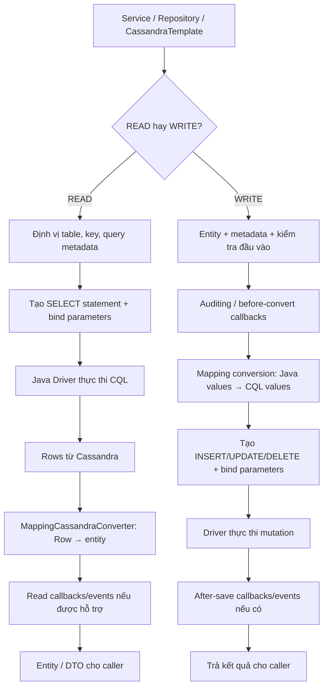
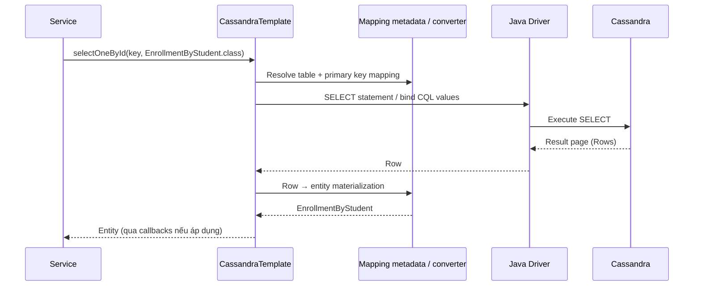
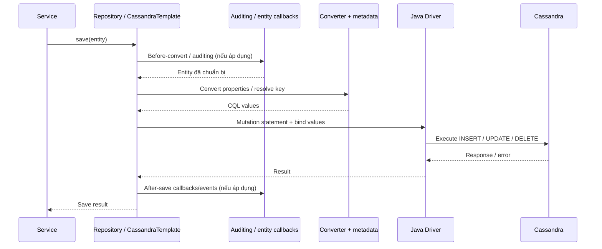
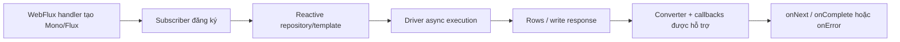

# Các giai đoạn đọc, chuyển đổi entity và tạo statement

Trong **Spring Data Cassandra**, một lời gọi đơn giản như `repository.findById(key)` hoặc `repository.save(entity)` thường che giấu nhiều công đoạn: tìm metadata của entity, tạo CQL phù hợp với khóa và bảng, bind các giá trị Java thành kiểu Cassandra, gửi statement qua Java Driver, nhận `Row`, tái tạo đối tượng miền và có thể kích hoạt **entity callbacks** hoặc **auditing**.

Nếu chỉ nhìn vào lớp repository, developer dễ nhầm rằng Cassandra “lưu nguyên đối tượng Java”, rằng `save` luôn là một `INSERT` theo nghĩa quan hệ, hoặc rằng trường `@LastModifiedDate` chính là timestamp dùng để giải quyết xung đột giữa replicas. Cả ba suy luận đó đều không chính xác.

Bài học này thuộc chương **Vòng đời và auditing** trong module **SPRING_DATA_CASSANDRA**: truy cập Apache Cassandra bằng entity mapping, repository, `CassandraTemplate` và truy vấn CQL; đồng thời chú trọng thiết kế bảng theo truy vấn, partition key, tính nhất quán, paging và hiệu năng của mô hình dữ liệu phân tán. Trọng tâm của bài là **“Các giai đoạn đọc, chuyển đổi entity và tạo statement”** — từ API Java cho đến CQL, và ngược lại.

> **Nguyên tắc:** Mapping là quá trình chuyển đổi **Java object ↔ dữ liệu CQL**; statement construction là quá trình tạo **câu lệnh/tham số gửi Cassandra**; auditing là quá trình điền metadata nghiệp vụ như người tạo hoặc thời điểm sửa. Ba công việc có liên quan nhưng **không đồng nhất**.

## 1. Mục tiêu học tập

Sau bài này, bạn có thể:

1. Vẽ hai pipeline **read** và **write** của Spring Data Cassandra, nêu vai trò của repository, `CassandraTemplate`, converter, statement và `CqlSession`.
2. Phân biệt **metadata mapping** (`@Table`, `@PrimaryKey`, `@Column`) với dữ liệu entity cụ thể trong từng request.
3. Giải thích cách Spring Data ánh xạ `Row` thành object và object thành các giá trị CQL khi thực thi mutation.
4. Phân biệt **construction of a CQL statement** với **execution of that statement**.
5. Biết thời điểm nào callback/auditing có thể thay đổi entity và vì sao không nên suy ra thứ tự chi tiết khi chưa xác minh phiên bản.
6. Cấu hình `@CreatedDate`, `@LastModifiedDate`, `@CreatedBy` và `@LastModifiedBy` trong phạm vi auditing được hỗ trợ.
7. Giải thích vì sao các auditing fields là **cột dữ liệu thông thường**, khác **write timestamp** nội bộ của Cassandra.
8. Phân tích ảnh hưởng của `null`, converter, partial projection và primary key đến câu CQL thực sự được sinh ra.
9. So sánh đường đi của `CassandraRepository`, `CassandraTemplate`, `CqlTemplate` và `CqlSession` trực tiếp.
10. Hiểu sự khác nhau giữa callback trong sync và reactive access, tránh chạy blocking I/O trong callback.
11. Viết integration test xác minh CQL/schema, mapping, auditing và dữ liệu được lưu trên Cassandra thật.
12. Dùng checklist chẩn đoán khi entity được đọc sai, auditing không chạy hoặc statement có tác động ngoài ý muốn.

## 2. Bản đồ tổng quát: hai hướng dữ liệu

Một ứng dụng thường đi từ **API/service** xuống Cassandra khi ghi và ngược lại khi đọc.



Sơ đồ là **mô hình khái niệm**. Tùy Spring Data Cassandra version, thao tác template/repository, callbacks và statement API, việc đánh giá metadata, converter và tạo một phần statement có thể đan xen. **Không dùng sơ đồ này như cam kết thứ tự tuyệt đối của mọi internal method**.

### 2.1. Các thành phần chính

| Thành phần | Vai trò cốt lõi | Không nên hiểu là |
| --- | --- | --- |
| `CassandraRepository` | API CRUD/query trên entity | Transaction manager ACID đa partition |
| `CassandraTemplate` / `CassandraOperations` | Thực thi thao tác mapping-aware | Java Driver thuần túy không có metadata |
| `CassandraMappingContext` | Metadata về entity, table, property và key | Kho dữ liệu thực của row |
| `MappingCassandraConverter` / `CassandraConverter` | Chuyển đổi Row/entity và giá trị CQL | Engine tự đổi thiết kế partition |
| `CassandraCustomConversions` | Đăng ký các phép đổi kiểu đọc/ghi | Tự sửa CQL schema sai |
| Bộ tạo statement nội bộ | Tạo cấu trúc `SELECT`, `INSERT`, `UPDATE`, `DELETE` | Cam kết tất cả query đều là prepared statement |
| `CqlSession` / Java Driver | Bind, execute, paging, consistency, timeout | Entity auditor |
| Entity callbacks/events | Can thiệp/quan sát các mốc lifecycle được hỗ trợ | Transaction rollback hoặc audit log bền vững |
| Auditing | Điền `created_at`, `updated_at`, `created_by`... | Write timestamp dùng cho Cassandra LWW |

### 2.2. Hai chữ “chuyển đổi”

Trong một đường đọc có ít nhất hai tầng chuyển đổi:

1. **CQL protocol → Driver value**: Java Driver giải mã bytes theo CQL type, ví dụ `uuid` thành `UUID`, `timestamp` thành `Instant`.
2. **Driver Row → domain entity**: Spring Data dùng mapping metadata, constructors, property access và custom conversions để tạo `EnrollmentByStudent`.

Không gộp hai tầng thành “Cassandra tự deserialize Java entity”. Cassandra lưu các cột/giá trị theo CQL schema; Java entity chỉ tồn tại ở phía ứng dụng.

## 3. Ví dụ xuyên suốt: bảng đăng ký khóa học

Giả sử nền tảng học tập có hai yêu cầu:

- Đọc các đăng ký gần đây của một học viên trong tenant.
- Ghi một enrollment cùng metadata tạo/sửa cho audit ứng dụng.

Bảng CQL:

```sql
CREATE TABLE IF NOT EXISTS learning.enrollments_by_student (
    tenant_id uuid,
    student_id uuid,
    enrolled_at timestamp,
    enrollment_id uuid,
    course_id uuid,
    enrollment_status text,
    created_at timestamp,
    updated_at timestamp,
    created_by text,
    updated_by text,
    PRIMARY KEY ((tenant_id, student_id), enrolled_at, enrollment_id)
) WITH CLUSTERING ORDER BY (enrolled_at DESC, enrollment_id ASC);
```

| Cột | Loại | Vai trò |
| --- | --- | --- |
| `tenant_id` | `uuid` | Partition key 1 |
| `student_id` | `uuid` | Partition key 2 |
| `enrolled_at` | `timestamp` | Clustering 1, mới trước cũ |
| `enrollment_id` | `uuid` | Clustering 2, phân biệt sự kiện |
| `course_id` | `uuid` | Regular column |
| `enrollment_status` | `text` | Trạng thái nghiệp vụ |
| `created_at`, `updated_at` | `timestamp` | Thời điểm audit dưới dạng dữ liệu |
| `created_by`, `updated_by` | `text` | Định danh actor nghiệp vụ |

**Điểm quan trọng:** `created_at`/`updated_at` nằm trong CQL schema như các regular columns. Chúng **không phải** metadata hệ thống tự động suy ra từ thời điểm một replica ghi mutation.

### 3.1. Thiết kế partition theo truy vấn

Primary key:

```text
PRIMARY KEY (
  (tenant_id, student_id),  -- hai thành phần partition key
  enrolled_at,              -- clustering 1
  enrollment_id             -- clustering 2
)
```

Đường đọc hợp lệ:

```sql
SELECT enrollment_id, course_id, enrolled_at, enrollment_status,
       created_at, updated_at, created_by, updated_by
FROM learning.enrollments_by_student
WHERE tenant_id = ?
  AND student_id = ?
LIMIT 20;
```

Spring Data có thể tạo statement từ method repository, nhưng **không được giả định** framework tự sửa một query thiếu partition key. Khả năng định tuyến và hiệu năng chủ yếu đến từ **CQL schema, partition restrictions, clustering ranges và workload**.

## 4. Mapping metadata: Spring Data nhìn entity thế nào?

Ta có một composite key:

```java
import java.io.Serializable;
import java.time.Instant;
import java.util.UUID;

import org.springframework.data.cassandra.core.cql.PrimaryKeyType;
import org.springframework.data.cassandra.core.mapping.PrimaryKeyClass;
import org.springframework.data.cassandra.core.mapping.PrimaryKeyColumn;

@PrimaryKeyClass
public class EnrollmentKey implements Serializable {

    @PrimaryKeyColumn(
        name = "tenant_id",
        ordinal = 0,
        type = PrimaryKeyType.PARTITIONED)
    private UUID tenantId;

    @PrimaryKeyColumn(
        name = "student_id",
        ordinal = 1,
        type = PrimaryKeyType.PARTITIONED)
    private UUID studentId;

    @PrimaryKeyColumn(
        name = "enrolled_at",
        ordinal = 2,
        type = PrimaryKeyType.CLUSTERED)
    private Instant enrolledAt;

    @PrimaryKeyColumn(
        name = "enrollment_id",
        ordinal = 3,
        type = PrimaryKeyType.CLUSTERED)
    private UUID enrollmentId;

    protected EnrollmentKey() {
    }

    // Bổ sung constructor, getters/setters, equals và hashCode
    // dựa trên TOÀN BỘ primary key trong source code thực.
}
```

Đây là lớp minh họa mapping; muốn biên dịch/chạy thật phải bổ sung constructors, accessors và `equals/hashCode`. Các thành phần key tham gia nhận diện một hàng; không tự thay đổi `enrolledAt` khi chỉ muốn đổi `enrollment_status`.

### 4.1. Entity chứa các trường auditing

```java
import java.time.Instant;
import java.util.UUID;

import org.springframework.data.annotation.CreatedBy;
import org.springframework.data.annotation.CreatedDate;
import org.springframework.data.annotation.LastModifiedBy;
import org.springframework.data.annotation.LastModifiedDate;
import org.springframework.data.annotation.Transient;
import org.springframework.data.cassandra.core.mapping.Column;
import org.springframework.data.cassandra.core.mapping.PrimaryKey;
import org.springframework.data.cassandra.core.mapping.Table;

@Table("enrollments_by_student")
public class EnrollmentByStudent {

    @PrimaryKey
    private EnrollmentKey key;

    @Column("course_id")
    private UUID courseId;

    @Column("enrollment_status")
    private String enrollmentStatus;

    @CreatedDate
    @Column("created_at")
    private Instant createdAt;

    @LastModifiedDate
    @Column("updated_at")
    private Instant updatedAt;

    @CreatedBy
    @Column("created_by")
    private String createdBy;

    @LastModifiedBy
    @Column("updated_by")
    private String updatedBy;

    @Transient
    private String displayLabel;

    protected EnrollmentByStudent() {
    }

    // Constructor, getters/setters hoặc persistence constructor
    // được hoàn thiện theo chính sách immutable/mutable của dự án.
}
```

Mapping liên kết `EnrollmentByStudent` với bảng và tên các cột. `@Transient` cho biết `displayLabel` không tham gia lưu trữ như property mapped thông thường.

**Không tự tạo cột `display_label` trong CQL** chỉ vì Java class có một field cùng ý nghĩa. Cột và property chỉ khớp khi mapping/schema được khai báo nhất quán.

### 4.2. Metadata được dùng ở những giai đoạn nào?

Metadata hỗ trợ xác định:

- Table/UDT tương ứng với class.
- Cột được đánh dấu primary key, ordinal và loại partition/clustering.
- Tên CQL column của từng property.
- Constructor/property access khi đọc entity.
- Giá trị nào cần chuyển đổi kiểu khi ghi hoặc đọc.
- Property nào được bỏ qua.
- Trường nào có annotation auditing.
- Cách cấu trúc một query/statement khi thao tác theo entity.

Metadata là **mô tả**. Nó không tự chạy query và không đại diện cho một snapshot dữ liệu của Cassandra.

### 4.3. Sai lệch schema–entity

Các lỗi thường gặp:

| Sai lệch | Triệu chứng |
| --- | --- |
| `course_id` thực tế là `text` nhưng Java dùng `UUID` | Lỗi codec/conversion hoặc dữ liệu không ánh xạ được |
| Java mapping nhầm `tenant_id` thành clustering | Statement định tuyến sai hoặc CQL lỗi |
| Thiếu constructor/accessor phù hợp | Không khởi tạo được entity khi đọc |
| Field Java đặt tên khác nhưng thiếu `@Column` | Đọc `null` hoặc driver/server báo thiếu column |
| Entity có auditing fields nhưng CQL table thiếu cột | Insert/update/read lỗi theo đường statement |
| Khóa đầy đủ bị tạo lại khi cập nhật | Sinh hàng mới thay vì sửa hàng hiện tại |

Đừng chữa sai schema bằng thêm `ALLOW FILTERING` hoặc đổi page size. Phải sửa mapping/migration/query đúng nguyên nhân.

## 5. Đường READ: từ lời gọi Java đến SELECT

Xét:

```java
EnrollmentByStudent entity =
    cassandraTemplate.selectOneById(
        key, EnrollmentByStudent.class);
```

Ví dụ giả định đã inject `CassandraTemplate cassandraTemplate` và xây `EnrollmentKey key` đầy đủ.

Các công đoạn khái niệm:

1. **Xác nhận entity class/id:** Spring Data biết `EnrollmentByStudent` có mapping metadata.
2. **Xác định bảng và khóa:** Từ `@Table` và `@PrimaryKey`/`@PrimaryKeyClass`.
3. **Tạo SELECT statement:** Các điều kiện theo toàn bộ primary key.
4. **Chuyển/bind khóa:** Các `UUID` và `Instant` thành dữ liệu CQL tương ứng.
5. **Gửi tới driver:** `CqlSession` thực thi theo consistency/profile đã cấu hình.
6. **Nhận kết quả:** Driver trả `Row` hoặc tập `Rows`.
7. **Chuyển Row thành entity:** Spring Data converter dùng mapping metadata.
8. **Phát lifecycle signals nếu được hỗ trợ:** Callback/events trên đường đọc.
9. **Trả entity:** Caller nhận đối tượng Java, hoặc `null`/empty result tùy API.

### 5.1. Sơ đồ đường đọc



Sơ đồ nhấn mạnh **trách nhiệm**, không cố mô tả thứ tự chính xác từng lời gọi private/internal class. Ở bản Spring Data cụ thể, việc create statement và converter có thể chia sẻ metadata hoặc được gọi tại các bước khác nhau.

### 5.2. Đọc qua repository

```java
import org.springframework.data.cassandra.repository.CassandraRepository;

public interface EnrollmentRepository
        extends CassandraRepository<EnrollmentByStudent, EnrollmentKey> {
}
```

Sau đó:

```java
Optional<EnrollmentByStudent> result =
    repository.findById(key);
```

Repository cung cấp abstraction cho query/mapping, nhưng **không làm mất bước Driver → Row → Converter** ở những truy vấn trả entity.

### 5.3. Đọc danh sách theo partition

```java
import java.util.List;
import java.util.UUID;

import org.springframework.data.cassandra.repository.Query;

public interface EnrollmentRepository
        extends CassandraRepository<EnrollmentByStudent, EnrollmentKey> {

    @Query("""
        SELECT *
        FROM learning.enrollments_by_student
        WHERE tenant_id = ?0 AND student_id = ?1
        LIMIT 20
        """)
    List<EnrollmentByStudent> recent(
        UUID tenantId, UUID studentId);
}
```

Với phương thức này, statement được định nghĩa rõ trong `@Query`, không nhất thiết được sinh hoàn toàn từ tên method. Nhưng kết quả `Row` vẫn phải ánh xạ đúng entity properties.

**`@Query` không tự chạy auditing khi chỉ đọc.** Các auditing fields chỉ là những cột đang được select và chuyển thành Java values.

## 6. Tạo SELECT statement khác với thực thi SELECT

Một CQL statement có thể được xây trước khi mở network request.

```text
Statement construction:
    SELECT ... FROM ...
    WHERE tenant_id = ? AND student_id = ?

Statement binding:
    tenant_id = T1
    student_id = S1

Execution:
    Driver gửi CQL đến coordinator
    Cassandra xử lý consistency, replica reads và paging

Materialization:
    Driver Row → Spring Data entity
```

Việc hiểu ranh giới này giúp trả lời:

- Câu CQL nào đang được gửi?
- Giá trị khóa nào được bind?
- Statement có `LIMIT` hoặc clustering range không?
- Consistency là gì?
- Converter bị lỗi **trước** hay **sau** khi query thành công?
- Câu query nhanh nhưng mapping hàng triệu rows gây chậm ở JVM hay không?

### 6.1. CQL không phải JPQL/SQL join

Spring Data Cassandra không tự sinh JOIN cho entity graph như ORM quan hệ. Một field Java kiểu object không làm Cassandra hiểu đó là foreign key relation.

Nếu service cần đọc enrollment và course title, thường phải dùng các **query-driven tables** thích hợp, hoặc hai queries và kết hợp ở application. Statement creation sẽ tuân theo CQL/schema, không biến Cassandra thành RDBMS.

### 6.2. Statement có thể là SimpleStatement hoặc prepared/bound

Java Driver 4.x có những dạng như `SimpleStatement`, `PreparedStatement`, `BoundStatement`. Spring Data sử dụng cơ chế xây/thực thi statement của phiên bản đang dùng.

**Không khẳng định mọi repository call luôn tạo `PreparedStatement` hay mọi query đều được server prepare.** Nếu cần chứng minh, quan sát query metrics/trace hoặc inspect hành vi trên dependency versions thực tế.

Ở tầng thấp có thể thấy rõ:

```java
PreparedStatement prepared = session.prepare("""
    SELECT course_id, enrolled_at, enrollment_id, enrollment_status
    FROM learning.enrollments_by_student
    WHERE tenant_id = ? AND student_id = ?
    LIMIT 20
    """);

BoundStatement bound =
    prepared.bind(tenantId, studentId);

ResultSet rows = session.execute(bound);
```

Đây là code trong một class có `CqlSession session` và các imports thích hợp. Nó dùng Java Driver trực tiếp; **không tự gọi Spring Data entity converter**.

## 7. Row → entity: chuyển đổi khi đọc

Khi Cassandra phản hồi, Java Driver có `Row` chứa các giá trị CQL theo projection của query.

Ví dụ một row:

```text
tenant_id          uuid       T1
student_id         uuid       S1
enrolled_at        timestamp  2026-11-25T09:30:00Z
enrollment_id      uuid       E1
course_id          uuid       C1
enrollment_status  text       ACTIVE
created_at         timestamp  2026-11-25T09:30:00Z
updated_at         timestamp  2026-11-25T09:30:00Z
created_by         text       student-service
updated_by         text       student-service
```

Spring Data cần:

1. Chọn entity type đích.
2. Xác định constructor/factory phù hợp.
3. Lấy các cột có trong `Row`.
4. Giải mã kiểu Java của giá trị (với sự hỗ trợ của driver).
5. Áp dụng custom reading conversions nếu có.
6. Điền property hoặc constructor parameters.
7. Hoàn thành entity materialization; chạy callbacks/events đọc nếu đường đi hỗ trợ.

### 7.1. Driver type không phải luôn domain type

| CQL type | Java Driver type thường gặp | Domain có thể muốn |
| --- | --- | --- |
| `uuid` | `UUID` | `UUID` hoặc value object |
| `text` | `String` | `String` hoặc enum/value object |
| `timestamp` | `Instant` | `Instant` hoặc time wrapper |
| `date` | `LocalDate` | `LocalDate` |
| `list<text>` | `List<String>` | Collection có quy tắc miền |
| `frozen<udt>` | `UdtValue` | Nested domain type, nếu mapping hỗ trợ |

Custom converters giúp giải quyết khoảng cách giữa **kiểu CQL** và **kiểu Java domain**. Chúng không thể sửa một query trả thiếu partition key hoặc server schema bị tạo sai.

### 7.2. Constructor binding và nullability

Nếu entity bất biến có constructor:

```java
public record EnrollmentSummary(
        UUID enrollmentId,
        String status,
        Instant updatedAt) {
}
```

Một RowMapper/DTO projection cần cung cấp đúng các cột/types cho constructor. Nếu query chỉ chọn `enrollment_id` và `enrollment_status` nhưng constructor đòi `updatedAt` non-null, việc materialize có thể thất bại hoặc nhận giá trị thiếu, tùy mapping/version.

Không dùng Java primitive `long`/`int` ở field có thể thiếu/NULL mà không có policy. `null` và “column not selected” không luôn đồng nghĩa ở mọi mapper.

### 7.3. After-convert không phải “after database transaction commit”

Các lifecycle signals ở giai đoạn read thường phản ánh rằng entity đã được materialize. Chúng **không** báo một transaction DB vừa commit.

Không dùng `after-convert` để gửi event “enrollment được tạo mới”, vì chỉ đọc entity cũ cũng có thể kích hoạt đường read callback, dẫn đến sự kiện trùng lặp.

## 8. Đường WRITE: entity → Cassandra mutation

Giả sử ứng dụng tạo một enrollment mới:

```java
EnrollmentByStudent entity = new EnrollmentByStudent(
    /* key, courseId, status ... */
);
repository.save(entity);
```

Đoạn minh họa cần constructor thực tế theo class đã định nghĩa. Một đường write mapping-aware có những công đoạn:

1. Nhận entity và xác định table/primary key metadata.
2. Kiểm tra trạng thái entity/“newness” nếu API/auditing cần.
3. Chạy những callbacks/auditing **trước chuyển đổi/ghi** được hỗ trợ.
4. Chuyển các properties Java sang CQL-typed values.
5. Tạo statement phù hợp (`INSERT`, `UPDATE` hoặc mutation tương ứng).
6. Áp dụng options như TTL, consistency, timestamp theo API/version.
7. Driver thực thi statement; Cassandra điều phối replicas.
8. Chạy lifecycle callbacks/events sau lưu nếu đường API hỗ trợ.
9. Trả kết quả hoặc entity đã được xử lý theo contract của API.

### 8.1. Sơ đồ đường ghi



Sơ đồ không cam kết một thứ tự tuyệt đối của mọi callback trong từng Spring Data version. **Quan trọng là phân biệt tác dụng ở JVM trước khi gửi CQL với tác dụng đã được Cassandra áp dụng**.

### 8.2. Cassandra UPDATE và INSERT không giống ORM quan hệ

Trong Cassandra, `UPDATE` thường có ngữ nghĩa **upsert**: ghi vào primary key chưa có sẵn có thể tạo dữ liệu mới. `INSERT` cũng không nên được hiểu là lỗi nếu một hàng cùng khóa đã tồn tại, trừ khi dùng conditional statement như `IF NOT EXISTS` theo cú pháp hợp lệ.

Do đó:

- Entity có `id` không null không chứng minh row đã tồn tại trong Cassandra.
- Một lời gọi `save` không tự đảm bảo “create-only”.
- Auditing dựa vào **entity newness**, không phải một phép xác minh tồn tại chắc chắn trên tất cả replicas.
- Nếu nghiệp vụ cần duy nhất một enrollment, phải thiết kế khóa, duplicate handling và LWT/conditional write khi phù hợp.

### 8.3. Primary key được chọn trước mutation

Khóa `(tenant_id, student_id, enrolled_at, enrollment_id)` phải ổn định. Nếu cập nhật status mà đổi `enrolledAt` thành `Instant.now()`, Cassandra xem đó là **một primary key khác**, không phải cùng row với auditing timestamp mới.

**Thời gian nghiệp vụ dùng trong clustering key khác `updated_at` auditing field.** Không gán lại clustering key mỗi khi cập nhật một regular column.

## 9. Giai đoạn tạo statement: từ property sang CQL

Spring Data cần chuyển property values thành các giá trị để gửi CQL.

Một entity:

```text
key.tenantId       = T1
key.studentId      = S1
key.enrolledAt     = 2026-11-25T09:30:00Z
key.enrollmentId   = E1
courseId           = C1
enrollmentStatus   = "ACTIVE"
createdAt          = 2026-11-25T09:30:02Z
updatedAt          = 2026-11-25T09:30:02Z
createdBy          = "student-service"
updatedBy          = "student-service"
```

có thể tương ứng với mutation CQL theo khóa đầy đủ:

```sql
INSERT INTO learning.enrollments_by_student (
    tenant_id, student_id, enrolled_at, enrollment_id,
    course_id, enrollment_status,
    created_at, updated_at, created_by, updated_by
) VALUES (?, ?, ?, ?, ?, ?, ?, ?, ?, ?);
```

**Câu lệnh trên là minh họa ý nghĩa**, không khẳng định mọi `repository.save` nhất thiết phát đúng chuỗi này, với đúng thứ tự cột và kiểu statement đó. Đường `insert/update/save` và converter có thể khác theo Spring Data version và lựa chọn API.

### 9.1. Statement construction trả lời câu hỏi nào?

- Target table/keyspace là gì?
- Mutation ảnh hưởng row/cell nào?
- Các primary-key values được bind từ đâu?
- Những cột nào thực sự nằm trong `SET` hoặc `VALUES`?
- Giá trị `null` được ghi, bỏ qua hay chuyển thành UNSET?
- TTL/write timestamp và consistency có được chỉ định không?
- Statement có `IF NOT EXISTS` hoặc condition nào không?
- Các thông số request timeout/page size/profile là gì?
- Statement có phù hợp CQL schema và clustering restrictions không?

**Kiểm tra chính statement được thực thi** là cách hiệu quả để phân biệt lỗi mapping và lỗi Cassandra server.

### 9.2. Prepared statement là optimization/protocol choice

Ví dụ Java Driver:

```java
PreparedStatement ps = session.prepare("""
    UPDATE learning.enrollments_by_student
    SET enrollment_status = ?, updated_at = ?
    WHERE tenant_id = ?
      AND student_id = ?
      AND enrolled_at = ?
      AND enrollment_id = ?
    """);

BoundStatement update = ps.bind(
    "COMPLETED",
    java.time.Instant.now(),
    tenantId,
    studentId,
    enrolledAt,
    enrollmentId
);

session.execute(update);
```

Prepared statement ràng buộc query template và các bind values. Nhưng đoạn này **không tự kích hoạt Spring Data auditing** vì nó gọi `CqlSession` trực tiếp; `updated_at` được đặt bằng code của caller, không nhờ `@LastModifiedDate`.

### 9.3. Không lấy chuỗi CQL làm nguồn xác thực quyền

Dù statement được bind an toàn, một người dùng vẫn không được phép yêu cầu `tenant_id` tùy ý. Tenant authorization phải được kiểm tra **trước khi query/mutation** và cursor/paging state phải gắn với đúng tenant.

Callback không nên là nơi duy nhất kiểm soát quyền tenant, vì các đường `CqlSession`/`CqlTemplate` có thể bypass nó.

## 10. Entity callbacks và lifecycle events

Spring Data có các cơ chế **entity lifecycle** để cho phép ứng dụng can thiệp hoặc quan sát những mốc liên quan đến việc đọc/ghi. Tên interface, chữ ký, hỗ trợ reactive và thứ tự áp dụng cụ thể phải được kiểm tra theo phiên bản Spring Data Cassandra đang dùng.

Một số khái niệm thường được gặp trong tài liệu Spring Data:

| Mốc khái niệm | Mục đích hợp lý | Điều nên tránh |
| --- | --- | --- |
| Trước convert/write | Chuẩn hóa thuộc tính, đặt audit fields | Query DB blocking hoặc thay khóa tùy tiện |
| Trước save / trước execute | Quan sát hoặc điều chỉnh metadata/statement trong API hỗ trợ | Giả định mutation đã commit |
| Sau save | Metrics/log hoặc xử lý local nhẹ | Coi là transaction event đa bảng |
| Sau load/convert | Tinh chỉnh giá trị presentation/derived fields | Gửi event nghiệp vụ “vừa tạo mới” |
| Trước/sau delete | Logging, tracing hoặc cleanup local | Cho rằng mọi replica đã compact tombstone |

Các tên thường được nhắc tới như `BeforeConvertCallback`, `BeforeSaveCallback`, `AfterSaveCallback` và `AfterConvertCallback` cần được đối chiếu **module Cassandra và version cụ thể**, vì không phải mọi store Spring Data đều cung cấp cùng interface/signature.

### 10.1. Entity callback khác application event

- **Entity callback:** cơ chế gắn vào vòng đời thực thi và có thể trả về entity đã chỉnh sửa ở những hook hỗ trợ.
- **Application event/listener:** cơ chế phát sự kiện cho các listener, có thể chịu ảnh hưởng cách dispatch và asynchronous event multicaster.

Không nên giả định một event listener chạy bất đồng bộ có thể thay đổi entity và những thay đổi đó luôn được dùng để build statement. Nếu cần sửa dữ liệu **trước convert**, dùng callback được contract version xác nhận và kiểm thử kết quả.

### 10.2. Thay đổi trước convert khác thay đổi sau save

Giả sử muốn chuẩn hóa trạng thái:

```text
Input entity:
  enrollmentStatus = " active "

Before-convert:
  " active " → "ACTIVE"

Statement:
  enrollment_status = "ACTIVE"

After-save:
  Chỉ nhận thông tin kết quả theo contract.
```

Nếu làm chuẩn hóa trong after-save, statement **có thể đã gửi " active "**. Đó không phải nơi đảm bảo mutation vừa ghi đã được sửa.

**Thời điểm mutation được tạo** mới quyết định giá trị nào đi vào Cassandra.

### 10.3. Callback đồng bộ phải nhanh và xác định

Một callback gọi API bên ngoài để tìm tên actor có thể làm mỗi lần `save` chậm khó đoán, tăng khả năng timeout, và làm behavior khác nhau giữa các request.

Khuyến nghị:

- Chuẩn bị dữ liệu và context trước khi gọi repository.
- Callback chỉ thực hiện thao tác ngắn, xác định, không phá partition key.
- Không tạo random primary key mới mỗi lần retry.
- Không gọi repository.save khác trong callback nếu không có chính sách vòng đời và recursion rõ ràng.
- Không dùng callback làm một distributed transaction.
- Đo độ trễ callbacks khi có nhiều rows.

## 11. Auditing: điền metadata ứng dụng ở giai đoạn phù hợp

Spring Data auditing cho phép quản lý các trường:

- `@CreatedDate`: thời điểm entity được xem là mới theo cơ chế auditing.
- `@LastModifiedDate`: thời điểm sửa theo auditing.
- `@CreatedBy`: actor tạo.
- `@LastModifiedBy`: actor sửa.

Các trường này cần có property Java **và cột CQL tương ứng**. Không phải mọi API CQL tự động áp dụng chúng.

### 11.1. Cấu hình auditing đồng bộ

Ví dụ Spring configuration:

```java
import java.util.Optional;

import org.springframework.context.annotation.Bean;
import org.springframework.context.annotation.Configuration;
import org.springframework.data.domain.AuditorAware;
import org.springframework.data.cassandra.config.EnableCassandraAuditing;

@Configuration
@EnableCassandraAuditing(auditorAwareRef = "auditorProvider")
public class CassandraAuditConfig {

    @Bean
    AuditorAware<String> auditorProvider() {
        return () -> Optional.of("system-import");
    }
}
```

Trong ví dụ này `"system-import"` chỉ minh họa **một actor kỹ thuật đã biết**. Ở production, provider cần lấy actor đã xác thực đúng context request/batch, không trả cố định một giá trị cho mọi người dùng.

**Chú ý:** API annotation, package và cách cấu hình auditing thay đổi theo Spring Data Cassandra/Boot release. Đối chiếu dependency BOM và tài liệu phiên bản đang chạy; ví dụ không thay việc kiểm tra cấu hình thực tế.

### 11.2. Reactive auditing dùng context khác

Trong ứng dụng WebFlux, SecurityContext có thể nằm trong **Reactor Context**, không phải `ThreadLocal` cố định. Một `AuditorAware` đồng bộ đọc `ThreadLocal` của Web MVC có thể không lấy đúng actor trong flow reactive.

Khi phiên bản Spring Data Cassandra hỗ trợ reactive auditing, dùng **reactive auditor provider/configuration** tương ứng, ví dụ khái niệm `ReactiveAuditorAware<T>` và annotation bật reactive auditing của module. Không khẳng định copy nguyên `AuditorAware` đồng bộ sang WebFlux là đủ.

### 11.3. Auditing không tự tạo lịch sử thay đổi

`@LastModifiedBy` lưu actor **gần nhất** theo các mutation làm thay đổi cột đó; nó không lưu danh sách mọi lần cập nhật.

Nếu yêu cầu:

- Ai đổi từ ACTIVE sang COMPLETED?
- Trước/sau của mỗi lần thay đổi?
- Thứ tự sự kiện?
- IP/trace ID và lý do nghiệp vụ?
- Lịch sử audit chống sửa/xóa?

thì cần **event log/audit trail** độc lập với thiết kế retention và quyền truy cập phù hợp. Chỉ thêm bốn annotation không tạo một audit ledger.

## 12. Vấn đề entity “mới” hay “đã có”

Cassandra có ngữ nghĩa upsert và không có cơ chế “database identity generated” giống nhiều ứng dụng RDBMS. Khi khóa được gán trước:

```java
EnrollmentKey key = new EnrollmentKey(
    tenantId, studentId, enrolledAt, enrollmentId);
```

(Đoạn trên giả định bạn đã viết constructor có tham số tương ứng.)

Khóa đã **khác null** trước `save` không có nghĩa Cassandra đã lưu row đó. Một số cơ chế xác định entity mới của Spring Data dựa trên ID/version hoặc `Persistable`, tùy store và version. Vì vậy việc auditing quyết định điền `created_at` hay chỉ `updated_at` có thể phụ thuộc **newness detection**.

### 12.1. Những kỳ vọng cần kiểm chứng

| Tình huống | Không nên mặc định |
| --- | --- |
| Entity mới nhưng ID đã được gán | `@CreatedDate` chắc chắn được điền giống ID null |
| `save` lần thứ hai | Không bao giờ đổi `created_at` |
| `insert` vào khóa đã tồn tại | Tự báo duplicate key |
| `update` cho khóa chưa tồn tại | Tự trả not-found |
| Custom `Persistable.isNew()` | Hoạt động đúng khi cờ new không được quản lý qua round-trip |
| Entity được copy/deserialize | Trạng thái newness giữ nguyên |

Nếu auditing của hệ thống cần bảo đảm mạnh “created_at không bao giờ bị sửa”, hãy có **tests và write policy rõ**; đừng dựa hoàn toàn vào annotation mà không kiểm tra generated mutations.

### 12.2. Không dùng auditing để quyết định uniqueness

Nếu enrollment ID phải duy nhất, CQL có thể dùng `INSERT ... IF NOT EXISTS` theo primary key thích hợp khi thực sự cần compare-and-set. Đây là yêu cầu khác với việc framework nhận diện entity mới.

**Auditing = metadata; LWT = cơ chế điều kiện khi ghi.** Không thay một thứ bằng thứ kia.

## 13. Auditing field khác Cassandra write timestamp

Đây là điểm dễ nhầm nhất.

| Thuộc tính | Auditing `updated_at` | Cassandra write timestamp |
| --- | --- | --- |
| Lưu ở đâu? | Regular column khai báo trong table | Metadata của từng cell/mutation |
| Kiểu thường gặp | CQL `timestamp` | Số microsecond từ Unix epoch |
| Ai chọn? | Auditing provider/service/application | CQL `USING TIMESTAMP`, driver generator hoặc coordinator |
| Quan sát bằng gì? | `SELECT updated_at` | `WRITETIME(column)` trên cột được hỗ trợ |
| Ý nghĩa | Lần sửa theo chính sách ứng dụng | Phiên bản dùng để hòa giải Last-Write-Wins |
| Có thể khác nhau? | **Có** | **Có** |
| Tự tạo transaction? | Không | Không |
| Có phải event time? | Không mặc nhiên | Không mặc nhiên |

Ví dụ:

```sql
SELECT enrollment_status,
       updated_at,
       WRITETIME(enrollment_status) AS status_write_ts
FROM learning.enrollments_by_student
WHERE tenant_id = ?
  AND student_id = ?
  AND enrolled_at = ?
  AND enrollment_id = ?;
```

`updated_at` có thể hiển thị `2026-11-25T09:45:00Z`, còn `status_write_ts` là một số **microsecond**. Chúng không nhất thiết biểu diễn cùng một instant nếu:

- Nguồn đồng hồ auditing khác nguồn tạo mutation timestamp.
- Driver/coordinator clock lệch nhau.
- Ứng dụng override `USING TIMESTAMP`.
- Một writer đi vòng qua auditing.
- Batch/backfill dùng timestamp lịch sử.

**Không dùng `@LastModifiedDate` để giải quyết xung đột Cassandra giữa replicas**. Cassandra chọn cell winner theo write timestamp và quy tắc hòa giải, không tự đọc cột `updated_at` rồi so sánh.

### 13.1. @CreatedDate không phải row creation timestamp do DB sinh

Cassandra không tự phát `created_at` cho Spring Data auditing trên mọi CQL write. Đường Driver trực tiếp như:

```sql
UPDATE learning.enrollments_by_student
SET enrollment_status = ?
WHERE tenant_id = ?
  AND student_id = ?
  AND enrolled_at = ?
  AND enrollment_id = ?;
```

không tự điền `created_at`/`updated_at` chỉ vì Java có auditing annotations. Nếu muốn đồng nhất metadata across writers, phải thiết kế hợp đồng ghi chung hoặc set các trường tường minh ở mỗi đường CQL.

### 13.2. Precision

CQL `timestamp` thường biểu diễn thời gian ở mức **millisecond**; write timestamp của Cassandra dùng **microsecond**. Khi test auditing `Instant`, không mặc định đọc lại giữ nguyên mọi nanosecond đã tạo bởi `Instant.now()`. Chuẩn hóa precision trong assertion hoặc dùng tolerance có chủ đích.

## 14. Null, UNSET và partial mutation

Giai đoạn entity-to-CQL conversion phải quyết định **đường ghi thực sự tác động cột nào**.

Giả sử API chỉ muốn đổi status:

```json
{
  "enrollmentStatus": "COMPLETED"
}
```

Nếu service dựng một entity chỉ có key và status, các auditing fields và courseId có thể là `null`. Tùy đường save/options của Spring Data Cassandra, giá trị null có thể bị bỏ qua, được bind theo cách đặc thù, hoặc trở thành deletion/tombstone trong CQL update.

**Không tự giả định `repository.save(partialEntity)` có semantics PATCH**.

### 14.1. CQL chỉ cập nhật cột cần sửa

Một đường write dễ kiểm tra:

```sql
UPDATE learning.enrollments_by_student
SET enrollment_status = ?,
    updated_at = ?,
    updated_by = ?
WHERE tenant_id = ?
  AND student_id = ?
  AND enrolled_at = ?
  AND enrollment_id = ?;
```

Câu này không sửa `course_id`, `created_at` và `created_by`; do đó tránh một nhóm tác động phụ không mong muốn.

### 14.2. NULL trong Cassandra có thể tạo tombstone

Với regular column, mutation như:

```sql
UPDATE learning.enrollments_by_student
SET created_by = null
WHERE tenant_id = ?
  AND student_id = ?
  AND enrolled_at = ?
  AND enrollment_id = ?;
```

có ngữ nghĩa xóa cột, có thể tạo tombstone. Nó khác với “field không xuất hiện trong JSON PATCH”.

Một API cần phân biệt:

| Đầu vào | Ý nghĩa mong muốn | Mutation |
| --- | --- | --- |
| Không có field | Giữ nguyên dữ liệu | Không ghi cột tương ứng |
| Field có giá trị | Cập nhật | `SET col = ?` |
| Field null để xóa | Xóa theo contract | `SET col = null` hoặc `DELETE col` |
| UNSET ở driver (khi hỗ trợ) | Bỏ qua bind value ở statement | Không đồng nghĩa CQL NULL |

Sự khác biệt này không thể giải quyết chỉ bằng annotation `@Column`. Cần test statement cuối và null-handling trong version thực tế.

### 14.3. Không dùng save(entity) cho partial projection

Nếu query chỉ lấy `enrollment_status` và `updated_at` rồi materialize entity thiếu `course_id`, gọi `save` ngay trên đối tượng đó có thể khiến các properties vắng mặt bị diễn giải sai.

Với partial queries, trả **DTO/read-only projection** và dùng CQL update chỉ cột cần sửa. Điều này rõ hơn về cả performance lẫn semantics.

## 15. Custom conversions nằm ở đâu?

Spring Data Cassandra cho phép đăng ký các phép chuyển đổi tùy biến khi domain type không trùng với CQL type.

Giả sử muốn dùng `CourseCode` là value object thay vì `String` trong Java:

```java
public record CourseCode(String value) {
    public CourseCode {
        if (value == null || value.isBlank()) {
            throw new IllegalArgumentException("Course code is required");
        }
    }
}
```

CQL vẫn lưu `course_code text`. Ta cần:

- **Writing conversion:** `CourseCode → String`.
- **Reading conversion:** `String → CourseCode`.

### 15.1. Converter cho write/read

```java
import org.springframework.core.convert.converter.Converter;
import org.springframework.data.convert.ReadingConverter;
import org.springframework.data.convert.WritingConverter;

@WritingConverter
public class CourseCodeWritingConverter
        implements Converter<CourseCode, String> {

    @Override
    public String convert(CourseCode source) {
        return source.value();
    }
}

@ReadingConverter
public class CourseCodeReadingConverter
        implements Converter<String, CourseCode> {

    @Override
    public CourseCode convert(String source) {
        return new CourseCode(source);
    }
}
```

Mỗi `public` class cần đặt trong file Java riêng khi triển khai. Converter là minh họa cho một property regular `text`, **không** có nghĩa có thể biến bất kỳ Java object phức tạp nào thành column type không được Cassandra schema chấp nhận.

### 15.2. Đăng ký CassandraCustomConversions

Cấu hình khái niệm:

```java
import java.util.List;

import org.springframework.context.annotation.Bean;
import org.springframework.context.annotation.Configuration;
import org.springframework.data.cassandra.core.convert.CassandraCustomConversions;

@Configuration
public class CassandraConversionConfig {

    @Bean
    CassandraCustomConversions cassandraCustomConversions() {
        return new CassandraCustomConversions(List.of(
            new CourseCodeWritingConverter(),
            new CourseCodeReadingConverter()));
    }
}
```

Ở ứng dụng dùng Spring Boot auto-configuration hoặc custom `CassandraConverter` bean, phải kiểm tra cách merge/chọn converters theo phiên bản; đừng đăng ký bean làm mất những conversions mặc định của hệ thống.

### 15.3. Conversion order ảnh hưởng dữ liệu được ghi

Nếu một callback điền `CourseCode` hoặc chuẩn hóa `enrollmentStatus` trước khi converter chạy, statement có thể dùng giá trị đã biến đổi. Nếu converter ghi trả một chuỗi CQL không hợp lệ hoặc null, lỗi có thể xuất hiện ở giai đoạn bind/execute.

**Converter chỉ nhận một giá trị và chuyển kiểu, không nên thực hiện remote I/O, query khác, tạo ID mới hoặc quyết định authorization.**

### 15.4. Test hai chiều

Một integration test cần chứng minh:

1. Ghi domain `CourseCode("CASS-101")`.
2. Cassandra lưu `"CASS-101"` ở cột `text`.
3. Đọc lại Row và mapping thành `CourseCode`.
4. Null/blank được xử lý đúng policy.
5. Không ghi dữ liệu vào sai column hoặc sai CQL type.

Một unit test chỉ test `Converter.convert` chưa chứng minh nó đã được Spring Data **đăng ký và gọi thực sự**.

## 16. Sự khác nhau giữa các đường API

Không phải mọi lời gọi đến Cassandra đều đi qua cùng lifecycle.

| Đường truy cập | Mapping entity | Auditing/Callbacks tự động? | Ghi chú |
| --- | --- | --- | --- |
| `CassandraRepository.save(entity)` | Có | Theo hỗ trợ/cấu hình phiên bản | Xem newness, mutation và converter |
| `CassandraRepository.findById(id)` | Có | Read callbacks/events nếu áp dụng | Có materialization entity |
| `CassandraTemplate.insert/update/select` | Có | Theo loại operation và cấu hình | Kiểm soát thêm các options |
| `ReactiveCassandraRepository` | Có | Theo reactive lifecycle được hỗ trợ | Không block callback |
| `ReactiveCassandraTemplate` | Có | Theo reactive lifecycle được hỗ trợ | Có Reactor context |
| `CqlTemplate` / `CqlOperations` | Không mặc nhiên mapping entity | **Không tự auditing entity** | Có thể map Row theo callback do caller cung cấp |
| `CqlSession.execute(...)` | **Không** | **Không** | Trực tiếp Java Driver |
| `@Query` SELECT trả entity | Có thể có | Tùy method/query path | Projection/entity materialization khác nhau |
| `@Query` UPDATE CQL tường minh | Không tự xem là entity save | Không mặc nhiên có auditing | Phải tự set audit columns nếu cần |

Bảng mô tả **hợp đồng điển hình**, không cam kết từng hook cụ thể trong mọi phiên bản. Khi dự án phụ thuộc chính xác vào callback, cần chứng minh bằng **integration test trên version đang dùng**.

### 16.1. CqlTemplate thấp hơn mapping template

`CqlTemplate` có thể thực thi CQL và dùng mapper:

```java
List<String> statuses = cqlTemplate.query(
    """
    SELECT enrollment_status
    FROM learning.enrollments_by_student
    WHERE tenant_id = ? AND student_id = ?
    """,
    (row, rowNum) -> row.getString("enrollment_status"),
    tenantId,
    studentId
);
```

Đoạn là ví dụ khái niệm theo callback mapper API: hãy đối chiếu overload/parameter binding của `CqlTemplate` trong phiên bản đang dùng, hoặc dùng `CqlSession`/prepared statement khi cần kiểm soát chặt. **Lỗi mapping của RowMapper tự viết không đi qua toàn bộ mapping converter**.

### 16.2. Driver trực tiếp không tự “nhìn thấy” @CreatedDate

`CqlSession.execute(...)` chỉ biết statement và driver options. Nó không đọc annotation `@CreatedDate` trên một Java entity mà caller không truyền cho Spring Data mapper.

Nếu hệ thống có cả repository và raw CQL writers, nên thống nhất audit contract ở service hoặc đảm bảo mọi write path điền trường tương ứng; không dựa vào hy vọng toàn hệ thống đi qua một hook duy nhất.

## 17. Reactive pipeline và lifecycle

Trong WebFlux/Reactor, mapping và callback có thể chạy trong chuỗi bất đồng bộ. Một publisher không nhất thiết được thực thi ngay lúc được tạo; execution thường bắt đầu khi subscribe.



### 17.1. Không gọi block() trong callback

Ví dụ anti-pattern:

```java
// Anti-pattern: blocking từ reactive lifecycle.
String actor = identityService.findActor()
    .block();
```

Nếu thực hiện trong event-loop/driver callback, `block()` có thể gây nghẽn thread hoặc lỗi runtime. Khi cần reactive auditing, dùng provider/hook phù hợp với `Reactor Context` và nối async logic bằng `Mono`/`Flux` theo API được hỗ trợ.

### 17.2. Không tự subscribe để “chắc chắn ghi”

```java
// Không nên trong HTTP handler:
repository.save(entity).subscribe();
return Mono.empty();
```

Cách này tạo subscription riêng, tách khỏi HTTP lifecycle và error handling. Thay vào đó:

```java
return repository.save(entity)
    .map(this::toResponse);
```

Đoạn là thân một method trả `Mono<...>` trong service/controller đã khai báo các hàm/biến phù hợp.

### 17.3. Cancellation không rollback mutation

Nếu downstream cancel sau khi driver đã gửi `INSERT`, Cassandra vẫn có thể áp dụng mutation. Vì vậy:

- Ghi với business ID ổn định.
- Không tự retry mù các write không idempotent.
- Xem timeout/cancel là **outcome có thể chưa chắc chắn**.
- Có reconciliation khi phải ghi nhiều read models.
- Không dùng `AfterSave`/`doFinally` như bằng chứng transaction đã commit trên mọi bảng.

### 17.4. Paging và conversion cost

Reactive publisher có thể phát rất nhiều entities trong nhiều page. Mỗi Row vẫn cần conversion/mapping, có chi phí CPU/heap. `Flux.collectList()` có thể gom mọi entity trong bộ nhớ; non-blocking không có nghĩa memory cost bằng 0.

Truy vấn phải có partition key/clustering conditions, page size và demand thích hợp. Một entity callback expensive áp dụng cho hàng triệu Rows có thể tạo bottleneck lớn dù driver async.

## 18. Projection, DTO và các giai đoạn có thể thay đổi

Không phải mọi query đều cần materialize toàn bộ entity.

Ví dụ chỉ cần:

```sql
SELECT enrollment_id, course_id, enrollment_status
FROM learning.enrollments_by_student
WHERE tenant_id = ? AND student_id = ?
LIMIT 20;
```

Một DTO:

```java
public record EnrollmentCard(
        UUID enrollmentId,
        UUID courseId,
        String status) {
}
```

Có thể được map bằng RowMapper hoặc projection được Spring Data Cassandra phiên bản đó hỗ trợ.

### 18.1. Tại sao projection hữu ích?

- Chỉ yêu cầu những cột UI cần.
- Giảm network bytes và vật liệu hóa object thừa.
- Tránh cố tạo entity đầy đủ từ dữ liệu thiếu các regular columns.
- Tách read model khỏi write entity.
- Làm rõ dữ liệu nào không được dùng để gọi `save`.

### 18.2. Không suy ra callback của entity luôn chạy với DTO

Nếu query được map thẳng `Row → EnrollmentCard` bằng mapper tùy biến, framework có thể **không** materialize `EnrollmentByStudent` và không gọi những entity callbacks chỉ gắn với entity type đó.

Cần kiểm tra đường mapping và contract của projection. Không gắn logic bảo mật hoặc audit correctness vào một after-convert callback mà assume mọi projection/scalar query đều chạy nó.

### 18.3. Scalar query

Một query `COUNT(*)`/`EXISTS` có thể trả `long`/`boolean` mà không materialize một domain entity. Đó vẫn là query từ repository nhưng không đi qua toàn bộ vòng đời Row → entity như `findById`.

## 19. CQL statement, consistency và write timestamp

Statement construction còn liên quan các execution options:

- **Consistency level**: `LOCAL_ONE`, `LOCAL_QUORUM` và những mức khác theo RF/DC.
- **TTL**: expiration policy của một số mutation/cột.
- **Write timestamp**: nguồn driver/coordinator hoặc CQL `USING TIMESTAMP`.
- **Page size**: số hàng mục tiêu mỗi lần fetch khi đọc.
- **Request timeout/execution profile**.
- **Conditional statements** nếu có LWT.

Các options này độc lập với auditing fields.

### 19.1. Consistency không xác định auditing correctness

Một `save(entity)` thành công theo `LOCAL_QUORUM` không chứng minh:

- Hai bảng phi chuẩn hóa được cập nhật atomically.
- Không có concurrent writer khác với timestamp cao hơn.
- `created_at` đã được bảo vệ khỏi ghi đè.
- Một reader ở datacenter khác đã thấy mutation mới.
- Một lịch sử audit đầy đủ đã tồn tại.

Consistency chỉ liên quan yêu cầu xác nhận replica theo kiến trúc Cassandra, **không tạo transaction ACID đa partition**.

### 19.2. Write timestamp và last-write-wins

Cassandra hòa giải giá trị cột bằng write timestamp nội bộ. Khi hai writers cùng cập nhật `enrollment_status`, “lần cập nhật mới nhất theo auditing `updated_at`” không nhất thiết là cell winner. Để chẩn đoán, dùng:

```sql
SELECT enrollment_status, updated_at,
       WRITETIME(enrollment_status) AS status_write_ts
FROM learning.enrollments_by_student
WHERE tenant_id = ?
  AND student_id = ?
  AND enrolled_at = ?
  AND enrollment_id = ?;
```

`WRITETIME` dùng đơn vị **microsecond** và không phải một lịch sử các mutations. Nó chỉ giúp kiểm tra timestamp của dữ liệu phù hợp đang quan sát được, không chứng minh callback auditing từng chạy hay chưa.

### 19.3. BATCH không biến callbacks thành transaction

Nếu service gọi `save` cho hai tables, các callbacks/auditing của mỗi entity không tự gói chúng vào một transaction. Một logged batch nhiều partition cũng **không tạo isolation** xuyên các bảng; vẫn cần event ID, retry, projection reconciliation và policy về sự nhất quán theo nghiệp vụ.

## 20. Quan sát từng giai đoạn khi debug

Một request chậm có thể do:

1. Tạo query không đúng partition key.
2. Driver chờ network/replica.
3. Quét nhiều SSTables/tombstones.
4. Materialize quá nhiều Rows.
5. Custom converter có CPU work lớn.
6. Entity callback làm blocking I/O.
7. Auditing provider gọi API/DB ngoài.
8. Batch/projection updates ngoài request chính.
9. Serialization JSON hoặc HTTP client chậm.

Không kết luận “Cassandra query chậm” chỉ từ tổng HTTP latency.

### 20.1. Bảng observability

| Stage | Dữ liệu nên quan sát | Không nên log |
| --- | --- | --- |
| Service/API | Query ID, latency, request outcome | Raw token, PII không cần |
| Metadata/query construction | Entity/table, loại statement, query fingerprint | Full CQL có giá trị nhạy cảm đã nội suy |
| Conversion | Số Rows, loại converter, lỗi ánh xạ | Toàn bộ entity chứa dữ liệu cá nhân |
| Driver | Request latency, timeout, consistency, page size | Credentials và paging state thô |
| Cassandra | Read/write latency, SSTables/tombstones, warnings | Query text đầy đủ tràn log |
| Auditing | Actor availability, field completeness | Raw security context |
| Reactive | Subscription start/cancel/error, in-flight | UUID riêng lẻ làm metrics labels vô hạn |

### 20.2. Phân biệt lỗi theo thời điểm

| Triệu chứng | Nghi vấn stage |
| --- | --- |
| Không tạo được repository bean | Mapping/configuration/metadata |
| CQL báo unknown column | Statement/schema mismatch |
| CQL báo partition key chưa đủ | Query construction |
| `CodecNotFoundException` | Driver type/binding |
| `ConverterNotFoundException` | Custom conversions/mapping |
| Read Row có dữ liệu nhưng entity field null | Property naming/projection/converter |
| `created_at` không được điền | Auditing config/newness/write path |
| `created_at` thay đổi ngoài ý muốn | Newness detection/statement/null write |
| `updated_at` đúng nhưng status đọc vẫn cũ | LWW/write timestamp/concurrent writers |
| Handler responsive nhưng p99 cao | Cassandra read path hoặc converter/serialization |
| Direct `CqlSession` write thiếu audit | Bypass entity lifecycle |
| Callback chạy hai lần | Hai paths/subscriptions/retry/events hoặc wiring |
| Reactive pipeline bị block | I/O trong callback hoặc `block()` |

Chẩn đoán cần **query thực sự, dependency version và test**. Nhiều lỗi có cùng biểu hiện nhưng nguyên nhân khác nhau.

## 21. Integration test: xác minh mapping, auditing và statement

Unit test cho getters/setters không đủ chứng minh Spring Data đã tạo đúng CQL và converter/auditor được gắn vào session thực. Hãy dùng **Testcontainers Cassandra** hoặc cluster test cô lập.

### 21.1. Test preconditions

1. Dùng keyspace `learning` riêng.
2. Tạo `enrollments_by_student` từ migration đúng schema.
3. Chạy Spring context có auditing config.
4. Tạo `EnrollmentKey` đầy đủ và không đổi trong vòng đời entity.
5. Dùng UUID fixture riêng cho từng test.
6. Giữ đồng hồ/auditor có thể kiểm soát để assertions ổn định khi cần.
7. Đặt query theo đầy đủ partition key.
8. Không dựa vào auto-schema ngầm tạo table nếu mục tiêu test migration.

### 21.2. Test round trip bằng CassandraTemplate

Đoạn mô tả logic:

```java
EnrollmentByStudent created =
    new EnrollmentByStudent(
        /* key, courseId, "ACTIVE", ... */);

EnrollmentByStudent inserted =
    cassandraTemplate.insert(created);

EnrollmentByStudent loaded =
    cassandraTemplate.selectOneById(
        key, EnrollmentByStudent.class);

assertThat(loaded).isNotNull();
assertThat(loaded.getKey()).isEqualTo(key);
assertThat(loaded.getEnrollmentStatus()).isEqualTo("ACTIVE");
```

Đây là **thân integration test minh họa**, yêu cầu entity constructors/getters và JUnit/AssertJ imports. Nó kiểm tra đường **entity → CQL → Row → entity**, không chỉ converter riêng lẻ.

### 21.3. Test auditing

Với một auditing config hợp lệ và newness policy đã kiểm chứng, test cần xác nhận:

- Trường `created_at` được điền khi tạo theo contract.
- Trường `updated_at` được điền/cập nhật theo contract.
- `created_by` và `updated_by` khớp actor provider.
- `created_at` không bị ghi đè ở những update mà policy yêu cầu giữ nguyên.
- Đường raw `CqlSession` không tự điền audit fields.
- Giá trị đọc lại có precision phù hợp CQL `timestamp`.

Không assert chính xác nanosecond của `Instant.now()`. Nếu dùng assigned composite keys, test đặc biệt phải xác minh **newness detection**, vì nó quyết định auditing có coi đối tượng là mới hay không.

### 21.4. Kiểm tra CQL trực tiếp

Sau khi lưu một entity, đọc bằng driver để tránh chỉ kiểm tra hai lần mapper cùng che một lỗi:

```java
Row row = session.execute(
    SimpleStatement.newInstance(
        """
        SELECT course_id, enrollment_status,
               created_at, updated_at, created_by, updated_by
        FROM learning.enrollments_by_student
        WHERE tenant_id = ? AND student_id = ?
          AND enrolled_at = ? AND enrollment_id = ?
        """,
        tenantId, studentId, enrolledAt, enrollmentId
    )
).one();

assertThat(row).isNotNull();
assertThat(row.getString("enrollment_status"))
    .isEqualTo("ACTIVE");
```

Bổ sung imports cho `Row`, `SimpleStatement` và fixture. Đoạn này kiểm chứng **dữ liệu đã tới Cassandra** độc lập với mapping read path.

### 21.5. Test partial updates

1. Tạo enrollment có `created_by` và `course_id` đầy đủ.
2. Chạy update chỉ sửa `enrollment_status`, `updated_at` và `updated_by`.
3. Đọc lại, xác minh các cột không nhắm tới **không đổi**.
4. Chạy trường hợp field null được gửi có chủ đích; kiểm tra tombstone/semantics.
5. Đảm bảo không update primary key.
6. Đảm bảo caller không thể cập nhật tenant khác.

Đây là cách tốt nhất để phát hiện một `save(partialEntity)` gây deletion ngoài ý muốn.

### 21.6. Test raw CQL bypass

Chạy:

```sql
UPDATE learning.enrollments_by_student
SET enrollment_status = 'COMPLETED'
WHERE tenant_id = ?
  AND student_id = ?
  AND enrolled_at = ?
  AND enrollment_id = ?;
```

Đọc `updated_at` và `updated_by` trước/sau. Nếu câu CQL chỉ sửa status, **auditing fields không tự cập nhật** vì raw CQL không qua entity auditing.

Test này giúp chứng minh vì sao production có nhiều writers cần thống nhất audit contract.

### 21.7. Test reactive

Nếu dùng `ReactiveCassandraTemplate` hoặc reactive repository:

- Dùng `StepVerifier` xác minh publisher phát entity/result dự kiến.
- Kiểm tra reactive auditor nhận được actor đúng từ Reactor Context.
- Không gọi `block()` trong production callback; chỉ dùng waiting có timeout trong test nếu cần.
- Dùng một test riêng kiểm tra lỗi converter/callback đi vào `onError`.
- Không suy ra cancellation là mutation rollback.

### 21.8. Testcontainers một node có giới hạn

Một node đủ để chứng minh mapping, CQL, converter, callbacks và auditing config. Nó **không tái hiện đầy đủ** replica consistency, clock skew, node downtime, LWW giữa writers, batchlog replay hay tail latency trên cluster production.

Với các tính chất phân tán, cần môi trường topology tương ứng và fault injection có kiểm soát; không gây sự cố trên production chỉ để thử.

## 22. Case study: auditing đúng ở repository nhưng sai ở job import

Tình huống:

- REST API gọi `EnrollmentRepository.save`, auditing fields có giá trị.
- Job import lịch sử dùng `CqlSession.execute` để tăng throughput.
- Sau migration, nhiều rows nhập từ job có `created_at = null`.
- Dashboard sắp xếp theo `updated_at` xuất hiện các giá trị thiếu.

Phân tích:

1. REST API đi qua **entity mapping/auditing**.
2. Job gọi **raw CQL**, không đi qua callback Spring Data.
3. CQL job có thể chỉ ghi `tenant_id`, `student_id`, `enrolled_at`, `enrollment_id`, `course_id` và status.
4. Cassandra không tự suy ra `created_at` vì Java entity có annotation.
5. Lỗi không nằm ở consistency hoặc driver paging.

### 22.1. Cách sửa

- Xác định **actor policy** cho import: ví dụ `"system-import"`.
- Xác định **created_at** là event time cũ hay thời điểm import, theo nghiệp vụ.
- Thêm các regular audit columns vào CQL import, hoặc chuyển import qua một abstraction mapping-aware đã kiểm chứng.
- Viết integration test dùng chính code path của batch job.
- Đối soát rows đã nhập thiếu metadata theo chính sách migration.
- Không dùng `WRITETIME` thay thế `created_at` nếu ý nghĩa nghiệp vụ khác.
- Không tự đặt write timestamp quá xa tương lai để “sửa audit”.

### 22.2. Vì sao không chỉ thêm callback?

Một callback trên entity class **không tự chạy** khi job không materialize hoặc save entity qua Spring Data. Phải sửa **đường ghi thực tế**. Đây chính là lợi ích của việc hiểu ranh giới giữa entity conversion và raw statement execution.

## 23. Case study: callback làm biến đổi khóa bất ngờ

Giả sử enrollment key có `enrolled_at`. Một callback “chống timestamp cũ” tự cập nhật:

```text
key.enrolledAt = Instant.now()
```

trước mỗi lần save.

Hậu quả:

1. Lần tạo đầu ghi row K1.
2. Lần cập nhật status sau đó sinh khóa K2 vì `enrolledAt` đã thay.
3. Cassandra ghi dữ liệu ở row K2, còn row K1 vẫn tồn tại.
4. UI đọc theo một ID có thể thấy duplicates hoặc “không cập nhật”.

**Đừng thay đổi primary key trong generic auditing callback.** Nếu cần mốc “last updated”, dùng regular `updated_at`, không tái sử dụng `enrolled_at` của clustering key.

### 23.1. Test chống thay khóa

- Xây key một lần.
- Lưu entity mới.
- Cập nhật `enrollment_status`.
- Đọc theo key cũ và xác minh row đó thay đổi.
- Query trong partition xác minh **không sinh row thứ hai** do thay clustering key.
- Nếu code dùng immutable entity, so sánh key trước/sau mapping.

## 24. Bài tập thực hành

Cho schema:

```sql
CREATE TABLE learning.messages_by_conversation (
    tenant_id uuid,
    conversation_id uuid,
    sent_at timestamp,
    message_id uuid,
    sender_id uuid,
    message_text text,
    created_at timestamp,
    updated_at timestamp,
    created_by text,
    updated_by text,
    PRIMARY KEY ((tenant_id, conversation_id), sent_at, message_id)
) WITH CLUSTERING ORDER BY (sent_at DESC, message_id ASC);
```

Ứng dụng WebFlux và một batch job cùng ghi tin nhắn. Một nhóm lập trình viên dùng `ReactiveCassandraRepository`; nhóm khác dùng `CqlSession` trực tiếp.

Hãy trả lời:

1. Partition key của bảng là gì?
2. Hai clustering columns là gì, và tại sao không nên thay `sent_at` khi sửa nội dung?
3. Từ `repository.findById` đến object Java có những giai đoạn nào?
4. Vai trò của `CassandraMappingContext` khác `CqlSession` như thế nào?
5. `MappingCassandraConverter` xử lý loại công việc gì?
6. Khi query đã thành công nhưng entity field `messageText` bị null, những giai đoạn nào cần kiểm tra?
7. Vì sao `@Column("message_text")` quan trọng nếu property Java tên khác?
8. `@CreatedDate` có tự thêm cột vào table đã có không?
9. `@LastModifiedDate` có bằng `WRITETIME(message_text)` không?
10. Driver `Row` và entity `Message` khác nhau ở đâu?
11. Khi dùng DTO chỉ có `messageId` và `messageText`, có nên `save` DTO như entity đầy đủ không?
12. `CqlTemplate` có tự kích hoạt auditing của `@CreatedBy` không?
13. Tại sao `CqlSession.execute` không biết một annotation trên entity Java?
14. Callback trước convert và after-save có thể ảnh hưởng đến mutation khác nhau ra sao?
15. Nếu listener chạy asynchronous, vì sao không dùng nó để sửa field trước khi statement được tạo?
16. Tại sao một callback gọi external HTTP trong mọi row read có thể gây p99 xấu?
17. Khi composite ID đã có giá trị trước insert, cần kiểm tra gì về newness detection?
18. `save` trên Cassandra có luôn phân biệt create/update bằng cách đọc row trước không?
19. Khi cần uniqueness message ID, nên kiểm tra cơ chế điều kiện nào?
20. Vì sao một DELETE/UPDATE ghi NULL có thể sinh tombstone?
21. Khi API PATCH không có `updated_by`, có nên gán null vào cột đó không?
22. Reactive auditor phải lấy actor từ context nào nếu SecurityContext nằm trong WebFlux?
23. Vì sao không nên dùng `ThreadLocal` chưa được chứng minh đúng cho mọi reactive execution?
24. Nếu downstream cancel sau khi `INSERT` được gửi, có thể kết luận message chưa tồn tại không?
25. Viết một SELECT có đầy đủ partition key và giới hạn 20 hàng.
26. Tại sao `SELECT *` cho toàn partition lớn có thể tốn memory/CPU mapping?
27. Tại sao `LIMIT 20` vẫn không bảo đảm chỉ quét 20 tombstones?
28. Nếu converter đổi String ↔ value object, test hai chiều cần xác minh gì?
29. Làm cách nào chứng minh batch job thiếu audit columns vì bypass lifecycle?
30. Vì sao `@Transactional` không tự tạo transaction ACID nhiều partition trên Cassandra?
31. Sau một lần ghi `LOCAL_QUORUM`, auditing fields có đảm bảo writer khác không ghi đè được không?
32. Những metrics nào giúp tách Cassandra latency khỏi converter/callback latency?
33. Testcontainers một node đủ xác minh những stage nào?
34. Những tình huống nào cần test nhiều replica riêng?
35. Khi cần audit trail chống sửa/xóa, vì sao bốn annotations auditing không đủ?

**Hướng giải:** CQL query và entity materialization là hai stage khác nhau. Auditing điền các regular columns khi đường mapping-aware hỗ trợ; raw CQL bypass. `created_at`/`updated_at` không phải Cassandra write timestamps. Composite primary key phải ổn định, partial update chỉ chạm cột muốn sửa, converter cần được đăng ký đúng. Callback không thay transaction hay authorization; mọi behavior phụ thuộc API/version phải được integration test.

## 25. Checklist code review và triển khai

- [ ] Đã phân biệt entity mapping, statement construction, execution và auditing.
- [ ] CQL schema và Java `@Table`/`@Column` khớp nhau.
- [ ] `@PrimaryKeyClass` chứa đúng partition/clustering keys và ordinal.
- [ ] Primary key không thay đổi khi chỉ sửa regular columns.
- [ ] Có đủ partition key trong các query nóng.
- [ ] Không dựa vào `ALLOW FILTERING` để che sai mô hình dữ liệu.
- [ ] Đã phân biệt sync repository, template, CqlTemplate và raw driver path.
- [ ] Không suy ra mọi repository operation đều dùng prepared statement.
- [ ] Đã xác định giai đoạn converter tham gia ở read/write.
- [ ] Custom reading/writing converters được test hai chiều.
- [ ] Auditing được bật bằng configuration phù hợp dependency version.
- [ ] `created_at`/`updated_at` có cột CQL và mapping tương ứng.
- [ ] Auditor provider xác định actor đúng tenant/user context.
- [ ] Đã xác minh newness detection với assigned/composite primary key.
- [ ] Không coi auditing timestamp là Cassandra LWW write timestamp.
- [ ] Không dùng after-save event để suy ra multi-table transaction commit.
- [ ] Không dùng callback để thay authorization hoặc nghiệp vụ idempotency.
- [ ] Reactive callbacks không block event loop.
- [ ] Không tự `subscribe()` trong HTTP service để gửi write không quản lý.
- [ ] Partial PATCH không bị map thành xóa các cột vắng mặt.
- [ ] Đã kiểm tra null/UNSET semantics trên đúng Spring Data version.
- [ ] Không gọi `save` từ DTO/projection thiếu cột mà không xác định write policy.
- [ ] Raw CQL writers điền audit fields theo cùng contract nếu cần.
- [ ] Có policy consistency, TTL và write timestamp phù hợp.
- [ ] Có logging/tracing bảo vệ PII và giới hạn cardinality.
- [ ] Có integration test round trip entity ↔ Cassandra thật.
- [ ] Test xác minh CQL trực tiếp độc lập với entity mapper.
- [ ] Có test audit fields, null mutation, key stability và raw-path bypass.
- [ ] Có test reactive context/cancellation khi sử dụng WebFlux.
- [ ] Không coi hoàn thành STEP 4 là đã kiểm tra QA chuyên môn.

## 26. Ghi nhớ

**Đọc entity** là chuỗi từ query metadata → SELECT statement → Java Driver → Row → Spring Data converter → entity. **Ghi entity** là chuỗi từ entity → mapping/auditing/callbacks phù hợp → CQL values/statement → driver → Cassandra. Phân biệt đúng các giai đoạn giúp debug lỗi schema, codec, converter và callback mà không đổ hết cho database.

**Auditing fields là dữ liệu ứng dụng.** Các annotation như `@CreatedDate` và `@LastModifiedDate` không tự biến thành Cassandra write timestamp, không tạo audit history và không chạy trên mọi raw CQL path. Với primary key đã được gán, phải kiểm thử newness detection để biết lúc nào Spring Data xem entity là mới.

**Entity callbacks không phải transaction manager.** Chúng không thay đổi quy tắc partition key, Last-Write-Wins, consistency, tombstone, paging hay failure recovery của Cassandra. Hãy thiết kế bảng theo truy vấn, giữ khóa ổn định, xác minh statement thực tế và kiểm thử trên Cassandra thật.

### Tài liệu tham khảo

- [Spring Data Cassandra — Object Mapping](https://docs.spring.io/spring-data/cassandra/reference/object-mapping.html)
- [Spring Data Cassandra — Entity Callbacks](https://docs.spring.io/spring-data/cassandra/reference/cassandra/entity-callbacks.html)
- [Spring Data Cassandra — Auditing](https://docs.spring.io/spring-data/cassandra/reference/cassandra/auditing.html)
- [Spring Data Cassandra — CassandraTemplate](https://docs.spring.io/spring-data/cassandra/reference/cassandra/template.html)
- [Spring Data Cassandra — CqlTemplate](https://docs.spring.io/spring-data/cassandra/reference/cassandra/cql-template.html)
- [Spring Data Cassandra — Repository Query Methods](https://docs.spring.io/spring-data/cassandra/reference/cassandra/repositories/query-methods.html)
- [Spring Data Commons — Entity Callbacks](https://docs.spring.io/spring-data/commons/reference/entity-callbacks.html)
- [Spring Data Commons — Auditing](https://docs.spring.io/spring-data/commons/reference/auditing.html)
- [Apache Cassandra Java Driver 4 — Statements](https://docs.datastax.com/en/developer/java-driver/4.17/manual/core/statements/)
- [Apache Cassandra — Data Modeling](https://cassandra.apache.org/doc/stable/cassandra/developing/data-modeling/)
- [Apache Cassandra — CQL Data Manipulation](https://cassandra.apache.org/doc/stable/cassandra/developing/cql/dml.html)
