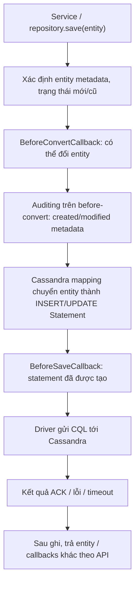

# BeforeConvertCallback và BeforeSaveCallback trong Spring Data Cassandra

Khi một entity được lưu qua Spring Data Cassandra, dữ liệu không đi thẳng từ object Java xuống Cassandra. Framework cần xác định metadata bảng, khóa, thuộc tính ánh xạ, kiểu CQL, xây `INSERT` hoặc `UPDATE` rồi mới chuyển statement cho driver. **Entity callbacks** cho phép ứng dụng can thiệp tại những điểm cụ thể trong vòng đời này.

Hai callback quan trọng nhất trước thao tác ghi là **`BeforeConvertCallback<T>`** và **`BeforeSaveCallback<T>`**. Tên gọi gần giống nhau, nhưng **thời điểm** chúng được gọi khác nhau, và do đó khả năng thay đổi giá trị **thực sự được ghi xuống Cassandra** cũng khác.

- **`BeforeConvertCallback`:** chạy **trước khi entity được chuyển thành statement CQL**. Giá trị entity được thay đổi tại đây có thể được mapping vào câu lệnh chuẩn bị ghi.
- **`BeforeSaveCallback`:** chạy **sau khi statement đã được tạo**, nhưng trước khi lưu. Callback có thể kiểm tra statement và trả entity; tuy nhiên **sửa entity lúc này không tự thay đổi các giá trị đã nằm trong statement**.

Bài thuộc chương **Vòng đời và auditing** của module **SPRING_DATA_CASSANDRA**. Chúng ta sẽ xây ví dụ lưu đơn hàng, làm rõ thứ tự callback và auditing, phân biệt synchronous với reactive callbacks, kiểm thử những gì thực sự được ghi, và xử lý các lỗi về ID, TTL, optimistic locking, retry và side effects.

> **Phiên bản và phạm vi:** Các chữ ký ví dụ sử dụng Spring Data Cassandra dựa trên Java driver 4.x, tương ứng các dòng Spring Data hiện đại (ví dụ 4.x–5.x). Một số chi tiết overload và lifecycle phụ thuộc phiên bản đang chạy; hãy kiểm tra API và integration test của dự án. Các ví dụ giả định keyspace `commerce` đã được tạo phù hợp. Không chạy logic này trực tiếp trên production khi chưa kiểm thử.

## 1. Nhìn đúng vòng đời một lần ghi entity

Một luồng lưu entity ở mức khái niệm:



**Sơ đồ chỉ minh họa thứ tự các checkpoint chính**, không khẳng định đây là mọi phương thức nội bộ hoặc mọi lifecycle event trong từng phiên bản Spring Data. Vị trí tương đối của các callback cùng giai đoạn có thể chịu tác động của `@Order`/`Ordered`.

Điểm quyết định:

```text
BeforeConvertCallback
       │
       ├─ Thay đổi object / trả một object khác
       ▼
  MAPPING THÀNH STATEMENT     ← RANH GIỚI QUAN TRỌNG
       │
       ▼
BeforeSaveCallback
       │
       ├─ Có thể quan sát / xác nhận entity + statement
       └─ Sửa object ở đây KHÔNG TỰ TÁC ĐỘNG tới statement đã tạo
       ▼
  Cassandra driver execute
```

Không nhầm `BeforeSaveCallback` với “cơ hội cuối cùng để gán một field rồi chắc chắn DB sẽ nhận được”. **Tên “before save” nói về thời điểm so với execution, không nói rằng mapping sẽ tự chạy lại.**

### 1.1. Bảng so sánh nhanh

| Tiêu chí | `BeforeConvertCallback<T>` | `BeforeSaveCallback<T>` |
| --- | --- | --- |
| Giai đoạn | Trước khi tạo CQL statement. | Sau khi mapping đã tạo statement, trước khi execute. |
| Phương thức | `onBeforeConvert(T, CqlIdentifier)` | `onBeforeSave(T, CqlIdentifier, Statement<?>)` |
| Nhận statement? | Không. | Có, để quan sát/kiểm tra trong API hiện đại. |
| Trả về | Entity ban đầu hoặc entity đã được thay đổi. | Entity ban đầu hoặc entity đã được thay đổi. |
| Sửa mapped field và muốn DB ghi giá trị mới | **Phù hợp.** | **Không phù hợp** nếu chỉ sửa entity sau khi statement tạo. |
| Kiểm tra statement đã được xây | Chưa có statement. | **Phù hợp**, nhưng đừng dựa vào khả năng sửa tùy ý statement. |
| Auditing mặc định | Auditing của Cassandra tham gia ở pha này. | Không phải pha điển hình để tạo auditing metadata. |
| Trách nhiệm | Chuẩn hóa, thiết lập giá trị mặc định, kiểm tra trước mapping. | Kiểm tra invariant cuối, observability metadata, quyết định fail-fast. |

## 2. Chữ ký API chính xác và các import

Các callback Cassandra nằm trong package `org.springframework.data.cassandra.core.mapping.event`.

### 2.1. BeforeConvertCallback

```java
package example.lifecycle;

import com.datastax.oss.driver.api.core.CqlIdentifier;
import org.springframework.data.cassandra.core.mapping.event.BeforeConvertCallback;

public final class OrderBeforeConvert
        implements BeforeConvertCallback<OrderRecord> {

    @Override
    public OrderRecord onBeforeConvert(
            OrderRecord entity, CqlIdentifier tableName) {

        // Thời điểm này, mapped Statement chưa được tạo.
        return entity;
    }
}
```

Trong contract:

- `entity` là object mà framework đang chuẩn bị chuyển thành dữ liệu ghi.
- `tableName` là `CqlIdentifier`, **không phải chuỗi tên bảng thô** do API client đưa vào.
- Method trả về **một entity hợp lệ** (có thể chính object cũ, hoặc object mới đối với kiểu immutable).
- Giá trị được trả về là đầu vào cho bước mapping tiếp theo.

### 2.2. BeforeSaveCallback

```java
package example.lifecycle;

import com.datastax.oss.driver.api.core.CqlIdentifier;
import com.datastax.oss.driver.api.core.cql.Statement;
import org.springframework.data.cassandra.core.mapping.event.BeforeSaveCallback;

public final class OrderBeforeSave
        implements BeforeSaveCallback<OrderRecord> {

    @Override
    public OrderRecord onBeforeSave(
            OrderRecord entity,
            CqlIdentifier tableName,
            Statement<?> statement) {

        // Statement đã được mapping từ entity ở một bước trước.
        return entity;
    }
}
```

Chú ý **`Statement<?>`** đến từ Java driver package `com.datastax.oss.driver.api.core.cql`. Không nhầm với JDBC `java.sql.Statement`.

Các `Statement` của Java driver 4.x thường được xử lý qua **immutable builder/copy-style APIs**. `BeforeSaveCallback` không có kiểu trả về `Statement` để thay thế câu CQL của pipeline. Vì vậy, hãy coi tham số statement là **đối tượng để kiểm tra**, không phải cơ chế chính thức để patch mọi giá trị CQL.

### 2.3. Callback là thành phần Spring, không phải annotation đặt trên method entity

Đăng ký một `@Component` triển khai interface hoặc một `@Bean` trong `ApplicationContext`. Đừng giả định Spring Data Cassandra có thể tự tìm một phương thức entity tên `onBeforeSave` nếu class không đăng ký callback hợp lệ.

Việc có thể lọc callback theo kiểu entity là một lợi ích của generic `BeforeSaveCallback<OrderRecord>`. Tránh callback “catch-all” `<Object>` không cần thiết nếu chỉ muốn xử lý một aggregate cụ thể.

## 3. Một domain model nhất quán để thực hành

Giả sử API quản lý trạng thái đơn hàng. Bảng phục vụ truy vấn bằng `order_id`:

```sql
CREATE TABLE commerce.orders_by_id (
    order_id uuid PRIMARY KEY,
    tenant_id text,
    status text,
    status_normalized text,
    amount decimal,
    created_at timestamp,
    updated_at timestamp,
    created_by text,
    updated_by text,
    version bigint
);
```

Thiết kế này chỉ phục vụ đường đọc **theo full partition key `order_id`**. Nếu sản phẩm cần liệt kê theo `tenant_id` và ngày, phải thiết kế một bảng truy vấn khác hoặc index được đánh giá riêng; callback không sửa được hạn chế của CQL/query modeling.

### 3.1. Entity ánh xạ schema

```java
package example.lifecycle;

import java.math.BigDecimal;
import java.time.Instant;
import java.util.UUID;

import org.springframework.data.annotation.CreatedBy;
import org.springframework.data.annotation.CreatedDate;
import org.springframework.data.annotation.LastModifiedBy;
import org.springframework.data.annotation.LastModifiedDate;
import org.springframework.data.annotation.Version;

import org.springframework.data.cassandra.core.mapping.Column;
import org.springframework.data.cassandra.core.mapping.PrimaryKey;
import org.springframework.data.cassandra.core.mapping.Table;

@Table("orders_by_id")
public class OrderRecord {

    @PrimaryKey("order_id")
    private UUID orderId;

    @Column("tenant_id")
    private String tenantId;

    @Column("status")
    private String status;

    @Column("status_normalized")
    private String statusNormalized;

    @Column("amount")
    private BigDecimal amount;

    @CreatedDate
    @Column("created_at")
    private Instant createdAt;

    @LastModifiedDate
    @Column("updated_at")
    private Instant updatedAt;

    @CreatedBy
    @Column("created_by")
    private String createdBy;

    @LastModifiedBy
    @Column("updated_by")
    private String updatedBy;

    @Version
    @Column("version")
    private Long version;

    public OrderRecord() {}

    public UUID getOrderId() { return orderId; }
    public void setOrderId(UUID value) { orderId = value; }

    public String getTenantId() { return tenantId; }
    public void setTenantId(String value) { tenantId = value; }

    public String getStatus() { return status; }
    public void setStatus(String value) { status = value; }

    public String getStatusNormalized() { return statusNormalized; }
    public void setStatusNormalized(String value) {
        statusNormalized = value;
    }

    public BigDecimal getAmount() { return amount; }
    public void setAmount(BigDecimal value) { amount = value; }

    public Instant getCreatedAt() { return createdAt; }
    public void setCreatedAt(Instant value) { createdAt = value; }

    public Instant getUpdatedAt() { return updatedAt; }
    public void setUpdatedAt(Instant value) { updatedAt = value; }

    public String getCreatedBy() { return createdBy; }
    public void setCreatedBy(String value) { createdBy = value; }

    public String getUpdatedBy() { return updatedBy; }
    public void setUpdatedBy(String value) { updatedBy = value; }

    public Long getVersion() { return version; }
    public void setVersion(Long value) { version = value; }
}
```

**Vì sao dùng `@Version Long`?**

Trong ví dụ, service cấp `UUID` trước khi lưu. Với entity không triển khai `Persistable`, `Long version = null` thường giúp Spring Data nhận biết entity mới dù ID đã khác `null`. Điều này cũng đưa **optimistic locking/LWT** vào đường save của framework, **không miễn phí về hiệu năng**. Chúng ta dùng version để làm ví dụ auditing chính xác với ID được gán trước; nếu ứng dụng không cần version, phải lựa chọn chiến lược `isNew` phù hợp và kiểm thử riêng.

Không tự gán `version = 0L` cho object mới khi sử dụng chiến lược wrapper version dựa trên `null`, vì có thể khiến framework coi đây là entity đã tồn tại.

### 3.2. Repository

```java
package example.lifecycle;

import java.util.UUID;
import org.springframework.data.cassandra.repository.CassandraRepository;

public interface OrderRepository
        extends CassandraRepository<OrderRecord, UUID> {
}
```

Repository và `CassandraTemplate` thực thi các đường lưu entity thích hợp có thể kích hoạt callback tương ứng được đăng ký. **Không giả định raw driver `CqlSession.execute(...)` hoặc `CqlTemplate.execute(...)` tự đi qua entity callback** — chúng làm việc ở mức CQL.

## 4. BeforeConvertCallback: chuẩn hóa dữ liệu trước mapping

Giả sử ứng dụng nhận `status = " shipped "` nhưng muốn lưu thêm `status_normalized = "SHIPPED"` để xuất dữ liệu nhất quán.

```java
package example.lifecycle;

import java.util.Locale;

import com.datastax.oss.driver.api.core.CqlIdentifier;
import org.springframework.core.annotation.Order;
import org.springframework.stereotype.Component;
import org.springframework.data.cassandra.core.mapping.event.BeforeConvertCallback;

@Component
@Order(50)
public final class OrderNormalizationCallback
        implements BeforeConvertCallback<OrderRecord> {

    @Override
    public OrderRecord onBeforeConvert(
            OrderRecord entity, CqlIdentifier tableName) {

        if (entity.getStatus() == null
                || entity.getStatus().isBlank()) {
            throw new IllegalArgumentException("Order status is required");
        }

        String normalized = entity.getStatus()
            .trim()
            .toUpperCase(Locale.ROOT);

        entity.setStatusNormalized(normalized);
        return entity;
    }
}
```

**Tại sao callback này phù hợp?** Vì nó chạy trước khi entity được chuyển thành CQL statement. Trên đường ghi có mapping callback, giá trị `status_normalized` được thiết lập tại đây sẽ được framework đọc và đưa vào mutation tương ứng.

Nếu muốn lưu cả `status` đã chuẩn hóa, có thể gọi `entity.setStatus(normalized)` tại điểm này. Nhưng cần xác định hợp đồng API/domain: không tùy ý viết lại trường do người dùng gửi nếu việc giữ nguyên bản gốc có ý nghĩa kiểm toán.

### 4.1. Mục tiêu tốt của BeforeConvertCallback

- Tính một giá trị phái sinh từ các field của chính entity, ví dụ `statusNormalized`.
- Áp dụng giá trị mặc định ổn định khi chưa có dữ liệu.
- Kiểm tra invariant **của entity trước mapping**.
- Chuẩn hóa định dạng trước khi cột được chuyển sang kiểu Cassandra.
- Với immutable entity, trả về **object mới chứa giá trị đã chuẩn hóa**, không cố sửa final field bằng reflection.

### 4.2. Những việc không nên đặt tại đây

- Đọc thêm một row Cassandra bằng network call để tìm “giá trị còn thiếu”.
- Gửi email, gọi payment service hoặc ghi bảng lịch sử trực tiếp mà không có idempotency.
- Tự động thay `orderId` ở mỗi lần lưu/ retry.
- Cấp version bằng timestamp của máy rồi bỏ qua `@Version`.
- Quyết định quyền truy cập dựa hoàn toàn vào một trường client có thể tự khai báo.
- Lấy secret/PII rồi ghi ra log.

Callback có thể chạy lại khi service retry. **Giữ nó nhanh, xác định được kết quả (deterministic), và ít side effect nhất có thể**.

### 4.3. Không sửa partition key một cách âm thầm

Nếu callback thay đổi `order_id` hoặc một thành phần partition key ở lần update, framework có thể ghi sang **partition khác** hoặc thất bại do ánh xạ/logic. Một request “đổi trạng thái đơn” không nên biến thành “tạo một đơn mới theo key khác”.

Nếu cần định danh, hãy cấp ID một lần ở tầng command/factory trước save. Với callback cấp ID ở lần tạo, phải chứng minh ID **ổn định qua retry, resubscription và serialization**; việc gọi `UUID.randomUUID()` mỗi lần callback chạy có thể tạo duplicate business row.

## 5. BeforeSaveCallback: quan sát và xác nhận trước execute

Khi `BeforeSaveCallback` chạy, statement đã được tạo từ entity. Đây là nơi thích hợp để **xác nhận invariant cuối** hoặc thu thập metadata quan sát ở mức nhẹ.

```java
package example.lifecycle;

import com.datastax.oss.driver.api.core.CqlIdentifier;
import com.datastax.oss.driver.api.core.cql.Statement;
import org.springframework.core.annotation.Order;
import org.springframework.data.cassandra.core.mapping.event.BeforeSaveCallback;
import org.springframework.stereotype.Component;

@Component
@Order(200)
public final class OrderBeforeSaveGuard
        implements BeforeSaveCallback<OrderRecord> {

    @Override
    public OrderRecord onBeforeSave(
            OrderRecord entity,
            CqlIdentifier tableName,
            Statement<?> statement) {

        if (entity.getOrderId() == null) {
            throw new IllegalStateException("Order key must not be null");
        }
        if (entity.getStatusNormalized() == null) {
            throw new IllegalStateException(
                "Status was not normalized before mapping");
        }

        if (!tableName.equals(CqlIdentifier.fromCql("orders_by_id"))) {
            throw new IllegalStateException("Unexpected target table");
        }

        // Chỉ quan sát loại statement; không log toàn bộ CQL + values.
        String statementType = statement.getClass().getSimpleName();
        if (statementType.isBlank()) {
            throw new IllegalStateException("Missing statement metadata");
        }

        return entity;
    }
}
```

Đoạn kiểm tra `statementType` nhằm minh họa rằng statement **đã tồn tại tại thời điểm này**, không phải một chính sách production buộc phải có. Cần kiểm tra kiểu/binding statement thực tế mà version framework sinh ra; không khóa code vào tên implementation nội bộ có thể thay đổi.

### 5.1. Anti-pattern: sửa field rồi tưởng statement được xây lại

```java
@Override
public OrderRecord onBeforeSave(
        OrderRecord entity,
        CqlIdentifier tableName,
        Statement<?> statement) {

    entity.setStatusNormalized("ARCHIVED"); // QUÁ MUỘN cho mutation đã tạo.
    return entity;
}
```

Đây là ví dụ **sai mục đích**, chỉ để chỉ ra thứ tự. Khi gọi setter tại `BeforeSaveCallback`, object trong bộ nhớ có thể thay đổi và được propagate, nhưng statement đã được tạo **không được framework tự động mapping lại** chỉ vì callback trả về object ấy.

Hậu quả có thể là:

```text
Giá trị statusNormalized trước mapping: "SHIPPED"
Statement được tạo: status_normalized = "SHIPPED"
BeforeSaveCallback sửa entity: "ARCHIVED"
CQL thực thi: vẫn ghi "SHIPPED"
Object trong Java: có thể hiện "ARCHIVED"
→ Trạng thái object và DB KHÔNG khớp.
```

**Cách sửa:** Chuyển logic thay đổi dữ liệu sang `BeforeConvertCallback` hoặc service trước khi save. Sau đó dùng `BeforeSaveCallback` chỉ để kiểm tra.

### 5.2. Có nên sửa trực tiếp Statement<?> không?

Không nên coi đây là API chuẩn để patch tùy ý nội dung câu CQL:

- Statement API Java driver hiện đại thường dùng các phương thức trả về **bản statement mới** thay vì mutate tại chỗ.
- `BeforeSaveCallback` trả `T entity`, **không trả Statement<?>` mới để framework thay thế**.
- Kể cả một implementation/version cho phép sửa một phần mutable state, logic phụ thuộc chi tiết đó dễ vỡ khi nâng cấp.
- Thay đổi CQL/TTL/consistency thuộc **statement/query options hoặc đường CQL tường minh** phù hợp, thay vì sửa lén ở callback.

Tài liệu API phiên bản mới nhấn mạnh **inspect statement**. Muốn chỉnh những gì thực sự được ghi, ưu tiên **BeforeConvert**, converter/mapping thích hợp hoặc CQL statement được xây theo API được hỗ trợ.

## 6. Auditing của Spring Data Cassandra chạy ở giai đoạn nào?

Spring Data có cơ chế **auditing** để gán metadata khi entity được tạo hoặc sửa, ví dụ:

- `@CreatedDate` — thời điểm tạo.
- `@LastModifiedDate` — thời điểm sửa.
- `@CreatedBy` — actor tạo.
- `@LastModifiedBy` — actor sửa.

Với Cassandra, auditing được tích hợp bằng **`AuditingEntityCallback`**, chạy trong pha **BeforeConvert**, nên giá trị auditing có thể được đưa vào statement sau đó.

Trong tài liệu chính thức, auditing callback có **order 100**. Callback tùy chỉnh không có thứ tự mặc định thường chạy với **`Ordered.LOWEST_PRECEDENCE`**; vì vậy cần tránh vô thức viết logic phụ thuộc auditing rồi giả định nó chạy trước.

### 6.1. Thứ tự khi có nhiều BeforeConvertCallback

Ví dụ khai báo:

```java
@Component
@Order(50)
class NormalizeBeforeAuditing implements BeforeConvertCallback<OrderRecord> {
    @Override
    public OrderRecord onBeforeConvert(
            OrderRecord entity, CqlIdentifier tableName) {
        // Chạy sớm hơn auditing order 100 trong cấu hình này.
        return entity;
    }
}
```

Và:

```java
@Component
@Order(200)
class CheckAfterAuditing implements BeforeConvertCallback<OrderRecord> {
    @Override
    public OrderRecord onBeforeConvert(
            OrderRecord entity, CqlIdentifier tableName) {
        // Có thể quan sát các trường auditing đã được thiết lập
        // nếu auditing đang bật và entity hợp lệ.
        return entity;
    }
}
```

Thứ tự khái niệm:

```text
BeforeConvert @Order(50)   -> Chuẩn hóa dữ liệu
Auditing callback order 100 -> Thiết lập auditing metadata
BeforeConvert @Order(200)  -> Xác nhận auditing/invariant
Mapping                       -> Tạo Statement
BeforeSave @Order(200)      -> Quan sát statement, fail-fast nếu cần
Execute                       -> Cassandra
```

**`@Order(200)` của BeforeSave không chạy cùng “hàng đợi BeforeConvert”.** Hai loại callback ở những checkpoint khác nhau; thứ tự chỉ có ý nghĩa trong nhóm callbacks tương ứng.

Đừng dựa vào thứ tự của hai callback có **cùng order** khi logic phụ thuộc nhau. Thiết lập thứ tự tường minh hoặc gộp logic liên quan trong một callback.

### 6.2. Auditing không phải nguồn sự thật tuyệt đối về hành động nghiệp vụ

`@CreatedDate`/`@LastModifiedDate` và `@CreatedBy`/`@LastModifiedBy` cho phép lưu **metadata của lần ghi qua Spring Data**, không phải lịch sử mọi sự kiện của cluster:

- Raw CQL, driver hoặc hệ thống ghi ngoài Spring Data có thể bỏ qua callback.
- Một mutation có thể được thử lại sau timeout và metadata có thể được tạo lại.
- Nhiều bảng truy cập/projection không tự dùng cùng auditing metadata.
- Cassandra write timestamp và `updated_at` trong entity là hai khái niệm khác nhau.
- Người dùng đổi trạng thái ngoài hệ thống chưa chắc có cùng principal/actor mà application context đang biết.

Nếu cần **audit trail bất biến** hoặc compliance-grade history, thiết kế bảng sự kiện/history riêng và protocol lưu phù hợp; không coi bốn annotation auditing là toàn bộ nhật ký sự kiện.

## 7. Bật auditing đúng cách trong Spring

Cấu hình imperative:

```java
package example.lifecycle;

import java.util.Optional;

import org.springframework.context.annotation.Bean;
import org.springframework.context.annotation.Configuration;
import org.springframework.data.cassandra.config.EnableCassandraAuditing;
import org.springframework.data.domain.AuditorAware;

@Configuration
@EnableCassandraAuditing
public class CassandraAuditConfig {

    @Bean
    AuditorAware<String> auditorAware() {
        // Demo background worker: dùng actor cố định rõ nguồn gốc.
        // Production phải truy xuất principal đã xác thực.
        return () -> Optional.of("system-worker");
    }
}
```

Khi auditing được bật và metadata entity phù hợp, Spring Data có thể gán các trường audit trong `BeforeConvert`.

**Không cần triển khai `AuditorAware` nếu chỉ theo dõi created/modified dates**, nhưng cần provider phù hợp khi muốn theo dõi user/actor. Nếu có nhiều bean `AuditorAware`, hãy chỉ rõ `auditorAwareRef` hoặc chọn cấu hình đơn nghĩa.

### 7.1. Cấu hình actor trong ứng dụng web

Không hard-code `"system-worker"` cho mọi request production. Cần lấy actor từ identity/principal được **xác thực**:

- HTTP request: actor từ SecurityContext hoặc cơ chế auth mà ứng dụng đã kiểm chứng.
- Message consumer: actor từ metadata event đã được kiểm tra/chữ ký/ACL.
- Job định kỳ: actor hệ thống như `"maintenance-job"` với scope rõ ràng.
- Multi-tenant: tenant ID phải được phân quyền độc lập, không chỉ lấy từ payload request.

Không tin `createdBy`/`updatedBy` do client gửi như “nguồn đúng” khi callback/auditing có trách nhiệm xác định actor phía server.

### 7.2. @CreatedDate phụ thuộc nhận diện entity mới

Spring Data dùng cơ chế xác định entity mới (entity-state detection). Với một ID được gán trước:

```java
OrderRecord row = new OrderRecord();
row.setOrderId(UUID.randomUUID());
row.setStatus("NEW");
// version của @Version Long vẫn null.
repository.save(row);
```

`@Version Long` với `null` thường giúp framework coi entity là **mới** khi gọi save, ngay cả khi UUID đã được gán. Auditing lúc tạo sẽ xử lý created metadata theo chiến lược đó. Cần nhớ optimistic locking dùng LWT trên đường versioned save, vì vậy có chi phí ghi cao hơn.

Nếu không có `@Version` hoặc `Persistable`, ID khác null có thể khiến framework **coi entity không mới**, từ đó `@CreatedDate` không được thiết lập như mong đợi. Đừng khắc phục bằng cách tự set createdDate trong `BeforeSaveCallback`; kiểm tra chiến lược new detection hoặc chuyển logic gán field tới trước mapping.

## 8. BeforeConvert và BeforeSave với mutable/immutable entity

Ví dụ ở trên dùng setters (mutable entity). Nhưng nhiều domain model dùng immutable values.

### 8.1. Mutable entity

```java
@Override
public OrderRecord onBeforeConvert(
        OrderRecord entity, CqlIdentifier tableName) {
    entity.setStatusNormalized(
        entity.getStatus().trim().toUpperCase(Locale.ROOT)
    );
    return entity;
}
```

Với mutable entity, callback có thể đổi chính instance rồi trả instance đó. Nhưng phải tránh cùng instance bị **nhiều thread thao tác đồng thời**, đặc biệt trong async/reactive code.

### 8.2. Immutable entity: trả object mới trước mapping

Ví dụ dùng Java record minh họa giá trị immutable ở tầng domain:

```java
public record ImmutableOrder(
    java.util.UUID id,
    String status,
    String normalizedStatus
) {
    public ImmutableOrder withNormalizedStatus(String value) {
        return new ImmutableOrder(id, status, value);
    }
}
```

Callback logic:

```java
import com.datastax.oss.driver.api.core.CqlIdentifier;
import org.springframework.data.cassandra.core.mapping.event.BeforeConvertCallback;

public class ImmutableOrderNormalizer
        implements BeforeConvertCallback<ImmutableOrder> {

    @Override
    public ImmutableOrder onBeforeConvert(
            ImmutableOrder entity, CqlIdentifier tableName) {

        String normalized = entity.status()
            .trim()
            .toUpperCase(java.util.Locale.ROOT);

        return entity.withNormalizedStatus(normalized);
    }
}
```

Đây là **ví dụ Java cho pattern trả object mới**, không phải một entity persistence hoàn chỉnh. Khi áp dụng vào Cassandra phải bổ sung metadata mapping cho kiểu immutable/record, constructor binding, khóa, converter và unit/integration test phù hợp.

Không trả một object kiểu khác `T` hoặc `null` rồi kỳ vọng framework tự đoán domain entity tiếp theo.

### 8.3. Tránh “đã đổi Java nhưng DB vẫn cũ”

Với immutable entity, sai lầm phổ biến là dùng `BeforeSaveCallback` tạo một bản sao chứa status mới và trả về, rồi không nhận ra statement vẫn chứa dữ liệu từ bản cũ. **Mọi field cần persist đều phải được quyết định trước bước mapping.**

## 9. Lifecycle events và EntityCallbacks không giống nhau

Spring Data Cassandra có các **ApplicationEvent** như `BeforeSaveEvent` và listener `AbstractCassandraEventListener`. Chúng khác với **EntityCallback**.

| Tiêu chí | ApplicationEvent/listener | EntityCallback |
| --- | --- | --- |
| Cơ chế | Spring `ApplicationEventMulticaster`. | Entity callback infrastructure. |
| Mục tiêu | Quan sát lifecycle; tích hợp event-driven nội bộ. | Can thiệp/biến đổi entity ở checkpoint xác định. |
| Thứ tự | Phụ thuộc event multicaster và listeners. | Có thứ tự bằng `@Order`/`Ordered`. |
| Event multicaster async | Có thể chạy listener ở thread khác; khó bảo đảm sửa entity đúng lúc. | Callback được tích hợp vào processing chain, có đường sync/reactive riêng. |
| Immutable entity | Event-based mutation dễ gây khó khăn. | Callback có thể trả object mới. |
| Khuyến nghị khi muốn đổi giá trị được persist | Không phải lựa chọn đầu tiên. | **BeforeConvertCallback**. |

Trong Spring Data Cassandra, lifecycle events có thể được phát **trước callbacks** tại các checkpoint liên quan; không nên dựa vào listener event để tranh thứ tự với callback và ghi đè dữ liệu.

Nếu team đang có một `AbstractCassandraEventListener.onBeforeSave(...)` rồi thêm `BeforeSaveCallback`, cần biết cả hai đang tồn tại, và thử thứ tự thực tế của phiên bản framework. Đừng nhầm tên `onBeforeSave` của **listener** với interface **BeforeSaveCallback<T>`**.

### 9.1. Không phát ApplicationEvent đồng nghĩa với không có callback?

Không. Đây là hai cơ chế khác nhau. Cấu hình cho phép tắt lifecycle events của template **không nên được mặc định** là đã vô hiệu mọi entity callback/auditing, hoặc ngược lại. Hãy kiểm chứng chính xác đường lưu và cấu hình version đang chạy.

Nếu code gọi raw driver `CqlSession.execute`, nó bỏ qua cả mapping events/callbacks của Spring Data; đây là lý do auditing không thể được xem là cơ chế global bắt buộc mọi CQL writer tuân theo.

## 10. Synchronous và reactive callback là hai họ interface riêng

Spring Data Cassandra hỗ trợ cả imperative và reactive APIs. **Synchronous API xem synchronous callbacks; reactive API xem reactive callbacks**.

| Đường lưu | Interface thích hợp |
| --- | --- |
| `CassandraRepository.save` / `CassandraTemplate.insert/update` | `BeforeConvertCallback<T>`, `BeforeSaveCallback<T>` |
| `ReactiveCassandraRepository.save` / `ReactiveCassandraTemplate` | `ReactiveBeforeConvertCallback<T>`, `ReactiveBeforeSaveCallback<T>` |
| `CqlTemplate.execute` | Không tự đi qua entity mapping callbacks. |
| `CqlSession.execute/executeAsync` | Không tự đi qua entity mapping callbacks. |

### 10.1. ReactiveBeforeConvertCallback

```java
package example.lifecycle;

import java.util.Locale;

import com.datastax.oss.driver.api.core.CqlIdentifier;
import org.reactivestreams.Publisher;
import org.springframework.data.cassandra.core.mapping.event.ReactiveBeforeConvertCallback;
import org.springframework.stereotype.Component;
import reactor.core.publisher.Mono;

@Component
public class ReactiveOrderNormalize
        implements ReactiveBeforeConvertCallback<OrderRecord> {

    @Override
    public Publisher<OrderRecord> onBeforeConvert(
            OrderRecord entity, CqlIdentifier tableName) {

        return Mono.fromSupplier(() -> {
            if (entity.getStatus() == null) {
                throw new IllegalArgumentException("Missing status");
            }

            entity.setStatusNormalized(entity.getStatus()
                .trim()
                .toUpperCase(Locale.ROOT));

            return entity;
        });
    }
}
```

Reactive callback trả `Publisher<T>`; ở đây `Mono.fromSupplier` hoãn bước xử lý đến khi framework subscribe. Không trả `null` thay cho publisher hoặc tạo một Mono rỗng nếu contract yêu cầu phải phát entity để tiếp tục ghi.

### 10.2. ReactiveBeforeSaveCallback

```java
package example.lifecycle;

import com.datastax.oss.driver.api.core.CqlIdentifier;
import com.datastax.oss.driver.api.core.cql.Statement;
import org.reactivestreams.Publisher;
import org.springframework.data.cassandra.core.mapping.event.ReactiveBeforeSaveCallback;
import org.springframework.stereotype.Component;
import reactor.core.publisher.Mono;

@Component
public class ReactiveOrderBeforeSave
        implements ReactiveBeforeSaveCallback<OrderRecord> {

    @Override
    public Publisher<OrderRecord> onBeforeSave(
            OrderRecord entity,
            CqlIdentifier tableName,
            Statement<?> statement) {

        return Mono.fromSupplier(() -> {
            if (entity.getStatusNormalized() == null) {
                throw new IllegalStateException(
                    "Missing normalized status before execution");
            }
            return entity;
        });
    }
}
```

**Không thay mapped field ở đây và nghĩ statement của reactive driver sẽ xây lại.** Nguyên tắc trước/sau mapping giữ nguyên với reactive API.

### 10.3. Không trộn callback synchronous với reactive rồi mong tất cả đều chạy

Một ứng dụng có cả `CassandraTemplate` và `ReactiveCassandraTemplate` phải:

- Đăng ký đúng hai họ callback nếu muốn quy tắc cùng áp dụng.
- Trích logic thuần như `normalizeStatus(...)` thành hàm dùng chung để tránh lệch nghiệp vụ.
- Kiểm thử **hai đường lưu riêng**, không chỉ kiểm thử repository blocking rồi kết luận reactive callback đã hoạt động.
- Không gọi `block()` bên trong reactive callback để chờ CQL/HTTP; nó có thể nghẽn thread xử lý reactive.

### 10.4. Auditing reactive

Để bật reactive auditing, dùng `@EnableReactiveCassandraAuditing` và provider `ReactiveAuditorAware<?>` phù hợp. Ví dụ tối giản:

```java
import org.springframework.context.annotation.Bean;
import org.springframework.context.annotation.Configuration;
import org.springframework.data.cassandra.config.EnableReactiveCassandraAuditing;
import org.springframework.data.domain.ReactiveAuditorAware;
import reactor.core.publisher.Mono;

@Configuration
@EnableReactiveCassandraAuditing
public class ReactiveCassandraAuditConfig {

    @Bean
    ReactiveAuditorAware<String> reactiveAuditorAware() {
        return () -> Mono.just("system-worker");
    }
}
```

Đây chỉ là **actor cho job thử nghiệm**. Với WebFlux, actor thực tế thường cần được tìm qua Reactor context hoặc bảo mật reactive được cấu hình; không giả định `ThreadLocal`/MDC của HTTP thread luôn đi theo mọi callback.

Nếu cùng ứng dụng bật auditing sync và reactive, xác minh bean configuration, auditor providers và đường lưu cụ thể để tránh metadata sai nguồn.

## 11. Null, validation và partial update: chỗ cần rất cẩn thận

Giả sử một REST PATCH chỉ đổi `status` nhưng DTO vô tình có `amount = null`. Nếu service dựng cả entity rồi gọi `repository.save(entity)`, mapping có thể ghi thêm các field hoặc tạo tombstone do ghi `null`, tùy API/settings.

Một `BeforeConvertCallback` **không biết chắc field nào người dùng chủ ý gửi** nếu tầng API đã làm mất phân biệt:

- **Absent**: field không xuất hiện trong PATCH.
- **Null**: client chủ động muốn bỏ giá trị.
- **Giá trị có mặt**: muốn ghi giá trị mới.

Đừng “chữa” tất cả null trong callback bằng cách nạp giá trị DB hiện có, vì:

1. Phát sinh read–modify–write không nguyên tử.
2. Có race với writer khác.
3. Có thể phá semantics xóa.
4. Làm callback blocking và khó retry.

### 11.1. Tốt hơn: command chuyên biệt và CQL tường minh

```java
public record ChangeOrderStatus(
    java.util.UUID orderId,
    String nextStatus
) {}
```

Service có thể dùng `CqlTemplate` với statement:

```sql
UPDATE commerce.orders_by_id
SET status = ?, status_normalized = ?
WHERE order_id = ?;
```

Nhưng **raw CQL sẽ không chạy `BeforeConvertCallback`**. Nếu cần cùng quy tắc normalization, service phải dùng **hàm thuần chung** trước khi bind statement.

Tách biệt rõ:

- Logic domain bắt buộc đúng với **mọi writer** → nên nằm trong service/domain/validation và schema/protocol.
- Logic hỗ trợ **đường mapping entity** → có thể đặt trong callback.
- Logic **phải chống ghi đè đồng thời** → dùng version/LWT, không dùng callback như một khóa giao dịch.

## 12. Callback không thay đổi luật Cassandra về consistency, TTL và LWT

### 12.1. Consistency

Dù callback đã chạy, mutation vẫn phải đạt consistency level do Cassandra statement/driver quyết định, ví dụ `LOCAL_QUORUM` theo RF/topology phù hợp. Callback không biết toàn bộ replica đã hội tụ hay chưa.

Không thay đổi CL trong `BeforeSaveCallback` bằng cách trông chờ có thể sửa trực tiếp statement; hãy cấu hình statement options trên API có hỗ trợ hoặc dùng Java driver đường CQL rõ ràng.

### 12.2. TTL

Khi ghi lại một hoặc nhiều cột, TTL của **các giá trị được ghi** có thể thay đổi. Nếu callback chuẩn hóa một giá trị và framework mapping lại toàn entity, những cột khác có thể cũng được gửi trong mutation, tùy thao tác và mapping settings.

Ví dụ:

```sql
UPDATE commerce.orders_by_id USING TTL 3600
SET status = 'SHIPPED'
WHERE order_id = 11111111-1111-1111-1111-111111111111;
```

Câu này chỉ ghi `status` với TTL 3600 giây; callback không tự quyết định TTL của cột khác. Ngược lại, một entity-level save có thể có phạm vi ghi rộng hơn, cần kiểm tra CQL sinh ra.

**Không** sửa `createdAt` trong `BeforeSaveCallback` rồi mong cột `created_at` đã có trong prepared statement đổi theo.

### 12.3. Optimistic locking

Khi entity dùng `@Version`, Spring Data có thể dùng LWT để bảo vệ ghi khỏi stale entity. Callback không biến một `UPDATE` thường thành `UPDATE ... IF version=?` nếu đường lưu không dùng optimistic protocol.

```sql
UPDATE commerce.orders_by_id
SET status = 'SHIPPED', version = 3
WHERE order_id = 11111111-1111-1111-1111-111111111111
IF version = 2;
```

Nếu condition không thỏa, **callback có thể đã chạy nhưng mutation không được áp dụng**. Vì thế side effect bên trong callback có thể đã xảy ra **dù DB không đổi** — nguyên nhân lớn để tránh gửi email/webhook trực tiếp tại đây.

## 13. Exception, retry và hiệu ứng phụ: callback có thể chạy lại

Xét một request:

```text
BeforeConvertCallback đã normalize → Mapping → BeforeSaveCallback
→ Cassandra nhận mutation → response bị mất → client timeout
→ Service retry → callbacks chạy lại
```

Có thể xảy ra:

- Lần đầu **đã ghi thành công** nhưng client nhận timeout.
- Lần retry ghi lại một lần nữa hoặc bị optimistic conflict.
- `@LastModifiedDate` được gán thời gian mới.
- Nếu callback phát email, email bị gửi **hai lần**.
- Nếu callback tự sinh UUID mới, hàng mới có thể được tạo thêm.
- Nếu callback sửa TTL/time-based field theo `Instant.now()`, lần retry có thể kéo dài vòng đời dữ liệu.

### 13.1. Định hướng thiết kế callback an toàn

1. **Deterministic** với cùng entity và cùng context có thể chấp nhận.
2. **Idempotent** nếu có khả năng retry.
3. **Không tự tạo side effect ngoài DB** khi không có protocol lưu đảm bảo.
4. Không tự động gọi repository save một entity khác từ callback — dễ tạo đệ quy, truy vấn ẩn và vòng phụ thuộc.
5. Không nuốt lỗi; validation thất bại nên trả exception rõ ràng **trước khi gửi CQL**.
6. Không coi callback invocation là bằng chứng Cassandra đã commit.

### 13.2. Throw exception ở BeforeSave có nghĩa gì?

Nếu `onBeforeSave` ném exception trong luồng xử lý bình thường, thao tác ghi dự kiến **chưa được gửi bởi bước execute tiếp theo**. Tuy nhiên không khẳng định toàn bộ workflow trước đó chưa có side effect: các callback/lifecycle event trước có thể đã chạy, và các request CQL khác có thể đã được gửi độc lập.

Không làm:

```java
// Anti-pattern: bắt mọi lỗi rồi coi save đã thành công.
try {
    repository.save(row);
} catch (Exception ignored) {
    return row;
}
```

Nếu callback validation thất bại, cần báo lỗi; nếu Cassandra timeout, phải phân biệt **unknown outcome** với lỗi điều kiện LWT và đối soát theo primary key/version.

## 14. Auditing và dữ liệu phân tán: giới hạn cần công khai

Metadata auditing trong một row là **trạng thái hiện tại của record**, không phải **chuỗi sự kiện bất biến**.

Ví dụ current row:

```json
{
  "orderId": "11111111-1111-1111-1111-111111111111",
  "status": "SHIPPED",
  "createdBy": "web-user-17",
  "updatedBy": "worker-2",
  "createdAt": "2026-11-25T08:00:00Z",
  "updatedAt": "2026-11-25T09:15:00Z"
}
```

Từ row này **không thể suy ra đầy đủ** những trạng thái `CREATED → PAID → PACKED → SHIPPED`, ai duyệt từng bước và event nào bị replay. Nếu ứng dụng có yêu cầu audit lịch sử cần:

- Bảng history theo **query và partition key** được thiết kế rõ.
- Event ID/operation ID để dedupe.
- Version và điều kiện LWT nếu phải chống ghi đè.
- Chính sách retention/TTL, sửa/xóa và tuân thủ quyền truy cập.
- Workflow đối soát khi ghi current và history lệch nhau.
- Quy tắc bảo vệ dữ liệu cá nhân trong audit payload.

Không dùng `BeforeSaveCallback` để lén `INSERT` một event history rồi mặc định **hai bảng được ghi nguyên tử**. Nếu parent save thất bại hoặc CAS conflict, event có thể đã được ghi; lúc đó lịch sử phản ánh một thao tác **chưa thực sự được chấp nhận**.

## 15. Kiểm thử tích hợp: giá trị đổi ở BeforeConvert phải lưu vào DB

Mock trực tiếp `OrderNormalizationCallback` chỉ chứng minh hàm Java đúng, **không** chứng minh Spring Data đã đăng ký callback và mapping đúng.

Một integration test cần:

1. Spring context load được callback bean và auditing config.
2. Bảng CQL tồn tại và mapping cột đúng.
3. Entity có ID mới và version `null` theo chiến lược đã chọn.
4. Save qua repository/template **entity-level**, không dùng raw driver để ghi.
5. Đọc lại từ Cassandra qua repository hoặc CQL.
6. Xác minh `status_normalized` thực sự được persist và các audit dates hợp lý.
7. Nếu cần, đo/chứng minh callback order.

### 15.1. JUnit 5 với CassandraRepository

```java
package example.lifecycle;

import static org.junit.jupiter.api.Assertions.*;

import java.math.BigDecimal;
import java.util.UUID;

import org.junit.jupiter.api.Test;
import org.springframework.beans.factory.annotation.Autowired;
import org.springframework.boot.test.context.SpringBootTest;

@SpringBootTest
class OrderLifecycleIntegrationTest {

    @Autowired
    OrderRepository repository;

    @Test
    void beforeConvertNormalizesValueBeforeItIsPersisted() {
        OrderRecord row = new OrderRecord();
        row.setOrderId(UUID.randomUUID());
        row.setTenantId("shop-42");
        row.setStatus(" shipped ");
        row.setAmount(new BigDecimal("250000.00"));

        // @Version Long = null giúp framework nhận đây là entity mới.
        assertNull(row.getVersion());

        OrderRecord saved = repository.save(row);
        OrderRecord loaded = repository.findById(saved.getOrderId())
            .orElseThrow();

        assertEquals("SHIPPED", loaded.getStatusNormalized());
        assertEquals(" shipped ", loaded.getStatus());
        assertNotNull(loaded.getCreatedAt());
        assertNotNull(loaded.getUpdatedAt());

        assertNotNull(loaded.getVersion());
    }
}
```

Tiền điều kiện:

- `@EnableCassandraAuditing` đã bật đúng bean config.
- `OrderNormalizationCallback` và `OrderBeforeSaveGuard` đã được component-scan.
- Keyspace/schema `commerce.orders_by_id` tồn tại; tên bảng/column mapping đúng.
- `CqlSession` đang dùng keyspace `commerce` (hoặc mapping tương đương theo cấu hình).
- Không có writer khác dùng cùng UUID và mọi dependency phù hợp version.
- Auditing đang gán ngày tháng theo cách Spring Data được cấu hình.

**Nếu test thất bại vì callback không được gọi**, kiểm tra việc tạo `CassandraTemplate` thủ công không gắn `ApplicationContext`, callback beans không được scan hoặc code dùng raw `CqlTemplate`. Đừng chữa bằng `Thread.sleep` hoặc tự gọi callback từ test rồi coi integration đã PASS.

### 15.2. Test xác nhận BeforeSave quá muộn để đổi mapped field

Không nên đăng ký một callback sai trên production chỉ để chứng minh lỗi. Trong một test profile riêng có thể:

- Tắt/loại callback mutation sai trong production.
- Đăng ký `BeforeSaveCallback` chỉ đổi `statusNormalized` từ `"SHIPPED"` thành `"NOT_PERSISTED"`.
- Ghi entity qua template.
- Đọc lại bằng **query mới** và khẳng định CQL vẫn ghi giá trị đã mapping từ trước, không phải giá trị thay sau mapping.

Kết luận test phải dựa vào DB row thật, không chỉ `assertEquals` trên object Java được trả về.

Lưu ý kết quả chi tiết về instance entity trả về có thể khác giữa immutable và mutable mapping. **Bất biến quan trọng là statement đã tạo không tự được xây lại từ setter trong BeforeSave**.

## 16. Kiểm thử callback order và auditing

### 16.1. Phân biệt lời gọi callback với kết quả commit

Một callback có thể tăng counter để quan sát:

```java
import java.util.concurrent.atomic.AtomicInteger;
import org.springframework.core.annotation.Order;
import org.springframework.data.cassandra.core.mapping.event.BeforeConvertCallback;
import com.datastax.oss.driver.api.core.CqlIdentifier;

@Order(50)
class CountingBeforeConvert implements BeforeConvertCallback<OrderRecord> {

    private final AtomicInteger invocations = new AtomicInteger();

    @Override
    public OrderRecord onBeforeConvert(
            OrderRecord entity, CqlIdentifier tableName) {
        invocations.incrementAndGet();
        return entity;
    }

    int getInvocations() {
        return invocations.get();
    }
}
```

Trong test profile, một lần `repository.save` thường kích hoạt callback trên đường lưu có mapping tương ứng. Nhưng counter chỉ phản ánh **số lần callback chạy**, không phải số mutation đã commit. Retry, save thất bại hoặc các method khác có thể khiến số lần invocation và số row viết không bằng nhau.

### 16.2. Test auditing order khi nhiều callback

Muốn kiểm tra giá trị `createdAt` do auditing cung cấp có sẵn cho callback khác:

```java
@Component
@Order(200)
class AuditFieldsGuard
        implements BeforeConvertCallback<OrderRecord> {

    @Override
    public OrderRecord onBeforeConvert(
            OrderRecord entity, CqlIdentifier tableName) {
        // Khi auditing enabled và entity được nhận là mới,
        // createdAt dự kiến đã được AuditingEntityCallback (order 100) gán.
        if (entity.getCreatedAt() == null) {
            throw new IllegalStateException("createdAt not initialized");
        }
        return entity;
    }
}
```

Đây là ví dụ **có điều kiện**. Nếu ứng dụng không bật auditing, không dùng `@CreatedDate` hoặc xử lý legacy record với trạng thái new detection khác, guard có thể từ chối save. Chỉ dùng khi đây là invariant **đã được hệ thống bảo đảm**.

### 16.3. Những tình huống test thêm

| Trường hợp | Mong đợi |
| --- | --- |
| Trạng thái có khoảng trắng/chữ thường | BeforeConvert chuẩn hóa giá trị được persist. |
| Status null | Validation lỗi trước khi gửi CQL. |
| Entity mới với UUID có sẵn | Auditing nhận đúng “mới” qua `@Version Long=null` hoặc cơ chế `isNew` được chọn. |
| Entity update với version cũ | LWT/optimistic conflict, callback có thể đã chạy nhưng DB không ghi đè. |
| Raw CQL update | Entity callback **không** được gọi; dữ liệu phải được chuẩn hóa riêng nếu cần. |
| Reactive repository save | Chạy **ReactiveBeforeConvert/ReactiveBeforeSave** chứ không trông chờ synchronous callback. |
| Save retry sau timeout | Không sinh event/ID trùng hoặc có side effect không kiểm soát. |
| Entity immutable | Callback trả object mới có được mapping đúng. |
| Multi-tenant | Table name/tenant authorization và principal không bị lấy từ dữ liệu không tin cậy. |

## 17. Kiểm thử reactive callback bằng StepVerifier

Với `ReactiveCassandraRepository<OrderRecord, UUID>` riêng trong môi trường reactive:

```java
import java.util.UUID;
import org.springframework.data.cassandra.repository.ReactiveCassandraRepository;

public interface ReactiveOrderRepository
        extends ReactiveCassandraRepository<OrderRecord, UUID> {
}
```

Integration test:

```java
import static org.junit.jupiter.api.Assertions.*;

import java.math.BigDecimal;
import java.time.Duration;
import java.util.UUID;

import org.junit.jupiter.api.Test;
import org.springframework.beans.factory.annotation.Autowired;
import org.springframework.boot.test.context.SpringBootTest;
import reactor.test.StepVerifier;

@SpringBootTest
class ReactiveOrderLifecycleIntegrationTest {

    @Autowired
    ReactiveOrderRepository repository;

    @Test
    void reactiveBeforeConvertRunsWhenSaveIsSubscribed() {
        OrderRecord row = new OrderRecord();
        row.setOrderId(UUID.randomUUID());
        row.setTenantId("shop-42");
        row.setStatus(" packed ");
        row.setAmount(new BigDecimal("10000.00"));

        var pipeline = repository.save(row)
            .flatMap(saved -> repository.findById(saved.getOrderId()));

        StepVerifier.create(pipeline)
            .assertNext(loaded ->
                assertEquals("PACKED", loaded.getStatusNormalized()))
            .expectComplete()
            .verify(Duration.ofSeconds(10));
    }
}
```

**Giải thích điểm thời gian:**

- Với reactive repository publisher lạnh, tạo biến `pipeline` chưa đồng nghĩa CQL đã chạy.
- `StepVerifier.verify(...)` thực hiện subscription và đợi tín hiệu.
- `ReactiveBeforeConvertCallback` được thực thi trong processing chain ở giai đoạn tương ứng, và có thể trả `Mono<OrderRecord>`.
- Đừng gọi `block()` trong reactive callback.
- Nếu chỉ đăng ký `BeforeConvertCallback` synchronous, không mặc định nó được gọi trên reactive API.

Cần profile/context reactive riêng phù hợp nếu cả hai repository imperative/reactive cùng tồn tại; không tự giả định hai cấu hình auditing đã bật và hoạt động chỉ vì annotation nằm trên entity.

## 18. Bảng lỗi thường gặp và cách sửa

| Triệu chứng | Nguyên nhân khả dĩ | Hướng xử lý |
| --- | --- | --- |
| Sửa status trong BeforeSave nhưng DB không đổi | Statement đã mapping trước callback. | Chuyển logic sang BeforeConvert. |
| BeforeConvert không được gọi | Callback chưa là Spring bean hoặc code dùng raw CQL. | Kiểm tra component scan, context/template API. |
| Auditing dates không được lưu | Chưa bật auditing, sai annotation hoặc new detection. | Bật auditing, kiểm tra ID/version/Persistable. |
| `@CreatedDate` không được gán khi UUID đã có | Entity bị coi là không mới khi chỉ xét ID. | `@Version Long` hoặc `Persistable.isNew` theo thiết kế. |
| Callback đọc thấy null audit fields | Thứ tự trước AuditingEntityCallback hoặc auditing chưa bật. | `@Order` phù hợp, test đúng lifecycle. |
| `createdBy` luôn là system-worker | AuditorAware demo được giữ nguyên production. | Cung cấp principal đã xác thực và phân biệt system actor. |
| Callback bị gọi nhiều lần | Retry, nhiều save hoặc reactive resubscription. | Giữ callback deterministic và idempotent. |
| LWT conflict nhưng email đã gửi | Side effect trong callback trước commit. | Chuyển qua outbox/workflow có idempotency. |
| Callback đổi partition key | Key không còn đúng, có thể tạo hàng mới. | ID phải ổn định qua vòng đời và retry. |
| Reactive save không thấy sync callback | Sync và reactive dùng interface riêng. | Đăng ký ReactiveBeforeConvertCallback. |
| `BeforeSaveCallback` sửa statement không có tác dụng | Statement kiểu immutable/callback không trả statement mới. | Dùng options/mapping/CQL API phù hợp. |
| Callback blocking làm chậm API | Query/HTTP call trong callback. | Di chuyển ra service/workflow; async reactive khi cần. |
| Trạng thái Java khác DB | Sửa entity sau mapping. | Đổi ở BeforeConvert và assert DB row. |
| Validation đổi null thành value không đúng | Callback không biết absent/null của PATCH. | DTO command tách absent/null và partial CQL. |
| Current row chỉ có updatedBy, thiếu lịch sử | Auditing fields không phải event log. | Tạo history/outbox/projection riêng nếu cần. |
| Sau timeout có hai bản ghi | ID được sinh lại hoặc retry non-idempotent. | Stable ID, idempotency, đọc đối soát. |
| TTL thay đổi bất ngờ | Entity save ghi lại nhiều cell hoặc default TTL. | Kiểm tra generated CQL và TTL từng cột. |

## 19. Checklist trước khi sử dụng hai callback

1. **Đường lưu thực sự là gì?** Repository, CassandraTemplate, ReactiveTemplate hay raw CQL?
2. **Giai đoạn cần đổi dữ liệu là trước hay sau mapping?** Nếu cần persist, chọn BeforeConvert.
3. **Generic type `T` của callback chính xác chưa?** Entity root hay toàn bộ `Object`?
4. **Callback là Spring bean và đúng ApplicationContext chưa?**
5. **Auditing đã bật và có đúng AuditorAware/ReactiveAuditorAware chưa?**
6. **Thứ tự `@Order` có mâu thuẫn với auditing (order 100) không?**
7. **ID/version có khiến entity bị nhận nhầm mới/cũ không?**
8. **Có sửa partition key hoặc version trong callback không?** Nếu có, vì sao?
9. **Immutable entity được trả về bằng bản sao đúng mapping chưa?**
10. **Callback có gọi network, blocking, email hoặc ghi DB khác không?** Nên tránh.
11. **Có side effect trùng khi retry/timeout/CAS conflict không?**
12. **Raw CQL writer khác có tuân cùng invariant domain không?**
13. **Cassandra TTL/consistency và partial update có phù hợp không?**
14. **Đã test bằng database readback, không chỉ kiểm tra object Java, chưa?**
15. **Nếu dùng reactive, ai subscribe và callback có phát entity trong Publisher không?**

## 20. Bài tập tình huống

**Bài 1 — Giá trị đổi quá muộn.** Một `BeforeSaveCallback` sửa `entity.statusNormalized` từ `NEW` sang `PAID`. Vì sao DB vẫn có thể ghi `NEW`? Sửa ở đâu?

**Bài 2 — Chọn callback.** Cần trim và uppercase trạng thái trước khi ghi một row; chọn `BeforeConvertCallback` hay `BeforeSaveCallback`?

**Bài 3 — Kiểm tra statement.** Cần log loại statement/CQL shape nhưng không log PII. Callback nào có tham số `Statement<?>`, và nên tránh log gì?

**Bài 4 — Auditing order.** Một callback `@Order(50)` đọc `entity.createdAt` và thấy `null`. Tại sao? Viết vị trí thứ tự phù hợp để đọc metadata sau auditing.

**Bài 5 — UUID gán trước.** Entity có ID mới nhưng không có version/Persistable, `@CreatedDate` không xuất hiện. Vì sao cơ chế xác định entity mới lại quan trọng?

**Bài 6 — Reactive API.** Application dùng `ReactiveCassandraTemplate` nhưng chỉ đăng ký `BeforeConvertCallback` synchronous. Có thể kỳ vọng nó tự chạy không?

**Bài 7 — Retry.** Callback tự `UUID.randomUUID()` khi tạo entity và gửi email trong `onBeforeSave`. Ghi timeout rồi service retry. Những hậu quả có thể xảy ra?

**Bài 8 — Raw CQL.** Một worker dùng `CqlTemplate.execute("UPDATE ...")`. Có chắc `@LastModifiedDate` và callback normalization chạy không?

**Bài 9 — Immutable entity.** Callback cần đổi một giá trị trong Java record. Nên thay final field hay tạo record mới rồi return, và phải làm tại checkpoint nào?

**Bài 10 — Version conflict.** `BeforeConvertCallback` đã chạy, sau đó save `@Version` bị optimistic conflict. Có thể suy ra callback tương đương một business event đã commit không?

**Bài 11 — PATCH null.** Request chỉ chứa `status` nhưng entity mapping có `amount=null`. Có nên viết callback query DB để lấp `amount` không? Cách thiết kế khác an toàn hơn?

**Bài 12 — Auditing vs history.** Bảng có `createdBy`, `updatedBy` và dates. Có thể dùng nó làm audit trail đầy đủ mọi state transition không?

### Gợi ý đáp án

1. Mapping đã tạo statement trước BeforeSave; sửa entity không làm statement mới tự sinh. Dùng BeforeConvert hoặc service trước mapping.
2. BeforeConvert, vì cần giá trị mới có mặt trong mutation được tạo.
3. BeforeSave có `Statement<?>`; tránh log query đầy đủ với bind values, token, PII và secret.
4. Auditing callback thường order 100, nên callback order 50 có thể chạy trước; dùng một BeforeConvert order lớn hơn 100, với auditing đã bật.
5. Spring Data có thể xem ID khác null là “không mới”; dùng `@Version Long=null` hoặc `Persistable.isNew` phù hợp, test đúng schema.
6. Không mặc định. Reactive API dùng ReactiveBeforeConvertCallback/ReactiveBeforeSaveCallback.
7. ID có thể đổi khiến tạo nhiều row; email có thể gửi trùng dù DB lỗi/timeout; cần stable ID, idempotency và durable side-effect workflow.
8. Không. Raw CQL bỏ qua entity callbacks/auditing mapping; phải dùng logic chung rõ ràng.
9. Trả immutable object mới **từ BeforeConvert** để mapper nhận giá trị đã sửa.
10. Không. Callback chạy trước CQL; LWT có thể từ chối mutation. Business commit phải xác nhận kết quả.
11. Không nên giấu read–modify–write trong callback. Dùng PATCH command/partial CQL có phân biệt absent/null và version CAS nếu cần.
12. Không. Đây là metadata trạng thái gần nhất, không phải lịch sử sự kiện bất biến.

**Ghi nhớ:** Trong Spring Data Cassandra, **`BeforeConvertCallback` thay đổi dữ liệu trước mapping**, vì vậy có thể ảnh hưởng giá trị được ghi. **`BeforeSaveCallback` chạy sau khi statement đã tạo**, thích hợp để kiểm tra/quan sát nhưng **không tự cập nhật CQL khi chỉ thay đổi entity**. Auditing thuộc pha BeforeConvert và có thứ tự riêng; synchronous và reactive callbacks là hai họ khác nhau. Không xem callback là transaction, nơi phát side effect an toàn hoặc cơ chế kiểm soát đồng thời. Hãy kiểm chứng bằng integration test đọc lại dữ liệu từ Cassandra, giữ ID/version ổn định và xử lý timeout/LWT đúng ngữ nghĩa.

### Tài liệu tham khảo chính thức

- [Spring Data Cassandra — Lifecycle Events và Entity Callbacks](https://docs.spring.io/spring-data/cassandra/reference/cassandra/events.html)
- [Spring Data Cassandra — BeforeConvertCallback API](https://docs.spring.io/spring-data/cassandra/reference/api/java/org/springframework/data/cassandra/core/mapping/event/BeforeConvertCallback.html)
- [Spring Data Cassandra — BeforeSaveCallback API](https://docs.spring.io/spring-data/cassandra/reference/api/java/org/springframework/data/cassandra/core/mapping/event/BeforeSaveCallback.html)
- [Spring Data Cassandra — Auditing Configuration](https://docs.spring.io/spring-data/cassandra/reference/cassandra/auditing.html)
- [Spring Data Commons — Auditing fundamentals](https://docs.spring.io/spring-data/commons/reference/auditing.html)
- [Spring Data Cassandra — Object Mapping](https://docs.spring.io/spring-data/cassandra/reference/cassandra/mapping.html)
- [Apache Cassandra — CQL DML](https://cassandra.apache.org/doc/stable/cassandra/developing/cql/dml.html)
