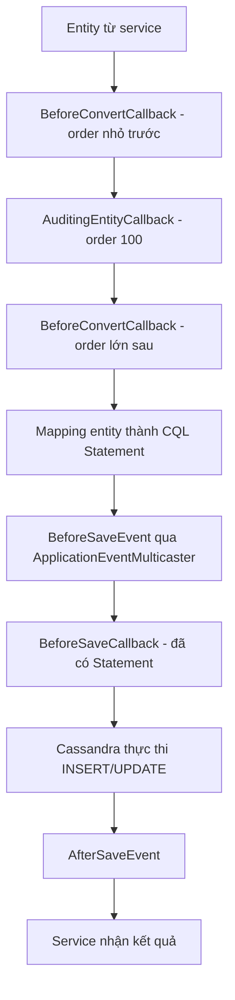
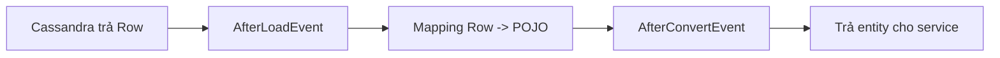

# Thứ tự callback và giữ logic dễ kiểm thử

Khi lưu một entity bằng **Spring Data Cassandra**, ứng dụng đôi khi cần chuẩn hóa dữ liệu, điền thông tin người tạo/người sửa, kiểm tra một điều kiện hợp lệ, rồi ghi Cassandra. Sau khi ghi hoặc đọc, ứng dụng còn có thể muốn đo metric, log sự kiện hoặc chuyển dữ liệu sang một lớp xử lý khác. Những việc này thường được viết trong **entity lifecycle callback**, **Spring application event listener** hoặc cấu hình **auditing**.

Vấn đề là các hook đó không chạy ở cùng một thời điểm. Đặc biệt:

- **`BeforeConvertCallback`** chạy **trước khi entity được chuyển thành CQL `Statement`**, nên có thể thay đổi field sẽ được ánh xạ xuống database.
- **`AuditingEntityCallback`** chạy ở pha **`BeforeConvert` với order 100**; nó điền các field auditing như `@CreatedDate`, `@LastModifiedDate`, `@CreatedBy` và `@LastModifiedBy`.
- **`BeforeSaveCallback`** chạy **sau khi `Statement` đã được tạo**; sửa field của entity tại đây **không tự cập nhật các giá trị đã được đưa vào statement**.
- **`AfterSaveEvent`**, **`AfterLoadEvent`**, **`AfterConvertEvent`** là các **application events** của Cassandra mapping, không phải các `AfterSaveCallback`/`AfterLoadCallback` có cùng contract với `EntityCallback`.
- Thứ tự các **entity callbacks** có thể được xác định bằng `@Order` hoặc `Ordered`. Ngược lại, **application events** có thể được phân phát bất đồng bộ; chúng không phải nơi phù hợp để dựa vào thứ tự chắc chắn cho mọi phép biến đổi entity.

Bài thuộc chương **Vòng đời và auditing** của module **SPRING_DATA_CASSANDRA**: truy cập Apache Cassandra bằng entity mapping, repository, CassandraTemplate và CQL; thiết kế bảng theo truy vấn, partition key, consistency, paging và hiệu năng phù hợp với mô hình phân tán. Mục tiêu chính không chỉ là ghi nhớ thứ tự callback mà còn biết **đặt logic ở đâu để có thể unit test trực tiếp**, tránh phụ thuộc ngầm vào framework hoặc side effect không thể kiểm soát.

Ví dụ sử dụng **Spring Data Cassandra 4.5.x**, **Java 17+**, Spring Boot 3.x tương thích và Apache Cassandra trong keyspace lab. Các đoạn code theo contract của Spring Data Cassandra; cần kiểm tra phiên bản dependency thực tế trước khi sao chép vào một dự án cũ.

## 1. Mục tiêu học tập

Sau bài này, bạn có thể:

1. Phân biệt **entity callback**, **mapping event listener** và **auditing infrastructure** trong Spring Data Cassandra.
2. Vẽ được thứ tự chính của đường ghi: **BeforeConvert → auditing → mapping/Statement → BeforeSave → CQL execute → AfterSave event**.
3. Hiểu ý nghĩa của **`@Order(50)`**, auditing **order 100**, `@Order(200)` và `Ordered.LOWEST_PRECEDENCE`.
4. Đặt thao tác **thay đổi field cần persist** vào `BeforeConvertCallback`, không đặt vào `BeforeSaveCallback`.
5. Dùng `BeforeSaveCallback` để kiểm tra hoặc quan sát statement **đã tạo**, tránh đánh đồng nó với cơ hội mapping lần hai.
6. Phân biệt luồng đọc **AfterLoadEvent → chuyển đổi Row thành entity → AfterConvertEvent** và các event xóa.
7. Cấu hình `@EnableCassandraAuditing` cùng `AuditorAware`, dùng các annotation audit trên entity.
8. Giải thích vì sao `@Version` hoặc cơ chế xác định **isNew** ảnh hưởng đến `@CreatedDate` và `@LastModifiedDate`.
9. Viết **pure function** cho quy tắc nghiệp vụ, dùng callback như adapter mỏng, không giấu repository/network call trong callback.
10. Dùng **ReactiveBeforeConvertCallback** và **ReactiveBeforeSaveCallback** đúng trong reactive path.
11. Kiểm thử logic bằng JUnit không cần Cassandra, rồi kiểm chứng mapping/callback/auditing bằng integration test trên Cassandra thật.
12. Nêu giới hạn: raw CQL bỏ qua entity lifecycle; callback không tạo distributed transaction và event sau save không phải outbox đáng tin cậy.

## 2. Ba cơ chế hook không giống nhau

| Cơ chế | Cách đăng ký | Điểm mạnh | Điều cần cảnh giác |
|---|---|---|---|
| **`EntityCallback<T>`** | Bean implement `BeforeConvertCallback<T>`, `BeforeSaveCallback<T>` | Có checkpoint cụ thể, trả entity mới hoặc đã sửa; tuần tự theo order | Phải đặt đúng pha và type |
| **`AuditingEntityCallback`** | `@EnableCassandraAuditing`, audit annotations | Tự điền tác giả/thời gian khi ghi entity | Phụ thuộc state detection, auditor/date provider và đường ghi |
| **`ApplicationEvent`** | `AbstractCassandraEventListener<T>` hoặc `ApplicationListener` | Quan sát save/delete/load/convert | Event multicaster có thể async; không có bảo đảm như chuỗi callback |
| **Domain service** | Method Java bình thường | Nơi rõ ràng để kiểm tra invariant, authorization, workflow | Service phải gọi theo thứ tự đúng, xử lý concurrency |
| **Raw CQL/driver** | `CqlTemplate`/`CqlSession` | Kiểm soát CQL và options trực tiếp | Không tự chạy callback/auditing của entity mapper |

### 2.1. Vì sao nên ưu tiên EntityCallback khi cần sửa entity?

Spring Data mô tả `EntityCallback` là điểm mở rộng có thứ tự **xác định trong processing chain**. Callback được nhận một entity và **trả lại** entity (hoặc Publisher của entity trong reactive path). Giá trị trả về có thể trở thành đầu vào cho bước tiếp theo.

`ApplicationEvent` phụ thuộc `ApplicationEventMulticaster`. Nếu cấu hình multicaster dùng `TaskExecutor` bất đồng bộ, event listener có thể chạy trên thread khác, thậm chí sau khi phần còn lại của save đã tiến triển. Do đó, **không dùng event listener để bảo đảm normalize field ngay trước khi statement được tạo**.

### 2.2. Phân biệt loại hook theo tên chính xác

Trong Spring Data Cassandra 4.5, các entity callbacks store-specific nổi bật là:

- **`BeforeConvertCallback<T>`**
- **`BeforeSaveCallback<T>`**
- **`ReactiveBeforeConvertCallback<T>`**
- **`ReactiveBeforeSaveCallback<T>`**
- **`AuditingEntityCallback`** / **`ReactiveAuditingEntityCallback`** được framework đăng ký khi bật auditing.

Còn **`AfterSaveEvent<T>`**, **`AfterLoadEvent<T>`**, **`AfterConvertEvent<T>`**, **`BeforeDeleteEvent<T>`**, **`AfterDeleteEvent<T>`** thuộc hạ tầng **mapping events**. Không tự tạo một interface `AfterSaveCallback<T>` rồi nghĩ Cassandra 4.5 sẽ tự gọi nó.

### 2.3. Hạn chế ở root entity

Tài liệu lifecycle events của Cassandra ghi rõ **mapping events phát cho root-level types**. Những object phức hợp nằm trong property của một aggregate root **không tự nhận một mapping event riêng** cho từng phần tử.

Ví dụ:

```java
@Table("orders_by_id")
class Order {
    @PrimaryKey
    UUID id;

    // Một value object lồng bên trong không mặc định là root event riêng.
    Address shippingAddress;
}
```

Nếu cần chuẩn hóa `shippingAddress`, nên có một pure function xử lý value object trong flow của **Order**, hoặc converter/mapping strategy phù hợp, thay vì đợi một event được phát độc lập cho `Address`.

## 3. Sơ đồ thứ tự đường ghi entity

### 3.1. Các checkpoint quan trọng

Trong đường `CassandraTemplate.insert(entity)` / `update(entity)` hoặc repository operations sử dụng mapping tương ứng:



Sơ đồ là **trình tự khái niệm của các checkpoint** trên synchronous mapping path; thời điểm handler của **ApplicationEvent** thật sự chạy có thể khác nếu multicaster được cấu hình async. Đừng dùng nó làm bảo đảm callback thread hoặc transaction toàn hệ thống.

### 3.2. Bảng phân biệt “khi nào field còn được persist?”

| Giai đoạn | Có CQL Statement rồi? | Sửa Java field có tự đi vào statement được tạo? | Dùng cho |
|---|---|---|---|
| Service trước `save` | **Chưa** | **Có**, khi mapper lấy state sau đó | Business invariant, validation, command |
| **`BeforeConvertCallback`** | **Chưa** | **Có** | Normalize, default, derived persisted fields |
| **`AuditingEntityCallback`** | **Chưa** | **Có** | Created/modified metadata |
| Mapping tạo statement | **Đang tạo** | Chốt snapshot field cho statement | Converter/mapping |
| **`BeforeSaveEvent`** | **Có** | **Không nên giả định** | Quan sát, metrics |
| **`BeforeSaveCallback`** | **Có** | **Không** (nếu chỉ đổi entity) | Inspect statement, observer |
| Cassandra execute | **Có** | Không còn ảnh hưởng tới statement hiện tại | Database write |
| **`AfterSaveEvent`** | Đã gửi/nhận kết quả write tương ứng | Thay object không phải một write mới | Telemetry, thông báo nội bộ không yêu cầu atomic |

### 3.3. Điều gì xảy ra nếu đặt normalize ở sai pha?

**Sai:**

```java
@Component
class WrongStatusCallback implements BeforeSaveCallback<AuditOrder> {

    @Override
    public AuditOrder onBeforeSave(
        AuditOrder entity,
        CqlIdentifier tableName,
        Statement<?> statement
    ) {
        entity.setStatus("PAID"); // Quá muộn để thay Statement đã tạo.
        return entity;
    }
}
```

Nếu service gửi entity có `status="PENDING"` thì câu CQL đã được chuẩn bị từ `PENDING` trước khi callback này chạy. Đối tượng Java sau callback có thể mang `PAID` nhưng row Cassandra vẫn nhận giá trị từ **statement cũ**.

**Đúng:** đổi giá trị cần persist trong service trước khi gọi save hoặc trong **`BeforeConvertCallback`**. Không dựa vào việc sửa một `Statement<?>` immutable theo cách không có contract rõ ràng.

### 3.4. Dữ liệu không chờ toàn bộ hệ thống

Callback có thứ tự trong **một operation mapping**; nó không tạo atomic transaction giữa:

```text
Cassandra INSERT
Kafka publish
Send email
Charge payment
```

Nếu một bước ngoài Cassandra lỗi, không có rollback SQL tự động cho tất cả bước. Cần idempotency, outbox/CDC, retry và reconciliation theo kiến trúc. Đừng đưa các I/O side effect bắt buộc vào callback rồi tuyên bố chúng được transactionally protected.

## 4. @Order và việc auditing chạy ở vị trí 100

### 4.1. Quy tắc sắp xếp

Spring Framework dùng **`@Order`** hoặc interface **`Ordered`** để sắp entity callback có liên quan:

- **Số nhỏ hơn chạy trước**.
- **`@Order(50)` chạy trước auditing order 100**.
- **`@Order(200)` chạy sau auditing order 100**.
- Callback không khai báo order mặc định thuộc **`Ordered.LOWEST_PRECEDENCE`** (thường chạy sau những callback có thứ tự tường minh).
- Nếu hai callbacks có **cùng thứ tự**, không được dựa vào tên class, vị trí khai báo bean hay thứ tự classpath làm thứ tự nghiệp vụ.

Spring Data Cassandra 4.5 tài liệu hóa:

```text
BeforeConvertCallback<T>      Ordered.LOWEST_PRECEDENCE
AuditingEntityCallback        order 100
BeforeSaveCallback<T>         Ordered.LOWEST_PRECEDENCE
```

Order chỉ **so sánh các callback thuộc cùng checkpoint**: `BeforeConvertCallback` khác checkpoint với `BeforeSaveCallback`; một `BeforeSaveCallback @Order(1)` **không thể chạy trước một `BeforeConvertCallback @Order(999)`**.

### 4.2. Cấu hình minh họa

```java
@Order(50)
@Component
class NormalizeOrderCallback
        implements BeforeConvertCallback<AuditOrder> {
    // ...
}

@Order(200)
@Component
class PostAuditGuardCallback
        implements BeforeConvertCallback<AuditOrder> {
    // ...
}

@Order(300)
@Component
class StatementObservationCallback
        implements BeforeSaveCallback<AuditOrder> {
    // ...
}
```

Trong một lần lưu entity:

```text
BeforeConvert @Order(50)
  -> AuditingEntityCallback (100)
  -> BeforeConvert @Order(200)
  -> build Statement
  -> BeforeSaveCallback @Order(300)
  -> execute
```

**Không dùng `@Order(100)` cho callback tự viết nếu cần xác định rõ trước/sau auditing.** Chọn số cách xa nhau như 50/200 và ghi comment lý do.

### 4.3. Trường hợp phụ thuộc giá trị audit

Nếu một validation callback phải kiểm tra `@LastModifiedDate` **sau khi auditing đã điền**, nó nên chạy ở **`BeforeConvert @Order(200)`**. Nếu bạn đặt `@Order(50)` rồi assert `updatedAt != null`, entity mới có thể chưa được auditing gán date, gây lỗi dù cấu hình audit đúng.

Ngược lại, nếu một normalization cần diễn ra **trước** khi auditing xem entity, `@Order(50)` là lựa chọn rõ ràng. Dù vậy, quy tắc nghiệp vụ quan trọng vẫn nên được service kiểm tra trước khi persistence bắt đầu; callback chỉ làm adapter hạ tầng nhỏ.

## 5. Tạo bảng thử và entity có auditing

### 5.1. Keyspace/bảng

Chạy trong Cassandra test cluster:

```sql
CREATE KEYSPACE IF NOT EXISTS sdc_audit_lab
WITH replication = {
    'class': 'SimpleStrategy',
    'replication_factor': 1
};

CREATE TABLE IF NOT EXISTS sdc_audit_lab.audit_orders_by_id (
    order_id uuid PRIMARY KEY,
    status text,
    status_key text,
    created_at timestamp,
    updated_at timestamp,
    created_by text,
    updated_by text,
    version bigint
);
```

**Lưu ý:** `SimpleStrategy` và replication factor 1 chỉ là cấu hình lab. Production đa datacenter cần `NetworkTopologyStrategy`, RF, consistency và migration được thiết kế riêng.

Đường đọc chính:

```sql
SELECT order_id, status, status_key,
       created_at, updated_at, created_by, updated_by, version
FROM sdc_audit_lab.audit_orders_by_id
WHERE order_id = 11111111-1111-1111-1111-111111111111;
```

Đọc theo **partition key `order_id`**. Auditing không tạo index/query capability mới và không giúp `WHERE created_by = ?` quét toàn bảng trở thành truy vấn hiệu quả.

### 5.2. AuditOrder.java

```java
import java.time.Instant;
import java.util.UUID;

import org.springframework.data.annotation.CreatedBy;
import org.springframework.data.annotation.CreatedDate;
import org.springframework.data.annotation.LastModifiedBy;
import org.springframework.data.annotation.LastModifiedDate;
import org.springframework.data.annotation.Version;

import org.springframework.data.cassandra.core.mapping.Column;
import org.springframework.data.cassandra.core.mapping.PrimaryKey;
import org.springframework.data.cassandra.core.mapping.Table;

@Table("audit_orders_by_id")
public class AuditOrder {

    @PrimaryKey("order_id")
    private UUID orderId;

    @Column("status")
    private String status;

    @Column("status_key")
    private String statusKey;

    @CreatedDate
    @Column("created_at")
    private Instant createdAt;

    @LastModifiedDate
    @Column("updated_at")
    private Instant updatedAt;

    @CreatedBy
    @Column("created_by")
    private String createdBy;

    @LastModifiedBy
    @Column("updated_by")
    private String updatedBy;

    @Version
    @Column("version")
    private Long version;

    public AuditOrder() {}

    public AuditOrder(UUID orderId, String status) {
        this.orderId = orderId;
        this.status = status;
        this.version = null; // Entity mới; framework quản lý version.
    }

    public UUID getOrderId() { return orderId; }
    public void setOrderId(UUID value) { orderId = value; }

    public String getStatus() { return status; }
    public void setStatus(String value) { status = value; }

    public String getStatusKey() { return statusKey; }
    public void setStatusKey(String value) { statusKey = value; }

    public Instant getCreatedAt() { return createdAt; }
    public void setCreatedAt(Instant value) { createdAt = value; }

    public Instant getUpdatedAt() { return updatedAt; }
    public void setUpdatedAt(Instant value) { updatedAt = value; }

    public String getCreatedBy() { return createdBy; }
    public void setCreatedBy(String value) { createdBy = value; }

    public String getUpdatedBy() { return updatedBy; }
    public void setUpdatedBy(String value) { updatedBy = value; }

    public Long getVersion() { return version; }
    public void setVersion(Long value) { version = value; }
}
```

### 5.3. Vì sao ví dụ có @Version?

Một lỗi hay gặp khi thử auditing là **tự cấp UUID trước khi insert**, nhưng framework dựa trên `isNew` để phân biệt created/modified. Nếu entity có ID non-null mà không có tín hiệu newness rõ ràng, auditing có thể **xem nó là entity đã tồn tại**, khiến `@CreatedDate`/`@CreatedBy` không được điền như kỳ vọng.

Ví dụ dùng **`@Version Long`**:

- Entity mới: `version == null`, giúp Spring Data nhận diện **new**.
- Insert qua đường versioned entity sử dụng **LWT/`IF NOT EXISTS`**; version đầu tiên là **0** theo semantics module.
- Update thành công nâng version **0 → 1 → 2...**.
- Optimistic locking có thêm chi phí **Paxos/LWT**; **không** thêm `@Version` vào mọi bảng chỉ để audit cho tiện nếu workload không cần CAS.

Trong dự án không cần LWT, có thể thiết kế **state detection** đúng bằng `Persistable`/custom entity state hoặc lifecycle đã kiểm chứng; phải test created-vs-modified sau khi cấp ID. **Không tự gán `version=0L` trước insert** khi dùng wrapper version để phân biệt entity mới.

### 5.4. Auditing không phải immutable audit log

Các cột `created_at`, `updated_at`, `created_by`, `updated_by` ở bảng này cho biết **metadata hiện tại**. Khi update, `updated_at`/`updated_by` thường bị ghi lại.

Chúng **không** lưu mọi lần thay đổi hoặc đủ chứng minh ai đã làm gì trong lịch sử. Nếu hệ thống yêu cầu audit trail bất biến, cần append-only events, log/CDC, retention, kiểm soát quyền và integrity riêng.

## 6. Đưa business rules ra pure functions

Để callback dễ kiểm thử, phần xử lý chính nên là **hàm thuần**: cùng đầu vào cho cùng đầu ra, không phụ thuộc `ApplicationContext`, hệ thống clock, database hoặc service bên ngoài.

### 6.1. Một quy tắc chuẩn hóa đơn giản

```java
import java.util.Locale;
import java.util.Set;

public final class OrderStatusPolicy {

    private static final Set<String> ALLOWED =
        Set.of("CREATED", "PAID", "SHIPPED", "CANCELLED");

    private OrderStatusPolicy() {}

    public static String normalize(String raw) {
        if (raw == null) {
            throw new IllegalArgumentException("status is required");
        }

        String normalized = raw.strip().toUpperCase(Locale.ROOT);

        if (!ALLOWED.contains(normalized)) {
            throw new IllegalArgumentException(
                "Unsupported status: " + normalized
            );
        }
        return normalized;
    }

    public static boolean canTransition(
        String current, String next
    ) {
        String from = normalize(current);
        String to = normalize(next);

        return switch (from) {
            case "CREATED" -> to.equals("PAID")
                           || to.equals("CANCELLED");
            case "PAID" -> to.equals("SHIPPED");
            case "SHIPPED", "CANCELLED" -> false;
            default -> false;
        };
    }
}
```

`normalize` không gọi Cassandra, không đọc `SecurityContext`, không dùng `Instant.now()`, không thay đổi global state. `canTransition` biểu diễn một phần domain invariant.

### 6.2. Chỗ dùng các hàm

- **`normalize`** có thể được gọi trong service **và** `BeforeConvertCallback` để giữ write path nhất quán.
- **`canTransition`** nên được service sử dụng ở command boundary, nơi có **trạng thái hiện tại và expected version**; không đặt “đọc trạng thái rồi quyết định” trong callback vì callback không tự có transaction.
- Nếu cần kiểm tra cạnh tranh, dùng **`@Version`/LWT** trong repository hoặc CQL `IF`; kiểm tra Java thuần không đủ ngăn race giữa hai requests.

**Nguyên tắc:** domain logic được test bằng `OrderStatusPolicyTest`; callback chỉ là một adapter rất mỏng gọi hàm đó tại điểm mapping phù hợp.

### 6.3. Vì sao không inject repository vào callback?

Một callback như:

```java
// Anti-pattern: vòng phụ thuộc và I/O ẩn.
@Override
public AuditOrder onBeforeConvert(AuditOrder entity, CqlIdentifier table) {
    AuditOrder previous = repository.findById(entity.getOrderId())
        .orElse(null);

    // ... business rules, network, write thêm ở đây ...
    return entity;
}
```

có các rủi ro:

- **N+1 read**: một batch/entity list có thể kích hoạt hàng loạt query ngầm.
- **Re-entrancy/circular writes** nếu callback gọi save lần nữa.
- **Race**: việc đọc trong callback rồi ghi sau đó **không tự là CAS**.
- **Khó unit test**: cần mock nhiều tầng chỉ để kiểm tra normalize.
- **Hidden latency và side effects**, khó tracing.
- **Reactive deadlock/blocking** nếu gọi repository imperative bên trong callback reactive.

Thay bằng **domain service làm read/validate/transition**, rồi save theo quy tắc nhất quán; callback chỉ normalizes values đã được xác định.

## 7. BeforeConvertCallback: thay đổi persisted fields trước Statement

### 7.1. NormalizeOrderCallback.java

```java
import com.datastax.oss.driver.api.core.CqlIdentifier;

import org.springframework.core.annotation.Order;
import org.springframework.data.cassandra.core.mapping.event.BeforeConvertCallback;
import org.springframework.stereotype.Component;

@Component
@Order(50) // Trước AuditingEntityCallback(order 100).
public class NormalizeOrderCallback
        implements BeforeConvertCallback<AuditOrder> {

    @Override
    public AuditOrder onBeforeConvert(
        AuditOrder entity, CqlIdentifier tableName
    ) {
        String canonical =
            OrderStatusPolicy.normalize(entity.getStatus());

        entity.setStatus(canonical);
        entity.setStatusKey(canonical);

        return entity;
    }
}
```

Ở thời điểm này, **CQL Statement chưa được tạo**, nên mapper sẽ đọc các giá trị đã được chuẩn hóa:

```text
Input:              status="  paid "
BeforeConvert:      status="PAID", status_key="PAID"
Auditing:           created_at/updated_at, created_by/updated_by
Statement mapping:  các giá trị trên được đưa vào CQL mutation
```

Ví dụ dùng **mutable entity**, nhưng callback API cũng có thể **trả một entity mới** cho immutable aggregate. Không được thay object rồi **quên return**: framework sử dụng giá trị trả về để tiếp tục pipeline.

### 7.2. @Order(50) ảnh hưởng đúng pha

Vì `@Order(50)` thấp hơn auditing order 100:

- Normalization diễn ra **trước auditing**.
- Auditing gán các metadata sau đó.
- Việc mapping CQL diễn ra khi cả normalize và audit đã hoàn tất.

Nếu việc normalize độc lập audit field, bản thân thứ tự 50/100 không quan trọng để tính đúng. Tuy vậy, ghi order tường minh giúp người đọc code hiểu **quyết định thiết kế** và tránh va chạm khi thêm callback khác.

### 7.3. Không thay partition key tùy tiện

Nếu callback tự sửa `orderId`/partition key sau khi service đã xác định URL/business ID, mutation có thể ghi vào **row khác** so với row ứng dụng dự định. Vì vậy:

- Tạo và validate ID trong service/command trước khi save.
- Không cấp partition key ngẫu nhiên lại trong mỗi callback invocation.
- Không tự tính bucket time-series bằng clock khác với key của request.
- Không sửa `@Version` trong callback.
- Không sửa các field chỉ là một phần của access-control scope bằng giá trị từ client chưa xác thực.

Normalization của **regular column** như `statusKey` an toàn hơn thay đổi primary key tại lifecycle hook.

## 8. AuditingEntityCallback: created/modified metadata ở order 100

### 8.1. Kích hoạt auditing imperative

```java
import java.util.Optional;

import org.springframework.context.annotation.Bean;
import org.springframework.context.annotation.Configuration;
import org.springframework.data.cassandra.config.EnableCassandraAuditing;
import org.springframework.data.domain.AuditorAware;

@Configuration(proxyBeanMethods = false)
@EnableCassandraAuditing(
    auditorAwareRef = "labAuditorAware",
    modifyOnCreate = true
)
public class CassandraAuditConfiguration {

    @Bean
    AuditorAware<String> labAuditorAware() {
        // Chỉ dùng trong môi trường lab/test.
        return () -> Optional.of("lab-user");
    }
}
```

Khi runtime có bean/config này, auditing có thể điền:

- `@CreatedDate` vào `created_at` khi framework xác định entity được tạo.
- `@LastModifiedDate` vào `updated_at` khi entity được tạo hoặc cập nhật, tùy `modifyOnCreate`.
- `@CreatedBy` vào `created_by`.
- `@LastModifiedBy` vào `updated_by`.

Trong **Spring Data Cassandra 4.5**, `@EnableCassandraAuditing` có các option `auditorAwareRef`, `dateTimeProviderRef`, `modifyOnCreate`, `setDates`. Mặc định `setDates=true` và `modifyOnCreate=true`.

### 8.2. AuditorAware trong ứng dụng thật

Bean `() -> Optional.of("lab-user")` chỉ dùng để test. Với ứng dụng thật, `AuditorAware` phải lấy danh tính từ **security context đáng tin cậy** hoặc policy của batch job; không dùng `createdBy` do client tự gửi mà không kiểm tra.

Một số trường hợp cần quy ước:

| Bối cảnh | Auditor gợi ý |
|---|---|
| Request HTTP đã xác thực | ID của principal được server xác thực |
| Scheduled job | Một service account được ghi nhận |
| Data migration | Migration actor/version |
| Không có principal | `Optional.empty()` hoặc policy mặc định được thiết kế rõ |
| Reactive WebFlux | `ReactiveAuditorAware` đọc từ Reactor/security context |

Nếu có nhiều bean `AuditorAware`, dùng `auditorAwareRef` chọn bean phù hợp. Không để hai auditing configurations tranh giành cùng entity type mà chưa kiểm tra tác động.

### 8.3. Tạo và sửa một entity

```java
import java.util.UUID;

import org.springframework.data.cassandra.repository.CassandraRepository;

public interface AuditOrderRepository
        extends CassandraRepository<AuditOrder, UUID> {
}
```

Ghi qua repository:

```java
AuditOrder created = repository.save(
    new AuditOrder(UUID.randomUUID(), "  created ")
);

// Sau save thành công với new-entity detection đúng:
created.getStatus();      // CREATED
created.getStatusKey();   // CREATED
created.getCreatedAt();   // giá trị đã điền
created.getUpdatedAt();   // đã điền nếu modifyOnCreate=true
created.getCreatedBy();   // lab-user
created.getUpdatedBy();   // lab-user
created.getVersion();     // 0 với @Version Long trong flow phù hợp
```

Khi update, service thay `status` trước rồi save:

```java
AuditOrder current = repository.findById(id).orElseThrow();

if (!OrderStatusPolicy.canTransition(
    current.getStatus(), "PAID"
)) {
    throw new IllegalStateException("Invalid status transition");
}

current.setStatus(" paid ");
AuditOrder paid = repository.save(current);

// Auditing sẽ cập nhật updatedAt / updatedBy;
// @Version sẽ dùng CAS để chặn stale write nếu phiên bản đã đổi.
```

Cần dùng **entity được save trả về**, đặc biệt với immutable types, để quan sát giá trị mới của framework. `CreatedDate` có ý nghĩa “thời điểm tạo được auditing ghi nhận”, không phải thời điểm DB commit với độ chính xác tuyệt đối trong hệ phân tán.

### 8.4. Thứ tự auditing và conversion có ảnh hưởng trực tiếp

`AuditingEntityCallback` chạy **trước statement mapping**, cho nên `createdAt`/`updatedAt` được gắn lên entity kịp lúc để đưa vào mutation.

Nếu bạn tự cài `BeforeSaveCallback` để điền `updatedAt=Instant.now()` **sau** mapping, có thể thấy Java object đã thay đổi nhưng Cassandra vẫn ghi giá trị thời điểm từ auditing trước đó. Hãy để auditing làm đúng trách nhiệm của nó, hoặc tự điền trong service/`BeforeConvert` khi không sử dụng auditing.

### 8.5. Auditing không phải Cassandra server timestamp

Cột `updated_at timestamp` là **dữ liệu nghiệp vụ**; nó khác **write timestamp** dùng cho last-write-wins:

| Giá trị | Đơn vị | Ai tạo? |
|---|---|---|
| `updated_at` với `@LastModifiedDate` | CQL timestamp, millisecond | Auditing/DateTimeProvider của Spring Data |
| `WRITETIME(status)` | Microsecond | Driver/server write timestamp của mutation |
| `USING TTL 120` | Giây | CQL/write options |
| `@Version Long` | Số revision logic | Spring Data optimistic locking |

Đừng dùng `updated_at` làm thay thế CAS/`@Version` nếu cần bảo vệ ghi cạnh tranh.

## 9. BeforeConvert @Order(200): chạy sau auditing

### 9.1. PostAuditGuardCallback.java

```java
import com.datastax.oss.driver.api.core.CqlIdentifier;

import org.springframework.core.annotation.Order;
import org.springframework.data.cassandra.core.mapping.event.BeforeConvertCallback;
import org.springframework.stereotype.Component;

@Component
@Order(200) // Sau auditing(order 100), vẫn trước Statement mapping.
public class PostAuditGuardCallback
        implements BeforeConvertCallback<AuditOrder> {

    @Override
    public AuditOrder onBeforeConvert(
        AuditOrder entity, CqlIdentifier tableName
    ) {
        if (entity.getUpdatedAt() == null) {
            throw new IllegalStateException(
                "Missing auditing updatedAt before statement mapping"
            );
        }

        return entity;
    }
}
```

Trong lab đã bật `modifyOnCreate=true`/`setDates=true`, validator này có thể nhận `updatedAt` sau khi auditing gán.

**Không áp dụng guard này mù quáng trong mọi dự án**: auditing có thể bị tắt, `setDates=false`, mapping time field khác hoặc entity không có audit metadata. Giá trị thực của ví dụ là chứng minh **order 200 kiểm tra output của order 100** trong cùng checkpoint.

### 9.2. Đặt callback sau auditing có phải bắt buộc?

Không. Nếu việc chuẩn hóa `statusKey` không phụ thuộc audit metadata, callback của bạn có thể chạy trước/ sau order 100 mà vẫn tạo cùng kết quả. Hãy đặt thứ tự chỉ khi có một **phụ thuộc dữ liệu thực** và viết test chứng minh điều đó.

### 9.3. Dừng write khi callback thất bại

Nếu `BeforeConvertCallback` ném exception, Spring Data dừng xử lý ở callback đó và truyền lỗi lên caller. `Statement` chưa được tạo bởi đường mapping tương ứng, nên request này **chưa gửi mutation hiện tại**.

Nhưng không suy rộng thành rollback cho toàn bộ service. Nếu service đã gửi các mutation **khác** trước khi gọi save này, chúng không tự được phục hồi. Kiểm tra phải đúng operation boundary.

## 10. BeforeSaveCallback: inspection sau khi Statement đã tồn tại

### 10.1. StatementObservationCallback.java

```java
import com.datastax.oss.driver.api.core.CqlIdentifier;
import com.datastax.oss.driver.api.core.cql.Statement;

import org.slf4j.Logger;
import org.slf4j.LoggerFactory;
import org.springframework.core.annotation.Order;
import org.springframework.data.cassandra.core.mapping.event.BeforeSaveCallback;
import org.springframework.stereotype.Component;

@Component
@Order(300)
public class StatementObservationCallback
        implements BeforeSaveCallback<AuditOrder> {

    private static final Logger log =
        LoggerFactory.getLogger(StatementObservationCallback.class);

    @Override
    public AuditOrder onBeforeSave(
        AuditOrder entity,
        CqlIdentifier tableName,
        Statement<?> statement
    ) {
        // Chỉ quan sát metadata đã được chuẩn bị, không sửa entity.
        log.debug(
            "Preparing Cassandra save for table {}, versioned={}",
            tableName.asInternal(),
            entity.getVersion() != null
        );

        return entity;
    }
}
```

**Vì sao không log nguyên statement?** CQL và bound values có thể chứa thông tin nhạy cảm như username, nội dung đơn hàng hoặc token. Nên log **operation type, table, correlation ID đã xử lý**, tránh in toàn bộ payload.

### 10.2. Kiểm tra một invariant ở BeforeSave?

Nếu kiểm tra chỉ cần nhìn statement/entity ở pha này và **ném lỗi trước khi execute**, callback có thể dùng để guard hạ tầng. Nhưng các quy tắc nghiệp vụ nên nằm ở **domain service/pure function**, nơi có input, permission và expectedVersion rõ ràng.

`BeforeSaveCallback` phù hợp để **inspect**, không phải nơi chỉnh giá trị persisted fields. Điều kiện nào cần thay đổi statement phải được thực hiện trước conversion hoặc bằng API statement builder có contract phù hợp — không chỉ sửa field và tin mapping sẽ chạy lại.

### 10.3. Phản ví dụ có thể test

Giả sử object có:

```text
status = CREATED
```

Callback `BeforeSave` thực thi:

```java
entity.setStatus("PAID");
return entity;
```

Statement đã được tạo từ `CREATED`. Sau execute, Cassandra có thể lưu **CREATED**, dù Java object có thể đã là **PAID**.

Không bao giờ dùng kết quả `entity.getStatus()` **sau BeforeSave** làm chứng cứ duy nhất về value đã persist. Muốn chắc chắn, đọc row lại trong integration test và kiểm tra `status`.

## 11. Mapping events: save, delete, load và convert

### 11.1. Các event được Spring Data Cassandra phát

| Event | Thời điểm khái niệm | Cách dùng an toàn |
|---|---|---|
| **`BeforeSaveEvent`** | Sau khi tạo Statement, trước CQL write | Diagnostics/metrics, tránh sửa entity mong persist |
| **`AfterSaveEvent`** | Sau khi thao tác entity write hoàn tất trên đường template | Metrics/quan sát; không phải outbox transaction |
| **`BeforeDeleteEvent`** | Trước delete entity theo template | Diagnostics, kiểm tra sơ bộ đã có ở service |
| **`AfterDeleteEvent`** | Sau delete theo template | Telemetry; tombstone/disk compaction vẫn riêng |
| **`AfterLoadEvent`** | Sau khi nhận mỗi driver Row từ SELECT, trước chuyển sang POJO | Quan sát đọc, diagnostics ở cấp Row |
| **`AfterConvertEvent`** | Sau khi ánh xạ Row sang entity Java | Quan sát entity đã map, không thay business state vô điều kiện |

Không có một **`AfterLoadCallback`** hoặc **`AfterSaveCallback`** store-specific giống `BeforeConvertCallback` trong bảng supported entity callbacks của Spring Data Cassandra 4.5. Tên event không phải giấy phép để tạo interface callback giả.

### 11.2. Listener ví dụ

```java
import org.slf4j.Logger;
import org.slf4j.LoggerFactory;
import org.springframework.data.cassandra.core.mapping.event.AbstractCassandraEventListener;
import org.springframework.data.cassandra.core.mapping.event.AfterConvertEvent;
import org.springframework.data.cassandra.core.mapping.event.AfterSaveEvent;
import org.springframework.stereotype.Component;

@Component
public class AuditOrderEventListener
        extends AbstractCassandraEventListener<AuditOrder> {

    private static final Logger log =
        LoggerFactory.getLogger(AuditOrderEventListener.class);

    @Override
    public void onAfterSave(AfterSaveEvent<AuditOrder> event) {
        log.debug("AuditOrder save event observed");
    }

    @Override
    public void onAfterConvert(AfterConvertEvent<AuditOrder> event) {
        log.trace("AuditOrder conversion event observed");
    }
}
```

Chỉ log event **theo loại**, không truy vấn ngược Cassandra trong handler mỗi row. Hãy nhớ listener có thể được gọi nhiều lần khi chạy query trả hàng nghìn row; **log hoặc network I/O trên từng Row** có thể ảnh hưởng lớn đến p95/p99.

### 11.3. AfterLoad trước AfterConvert

Đường đọc tiêu biểu của `CassandraTemplate.select(...)`:



`AfterLoadEvent` nhìn thấy thời điểm **Row đã được đọc nhưng chưa map thành entity**; `AfterConvertEvent` xảy ra **sau chuyển đổi**. Hai event này không làm dữ liệu trong DB thay đổi, và không được dùng làm “lazy write-back” mỗi lần đọc.

### 11.4. Trường hợp event async

Spring `ApplicationEventMulticaster` có thể được cấu hình với `TaskExecutor`. Nếu dùng async dispatch:

- `onAfterSave` có thể được xử lý sau khi service nhận kết quả.
- Event handler có thể chạy trên thread khác, không thấy cùng ThreadLocal/security context.
- Thứ tự giữa hai event handlers không còn là cơ sở tốt cho invariant.
- Exception của async event listener không nhất thiết được truyền như exception của lệnh save ban đầu.
- Nếu handler gửi email hoặc message bên ngoài, có thể bị mất/lặp trong sự cố process restart.

Để **thay đổi entity** theo thứ tự xác định, dùng `EntityCallback`. Để **làm việc ngoài DB cần bảo đảm**, dùng workflow/outbox/retry riêng.

### 11.5. Mapping events có thể tốn chi phí

Tài liệu Cassandra cảnh báo lifecycle events có thể làm thay đổi performance profile khi đọc nhiều row. Nếu một query đọc 100.000 rows và mỗi row phát `AfterLoadEvent` và `AfterConvertEvent`, số callback/handler invocation có thể rất lớn.

Cân nhắc metrics **aggregate** tại tầng service/query, sampling, log level và chọn giới hạn row/page size hợp lý. Đừng bật DEBUG logging trên toàn bộ mapping events production rồi kết luận driver chậm.

## 12. Synchronous và reactive callbacks là hai đường khác nhau

### 12.1. Không tự chờ callback synchronous trong reactive path

Spring Data tách API theo loại: **imperative operations dùng synchronous callbacks**, còn **reactive operations dùng reactive callbacks** theo chính tài liệu.

Một bean implement `BeforeConvertCallback<AuditOrder>` **không tự có contract giống hệt** `ReactiveBeforeConvertCallback<AuditOrder>` cho reactive template. Nếu ứng dụng có cả synchronous và reactive DAOs, phải xác định rõ mỗi đường dùng loại hook nào.

### 12.2. ReactiveBeforeConvertCallback

```java
import com.datastax.oss.driver.api.core.CqlIdentifier;

import org.reactivestreams.Publisher;
import org.springframework.core.annotation.Order;
import org.springframework.data.cassandra.core.mapping.event.ReactiveBeforeConvertCallback;
import org.springframework.stereotype.Component;

import reactor.core.publisher.Mono;

@Component
@Order(50)
public class ReactiveNormalizeOrderCallback
        implements ReactiveBeforeConvertCallback<AuditOrder> {

    @Override
    public Publisher<AuditOrder> onBeforeConvert(
        AuditOrder entity, CqlIdentifier tableName
    ) {
        return Mono.fromSupplier(() -> {
            String normalized =
                OrderStatusPolicy.normalize(entity.getStatus());
            entity.setStatus(normalized);
            entity.setStatusKey(normalized);
            return entity;
        });
    }
}
```

`Mono.fromSupplier(...)` chỉ thực hiện khi có subscription. Callback không gọi `block()`/`subscribe()` thủ công; hạ tầng Spring Data reactive sẽ compose Publisher vào luồng save.

### 12.3. ReactiveBeforeSaveCallback

```java
import com.datastax.oss.driver.api.core.CqlIdentifier;
import com.datastax.oss.driver.api.core.cql.Statement;

import org.reactivestreams.Publisher;
import org.springframework.data.cassandra.core.mapping.event.ReactiveBeforeSaveCallback;

import reactor.core.publisher.Mono;

public class ReactiveStatementObserver
        implements ReactiveBeforeSaveCallback<AuditOrder> {

    @Override
    public Publisher<AuditOrder> onBeforeSave(
        AuditOrder entity,
        CqlIdentifier tableName,
        Statement<?> statement
    ) {
        // Trả lại entity, không dùng bước này để sửa persisted fields.
        return Mono.just(entity);
    }
}
```

Bean trên cần được đăng ký (`@Component` hoặc `@Bean`) nếu muốn hoạt động. Quan trọng là `Publisher<AuditOrder>` được trả lại, không phải `void` và không phải một `subscribe()` lồng.

### 12.4. Bật reactive auditing

```java
import org.springframework.context.annotation.Bean;
import org.springframework.context.annotation.Configuration;

import org.springframework.data.cassandra.config.EnableReactiveCassandraAuditing;
import org.springframework.data.domain.ReactiveAuditorAware;

import reactor.core.publisher.Mono;

@Configuration(proxyBeanMethods = false)
@EnableReactiveCassandraAuditing(
    auditorAwareRef = "reactiveLabAuditor"
)
public class ReactiveAuditConfiguration {

    @Bean
    ReactiveAuditorAware<String> reactiveLabAuditor() {
        return () -> Mono.just("lab-reactive-user");
    }
}
```

Trong WebFlux production, có thể đọc principal từ **Reactor Context / Reactive SecurityContextHolder** đúng quyền truy cập, thay vì dựa vào `ThreadLocal` imperative. Không dùng `SecurityContextHolder.getContext()` như nguồn auditor đáng tin trong một luồng reactive có thể đổi thread.

### 12.5. Dùng StepVerifier để test reactive chain

```java
StepVerifier.create(reactiveRepository.save(order))
    .assertNext(saved -> {
        assertThat(saved.getStatus()).isEqualTo("CREATED");
        assertThat(saved.getCreatedAt()).isNotNull();
    })
    .verifyComplete();
```

Đây là **fragment** giả định `reactiveRepository`, `order`, `StepVerifier` và AssertJ đã được import/config. Publisher chỉ được thực thi khi subscribe; `StepVerifier` vừa kích hoạt save vừa assert result.

**Không chạy cùng lúc hai cơ chế auditing trên một application context phức tạp mà chưa test rõ từng đường sync/reactive**. Việc giữ cùng quy tắc normalization nên được thực hiện bằng **`OrderStatusPolicy.normalize`** tái sử dụng trong cả hai callback, không copy nghiệp vụ thành hai bản riêng.

## 13. Luồng dữ liệu nào có callback, luồng nào có thể bỏ qua?

| Đường ghi/đọc | Có thể đi qua mapping lifecycle? | Cần làm gì để chắc chắn? |
|---|---|---|
| `CassandraTemplate.insert(entity)` | **Có** theo supported entity operations | Integration test auditing/normalization |
| `CassandraTemplate.update(entity)` | **Có** | Test output và version if present |
| `CassandraRepository.save(entity)` | **Có**, đi qua mapping infrastructure phù hợp | Test trên repository thực |
| `ReactiveCassandraTemplate.insert(entity)` | **Có** với reactive callbacks | StepVerifier + Cassandra test |
| `CqlTemplate.execute("INSERT ...")` | **Không tự gọi entity callbacks** | Tự đặt metadata/validation trong CQL/service |
| Java driver `CqlSession.execute(statement)` | **Không** | Ghi mọi field được yêu cầu trong CQL |
| CQL từ `cqlsh`/ETL/ngoài ứng dụng | **Không** | Migration/contract giữa mọi writer |
| Query theo raw `Row` qua `CqlTemplate` | **Không qua entity converter** | Tự mapping/observer |
| Bulk/batch APIs, query update/delete không có entity | **Không được suy ra** toàn bộ hooks của single-entity path | Test từng overload/đường thực tế |

### 13.1. Dữ liệu có thể bị bỏ qua auditing nếu dùng raw CQL

Giả sử dự án có audit fields trong `AuditOrder`, nhưng một job chạy:

```sql
UPDATE sdc_audit_lab.audit_orders_by_id
SET status = 'PAID'
WHERE order_id = 11111111-1111-1111-1111-111111111111;
```

Job này **không tự đi qua `AuditingEntityCallback` của Java**. `status` đổi nhưng `updated_at`/`updated_by` có thể không đổi. Điều đó không phải bug của callback: raw CQL đã đi **ngoài mapping lifecycle**.

Nếu cần metadata nhất quán trên mọi writer, phải quy định:

- Mọi ghi dùng cùng service/version-aware path; hoặc
- Mọi CQL writer tự cung cấp audit fields; hoặc
- Dùng một pipeline event/CDC để lưu lịch sử với contract rõ ràng.

### 13.2. Repository không tạo SQL transaction ngầm

`repository.save` với `@Version` có thể dùng **LWT** để kiểm tra version, nhưng không biến một chuỗi:

```text
save order
send event
update customer projection
```

thành transaction ACID xuyên nhiều table-partitions và hệ thống. Callback **không** thay đổi giới hạn isolation/atomicity của Cassandra.

### 13.3. Khi nào callback có thể chạy nhiều lần?

Trong đường ứng dụng:

- Save được retry sau timeout.
- Controller/service gọi save nhiều lần cùng entity.
- User gửi hai HTTP requests tương đương.
- Publisher reactive được subscribe nhiều lần nếu không chia sẻ đúng lifecycle.

Vì thế, callback nên **idempotent và nhanh**. `normalize("  paid  ")` gọi nhiều lần vẫn ra `PAID`; còn “gửi email sau save” nhiều lần có thể gửi trùng nếu không có idempotency key.

## 14. Kiểm thử unit: không cần Cassandra cho business rule

### 14.1. Test hàm normalize

```java
import static org.assertj.core.api.Assertions.assertThat;
import static org.assertj.core.api.Assertions.assertThatThrownBy;

import org.junit.jupiter.api.Test;

class OrderStatusPolicyTest {

    @Test
    void normalizesStatusDeterministically() {
        assertThat(OrderStatusPolicy.normalize(" paid "))
            .isEqualTo("PAID");

        assertThat(OrderStatusPolicy.normalize("paid"))
            .isEqualTo("PAID");

        assertThat(OrderStatusPolicy.normalize("PAID"))
            .isEqualTo("PAID");
    }

    @Test
    void rejectsUnsupportedStatus() {
        assertThatThrownBy(
            () -> OrderStatusPolicy.normalize("UNKNOWN")
        ).isInstanceOf(IllegalArgumentException.class);
    }

    @Test
    void checksAllowedTransitions() {
        assertThat(OrderStatusPolicy.canTransition(
            "CREATED", "PAID"
        )).isTrue();

        assertThat(OrderStatusPolicy.canTransition(
            "PAID", "CANCELLED"
        )).isFalse();
    }
}
```

Bài test này:

- Không khởi động Spring.
- Không cần Mockito.
- Không cần Cassandra.
- Không phụ thuộc đồng hồ thật, ThreadLocal hay `AuditorAware`.
- Xác minh chính xác **business rule**, không kiểm tra incidental framework setup.

### 14.2. Test adapter callback trực tiếp

```java
import static org.assertj.core.api.Assertions.assertThat;

import java.util.UUID;

import com.datastax.oss.driver.api.core.CqlIdentifier;
import org.junit.jupiter.api.Test;

class NormalizeOrderCallbackTest {

    @Test
    void normalizesBeforeMapping() {
        AuditOrder entity = new AuditOrder(
            UUID.randomUUID(), "  created  "
        );

        AuditOrder output = new NormalizeOrderCallback()
            .onBeforeConvert(
                entity,
                CqlIdentifier.fromCql("audit_orders_by_id")
            );

        assertThat(output.getStatus()).isEqualTo("CREATED");
        assertThat(output.getStatusKey()).isEqualTo("CREATED");
    }
}
```

Bài test chứng minh callback **gọi đúng pure function**, không chứng minh framework đã **đăng ký bean**, **tôn trọng order**, **tạo CQL statement**, hoặc **ghi row**. Những điều đó thuộc integration test.

### 14.3. Test callback failure

```java
@Test
void badStatusFailsFast() {
    AuditOrder invalid = new AuditOrder(
        UUID.randomUUID(), "SOMETHING_ELSE"
    );

    assertThatThrownBy(
        () -> new NormalizeOrderCallback().onBeforeConvert(
            invalid,
            CqlIdentifier.fromCql("audit_orders_by_id")
        )
    ).isInstanceOf(IllegalArgumentException.class);
}
```

Ở đây, lỗi xuất hiện **trước mapping** khi callback được gọi. Không phải test cho rollback vì không có database mutation nào trong unit test này.

## 15. Integration test: chứng minh thứ tự callback và persistence

### 15.1. Mục tiêu integration test

Cần Cassandra test instance thật, schema `sdc_audit_lab.audit_orders_by_id` ở mục 5, Spring context có:

- Bean `NormalizeOrderCallback @Order(50)`.
- Bean auditing với `@EnableCassandraAuditing` và `AuditorAware`.
- Bean `PostAuditGuardCallback @Order(200)`.
- Bean `StatementObservationCallback` (tùy chọn).
- `AuditOrderRepository`.

Sau khi save:

- `status`, `status_key` đã normalize.
- Audit columns đã được gán **trước khi mapping Statement**.
- `PostAuditGuardCallback` không ném exception vì `updatedAt` đã có.
- Row đọc lại từ Cassandra chứa cùng các giá trị đã persist.
- Khi update thành công, `version` tăng và `created_at` vẫn giữ metadata create.

### 15.2. JUnit 5 + Spring Boot test

```java
import static org.assertj.core.api.Assertions.assertThat;

import java.time.Instant;
import java.util.UUID;

import org.junit.jupiter.api.Test;
import org.springframework.beans.factory.annotation.Autowired;
import org.springframework.boot.test.context.SpringBootTest;

@SpringBootTest
class AuditOrderLifecycleIT {

    @Autowired
    AuditOrderRepository repository;

    @Test
    void beforeConvertAndAuditingPersistInExpectedOrder() {
        UUID id = UUID.randomUUID();
        AuditOrder input = new AuditOrder(id, " created ");

        assertThat(input.getVersion()).isNull();

        AuditOrder inserted = repository.save(input);
        AuditOrder fromDb = repository.findById(id).orElseThrow();

        assertThat(fromDb.getStatus()).isEqualTo("CREATED");
        assertThat(fromDb.getStatusKey()).isEqualTo("CREATED");
        assertThat(fromDb.getCreatedAt()).isNotNull();
        assertThat(fromDb.getUpdatedAt()).isNotNull();
        assertThat(fromDb.getCreatedBy()).isEqualTo("lab-user");
        assertThat(fromDb.getUpdatedBy()).isEqualTo("lab-user");
        assertThat(fromDb.getVersion()).isEqualTo(0L);

        Instant originalCreatedAt = fromDb.getCreatedAt();

        fromDb.setStatus(" paid ");
        AuditOrder paid = repository.save(fromDb);
        AuditOrder reloaded = repository.findById(id).orElseThrow();

        assertThat(reloaded.getStatus()).isEqualTo("PAID");
        assertThat(reloaded.getStatusKey()).isEqualTo("PAID");
        assertThat(reloaded.getCreatedAt())
            .isEqualTo(originalCreatedAt);
        assertThat(reloaded.getUpdatedAt())
            .isNotNull();
        assertThat(reloaded.getVersion()).isEqualTo(1L);
    }
}
```

**Lưu ý:** `inserted`/`paid` ở đây được dùng để thực hiện operation; test cố ý **đọc lại từ DB**, không chỉ assert object Java, vì sai lầm `BeforeSave` có thể khiến **object đúng nhưng statement ghi sai**.

Kỳ vọng `version=0→1` phụ thuộc entity `@Version Long` và đường repository version-aware như ví dụ. Nếu stack/config tắt LWT/version mapping, test sẽ phát hiện contract không như giả định.

### 15.3. Có cần assert timestamp tăng strictly?

Không nên cứng `updatedAtAfter.isAfter(updatedAtBefore)` trong test chạy nhanh: Cassandra `timestamp` có độ phân giải **millisecond**, hai operation sát nhau có thể hiển thị cùng millisecond.

Có thể assert:

```java
assertThat(reloaded.getUpdatedAt())
    .isAfterOrEqualTo(fromDb.getUpdatedAt());
```

Nếu cần test thời gian **chính xác**, cấu hình `DateTimeProvider`/`Clock` có khả năng inject trong test, thay vì `Thread.sleep(1000)` gây test chậm và flaky. Đồng thời cần định nghĩa contract “thời điểm audit” là lúc Spring Data chuẩn bị mutation, không phải commit time tuyệt đối trên cluster.

### 15.4. Test order thật, không chỉ @Order annotation

Integration test phía trên kiểm tra:

1. `@Order(50)` normalization đã có trước mapper.
2. Auditing order 100 đã gán updatedAt trước.
3. `PostAuditGuardCallback @Order(200)` nhận updatedAt và cho save tiếp tục.
4. Row Cassandra chứa normalized + auditing fields.

Đây là **behavior test** mạnh hơn một test chỉ xem annotation `@Order` có tồn tại trên class. Nếu một refactor đổi order 200 thành 50, guard có thể fail ở entity mới, làm test phát hiện thứ tự sai.

### 15.5. Vì sao mock repository không đủ?

Mockito mock `AuditOrderRepository.save(...)` sẽ không:

- Tạo CQL statement từ entity.
- Gọi `AuditingEntityCallback` theo checkpoint.
- Áp `@Order` của các Spring beans trong mapping pipeline.
- Thực thi conditional insert/update của `@Version`.
- Lưu row thật hoặc phát mapping events theo đường template.

Do đó, **unit test** cho pure rules/callback đơn lẻ và **integration test** cho framework order/persistence là hai lớp bổ sung nhau, không thay thế lẫn nhau.

## 16. Đặt logic ở đâu để dễ kiểm thử và dễ vận hành?

| Loại logic | Nơi nên bắt đầu | Vì sao |
|---|---|---|
| Chuẩn hóa chuỗi/giá trị mặc định | Pure function gọi bởi service hoặc `BeforeConvert` | Deterministic, test nhanh, persist đúng pha |
| Kiểm tra business transition | Domain service/pure policy + CAS nếu cần | Có current state, permission, expectedVersion |
| Ai tạo/sửa và thời gian sửa | Spring Data auditing | Hạ tầng chuẩn, tránh copy code |
| Validate audit metadata **sau** auditing | `BeforeConvert @Order(200)` nếu thực sự cần | Thấy output của callback order 100 |
| Inspect CQL Statement đã mapping | `BeforeSaveCallback` | Không thay persisted fields |
| Measure số row đọc/độ trễ query | Metrics ở DAO/service, event có sampling | Tránh event mỗi row tạo overhead lớn |
| Ghi audit trail bất biến | Event log/CDC/outbox có idempotency | Không phụ thuộc event listener trong process |
| Gửi email/payment | Workflow riêng sau command đã xác định kết quả | Bảo đảm retry/compensation rõ ràng |
| Chọn query theo partition key | Repository/CqlTemplate/DAO | Callback không sửa được schema/query pattern |
| Kiểm soát concurrency | `@Version`/LWT/sequence có chủ đích | Callback không là distributed lock |

### 16.1. Một service phân chia trách nhiệm rõ

```java
import java.util.UUID;

import org.springframework.stereotype.Service;

@Service
public class OrderStatusCommandService {

    private final AuditOrderRepository repository;

    public OrderStatusCommandService(
        AuditOrderRepository repository
    ) {
        this.repository = repository;
    }

    public AuditOrder markPaid(UUID id, long expectedVersion) {
        AuditOrder current = repository.findById(id)
            .orElseThrow();

        // Precondition từ API + domain rule.
        if (!java.util.Objects.equals(
            current.getVersion(), expectedVersion
        )) {
            throw new IllegalStateException("Stale client version");
        }

        if (!OrderStatusPolicy.canTransition(
            current.getStatus(), "PAID"
        )) {
            throw new IllegalStateException("Transition not allowed");
        }

        current.setStatus("paid");

        // Callback sẽ normalize; auditing sẽ cập nhật metadata.
        // @Version vẫn kiểm tra race giữa SELECT và save.
        return repository.save(current);
    }
}
```

Phân công:

- Service: đọc trạng thái hiện tại, so expected version và rule chuyển trạng thái.
- Pure policy: normalize và xác thực transition.
- BeforeConvert: chuẩn hóa regular columns trước mapping.
- Auditing: ghi metadata create/update.
- Repository/`@Version`: kiểm tra CAS khi ghi.
- Metrics/log: quan sát ở ngoài hoặc tại callback phù hợp.

**Không chuyển toàn bộ service thành một BeforeSaveCallback khổng lồ.** Làm vậy khiến lifecycle, business logic, network, error handling và persistence state phụ thuộc chằng chịt, rất khó debug.

## 17. Các failure mode thường gặp

| Hiện tượng | Nguyên nhân có thể | Cách xử lý |
|---|---|---|
| Java object đổi nhưng DB giữ giá trị cũ | Sửa entity trong **`BeforeSaveCallback`** sau mapping | Di chuyển sang `BeforeConvertCallback` hoặc service |
| `@CreatedDate` null dù insert thành công | Auditing chưa bật, state detection xem entity không mới | Kiểm tra `@EnableCassandraAuditing`, `@Version`/`isNew` và test |
| `@LastModifiedDate` null ngay khi create | `modifyOnCreate=false` hoặc `setDates=false` | Xác nhận auditing flags và contract |
| Callback không chạy | Bean không được scan, type generic sai, dùng raw CQL | Đăng ký bean, test repository/template đúng path |
| Callback sync không chạy trong reactive DAO | Sai callback API | Implement `ReactiveBeforeConvertCallback`/`ReactiveBeforeSaveCallback` |
| Auditing không thấy user trong WebFlux | Dùng ThreadLocal imperative thay Reactor context | Dùng `ReactiveAuditorAware` đúng security context |
| Một callback chạy không như thứ tự dự tính | Không đặt `@Order` hoặc hai bean trùng order | Gán số rõ ràng và test behavior |
| Guard sau auditing gặp updatedAt null | Đặt order trước 100 hoặc audit tắt | Dùng `@Order(200)`, bật audit, test config |
| Event AfterSave không được gửi | Đường raw CQL/driver hoặc event emission bị tắt | Không dựa trên event cho business-critical workflow |
| Event bị gửi nhiều lần | Retry, re-subscription hoặc nhiều writer | Idempotency và de-duplication |
| Email được gửi dù trạng thái DB không như ý | Side effect trong callback/event trước kết quả chắc chắn | Workflow/outbox và đối soát |
| Query đọc chậm khi bật lifecycle event | Listener xử lý từng row, log quá nhiều | Sampling, metrics ở DAO, giới hạn query |
| Callback gây N+1 | Inject repository và query ở `onBeforeConvert` | Tách read/validation vào service |
| Entity có UUID trước insert bị coi đã tồn tại | State detection dựa trên ID non-null | Dùng `Persistable`/`@Version`/newness contract phù hợp |
| @Version không tăng sau raw UPDATE | Raw CQL bỏ qua entity mapper | Áp CAS/version ở mọi writer |
| Test pass nhưng production không có audit field | Test chỉ mock save, không test Cassandra | Integration test đọc row thật |
| Event handler async mất context | `ApplicationEventMulticaster` chạy thread khác | Không phụ thuộc ThreadLocal, dùng messaging phù hợp |
| Callback trước save làm đổi primary key | Side effect ẩn, sai partition/bucket | Đưa key generation vào command boundary |
| Mọi write đều chậm | Quá nhiều callback/event, @Version LWT không cần thiết | Profiling, chọn đúng abstraction và invariant |

### 17.1. Checklist debug có thứ tự

1. Xác định **đường gọi** là repository/template entity hay raw `CqlSession`/CQL.
2. Kiểm tra callback nằm đúng **package** `org.springframework.data.cassandra.core.mapping.event`.
3. Xác nhận callback là **Spring bean** đúng generic entity type.
4. Xác nhận checkpoint: **BeforeConvert trước Statement**, **BeforeSave sau Statement**.
5. Liệt kê các `@Order`/`Ordered` trong cùng checkpoint, đặc biệt auditing order 100.
6. Kiểm tra `@EnableCassandraAuditing`, `AuditorAware`/`ReactiveAuditorAware` và `isNew` detection.
7. Kiểm tra entity có đủ partition key/clustering fields, `@Version` và audit columns đúng schema.
8. Đọc **row thực** sau save thay vì chỉ nhìn Java object.
9. Nếu event thiếu/thứ tự lạ, xem cấu hình multicaster sync/async.
10. Đo latency/counter nếu listener chạy cho hàng nghìn rows.
11. Dùng unit test cho pure policy và integration test cho lifecycle behavior.
12. Với sự cố cạnh tranh, xem write timestamp/LWT/retry, không đổ lỗi cho callback order trước khi có bằng chứng.

## 18. Bài tập thực hành

### Bài 1 — Chọn checkpoint đúng

Một yêu cầu phải trim `status` và lưu `status_key` viết hoa cùng record. Nên đặt trong `BeforeConvertCallback` hay `BeforeSaveCallback`?

**Đáp án:** `BeforeConvertCallback`, vì statement chưa được tạo; thay đổi entity sẽ được mapping.

### Bài 2 — Auditing order 100

Có ba callbacks:

```text
A: BeforeConvert @Order(200)
B: BeforeConvert @Order(50)
C: AuditingEntityCallback order 100
```

Hỏi thứ tự nào?

**Đáp án:** **B → C → A**. `BeforeSaveCallback` khác checkpoint và không chen vào giữa những bước BeforeConvert.

### Bài 3 — Hai callback cùng order

A và B đều là `BeforeConvertCallback<AuditOrder> @Order(200)`, B cần kết quả của A.

**Hỏi:** Có an toàn khi dựa vào thứ tự tên class không?

**Đáp án:** Không. Cho A/B **order khác nhau** hoặc gộp logic phụ thuộc vào một callback thuần có test.

### Bài 4 — Sửa đoạn code sai

```java
class LateMutation implements BeforeSaveCallback<AuditOrder> {
    public AuditOrder onBeforeSave(
        AuditOrder e, CqlIdentifier t, Statement<?> s
    ) {
        e.setStatus("PAID");
        return e;
    }
}
```

**Yêu cầu:** Giải thích vì sao DB có thể không ghi PAID, rồi chuyển code sang `BeforeConvertCallback` hoặc service.

### Bài 5 — CreatedDate bị null

Một entity có UUID do client/service cấp trước `save`; auditing không tự gán `createdAt`.

**Yêu cầu:** Xem `@EnableCassandraAuditing` và new-entity detection; thử `@Version Long` null hoặc strategy `Persistable.isNew` đúng, không tự overwrite timestamp.

### Bài 6 — Pure function và unit test

Viết test cho `OrderStatusPolicy.normalize(" paid ") == "PAID"`, `normalize("UNKNOWN")` ném lỗi, `canTransition("PAID","CANCELLED") == false` mà không dùng Spring/Cassandra.

### Bài 7 — Event listener và callback

Một developer dùng `AfterSaveEvent` để gọi thanh toán ngoài hệ thống rồi nghĩ “nếu thanh toán lỗi thì Cassandra sẽ rollback”.

**Hỏi:** Sai ở đâu?

**Đáp án:** Cassandra write đã hoàn tất hoặc đang được xử lý theo contract riêng; event không tạo transaction đa hệ thống. Cần workflow/idempotency/compensation.

### Bài 8 — Read events

Một query đọc 10.000 rows qua template, listener `onAfterLoad` gửi HTTP request mỗi row.

**Hỏi:** Rủi ro nào?

**Đáp án:** Latency/side effects lớn, mất ổn định, rate-limit, không cần thiết. Chuyển sang metrics aggregate hoặc pipeline riêng.

### Bài 9 — Reactive path

Một callback chỉ implement `BeforeConvertCallback` trong khi hệ thống dùng `ReactiveCassandraTemplate`.

**Yêu cầu:** Viết `ReactiveBeforeConvertCallback` với `Publisher<AuditOrder>`, trả `Mono.just(entity)` hoặc `Mono.fromSupplier`; không gọi `block()`.

### Bài 10 — Auditing security context

Một WebFlux app lấy auditor từ `ThreadLocal` mặc định.

**Hỏi:** Vì sao có thể sai?

**Đáp án:** Reactive pipelines có thể đổi thread; dùng `ReactiveAuditorAware` dựa trên Reactor/security context.

### Bài 11 — Integration test thực

Tạo order với `status=" created "` và `version=null`, gọi `repository.save` rồi đọc lại:

- `status="CREATED"`
- `status_key="CREATED"`
- `created_at/updated_at` không null
- `created_by/updated_by="lab-user"`
- version 0

Sau đó update sang PAID và xác nhận version 1. Vì sao phải đọc lại từ Cassandra thay vì assert object Java sau callback?

### Bài 12 — Chặn lost update

Hai request đọc cùng version 0. Một request save, request còn lại mang bản cũ. Callback normalization có tự chống lost update không?

**Đáp án:** Không. Cần `@Version`/LWT và domain policy, không chỉ normalize.

### Bài 13 — Raw CQL

Một ETL job chạy `UPDATE audit_orders_by_id SET status = ... WHERE order_id = ...` và bỏ qua `updated_at`.

**Hỏi:** Vì sao Spring auditing không chạy?

**Đáp án:** Raw CQL không đi qua entity lifecycle của Spring Data. Phải đồng bộ contract giữa mọi writer.

### Bài 14 — Biến callback thành service

Một callback 300 dòng gọi repository, kiểm tra payment, gửi mail và thay ba field. Hãy tách thành:

1. Pure validation/normalization.
2. Service orchestration với explicit dependencies.
3. Thin `BeforeConvert` adapter khi cần.
4. Auditing infrastructure.
5. Outbox/idempotent workflow cho side effects.

### Bài 15 — Async event multicaster

Khi `ApplicationEventMulticaster` chạy async, có thể giả định `onAfterSave` đã hoàn tất trước khi HTTP response được gửi không?

**Đáp án:** Không. Dùng event cho quan sát; nếu bắt buộc hoàn tất side effect, thiết kế contract khác và test rõ, không dựa vào thứ tự ngầm.

## 19. Câu hỏi tự kiểm tra

1. **`BeforeConvertCallback` chạy trước hay sau tạo CQL Statement?** Trước.
2. **`BeforeSaveCallback` chạy trước hay sau tạo Statement?** Sau.
3. **Sửa entity trong `BeforeSaveCallback` có tự cập nhật values của Statement đã tạo không?** Không.
4. **Auditing của Cassandra dùng EntityCallback nào?** `AuditingEntityCallback` / `ReactiveAuditingEntityCallback` ở pha `BeforeConvert`.
5. **Order của auditing theo tài liệu Spring Data Cassandra là bao nhiêu?** **100**.
6. **`@Order(50)` so với auditing chạy khi nào?** Trước.
7. **`@Order(200)` so với auditing chạy khi nào?** Sau.
8. **Số `@Order` nhỏ hơn có ưu tiên trước hay sau?** Trước.
9. **Có nên dựa vào tên class khi hai callback cùng order?** Không.
10. **`@Order(1) BeforeSave` có chạy trước `@Order(200) BeforeConvert` không?** Không, khác checkpoint.
11. **Interface `BeforeSaveCallback` Cassandra nhận gì ngoài entity?** `CqlIdentifier` và `Statement<?>`.
12. **`AfterSaveEvent` có phải interface `AfterSaveCallback` không?** Không.
13. **`AfterLoadEvent` xảy ra trước hay sau entity conversion?** Trước.
14. **`AfterConvertEvent` xảy ra khi nào?** Sau khi Row được chuyển thành POJO.
15. **Mapping events có phát độc lập cho mọi embedded nested object không?** Không mặc định; root-level.
16. **`@EnableCassandraAuditing` dùng làm gì?** Bật hạ tầng auditing imperative.
17. **Reactive auditing dùng annotation nào?** `@EnableReactiveCassandraAuditing`.
18. **Auditor imperative dùng interface nào?** `AuditorAware<T>`.
19. **Auditor reactive dùng interface nào?** `ReactiveAuditorAware<T>`.
20. **`@CreatedDate` và `@LastModifiedDate` cần gì ngoài annotation?** Auditing bật, state detection và mapping/schema phù hợp.
21. **`@Version Long=null` có thể giúp gì cho create?** Giúp xác định entity mới; đồng thời bật LWT optimistic locking.
22. **`BeforeConvert` có nên gọi repository để kiểm tra transition?** Thường không; chuyển sang service và CAS nếu cần.
23. **Synchronous callback có tự thay reactive callback không?** Không.
24. **Reactive callback có nên gọi `block()` không?** Không.
25. **Sau khi tạo Publisher có chắc reactive callback đã chạy chưa?** Không; cần subscription.
26. **Raw CQL qua `CqlSession` có tự gọi auditing callback không?** Không.
27. **ApplicationEventMulticaster async ảnh hưởng gì?** Handler có thể chạy lệch thread/thời điểm, không bảo đảm thứ tự business.
28. **Callback có tạo transaction giữa Cassandra và Kafka không?** Không.
29. **Vì sao phải có pure function?** Deterministic, test nhanh, tái sử dụng được, không phụ thuộc framework.
30. **Unit test callback có chứng minh statement persisted đúng không?** Không; cần integration test đọc lại Cassandra.
31. **`@LastModifiedDate` có phải CQL write timestamp không?** Không; là cột timestamp thông thường.
32. **Nên đặt log từng Row trong `onAfterLoad` cho hàng triệu row không?** Không; overhead và rủi ro thông tin.
33. **Sau callback ném exception, các mutation trước đó trong service tự rollback không?** Không.
34. **Retry nhiều lần có thể gọi callback nhiều lần không?** Có.
35. **Một audit trail đầy đủ có được bảo đảm chỉ bằng @CreatedBy/@LastModifiedBy không?** Không; cần lịch sử bất biến riêng.

## 20. Tổng kết

- **Bài học của thứ tự callback** là hiểu **checkpoint**, không chỉ học thuộc tên method.
- **`BeforeConvertCallback`** là nơi thay đổi persisted fields vì nó chạy **trước mapping CQL Statement**.
- **Auditing order 100** chạy trong pha BeforeConvert; dùng **`@Order(50)`** trước audit và **`@Order(200)`** sau audit khi thật sự có phụ thuộc dữ liệu. Order nhỏ chạy trước trong cùng checkpoint.
- **`BeforeSaveCallback`** nhận `Statement<?>` đã tạo; sửa entity ở đây **không làm lại statement mapping**. Thích hợp inspect/diagnostics, không thích hợp sửa regular column cần lưu.
- **`AfterSaveEvent`, `AfterLoadEvent`, `AfterConvertEvent`** là **mapping events**, không phải các EntityCallback cùng tên. Events có thể chịu async multicaster và chỉ phát cho root-level entities theo contract.
- **`@EnableCassandraAuditing`** cùng `AuditorAware` kích hoạt metadata `@CreatedBy`/`@CreatedDate`/`@LastModifiedBy`/`@LastModifiedDate`. Cần hiểu **isNew** và `@Version` khi entity có UUID được cấp trước.
- **Logic nghiệp vụ nên là pure functions và domain service**, callback chỉ là adapter nhỏ; tránh network I/O, repository calls, gửi mail/payment và sửa partition key trong lifecycle hooks.
- Synchronous và reactive callback paths là **hai API khác nhau**; reactive dùng `ReactiveBeforeConvertCallback`/`ReactiveBeforeSaveCallback` và `ReactiveAuditorAware`.
- **Kiểm thử hai tầng**: unit test pure rule/callback trực tiếp; integration test với Spring Data/Cassandra thật, **đọc lại row** để chứng minh giá trị đã persist và callback order hoạt động.
- Auditing callbacks **không thay thế** partition-aware CQL, LWT, idempotency, transaction workflow và audit trail bất biến.

## Tài liệu tham khảo

1. [Spring Data Cassandra 4.5 — Lifecycle Events & Entity Callbacks](https://docs.spring.io/spring-data/cassandra/reference/4.5/cassandra/events.html): thứ tự checkpoint, `@Order`, auditing order 100, listener events và phạm vi root entity.
2. [Spring Data Cassandra 4.5 — Auditing Configuration](https://docs.spring.io/spring-data/cassandra/reference/4.5/cassandra/auditing.html): `@EnableCassandraAuditing`, `@EnableReactiveCassandraAuditing`, `AuditorAware` và `ReactiveAuditorAware`.
3. [Spring Data Cassandra 4.5 — BeforeConvertCallback JavaDoc](https://docs.spring.io/spring-data/cassandra/reference/4.5/api/java/org/springframework/data/cassandra/core/mapping/event/BeforeConvertCallback.html): hook trước khi entity được chuyển thành CQL Statement.
4. [Spring Data Cassandra 4.5 — BeforeSaveCallback JavaDoc](https://docs.spring.io/spring-data/cassandra/reference/4.5/api/java/org/springframework/data/cassandra/core/mapping/event/BeforeSaveCallback.html): callback sau mapping, signature `(T, CqlIdentifier, Statement<?>)`.
5. [Spring Data Cassandra 4.5 — ReactiveBeforeConvertCallback JavaDoc](https://docs.spring.io/spring-data/cassandra/reference/4.5/api/java/org/springframework/data/cassandra/core/mapping/event/ReactiveBeforeConvertCallback.html): `Publisher<T> onBeforeConvert(...)`.
6. [Spring Data Cassandra 4.5 — ReactiveBeforeSaveCallback JavaDoc](https://docs.spring.io/spring-data/cassandra/reference/4.5/api/java/org/springframework/data/cassandra/core/mapping/event/ReactiveBeforeSaveCallback.html): `Publisher<T> onBeforeSave(...)`.
7. [Spring Data Cassandra 4.5 — AuditingEntityCallback JavaDoc](https://docs.spring.io/spring-data/cassandra/reference/4.5/api/java/org/springframework/data/cassandra/core/mapping/event/AuditingEntityCallback.html): auditing triển khai từ BeforeConvert callback.
8. [Spring Data Cassandra 4.5 — AbstractCassandraEventListener JavaDoc](https://docs.spring.io/spring-data/cassandra/reference/4.5/api/java/org/springframework/data/cassandra/core/mapping/event/AbstractCassandraEventListener.html): `onBeforeSave`, `onAfterSave`, `onBeforeDelete`, `onAfterDelete`, `onAfterLoad` và `onAfterConvert`.
9. [Spring Data Cassandra 4.5 — EnableCassandraAuditing JavaDoc](https://docs.spring.io/spring-data/cassandra/docs/4.5.x/api/org/springframework/data/cassandra/config/EnableCassandraAuditing.html): `setDates`, `modifyOnCreate`, `auditorAwareRef` và `dateTimeProviderRef`.
10. [Spring Data Commons 3.5 — Auditing](https://docs.spring.io/spring-data/cassandra/reference/data-commons/3.5/auditing.html): `@CreatedBy`, `@LastModifiedBy`, `@CreatedDate`, `@LastModifiedDate` và auditor metadata.
11. [Spring Data Commons — EntityCallback API](https://docs.spring.io/spring-data/cassandra/reference/data-commons/api/java/org/springframework/data/mapping/callback/EntityCallback.html): generic type filtering, ordering, exception handling và trả entity.
12. [Spring Data Commons — Entity State Detection](https://docs.spring.io/spring-data/cassandra/reference/repositories/core-concepts.html): `isNew` detection, `@Version` và `Persistable`.
13. [Spring Data Cassandra 4.5 — CassandraTemplate](https://docs.spring.io/spring-data/cassandra/reference/4.5/cassandra/template.html): entity operations, auditing/versioned writes và mapping.
14. [Apache Cassandra — Data Modeling](https://cassandra.apache.org/doc/stable/cassandra/developing/data-modeling/): partition key/access pattern; lifecycle hooks không thay đổi query-first design.
