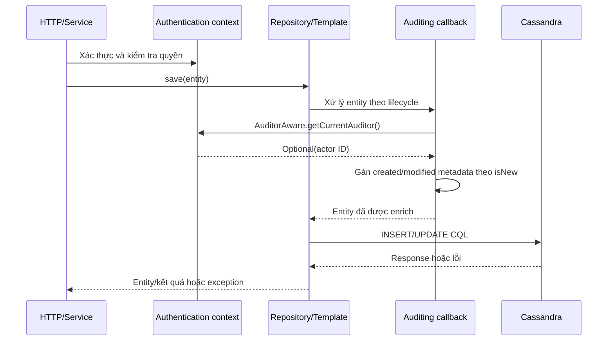

# @EnableCassandraAuditing và AuditorAware trong Spring Data Cassandra

Một ứng dụng quản lý đơn hàng, yêu cầu phê duyệt hoặc hồ sơ nghiệp vụ thường cần trả lời: **“Ai đã tạo bản ghi này, ai sửa gần nhất và thay đổi xảy ra lúc nào?”** Spring Data Cassandra cung cấp cơ chế **entity auditing** để tự điền những thuộc tính như `createdBy`, `createdAt`, `lastModifiedBy` và `lastModifiedAt` khi ứng dụng lưu entity qua đường persistence được hỗ trợ.

Hai thành phần quan trọng nhất là:

- **`@EnableCassandraAuditing`:** bật hạ tầng auditing của Spring Data Cassandra.
- **`AuditorAware<T>`:** cung cấp danh tính tác nhân (*auditor*) tại thời điểm framework xử lý entity, thường từ Spring Security hoặc một ngữ cảnh ứng dụng được tin cậy.

Bài thuộc chương **Vòng đời và auditing** của module **SPRING_DATA_CASSANDRA**. Ta sẽ kết nối entity mapping, `CassandraRepository`, `CassandraTemplate` và CQL với cơ chế auditing; phân biệt thời điểm trước/sau lưu, cách nhận biết entity mới, rủi ro ghi CQL trực tiếp, tác vụ nền, bảo mật, concurrency, TTL và kiểm thử tích hợp.

> **Phạm vi:** Ví dụ dùng Java 17+, Spring Data Cassandra và Spring Security. API/constructor/tùy chọn có thể khác giữa các phiên bản Spring Data; phải kiểm tra thư viện thực tế khi triển khai. Các ví dụ giả định keyspace `commerce` đã tồn tại; nội dung này chưa thay thế vòng QA chuyên môn/kiểm thử thực thi.

## 1. Auditing giải quyết bài toán nào?

Một bảng không có trường auditing:

```sql
CREATE TABLE commerce.tasks_by_id (
    task_id uuid PRIMARY KEY,
    tenant_id text,
    status text,
    description text
);
```

Sau khi nhiều request cùng sửa `status`, chỉ nhìn bản ghi hiện tại không trả lời được ai đã sửa. Ta bổ sung các trường auditing:

```sql
CREATE TABLE commerce.audited_tasks_by_id (
    task_id uuid PRIMARY KEY,
    tenant_id text,
    status text,
    description text,
    created_by text,
    created_at timestamp,
    modified_by text,
    modified_at timestamp,
    version bigint
);
```

Trong ví dụ này, `task_id` là **partition key**, đồng thời là full primary key. Cassandra truy vấn chính xác một task bằng `WHERE task_id = ?`. `tenant_id` là thuộc tính nghiệp vụ và **không tự bảo vệ phân quyền**: nếu hệ thống đa tenant, phải xác thực quyền của caller trước khi trả dữ liệu; có thể thiết kế lại primary key theo tenant tùy access pattern.

Khi task được tạo:

| Trường | Giá trị minh họa | Ý nghĩa |
| --- | --- | --- |
| `created_by` | `user:alice` | Ai tạo task. |
| `created_at` | `2026-11-25T09:00:00Z` | Khi ứng dụng gán thời điểm tạo. |
| `modified_by` | `user:alice` | Người sửa cuối; có thể được điền cả lần tạo tùy cấu hình. |
| `modified_at` | `2026-11-25T09:00:00Z` | Thời điểm sửa cuối theo auditing. |
| `version` | Giá trị framework đã quản lý | Dùng optimistic locking, **không phải** mốc thời gian. |

Sau lần cập nhật của `user:bob`, kỳ vọng các giá trị tạo ban đầu **giữ nguyên**, còn `modified_by`/`modified_at` phản ánh thao tác mới.

**Đây là metadata của bản ghi hiện tại**, không phải một bản ghi lịch sử đầy đủ về mọi lần thay đổi. Nếu cần xem tất cả sự kiện, ai đã đổi `NEW → APPROVED` và vì sao, phải thiết kế **history/event log riêng**.

## 2. Bốn annotation auditing và vai trò của chúng

Spring Data dùng những annotation từ `org.springframework.data.annotation`:

```java
import org.springframework.data.annotation.CreatedBy;
import org.springframework.data.annotation.CreatedDate;
import org.springframework.data.annotation.LastModifiedBy;
import org.springframework.data.annotation.LastModifiedDate;
```

| Annotation | Dữ liệu được điền | Ai/cái gì cung cấp |
| --- | --- | --- |
| `@CreatedBy` | Tác nhân tạo entity. | `AuditorAware<T>`. |
| `@LastModifiedBy` | Tác nhân thay đổi gần nhất. | `AuditorAware<T>`. |
| `@CreatedDate` | Thời điểm tạo do ứng dụng xác định. | `DateTimeProvider` hoặc mặc định của auditing. |
| `@LastModifiedDate` | Thời điểm sửa cuối. | `DateTimeProvider` hoặc mặc định của auditing. |

**`AuditorAware` không phải thành phần cấp timestamp.** Nó trả về *ai* đang thao tác. Ngày giờ được auditing infrastructure quyết định thông qua date/time provider; nên chuẩn hóa UTC và có chiến lược đồng bộ đồng hồ hệ thống.

Một số hệ thống chỉ dùng `@CreatedDate`/`@LastModifiedDate`; khi đó không nhất thiết cần auditor con người. Nhưng khi muốn điền `@CreatedBy`/`@LastModifiedBy`, cần một nguồn auditor đáng tin cậy. Nếu không có auditor, đừng giả định các trường người dùng sẽ tự có giá trị.

## 3. Bật auditing bằng @EnableCassandraAuditing

Cấu hình Spring tối thiểu:

```java
import org.springframework.context.annotation.Configuration;
import org.springframework.data.cassandra.config.EnableCassandraAuditing;

@Configuration
@EnableCassandraAuditing
public class CassandraAuditingConfig {
}
```

Annotation kích hoạt hạ tầng Spring Data auditing dùng trong persistence callbacks/mapping của Cassandra. Đây **không phải câu CQL** và không tự thêm cột vào schema.

Để chỉ rõ bean cung cấp người thao tác:

```java
import org.springframework.context.annotation.Configuration;
import org.springframework.data.cassandra.config.EnableCassandraAuditing;

@Configuration
@EnableCassandraAuditing(auditorAwareRef = "currentActorAuditor")
public class CassandraAuditingConfig {
}
```

`auditorAwareRef` chọn bean `AuditorAware` theo tên, hữu ích khi có nhiều nguồn auditor trong cùng application context. Chọn rõ bean giúp tránh nhập nhằng giữa web user và service principal.

### 3.1. Những điều @EnableCassandraAuditing không thực hiện

Nó **không**:

- Tạo/ALTER bảng Cassandra hoặc tự thêm các cột `created_by`/`created_at`.
- Tự xác định danh tính người dùng nếu ứng dụng chưa cung cấp `AuditorAware` thích hợp.
- Biến mọi câu `UPDATE` CQL viết tay thành một lần cập nhật auditing.
- Tạo trigger ở Cassandra server, audit các client khác hoặc thu thập mọi truy vấn trong cluster.
- Cung cấp transaction ACID đa partition, optimistic concurrency hoặc version cho entity không có cơ chế ấy.
- Lưu một lịch sử bất biến của mọi thay đổi.
- Tự kiểm tra quyền truy cập tenant hoặc bảo đảm principal hiện tại đáng tin.
- Đảm bảo audit date và Cassandra write timestamp có cùng giá trị.

Auditing này nằm **ở phía ứng dụng Spring**. Một script `cqlsh`, worker khác dùng Java driver trực tiếp hoặc một service không bật auditing có thể ghi row mà không qua callback của Spring Data.

## 4. Tạo AuditorAware<String> từ Spring Security

Interface `AuditorAware<T>` thuộc Spring Data Commons:

```java
import java.util.Optional;
import org.springframework.data.domain.AuditorAware;

public interface AuditorAware<T> {
    Optional<T> getCurrentAuditor();
}
```

Ở đây `T` là **kiểu dữ liệu của trường actor trên entity**. Nếu entity khai báo `String createdBy` và `String modifiedBy`, lựa chọn tự nhiên là `AuditorAware<String>`.

Một implementation sử dụng `SecurityContextHolder` của Spring Security:

```java
import java.util.Optional;

import org.springframework.data.domain.AuditorAware;
import org.springframework.security.authentication.AnonymousAuthenticationToken;
import org.springframework.security.core.Authentication;
import org.springframework.security.core.context.SecurityContextHolder;
import org.springframework.stereotype.Component;

@Component("currentActorAuditor")
public class SecurityAuditorAware implements AuditorAware<String> {

    @Override
    public Optional<String> getCurrentAuditor() {
        Authentication authentication =
            SecurityContextHolder.getContext().getAuthentication();

        if (authentication == null
                || !authentication.isAuthenticated()
                || authentication instanceof AnonymousAuthenticationToken) {
            return Optional.empty();
        }

        String principalName = authentication.getName();

        if (principalName == null || principalName.isBlank()) {
            return Optional.empty();
        }

        // Chọn một định danh ổn định; đây là ví dụ minh họa.
        return Optional.of("user:" + principalName);
    }
}
```

Cách thiết kế này có các điểm rõ ràng:

1. **Không coi anonymous là một user đã xác thực.**
2. Không dùng thông tin đến trực tiếp từ request body làm actor.
3. Lấy principal từ security context đã qua xác thực.
4. Trả `Optional.empty()` nếu **không có** principal tin cậy.
5. Đảm bảo kiểu actor khớp field của entity.

**`authentication.getName()` chưa chắc là ID bất biến của người dùng**: có hệ thống trả email/display name có thể đổi. Trong production nên chọn **subject ID ổn định** (ví dụ tenant-scoped user ID hoặc IDP subject) và chính sách namespace như `user:...`, `service:...`.

### 4.1. Đừng dùng actor lấy từ client không kiểm chứng

Không an toàn:

```java
// Anti-pattern: client tự khai ai sửa record.
String actor = request.getHeader("X-User-Name");
task.setModifiedBy(actor);
repository.save(task);
```

Bất kỳ client nào có thể giả mạo header nếu không có một lớp xác thực/gateway được tin cậy bảo vệ nó. Dùng `SecurityContext` sau authentication/authorization, hoặc nhận actor từ một command đã được xác thực.

Nếu có các actor loại khác nhau (người dùng, service, scheduled job), lưu kiểu dữ liệu ổn định và không gây nhầm:

```text
user:42c8d1...
service:billing-consumer
job:daily-expiration
migration:v2026-11
```

Đừng ghi token truy cập, password, session cookie hoặc toàn bộ claims JWT vào trường `modified_by`. Metadata auditing cần tối thiểu, dễ truy vết nhưng không lộ bí mật.

## 5. Ánh xạ entity có auditing annotations

Entity Java cho bảng `commerce.audited_tasks_by_id`:

```java
import java.time.Instant;
import java.util.UUID;

import org.springframework.data.annotation.CreatedBy;
import org.springframework.data.annotation.CreatedDate;
import org.springframework.data.annotation.LastModifiedBy;
import org.springframework.data.annotation.LastModifiedDate;
import org.springframework.data.annotation.Version;

import org.springframework.data.cassandra.core.mapping.Column;
import org.springframework.data.cassandra.core.mapping.PrimaryKey;
import org.springframework.data.cassandra.core.mapping.Table;

@Table("audited_tasks_by_id")
public class AuditedTask {

    @PrimaryKey("task_id")
    private UUID taskId;

    @Column("tenant_id")
    private String tenantId;

    @Column("status")
    private String status;

    @Column("description")
    private String description;

    @CreatedBy
    @Column("created_by")
    private String createdBy;

    @CreatedDate
    @Column("created_at")
    private Instant createdAt;

    @LastModifiedBy
    @Column("modified_by")
    private String modifiedBy;

    @LastModifiedDate
    @Column("modified_at")
    private Instant modifiedAt;

    @Version
    @Column("version")
    private Long version;

    public AuditedTask() {}

    public UUID getTaskId() { return taskId; }
    public void setTaskId(UUID value) { taskId = value; }

    public String getTenantId() { return tenantId; }
    public void setTenantId(String value) { tenantId = value; }

    public String getStatus() { return status; }
    public void setStatus(String value) { status = value; }

    public String getDescription() { return description; }
    public void setDescription(String value) { description = value; }

    public String getCreatedBy() { return createdBy; }
    public void setCreatedBy(String value) { createdBy = value; }

    public Instant getCreatedAt() { return createdAt; }
    public void setCreatedAt(Instant value) { createdAt = value; }

    public String getModifiedBy() { return modifiedBy; }
    public void setModifiedBy(String value) { modifiedBy = value; }

    public Instant getModifiedAt() { return modifiedAt; }
    public void setModifiedAt(Instant value) { modifiedAt = value; }

    public Long getVersion() { return version; }
    public void setVersion(Long value) { version = value; }
}
```

Với schema này:

- `taskId` định vị đúng partition.
- `@CreatedBy`/`@LastModifiedBy` chỉ đến **hai cột khác nhau**.
- `Instant` tương ứng với CQL `timestamp` thông qua mapping/converter phù hợp.
- `@Version Long` hỗ trợ optimistic locking khi sử dụng đường persistence được hỗ trợ, đồng thời giúp nhận biết một entity mới có ID **đã được gán** khi version còn `null`.
- Các setter trên được đưa vào để ví dụ đầy đủ; service **không nên** tự gán version hoặc trường audit trong thao tác nghiệp vụ thông thường.

### 5.1. @Version không phải annotation auditing

`@Version` giúp bảo vệ cạnh tranh bằng protocol optimistic locking/LWT của Spring Data Cassandra khi API hỗ trợ. Nó **không** thay thế `@LastModifiedDate`.

Ví dụ hai request cùng đọc task version 4 rồi muốn lưu hai trạng thái khác nhau. Không thể dùng `modifiedAt` để bảo đảm chỉ một request thắng; đồng hồ ứng dụng có thể lệch, hai request có thể cùng timestamp và Cassandra hòa giải theo write timestamp. Cần CAS/version phù hợp.

### 5.2. Auditing không cấp quyền cho người đang sửa

Dù `modifiedBy = user:bob`, Cassandra không biết đây có phải user được phép sửa task của `tenant_id` hiện tại. Authentication và authorization phải diễn ra **trước persistence**, không thể dựa vào kết quả auditing để hợp thức hóa một write không có quyền.

## 6. Repository save: luồng tạo mới và cập nhật

Repository:

```java
import java.util.UUID;

import org.springframework.data.cassandra.repository.CassandraRepository;

public interface AuditedTaskRepository
        extends CassandraRepository<AuditedTask, UUID> {
}
```

Service tạo task:

```java
import java.util.UUID;

import org.springframework.stereotype.Service;

@Service
public class AuditedTaskService {

    private final AuditedTaskRepository tasks;

    public AuditedTaskService(AuditedTaskRepository tasks) {
        this.tasks = tasks;
    }

    public AuditedTask create(String tenantId, String description) {
        AuditedTask row = new AuditedTask();
        row.setTaskId(UUID.randomUUID());
        row.setTenantId(tenantId);
        row.setDescription(description);
        row.setStatus("NEW");

        // Không tự điền createdAt/createdBy/version.
        return tasks.save(row);
    }

    public AuditedTask changeStatus(UUID taskId, String newStatus) {
        AuditedTask row = tasks.findById(taskId)
            .orElseThrow(() -> new IllegalArgumentException("Not found"));

        // Kiểm tra quyền tenant và state machine ở tầng nghiệp vụ.
        row.setStatus(newStatus);

        // Auditing áp dụng khi ghi qua đường persistence được hỗ trợ.
        return tasks.save(row);
    }
}
```

Trong phương thức `create`:

- `taskId` đã là UUID, nhưng `version = null` theo kiểu wrapper `Long`; Spring Data dùng metadata new-state detection phù hợp.
- `@CreatedBy` nhận auditor từ `AuditorAware` khi entity được coi là mới.
- `@CreatedDate` được framework gán thời gian.
- Các trường `@LastModified...` **có thể được gán cả khi tạo mới** theo chính sách `modifyOnCreate`.
- `@Version` được framework quản lý theo optimistic-locking semantics; không hardcode phiên bản khởi tạo.

Trong `changeStatus`:

- Entity được **đọc từ DB**, giữ version đã tồn tại.
- Khi lưu, auditing thường giữ nguyên `createdBy`/`createdAt` và cập nhật `modifiedBy`/`modifiedAt`.
- Nếu version đã stale do writer khác cập nhật, ghi có thể bị từ chối theo optimistic-locking protocol; không tự retry bằng UPDATE không điều kiện.
- Cần dùng **entity được trả về từ `save`** nếu tiếp tục lưu, vì mapping/version/callback có thể tạo phiên bản object mới.

### 6.1. Bảng kỳ vọng auditing

| Thao tác | `createdBy` / `createdAt` | `modifiedBy` / `modifiedAt` |
| --- | --- | --- |
| Tạo entity mới qua repository | Được điền nếu auditor/date provider khả dụng. | Có thể cũng được điền, tùy `modifyOnCreate`. |
| Sửa entity đã tồn tại qua repository | Giữ metadata tạo ban đầu. | Cập nhật theo lần ghi. |
| Lưu entity bị stale và LWT không áp dụng | **Không được giả định DB đã đổi**. | Không kết luận từ object in-memory; đọc lại DB. |
| Gửi CQL `UPDATE` trực tiếp ngoài mapping | Không tự chạy entity auditing. | Caller phải tự đặt audit fields nếu muốn. |
| Client không có principal hợp lệ | `AuditorAware` có thể trả empty. | Actor có thể thiếu hoặc phải bị tầng nghiệp vụ từ chối. |

Auditing không phải **bảo đảm tự động cho mọi thứ liên quan đến Cassandra**. Phải xác định chính xác các đường ghi trong hệ thống.

## 7. Cấu hình thời điểm tạo/sửa và chính sách modifyOnCreate

Một số ứng dụng muốn:

- `created_at` gắn khi tạo.
- `modified_at` cũng gắn ngay khi tạo.
- Hoặc chỉ gắn `modified_at` khi có **một lần sửa sau tạo**.

Trong `@EnableCassandraAuditing`, tùy chọn `modifyOnCreate` điều khiển chính sách ghi last-modified fields khi một entity mới được tạo (theo phiên bản API hỗ trợ). Cấu hình minh họa:

```java
@Configuration
@EnableCassandraAuditing(
    auditorAwareRef = "currentActorAuditor",
    modifyOnCreate = false
)
public class CassandraAuditingConfig {
}
```

Nếu đặt `modifyOnCreate = false`, kỳ vọng `modified_by`/`modified_at` chỉ được gán khi thao tác update xảy ra sau lần tạo, thay vì tự điền trên insert đầu. Nếu dự án đã dùng cấu hình mặc định, **không tự suy ra giá trị trường modified lúc create bằng null hay không**; cần kiểm tra cấu hình/phiên bản và integration test.

### 7.1. DateTimeProvider và đồng hồ có thể kiểm thử

Khi cần test thời điểm chính xác hoặc chuẩn hóa đồng hồ, Spring Data auditing hỗ trợ ý tưởng cung cấp thời gian qua `DateTimeProvider` thay vì gọi `Instant.now()` trực tiếp trong service.

Ví dụ cấu hình kiểu:

```java
import java.time.Clock;
import java.time.Instant;
import java.util.Optional;

import org.springframework.context.annotation.Bean;
import org.springframework.context.annotation.Configuration;
import org.springframework.data.auditing.DateTimeProvider;

@Configuration
public class AuditingTimeConfig {

    @Bean
    Clock auditingClock() {
        return Clock.systemUTC();
    }

    @Bean("auditingDateTimeProvider")
    DateTimeProvider auditingDateTimeProvider(Clock auditingClock) {
        return () -> Optional.of(Instant.now(auditingClock));
    }
}
```

Và tham chiếu provider theo tên, trên phiên bản hỗ trợ thuộc tính `dateTimeProviderRef`:

```java
@Configuration
@EnableCassandraAuditing(
    auditorAwareRef = "currentActorAuditor",
    dateTimeProviderRef = "auditingDateTimeProvider"
)
public class CassandraAuditingConfig {
}
```

**Chỉ có một bean `@EnableCassandraAuditing` kích hoạt auditing trong cấu hình thực tế.** Các snippet cấu hình trên là **phương án minh họa thay thế/bổ sung**, không có nghĩa copy cả ba lớp cùng `@EnableCassandraAuditing` vào một ứng dụng. Khi sử dụng provider ở production, tên bean và generic date type phải khớp API của Spring Data đang chạy.

### 7.2. Vì sao nên dùng Clock trong test?

Với `Clock.fixed(...)`, test có thể kiểm tra `createdAt`/`modifiedAt` bằng một `Instant` xác định, tránh assertion dựa trên cửa sổ mili giây dễ flaky.

Nhưng **clock của ứng dụng không phải clock Cassandra**. Audit dates có thể khác `WRITETIME(column)`, timestamp CQL write và giờ của replica; điều đó là bình thường nếu các tầng được định nghĩa rõ.

## 8. AuditorAware được gọi lúc nào trong vòng đời entity?

Spring Data Cassandra có cơ chế entity callbacks/lifecycle hooks. Auditing được xử lý trong **đường mapping/persistence** để điền các thuộc tính được đánh dấu trước khi dữ liệu entity được chuyển thành mutation CQL phù hợp.



Sơ đồ chỉ diễn tả **thứ tự khái niệm**, không tuyên bố tên/tọa độ của mọi callback event ở mọi phiên bản. Những điều cần lưu ý:

1. Auditor được lấy **khi thao tác entity được xử lý**, không mặc định tại thời điểm HTTP request bắt đầu.
2. Các trường audit có thể được gán vào object **trước** khi Cassandra xác nhận write.
3. Nếu write **thất bại hoặc timeout**, object trong bộ nhớ đã có metadata mới **không chứng minh DB đã commit**.
4. Nếu converter khác hoặc custom entity callback sửa cùng fields, thứ tự callbacks có thể làm kết quả khác mong đợi.
5. Một câu CQL không qua entity mapping **không tự phát các callback này**.

### 8.1. Auditing metadata trước ghi khác “đã lưu thành công”

Một tình huống:

```text
Service gọi repository.save(entity)
→ Auditing gán modified_by = user:bob
→ Driver gửi UPDATE, chờ CL
→ WriteTimeoutException
```

Lúc này, không được nhìn `entity.getModifiedBy()` rồi báo “Bob đã lưu thành công”. Mutation có thể đã áp dụng tại một số replica hoặc response bị mất. Ứng dụng cần error handling, idempotency và đọc/đối soát theo yêu cầu nghiệp vụ.

### 8.2. Event callbacks không phải transaction hook

Không dùng một auditing callback như nơi phát email, thu tiền hoặc gửi business event không có idempotency. Retry hoặc callback invocation lại có thể gây tác động phụ trùng; Cassandra cũng không cung cấp transaction ACID tự động xuyên database và hệ thống ngoài.

## 9. New-state detection: ID đã gán không có nghĩa entity đã tồn tại

Auditing cần phân biệt **create** với **update**, nên chiến lược xác định entity mới rất quan trọng.

Spring Data Commons thường xem:

- Có `Persistable<ID>` → dùng `isNew()` do entity cung cấp.
- Không có Persistable nhưng có `@Version` → dùng version làm tín hiệu; kiểu wrapper như `Long` với `null` thường biểu diễn entity mới.
- Không có version → dùng ID, `null` thường được coi là mới.

Giả sử UUID được tạo sẵn:

```java
AuditedTask row = new AuditedTask();
row.setTaskId(UUID.randomUUID());
row.setStatus("NEW");
// version vẫn null; framework có thể nhận biết là entity mới.
```

Nếu bỏ `@Version` và vẫn dùng ID được gán trước, framework có thể xem entity **không mới** dù DB chưa có hàng. Khi đó auditing có thể đi vào đường last-modified thay vì created metadata, tùy API và new-state strategy.

**Vì vậy, “createdAt không được gán” không nhất thiết là lỗi `@EnableCassandraAuditing`.** Trước khi chỉnh cấu hình, hãy kiểm tra entity đang được framework coi là mới hay cũ.

### 9.1. Persistable.isNew cần lifecycle đúng

```java
import org.springframework.data.domain.Persistable;
import org.springframework.data.annotation.Transient;

public class ExampleNewState implements Persistable<UUID> {

    @Transient
    private boolean newEntity = true;

    // Trích đoạn minh họa: các field khóa/getter đầy đủ do entity cung cấp.
    @Override
    public UUID getId() {
        return id;
    }

    @Override
    @Transient
    public boolean isNew() {
        return newEntity;
    }
}
```

Trong code trên, `id` là field do entity thực tế cần khai báo/ánh xạ; snippet chỉ minh họa phương thức new-state, **không phải lớp đầy đủ để compile**.

Nếu entity đọc từ Cassandra mà `newEntity` vẫn `true`, auditing có thể đặt **created metadata sai** ở lần lưu sau, còn đường persistence có thể thử create thay vì update. Khi chọn Persistable, phải thiết kế constructor/callback để đặt `isNew() = false` sau khi hydrate hoặc sau ghi thành công, và integration test vòng đời này.

**Khuyến nghị:** Đừng thêm Persistable khi `@Version Long` và strategy mặc định đã giải quyết đúng yêu cầu. Hai nguồn cờ “mới/cũ” mâu thuẫn gây lỗi khó tìm.

## 10. Auditing với CassandraTemplate và repository khác raw CQL

Các thao tác lưu dữ liệu có thể đến từ nhiều API:

| API | Có đi qua entity mapping/auditing? | Việc cần kiểm tra |
| --- | --- | --- |
| `CassandraRepository.save(entity)` | Đường entity persistence điển hình. | `isNew`, `@Version`, callback, auditor. |
| `CassandraTemplate.insert(entity)` | Đường entity mapping được hỗ trợ. | Version/field audit được gán đúng. |
| `CassandraTemplate.update(entity)` | Có thể đi qua entity callback theo API/version. | Xác minh đường cập nhật thực và câu CQL tạo ra. |
| `CassandraTemplate` query/update theo cột cụ thể | Không mặc định mọi API đều tạo entity event. | Test chính xác overload và mapping behavior. |
| `CqlTemplate.execute("UPDATE ...")` | **Không tự chạy entity auditing.** | Tự đặt `modified_by`/`modified_at` nếu yêu cầu. |
| `CqlSession.execute(statement)` | **Không tự chạy entity auditing.** | Caller quản lý actor, thời gian và CAS. |
| `@Query` repository viết CQL `UPDATE` trực tiếp | Không nên giả định callback entity được chạy. | Kiểm chứng statement được thực thi và audit fields. |
| Batch CQL, script migration, `cqlsh` | Không thông qua callback Spring entity. | Audit theo batch/script protocol riêng. |

Đặc biệt **`saveAll` không phải “transaction auditing”**. Nó không tự tạo transaction ACID đa partition hay bảo đảm toàn bộ entities được lưu đồng thời. Mỗi mutation cần tuân thủ các quy tắc Cassandra về retry/consistency.

### 10.1. Partial update bằng CqlTemplate

Ví dụ API `PATCH /tasks/{id}/status` chỉ cập nhật cột `status`. Nếu dùng CQL trực tiếp:

```sql
UPDATE commerce.audited_tasks_by_id
SET status = 'APPROVED'
WHERE task_id = 11111111-1111-1111-1111-111111111111;
```

Entity auditing **không tự thêm `modified_by`/`modified_at`** vào câu CQL trên. Một cách viết tường minh:

```sql
UPDATE commerce.audited_tasks_by_id
SET status = 'APPROVED',
    modified_by = 'user:bob',
    modified_at = '2026-11-25T10:00:00Z'
WHERE task_id = 11111111-1111-1111-1111-111111111111;
```

Điều này giúp đặt audit fields trong **cùng mutation** của statement, nhưng **vẫn chưa bảo đảm optimistic concurrency**, vì update thường của Cassandra có thể upsert và ghi đè khi các writer tranh chấp.

### 10.2. Nếu entity có @Version, CQL trực tiếp phải tuân CAS

Với entity versioned, một raw UPDATE không kiểm tra/tăng version có thể **phá hợp đồng optimistic locking** của toàn ứng dụng. Cần một statement có điều kiện, ví dụ:

```sql
UPDATE commerce.audited_tasks_by_id
SET status = 'APPROVED',
    modified_by = 'user:bob',
    modified_at = '2026-11-25T10:00:00Z',
    version = 5
WHERE task_id = 11111111-1111-1111-1111-111111111111
IF version = 4;
```

Ở đây:

- `version = 5` là giá trị mới được client/protocol tính.
- `IF version = 4` là **LWT condition** tại Cassandra.
- Không dùng `SET version = version + 1` trên cột `bigint` thường; đó không phải cách tăng số hợp lệ của regular CQL.
- Với kết quả `[applied] = false`, không được báo thành công; phải đọc lại và xử lý conflict.
- Với timeout, outcome chưa chắc chắn; không mặc định mutation đã rollback.

Khi dùng song song repository `@Version` và raw CQL, mọi writer cần thống nhất cách version tăng và cách audit fields được cập nhật, nếu không các service sẽ nhìn thấy metadata sai lệch.

## 11. Ví dụ Java driver: lấy auditor rồi ghi cập nhật điều kiện

Trong một service có thể dùng `CqlSession` do Spring quản lý và `AuditorAware<String>` đã cấu hình:

```java
import java.time.Clock;
import java.time.Instant;
import java.util.UUID;

import com.datastax.oss.driver.api.core.CqlSession;
import com.datastax.oss.driver.api.core.cql.SimpleStatement;
import org.springframework.data.domain.AuditorAware;
import org.springframework.stereotype.Service;

@Service
public class ConditionalTaskUpdater {

    private final CqlSession session;
    private final AuditorAware<String> actorProvider;
    private final Clock clock;

    public ConditionalTaskUpdater(
            CqlSession session,
            AuditorAware<String> actorProvider,
            Clock clock) {
        this.session = session;
        this.actorProvider = actorProvider;
        this.clock = clock;
    }

    public boolean approve(UUID taskId, long expectedVersion) {
        String actor = actorProvider.getCurrentAuditor()
            .orElseThrow(() -> new SecurityException(
                "Cannot audit task modification without an actor"));

        if (expectedVersion == Long.MAX_VALUE) {
            throw new IllegalArgumentException("Version overflow");
        }

        Instant now = Instant.now(clock);

        SimpleStatement statement = SimpleStatement.builder(
                "UPDATE commerce.audited_tasks_by_id " +
                "SET status=?, modified_by=?, modified_at=?, version=? " +
                "WHERE task_id=? IF version=?")
            .addPositionalValues(
                "APPROVED", actor, now,
                expectedVersion + 1,
                taskId, expectedVersion
            )
            .build();

        return session.execute(statement).wasApplied();
    }
}
```

Ví dụ chỉ minh họa một đường conditional update với actor bắt buộc. Production phải thêm:

- Kiểm tra caller có quyền sửa task và tenant tương ứng **trước khi ghi**.
- Chọn CL/serial CL theo RF và topology.
- Phân loại CAS false với timeout và lỗi driver.
- Giới hạn retry, có đối soát idempotency.
- Không tự tạo `CqlSession` cho mỗi request và không đóng session sau mỗi update.
- Đồng nhất quy tắc version với các writer khác.

Điểm then chốt: **AuditorAware cung cấp actor, không tự làm thay mọi CQL**. Raw CQL ở đây tự bind `modified_by`/`modified_at` nên không phụ thuộc entity callbacks.

## 12. Nhiều AuditorAware bean và danh tính của job nền

Không phải mọi mutation đều đến từ HTTP user. Một hệ thống có thể có:

- Người dùng đã đăng nhập qua Spring Security.
- Service account của message consumer.
- Scheduled job chạy hằng ngày.
- Migration/backfill được vận hành có chủ đích.

Một `AuditorAware` chỉ đọc `SecurityContextHolder` có thể trả empty trong thread của background job. **Đó không nhất thiết là lỗi Cassandra**; job có thể đơn giản không có security principal của người dùng.

### 12.1. Chọn actor có chủ đích theo loại công việc

Một hướng thiết kế:

```java
public record AuditCommandContext(
    String actorId,
    String operationId,
    String tenantId
) {}
```

Tầng HTTP dựng `AuditCommandContext` từ principal **đã xác thực**. Tầng job dựng actor ID từ cấu hình được quản lý, ví dụ `job:retention-cleanup`. Không nhận `actorId` từ payload không tin cậy rồi xem nó là danh tính đã xác thực.

Nếu auditing phụ thuộc ThreadLocal:

- Một background worker cần thiết lập ngữ cảnh rõ ràng ở thời điểm thực thi, hoặc
- Dùng một chiến lược auditor riêng từ context ứng dụng đáng tin, hoặc
- Ghi audit fields tường minh trong lệnh CQL phù hợp.

Không tự đặt `user:admin` làm fallback cho mọi tác vụ không có security context: việc đó làm sai audit trail. Nếu nghiệp vụ yêu cầu actor bắt buộc, hãy **từ chối ghi khi actor không xác định** thay vì im lặng gán giá trị giả.

### 12.2. Khi có nhiều nguồn AuditorAware

Ví dụ hai bean `webActorAuditor` và `jobActorAuditor` có thể cùng tồn tại. Dùng `auditorAwareRef` để chọn một bean cụ thể, hoặc thiết kế **một composite auditor** có quy tắc ưu tiên dựa trên context đáng tin cậy.

Không bật hai cấu hình `@EnableCassandraAuditing` độc lập chỉ để chọn bean theo request: việc chọn actor cần xảy ra **bên trong provider**, còn Spring config nên không gây trùng/bất định các infrastructure beans.

## 13. Async/reactive: thời điểm lấy auditor và truyền security context

Đây là chỗ dễ sai khi ứng dụng chuyển từ đồng bộ sang bất đồng bộ.

### 13.1. SecurityContextHolder gắn với thread

`SecurityContextHolder` ở chế độ truyền thống dựa vào ThreadLocal. Nếu code chạy ở thread khác mà không có cơ chế propagation, `AuditorAware#getCurrentAuditor()` có thể trả `Optional.empty()` hoặc actor không đúng.

Ví dụ anti-pattern:

```java
// Không giả định context của HTTP thread tự sang mọi async callback.
CompletableFuture.runAsync(() -> {
    repository.save(task);
});
```

Nếu callback chạy trên thread của executor khác, audit provider đọc `SecurityContextHolder` có thể không thấy principal. Không sửa bằng cách copy nguyên `Authentication` không kiểm soát hoặc dùng global static actor; cần chiến lược **context propagation có ràng buộc vòng đời** và thread pool an toàn.

Một số lựa chọn:

- Dùng executor được Spring Security quản lý để truyền security context theo quy tắc phù hợp.
- Truyền actor ID đã được xác thực trong command bất biến và kiểm tra quyền trước async boundary.
- Với reactive pipeline, dùng ngữ cảnh bảo mật reactive chính thống.
- Đặt test concurrent requests để chắc chắn không bị rò actor của request trước do thread reuse.

### 13.2. Reactive AuditorAware không tương đương AuditorAware thường

Với Spring Security + WebFlux, context bảo mật thường được truyền trong **Reactor Context**, không phải một ThreadLocal cố định. Spring Data Commons cung cấp `ReactiveAuditorAware<T>`, trả về reactive publisher cho actor.

Một ví dụ ở mức khái niệm:

```java
import org.springframework.data.domain.ReactiveAuditorAware;
import org.springframework.security.core.context.ReactiveSecurityContextHolder;
import reactor.core.publisher.Mono;

public class ReactiveSecurityAuditorAware
        implements ReactiveAuditorAware<String> {

    @Override
    public Mono<String> getCurrentAuditor() {
        return ReactiveSecurityContextHolder.getContext()
            .map(context -> context.getAuthentication())
            .filter(authentication ->
                authentication != null && authentication.isAuthenticated())
            .map(authentication -> "user:" + authentication.getName());
    }
}
```

Khi dùng reactive Cassandra auditing, **phải kiểm tra annotation/cấu hình auditing tương ứng của phiên bản Spring Data Cassandra**, thường là đường reactive auditing dành cho `ReactiveAuditorAware`. Không mặc định bật `@EnableCassandraAuditing` cùng `AuditorAware` ThreadLocal sẽ tự lấy được `ReactiveSecurityContextHolder` trong mọi publisher.

Đặc biệt cần tránh **anonymous principal** khi dùng WebFlux; trong code production nên lọc actor chưa xác thực, giữ ID ổn định và chỉ bắt đầu truy vấn khi authorization đã được xác minh.

### 13.3. Subscription khác thời điểm assembly

Một reactive repository trả `Mono` có thể chỉ thực thi CQL khi WebFlux subscribe, **sau** khi controller đã trả publisher. Vì thế auditor cần tồn tại **đúng tại thời điểm callback xảy ra**, không chỉ tại lúc Java gọi phương thức repository.

Không dùng một biến mutable cấp singleton như `currentUser` trong bean `AuditorAware` để lưu actor cho từng request. Các subscription chồng nhau sẽ làm trộn danh tính và có thể khiến một người được ghi là người sửa của tenant khác.

## 14. CreatedAt, ModifiedAt, Cassandra timestamp và consistency

Bốn khái niệm thời gian nên được hiểu riêng:

| Giá trị | Nguồn | Dùng để làm gì |
| --- | --- | --- |
| `created_at` | Auditing/date provider của ứng dụng | Hiển thị lúc entity được tạo theo logic ứng dụng. |
| `modified_at` | Auditing/date provider ở lần lưu | Hiển thị lần sửa gần nhất do ứng dụng ghi nhận. |
| `WRITETIME(column)` | Metadata CQL từ Cassandra | Phục vụ hòa giải bản ghi, ở đơn vị microsecond. |
| `TTL(column)` | Metadata thời gian sống | Thời gian còn lại của giá trị có TTL. |

Ví dụ:

```sql
SELECT
    status,
    created_by,
    created_at,
    modified_by,
    modified_at,
    WRITETIME(status) AS status_write_time,
    TTL(status) AS status_ttl
FROM commerce.audited_tasks_by_id
WHERE task_id = 11111111-1111-1111-1111-111111111111;
```

Không suy ra:

- `modified_at` luôn bằng `WRITETIME(status)`.
- `modified_at` mới hơn nghĩa là mutation đó chắc chắn “thắng” mọi writer khác.
- Cassandra đã thu hồi dữ liệu vật lý ngay sau khi `TTL(status)` hết hạn.
- Một lần đọc `LOCAL_ONE` thấy trạng thái cũ nghĩa là auditing callback chắc chắn không chạy.

### 14.1. Clock skew và timestamp giả

Nếu hai JVM có đồng hồ lệch, `modified_at` có thể **nhỏ hơn** thời điểm của lần lưu trước, dù mutation được xử lý sau. Trường audit này phục vụ truy vết, không thay thế optimistic locking hoặc event order.

Khi tính nhất quán nghiệp vụ quan trọng, dùng `@Version`/LWT hoặc một protocol version theo aggregate. Không dùng riêng `modifiedAt` để quyết định transition nào phải thắng.

### 14.2. TTL và tombstone của audit fields

Nếu bảng có `default_time_to_live` hoặc dùng `USING TTL` trong đường write:

- Giá trị `created_by`/`created_at` có thể được ghi với TTL theo mutation.
- Khi partial update chỉ sửa `status`, các audit fields cũ có thể giữ TTL trước đó.
- Khi ghi toàn entity với TTL mới, audit fields cũng có thể bị refresh thời hạn nếu nằm trong mutation.
- Khi giá trị có TTL hết hạn, metadata tombstone/expiration vẫn có chi phí vận hành cho đến khi các điều kiện compaction/repair được thỏa.

**Đừng giả định “audit metadata lưu vĩnh viễn” nếu table retention đang xóa nó.** Nếu pháp lý/nghiệp vụ yêu cầu giữ lịch sử dài hạn, thiết kế lịch sử/audit log với retention, backup và quyền truy cập riêng.

## 15. Những giới hạn của auditing tự động

Auditing tự động thường chỉ biết **người hiện tại** và **thời điểm**. Nó không biết:

- Vì sao người dùng đổi trạng thái.
- Field nào thay đổi từ giá trị nào sang giá trị nào.
- Có bao nhiêu lần cập nhật trước đó.
- Hệ thống ngoài Cassandra (email/payment) đã hoàn thành hay chưa.
- Một mutation ngoài Spring Data đã bị thực thi bởi ai.
- Người dùng có thực sự được phép cập nhật tenant đó hay không.

Nếu cần audit trail có thể kiểm chứng và không bị ghi đè:

```sql
CREATE TABLE commerce.task_history_by_id_day (
    task_id uuid,
    event_day date,
    occurred_at timestamp,
    event_id uuid,
    actor_id text,
    old_status text,
    new_status text,
    reason text,
    PRIMARY KEY ((task_id, event_day), occurred_at, event_id)
) WITH CLUSTERING ORDER BY (occurred_at DESC, event_id ASC);
```

Bảng history có query-driven partition key theo task/day, clustering theo time/event ID. **Nó không được tự tạo bởi `@EnableCassandraAuditing`**; ứng dụng phải ghi business events, xử lý idempotency, replay và nhất quán giữa current/history.

Nếu current row được cập nhật thành công nhưng event history ghi thất bại, có thể có sai lệch. Cassandra logged batch **không cung cấp snapshot isolation hoặc transaction ACID chung với hệ thống khác**. Cần một durable event/outbox/CDC/reconciliation protocol nếu audit trail cần bảo đảm cao.

## 16. Kiểm thử @EnableCassandraAuditing và AuditorAware

Unit test một `AuditorAware` đủ để chứng minh cách lấy principal, nhưng **không chứng minh entity mapping và Cassandra callback đã chạy**. Cần ít nhất một integration test với Spring context và Cassandra thật.

### 16.1. Test đơn vị khi có và không có authentication

```java
import static org.junit.jupiter.api.Assertions.*;

import java.util.Optional;
import org.junit.jupiter.api.AfterEach;
import org.junit.jupiter.api.Test;

import org.springframework.security.authentication.TestingAuthenticationToken;
import org.springframework.security.core.context.SecurityContextHolder;

class SecurityAuditorAwareTest {

    private final SecurityAuditorAware auditor =
        new SecurityAuditorAware();

    @AfterEach
    void clearSecurityContext() {
        SecurityContextHolder.clearContext();
    }

    @Test
    void returnsAuthenticatedPrincipal() {
        SecurityContextHolder.getContext().setAuthentication(
            new TestingAuthenticationToken(
                "alice-42", "not-used", "ROLE_USER"
            )
        );

        assertEquals(
            Optional.of("user:alice-42"),
            auditor.getCurrentAuditor()
        );
    }

    @Test
    void returnsEmptyWhenNoPrincipal() {
        SecurityContextHolder.clearContext();
        assertTrue(auditor.getCurrentAuditor().isEmpty());
    }
}
```

Đừng để SecurityContext từ test trước rò vào test sau. Tương tự, một app executor dùng thread pool phải có chiến lược dọn/transmit context đúng vòng đời.

### 16.2. Integration test create rồi update

```java
import static org.junit.jupiter.api.Assertions.*;

import java.util.UUID;

import org.junit.jupiter.api.AfterEach;
import org.junit.jupiter.api.Test;
import org.springframework.beans.factory.annotation.Autowired;
import org.springframework.boot.test.context.SpringBootTest;
import org.springframework.security.authentication.TestingAuthenticationToken;
import org.springframework.security.core.context.SecurityContextHolder;

@SpringBootTest
class CassandraAuditingIntegrationTest {

    @Autowired
    AuditedTaskRepository tasks;

    @AfterEach
    void clearPrincipal() {
        SecurityContextHolder.clearContext();
    }

    private void authenticate(String user) {
        SecurityContextHolder.getContext().setAuthentication(
            new TestingAuthenticationToken(
                user, "not-used", "ROLE_USER"
            )
        );
    }

    @Test
    void recordsCreatorAndLastModifier() {
        authenticate("alice-42");

        AuditedTask input = new AuditedTask();
        UUID id = UUID.randomUUID();
        input.setTaskId(id);
        input.setTenantId("shop-42");
        input.setStatus("NEW");

        AuditedTask created = tasks.save(input);

        assertEquals("user:alice-42", created.getCreatedBy());
        assertNotNull(created.getCreatedAt());
        assertNotNull(created.getVersion());

        // Đọc lại để bảo đảm đang test giá trị persisted.
        AuditedTask loaded = tasks.findById(id).orElseThrow();
        assertEquals("user:alice-42", loaded.getCreatedBy());
        var creationTime = loaded.getCreatedAt();

        authenticate("bob-17");
        loaded.setStatus("APPROVED");
        tasks.save(loaded);

        AuditedTask updated = tasks.findById(id).orElseThrow();

        assertEquals("user:alice-42", updated.getCreatedBy());
        assertEquals(creationTime, updated.getCreatedAt());
        assertEquals("user:bob-17", updated.getModifiedBy());
        assertNotNull(updated.getModifiedAt());
    }
}
```

Test trên cần:

1. `@EnableCassandraAuditing(auditorAwareRef = "currentActorAuditor")` được load trong Spring context.
2. Bean `SecurityAuditorAware` đúng tên và type.
3. Bảng `commerce.audited_tasks_by_id` có đủ cột đúng kiểu.
4. Spring Data mapping/repository và Cassandra `CqlSession` hoạt động.
5. UUID test riêng, không có writer cạnh tranh.
6. Cấu hình `modifyOnCreate` được xét đúng (test chỉ bắt buộc modified metadata sau update).
7. `@Version` dùng đúng optimistic locking của phiên bản đã cài.

Một test có thể PASS về auditing nhưng **vẫn không chứng minh** correctness khi nhiều node gặp lỗi hoặc nhiều writer cùng cập nhật; cần test riêng cho LWT/consistency.

### 16.3. Kiểm thử với Clock.fixed và provider

Để kiểm tra timestamp mà không dựa vào độ trễ hệ thống:

```java
import java.time.Clock;
import java.time.Instant;
import java.time.ZoneOffset;

Clock fixed = Clock.fixed(
    Instant.parse("2026-11-25T09:00:00Z"),
    ZoneOffset.UTC
);
```

Inject `Clock` này vào `DateTimeProvider` của test context; nếu auditing cấu hình provider đúng, `@CreatedDate`/`@LastModifiedDate` có thể được assert bằng một Instant cụ thể.

**Không dùng `Thread.sleep(1000)` như cách duy nhất để phân biệt createdAt và modifiedAt**, vì test phụ thuộc scheduler/độ trễ và không kiểm tra nguồn clock có đúng không.

### 16.4. Test negative case cho raw CQL

Một integration test có thể:

1. Tạo task qua repository dưới principal `alice`.
2. Chạy raw CQL `UPDATE ... SET status='CLOSED' WHERE task_id=?` dưới principal `bob`.
3. Đọc lại và xác minh **`modified_by` vẫn là giá trị cũ** nếu CQL không đặt field.
4. Khẳng định đường raw CQL không tự kích hoạt entity auditing.
5. Chạy statement raw CQL có bind `modified_by`/`modified_at` và CAS version.
6. Đọc lại để chứng minh protocol cập nhật auditing cho đường ghi trực tiếp.

Không lấy kết quả này để khuyên mọi hệ thống cập nhật raw CQL bằng cách bỏ qua version; nếu entity đang dùng `@Version`, test phải bảo vệ optimistic locking.

## 17. Troubleshooting: auditing không ghi hoặc ghi sai actor

| Triệu chứng | Nguyên nhân có thể | Cách kiểm tra |
| --- | --- | --- |
| `created_by`/`modified_by` luôn null | Không bật auditing hoặc không có `AuditorAware` đúng bean. | Kiểm tra `@EnableCassandraAuditing`, bean name, logs/context. |
| Date có nhưng actor null | Date provider có mặt, auditor empty. | Kiểm tra authentication và `getCurrentAuditor()`. |
| Created fields không được gán trên entity mới | Entity bị nhận là **không mới** do ID/version/Persistable. | Kiểm tra `isNew`, `@Version Long` và đường persistence. |
| Created fields bị thay đổi khi update | Mapping/callback ngoài ý muốn hoặc entity state sai. | Test create/update, inspect actual CQL và new-state detection. |
| Actor là anonymous | Chỉ kiểm `isAuthenticated` mà không loại anonymous token. | Lọc `AnonymousAuthenticationToken` hoặc principal đáng tin. |
| Actor từ người dùng khác | ThreadLocal/security context bị rò khi dùng thread pool. | Kiểm tra propagation và clear context trong callback/job. |
| Auditing không chạy khi `CqlTemplate.execute` | Raw CQL bypasses entity lifecycle. | Bind audit fields tường minh hoặc chuyển sang API mapping. |
| Audit metadata đổi nhưng write timeout | Field trong RAM được set trước khi DB ACK. | Đối soát DB; không kết luận từ object. |
| Một số bản ghi không có audit columns | Legacy data hoặc migration chưa bổ sung. | Kiểm tra schema, backfill và rollout các writer. |
| LastModifiedDate có giá trị ngay khi create | Cấu hình `modifyOnCreate`. | Xác minh expectation và version. |
| createdAt khác `WRITETIME(created_by)` | Application clock khác Cassandra write metadata. | Hiểu đúng hai khái niệm, kiểm tra clock skew. |
| @Version conflicts khi raw UPDATE | Một writer bỏ qua version protocol. | Thống nhất CAS cho mọi đường ghi. |
| AuditorAware sử dụng trong WebFlux nhưng trống | Reactive context khác ThreadLocal. | Dùng reactive auditor/context support đúng phiên bản. |
| Timestamp audit hết TTL dù entity còn | TTL trên từng cell/default TTL của bảng. | Đọc `TTL(column)`, xem CQL mutation và retention. |
| Nhiều AuditorAware làm injection mơ hồ | Không chọn bean rõ ràng. | Dùng `auditorAwareRef` hoặc composite provider. |

## 18. Checklist thiết kế và bảo mật

Trước khi dùng auditing trong production, kiểm tra:

1. **Schema đã có cột audit đúng kiểu** (`text`, `timestamp`) và chính sách migration?
2. **Chỉ có cấu hình auditing cần thiết**, bean `AuditorAware` xác định rõ?
3. `@CreatedBy`/`@LastModifiedBy` có **cùng kiểu** với `AuditorAware<T>` không?
4. Principal dùng làm auditor có **ID ổn định** không, hay là display name/email có thể đổi?
5. Anonymous/missing authentication được xử lý ra sao?
6. Scheduled job/service account có actor namespace riêng và có thể kiểm chứng không?
7. Có ngăn client tự giả mạo `created_by`/`modified_by` qua request payload không?
8. Auth/tenant authorization diễn ra **trước khi lưu**, không dựa vào auditing làm kiểm soát quyền?
9. Entity mới được nhận biết đúng bằng `@Version` hoặc `Persistable.isNew()`?
10. Cả repository, template, CQL trực tiếp và batch có **cùng chính sách auditing** không?
11. Nếu có `@Version`, mọi writer có dùng CAS/version protocol không?
12. Async/reactive code có truyền **audit/security context đúng thời điểm** không?
13. Retry/timeout có được hiểu như **kết quả có thể chưa xác định**, không phải rollback?
14. `created_at`/`modified_at` có dùng clock/UTC nhất quán và policy clock skew không?
15. TTL/default TTL có làm audit fields biến mất trước hạn lưu trữ không?
16. Có thực sự cần **audit trail lịch sử riêng** ngoài bốn trường current audit không?
17. Test đã xác minh cả giá trị **sau khi đọc lại từ Cassandra**, không chỉ object trong RAM?
18. Đã bảo vệ dữ liệu audit chứa thông tin cá nhân khỏi truy cập trái phép và log quá mức?

## 19. Bài tập tình huống

**A — Bật auditing.** Entity có đủ `@CreatedBy` và `@LastModifiedBy`, nhưng giá trị luôn null. Ba điều kiện quan trọng cần xác minh đầu tiên là gì?

**B — Kiểu AuditorAware.** Entity có `String createdBy` nhưng provider trả `AuditorAware<Long>`. Có thể xem hai kiểu tương đương không? Nên thống nhất thế nào?

**C — ID được gán sẵn.** Service đặt UUID trước khi save và entity không có `@Version` hoặc `Persistable`. Vì sao `@CreatedDate` có thể không được điền như mong đợi?

**D — Actor anonymous.** Một authentication object có `isAuthenticated()==true` nhưng đại diện user anonymous. Vì sao `getCurrentAuditor()` không nên trả `user:anonymousUser`?

**E — Raw CQL.** Một worker dùng `CqlSession.execute("UPDATE ... SET status=?")`. Vì sao `modified_by` không tự đổi dù ứng dụng có `@EnableCassandraAuditing`?

**F — Concurrency.** Hai user cùng đọc version 3 rồi cập nhật status, cả hai đều có thời điểm `modified_at`. Vì sao timestamp auditing không thay optimistic locking?

**G — Timeout.** Auditing đã sửa `modifiedBy` của object thành Bob, nhưng `repository.save` nhận timeout. Có thể tuyên bố Bob đã lưu thành công không?

**H — Job nền.** Scheduler chạy không có HTTP SecurityContext, `AuditorAware` trả empty. Có nên gán mặc định `user:admin`? Cách nào tốt hơn?

**I — WebFlux.** Reactive repository tạo Mono ở HTTP thread nhưng subscribe sau đó. Tại sao một AuditorAware dựa trên ThreadLocal có thể sai? Cần làm gì?

**J — createdAt và WRITETIME.** Cassandra `WRITETIME(status)` khác với `modifiedAt`. Đây có chắc là lỗi auditing không?

**K — TTL.** Bảng có TTL mặc định 7 ngày. Có thể hứa các trường `createdBy`/`createdAt` sẽ tồn tại vô hạn không?

**L — Audit trail.** Bản current có created/modified metadata. Có thể từ đó biết mọi lần thay đổi trong hai năm không? Cần thiết kế thêm gì?

**M — LWT.** Raw CQL `UPDATE ... IF version=3` trả `[applied]=false`. Có nên retry lại bằng UPDATE không điều kiện để “chắc là lưu” không?

**N — Testing.** Unit test mock repository trả entity với `createdBy` đã điền sẵn có chứng minh auditing callback Spring Data chạy trên Cassandra thật không?

### Gợi ý đáp án

1. Bật `@EnableCassandraAuditing`, bean `AuditorAware` đúng type/tên và **đường lưu có đi qua mapping/callback**; thêm kiểm tra isNew.
2. Không. Chọn cùng kiểu, ví dụ `AuditorAware<String>` với field `String`.
3. Chiến lược new detection dựa trên ID có thể coi entity đã tồn tại. Dùng `@Version Long` hoặc `Persistable` được quản lý đúng.
4. Anonymous không đại diện cho người dùng đã xác thực; lọc anonymous và bảo vệ integrity của actor.
5. Raw CQL không chạy entity callback; cần bind actor/time trong mutation hoặc dùng API mapping phù hợp.
6. Audit timestamp không phải điều kiện CAS; cần `@Version`/`IF version=?` theo protocol.
7. Không. Audit fields có thể đã được gán trước khi server xác nhận; phải đọc/đối soát theo contract.
8. Không. Dùng `job:...` được xác định từ workflow tin cậy, hoặc từ chối write nếu policy yêu cầu actor.
9. ThreadLocal không tự truyền theo Reactor Context; dùng reactive auditing/security context phù hợp hoặc propagation an toàn.
10. Không chắc. Audit date từ application, WRITETIME là metadata Cassandra, đơn vị/ngữ nghĩa khác nhau.
11. Không. TTL có thể làm audit fields hết hạn; cần retention riêng nếu yêu cầu dài hạn.
12. Không. Auditing current chỉ lưu người tạo và sửa cuối; cần history/event log, retention và workflow ghi bền vững.
13. Không. CAS false là xung đột điều kiện; phải đọc lại và xử lý state machine, không bypass.
14. Không. Cần integration test thật với `@EnableCassandraAuditing`, security context và Cassandra schema.

**Ghi nhớ:** `@EnableCassandraAuditing` bật cơ chế điền metadata trên **entity persistence lifecycle**; `AuditorAware<T>` xác định **ai** thao tác, còn `@CreatedDate`/`@LastModifiedDate` xác định **khi nào** thông qua hạ tầng time provider. Với Spring Data Cassandra, phải chú ý **isNew**, `@Version`, bảo mật principal, đường ghi raw CQL bỏ qua callback, context của async/reactive và hiệu ứng retry/timeout. Bốn audit fields chỉ mô tả trạng thái tạo/sửa **hiện tại**, không thay thế một **audit trail bất biến** hay cơ chế concurrency/authorization.

### Tài liệu tham khảo theo phiên bản

- [Spring Data Cassandra — Auditing](https://docs.spring.io/spring-data/cassandra/reference/cassandra/auditing.html)
- [Spring Data Cassandra — Object mapping](https://docs.spring.io/spring-data/cassandra/reference/cassandra/mapping.html)
- [Spring Data Cassandra — Template](https://docs.spring.io/spring-data/cassandra/reference/cassandra/template.html)
- [Spring Data Commons — Auditing](https://docs.spring.io/spring-data/commons/reference/auditing.html)
- [Spring Data Commons — Entity state detection](https://docs.spring.io/spring-data/commons/reference/repositories/core-concepts.html)
- [Spring Security — Authentication and SecurityContextHolder](https://docs.spring.io/spring-security/reference/servlet/authentication/architecture.html)
- [Spring Security — Reactive security context](https://docs.spring.io/spring-security/reference/reactive/authorization/method.html)
- [Apache Cassandra — CQL and conditional updates](https://cassandra.apache.org/doc/stable/cassandra/developing/cql/dml.html)
