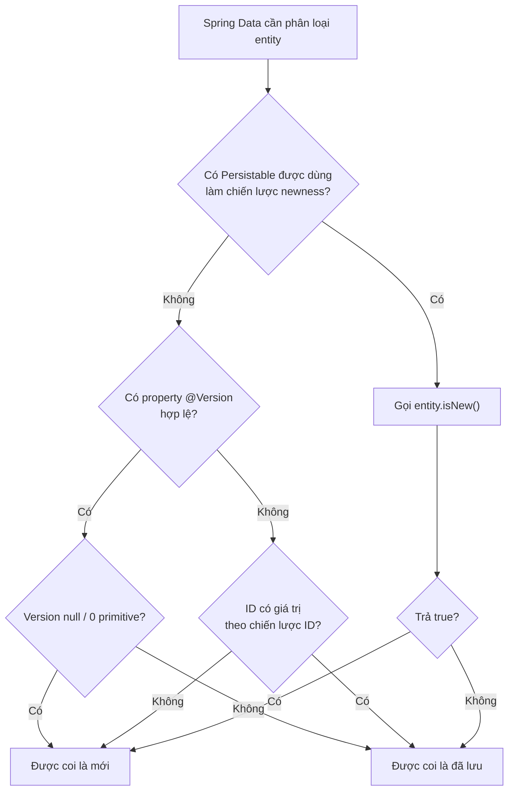
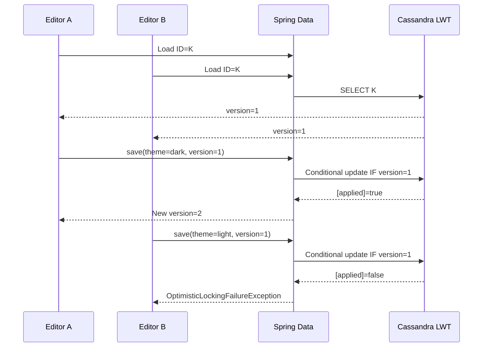
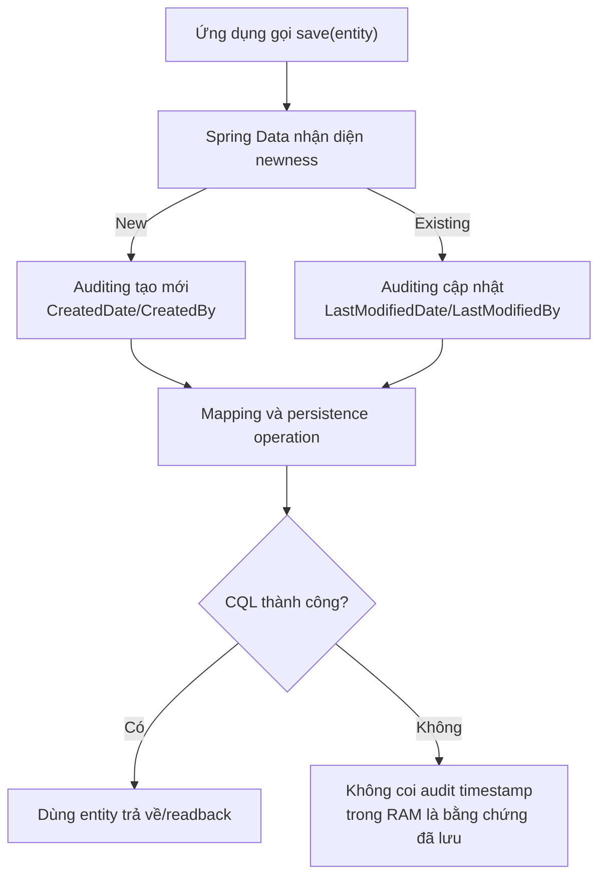
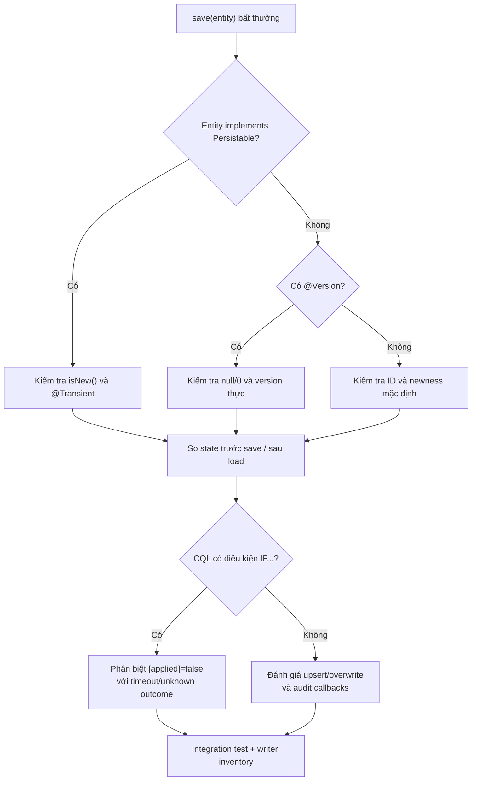

# Nhận biết tạo mới bằng @Version hoặc Persistable

## 1. Vấn đề: entity đã có ID thì có phải đã được lưu?

Hãy tưởng tượng một API Spring Boot sử dụng **Spring Data Cassandra** để lưu cấu hình của một tài khoản. Ứng dụng cấp `UUID` ngay khi tạo object Java, trước lúc gọi repository:

```java
UUID accountId = UUID.randomUUID();
AccountPreferences preferences =
    new AccountPreferences(accountId, "light", "vi");
```

Ở thời điểm này, `accountId != null` nhưng **chưa có bằng chứng nào** rằng hàng tương ứng đã nằm trong Cassandra. Nếu Spring Data chỉ dựa vào ID để quyết định entity mới hay cũ, một object có ID cấp sẵn dễ bị nhận diện là **đã tồn tại**.

Vấn đề không chỉ ảnh hưởng tên câu lệnh `INSERT` hay `UPDATE`. Nó liên quan tới:

- Đường persistence được chọn khi `repository.save(...)`.
- Điều kiện ghi tạo mới (ví dụ `IF NOT EXISTS`) và cập nhật có điều kiện (`IF version = ...`).
- Trường `@CreatedDate` và `@LastModifiedDate` trong cơ chế auditing.
- Tránh ghi đè hàng đã có cùng khóa khi hai request cạnh tranh.
- Cách làm việc với entity có ID do ứng dụng cấp, ID tổng hợp, object bất biến và dữ liệu lịch sử.
- Phát hiện cập nhật từ object đã cũ thay vì âm thầm lost update.

Spring Data cung cấp những chiến lược nhận biết entity mới (*newness detection*). Hai cơ chế đặc biệt quan trọng là **`@Version`** và **`Persistable.isNew()`**.

**Mục tiêu bài học:** biết rõ khi nào dùng từng cơ chế, chúng *quyết định điều gì* và *không quyết định điều gì*, rồi kiểm chứng bằng CQL/Java và integration test thay vì dựa vào giả định về trạng thái database.

Bài thuộc chương **Vòng đời và auditing** của module `SPRING_DATA_CASSANDRA`: truy cập Apache Cassandra bằng entity mapping, repository, `CassandraTemplate` và CQL, đồng thời thiết kế partition key, consistency, paging và hiệu năng theo mô hình phân tán.

## 2. Phân biệt ba loại “mới” không giống nhau

Có ba câu hỏi thường bị trộn lẫn:

| Câu hỏi | Tầng nào trả lời? | Ví dụ |
| --- | --- | --- |
| **Object Java có ID chưa?** | State trong bộ nhớ ứng dụng. | `id = UUID.randomUUID()` có thể có ngay khi khởi tạo. |
| **Spring Data coi entity là mới?** | Entity information/metadata: version, ID, `Persistable`. | `version == null` hoặc `isNew() == true`. |
| **Cassandra đã có hàng với primary key này chưa?** | Trạng thái các replica, truy vấn/điều kiện CQL. | `INSERT ... IF NOT EXISTS` cho biết điều kiện create-if-absent có áp dụng hay không. |

Từ đó có hai nguyên tắc:

1. `entity.isNew() == true` **không phải truy vấn tồn tại hàng trong Cassandra**.
2. Một entity “đã tồn tại” theo metadata **không tự bảo đảm** câu `UPDATE` sẽ tìm đúng hàng cũ hoặc từ chối ghi mới; ngữ nghĩa Cassandra phụ thuộc câu CQL có điều kiện hay không.

Trong Cassandra, `INSERT` và `UPDATE` không điều kiện thường mang tính **upsert** theo primary key. Vì vậy, “chọn đường INSERT thay cho UPDATE” không tự tương đương với **unique constraint/transaction** của RDBMS.

### 2.1. Các trạng thái có thể đồng thời xảy ra

```text
Object Java:
    id = 4e2b...
    version = null

Spring Data:
    isNew = true     (theo @Version wrapper null)

Cassandra:
    Hàng có thể CHƯA tồn tại
    hoặc ĐÃ tồn tại do writer khác tạo cùng ID
```

Sự khác biệt này giải thích vì sao thiết kế tạo mới an toàn thường cần **conditional insert**, còn cập nhật lạc quan thường cần **conditional update**. Metadata giúp chọn đường thao tác, nhưng **tính đúng dưới cạnh tranh** phải đến từ điều kiện ghi và hợp đồng persistence được hỗ trợ.

## 3. Thứ tự chiến lược nhận biết entity mới trong Spring Data

Ở mức Spring Data chung, những chiến lược thường gặp là:

1. **`Persistable`**: nếu entity triển khai interface `org.springframework.data.domain.Persistable<ID>`, framework có thể gọi `isNew()` do entity cung cấp để quyết định newness.
2. **`@Version`**: khi có một property version hợp lệ, entity thường được coi mới nếu version `null` (wrapper) hoặc `0` với kiểu số nguyên thủy được hỗ trợ.
3. **ID**: nếu không có cơ chế trên, framework dựa vào ID: `null` là mới; ID đã có thường được xem là không mới (đối với kiểu/chiến lược thông thường).

**Thứ tự ưu tiên và biến thể mapping cần đối chiếu đúng Spring Data Cassandra version đang chạy.** Đừng kết hợp `Persistable`, `@Version` và custom entity information rồi chỉ dựa vào một chú giải đơn lẻ để đoán kết quả. Integration test là cách xác minh contract thực tế.

### 3.1. Ma trận dự đoán

| Entity | ID | Version | `isNew()` | Newness thường được suy luận |
| --- | --- | --- | --- | --- |
| Không `@Version`, không `Persistable` | `null` | — | — | Mới. |
| Không `@Version`, không `Persistable` | UUID được cấp trước | — | — | Thường không mới theo ID. |
| Có `@Version Long` | UUID được cấp trước | `null` | — | Mới. |
| Có `@Version Long` | UUID được cấp trước | `1L` hoặc version đã lưu | — | Không mới. |
| Có `@Version long` | UUID được cấp trước | `0L` | — | Thường mới theo quy ước primitive version. |
| Có `@Version long` | UUID được cấp trước | khác `0L` | — | Không mới. |
| Có `Persistable<UUID>` | UUID được cấp trước | — | `true` | Mới theo entity-provided state. |
| Có `Persistable<UUID>` | UUID được cấp trước | — | `false` | Không mới theo entity-provided state. |

Bảng là **mô hình thông thường**, không nói rằng Cassandra đã tra primary key để xác minh sự tồn tại. Với ID dạng primitive, custom converters, lifecycle callbacks hoặc entity information tùy biến, phải kiểm tra riêng.

### 3.2. Sơ đồ quyết định



Đây là **sơ đồ tư duy về lựa chọn chiến lược**, không phải source code nội bộ cố định của mọi bản phát hành Spring Data Cassandra.

## 4. Chuẩn bị schema để thử newness và auditing

### 4.1. Keyspace lab

```sql
-- Lab một node tại data center dc1; RF=1 không dùng để
-- đánh giá khả năng chịu lỗi quorum của production RF=3.
CREATE KEYSPACE IF NOT EXISTS learning
WITH replication = {
    'class': 'NetworkTopologyStrategy',
    'dc1': 1
};
```

Trong production, RF và DC phải bám topology thực. Newness detection ở Java **không sửa RF**, không thay đổi replica placement hay consistency level của CQL.

### 4.2. Bảng cấu hình có cột version và ngày auditing

```sql
CREATE TABLE IF NOT EXISTS learning.preferences_by_account (
    account_id uuid PRIMARY KEY,
    theme text,
    language_code text,
    version bigint,
    created_at timestamp,
    modified_at timestamp
);
```

Thiết kế:

| Cột | Vai trò |
| --- | --- |
| `account_id` | Partition key và định danh một hàng. |
| `theme`, `language_code` | Giá trị nghiệp vụ có thể thay đổi. |
| `version bigint` | Phiên bản optimistic locking, không phải clustering key. |
| `created_at timestamp` | Ngày tạo ở tầng ứng dụng/auditing. |
| `modified_at timestamp` | Ngày sửa ở tầng ứng dụng/auditing. |

Bảng truy vấn chủ yếu bằng:

```sql
SELECT account_id, theme, language_code, version,
       created_at, modified_at
FROM learning.preferences_by_account
WHERE account_id = 11111111-1111-1111-1111-111111111111;
```

**Không cần `ALLOW FILTERING`** vì câu lệnh có đầy đủ partition key. Nếu ứng dụng cần truy vấn theo tenant/ngày, phải thiết kế bảng tương ứng, không quét toàn bộ cấu hình rồi lọc ở service.

### 4.3. Vì sao version là cột thường?

Nếu đưa `version` vào primary key, version 1 và version 2 trở thành **hai hàng khác nhau**, không còn điều kiện so sánh giá trị version ở cùng một hàng. Với optimistic locking, version phải mô tả **trạng thái của hàng hiện tại** mà một cập nhật muốn thay đổi.

`created_at` và `modified_at` cũng là **cột thường**: Spring auditing điền giá trị vào chúng; Cassandra không tự tạo trigger auditing tương đương cơ sở dữ liệu quan hệ chỉ vì tên cột.

## 5. Cách A: @Version cho entity có ID cấp trước

### 5.1. Entity mẫu

```java
package com.example.preferences.domain;

import java.time.Instant;
import java.util.UUID;

import org.springframework.data.annotation.CreatedDate;
import org.springframework.data.annotation.LastModifiedDate;
import org.springframework.data.annotation.Version;
import org.springframework.data.cassandra.core.mapping.Column;
import org.springframework.data.cassandra.core.mapping.PrimaryKey;
import org.springframework.data.cassandra.core.mapping.Table;

@Table("preferences_by_account")
public class AccountPreferences {

    @PrimaryKey("account_id")
    private UUID accountId;

    private String theme;

    @Column("language_code")
    private String languageCode;

    @Version
    private Long version;

    @CreatedDate
    @Column("created_at")
    private Instant createdAt;

    @LastModifiedDate
    @Column("modified_at")
    private Instant modifiedAt;

    protected AccountPreferences() {
    }

    public AccountPreferences(
            UUID accountId, String theme, String languageCode) {
        this.accountId = accountId;
        this.theme = theme;
        this.languageCode = languageCode;
        // version, createdAt, modifiedAt để null khi tạo mới.
    }

    public UUID getAccountId() { return accountId; }
    public String getTheme() { return theme; }
    public String getLanguageCode() { return languageCode; }
    public Long getVersion() { return version; }
    public Instant getCreatedAt() { return createdAt; }
    public Instant getModifiedAt() { return modifiedAt; }

    public void changeTheme(String value) { this.theme = value; }
    public void changeLanguage(String value) { this.languageCode = value; }
}
```

Các annotation cần phân biệt:

- `@PrimaryKey` thuộc `org.springframework.data.cassandra.core.mapping`.
- `@Version` thuộc `org.springframework.data.annotation`; không phải một annotation timestamp của Cassandra.
- `@CreatedDate` và `@LastModifiedDate` thuộc Spring Data auditing.
- `@Column` giải quyết mapping tên snake_case, không thay chiến lược nhận diện mới.
- `Long` wrapper cho phép `null` được dùng làm tín hiệu ban đầu. Tránh tự ép version mặc định thành một số dương trước lần lưu đầu.

### 5.2. Vì sao dùng Long thay vì long?

Với `Long version`:

```text
new AccountPreferences(id, ...):
    id      = UUID khác null
    version = null

=> Spring Data có cơ sở phân loại là entity mới.
```

Với `long version`:

```text
new AccountPreferences(id, ...):
    id      = UUID khác null
    version = 0 (giá trị mặc định của primitive)

=> Spring Data thường xem primitive version=0 là trạng thái mới.
```

Tuy vậy, `Long` thường rõ nghĩa hơn trong ví dụ đầu tiên vì `null` thể hiện “chưa có phiên bản lưu” tách biệt với số phiên bản thực tế. Khi dữ liệu legacy có `version = null` nhưng hàng đã tồn tại, cần **migration hoặc custom lifecycle strategy**, không coi mọi hàng có version null là dữ liệu thực sự chưa tồn tại.

### 5.3. Không tự tăng version trong service

Không dùng:

```java
// Sai nếu framework đang quản lý @Version:
entity.setVersion(entity.getVersion() + 1);
repository.save(entity);
```

Ví dụ chỉ để minh họa anti-pattern (entity mẫu không công khai setter). Khi cập nhật một bản ghi, **Spring Data trên đường version-aware** phụ trách quản lý giá trị version và điều kiện kiểm tra. Nếu service tự thay trước khi save, nó có thể gửi **expected version sai** hoặc làm sai nhận diện create/update.

Khi xử lý response, dùng entity được trả về hoặc tải lại từ Cassandra để biết version sau khi ghi:

```java
AccountPreferences saved = repository.save(entity);
Long newVersion = saved.getVersion();
```

Không hardcode rằng mọi bản Spring Data bắt đầu từ version `0` hay `1` nếu chưa đọc đúng tài liệu của bản triển khai và test thực tế.

## 6. Repository save và đường create/update

### 6.1. Khai báo repository

```java
package com.example.preferences.repository;

import java.util.UUID;

import org.springframework.data.cassandra.repository.CassandraRepository;
import com.example.preferences.domain.AccountPreferences;

public interface AccountPreferencesRepository
        extends CassandraRepository<AccountPreferences, UUID> {
}
```

Ví dụ:

```java
UUID id = UUID.randomUUID();

AccountPreferences draft =
    new AccountPreferences(id, "light", "vi");

AccountPreferences created = repository.save(draft);

AccountPreferences loaded = repository.findById(id)
    .orElseThrow();

loaded.changeTheme("dark");
AccountPreferences modified = repository.save(loaded);
```

**Điểm cần kiểm chứng:**

1. Trước lần save đầu, `draft.getVersion() == null`.
2. Lần lưu đầu đi qua new-entity path được Spring Data hỗ trợ.
3. Entity được trả về hoặc tải lại có **version đã được lưu**.
4. Lần lưu sau mang version ấy, được kiểm tra theo version-aware update.
5. Nếu một bản Java cũ vẫn giữ version trước khi writer khác lưu, save của nó phải bị phát hiện conflict theo hợp đồng optimistic locking.

### 6.2. Newness không chỉ là INSERT hay UPDATE về mặt câu chữ

Trên Cassandra, ghi **không điều kiện** có thể tạo hoặc ghi đè cell theo khóa:

```sql
-- INSERT thường có thể mang semantics upsert:
INSERT INTO learning.preferences_by_account (
    account_id, theme, language_code
) VALUES (
    11111111-1111-1111-1111-111111111111,
    'light', 'vi'
);

-- UPDATE thường cũng có thể tạo giá trị khi hàng chưa có:
UPDATE learning.preferences_by_account
SET theme = 'dark'
WHERE account_id = 11111111-1111-1111-1111-111111111111;
```

Vì thế, nếu repository không sử dụng conditional CQL, chỉ phân loại đúng “new”/“existing” vẫn **chưa đủ để bảo vệ create-only hoặc update-only**.

`@Version` được dùng để hỗ trợ optimistic locking ở các đường persistence tương ứng; với Spring Data Cassandra, việc bảo vệ có thể dựa trên **lightweight transactions**. Nhưng không suy luận mọi method `@Query UPDATE` hoặc mọi câu `CqlSession.execute(...)` đều được framework tự bổ sung điều kiện version.

### 6.3. Khi newness sai, lỗi có thể tinh vi

| Dữ liệu Java | Spring Data nhận diện sai | Hậu quả khả dĩ |
| --- | --- | --- |
| ID cấp trước, không `@Version` | “Đã lưu” dù Cassandra chưa có hàng. | Chạy update/upsert không điều kiện; auditing có thể đánh dấu sửa thay vì tạo. |
| Legacy row có version null | “Mới” dù Cassandra có hàng. | Đường create-if-absent có thể bị từ chối; không tương đương sửa bình thường. |
| `Persistable.isNew()` luôn true | “Mới” cả sau khi lưu. | Những lần save sau tiếp tục đi qua create path; auditing không đúng. |
| `Persistable.isNew()` luôn false | “Đã lưu” trước lần tạo đầu. | Không kích hoạt create path mong đợi; có thể gây overwrite/upsert. |
| Entity bị clone nhưng làm mất version | Bản sao bị xem là mới. | Từ chối tạo trùng hoặc lỗi version/ID collision. |
| Một writer đi thẳng CQL | Không qua entity detection. | Bypass auditing và optimistic lock nếu không có điều kiện riêng. |

## 7. LWT: phát hiện khóa đã tồn tại và cập nhật từ version cũ

### 7.1. Create-if-absent

```sql
INSERT INTO learning.preferences_by_account (
    account_id, theme, language_code, version
) VALUES (
    11111111-1111-1111-1111-111111111111,
    'light', 'vi', 1
) IF NOT EXISTS;
```

Đây là **conditional insert**. Kết quả CQL có `[applied]`:

- `true`: điều kiện không tồn tại được thỏa và mutation được áp dụng thành công theo protocol.
- `false`: Cassandra đã phát hiện một hàng không thỏa điều kiện; **không ghi đè** như unconditional upsert.
- Timeout/connection error: client có thể **chưa biết chắc** mutation đã được áp dụng hay không, không được coi giống `[applied]=false`.

Số `version=1` ở đây chỉ là ví dụ thủ công cho CQL, **không khẳng định** Spring Data Cassandra sinh version đầu là 1 trong mọi bản phát hành.

### 7.2. Update-if-version-matches

```sql
UPDATE learning.preferences_by_account
SET theme = 'dark',
    version = 2
WHERE account_id = 11111111-1111-1111-1111-111111111111
IF version = 1;
```

Nếu một writer khác đã thay version thành 2, update trên sẽ trả `[applied]=false`. Đây là cơ sở để Spring Data trên đường version-aware đưa ra `OptimisticLockingFailureException` hoặc tín hiệu cùng họ khi stale write.



Sơ đồ là **mô hình lý giải**, không phải trace chuẩn của mọi phương thức repository/template. Trong integration test phải kiểm chứng operation thực tế.

### 7.3. Normal consistency và serial consistency

LWT sử dụng cơ chế đồng thuận, nên có thể cần xét **normal consistency** và **serial consistency**. Với Java Driver 4.x:

```java
import com.datastax.oss.driver.api.core.DefaultConsistencyLevel;

Row result = session.execute(
    updateIfVersionMatches.bind(
        "dark", 2L, accountId, 1L
    )
    .setConsistencyLevel(DefaultConsistencyLevel.LOCAL_QUORUM)
    .setSerialConsistencyLevel(
        DefaultConsistencyLevel.LOCAL_SERIAL)
).one();
```

`updateIfVersionMatches` là prepared statement CQL `UPDATE ... IF version = ?`; ví dụ tập trung vào CL và kết quả. Local quorum/serial phải đúng topology và phạm vi DC. **LWT đắt hơn ghi thường**, không dùng cho mọi hàng chỉ vì muốn biết nó mới hay cũ.

**Không dùng `SELECT exists` rồi `INSERT` thường** để mô phỏng LWT dưới concurrent writers: hai request có thể cùng thấy “chưa có” trước khi cả hai ghi.

## 8. Cách B: Persistable tự cung cấp isNew()

### 8.1. Khi nào nên dùng?

`org.springframework.data.domain.Persistable<ID>` hữu ích khi:

- ID **luôn được cấp trước** và bạn không muốn dùng version chỉ để phân loại newness.
- Entity có lifecycle tạo mới/tải từ database được kiểm soát qua **factory và persistence constructor**.
- Một số record bất biến cần phân biệt “chưa bao giờ được lưu” với “đã được materialize từ Cassandra”.
- Bạn muốn chủ động diễn đạt state thay vì suy luận từ ID.

**Đánh đổi:** bạn phải duy trì `isNew()` đúng qua **create, save, load, copy, serialization, retry và lỗi**. Đánh dấu nhầm rất dễ làm Spring Data chọn nhánh lifecycle sai.

### 8.2. Ví dụ với factory tạo mới và persistence constructor

Bảng riêng không có version để làm rõ `Persistable`:

```sql
CREATE TABLE IF NOT EXISTS learning.notes_by_id (
    note_id uuid PRIMARY KEY,
    title text,
    created_at timestamp
);
```

Entity:

```java
package com.example.notes.domain;

import java.time.Instant;
import java.util.UUID;

import org.springframework.data.annotation.PersistenceCreator;
import org.springframework.data.annotation.Transient;
import org.springframework.data.cassandra.core.mapping.Column;
import org.springframework.data.cassandra.core.mapping.PrimaryKey;
import org.springframework.data.cassandra.core.mapping.Table;
import org.springframework.data.domain.Persistable;

@Table("notes_by_id")
public class Note implements Persistable<UUID> {

    @PrimaryKey("note_id")
    private final UUID id;

    private final String title;

    @Column("created_at")
    private final Instant createdAt;

    // Không ghi cờ lifecycle này thành cột Cassandra.
    @Transient
    private boolean newEntity;

    @PersistenceCreator
    public Note(UUID id, String title, Instant createdAt) {
        // Constructor này dành cho materialization từ Cassandra.
        this.id = id;
        this.title = title;
        this.createdAt = createdAt;
        this.newEntity = false;
    }

    private Note(
            UUID id, String title, Instant createdAt,
            boolean newEntity) {
        this.id = id;
        this.title = title;
        this.createdAt = createdAt;
        this.newEntity = newEntity;
    }

    public static Note createNew(UUID id, String title) {
        if (id == null || title == null || title.isBlank()) {
            throw new IllegalArgumentException(
                "id va title la bat buoc"
            );
        }

        return new Note(id, title, null, true);
    }

    @Override
    public UUID getId() {
        return id;
    }

    @Override
    public boolean isNew() {
        return newEntity;
    }

    public String getTitle() {
        return title;
    }

    public Instant getCreatedAt() {
        return createdAt;
    }

    public void markPersisted() {
        newEntity = false;
    }
}
```

**Cần đọc kỹ:**

1. `Persistable<UUID>` cung cấp `getId()` và `isNew()`.
2. `@Transient` là annotation **Spring Data** để bỏ field `newEntity` khỏi ánh xạ Cassandra, không phải một cột schema.
3. `createNew(...)` tạo object với cờ `true` dù ID đã khác null.
4. `@PersistenceCreator` đánh dấu constructor framework dùng khi đọc row từ Cassandra; object materialized có cờ `false`.
5. `markPersisted()` là công cụ do **ứng dụng tự cung cấp**, không phải lifecycle hook tự động của Cassandra.
6. `createdAt` ở đây là cột thường. Nếu cần auditing, có thể thêm `@CreatedDate`/bật auditing, nhưng phải kiểm tra cách materialization đối với constructor immutable và field được framework populate.
7. Khi dùng class trong production, kiểm thử **Spring Data có thật sự chọn persistence constructor đã định nghĩa**. Một cấu hình constructor/property mapping sai có thể làm entity fail load; không lấy ví dụ làm bảo đảm cho mọi custom converter.

### 8.3. Repository cho Persistable

```java
package com.example.notes.repository;

import java.util.UUID;

import org.springframework.data.cassandra.repository.CassandraRepository;
import com.example.notes.domain.Note;

public interface NoteRepository
        extends CassandraRepository<Note, UUID> {
}
```

Service minh họa:

```java
Note fresh = Note.createNew(UUID.randomUUID(), "Ghi chú đầu");

Note saved = repository.save(fresh);

// Chỉ đánh dấu sau khi save đã hoàn tất thành công.
// Nếu Spring Data trả instance khác, xử lý trên instance trả về.
saved.markPersisted();

Note reloaded = repository.findById(saved.getId())
    .orElseThrow();

assert !reloaded.isNew();
```

`markPersisted()` không phải một phương thức repository. Nó là trách nhiệm của thiết kế entity nếu chọn cờ lifecycle. Nếu một lần save **timeout**, không được tự động đánh dấu persisted như đã thành công; cần kiểm tra trạng thái/retry theo hợp đồng nghiệp vụ.

Nếu entity được sao chép bằng builder, JSON deserialization hoặc mapper DTO, đảm bảo cờ newness không vô tình trở lại true. **Không cho client HTTP tự gửi `isNew`** để điều khiển trực tiếp nhánh ghi.

## 9. Bẫy Persistable: ID và isNew() ảnh hưởng mapping

### 9.1. isNew là state tạm, không phải dữ liệu nghiệp vụ

Cờ `newEntity` phản ánh **vòng đời object trong ứng dụng**, không nên lưu thành cell Cassandra. Nếu vô tình persist cờ này:

- Object đọc lại có thể luôn mang `newEntity=true` từ lần tạo đầu.
- Repository sẽ tiếp tục xem hàng đã lưu là mới.
- Auditing có thể lặp lại `created_at` hoặc dùng nhánh lifecycle không mong muốn.
- Bản copy/serialization có thể lưu lại cờ sai.

Vì vậy phải đánh dấu `@Transient` hoặc thiết kế property access phù hợp và kiểm tra schema/statement thực sự.

### 9.2. getId() của Persistable không phải lúc nào cũng mapping tự đoán đúng

Nếu property `id` không khớp khóa primary key thực tế, framework có thể chọn mapping sai, nhất là khi tên method `getId()` và field `id` xuất hiện cùng metadata property. Ví dụ đã dùng `@PrimaryKey("note_id")` rõ ràng để tránh suy luận từ tên `id`.

Với composite key, cân nhắc một `@PrimaryKeyClass`/ID type riêng hoặc `MapId` theo Spring Data Cassandra. Kiểm thử `getId()` trả đúng **toàn bộ ID**, không chỉ một phần partition key.

### 9.3. @Transient của Spring Data khác transient của ngôn ngữ

`@Transient` là tín hiệu mapping. Java `transient` chủ yếu liên quan serialization; các framework mapping khác nhau có thể xử lý các trường hợp kết hợp theo quy tắc riêng. Trong ví dụ Spring Data, đặt annotation rõ để intention không mơ hồ.

### 9.4. Immutable entity và bản trả về từ save()

Nếu một object được thiết kế immutable hoàn toàn, `markPersisted()` dạng mutation không phù hợp. Có thể dùng copy method trả instance mới với `newEntity=false` và bảo đảm version/auditing fields được copy chính xác. Chú ý Spring Data có thể trả **instance mới** sau save khi sử dụng property/wither immutable.

Bất kể chọn mutable hay immutable, **đừng bỏ qua entity được trả về từ repository.save(...)**: nó có thể chứa version/auditing fields đã được cập nhật.

## 10. Chọn @Version hay Persistable trong thực tế?

| Tiêu chí | `@Version` | `Persistable.isNew()` |
| --- | --- | --- |
| Cần phân loại object có ID cấp sẵn | Có, qua trạng thái version. | Có, qua flag/logic ứng dụng. |
| Cần optimistic locking khi update | Là cách trực tiếp theo cơ chế version-aware của Spring Data Cassandra. | **Không tự cung cấp CAS/version**; chỉ nói entity mới hay cũ. |
| Entity có field version trong Cassandra | Có. | Không bắt buộc. |
| Phải duy trì state thủ công | Ít hơn nếu framework quản lý version. | Nhiều hơn: flag create/save/load/copy. |
| Dữ liệu legacy version null | Cần migration/chính sách đặc biệt. | Có thể dùng newness custom, nhưng vẫn phải tránh ghi sai. |
| Tần suất ghi cao | LWT optimistic lock có thêm chi phí. | Newness không tự thêm LWT; hiệu năng phụ thuộc write path. |
| Có writer trực tiếp CQL | Writer đó có thể bypass version-aware locking. | Writer trực tiếp cũng bypass isNew/auditing. |
| Auditing tạo/sửa | Newness theo version có thể giúp phân nhánh. | Phân nhánh theo `isNew` nếu được dùng. |
| Rủi ro chính | Version/timestamp cạnh tranh, migration, LWT overhead. | Cờ state sai, flag leakage, duplicate ID, auditing sai. |

### Quy tắc lựa chọn

- **Cần từ chối stale update:** ưu tiên mô hình `@Version`/LWT được hỗ trợ, có test xung đột.
- **Chỉ cần phân biệt object mới khi ID cấp trước:** `Persistable` có thể hợp lý nếu lifecycle được quản lý tốt.
- **Không cần phân biệt tạo/sửa trong ghi idempotent:** có thể dùng upsert có chủ đích, nhưng phải hiểu auditing và duplicate semantics.
- **Cần chống tạo trùng theo khóa:** dùng create-if-absent có điều kiện phù hợp; `isNew()==true` không thay `IF NOT EXISTS`.
- **Cần lịch sử chỉnh sửa:** cân nhắc bảng audit/event bất biến riêng. `@CreatedDate` và `@LastModifiedDate` chỉ là metadata trên row hiện hành.

## 11. Không kết hợp @Version và Persistable một cách máy móc

Cả hai cơ chế đều có thể tồn tại trên cùng entity, nhưng dễ gây mâu thuẫn:

```text
id       = UUID đã cấp
version  = null
isNew()  = false

Ý nghĩa theo @Version:   object có dấu hiệu chưa được lưu
Ý nghĩa theo Persistable: object tuyên bố đã được lưu
```

Nếu framework dùng chiến lược `Persistable` cho newness, nhánh persistence có thể khác mong đợi của người chỉ nhìn `version == null`. Ở chiều ngược lại:

```text
id       = UUID đã cấp
version  = 9
isNew()  = true
```

Object có version đã lưu nhưng lại khai báo mới. Điều này có thể gây nhầm lẫn create/update, điều kiện LWT và auditing.

**Khuyến nghị:** chọn **một nguồn chân lý cho newness** và viết integration test. Nếu bắt buộc kết hợp vì legacy/migration, mô tả rõ cách `isNew` được tính, khi nào đổi cờ và những test bao phủ insert, update, stale entity, delete, readback.

**Không dựa vào `@CreatedDate != null` để kết luận entity đã lưu.** Timestamp có thể được ứng dụng gán từ trước hoặc được tạo bởi callback khi object còn chưa ghi thành công. CreatedDate là thông tin audit, không phải kết quả `SELECT` tồn tại hàng.

## 12. Auditing: tại sao newness ảnh hưởng created_at và modified_at?

### 12.1. Bật Spring Data Cassandra auditing

Trong ứng dụng Spring Boot sử dụng Spring Data Cassandra, có thể kích hoạt auditing cho các entity được mapping:

```java
package com.example.preferences.config;

import org.springframework.context.annotation.Configuration;
import org.springframework.data.cassandra.config.EnableCassandraAuditing;

@Configuration
@EnableCassandraAuditing
public class CassandraAuditingConfig {
}
```

Các trường `@CreatedDate` và `@LastModifiedDate` của `AccountPreferences` ở phần 5 là metadata Spring Data quản lý khi callback/auditing infrastructure được bật đúng.

Nếu ứng dụng còn ghi ai đã tạo/sửa, có thể thêm:

```java
import org.springframework.data.annotation.CreatedBy;
import org.springframework.data.annotation.LastModifiedBy;

// Trên entity, kết hợp cột CQL tương ứng:
@CreatedBy
private String createdBy;

@LastModifiedBy
private String modifiedBy;
```

và bean `AuditorAware<T>` theo cơ chế Spring Data:

```java
package com.example.preferences.config;

import java.util.Optional;

import org.springframework.context.annotation.Bean;
import org.springframework.context.annotation.Configuration;
import org.springframework.data.domain.AuditorAware;

@Configuration
public class AuditorProviderConfig {

    @Bean
    AuditorAware<String> auditorAware() {
        return () -> Optional.of("system-job");
    }
}
```

`"system-job"` chỉ là ví dụ **cố định cho batch job**. Với request của người dùng, lấy actor từ security context sau khi xác thực, nhưng không lấy tenant/user ID trực tiếp từ input không tin cậy. Đối với WebFlux/reactive, cần kiểm tra cơ chế auditing và propagation reactive phù hợp phiên bản Spring Data Cassandra; đừng sao chép `ThreadLocal` từ MVC vào một completion callback mà không kiểm soát.

### 12.2. Auditing xét entity “mới” ở đâu?

Về ý nghĩa thông thường:

- Khi entity được coi là **mới**, auditing có thể điền `created_at` và tùy cấu hình cả thời gian sửa.
- Khi entity được coi **đã tồn tại**, auditing cập nhật `modified_at` theo quy tắc và cấu hình hỗ trợ.
- Việc cập nhật các trường audit xảy ra trong pipeline Spring Data và có thể khác khi dùng immutable entity, custom callback hoặc đường ghi cụ thể.



Sơ đồ nhấn mạnh **newness có ảnh hưởng tới lifecycle callback**, không mô tả chính xác thứ tự tất cả callbacks ở mọi API/version.

### 12.3. Trường audit không tự chứng minh thời điểm ghi trên replica

| Thời gian | Nguồn | Ý nghĩa |
| --- | --- | --- |
| `@CreatedDate` | Clock/auditing ở ứng dụng | Thời điểm framework ghi nhận entity được tạo theo newness. |
| `@LastModifiedDate` | Clock/auditing ở ứng dụng | Thời điểm framework ghi nhận entity được sửa. |
| `WRITETIME(column)` | Write timestamp trên Cassandra cell | Metadata mutation phục vụ hòa giải dữ liệu; không phải created date nghiệp vụ. |
| `Instant.now()` ở service | Đồng hồ process | Có thể khác replica clock, timezone và thời điểm commit thực tế. |

Một ứng dụng có clock lệch hoặc ghi retry có thể tạo thời gian auditing khác thời điểm dữ liệu thực được các replica phản hồi. **CQL write timestamp, CQL `timestamp` column và auditing timestamp là ba khái niệm khác nhau.**

### 12.4. Lỗi newness gây lỗi auditing

Nếu entity có ID cấp sẵn nhưng Spring Data coi là existing, `@CreatedDate` có thể **không được điền theo nhánh tạo mới**. Ngược lại, nếu `Persistable.isNew()` vẫn true sau một lần lưu, một lần save sau có thể dùng lại nhánh create và cập nhật sai metadata được kỳ vọng chỉ ghi một lần.

Đừng sửa bằng cách gán `createdAt = Instant.now()` ở mọi lần save. Cần **sửa chiến lược newness trước**, rồi kiểm chứng auditing qua saved entity và kết quả đọc thật từ Cassandra.

## 13. Auditing không thay thế lịch sử thay đổi

Hai cột `created_at` và `modified_at` chỉ cho biết **metadata của hàng hiện tại** theo quy ước ứng dụng. Nếu muốn trả lời:

- Ai đổi `theme` từ `light` sang `dark`?
- Version nào được sửa sau khi đã tạo?
- Payload nào đã được request gửi lúc 10:05?
- Một thay đổi có bị xung đột và từ chối không?
- Có những lần ghi trực tiếp từ batch job không đi qua auditing?

thì chỉ hai cột timestamp **không đủ**.

Một bảng sự kiện audit riêng có thể được thiết kế theo truy vấn:

```sql
CREATE TABLE IF NOT EXISTS learning.preference_changes_by_account_day (
    account_id uuid,
    event_day date,
    occurred_at timestamp,
    change_id uuid,
    actor_id text,
    operation text,
    version_before bigint,
    version_after bigint,
    PRIMARY KEY (
        (account_id, event_day),
        occurred_at,
        change_id
    )
) WITH CLUSTERING ORDER BY (
    occurred_at DESC,
    change_id ASC
);
```

Bảng này phục vụ truy vấn **lịch sử thay đổi của một account trong một ngày**, không thay bảng trạng thái `preferences_by_account`. `change_id` giúp phân biệt các event có cùng timestamp.

**Lưu ý lớn:** cập nhật preferences và ghi event audit ở hai bảng/partition **không trở thành một transaction ACID** chỉ vì hai operation diễn ra trong một method Java. Ngay cả `LOGGED BATCH` cũng không có isolation transaction đa partition như RDBMS.

Nếu lịch sử thay đổi là nghĩa vụ pháp lý hoặc nghiệp vụ quan trọng, cần thiết kế **idempotency, outbox/event sourcing, recovery/reconciliation** để đối soát khi một trong hai thao tác lỗi. Audit callback đơn thuần không bảo đảm ghi một event history bền vững cho mọi writer.

## 14. Integration test: xác minh @Version nhận diện ID cấp sẵn

### 14.1. Test tạo mới với version null

Giả sử môi trường tích hợp đã có keyspace/bảng ở phần 4 và cấu hình auditing hoạt động:

```java
package com.example.preferences;

import java.util.UUID;

import org.junit.jupiter.api.Test;
import org.springframework.beans.factory.annotation.Autowired;
import org.springframework.boot.test.context.SpringBootTest;

import com.example.preferences.domain.AccountPreferences;
import com.example.preferences.repository.AccountPreferencesRepository;

import static org.junit.jupiter.api.Assertions.*;

@SpringBootTest
class AccountPreferencesLifecycleIT {

    @Autowired
    AccountPreferencesRepository repository;

    @Test
    void assignedIdWithNullVersionIsInsertedAsNew() {
        UUID id = UUID.randomUUID();
        AccountPreferences draft =
            new AccountPreferences(id, "light", "vi");

        assertNotNull(draft.getAccountId());
        assertNull(draft.getVersion());

        AccountPreferences saved = repository.save(draft);
        AccountPreferences stored =
            repository.findById(id).orElseThrow();

        assertNotNull(saved.getVersion());
        assertNotNull(stored.getVersion());
        assertEquals("light", stored.getTheme());
        assertEquals("vi", stored.getLanguageCode());

        // Với auditing được bật và mapping đúng:
        assertNotNull(stored.getCreatedAt());
    }
}
```

Điểm cần hiểu: test tạo một **ID ngẫu nhiên**, nhưng không xem `repository.existsById` là cách duy nhất để chứng minh create-if-absent an toàn dưới cạnh tranh. Hãy test cả trường hợp ID collision.

### 14.2. Test stale version bị từ chối

```java
import java.util.UUID;

import org.springframework.dao.OptimisticLockingFailureException;

import static org.junit.jupiter.api.Assertions.*;

@Test
void staleCopyMustNotOverwriteNewerVersion() {
    UUID id = UUID.randomUUID();
    repository.save(
        new AccountPreferences(id, "light", "vi")
    );

    AccountPreferences editorA =
        repository.findById(id).orElseThrow();

    AccountPreferences editorB =
        repository.findById(id).orElseThrow();

    assertEquals(
        editorA.getVersion(), editorB.getVersion()
    );

    editorA.changeTheme("dark");
    AccountPreferences afterA = repository.save(editorA);

    editorB.changeTheme("system");

    assertThrows(
        OptimisticLockingFailureException.class,
        () -> repository.save(editorB)
    );

    AccountPreferences finalState =
        repository.findById(id).orElseThrow();

    assertEquals("dark", finalState.getTheme());
    assertEquals(
        afterA.getVersion(), finalState.getVersion()
    );
}
```

Trong test thật, các method có thể đặt cùng một class `@SpringBootTest` ở phần trên và dùng repository được inject. Đoạn thứ hai được rút gọn import/class để tập trung vào tình huống stale entity.

**Test bằng hai snapshot** quan trọng hơn một mock trả lỗi giả. Cassandra thật cần chứng minh thao tác cập nhật thứ hai không đè lên thao tác thứ nhất.

### 14.3. Không kết luận API nào cũng ném cùng exception

`OptimisticLockingFailureException` là API-level signal của Spring trên đường version-aware. Nếu bạn gọi CQL trực tiếp bằng `CqlSession`:

```java
Row applied = session.execute(conditionalStatement).one();
boolean ok = applied != null
    && applied.getBoolean("[applied]");
```

Java Driver trả thông tin `[applied]` chứ không tự hiểu `@Version` của entity Spring. Mapping `false` thành conflict là trách nhiệm adapter/service, và timeout phải được xử lý riêng.

## 15. Integration test: xác minh Persistable.isNew() không bị giữ sai

### 15.1. Tạo object mới có UUID trước khi save

```java
package com.example.notes;

import java.util.UUID;

import org.junit.jupiter.api.Test;
import org.springframework.beans.factory.annotation.Autowired;
import org.springframework.boot.test.context.SpringBootTest;

import com.example.notes.domain.Note;
import com.example.notes.repository.NoteRepository;

import static org.junit.jupiter.api.Assertions.*;

@SpringBootTest
class NotePersistableIT {

    @Autowired
    NoteRepository repository;

    @Test
    void factoryAndMaterializationHaveDifferentNewness() {
        Note fresh = Note.createNew(
            UUID.randomUUID(), "Tài liệu thử"
        );

        assertNotNull(fresh.getId());
        assertTrue(fresh.isNew());

        Note saved = repository.save(fresh);
        saved.markPersisted();

        assertFalse(saved.isNew());

        Note loaded = repository.findById(saved.getId())
            .orElseThrow();

        assertFalse(loaded.isNew());
        assertEquals("Tài liệu thử", loaded.getTitle());
    }
}
```

Test cần chạy thật trên Cassandra với đúng entity mapping. Nếu framework không materialize object bằng constructor được đánh dấu `@PersistenceCreator` như kỳ vọng, `loaded.isNew()` sẽ phát hiện bất thường.

### 15.2. Test ID trùng không thể chỉ nhìn isNew

```java
UUID duplicateId = UUID.randomUUID();

Note first = Note.createNew(duplicateId, "Bản A");
Note savedFirst = repository.save(first);
savedFirst.markPersisted();

Note second = Note.createNew(duplicateId, "Bản B");

assertTrue(second.isNew());

// ĐỪNG viết:
// assertThrows(DuplicateKeyException.class,
//              () -> repository.save(second));
//
// Với Cassandra upsert không điều kiện, không thể dựa vào
// newness để đòi duplicate key exception như SQL.
```

Đây là **phép kiểm thử nhận thức**: `second.isNew() == true` nhưng Cassandra có thể đã chứa hàng cùng ID. Nếu nghiệp vụ muốn từ chối tạo trùng, hãy dùng API `INSERT IF NOT EXISTS` và kiểm tra `[applied]`, thay vì kỳ vọng riêng `Persistable` cung cấp uniqueness.

### 15.3. Test save hai lần trong cùng request

Một lỗi phổ biến:

```java
Note note = Note.createNew(id, "A");
repository.save(note);
repository.save(note);
```

Nếu ứng dụng không quản lý cờ `isNew()` sau lần save đầu, lần hai có thể vẫn được nhận diện là **create**. Với ghi không điều kiện, có thể không phát sinh lỗi rõ ràng, nhưng auditing và đường persistence khác mong đợi.

Nên ưu tiên:

```java
Note saved = repository.save(
    Note.createNew(id, "A")
);
saved.markPersisted();

// Các bước sau dùng saved/reloaded state.
```

**Tính bền vững khi có lỗi:** chỉ chuyển cờ sau khi xác nhận thành công theo contract; với timeout chưa rõ, sử dụng readback/đối soát thay vì coi object Java là nguồn chân lý database.

## 16. API update: expectedVersion ở client khác version vừa đọc trong service

Đây là một bẫy quan trọng khi đã chọn `@Version`.

Một người mở form lúc entity có version `5`. Sau đó một người khác cập nhật thành version `6`. Người thứ nhất gửi form cũ, nhưng service lại làm:

```java
// Anti-pattern: bỏ qua version mà client đã nhìn thấy.
AccountPreferences latest = repository.findById(id)
    .orElseThrow();

latest.changeTheme(requestedTheme);
repository.save(latest);
```

Nếu không có writer xen giữa lần `findById` và `save`, update này có thể thành công với version `6`. Về mặt CAS, object không stale; **về mặt ý định người dùng**, request được gửi dựa trên snapshot version `5` và đã âm thầm ghi đè thay đổi version `6`.

### 16.1. Giữ expectedVersion từ client

Một request DTO:

```java
package com.example.preferences.api;

public record ChangeThemeCommand(
    String theme,
    Long expectedVersion
) {
}
```

Service cần:

1. Xác thực quyền của caller đối với account/tenant.
2. Tải entity theo đúng primary key.
3. So `expectedVersion` của client với version vừa tải; nếu không khớp, trả conflict.
4. Áp dụng phép thay đổi nghiệp vụ.
5. Gọi `repository.save(...)` version-aware để Cassandra kiểm tra lần nữa tại thời điểm ghi (chống race giữa bước 3 và bước 5).
6. Trả entity/version mới cho client; không tự tăng version.

Ví dụ:

```java
package com.example.preferences.service;

import java.util.Objects;
import java.util.UUID;

import org.springframework.dao.OptimisticLockingFailureException;
import org.springframework.stereotype.Service;

import com.example.preferences.domain.AccountPreferences;
import com.example.preferences.repository.AccountPreferencesRepository;

@Service
public class PreferencesService {

    private final AccountPreferencesRepository repository;

    public PreferencesService(
            AccountPreferencesRepository repository) {
        this.repository = repository;
    }

    public AccountPreferences changeTheme(
            UUID accountId,
            String desiredTheme,
            Long expectedVersion) {

        if (accountId == null || expectedVersion == null
                || desiredTheme == null || desiredTheme.isBlank()) {
            throw new IllegalArgumentException(
                "Thieu id, version hoac theme"
            );
        }

        AccountPreferences current =
            repository.findById(accountId).orElseThrow();

        if (!Objects.equals(
                current.getVersion(), expectedVersion)) {
            throw new OptimisticLockingFailureException(
                "Du lieu da thay doi, can tai lai"
            );
        }

        current.changeTheme(desiredTheme);

        // Version check ở database vẫn cần thiết:
        // writer khác có thể chen giữa read và save.
        return repository.save(current);
    }
}
```

**Quan trọng:** authorization không được bỏ qua. `accountId`/`expectedVersion` là input không tin cậy; người dùng biết ID và version không tự được phép sửa account của người khác.

### 16.2. Mapping HTTP conflict

Một API dùng expectedVersion trong body có thể trả `409 Conflict` khi version cũ. Nếu dùng HTTP conditional requests với `If-Match`, `412 Precondition Failed` thường phù hợp khi precondition không thỏa.

Đừng bắt `OptimisticLockingFailureException` rồi retry bằng cách tải version mới, gán lại `theme` cũ và lưu ngay: thao tác ấy **có thể tạo lại lost update ở tầng nghiệp vụ**.

## 17. Reactive và @Async: vòng đời entity vẫn cần giữ đúng

### 17.1. Reactive repository

Ở dự án dùng reactive stack, một repository có thể khai báo:

```java
package com.example.preferences.reactive;

import java.util.UUID;

import org.springframework.data.cassandra.repository.ReactiveCassandraRepository;
import com.example.preferences.domain.AccountPreferences;

public interface ReactivePreferencesRepository
        extends ReactiveCassandraRepository<AccountPreferences, UUID> {
}
```

Đường xử lý theo publisher:

```java
Mono<AccountPreferences> saved =
    reactiveRepository.save(entity);
```

`Mono` là publisher; không được kết luận entity đã lưu chỉ vì có biến `saved`. Cần subscribe/compose và xử lý kết quả **thành công**:

```java
return reactiveRepository.save(entity)
    .flatMap(stored ->
        reactiveRepository.findById(
            stored.getAccountId()
        )
    );
```

Lưu ý:

- Phải phân biệt **entity được tạo mới trước subscription** với operation đã được thực thi thành công.
- Không gọi `.block()` trên WebFlux event-loop để ép hoàn tất.
- Nếu làm auditor tracking user trong reactive, chọn cơ chế auditing/context propagation phù hợp phiên bản, không tự dựa vào thread-local.
- `@Version`/`Persistable` vẫn là newness/lifecycle concern; reactive không biến version check thành transaction đa partition.
- Khi write timeout, trạng thái DB có thể chưa chắc chắn; không cập nhật lifecycle flag chỉ dựa trên việc publisher được tạo.

### 17.2. @Async chỉ chuyển chỗ thực thi

Một method:

```java
@Async("blockingCassandraExecutor")
public CompletableFuture<AccountPreferences> saveInWorker(
        AccountPreferences entity) {

    AccountPreferences saved = repository.save(entity);
    return CompletableFuture.completedFuture(saved);
}
```

sẽ dùng worker thread để thực thi **repository blocking** khi được gọi qua Spring proxy. Việc chạy ở thread khác không làm `isNew()` đúng hơn và không tạo transaction mới. Nếu cùng một mutable entity bị chia sẻ giữa hai tasks, cờ lifecycle/version có thể bị thay đổi cạnh tranh ngay trong JVM.

**Khuyến nghị:** tránh chia sẻ instance entity mutable giữa các request/song song. Dùng DTO immutable, tải state đúng khi cập nhật và dựa vào CAS/expectedVersion ở persistence boundary.

## 18. Migration: thêm @Version vào bảng đã có dữ liệu

Thay đổi từ entity không version sang entity có `@Version Long` là **thay đổi vòng đời persistence**, không chỉ thêm một field.

Giả sử bảng cũ:

```sql
CREATE TABLE learning.old_preferences_by_account (
    account_id uuid PRIMARY KEY,
    theme text
);
```

đã có hàng. Sau migration schema:

```sql
ALTER TABLE learning.old_preferences_by_account
ADD version bigint;
```

các hàng cũ có `version = null` cho đến khi được backfill. Entity Spring với `@Version` có thể xem hàng ấy là **mới** dù ID đã tồn tại. Khi save, đường create-if-absent có thể thất bại hoặc hành vi khác mong đợi.

### 18.1. Các bước rollout cần thiết

1. **Đọc hợp đồng Spring Data version** đang dùng (giá trị khởi tạo, CAS create/update, callback order).
2. Kiểm kê **mọi writer**: repository, template, `@Query UPDATE`, CQL direct, job backfill.
3. Lên kế hoạch bổ sung cột version cho tất cả các bảng/row liên quan; không dựa vào `ALTER TABLE` để tự điền giá trị của hàng cũ.
4. Backfill version có kiểm soát theo **đầy đủ primary key**. Chú ý write timestamp và concurrent updates.
5. Cân nhắc rollout tương thích giữa writer cũ và mới: writer cũ không tăng version có thể **phá optimistic locking** của writer mới.
6. Kiểm thử key collision, null version, stale updates, create-if-absent, delete và rollback.
7. Theo dõi conflict rate, LWT latency, unavailable/timeouts và dữ liệu bị bỏ sót.
8. Chỉ sau khi migration ổn định mới bật toàn bộ write paths version-aware theo policy.

Một thao tác backfill không điều kiện:

```sql
-- Chỉ minh họa cho một hàng lab; production cần runbook.
UPDATE learning.old_preferences_by_account
SET version = 1
WHERE account_id = 11111111-1111-1111-1111-111111111111;
```

không phù hợp để chạy mù trên dữ liệu đang có writer version-aware cạnh tranh. Có thể cần **conditional update `IF version = null`** nếu phiên bản CQL và schema/condition hỗ trợ theo đúng semantics, hoặc migration có downtime/quy trình chuyển writer được kiểm soát. Luôn test trên bản Cassandra thực tế.

### 18.2. @Version không tự bảo vệ trước writer cũ

Nếu writer A dùng `@Version` với condition, nhưng writer B vẫn chạy:

```sql
UPDATE learning.preferences_by_account
SET theme = 'legacy'
WHERE account_id = 11111111-1111-1111-1111-111111111111;
```

writer B có thể đổi `theme` **mà không thay `version`**. Sau đó một writer A khác có thể save dựa trên version cũ (vẫn khớp), gây lost update. Điều này chứng minh optimistic locking là **hợp đồng của tất cả writer**, không phải thuộc tính phép màu của một annotation Java.

## 19. TTL, delete và tính nhất quán có thể ảnh hưởng newness

### 19.1. Version hết TTL trước dữ liệu khác

Trong Cassandra, TTL áp dụng cho giá trị cell được ghi; một lần update chỉ một cột có thể có TTL khác các cột còn lại. Nếu `version` hết TTL trước `theme`, một row vẫn có dữ liệu nghiệp vụ nhưng version có thể `null`.

Điều này gây bất ổn cho newness/optimistic locking. Tránh policy retention làm version biến mất riêng rẽ khi các trường đang được bảo vệ còn tồn tại.

### 19.2. Xóa rồi lưu lại snapshot cũ

Một snapshot Java được nạp khi hàng còn tồn tại có version `N`. Một actor khác DELETE hàng. Snapshot cũ gọi save:

- Trên đường version-aware, update điều kiện `IF version = N` thường không còn thỏa.
- Trên đường upsert không điều kiện, UPDATE có thể tạo lại dữ liệu theo khóa.

Nếu API có nghĩa “update-only”, phải có **điều kiện tương ứng**, không dùng `repository.save` không version một cách mù quáng. Nếu nghiệp vụ cho phép recreate, nên định nghĩa command create rõ ràng và xử lý lịch sử/ID/version.

### 19.3. Consistency level không phải entity detection

Với RF=3 trong một DC, `LOCAL_QUORUM` read/write thường cần hai replica. Cặp CL quorum có thể giúp suy luận read-after-write trong phạm vi replica ổn định, nhưng:

- Không làm `Persistable.isNew()` đọc Cassandra thay vì trả boolean.
- Không biến một `INSERT` thường thành `IF NOT EXISTS`.
- Không thay LWT khi cần chống version race.
- Không sửa timestamp/cạnh tranh mutation ở writer khác.
- Không làm auditing tự động áp dụng lên CQL driver trực tiếp.

Chọn CL/serial CL theo topology thực và yêu cầu dữ liệu; không giải quyết vấn đề newness chỉ bằng tăng consistency level.

## 20. Những lỗi thường gặp và chẩn đoán

| Triệu chứng | Nguyên nhân khả dĩ | Hướng kiểm tra |
| --- | --- | --- |
| Entity có UUID sẵn bị xem là existing | Không `@Version` hay `Persistable`, detection dựa vào ID. | Kiểm tra metadata/entity information, test save đầu. |
| `@CreatedDate` không được gán khi tạo | Newness bị xem là existing; auditing không bật hoặc đường write bypass. | Kiểm tra annotation/config, saved entity, CQL readback. |
| `@Version` đang null dù hàng đã tồn tại | Dữ liệu legacy, field mapping sai, TTL/partial write. | Schema/row migration, driver SELECT, cột version. |
| Save entity mới nhưng ID trùng và có conflict | Version-aware create-if-absent hoặc điều kiện tạo mới không thỏa. | Xác nhận khóa/duplicate, phân biệt với network error. |
| Cập nhật stale ném `OptimisticLockingFailureException` | Writer khác đã tăng version hoặc hàng bị xóa/condition không thỏa. | Đọc version hiện tại, xác minh operation và business conflict. |
| Không có conflict dù UI dùng form cũ | Service tải version mới rồi bỏ expectedVersion của client. | Dùng version/If-Match trong API. |
| `Persistable` sau load vẫn `isNew=true` | Flag không được reset hoặc constructor/callback sai. | Kiểm tra `@Transient`, `@PersistenceCreator`, integration test. |
| Save lần hai vẫn đi qua create path | Không chuyển flag của `Persistable` sau save hoặc giữ object cũ. | Dùng saved/reloaded instance, kiểm soát lifecycle. |
| ID collision với `Persistable` không ném lỗi | CQL insert/upsert không có điều kiện. | Dùng `IF NOT EXISTS` nếu cần create-only. |
| Auditing timestamp đổi bất thường | isNew sai, save full entity, writer bypass hoặc clock skew. | Trace callback, write paths, metadata và timezone. |
| LWT timeout bị xem là “duplicate” | Gộp timeout với `[applied]=false`. | Phân loại lỗi, readback/recovery. |
| `@Version` nhưng CQL manual vẫn ghi đè | CQL direct không dùng version guard. | Kiểm kê mọi writer và áp dụng CAS policy. |
| Version của object bị tự tăng trước save | Service sửa version thủ công. | Bỏ logic tự tăng, để persistence layer quản lý. |
| Reactive publisher được tạo nhưng không lưu | Không subscribe/compose publisher. | Test completion/error và lifecycle state sau execution. |
| ID composite chỉ kiểm tra một thành phần | Mapping `MapId`/`@PrimaryKeyClass` sai. | Xác minh toàn bộ primary key và câu SELECT theo key. |
| Version mất vì TTL | Retention policy không đồng nhất. | Kiểm tra TTL từng cột và write paths. |
| Dữ liệu tạo/sửa không có audit event riêng | Chỉ lưu created/modified fields. | Thiết kế audit history có recovery/outbox khi cần. |

### Quy trình khoanh vùng



Hãy kiểm tra cả **state của object trước save**, **CQL/query thực sự gửi đi**, **kết quả từ Cassandra** và **metadata auditing sau save**. Không chỉ xem một flag ở debugger rồi khẳng định dữ liệu đã tạo thành công.

## 21. Bài tập từng bước

### Bài 1 — Dự đoán newness

Với các trường hợp sau, dự đoán newness và giải thích tại sao:

1. Entity không version, ID null.
2. Entity không version, ID là UUID mới tạo.
3. Entity có `@Version Long`, ID có giá trị, version null.
4. Entity có `@Version Long`, ID có giá trị, version 7.
5. Entity có `@Version long`, version 0.
6. Entity triển khai `Persistable` trả `true` trong khi ID đã có.
7. Entity triển khai `Persistable` trả `false` trong khi ID còn null (trạng thái sai hợp đồng).

Nêu rõ kết luận **Spring Data phân loại** không đồng nghĩa Cassandra đã có/chưa có hàng.

### Bài 2 — Kiểm tra @Version với UUID cấp trước

Tạo bảng `preferences_by_account` và entity `AccountPreferences`:

1. Khởi tạo object với UUID khác null, version null.
2. Save và readback, kiểm tra version và created_at.
3. Load hai snapshot A và B.
4. Save A rồi save B stale.
5. Xác nhận conflict và giá trị cuối không bị B ghi đè.
6. Thử đường CQL direct không condition; giải thích vì sao `@Version` không bảo vệ writer đó.

### Bài 3 — Viết Persistable factory/constructor

Tạo `Note.createNew(...)` và repository:

1. Assert factory tạo `isNew=true`.
2. Save thành công, quản lý flag persisted.
3. Load từ Cassandra, assert `isNew=false`.
4. Clone/serialize entity rồi đọc lại, kiểm tra flag không bị reset sai.
5. Tạo ID trùng rồi ghi thử, phân biệt newness với uniqueness.

### Bài 4 — Auditing sai nhánh

Tạo một entity với ID gán trước và không có version/Persistable, bật auditing. Quan sát `created_at`/`modified_at` theo mapping đang dùng. Thêm `@Version` hoặc `Persistable` đúng cách và so sánh qua integration test.

Không suy diễn rằng `created_at` luôn được điền khi dùng `INSERT`: hãy quan sát **Spring Data auditing pipeline** của thao tác thực tế.

### Bài 5 — Migration legacy version null

Giả lập một bảng đã có hàng nhưng mới được thêm cột version:

1. Xác nhận SELECT trả version null.
2. Thử save bằng entity `@Version Long` trên môi trường lab.
3. Ghi lại đường create/update và exception.
4. Thiết kế phương án backfill version có concurrency control.
5. Thử writer cũ chạy song song và giải thích vì sao cần đồng bộ tất cả đường ghi.

### Bài 6 — API expectedVersion

Tạo DTO có `expectedVersion`:

- Gửi đúng version và lưu thành công.
- Gửi version cũ và nhận conflict.
- Gửi thiếu version và bị validation error.
- Thực hiện hai request đồng thời với cùng version; kiểm tra chỉ một conditional update thành công.
- Kiểm tra caller không có quyền account bị từ chối trước khi ghi.

### Bài 7 — TTL và lifecycle

Gắn TTL khác nhau cho `version` và `theme` trên bảng thử nghiệm, sau đó quan sát trạng thái row khi version hết TTL trước theme. Viết lý do mô hình đó không phù hợp optimistic locking; đề xuất retention policy đồng nhất hoặc tách bảng theo vòng đời.

### Ma trận kiểm thử tóm tắt

| Trường hợp | Điều cần chứng minh |
| --- | --- |
| ID null, không version | Được xem là mới theo default ID detection. |
| UUID cấp sẵn, không version | Thường được xem là existing dù hàng chưa được ghi. |
| UUID cấp sẵn, `@Version Long=null` | Newness dựa version chứ không dựa ID. |
| Stale version | Bị từ chối bởi đường version-aware được hỗ trợ. |
| ID collision khi version-aware create | Không âm thầm overwrite nếu create-if-absent được dùng. |
| `Persistable.isNew=true` với ID đã cấp | Newness được điều khiển bằng state ứng dụng. |
| `Persistable` sau readback | `isNew=false` theo lifecycle thiết kế. |
| `Persistable` save hai lần | Không giữ nhầm cờ true sau thành công. |
| `@Transient` trên lifecycle flag | Flag không bị ghi thành cột CQL. |
| `@CreatedDate` có auditing | Tạo mới được đánh dấu đúng, phụ thuộc cấu hình. |
| Direct CQL write | Không được auto auditing hoặc version guard của repository. |
| Legacy version null | Cần migration, không mặc định coi hàng cũ là mới thật. |
| Timeout sau save | Không tự khẳng định đã commit hay chưa. |
| HTTP request version cũ | Có conflict policy thay vì reload rồi overwrite. |
| Composite primary key | getId/MapId/mapping dùng đúng toàn bộ khóa. |
| TTL riêng trên version | Test phát hiện lỗi vòng đời/locking. |
| Multi-DC | RF/CL/LWT serial scope theo topology, không quyết định newness. |
| Reactive save | Thực sự subscribe/compose, xử lý result/error trước khi đổi state. |

## 22. Checklist code review và vận hành

- [ ] Đã phân biệt **ID khác null**, **Spring Data xem là mới** và **row tồn tại trong Cassandra**.
- [ ] Với ID gán trước, đã chọn `@Version` hoặc `Persistable` nếu cần newness chính xác; không mặc định ID đã cấp nghĩa là đã lưu.
- [ ] `@Version` import đúng từ Spring Data, dùng kiểu/version semantics được hỗ trợ.
- [ ] Không tự tăng version trong service khi framework đang quản lý.
- [ ] Nếu dùng `Persistable`, `getId()` và `isNew()` phản ánh đúng state; cờ lifecycle dùng `@Transient`.
- [ ] Factory tạo mới, persistence constructor, load và save được kiểm thử cùng nhau.
- [ ] Không chia sẻ entity mutable/flag newness tùy tiện giữa concurrent requests.
- [ ] Với immutable entity, luôn xét object **được save trả về** và strategy copy/wither đúng.
- [ ] Không trộn `Persistable` và `@Version` nếu chưa định nghĩa một nguồn chân lý và kiểm thử.
- [ ] Không coi `isNew=true` là thay thế `IF NOT EXISTS` để chống duplicate ID.
- [ ] Đã kiểm chứng đường version-aware có CAS/LWT cần thiết và xử lý optimistic conflict.
- [ ] Phân biệt `[applied]=false` với timeout hoặc unavailable chưa chắc chắn.
- [ ] API có `expectedVersion`/`If-Match` nếu cần ngăn sửa dựa trên form cũ.
- [ ] Có auditing config, mapping `@CreatedDate`/`@LastModifiedDate` và integration test lưu/đọc lại.
- [ ] Không coi created/modified timestamp là audit history đầy đủ.
- [ ] Mọi write path (repository, template, direct CQL, batch job) đều được kiểm kê về version/auditing.
- [ ] Dữ liệu legacy có version null được migration trước khi áp optimistic locking rộng rãi.
- [ ] Không để version hết TTL sớm hơn dữ liệu được bảo vệ.
- [ ] Primary key theo query pattern, đủ partition/clustering keys, không dùng version làm khóa.
- [ ] Consistency/serial consistency và RF/DC phù hợp cluster thực tế; newness không sửa được bằng cách tăng CL.
- [ ] Có integration tests: assigned ID, insert, update, stale version, ID collision, delete, timeout, auditing.
- [ ] Có metrics conflict/LWT timeout, cảnh báo writer bypass version và runbook đối soát.
- [ ] Có authorization theo tenant/account; không tin `isNew` hoặc version do client gửi như quyền truy cập.

## 23. Tài liệu tham khảo và hướng học tiếp

Đối chiếu với phiên bản Spring Data Cassandra, Spring Boot và Apache Cassandra mà hệ thống đang chạy:

- [Spring Data Cassandra Reference](https://docs.spring.io/spring-data/cassandra/reference/): mapping entity, repositories, optimistic locking, auditing, lifecycle callbacks.
- [Spring Data Commons — Entity State Detection](https://docs.spring.io/spring-data/commons/reference/repositories/core-concepts.html): `Persistable` và các chiến lược xác định entity mới.
- [Spring Data Commons — Auditing](https://docs.spring.io/spring-data/commons/reference/auditing.html): `@CreatedDate`, `@LastModifiedDate`, `AuditorAware` và auditing infrastructure.
- [Apache Cassandra CQL — Data Manipulation](https://cassandra.apache.org/doc/latest/cassandra/developing/cql/dml.html): `INSERT`/`UPDATE`, `IF NOT EXISTS`, `IF version = ...` và kết quả `[applied]`.
- [Apache Cassandra — Architecture](https://cassandra.apache.org/doc/latest/cassandra/architecture/overview.html): coordinator, replication, LWT, consistency và các điều kiện đọc/ghi.

Nên học tiếp **repository save semantics, optimistic locking/LWT, entity callbacks, auditing, CQL write timestamp, data migration** và thiết kế bảng theo truy vấn. Khi gặp bất đồng giữa framework docs và hành vi quan sát được, hãy ghi rõ phiên bản dependency, trace CQL trong môi trường kiểm thử và kiểm tra **kết quả readback**, thay vì “sửa” code theo suy đoán.

**Kết luận:** `@Version` và `Persistable.isNew()` đều giúp Spring Data Cassandra **nhận biết entity mới** ngay cả khi ID được ứng dụng cấp trước, nhưng chúng giải quyết hai nhu cầu khác nhau. `@Version` còn gắn với optimistic locking trên đường persistence được hỗ trợ, còn `Persistable` trao trách nhiệm quản lý state new/existing cho chính entity. **Newness không phải phép kiểm tra hàng có tồn tại trong Cassandra**, không thay `INSERT IF NOT EXISTS` khi cần create-only, và không bảo vệ mọi direct CQL write. Chọn một chiến lược rõ ràng, kiểm soát auditing, giữ expectedVersion qua API, kiểm thử stale updates và lập kế hoạch migration/timeout mới giúp vòng đời entity đáng tin cậy trong hệ phân tán.
