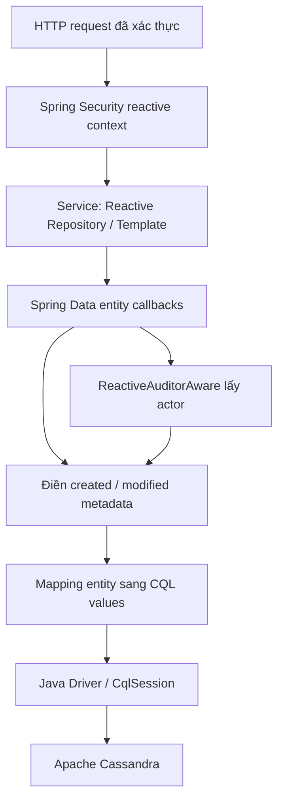

# @EnableReactiveCassandraAuditing và ReactiveAuditorAware

## Mục tiêu học tập

Trong một ứng dụng Spring Data Cassandra, nhiều entity cần lưu thông tin **ai đã tạo**, **ai cập nhật gần nhất**, **được tạo lúc nào** và **được cập nhật lúc nào**. Việc lặp lại những phép gán như `entity.setModifiedBy(userId)` ở mọi service vừa dễ quên, vừa khó duy trì khi đường ghi ngày càng nhiều.

Spring Data cung cấp cơ chế **auditing** dựa trên annotation và entity callback. Với luồng truy cập phản ứng (*reactive*), `@EnableReactiveCassandraAuditing` cho phép kích hoạt xử lý auditing phù hợp, còn `ReactiveAuditorAware<T>` cung cấp danh tính người thực hiện dưới dạng `Mono<T>`. Danh tính có thể đến từ ngữ cảnh bảo mật của request trong **Reactor Context**, không cần phụ thuộc vào `ThreadLocal` của servlet.

Bài học nằm trong chương **Vòng đời và auditing** của module `SPRING_DATA_CASSANDRA` — học truy cập Apache Cassandra bằng entity mapping, repository, `CassandraTemplate` và CQL; đồng thời thiết kế bảng theo truy vấn, partition key, consistency, paging và kiểm soát hiệu năng của hệ dữ liệu phân tán.

Sau bài, bạn có thể:

- Giải thích auditing metadata và giới hạn của nó so với **audit log/event history**.
- Cấu hình `@EnableReactiveCassandraAuditing` và khai báo `ReactiveAuditorAware<String>`.
- Sử dụng `@CreatedBy`, `@CreatedDate`, `@LastModifiedBy` và `@LastModifiedDate` trên entity Cassandra.
- Lấy danh tính từ Spring Security reactive context, xử lý request ẩn danh và job hệ thống một cách có chủ đích.
- Hiểu cách Spring Data phân biệt **entity mới/cũ** và tác động đến trường created/modified.
- Nhận diện đường ghi nào qua auditing callback, đường ghi nào cần tự điền metadata.
- Phân biệt ngày audit ở tầng ứng dụng với Cassandra `WRITETIME(column)` và timestamp của sự kiện nghiệp vụ.
- Thiết kế đúng cho multi-tenant, retry, LWT, cập nhật một phần, TTL và truy vấn theo khóa.
- Kiểm thử với Reactor `StepVerifier` và integration test Cassandra, kể cả thiếu actor hoặc nhiều writer.

## 1. Auditing trong Spring Data Cassandra giải quyết điều gì?

Giả sử hệ thống quản lý tài liệu. Một record có các thuộc tính:

```text
document_id   = 11111111-1111-4111-8111-111111111111
title         = "Quy trình tiếp nhận"
status        = "DRAFT"

created_by    = "user-100"
created_at    = 2026-11-25T09:00:00Z
modified_by   = "user-205"
modified_at   = 2026-11-25T10:15:00Z
```

Nhóm đầu chứa **dữ liệu nghiệp vụ**; nhóm sau ghi metadata về vòng đời của entity.

| Thuộc tính | Câu hỏi được hỗ trợ |
| --- | --- |
| `created_by` | Ai được hệ thống ghi nhận là người tạo entity? |
| `created_at` | Entity được ghi nhận là mới tại thời điểm nào theo date provider của ứng dụng? |
| `modified_by` | Ai được ghi nhận ở lần cập nhật gần nhất qua đường auditing? |
| `modified_at` | Ngày audit của lần cập nhật gần nhất qua đường auditing? |

Các annotation Spring Data:

```java
@CreatedBy
@CreatedDate
@LastModifiedBy
@LastModifiedDate
```

giúp điền các trường tương ứng trong vòng đời lưu entity **khi thao tác đi qua cơ chế mapping/auditing được cấu hình và hỗ trợ**.

### Auditing không phải lịch sử bất biến

Nếu một entity được cập nhật ba lần:

```text
11:00 user-A sửa title
11:05 user-B sửa status
11:10 user-C sửa title
```

thì cột `modified_by` trên bản ghi hiện tại có thể là `user-C`. Hai sự kiện trước **không tự xuất hiện** như các record lịch sử.

Vì vậy phải phân biệt:

- **Auditing metadata:** thông tin tạo/cập nhật hiện có trên entity.
- **Audit trail/event log:** nhiều bản ghi sự kiện, chứa operation ID, actor, thời gian, thay đổi và kết quả, được thiết kế để truy vấn lịch sử.
- **Cassandra write timestamp:** metadata lưu trữ theo cell, phục vụ cơ chế phân giải dữ liệu; không cho actor hoặc đầy đủ lịch sử.

**Không dùng `@LastModifiedBy` thay thế một hệ thống audit tuân thủ pháp lý, đối soát tài chính hoặc điều tra sự kiện có yêu cầu lịch sử đầy đủ.**

## 2. Đường đi của reactive auditing

Một đường lưu entity phổ biến:



Sơ đồ thể hiện **đường đi logic**. Thứ tự chi tiết callback, cách xác định entity mới và các API được hỗ trợ thay đổi theo thế hệ Spring Data. Điều quan trọng cần nhớ:

1. Cơ chế auditing hoạt động trong **lifecycle của Spring Data**, không phải trigger nằm trong Cassandra.
2. `ReactiveAuditorAware` trả về một **Publisher chứa actor**, không truy vấn trực tiếp “ai gửi câu CQL” từ database.
3. Entity phải có các thuộc tính annotated phù hợp để nhận giá trị.
4. Một lệnh CQL viết trực tiếp qua driver **không tự chạy entity callback**.
5. Một lời gọi repository reactive chưa được subscribe thì chưa thể mặc định là write đã hoàn tất.

### Reactive khác imperative ở đâu?

| Truy cập imperative | Truy cập reactive |
| --- | --- |
| Thường dùng `CassandraRepository` và `CassandraTemplate`. | Thường dùng `ReactiveCassandraRepository` và `ReactiveCassandraTemplate`. |
| Auditor có thể được cấp qua `AuditorAware<T>`. | Auditor phù hợp là `ReactiveAuditorAware<T>`. |
| Một số ngữ cảnh có thể gắn với thread. | Context theo subscription/pipeline; không giả định thread cố định. |
| Thao tác có thể thực thi ngay khi gọi method đồng bộ. | Publisher có thể thực thi khi subscribe và chịu ảnh hưởng retry/cancellation. |

**Đừng bật reactive auditing rồi giả định tất cả thao tác đồng bộ qua JDBC/CQL/driver cũng được kiểm toán tự động.** Phải xác minh từng đường ghi mà dự án thực sự sử dụng.

## 3. Chuẩn bị hạ tầng và phiên bản

Tối thiểu, ứng dụng cần một cấu hình Spring Data Cassandra có **khả năng reactive** và các thành phần Reactor tương thích.

Nếu lấy actor từ security context, dự án còn cần **Spring Security reactive/WebFlux** hoặc một cơ chế cấp danh tính theo Reactor Context của riêng ứng dụng.

Trước khi viết code, kiểm tra:

1. Phiên bản **Spring Boot** và bộ dependency Spring Data Cassandra được quản lý tương thích.
2. `@EnableReactiveCassandraAuditing` có trong phiên bản Spring Data đang dùng và package import đúng.
3. `ReactiveAuditorAware<T>` có trong bộ Spring Data Commons tương ứng.
4. Entity được lưu bằng **reactive repository/template** và cơ chế callback cần thiết đã kích hoạt.
5. Cách mapping `Instant`, tên cột và chiến lược nhận diện entity mới phù hợp.
6. Cơ chế xác thực có cung cấp `Authentication` trong Reactor Context ở thời điểm save được subscribe hay không.

**Không suy luận rằng chỉ thêm Spring WebFlux là đã bật Cassandra reactive auditing.** Cần cấu hình rõ ràng và kiểm thử end-to-end.

### Chọn một nơi sở hữu cấu hình

Thông thường, nên có **một cấu hình auditing nhất quán** cho application context, tránh khai báo nhiều bean auditor trùng vai trò hoặc tự bật các chiến lược auditing không rõ ràng qua nhiều module.

Nếu ứng dụng còn có truy cập blocking, hãy xác định đường ghi nào dùng reactive auditing, đường nào dùng imperative auditing, và đừng để hai đường có quy tắc actor/ngày audit khác nhau trên cùng dữ liệu.

## 4. Bật @EnableReactiveCassandraAuditing

Ví dụ cấu hình **Spring Data Cassandra reactive** kết hợp với Spring Security:

```java
import org.springframework.context.annotation.Bean;
import org.springframework.context.annotation.Configuration;
import org.springframework.data.cassandra.config.EnableReactiveCassandraAuditing;
import org.springframework.data.domain.ReactiveAuditorAware;

@Configuration(proxyBeanMethods = false)
@EnableReactiveCassandraAuditing(
        auditorAwareRef = "reactiveDocumentAuditor")
public class CassandraAuditConfiguration {

    @Bean("reactiveDocumentAuditor")
    ReactiveAuditorAware<String> reactiveDocumentAuditor() {
        return new SecurityContextDocumentAuditor();
    }
}
```

Trong đó `SecurityContextDocumentAuditor` sẽ được định nghĩa ở phần kế tiếp.

Ý nghĩa:

- `@EnableReactiveCassandraAuditing` kích hoạt phần hỗ trợ reactive auditing của Spring Data Cassandra.
- `auditorAwareRef` trỏ đến bean `ReactiveAuditorAware<String>` mà cấu hình muốn sử dụng.
- Bean auditor tạo ra actor tương ứng với **subscription đang thực thi**, không lấy một user ID cứng được xác định lúc Spring khởi tạo singleton.
- Các annotation `@CreatedBy`, `@LastModifiedBy` trên entity sẽ dùng kiểu actor tương thích với `String` trong ví dụ.

**Lưu ý phiên bản:** đây là ví dụ cho một thế hệ Spring Data Cassandra có annotation/configuration nêu trên. Nếu dự án dùng dòng khác, kiểm tra API annotation, tên attribute và component scanning thực tế; đừng đoán qua tên phương thức gần giống.

### Tại sao không trả sẵn “admin”?

```java
// Nguy hiểm nếu mọi request đều được gán cùng actor:
@Bean
ReactiveAuditorAware<String> auditor() {
    return () -> Mono.just("admin");
}
```

Với cấu hình này, mọi thay đổi đều được ghi nhận là `admin`, kể cả request do người dùng khác thực hiện. Nó **làm sai thông tin audit**, không chỉ là một lựa chọn tiện lợi.

Chỉ dùng actor hệ thống cố định cho **đường ghi nền đã được xác thực là job hệ thống**, có quy tắc định danh riêng.

## 5. ReactiveAuditorAware lấy actor từ Reactor Security Context

Hợp đồng cốt lõi:

```java
public interface ReactiveAuditorAware<T> {
    Mono<T> getCurrentAuditor();
}
```

Đây là chữ ký về ý nghĩa của interface Spring Data Commons. Cụ thể với Spring Security reactive:

```java
import org.springframework.data.domain.ReactiveAuditorAware;
import org.springframework.security.authentication.AnonymousAuthenticationToken;
import org.springframework.security.core.Authentication;
import org.springframework.security.core.context.ReactiveSecurityContextHolder;

import reactor.core.publisher.Mono;

public final class SecurityContextDocumentAuditor
        implements ReactiveAuditorAware<String> {

    @Override
    public Mono<String> getCurrentAuditor() {
        return ReactiveSecurityContextHolder.getContext()
                .flatMap(context ->
                        Mono.justOrEmpty(context.getAuthentication()))
                .filter(Authentication::isAuthenticated)
                .filter(authentication ->
                        !(authentication
                                instanceof AnonymousAuthenticationToken))
                .flatMap(authentication ->
                        Mono.justOrEmpty(authentication.getName()))
                .filter(name -> !name.isBlank());
    }
}
```

### Giải thích luồng trên

1. `ReactiveSecurityContextHolder.getContext()` tìm ngữ cảnh bảo mật trong **Reactor Context**.
2. Từ đó lấy `Authentication` hiện hành.
3. Lọc request chưa xác thực và `AnonymousAuthenticationToken`.
4. Lấy tên principal làm actor.
5. Nếu không có actor hợp lệ, Publisher có thể hoàn tất **rỗng**.

Việc dùng `Authentication.getName()` là một **chính sách ví dụ**. Trong hệ thống có username đổi được, nên cân nhắc một ID ổn định (subject/UUID) từ principal hoặc claim đã được xác minh, thay vì lưu chuỗi tên hiển thị.

### Vì sao không dùng SecurityContextHolder kiểu ThreadLocal?

Đoạn sau dễ gây lỗi trong luồng reactive:

```java
// Không nên suy ra principal reactive từ thread hiện tại:
// Authentication auth =
//     SecurityContextHolder.getContext().getAuthentication();
```

Với WebFlux, callback có thể chạy trên các thread khác nhau và ngữ cảnh bảo mật được truyền qua Reactor Context. Dựa vào một `ThreadLocal` servlet có thể cho ra `null` hoặc principal không đúng với request.

### Cần hiểu sự khác nhau giữa xác thực và quyền truy cập

`isAuthenticated()` và việc không phải anonymous **không tự chứng minh người dùng được phép sửa tài liệu cụ thể**. Authorization phải kiểm tra quyền trên tài nguyên/tenant **trước khi ghi**, độc lập với việc lấy actor để audit.

**AuditorAware xác định danh tính ghi metadata; nó không phải lớp bảo vệ quyền truy cập Cassandra.**

## 6. Thiết kế actor cho request, job nền và anonymous

Một ứng dụng có thể có nhiều nguồn ghi:

| Nguồn ghi | Actor nên ghi nhận | Điểm cần kiểm tra |
| --- | --- | --- |
| Request của người dùng đã đăng nhập | User ID ổn định từ principal. | Người dùng có quyền trên tenant/tài liệu? |
| Service-to-service đã xác thực | Service principal được định danh rõ. | Không nhầm service account với người dùng cuối. |
| Scheduled job | Actor hệ thống được chọn có chủ đích, ví dụ `system:retention-job`. | Có ngữ cảnh job và operation ID để truy vết? |
| Message consumer | Actor của nguồn sự kiện hoặc consumer tùy policy. | Có tin cậy danh tính trong message không? |
| Request anonymous | Không có auditor, hoặc từ chối thao tác tùy nghiệp vụ. | Không ghi “admin” như fallback im lặng. |

### Mono.empty() mang ý nghĩa gì?

Một implementation `ReactiveAuditorAware<String>` có thể trả `Mono.empty()` khi không tìm thấy principal hợp lệ. Điều đó **không bảo đảm thao tác lưu sẽ tự bị từ chối**. Tùy cấu hình, các trường `created_by`/`modified_by` có thể không được điền, trong khi những thông tin khác vẫn được xử lý.

Nếu nghiệp vụ bắt buộc có actor, phải **kiểm tra tiền điều kiện trước đường ghi** hoặc thiết kế failure rõ ràng thay vì kỳ vọng auditing tự làm authorization.

### Tách actor hệ thống

Một service nền có thể dùng một chính sách:

```java
public interface AuditActorPolicy {
    Mono<String> requireActorForUserWrite();
    Mono<String> actorForTrustedSystemJob(String jobName);
}
```

Đây là **giao diện ứng dụng minh họa**, không phải API Spring Data. Mục đích là phân biệt “request thiếu principal ngoài dự kiến” với “job hệ thống thực sự được phép sử dụng actor hệ thống”.

Không cho request HTTP tự cung cấp `X-Audit-User: admin` rồi tin ngay: header có thể bị giả mạo nếu không có gateway/authentication kiểm soát.

## 7. Annotate entity: bốn trường auditing

Giả sử ứng dụng quản lý tài liệu theo ID:

```sql
CREATE TABLE documents_by_id (
    document_id uuid PRIMARY KEY,
    title text,
    status text,
    created_by text,
    created_at timestamp,
    modified_by text,
    modified_at timestamp
);
```

Entity:

```java
import java.time.Instant;
import java.util.UUID;

import org.springframework.data.annotation.CreatedBy;
import org.springframework.data.annotation.CreatedDate;
import org.springframework.data.annotation.LastModifiedBy;
import org.springframework.data.annotation.LastModifiedDate;
import org.springframework.data.cassandra.core.mapping.Column;
import org.springframework.data.cassandra.core.mapping.PrimaryKey;
import org.springframework.data.cassandra.core.mapping.Table;

@Table("documents_by_id")
public class Document {

    @PrimaryKey("document_id")
    private UUID id;

    @Column("title")
    private String title;

    @Column("status")
    private String status;

    @CreatedBy
    @Column("created_by")
    private String createdBy;

    @CreatedDate
    @Column("created_at")
    private Instant createdAt;

    @LastModifiedBy
    @Column("modified_by")
    private String modifiedBy;

    @LastModifiedDate
    @Column("modified_at")
    private Instant modifiedAt;

    // Constructor, getters/setters hoặc mapping style phù hợp.
}
```

### Ý nghĩa từng annotation

| Annotation | Dự kiến khi entity được nhận diện là mới | Dự kiến khi được nhận diện là đã tồn tại |
| --- | --- | --- |
| `@CreatedBy` | Điền actor tạo mới khi có auditor. | Thông thường không tự đổi actor tạo ở mỗi update. |
| `@CreatedDate` | Điền thời điểm tạo theo date provider. | Thông thường giữ ngày tạo trước đó. |
| `@LastModifiedBy` | Có thể được điền ngay khi tạo theo cấu hình auditing. | Điền actor của lần cập nhật hiện hành. |
| `@LastModifiedDate` | Có thể được điền ngay khi tạo theo cấu hình auditing. | Điền ngày sửa ở lần cập nhật hiện hành. |

Quy tắc *modified on create* và date provider có thể có tùy chọn cấu hình theo version. Không tự mặc định rằng mọi ứng dụng sẽ để modified fields rỗng khi insert; hãy xác định policy nhất quán và viết integration test cho lần tạo đầu.

### Dùng Instant thay vì format ngày dạng String

`Instant` giúp ứng dụng lưu một thời điểm UTC rõ nghĩa và tránh lẫn múi giờ của người dùng với timestamp CQL. Date-time auditing phụ thuộc clock/date provider ứng dụng; đó không phải cơ chế lấy thời gian từ Cassandra coordinator một cách bắt buộc.

Nếu cần hiển thị theo giờ Việt Nam, hãy chuyển ở tầng trình bày; **đừng thay đổi ý nghĩa UTC của audit instant tùy theo múi giờ server**.

## 8. Entity mới hay cũ: phần quyết định created/modified

Cơ chế auditing phải biết một entity đang được **tạo mới** hay **cập nhật**. Trong Spring Data, việc xác định trạng thái này có thể dựa vào:

- Giá trị ID và chiến lược is-new của entity information.
- Cột version nếu dùng versioning/optimistic locking phù hợp.
- Việc entity tự triển khai `Persistable<ID>` với `isNew()`.
- Những quy tắc bổ sung của phiên bản Spring Data Cassandra và mapping metadata.

### Cạm bẫy với UUID do ứng dụng sinh

Nhiều ứng dụng tạo ID trước khi lưu:

```java
Document document = new Document();
document.setId(UUID.randomUUID());
document.setTitle("Hướng dẫn kiểm kê");
repository.save(document);
```

**Không tự khẳng định** rằng Spring Data sẽ luôn nhận diện đối tượng này là “mới”, chỉ vì chưa có hàng tương ứng trong Cassandra. Khi ID được cấp trước và không có tín hiệu is-new khác, một số chiến lược nhận diện sẽ xem ID khác null là đối tượng đã tồn tại.

Hệ quả có thể là:

- `@CreatedDate`/`@CreatedBy` không được điền theo kỳ vọng khi insert đầu tiên.
- Audit fields của lần update không đồng nhất.
- Logic version hoặc insert/upsert không phù hợp với entity lifecycle.

### Có thể dùng Persistable khi thực sự cần

Khung minh họa:

```java
import java.util.UUID;
import org.springframework.data.domain.Persistable;
import org.springframework.data.annotation.Transient;

public class NewDocumentMarker implements Persistable<UUID> {
    private UUID id;

    @Transient
    private boolean newEntity = true;

    @Override
    public UUID getId() {
        return id;
    }

    @Override
    public boolean isNew() {
        return newEntity;
    }

    public void markNotNew() {
        newEntity = false;
    }
}
```

Đây là **khung mô tả chiến lược is-new**, không phải một entity Cassandra hoàn chỉnh. Trong triển khai thực tế, phải bảo đảm flag không bị persist thành cột CQL, được chuyển đúng trạng thái sau khi ghi/đọc lại và hoạt động với callback/constructors được version Spring Data hỗ trợ. Không chỉ copy khung rồi kỳ vọng toàn bộ vòng đời tự hoàn chỉnh.

### @Version là một lựa chọn khác, nhưng thay đổi ngữ nghĩa ghi

Khi dùng optimistic locking với `@Version` theo khả năng của Spring Data Cassandra, entity mới/cũ có thể được nhận diện theo version. Tuy nhiên, thêm `@Version` không chỉ để “sửa created date”: nó có thể dẫn đến **LWT/CAS**, conflict exception và chi phí phối hợp khác với ghi thường.

**Chọn chiến lược nhận diện entity mới bằng thiết kế lifecycle, không thêm @Version một cách vô tình chỉ để làm auditing trông có vẻ đúng.**

## 9. Repository reactive: lưu qua lifecycle được auditing hỗ trợ

Repository:

```java
import java.util.UUID;
import org.springframework.data.cassandra.repository.ReactiveCassandraRepository;

public interface DocumentRepository
        extends ReactiveCassandraRepository<Document, UUID> {
}
```

Một service có thể lưu entity:

```java
import reactor.core.publisher.Mono;

public Mono<Document> createDocument(String title) {
    return Mono.defer(() -> {
        Document doc = new Document();
        doc.setId(UUID.randomUUID());
        doc.setTitle(title);
        doc.setStatus("DRAFT");
        return repository.save(doc);
    });
}
```

Đoạn mã là ví dụ phương thức trong service có `repository` được inject và entity có setters. Để thực thi thật, cần xác định **chính sách tạo ID** và **cách entity được nhận diện là mới**. Không được lấy sự hiện diện của `Mono<Document>` làm bằng chứng các trường created đã được gán nếu chưa kiểm tra lifecycle thực tế.

### Tại sao Mono.defer?

`Mono.defer(...)` trì hoãn việc tạo entity và gọi repository đến thời điểm subscribe. Với code có nhiều subscription, mỗi lần subscribe có thể tạo một entity hoặc một write mới.

Do đó:

```java
Mono<Document> creation = createDocument("Quy trình mới");

creation.subscribe(); // Có thể tạo một tài liệu.
creation.subscribe(); // Có thể tạo thêm tài liệu nữa.
```

**Không chủ động subscribe trong service nghiệp vụ như ví dụ trên.** Đây là phản ví dụ cho thấy nhiều subscription có thể gây tác dụng phụ lặp. Trong WebFlux, thường trả Publisher lên framework để quản lý subscription.

Nếu API phải bảo đảm một request tạo đúng một tài liệu, cần **operation ID/idempotency policy** vượt ra ngoài việc lựa chọn `Mono.defer` hay `repository.save`.

### Đọc lại để xác minh auditing

Trong một integration test, sau khi save thành công, đọc entity từ database và xác nhận `createdBy/createdAt`. Không chỉ xem object Java trước khi subscribe hoặc mock `repository.save`, vì các callback có thể chỉ chạy trong luồng persist thực tế.

## 10. Cập nhật entity và bảo toàn created metadata

Một entity đã được đọc đầy đủ rồi cập nhật:

```java
import java.util.UUID;
import reactor.core.publisher.Mono;

public Mono<Document> renameDocument(UUID documentId, String newTitle) {
    return repository.findById(documentId)
            .switchIfEmpty(Mono.error(
                    new DocumentNotFoundException(documentId)))
            .flatMap(existing -> {
                existing.setTitle(newTitle);
                return repository.save(existing);
            });
}
```

Trong đó `DocumentNotFoundException` là exception thuộc ứng dụng. Khi entity được nhận diện là **đang cập nhật** và auditing chạy đúng, Spring Data có thể điền metadata modified phù hợp. Nhưng **đừng tự suy rằng save là một UPDATE chỉ thay một cột**. Cassandra có semantics upsert; các cột được ghi và cách mapping `null` phụ thuộc API, conversion và chiến lược câu lệnh.

Nếu bạn tạo một entity mới chỉ có ID và title rồi gọi save:

```java
// Dễ gây vấn đề nếu muốn cập nhật riêng title:
Document partial = new Document();
partial.setId(documentId);
partial.setTitle("Tên mới");
return repository.save(partial);
```

thì các trường `createdBy`, `createdAt`, `status` khác có thể bị bỏ sót, ghi null hoặc bị ảnh hưởng tùy đường mapping. Không được coi một partial entity là một bản sao đầy đủ an toàn để save.

### Nguyên tắc cho update

1. Nếu cần auditing tự động theo lifecycle, dùng **đường lưu entity đầy đủ** được Spring Data hỗ trợ và kiểm thử.
2. Nếu chỉ muốn thay vài cột, có thể chọn **CQL update mục tiêu**; lúc ấy phải tự có chính sách cập nhật modified fields.
3. Khi có nhiều writer, dùng version/điều kiện nghiệp vụ nếu cần chống lost update.
4. Đừng sửa `createdAt`/`createdBy` sau khi entity đã được tạo chỉ vì một request update thông thường.
5. Không tin rằng callback đã chạy đồng nghĩa CQL đã được replica xác nhận; kết quả write phải được kiểm tra.

## 11. Đường ghi nào tự chạy auditing, đường nào có thể bỏ qua?

Đây là một ranh giới vận hành quan trọng. Không phải mọi API chạm Cassandra đều đi qua **entity lifecycle callbacks**.

| Đường thao tác | Khả năng đi qua reactive auditing | Cần làm gì? |
| --- | --- | --- |
| `ReactiveCassandraRepository.save(entity)` | **Có thể**, khi cấu hình và mapping/callback được kích hoạt. | Kiểm thử created/modified ở insert/update. |
| `ReactiveCassandraTemplate.insert(entity)` | Thường tham gia đường entity mapping/callback tương ứng. | Kiểm tra phiên bản và tình trạng entity mới. |
| `ReactiveCassandraTemplate.update(entity)` | Tùy API và xử lý entity ở phiên bản thực. | Xác minh auditing và fields được ghi bằng integration test. |
| `ReactiveCassandraTemplate.update(Query, Update, ...)` | Có thể bypass callback của entity đầy đủ vì thực thi cập nhật mục tiêu. | Đặt modified fields theo chính sách nếu callback không chạy. |
| `@Query` với CQL UPDATE/DELETE viết tay | Không nên mặc định callback tự xử lý từng regular cell. | Tự quản lý audit metadata nếu cần. |
| `CqlSession.executeAsync(...)` | **Không** tự chạy Spring Data entity auditing. | Bind modified_by/modified_at tường minh. |
| cqlsh, migration script, ETL/bulk import ngoài Spring | **Không** chạy callback Spring của ứng dụng. | Chính sách backfill/audit riêng. |
| TTL expiration, compaction, repair | Không phải một lần save entity trong Spring. | Không kỳ vọng actor/modifiedAt tự thay khi TTL hết hạn. |

Bảng mô tả **điểm cần xác minh**, không phải cam kết mọi overload/template ở mọi phiên bản luôn giống nhau. Sự khác biệt giữa **entity operation** và **CQL statement operation** quan trọng hơn tên class có chữ “Reactive”.

### CQL cập nhật có điều kiện và audit field

Một API cập nhật trạng thái trực tiếp:

```sql
UPDATE documents_by_id
SET status = 'APPROVED'
WHERE document_id = 11111111-1111-4111-8111-111111111111;
```

Nếu câu lệnh này được gọi qua driver, Spring Data auditing callback **không tự thêm** `modified_by` hoặc `modified_at`. Một lựa chọn ghi tường minh:

```sql
UPDATE documents_by_id
SET status = 'APPROVED',
    modified_by = 'user-205',
    modified_at = '2026-11-25T10:15:00Z'
WHERE document_id = 11111111-1111-4111-8111-111111111111;
```

Trong production, actor phải đến từ danh tính đã xác thực, thời gian được tạo theo policy và các giá trị cần được **bind parameter**, không nối chuỗi do client cung cấp. Câu ví dụ minh họa CQL, không khuyến khích hardcode actor.

Nếu cần kiểm tra “chỉ chấp thuận khi status hiện tại là PENDING”, còn phải xét `UPDATE ... IF status = 'PENDING'`/LWT hoặc giao thức trạng thái tương ứng. **Auditing metadata không tự làm việc kiểm tra điều kiện.**

## 12. ReactiveAuditorAware chạy trong ngữ cảnh subscription

Ở WebFlux, thông tin bảo mật reactive thường được truyền qua **subscriber context**, không phải giá trị global trên singleton. Ví dụ một đường save:

```java
public Mono<Document> updateTitle(
        UUID id, String newTitle) {
    return repository.findById(id)
            .switchIfEmpty(Mono.error(
                    new DocumentNotFoundException(id)))
            .flatMap(doc -> {
                doc.setTitle(newTitle);
                return repository.save(doc);
            });
}
```

Nếu publisher trên được subscribe **bên trong request chain của Spring Security WebFlux**, `ReactiveAuditorAware` có thể đọc principal từ context đang hoạt động.

### Vì sao principal có thể không xuất hiện?

- Một scheduled job không chạy qua HTTP security filter chain.
- Một test tự subscribe mà không cấp Security Context.
- Một luồng bị “tách” bằng việc gọi `subscribe()` thủ công, làm mất ngữ cảnh request mong đợi.
- Dữ liệu chuyển qua một integration/messaging system mà không mang danh tính người dùng.
- Principal anonymous hoặc một kiểu authentication không phù hợp chính sách auditor.

**Không sửa bằng cách giữ actor vào biến static hoặc ThreadLocal dùng chung.** Có thể lộ danh tính từ request này sang request khác, nhất là khi luồng chạy trên scheduler tái sử dụng thread.

### ContextWrite cho một test minh họa

```java
Authentication authentication =
        new UsernamePasswordAuthenticationToken(
                "user-205",
                "unused",
                List.of(new SimpleGrantedAuthority("ROLE_EDITOR")));

Mono<String> auditor = reactiveAuditorAware.getCurrentAuditor()
        .contextWrite(
                ReactiveSecurityContextHolder
                        .withAuthentication(authentication));
```

Ví dụ trên giả định có imports:

```java
import java.util.List;
import org.springframework.security.core.Authentication;
import org.springframework.security.authentication.UsernamePasswordAuthenticationToken;
import org.springframework.security.core.authority.SimpleGrantedAuthority;
import org.springframework.security.core.context.ReactiveSecurityContextHolder;
import reactor.core.publisher.Mono;
```

Đây là cách **cấp Security Context cho subscription trong test**, không phải chỉ dẫn để một request client tùy ý tự khai báo người dùng đã xác thực.

## 13. Tránh mất actor khi chia tách luồng reactive

Một sai lầm dễ mắc:

```java
// Sai trong nhiều service reactive:
public Mono<Void> handleRequest(Document doc) {
    repository.save(doc).subscribe();
    return Mono.empty();
}
```

Hậu quả:

1. Application chủ động tạo một subscription mới không được WebFlux kiểm soát theo vòng đời response.
2. Có thể mất Reactor Security Context mong đợi.
3. Lỗi save không đi vào Publisher trả về cho controller.
4. HTTP có thể trả thành công trong khi write đang lỗi.
5. Không còn đường quản lý rõ ràng timeout, cancellation và retry.

Hãy **trả Publisher và compose**:

```java
public Mono<Void> handleRequest(Document doc) {
    return repository.save(doc).then();
}
```

Khi controller trả Publisher này, WebFlux quản lý subscription theo request. Thông tin security context còn phụ thuộc cấu hình filter/chain; test phải xác minh thực tế.

### Scheduler không phải tự động là nguyên nhân mất context

Reactor Context được thiết kế để đi cùng subscription qua các operator; việc `publishOn(...)` hoặc `subscribeOn(...)` không đồng nghĩa mọi Reactor Context bị mất. Nguy cơ thường đến từ **tự tạo subscription tách rời**, chuyển sang API không hiểu Reactor Context hoặc cầu nối ThreadLocal tự xây không đúng.

Vì vậy, không đưa ra quy tắc “không bao giờ đổi scheduler nếu cần auditing”; hãy kiểm tra **context propagation thực tế**.

## 14. Công việc nền và message consumer cần chính sách actor riêng

Một background job hết hạn tài liệu không có HTTP principal. Nếu auditing mặc định không tìm thấy actor và trả `Mono.empty()`, `modifiedBy` có thể không phản ánh nguồn thao tác, tùy đường save/callback.

Ba phương án thường được đánh giá:

1. **Định danh service/job rõ ràng** trong ngữ cảnh công việc và chuyển vào một provider có kiểm soát.
2. **Điền modified fields tường minh** ở đường CQL/job nếu nó không đi qua entity auditing callback.
3. Lưu **audit event riêng** khi quy trình cần biết job ID, job version, lý do và đối tượng được ảnh hưởng.

Ví dụ chính sách actor:

```text
HTTP user edit:
  actor = "user:205"

Nightly retention job:
  actor = "system:retention-job"

Imported data from external ETL:
  actor = "system:legacy-import"
  source_operation_id = ...
```

Đây là định dạng actor minh họa. Hãy quy định naming convention, nguồn tin cậy và vòng đời token/identity. Không dùng cùng chuỗi `"system"` cho mọi tác vụ nếu sau này phải phân biệt actor trong điều tra.

### Khi xử lý message “on behalf of” một user

Một message có thể chứa user ID gốc, nhưng nội dung message không mặc định đáng tin cậy. Consumer cần xác minh nguồn và chữ ký/quyền nếu được yêu cầu, phân biệt **principal kỹ thuật đang xử lý** với **người được đại diện**.

Nếu cần cả hai, một trường `modified_by` duy nhất không đủ ngữ cảnh; audit log nên lưu originator, executor và operation ID theo đúng contract.

## 15. Auditing và authorization trong multi-tenant

Một tài liệu có thể thuộc tenant, và application cần bảo đảm người dùng của tenant A **không thể sửa hoặc đọc metadata** của tenant B.

Schema thiết kế theo truy vấn và phạm vi tenant:

```sql
CREATE TABLE documents_by_tenant (
    tenant_id uuid,
    document_id uuid,
    title text,
    status text,
    created_by text,
    created_at timestamp,
    modified_by text,
    modified_at timestamp,
    PRIMARY KEY ((tenant_id), document_id)
);
```

Schema này chỉ là một mẫu: nếu tenant có số lượng tài liệu rất lớn, partition chỉ theo `tenant_id` có thể quá lớn và nóng. Khi đó cần thiết kế bucket/shard hoặc khóa khác theo truy vấn. Mục tiêu là minh họa **tenant là một phần đường định vị dữ liệu**, không đề xuất cấu trúc tối ưu cho mọi workload.

### Những nguyên tắc quan trọng

- Actor `"user-205"` **không chứng minh** user được quyền sửa tài liệu.
- Authorization phải kiểm tra quan hệ giữa principal, tenant, tài liệu và hành động.
- Repository query/update phải dùng **đủ khóa/điều kiện scope**.
- Không lấy tenant từ một field trong JSON body mà không kiểm tra token/authorization.
- Không dùng fallback auditor “admin” để vượt qua tình huống thiếu principal.
- Không trả metadata actor của tài liệu tenant khác chỉ vì CQL tìm được hàng.

### Kiểu actor có thể cần namespace

Khi user ID chỉ duy nhất trong một tenant, giá trị:

```text
created_by = "205"
```

có thể mơ hồ. Có thể lưu một định danh đã namespaced như `tenantId:userId` hoặc dùng một user ID toàn cục ổn định. Nếu dùng object phức hợp thay cho `String`, cần bảo đảm conversion/mapping Cassandra tương ứng và khai báo `ReactiveAuditorAware<T>` cùng kiểu.

**Không dùng auditing callback như biện pháp cách ly tenant thay cho thiết kế khóa và authorization.**

## 16. Ngày audit so với WRITETIME và thời điểm nghiệp vụ

Cassandra lưu write timestamp trên regular cells phục vụ giải quyết xung đột; CQL có thể đọc bằng `WRITETIME(column)` với kiểu cột phù hợp.

Ví dụ:

```sql
SELECT
    title,
    created_at,
    modified_at,
    WRITETIME(title) AS title_write_time_us
FROM documents_by_id
WHERE document_id = 11111111-1111-4111-8111-111111111111;
```

Ba nhóm thời gian khác nhau:

| Dữ liệu | Nguồn/ý nghĩa |
| --- | --- |
| `created_at` | Ngày được entity auditing điền khi hệ thống nhận diện entity mới. |
| `modified_at` | Ngày được entity auditing điền ở lần sửa qua đường hỗ trợ. |
| `WRITETIME(title)` | Write timestamp CQL của phiên bản cell `title` được quan sát, tính bằng **microsecond**. |
| `event_at` (nếu có) | Thời gian sự kiện nghiệp vụ, có thể khác thời gian hệ thống nhận/ghi. |

**Không được xem `modified_at == WRITETIME(title)` là một invariant.** Audit field thường dựa trên clock/date provider tầng Java; write timestamp có thể do driver/coordinator hoặc câu lệnh CQL cấp theo chính sách riêng. Các giá trị có thể lệch theo thời gian, đơn vị và lần cập nhật cột.

### Timestamp không tự bảo đảm thứ tự nghiệp vụ

Trong Cassandra, xung đột ghi vào regular cells thường được giải quyết bằng **write timestamp**, không nhất thiết đúng thứ tự request hoàn tất theo thời gian thực. Nếu có client lệch đồng hồ hoặc `USING TIMESTAMP` bất thường, một ghi đã nhận xác nhận quorum nhưng có timestamp thấp hơn có thể không thắng phiên bản cell khác.

Do đó:

- `@LastModifiedDate` không phải một token optimistic locking.
- `@LastModifiedBy` không tạo một lịch sử tuyến tính hóa các actor.
- Thay đổi cả `modifiedBy` và `modifiedAt` không tự làm nghiệp vụ tránh lost update.
- Khi cần điều kiện chuyển trạng thái, phải dùng version/LWT hoặc protocol bảo vệ tương ứng.

### Vấn đề đồng bộ clock

Nếu date provider dùng clock của mỗi service instance, các instance có thể lệch giờ. Cần đồng bộ thời gian, kiểm tra NTP/clock drift và quy định ý nghĩa date audit trong SLA.

Không dùng created/modified timestamp để chứng minh “chắc chắn operation A đã hoàn tất trước B” khi hệ thống không có protocol tương ứng.

## 17. TTL, xóa và việc cập nhật audit field

Một regular row trong Cassandra có thể chứa các cell với TTL khác nhau. Nếu entity có trường:

```java
@LastModifiedDate
@Column("modified_at")
private Instant modifiedAt;
```

thì câu hỏi quan trọng là **phạm vi TTL ở lần ghi thực tế**:

- Nếu table có `default_time_to_live`, regular cells có thể nhận TTL theo policy.
- Một lần save entity có thể ghi lại nhiều cột, thay đổi TTL của chúng theo tùy chọn ghi.
- Một lệnh UPDATE chỉ thay `status` có thể không viết lại `modified_at` nếu không thêm CQL tương ứng.
- Nếu chỉ audit field sống lâu hơn dữ liệu nghiệp vụ hoặc ngược lại, có thể xuất hiện hàng logic không nhất quán với mục đích quản trị.

### Xóa hoặc hết hạn không tự ghi actor mới

Khi TTL hết hạn:

```text
Cell sống → hết TTL → không còn xuất hiện như giá trị sống
              |
              +-- Cassandra quản lý tombstone/compaction
```

Đây **không** phải một lời gọi `repository.save(entity)` nên đừng mong `modifiedBy="system:ttl"` tự xuất hiện. Tương tự, lệnh `DELETE` CQL trực tiếp không tự tạo một audit event.

Nếu cần lịch sử “ai yêu cầu xóa” hoặc “khi nào hệ thống thực thi retention”, hãy thiết kế record sự kiện/audit riêng; đừng trông đợi metadata của hàng đã bị xóa vẫn đọc được như trước.

### Dữ liệu bị xóa logic khác xóa vật lý

Hết TTL/tombstone và compaction là các giai đoạn khác nhau. `gc_grace_seconds`, repair và trạng thái replica ảnh hưởng khả năng dọn dữ liệu an toàn. Trường `modifiedAt` không nói liệu bản sao trong snapshot/backup đã được xóa hay chưa.

Với yêu cầu xóa dữ liệu nhạy cảm, phải xem cả cache, backup, audit log và các hệ thống dẫn xuất; auditing entity không phải bằng chứng xóa vĩnh viễn.

## 18. Retry, resubscribe và idempotency: tác động lên audit fields

Trong Reactor, `retryWhen(...)` có thể **đăng ký lại** Publisher nguồn khi xảy ra lỗi. Nếu nguồn thực hiện ghi Cassandra khi subscribe, việc resubscribe có thể **gửi lại CQL**.

Ví dụ rủi ro:

```java
// Không gắn read retry policy mù quáng vào mọi write:
return repository.save(document)
        .retryWhen(Retry.backoff(3, Duration.ofMillis(100)));
```

Nếu write đầu đã được Cassandra chấp nhận nhưng response bị mất:

- Lần retry có thể gọi lại callback auditing.
- `modifiedAt` có thể được tạo lần nữa, mang timestamp khác.
- Một số field có thể được ghi lại với timestamp CQL mới.
- Nếu domain logic tạo ID/sự kiện mới trong nguồn, cùng một ý định nghiệp vụ có thể tạo thêm side effect.
- Nếu có LWT/versioning, outcome timeout vẫn không tự được phân loại là conflict.

**Không coi một thao tác repository save là an toàn để retry chỉ vì nó trả Mono.**

### Giữa lỗi xác định và outcome không rõ

| Kết quả | Ý nghĩa | Hành động |
| --- | --- | --- |
| `save()` trả entity thành công theo contract | Ghi nhận thao tác ở tầng service theo chính sách. | Tiếp tục workflow, không tự lặp. |
| LWT conditional write trả `applied=false` | Điều kiện không được áp dụng; có thể do version đổi. | Đọc lại, tính lại, thử lại có giới hạn nếu hợp lệ. |
| Write timeout/đứt kết nối khi đang ghi | Client **không biết chắc** dữ liệu đã được ghi chưa. | Xác minh outcome/idempotency, không retry mù. |
| Mapping/schema error | Code/dữ liệu không hợp lệ. | Sửa lỗi, không dùng backoff để che. |
| Không tìm thấy entity khi read | Không có hàng trong query vừa hoàn tất. | Xử lý NOT_FOUND, không phải lỗi audit. |

### ReactiveAuditorAware có thể được gọi nhiều lần

Trong cùng một request, callback auditing có thể được kích hoạt theo nhiều lần save hoặc nhiều subscriptions. Vì thế:

- Auditor phải trả danh tính **đúng ngữ cảnh mỗi lần gọi**.
- Đừng để `getCurrentAuditor()` tạo một sự kiện billing/email quan trọng.
- Tránh lưu actor vào mutable field của singleton.
- Không dùng một lời gọi auditor làm nguồn sinh operation ID.
- Nếu cần cùng operation ID xuyên retry, ID phải được tạo và giữ theo hợp đồng riêng.

### Một quy tắc cần có

**Auditing tự động cung cấp metadata, nhưng idempotency của thao tác ghi vẫn là trách nhiệm thiết kế nghiệp vụ và giao thức lưu dữ liệu.**

## 19. Cập nhật đồng thời: auditing không phải optimistic locking

Hai người cùng sửa một tài liệu:

```text
T0: title="A", status="DRAFT"

User U1 đọc entity ở T1
User U2 đọc entity ở T1

U1 sửa title="B", gọi save(...)
U2 sửa status="APPROVED", gọi save(...)
```

Auditing callback có thể điền:

```text
U1: modified_by="U1", modified_at=t2
U2: modified_by="U2", modified_at=t3
```

Nhưng hai thao tác **không tự có transaction isolation**. Việc ghi lại entity cũ có thể làm mất cập nhật của người khác, phụ thuộc những cột được viết và timestamp LWW. Các audit fields cũng có thể không phản ánh đúng “tác giả của giá trị cuối” nếu nhiều cell được cập nhật độc lập hoặc một writer bỏ qua callback.

### Khi cần tránh lost update

Sử dụng một protocol như:

1. Đọc entity có version.
2. Xác nhận quyền và kiểm tra chuyển trạng thái nghiệp vụ.
3. Tính các giá trị cần cập nhật.
4. Gửi conditional write/LWT với `IF version = expectedVersion` khi phù hợp.
5. Nếu `applied=false`, **đọc lại, tính lại, thử lại** có giới hạn.
6. Nếu timeout, xử lý **unknown outcome**, không mặc định conflict.

Ví dụ schema regular bổ sung version:

```sql
CREATE TABLE documents_with_version_by_id (
    document_id uuid PRIMARY KEY,
    title text,
    status text,
    version bigint,
    created_by text,
    created_at timestamp,
    modified_by text,
    modified_at timestamp
);
```

Conditional CQL minh họa:

```sql
UPDATE documents_with_version_by_id
SET title = 'B',
    modified_by = 'user-100',
    modified_at = '2026-11-25T10:20:00Z',
    version = 8
WHERE document_id = 11111111-1111-4111-8111-111111111111
IF version = 7;
```

**Ý nghĩa:** audit fields được ghi **cùng conditional update** khi điều kiện áp dụng; nếu điều kiện không đúng, cả nhóm thay đổi của statement không được áp dụng. Ví dụ CQL dùng literal để giải thích; production cần bind các giá trị đã được xác thực và xác định consistency.

### @Version của Spring Data

Spring Data Cassandra có thể hỗ trợ optimistic locking với `@Version` ở những đường ghi entity và phiên bản tương ứng. Nhưng:

- Không mặc định mọi `repository.save()` trở thành LWT nếu chỉ có field tên `version`.
- Kiểm tra CQL/exception khi version conflict theo phiên bản module đang chạy.
- Khi retry conflict, phải đọc lại entity và **tính lại** thay đổi nghiệp vụ.
- Mọi writer liên quan phải tuân thủ cùng protocol, kể cả script/CQL trực tiếp.
- Auditing vẫn không làm cho nhiều partition hoặc nhiều dịch vụ commit/rollback cùng nhau.

## 20. Khi cần lịch sử thật: thiết kế audit event riêng

Nếu nghiệp vụ cần truy vết:

> “Ai đổi trạng thái tài liệu từ DRAFT sang APPROVED, từ đâu, request nào, có thành công không và trước đó ai đã sửa?”

thì bốn cột auditing trên entity không đủ. Có thể thiết kế **audit event table theo truy vấn**.

Ví dụ cần liệt kê lịch sử của một tài liệu:

```sql
CREATE TABLE document_audit_by_id (
    tenant_id uuid,
    document_id uuid,
    event_at timestamp,
    operation_id uuid,
    actor_id text,
    action text,
    old_status text,
    new_status text,
    source_service text,
    PRIMARY KEY (
        (tenant_id, document_id),
        event_at,
        operation_id
    )
) WITH CLUSTERING ORDER BY (
    event_at DESC,
    operation_id ASC
);
```

Trong ví dụ:

- Partition key `(tenant_id, document_id)` hỗ trợ đọc lịch sử **một tài liệu trong một tenant**.
- Clustering theo thời gian cho phép liệt kê sự kiện mới trước.
- `operation_id` phân biệt sự kiện cùng thời điểm và phục vụ correlation; nó **không tự chống ghi trùng** nếu protocol không kiểm tra.
- `old_status` và `new_status` là dữ liệu nghiệp vụ của event, không suy ngược từ một ô `modified_by`.

### Lưu ý giới hạn partition

Một tài liệu có hàng triệu events qua nhiều năm sẽ tạo partition lớn nếu chỉ dùng `(tenant_id, document_id)`. Khi cần retention/khối lượng lớn, có thể thêm bucket tháng/ngày vào partition key và yêu cầu query đi qua các bucket theo thứ tự rõ ràng.

### Vấn đề dual-write

Giả sử service:

```text
1. UPDATE documents_by_id
2. INSERT document_audit_by_id
```

Nếu bước 1 thành công còn bước 2 lỗi, tài liệu đã thay đổi nhưng thiếu audit event. Đảo thứ tự lại có thể tạo event dù thay đổi chưa thành công.

**Không được coi hai lệnh ở hai partition/bảng là một transaction ACID chỉ vì dùng cùng CqlSession hoặc cùng consistency level.** Đối với audit có yêu cầu chính xác cao, cần thiết kế giao thức có idempotency, trạng thái, đối soát/outbox hoặc nền tảng transaction tương ứng.

### Audit event có thể chứa dữ liệu nhạy cảm

Audit log thường giữ danh tính và nội dung cũ-mới lâu hơn entity. Cần chính sách riêng cho:

- Phân quyền xem audit log.
- Che hoặc không lưu dữ liệu nhạy cảm không cần thiết.
- Retention, TTL và rủi ro tombstone.
- Encryption và quản trị khóa.
- Khả năng sửa/xóa bởi operator, tính toàn vẹn và điều tra.

Auditing entity không mặc nhiên tạo ra một **sổ sự kiện bất biến chống sửa đổi**.

## 21. Kiểm thử ReactiveAuditorAware bằng StepVerifier

`StepVerifier` của `reactor-test` hữu ích để kiểm tra **Publisher trả đúng actor**. Ví dụ dùng Spring Security reactive:

```java
import java.util.List;

import org.junit.jupiter.api.Test;
import org.springframework.security.authentication.UsernamePasswordAuthenticationToken;
import org.springframework.security.core.Authentication;
import org.springframework.security.core.authority.SimpleGrantedAuthority;
import org.springframework.security.core.context.ReactiveSecurityContextHolder;

import reactor.test.StepVerifier;

class SecurityContextDocumentAuditorTest {

    private final SecurityContextDocumentAuditor auditor =
            new SecurityContextDocumentAuditor();

    @Test
    void emitsAuthenticatedUser() {
        Authentication auth = new UsernamePasswordAuthenticationToken(
                "user-205",
                "ignored",
                List.of(new SimpleGrantedAuthority("ROLE_EDITOR")));

        StepVerifier.create(
                auditor.getCurrentAuditor()
                        .contextWrite(
                                ReactiveSecurityContextHolder
                                        .withAuthentication(auth)))
                .expectNext("user-205")
                .verifyComplete();
    }

    @Test
    void emitsNoAuditorWithoutSecurityContext() {
        StepVerifier.create(auditor.getCurrentAuditor())
                .verifyComplete();
    }
}
```

Test này xác minh **auditor provider**, chưa chứng minh Spring Data callback đã điền metadata vào Cassandra. Để chứng minh tích hợp, cần lưu entity thật qua repository reactive trong một môi trường test phù hợp.

### Test trường hợp anonymous

Nếu security context chứa một `AnonymousAuthenticationToken`, implementation ở phần 5 loại bỏ principal đó. Test có thể xác minh Publisher hoàn tất rỗng.

**Tại sao?** Vì `isAuthenticated()` không đủ để biết request là một người dùng được xác thực thật sự: anonymous token của Spring Security có thể có trạng thái authenticated theo quy tắc framework. Cần kiểm tra kiểu token/chính sách người dùng.

### Test actor namespace

Nếu application lưu `tenant:userId`, test phải xác nhận:

- Tenant đến từ nguồn đã được xác thực/ủy quyền.
- Không thể cấp tenant của người khác qua header tùy ý.
- Actor ổn định khi đổi display name.
- Với service principal, namespace không trùng với user ID.

## 22. Integration test: kiểm chứng callback và Cassandra thật

Unit test ở mục trước không đủ. Hãy dùng **Cassandra test environment hoặc Testcontainers tương ứng** với phiên bản dự án và cấu hình Spring Data reactive thực tế.

### Những test tối thiểu

| Ca thử | Kỳ vọng |
| --- | --- |
| Lưu entity mới với principal trong Reactor Context | Created fields được điền phù hợp; modified fields theo policy create. |
| Đọc lại entity bằng repository | Giá trị audit thực sự được lưu trong Cassandra, không chỉ nằm trên object Java. |
| Update entity hiện có với principal khác | Created fields giữ nguyên; modified fields thể hiện actor cập nhật phù hợp. |
| Entity có UUID được cấp trước | is-new strategy hoạt động như thiết kế; created fields không bị bỏ qua. |
| Không có Security Context | Hành vi auditor rỗng/ghi bị từ chối theo policy đã chọn. |
| Anonymous authentication | Không ghi anonymous thành user thật nếu không cho phép. |
| Job nền | Actor hệ thống rõ ràng, không vô tình thành admin của request khác. |
| `@Query` UPDATE CQL trực tiếp | Kiểm tra audit callback có chạy không; nếu không, modified fields phải được ghi tường minh theo policy. |
| `CqlSession.executeAsync(...)` | Không dựa vào Spring callback; kiểm tra CQL có actor/time hợp lệ khi cần. |
| Hai writer đồng thời | Không kỳ vọng auditing thay thế optimistic locking; kiểm tra invariant nghiệp vụ. |
| Timeout sau ghi | Không tự retry tạo duplicate; xử lý unknown outcome. |
| Update với TTL hoặc null fields | Xác minh các cột audit còn đúng vòng đời, không vô tình bị xóa/hết hạn. |
| Multi-tenant authorization | Actor và dữ liệu không chéo tenant. |

### Khung kiểm thử save với security context

```java
// Pseudocode có chủ đích: giả định Document đã có ID,
// isNew strategy được thiết kế và repository được inject.
Authentication user = authenticated("user-100");

Mono<Document> write = repository.save(newDocument())
        .contextWrite(
                ReactiveSecurityContextHolder
                        .withAuthentication(user));

StepVerifier.create(write)
        .assertNext(saved -> {
            assertEquals("user-100", saved.getCreatedBy());
            assertNotNull(saved.getCreatedAt());
        })
        .verifyComplete();

// Sau đó đọc lại cùng khóa bằng repository để xác nhận
// metadata đã được Cassandra lưu thật.
```

Trong đó `authenticated(...)` và `newDocument()` là **test helper giả định**, không phải method có sẵn. Test cần dùng đúng chiến lược tạo ID và is-new, đồng thời cấu hình auditing bean/callback thật.

### Test cập nhật nhiều lần

Một kịch bản có thể là:

```text
Tạo tài liệu:
  actor=user-100
  created_by=user-100
  created_at=t1

Sửa tiêu đề:
  actor=user-205
  created_by vẫn user-100
  created_at vẫn t1
  modified_by=user-205
  modified_at=t2

Đọc lại DB:
  các giá trị còn như kỳ vọng
```

Không nên kiểm tra `modifiedAt == Instant.now()` chính xác tuyệt đối: clock và thời gian xử lý có thể chênh. Dùng khoảng thời gian hợp lý, date provider có thể điều khiển và độ phân giải lưu trữ mà Cassandra hỗ trợ.

## 23. Quan sát production và xử lý lỗi

Auditing tự động dễ khiến hệ thống tin rằng mọi thay đổi đều được truy vết, trong khi một số đường ghi không qua callback hoặc principal bị thiếu.

| Triệu chứng | Cần kiểm tra | Hướng khắc phục |
| --- | --- | --- |
| `created_by` luôn null | Auditor bean/context chưa có, principal rỗng, callback không chạy hoặc is-new sai. | Kiểm tra bean ref, Security Context, callback và test insert. |
| `created_at` không được điền khi insert | Entity bị nhận diện là cũ; auditing/date config chưa đúng. | Kiểm tra UUID preassigned, `Persistable.isNew()`, `@Version` và mapping. |
| `modified_by` luôn là anonymousUser | Dùng `Authentication.getName()` mà không lọc anonymous. | Loại anonymous theo policy, xác minh loại token. |
| Scheduled job ghi modified_by null | Không có HTTP principal, job thiếu actor policy. | Tạo actor hệ thống rõ ràng trong đường job. |
| CQL update không thay modified_at | Bypass entity callback. | Bind và cập nhật audit metadata tường minh hoặc dùng entity operation phù hợp. |
| created fields đổi khi update | Entity lifecycle/is-new không đúng hoặc save partial entity. | Kiểm tra mapping, thay đổi ID/version, CQL được sinh. |
| `modified_at` không khớp `WRITETIME(title)` | Hai trường có nguồn và đơn vị thời gian khác nhau. | Không coi đây là lỗi mặc định; kiểm tra timestamp/clock. |
| Hai request cùng ghi, audit fields khó diễn giải | Lost update, last-write-wins theo cell, writer cạnh tranh. | Dùng protocol trạng thái/version hoặc audit event riêng. |
| Sau timeout, modified_at bị đổi hai lần | Retry đã lặp write/callback. | Kiểm tra idempotency, retry policy và request outcome. |
| Audit event bị thiếu sau cập nhật thành công | Dual-write giữa entity và bảng audit. | Thiết kế reconciliation/outbox và idempotent workflow. |
| Actor tenant khác xuất hiện | Context/authz sai, source identity không đáng tin hoặc cache/chia sẻ mutable state. | Dừng đường ghi sai, điều tra quyền và context propagation. |
| Trường audit hết TTL trước dữ liệu chính | TTL/default TTL áp sai phạm vi. | Thiết kế policy TTL theo vòng đời các cell. |

### Những metric/log có ích

- Tỉ lệ lưu entity **thiếu auditor** theo loại thao tác và dịch vụ.
- Tỉ lệ write trực tiếp qua CQL ngoài repository/template callback.
- Số request bị từ chối vì thiếu actor hoặc thiếu quyền.
- Tỉ lệ optimistic-lock conflict và retry-exhausted.
- Timeout ghi với outcome không chắc chắn.
- Độ lệch clock giữa các service instance.
- Số event audit đang chờ được đối soát/ghi bổ sung.
- Kích thước partition audit và chi phí query/paging.

Không log thông tin xác thực nhạy cảm hoặc token để “debug actor”; dùng correlation ID, principal ID đã được phép hiển thị và quyền xem log phù hợp.

## 24. Checklist triển khai

1. **Bật đúng reactive auditing:** cấu hình annotation/bean có thực sự được component scan?
2. **Dùng đúng AuditorAware:** `ReactiveAuditorAware<T>` tương thích kiểu actor của entity?
3. **Context:** có Security Context khi Publisher được subscribe không?
4. **Authorization:** actor có quyền trên dữ liệu/tenant đang sửa không?
5. **isNew:** entity với UUID do app cấp có được nhận diện là mới chính xác không?
6. **Annotation mapping:** bốn trường annotated có kiểu Cassandra/Java hợp lệ?
7. **Created semantics:** created fields có giữ nguyên sau update không?
8. **Modified semantics:** modified fields có thay đổi theo policy kể cả khi save vào entity cũ?
9. **Đường bypass:** mọi `@Query` UPDATE, raw CQL, migration và job đã có chính sách audit chưa?
10. **Retry:** có nguy cơ resubscribe write, unknown outcome hoặc duplicate event không?
11. **Concurrency:** auditing có bị nhầm là version/CAS không?
12. **TTL:** ngày audit có thời hạn sống phù hợp, không bị xóa khác với dữ liệu nguồn?
13. **Audit trail:** có cần lịch sử bất biến và actor chính xác qua nhiều bảng/hệ thống không?
14. **Integration tests:** đã kiểm chứng principal trong Reactor Context và readback Cassandra thật chưa?
15. **Monitoring:** đã có metrics cho thiếu actor, lỗi callback và lệch dữ liệu chưa?

## 25. Bài tập vận dụng

**Câu 1 — ReactiveAuditorAware.** Tại sao không nên lấy người dùng reactive bằng `SecurityContextHolder.getContext()` kiểu ThreadLocal?

**Gợi ý:** Reactor hoạt động theo subscription/context, có thể đổi thread. Nên dùng nguồn context phản ứng tương ứng, ví dụ `ReactiveSecurityContextHolder`.

**Câu 2 — Hai annotation.** `@CreatedBy` và `@LastModifiedBy` khác nhau thế nào khi một entity được cập nhật nhiều lần?

**Gợi ý:** Created actor của lần tạo, modified actor của lần cập nhật hiện hành qua callback. Chúng không lưu mọi actor trong lịch sử.

**Câu 3 — Anonymous.** `isAuthenticated()` có đủ để loại mọi principal anonymous trong Spring Security không?

**Gợi ý:** Không nên giả định. Một anonymous token có thể được coi là authenticated theo cơ chế framework; cần chính sách phân loại phù hợp.

**Câu 4 — UUID.** Một entity mới có UUID được gán trước khi `save()`. Vì sao `createdAt` có thể không như mong đợi?

**Gợi ý:** Một số chiến lược is-new dựa vào ID khác null. Kiểm tra `Persistable`/version/is-new và vòng đời entity.

**Câu 5 — Raw CQL.** Một service gọi `CqlSession.executeAsync("UPDATE ...")`. Nó có tự điền `modifiedBy` từ auditing callback không?

**Gợi ý:** Không. Đường driver trực tiếp không đi qua Spring Data entity auditing. Phải tự có chính sách audit trong CQL/workflow.

**Câu 6 — Retry.** `repository.save(entity).retryWhen(...)` bị timeout rồi thử lại. Có thể kết luận trường `modifiedAt` chắc chắn phản ánh chỉ một write không?

**Gợi ý:** Không. Resubscribe có thể chạy callback và CQL thêm lần nữa; timeout không chứng minh lần ghi trước chưa áp dụng.

**Câu 7 — Tính đúng.** Nếu `modifiedBy` được điền chính xác, có được kết luận hai writer không gây lost update?

**Gợi ý:** Không. Auditing không phải optimistic locking hoặc transaction isolation; cần version/CAS cho invariant phù hợp.

**Câu 8 — TTL.** Một row hết TTL rồi biến mất. Spring Data có tự ghi `modifiedBy="system:ttl"` không?

**Gợi ý:** Không. TTL expiration do Cassandra quản lý, không phải entity save callback.

**Câu 9 — Audit log.** Trường `modifiedBy` hiện tại có trả lời “ai đã sửa ba lần trước và nội dung cũ là gì” không?

**Gợi ý:** Không. Cần audit event/history riêng, thiết kế theo truy vấn và xử lý dual-write.

**Câu 10 — Tenant.** Khi actor là `user-205`, có thể bỏ qua kiểm tra user có quyền sửa tài liệu của tenant hiện tại không?

**Gợi ý:** Không. Auditing nhận diện actor, authorization bảo vệ quyền truy cập; hai trách nhiệm độc lập.

**Câu 11 — Metadata.** `@LastModifiedDate` và `WRITETIME(title)` có bắt buộc bằng nhau không?

**Gợi ý:** Không. Một trường do application auditing/date provider điền, trường kia là write timestamp của cell Cassandra, đơn vị và nguồn khác nhau.

**Câu 12 — Job nền.** Một job ETL không có principal WebFlux. Làm gì để có actor đúng?

**Gợi ý:** Quy định actor hệ thống đã được xác thực/kiểm soát và ghi qua đường dữ liệu thích hợp; không mạo nhận một người dùng HTTP.

## Tổng kết

**`@EnableReactiveCassandraAuditing`** kích hoạt cơ chế auditing cho đường Spring Data Cassandra reactive được hỗ trợ, còn **`ReactiveAuditorAware<T>`** cung cấp actor dưới dạng Publisher, thường lấy từ **Reactor Security Context**. Khi entity có `@CreatedBy`, `@CreatedDate`, `@LastModifiedBy` và `@LastModifiedDate`, Spring Data có thể điền metadata tạo/sửa trong lifecycle lưu entity — **nếu cấu hình, callback, trạng thái is-new và đường ghi đều phù hợp**.

Hãy nhớ ba giới hạn:

1. **Auditing không phải authorization:** biết ai sửa không chứng minh người đó có quyền sửa tài liệu/tenant.
2. **Auditing không phải audit history hay optimistic locking:** bốn trường trên row hiện tại không lưu mọi thay đổi và không ngăn lost update; cần event log, LWT/CAS hoặc workflow tương ứng khi nghiệp vụ yêu cầu.
3. **Auditing không tự chạy với mọi CQL:** raw driver queries, partial updates, migrations, TTL expiration và thao tác ngoài Spring callback cần chính sách riêng.

Trong ứng dụng phân tán, cần kiểm soát **quy tắc isNew, kiểu actor, context propagation, retry/idempotency, partition key, consistency và TTL**. Hãy xác minh bằng `StepVerifier` cùng integration test đọc lại dữ liệu Cassandra, đồng thời đo các đường ghi thiếu actor và sự cố đồng thời. Đó là cách biến auditing từ vài annotation tiện lợi thành một hợp đồng dữ liệu có thể tin cậy và vận hành lâu dài.
