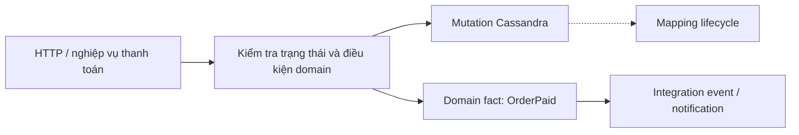
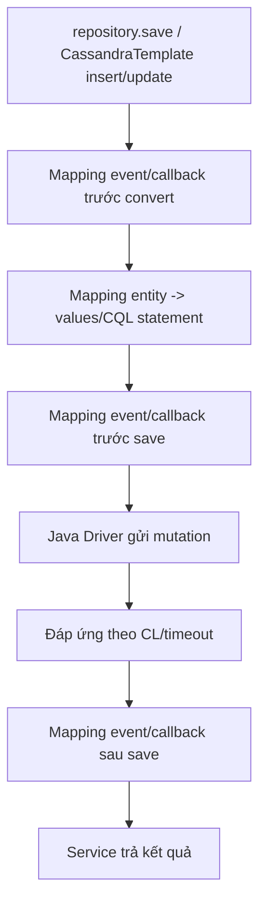
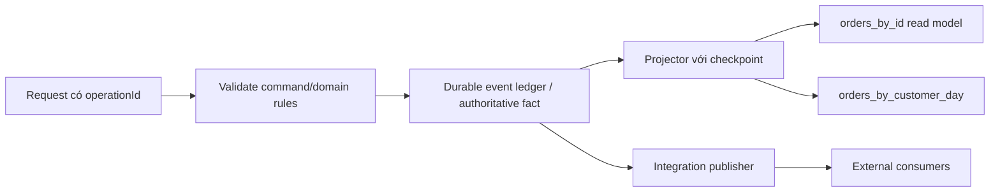

# Tách sự kiện nghiệp vụ khỏi sự kiện ánh xạ dữ liệu

Trong ứng dụng **Spring Data Cassandra**, hai thao tác sau có thể xảy ra rất gần nhau nhưng mang ý nghĩa khác hẳn:

- **Sự kiện ánh xạ dữ liệu (*mapping/persistence lifecycle event*):** Framework chuẩn bị một entity để chuyển thành CQL, lưu entity, hoặc chuyển một hàng Cassandra thành object Java.
- **Sự kiện nghiệp vụ (*domain/business event*):** Một sự kiện có ý nghĩa với hệ thống như “Đơn hàng đã thanh toán”, “Đăng ký đã được phê duyệt”, “Số dư đã được đối soát”.

Ví dụ, `AfterSave` chỉ nói rằng một thao tác lưu entity đã đi qua một mốc nhất định của **persistence lifecycle**. Nó **không** có nghĩa “đơn hàng vừa được thanh toán”, cũng không đồng nghĩa một event đã được ghi bền vững để Kafka, email service hoặc hệ thống kế toán xử lý.

Lẫn hai loại sự kiện là nguồn gốc của nhiều lỗi khó tái hiện: email gửi trùng khi retry, phát `OrderPaid` khi chỉ sửa một trường mô tả, callback chạy trên luồng truy cập dữ liệu nhưng lại gọi HTTP chậm, hoặc hệ thống trả lỗi cho người dùng dù bản ghi Cassandra thực ra đã được lưu.

Bài thuộc chương **Vòng đời và auditing** của module **SPRING_DATA_CASSANDRA**. Chúng ta sẽ kết nối entity mapping, repository, `CassandraTemplate`, CQL, auditing và mô hình dữ liệu phân tán để thiết kế ranh giới rõ ràng giữa **việc lưu dữ liệu** và **điều gì thật sự đã xảy ra trong nghiệp vụ**.

> **Thông điệp trung tâm:** **Mapping event là tín hiệu kỹ thuật của framework; domain event là sự thật nghiệp vụ do ứng dụng xác định.** Không nên lấy một callback như `AfterSave` làm nơi mặc định phát integration event, ghi sổ tài chính hoặc gọi dịch vụ bên ngoài.

## 1. Tình huống mở đầu: gửi email hai lần vì AfterSave

Giả sử bảng `orders_by_id` lưu trạng thái đơn hàng. Một developer nghĩ rằng mọi lần entity được lưu xong thì gửi email:

```java
// Giả mã minh họa cách thiết kế cần tránh:
onAfterSave(OrderEntity order) {
    if ("PAID".equals(order.getStatus())) {
        emailClient.sendPaymentReceipt(order.getId());
    }
}
```

Vấn đề là `AfterSave` có thể xảy ra trong nhiều tình huống:

1. Đơn được cập nhật từ `PENDING` sang `PAID`.
2. Đơn đã `PAID` nhưng được sửa `delivery_note`.
3. Một job backfill đọc rồi lưu lại entity.
4. Retry sau khi request ghi đã thực sự áp dụng nhưng phản hồi bị mất.
5. Một read model được ghi lại từ sự kiện cũ.
6. Test hoặc maintenance job gọi cùng repository.

Cả sáu trường hợp đều có thể kích hoạt thao tác lưu, nhưng chỉ trường hợp **thực sự chuyển trạng thái sang PAID theo quy tắc nghiệp vụ** mới có thể dẫn tới event “đơn vừa thanh toán”.

Ngay cả khi callback kiểm tra `status == "PAID"`, nó không biết **trạng thái trước đó**, không có bằng chứng rằng payment gateway đã xác nhận, và không có cơ chế chống gửi mail trùng.

### Nhìn đúng chuỗi hành động



Sơ đồ **khái niệm**, không ấn định callback nào chạy trước/sau mọi bước. Sự kiện domain phải dựa vào **quyết định nghiệp vụ đáng tin cậy**; mapping callback chỉ biết quá trình ánh xạ/lưu diễn ra.

## 2. Hai nhóm sự kiện có hợp đồng khác nhau

| Tiêu chí | Mapping/lifecycle event | Domain/business event |
| --- | --- | --- |
| Nguồn gốc | Spring Data persistence infrastructure | Domain model / application service / nghiệp vụ |
| Ví dụ | Before convert, before save, after save, after convert | OrderPaid, SubscriptionCancelled, InventoryReserved |
| Ý nghĩa | Entity sắp được hoặc vừa được xử lý trong vòng đời mapping | Một sự kiện nghiệp vụ có điều kiện rõ ràng đã xảy ra |
| Thời điểm | Phụ thuộc API và phase của persistence operation | Khi trạng thái/domain transition được xác lập |
| Có thể lặp? | Có, theo mỗi lần lưu/đọc/retry | Một business occurrence cần identity/idempotency rõ |
| Độ bền | Không mặc định là event log bền vững | Tùy cách ứng dụng ghi nhận; có thể cần durable journal/outbox |
| Phát sang hệ ngoài? | Không phải mục đích mặc định | Có thể cần integration event sau khi có nguồn tin cậy |
| Tính nhất quán | Theo request Cassandra và framework mapping | Theo business invariant, operation ID, reconciliation |
| Hỗ trợ đọc lại lịch sử | Không; callback không phải audit trail tự động | Có thể, nếu được persist trong event log |
| Tương quan với tenant/user | Thường lấy context của operation | Phải là dữ liệu domain có nguồn tin cậy và phân quyền |

**Không phải cứ đặt tên class `SomethingEvent` là nó trở thành domain event.** Tên, payload, điều kiện phát và nguồn dữ liệu có thẩm quyền mới xác định ý nghĩa.

## 3. Một entity có thể được lưu nhiều lần nhưng nghiệp vụ chỉ xảy ra một lần

Hãy thiết kế bảng tra đơn theo khóa:

```sql
CREATE TABLE IF NOT EXISTS commerce_ks.orders_by_id (
    tenant_id uuid,
    order_id uuid,
    customer_id uuid,
    status text,
    total_amount decimal,
    created_at timestamp,
    updated_at timestamp,
    last_operation_id uuid,
    PRIMARY KEY ((tenant_id, order_id))
);
```

Ở bảng này:

- `(tenant_id, order_id)` là **composite partition key**.
- `status` là regular column chứa một trạng thái hiện tại.
- `created_at` và `updated_at` là metadata ứng dụng/auditing, không phải khóa.
- `last_operation_id` có thể giúp tương quan với nghiệp vụ, nhưng **không tự tạo uniqueness cho operation ID toàn hệ thống**.
- Cassandra sao chép partition theo RF; không tự biến mỗi lần `UPDATE` thành một domain event.

Ví dụ cùng một đơn:

```text
T1: status = PENDING
T2: payment gateway xác nhận, transition thành PAID
T3: service lưu PAID
T4: support sửa địa chỉ giao hàng
T5: job backfill ghi lại metadata
```

Một event `OrderPaid` có thể hợp lệ tại T2/T3 tùy hợp đồng và cách bảo đảm durable, **không hợp lệ ở T4/T5** chỉ vì `AfterSave` vẫn thấy `PAID`.

### State khác event

| State | Event |
| --- | --- |
| “Đơn đang PAID” | “Đơn chuyển từ PENDING sang PAID do operation X” |
| Giá trị hiện tại | Sự kiện đã xảy ra |
| Có thể được ghi lại/overwrite | Cần identity, thời điểm, nguyên nhân và quy tắc trùng lặp |
| Thường đọc bằng khóa | Có thể cần journal, ordering hoặc subscription |
| Phù hợp projection/read model | Phù hợp workflow, audit nghiệp vụ, integration |

**Cassandra entity là biểu diễn lưu trữ**, không mặc định là toàn bộ domain aggregate hay event history.

## 4. Vòng đời mapping của Spring Data Cassandra

Spring Data Cassandra có cơ chế **mapping events** và **entity callbacks**, tùy phiên bản và cách truy cập dữ liệu. Các pha thường gặp:

1. **BeforeConvert:** Trước khi chuyển entity Java thành biểu diễn dùng để ghi CQL.
2. **BeforeSave:** Trước khi phát/lưu mutation vào Cassandra, tại giai đoạn persistence phù hợp.
3. **AfterSave:** Sau khi thao tác lưu qua tầng Spring Data hoàn tất theo đường gọi tương ứng.
4. **AfterLoad / AfterConvert:** Các pha liên quan đọc hàng dữ liệu và chuyển sang entity Java.

Các tên class, method signature, việc hỗ trợ imperative/reactive và thứ tự tương đối giữa listener, callback, auditing component có thể khác theo release. Vì vậy cần kiểm tra **Spring Data Cassandra version** trước khi áp dụng trực tiếp code callback.



Sơ đồ này minh họa *đường ghi đồng bộ điển hình*, không phải specification bất biến cho mọi API, Spring Data release hoặc đường raw CQL. **Mapping callback không nhất thiết chạy nếu service gọi trực tiếp `CqlSession.execute(...)`** thay vì đi qua mapping infrastructure.

### Sự kiện Before/After không có ý nghĩa business commit

- `BeforeSave` có thể chạy dù mutation sau đó bị từ chối do timeout/schema/replica unavailable.
- `AfterSave` chỉ nói thao tác persistence mà Spring Data quản lý đã hoàn tất ở mốc tương ứng.
- Một ghi thành công ở `LOCAL_ONE` không có nghĩa mọi replica tại mọi datacenter đã hội tụ.
- Một write thành công lên bảng `orders_by_id` không đồng nghĩa bảng `orders_by_customer_day` cũng đã cập nhật.
- Một lần callback không khẳng định event đã được consumer ngoài hệ thống nhận.

## 5. Mapping event và EntityCallback cũng không hoàn toàn đồng nhất

Trong hệ Spring Data, cần phân biệt thêm:

**Mapping ApplicationEvents:** Các sự kiện được phát qua cơ chế Spring application event để listener quan sát vòng đời persistence. Tùy phiên bản, chúng có thể đi qua `ApplicationEventPublisher` và các listener dạng `AbstractCassandraEventListener`.

**EntityCallbacks:** Các interface chuyên biệt cho phép thực hiện logic ở một phase của entity lifecycle và, với những callback có hỗ trợ trả entity, có thể trả entity đã điều chỉnh cho việc mapping tiếp theo. Đây là một cơ chế có hợp đồng mạnh hơn cho một số trường hợp biến đổi dữ liệu.

| Câu hỏi | Mapping event listener | EntityCallback |
| --- | --- | --- |
| Chủ yếu dùng để | Quan sát/ phản ứng với lifecycle | Can thiệp có kiểm soát vào lifecycle entity |
| Biến đổi entity trước ghi | Không nên giả định mutation listener luôn được dùng như kết quả mapping | Một số before callbacks có hợp đồng trả entity đã biến đổi |
| Thứ tự chạy | Phụ thuộc event multicaster/ordering | Có cơ chế ordering theo callback infrastructure |
| Async execution | Spring event publisher có thể cấu hình async | Phải theo hợp đồng callback imperative/reactive cụ thể |
| Side effects ngoài DB | Rủi ro vì không durable | Vẫn rủi ro; callback không thay business workflow |

**Hãy dùng callback cho việc thuộc về biểu diễn dữ liệu**, như chuẩn hóa giá trị trước lưu hoặc auditing metadata theo cách framework hỗ trợ. **Đừng đặt business transition và phát event tích hợp ở listener chỉ vì nó tên `AfterSave`.**

### Ví dụ hợp lý cho callback

Một hệ thống yêu cầu mã kho lưu dạng uppercase. Phần chuẩn hóa có thể đặt tại:

- Domain constructor/value object nếu quy tắc là **business invariant**.
- Callback before-convert nếu chỉ là quy ước **persistence representation**.
- Converter chuyên biệt nếu cần chuyển kiểu Java ↔ CQL.

Lựa chọn tùy việc “uppercase” là luật nghiệp vụ hay chỉ là biểu diễn. Trong mọi trường hợp, callback cần **deterministic, không gọi network và không sinh side effect lặp khó phục hồi**.

## 6. Auditing: metadata kỹ thuật, không phải event nghiệp vụ

Spring Data Cassandra có khả năng hỗ trợ auditing bằng các annotation Spring Data như:

- `@CreatedDate`: ghi nhận thời điểm tạo theo auditing infrastructure.
- `@LastModifiedDate`: ghi nhận thời điểm sửa qua đường mapping/auditing.
- `@CreatedBy`: ghi nhận actor tạo, nếu có nguồn auditor phù hợp.
- `@LastModifiedBy`: ghi nhận actor sửa, nếu cấu hình auditor.

Ví dụ:

```java
import java.time.Instant;
import java.util.UUID;

import org.springframework.data.annotation.CreatedBy;
import org.springframework.data.annotation.CreatedDate;
import org.springframework.data.annotation.LastModifiedBy;
import org.springframework.data.annotation.LastModifiedDate;
import org.springframework.data.cassandra.core.mapping.Column;
import org.springframework.data.cassandra.core.mapping.PrimaryKey;
import org.springframework.data.cassandra.core.mapping.Table;

@Table("orders_by_id")
public class OrderEntity {

    @PrimaryKey
    private OrderKey key;

    @Column("customer_id")
    private UUID customerId;

    private String status;

    @CreatedDate
    @Column("created_at")
    private Instant createdAt;

    @LastModifiedDate
    @Column("updated_at")
    private Instant updatedAt;

    @CreatedBy
    @Column("created_by")
    private String createdBy;

    @LastModifiedBy
    @Column("updated_by")
    private String updatedBy;

    // Constructors/getters/setters và những trường còn lại.
}
```

**Lưu ý schema:** Ví dụ mapping dùng `created_by`/`updated_by`; nếu sử dụng entity này, bảng Cassandra phải có các cột tương ứng. Schema ở mục 3 chưa khai báo hai cột đó; cần migration bổ sung khi thực hành hoặc dùng một entity rút gọn không có audit-by.

### Bật auditing theo phiên bản Spring Data Cassandra

Một cấu hình thường được dùng trong ứng dụng hỗ trợ Cassandra auditing:

```java
import org.springframework.context.annotation.Configuration;
import org.springframework.data.cassandra.config.EnableCassandraAuditing;

@Configuration
@EnableCassandraAuditing
public class CassandraAuditingConfig {
}
```

Với actor metadata, cần cung cấp `AuditorAware<T>` hoặc cơ chế auditor tương ứng để framework tìm được actor. Đối chiếu tên annotation/configuration property với release cụ thể; ví dụ này không thay thế dependency và keyspace configuration.

### Những gì auditing không làm

- Không tự ghi **mọi phiên bản lịch sử** của entity.
- Không tạo một domain event `OrderUpdated` mỗi khi field thay đổi.
- Không cung cấp chữ ký chống giả mạo hay audit trail tuân thủ pháp lý.
- Không bảo đảm dữ liệu metadata được cập nhật qua raw `CqlSession` hoặc mọi integration path không đi qua mapping.
- Không tự ghi nhận caller thật nếu request không có security context/auditor.
- Không tạo một đồng hồ toàn cluster; timestamp từ nhiều client vẫn cần được diễn giải cẩn thận.

**`updated_at` là metadata thời gian**, còn `OrderPaid` là sự kiện có business identity và nguyên nhân. Hai khái niệm không thay thế nhau.

## 7. Auditing CreatedBy / LastModifiedBy và ngữ cảnh bất đồng bộ

Giả sử actor là người dùng đã xác thực. Một `AuditorAware<String>` có thể đọc context được ứng dụng cung cấp:

```java
import java.util.Optional;

import org.springframework.data.domain.AuditorAware;

public final class RequestAuditorAware
        implements AuditorAware<String> {

    @Override
    public Optional<String> getCurrentAuditor() {
        // Ví dụ định hướng: lấy actor từ security context
        // được xác thực và truyền qua application boundary.
        return Optional.empty();
    }
}
```

Đoạn code trả empty để tránh giả định về framework security và cách thread/context được truyền. Trong ứng dụng thật, implement với ngữ cảnh **đã xác thực**, có policy cho batch job/system actor và cách truyền context phù hợp.

### Lưu ý thread và reactive context

- `ThreadLocal` không tự truyền an toàn qua mọi thread của `CompletableFuture` hoặc callback driver.
- Trong reactive pipeline, Reactor Context và security context cần được truy cập theo cơ chế tương thích, không suy từ `SecurityContextHolder` thread-local truyền thống.
- Không lấy user ID từ untrusted request body khi auditing quyền/actor.
- Job backfill có thể dùng một system auditor định danh cụ thể, không ngụy tạo người dùng thật.
- Khi auditor không có, cần xác định có cho phép metadata null hay từ chối operation.

Auditing cần độ tin cậy của identity source, không chỉ một annotation.

## 8. CreatedDate, LastModifiedDate và CQL WRITETIME không giống nhau

Một số hệ dùng ba khái niệm thời gian:

| Thời gian | Nguồn | Ý nghĩa |
| --- | --- | --- |
| `created_at` | Ứng dụng/auditing | Ngày tạo entity theo hợp đồng application |
| `updated_at` | Ứng dụng/auditing | Lần cập nhật được tracking qua mapping path |
| `WRITETIME(column)` | Metadata write của Cassandra cell | CQL write timestamp được lưu cho cell, không tự là thời gian business transition |

Ví dụ CQL:

```sql
SELECT status, updated_at,
       WRITETIME(status) AS status_write_time
FROM commerce_ks.orders_by_id
WHERE tenant_id = 11111111-1111-1111-1111-111111111111
  AND order_id = 22222222-2222-2222-2222-222222222222;
```

Một `WRITETIME` không chứng minh payment gateway đã chuyển tiền, hay actor nào đã ra lệnh. CQL timestamp có thể chịu ảnh hưởng client-supplied timestamps và clock skew; write có timestamp lớn hơn không nhất thiết là HTTP request hoàn tất sau cùng.

### Auditing không thay lịch sử nghiệp vụ

Nếu cần chứng minh ai duyệt hoàn tiền, lúc nào, dựa trên điều kiện nào và operation ID gì, **một cột `last_modified_by` không đủ**. Hệ thống cần một **business audit event** có đủ identity, loại hành động, reference, version, actor, timestamp, reason và integrity/retention policy phù hợp.

## 9. Repository.save và CassandraTemplate.save không đồng nghĩa domain transition

Một repository:

```java
import org.springframework.data.cassandra.repository.CassandraRepository;

public interface OrderRepository
        extends CassandraRepository<OrderEntity, OrderKey> {
}
```

Service có thể gọi:

```java
OrderEntity order = repository.findById(key).orElseThrow();
order.setStatus("PAID");
repository.save(order);
```

Nhưng hai bước đọc rồi ghi này không có atomic compare-and-set. Writer khác có thể thay status sau khi chúng ta đọc. **`AfterSave` không biết nghiệp vụ “chuyển từ PENDING sang PAID” có thật sự được áp dụng theo luật domain hay không.**

Tương tự, `CassandraTemplate.insert(...)`, `update(...)` và `select(...)` kích hoạt những phần lifecycle mapping tương ứng theo API/version. Nhưng **raw CQL qua `CqlSession` thường bỏ qua framework callbacks/auditing** vì nó không chạy qua entity conversion.

### Điều kiện mới là cơ sở phát domain event

Nếu nghiệp vụ yêu cầu `PENDING → PAID` chỉ một lần:

1. Tìm operation/payment reference đáng tin.
2. Xác thực tenant/order và trạng thái hợp lệ.
3. Dùng mutation có điều kiện phù hợp nếu cần tránh race.
4. Đọc kết quả condition thực sự applied hay không.
5. Ghi nhận sự kiện nghiệp vụ bằng cơ chế bền vững theo yêu cầu.
6. Xử lý retry/outcome unknown và phát integration event qua pipeline có kiểm soát.

Một callback hậu ghi không thay bước 1–4.

## 10. Chuyển trạng thái có điều kiện bằng LWT

Cassandra cung cấp **lightweight transaction (LWT)** cho những câu lệnh `IF` được hỗ trợ.

```sql
UPDATE commerce_ks.orders_by_id
SET status = 'PAID',
    last_operation_id = 99999999-9999-9999-9999-999999999999
WHERE tenant_id = 11111111-1111-1111-1111-111111111111
  AND order_id = 22222222-2222-2222-2222-222222222222
IF status = 'PENDING';
```

LWT trả thông tin `[applied]`. Nếu điều kiện không còn đúng, không nên phát `OrderPaid` cho request hiện tại chỉ vì đã cố gửi update.

Ví dụ với Java Driver 4:

```java
import java.util.UUID;

import com.datastax.oss.driver.api.core.CqlSession;
import com.datastax.oss.driver.api.core.DefaultConsistencyLevel;
import com.datastax.oss.driver.api.core.cql.BoundStatement;
import com.datastax.oss.driver.api.core.cql.PreparedStatement;
import com.datastax.oss.driver.api.core.cql.Row;

public final class OrderStateWriter {
    private final CqlSession session;
    private final PreparedStatement markPaid;

    public OrderStateWriter(CqlSession session) {
        this.session = session;
        this.markPaid = session.prepare("""
            UPDATE commerce_ks.orders_by_id
            SET status = 'PAID',
                last_operation_id = ?
            WHERE tenant_id = ? AND order_id = ?
            IF status = 'PENDING'
            """);
    }

    public boolean markPaid(
            UUID tenantId, UUID orderId, UUID operationId) {

        BoundStatement statement = markPaid
            .bind(operationId, tenantId, orderId)
            .setConsistencyLevel(
                DefaultConsistencyLevel.LOCAL_QUORUM
            )
            .setSerialConsistencyLevel(
                DefaultConsistencyLevel.LOCAL_SERIAL
            );

        Row row = session.execute(statement).one();
        return row != null && row.getBoolean("[applied]");
    }
}
```

**Quan trọng:** `LOCAL_SERIAL` trong ví dụ chỉ minh họa cách đặt serial CL. Kiến trúc có concurrent writers nhiều datacenter phải chọn và kiểm tra serial-consistency policy nhất quán với topology. Schema cần đúng, RF phù hợp và operation ID phải do tầng nghiệp vụ sinh/kiểm soát.

### LWT không tự phát event bền vững

Dù `[applied] = true`, nếu service ngay sau đó publish một Spring application event rồi process chết trước khi gửi sang broker, **event có thể mất**. Nếu thêm một insert vào bảng event khác, vẫn có **hai thao tác** với khoảng lỗi cần xử lý. Giải pháp bền vững phải giải quyết ranh giới này; không chỉ chuyển chỗ gọi publisher từ callback sang service.

## 11. Định nghĩa domain event có ý nghĩa

Một event nên là **sự thật đã xảy ra**, diễn đạt ở thì quá khứ và đủ identity để xử lý lại.

```java
import java.math.BigDecimal;
import java.time.Instant;
import java.util.UUID;

public record OrderPaid(
    UUID eventId,
    UUID operationId,
    UUID tenantId,
    UUID orderId,
    BigDecimal paidAmount,
    Instant occurredAt,
    String paymentReference
) {
}
```

Các field có vai trò:

- `eventId`: danh tính event, phục vụ dedup và truy vết.
- `operationId`: danh tính thao tác nghiệp vụ/HTTP request hoặc payment operation ổn định.
- `tenantId` và `orderId`: scope của aggregate/tenant.
- `paidAmount`: số tiền đã được xác nhận theo nguồn đáng tin.
- `occurredAt`: mốc nghiệp vụ với ý nghĩa và clock policy rõ ràng.
- `paymentReference`: liên kết payment gateway, phải bảo vệ dữ liệu nhạy cảm.

**Đừng cho callback mapping tự sinh `eventId` mới ở mỗi lần save.** Một lần retry sẽ có event ID khác và downstream không thể dedup theo cùng sự kiện.

### Event không nên mang nguyên entity object

Không nên publish toàn bộ `OrderEntity` làm integration event mặc định:

- Entity có thể chứa thông tin nội bộ không được phép ra ngoài.
- Schema Java/Cassandra thay đổi kéo theo hợp đồng event bất ngờ.
- Entity mutable có thể bị sửa sau khi publish.
- Consumer không biết event phản ánh transition nào.
- Không có event ID/version và semantics rõ.

Tạo payload domain riêng, có version nếu cần backward compatibility. Mapping entity và event schema là hai mô hình cần tiến hóa độc lập.

## 12. Domain event khác integration event

**Domain event** diễn tả điều đã xảy ra trong mô hình nghiệp vụ của một service. **Integration event** là thông điệp gửi cho hệ thống khác, cần hợp đồng dữ liệu và độ tin cậy phát/nhận.

Ví dụ:

```text
Domain:
  OrderPaid(orderId, operationId, paidAmount, ...)

Integration:
  commerce.order.paid.v1
  {
    "event_id": "...",
    "tenant_id": "...",
    "order_id": "...",
    "payment_reference": "...",
    "schema_version": 1,
    "occurred_at": "..."
  }
```

Payload minh họa, không phải một JSON artifact cần copy nguyên vào code. Nên áp dụng quy tắc versioning, masking, authorization, tracing và retention theo môi trường.

### Vì sao không gửi trực tiếp từ AfterSave?

Nếu mapping callback gọi broker:

```text
Cassandra mutation -> AfterSave -> broker.publish(...)
```

có ít nhất hai khoảng lỗi:

1. Cassandra đã ghi nhưng app process chết trước khi broker nhận message → **mất event**.
2. Broker đã nhận message nhưng app mất response rồi retry → **có thể phát trùng**.

`AfterSave` không phải distributed transaction giữa Cassandra và broker. Tách domain event khỏi mapping event là bước đầu; **durable delivery, dedup và reconciliation** là bước tiếp theo.

## 13. Spring ApplicationEventPublisher không phải message broker bền vững

Spring Framework có `ApplicationEventPublisher` và `@EventListener`:

```java
import org.springframework.context.ApplicationEventPublisher;

public final class DomainEventDispatcher {
    private final ApplicationEventPublisher publisher;

    public DomainEventDispatcher(ApplicationEventPublisher publisher) {
        this.publisher = publisher;
    }

    public void publish(OrderPaid event) {
        publisher.publishEvent(event);
    }
}
```

Đây là cơ chế **in-process application events**. Nó hữu ích để tách module trong một process, viết listener cho chức năng phụ, hoặc tổ chức code. Nhưng:

- Event có thể không được giữ nếu process crash.
- Không có consumer offset/ack/replay bền vững mặc định.
- Việc dispatch có thể đồng bộ hoặc bất đồng bộ tùy event multicaster/config.
- Exception từ listener đồng bộ có thể ảnh hưởng caller dù mutation Cassandra đã áp dụng.
- Một listener bất đồng bộ có thể chạy sau khi HTTP request kết thúc hoặc bị mất khi process dừng.
- `publishEvent(...)` không tự cung cấp exactly-once hoặc transaction với Cassandra.

### @TransactionalEventListener có thay được outbox?

Không nên mặc định. `@TransactionalEventListener(phase = AFTER_COMMIT)` chỉ có ý nghĩa gắn với **transaction synchronization** thực sự đang được quản lý cho một loại transaction. Cassandra **không cung cấp transaction SQL nhiều partition thông qua repository CRUD** như RDBMS. Không thể giả định annotation này cho ra “after Cassandra commit” đáng tin cho mọi lời gọi.

Cần kiểm tra transaction manager, API và semantics thật; với integration event cần phát bền vững, hãy dùng thiết kế phù hợp thay vì tự suy một callback là commit hook.

## 14. CQL BATCH không làm domain event tự trở thành atomic

Một team có thể muốn lưu status và event:

```sql
CREATE TABLE IF NOT EXISTS commerce_ks.order_events_by_operation (
    tenant_id uuid,
    operation_id uuid,
    order_id uuid,
    event_type text,
    occurred_at timestamp,
    payload text,
    PRIMARY KEY ((tenant_id, operation_id))
);
```

Và cân nhắc logged batch:

```sql
BEGIN LOGGED BATCH
    UPDATE commerce_ks.orders_by_id
    SET status = 'PAID'
    WHERE tenant_id = 11111111-1111-1111-1111-111111111111
      AND order_id = 22222222-2222-2222-2222-222222222222;

    INSERT INTO commerce_ks.order_events_by_operation (
        tenant_id, operation_id, order_id,
        event_type, occurred_at, payload
    ) VALUES (
        11111111-1111-1111-1111-111111111111,
        99999999-9999-9999-9999-999999999999,
        22222222-2222-2222-2222-222222222222,
        'OrderPaid',
        '2026-11-25T03:00:00Z',
        '{"schema_version":1}'
    );
APPLY BATCH;
```

**Cảnh báo:** Đây là **ví dụ để phân tích ranh giới**, không phải workflow thanh toán production an toàn sẵn có. Hai bảng/partition khác nhau, logged batch có batchlog hỗ trợ eventual application nhưng **không có isolation xuyên partition**, không thay compare-and-set `IF status = 'PENDING'`, và không cung cấp transaction với payment gateway/Kafka.

Không thể đơn giản kết hợp một conditional update ở partition A với insert event có conditional uniqueness ở partition B rồi giả định có Paxos transaction toàn hệ thống.

### Ba nguy cơ còn nguyên

- **Race:** Hai payment operations có thể cố chuyển trạng thái.
- **Observation gap:** Reader có thể thấy status mới và event cũ, hoặc ngược lại trong một khoảng thời gian.
- **Unknown outcome:** Batch timeout không khẳng định mọi mutation đều đã rollback.

Nếu nghiệp vụ muốn một **durable event source of truth**, phải thiết kế dữ liệu/event ledger sao cho một đơn vị commit có thể được xác định và replay an toàn, đồng thời hiểu giới hạn Cassandra.

## 15. Kiến trúc nên chọn: authoritative fact và projector

Một cách tiếp cận là **event-first với một event ledger bền vững làm nguồn sự thật**, sau đó tạo các read models bất đồng bộ:



Điều kiện để mô hình này đúng:

1. **Ledger là nguồn sự thật thực sự**, không chỉ bảng phụ ghi sau một state update không có transaction với nó.
2. Mỗi operation có **ID ổn định** qua mọi retry.
3. Có cơ chế chống trùng/claim ID theo Cassandra, ví dụ conditional insert trên **một key**.
4. Event order và business invariants được bảo đảm theo thiết kế aggregate; uniqueness của event ID **không tự serial hóa tất cả commands trên một đơn hàng**.
5. Projector xử lý **at-least-once delivery**, checkpoint và retry an toàn.
6. Read model có SLA về **độ trễ hội tụ** và khả năng rebuild.
7. Phát integration event cũng cần **durable progress/ack/dedup**, không chỉ callback in-memory.

### Ví dụ claim event ID trên Cassandra

```sql
INSERT INTO commerce_ks.order_events_by_operation (
    tenant_id, operation_id, order_id,
    event_type, occurred_at, payload
) VALUES (
    11111111-1111-1111-1111-111111111111,
    99999999-9999-9999-9999-999999999999,
    22222222-2222-2222-2222-222222222222,
    'OrderPaid',
    '2026-11-25T03:00:00Z',
    '{"schema_version":1}'
)
IF NOT EXISTS;
```

`IF NOT EXISTS` là conditional insert/LWT trên khóa `(tenant_id, operation_id)`. Caller phải kiểm tra `[applied]`; khi false, tìm lại event đã có và đối chiếu payload, không coi mọi duplicate ID đều hợp lệ.

**Quan trọng:** LWT này chống trùng theo **operation ID**, nhưng tự nó **không chứng minh** đơn hàng chuyển từ PENDING sang PAID đúng business invariant. Nếu nhiều operation IDs cạnh tranh trên cùng order, cần thêm cơ chế phiên bản/serialization/aggregate-state phù hợp. Event-first là một kiến trúc, không phải phép màu exactly-once.

## 16. @DomainEvents trong Spring Data Commons: không đồng nghĩa mapping events

Một số module **Spring Data** cung cấp các annotation trong Spring Data Commons, chẳng hạn `@DomainEvents` và `@AfterDomainEventPublication`, để hỗ trợ tập hợp và phát domain events từ aggregate trong những repository operations được hỗ trợ.

**Nhưng không được giả định** chỉ cần thêm hai annotation này vào một entity Cassandra thì mọi thao tác `CassandraRepository.save(...)` ở mọi phiên bản sẽ tự lưu/phát event theo cùng cách, đặc biệt với batch, reactive, custom repository hoặc raw CQL. Cần kiểm chứng sự hỗ trợ **đúng Spring Data Cassandra release**, đường gọi repository cụ thể và hành vi trong integration test.

### Ba khái niệm vẫn cần tách

1. **Mapping event:** Infrastructure biết một entity sắp/vừa được ánh xạ/lưu.
2. **Domain event collection:** Aggregate nhận biết một transition và ghi nhận event có ý nghĩa.
3. **Durable event publishing:** Hệ thống bảo đảm event được ghi nhận bền vững, có khả năng gửi lại và tránh xử lý trùng.

`@DomainEvents` (nếu được hỗ trợ) liên quan mục 2 và việc dispatch trong process; nó **không tự cấp transaction với message broker hoặc outbox bền vững**.

### Ví dụ quy tắc sử dụng

Nếu aggregate ghi nhận `OrderPaid`, event nên được sinh bởi thao tác domain như `markPaid(...)` đã xác minh transition, **không** bởi một event callback thấy entity hiện có `status=PAID`.

Ngay cả khi domain event publisher chạy sau một repository operation thành công, service cần phân tích crash window và retry khi có hệ thống ngoài Cassandra.

## 17. Đặt business transition ở service/domain boundary

Một cách tách trách nhiệm rõ:

| Thành phần | Trách nhiệm |
| --- | --- |
| Controller | Nhận command, xác thực input và authentication |
| Application service | Điều phối một use case, giữ operation ID, gọi domain/store |
| Domain policy/aggregate | Kiểm tra business invariant, quyết định transition |
| Cassandra writer | Thực thi CQL với partition key và consistency policy |
| Entity callback / auditing | Chuẩn hóa, ghi metadata của persistence representation |
| Event ledger/producer | Ghi event có identity và trạng thái delivery |
| Projector | Chuyển event thành read model, retry và đối soát |
| Integration consumer | Xử lý event idempotently theo event ID |

Không biến repository thành nơi gửi email hay đọc payment gateway. Repository chỉ nên tập trung thao tác lưu/truy vấn dữ liệu theo hợp đồng persistence.

### Domain policy không cần biết Cassandra callback

Ví dụ các kiểu miền:

```java
import java.math.BigDecimal;
import java.time.Instant;
import java.util.UUID;

public enum OrderStatus {
    PENDING, PAID, CANCELLED
}

public record PaymentConfirmation(
    UUID operationId,
    UUID orderId,
    BigDecimal amount,
    String paymentReference
) {
}

public record OrderTransition(
    OrderStatus nextStatus,
    OrderPaid event
) {
}

public final class OrderPaymentPolicy {

    public OrderTransition decide(
            OrderStatus current,
            UUID tenantId,
            PaymentConfirmation confirmation,
            Instant occurredAt) {

        if (current != OrderStatus.PENDING) {
            throw new IllegalStateException(
                "Only a pending order can become paid"
            );
        }

        // Event identity phải ổn định qua retry.
        UUID eventId = confirmation.operationId();

        OrderPaid event = new OrderPaid(
            eventId,
            confirmation.operationId(),
            tenantId,
            confirmation.orderId(),
            confirmation.amount(),
            occurredAt,
            confirmation.paymentReference()
        );

        return new OrderTransition(OrderStatus.PAID, event);
    }
}
```

Đây là logic minh họa cho quyết định domain. Phải xác thực số tiền, đơn, payment reference và quy tắc chuyển trạng thái trong hệ thật; không tin mọi giá trị đến từ request.

**Giới hạn:** Logic thuần Java ở trên **không tự atomic** khi có hai request đồng thời. Storage writer cần CAS/LWT hoặc một cơ chế serialization khác, và service chỉ được khẳng định event hợp lệ khi kết quả đã được chấp nhận theo hợp đồng.

### Đừng dùng entity callback để so sánh old/new state

Một callback `BeforeSave` thường chỉ nhận entity hiện tại và context mapping, không có một snapshot bất biến của trạng thái cũ đã được khóa. Nó không thể an toàn thực hiện:

```text
if oldStatus == PENDING and newStatus == PAID:
    emit OrderPaid
```

trừ khi một cơ chế domain/storage bên ngoài callback đã bảo đảm việc so sánh/transition. Việc callback tự đọc lại Cassandra trước khi save còn tạo race và thêm round trip.

## 18. Từ domain decision đến durable event: ranh giới nguy hiểm

Một kiến trúc nhìn có vẻ hợp lý:

```java
boolean applied = orderStateWriter.markPaid(
    tenantId, orderId, operationId
);

if (applied) {
    applicationEventPublisher.publishEvent(orderPaid);
}
```

Code này có ưu điểm: không phát khi CAS không applied. Nhưng có khoảng lỗi:

```text
T0: Cassandra CAS status=PAID thành công
T1: Process crash trước khi publish OrderPaid
T2: Sau restart, retry CAS thấy status != PENDING
T3: Nếu code chỉ publish khi applied=true,
    OrderPaid có thể không bao giờ được phát.
```

Vì vậy tách sự kiện business khỏi mapping callback **chưa đủ**. Cần cơ chế bảo đảm event được ghi bền vững hoặc **reconstruction/reconciliation** từ nguồn có thẩm quyền.

### Những giải pháp thường được đánh giá

- **Event ledger làm nguồn sự thật:** Ghi domain fact trước, projector cập nhật read models sau.
- **Outbox có ranh giới commit thật sự:** Lưu state và event cùng một đơn vị atomic/transaction hợp lệ của storage, rồi worker phát event.
- **CDC (*change data capture*):** Đọc mutation stream/changes từ Cassandra trong điều kiện version/hạ tầng hỗ trợ; chuyển thành event đã được làm giàu và kiểm soát.
- **State + reconciliation:** Nếu không có atomic append, dùng operation ID, marker trạng thái và worker kiểm tra những transition chưa có event, với SLA và cách phát lại rõ.
- **Workflow orchestration/saga:** Dùng cho các side effects liên hệ nhiều hệ thống như payment gateway, inventory và email.

**Đừng gọi một bảng event thứ hai là “transactional outbox” nếu hai bảng được ghi không có ranh giới atomic như thiết kế đòi hỏi.** Tên outbox không tạo bảo đảm mới cho Cassandra.

## 19. Outbox trong Cassandra: phải xác định atomic unit

Trong RDBMS, transactional outbox thường dựa vào cùng một SQL transaction ghi **state** và **outbox row**. Nhưng **Cassandra không có transaction SQL tự do xuyên nhiều partition**.

Giả sử:

```text
orders_by_id(tenant_id, order_id)
outbox_by_event_id(tenant_id, event_id)
```

Hai bảng có hai partition keys khác nhau, không thể suy rằng hai lời gọi repository độc lập đều atomic hoặc có isolation chung.

### Logged batch có giúp được gì?

Logged batch đa partition dùng batchlog để hỗ trợ eventual application của một nhóm mutations trong điều kiện phù hợp. Nó **không** cho phép reader thấy state/outbox thay đổi đồng thời, không tạo CAS xuyên partition và không giải quyết side effects ngoài Cassandra.

Nếu workflow chịu được **eventual completion nhưng không yêu cầu isolation tuyệt đối** và đã có idempotency/reconciliation, logged batch có thể là một phương án đánh giá. Không thể mặc định nó thay thế transactional outbox RDBMS ở mọi ngữ cảnh.

### Một cách thiết kế dễ kiểm chứng hơn

Chọn một **durable authoritative fact** làm điểm quyết định duy nhất của workflow; chẳng hạn event ledger có `operation_id` ổn định và conditional insert. Sau đó:

1. Một event được chấp nhận → trở thành input hợp lệ cho projector.
2. Projector ghi `orders_by_id` và các view khác có thể lặp lại.
3. Event delivery worker lấy những event chưa gửi theo checkpoint.
4. Consumer deduplicate bằng `event_id`.
5. Metrics đo tuổi event chưa project/chưa publish.
6. Có cơ chế rebuild read model từ nguồn authoritative.

Đánh đổi là UX có thể phải chờ/hiển thị trạng thái xử lý khi projection chưa theo kịp. Mô hình này chỉ đúng nếu **domain invariants** cũng được bảo đảm trên nguồn authoritative, không chỉ trên projection.

## 20. Projector phải idempotent, không chỉ event publisher

Giả sử worker đọc `OrderPaid(eventId = E)` và cập nhật hai read models:

```text
1. Update orders_by_id
2. Insert orders_by_customer_day
3. Mark event E processed
```

Nếu worker crash sau bước 1, khi phục hồi nó có thể xử lý event E lần nữa. Vì vậy những thao tác projection phải **lặp lại an toàn**, hoặc có checkpoint/version theo đúng key.

### Ví dụ trạng thái projection có version

Bảng:

```sql
CREATE TABLE IF NOT EXISTS commerce_ks.orders_projection_by_id (
    tenant_id uuid,
    order_id uuid,
    status text,
    last_event_version bigint,
    last_event_id uuid,
    PRIMARY KEY ((tenant_id, order_id))
);
```

Với một event stream có **version tăng tuần tự theo từng order** được nguồn authoritative cấp thật, projector có thể dùng conditional update:

```sql
UPDATE commerce_ks.orders_projection_by_id
SET status = 'PAID',
    last_event_version = 12,
    last_event_id = 99999999-9999-9999-9999-999999999999
WHERE tenant_id = 11111111-1111-1111-1111-111111111111
  AND order_id = 22222222-2222-2222-2222-222222222222
IF last_event_version = 11;
```

Đây là **mẫu minh họa điều kiện version**. Nó đòi hỏi row khởi tạo phù hợp, source tạo version có tính tuần tự thật, concurrency policy rõ và xử lý khi `[applied] = false`. **Không tự lấy random UUID hoặc wall-clock time làm version tuyến tính hóa.**

### Với read model khác partition

Một projection event E sang bảng `orders_by_customer_day` không thể dùng cùng CAS transaction xuyên cả hai bảng. Cần thiết kế:

- Upsert deterministic theo key, hạn chế side effect do retry.
- Event ID/sequence làm watermark khi đọc/đối soát.
- Reconciliation jobs tìm event chưa có projection tương ứng.
- Consumer checkpoint chỉ được advance sau các bước phù hợp hoặc có cơ chế phát lại.
- Nếu out-of-order, buffer/reorder theo key hoặc dùng conditional version checks.
- Nếu cần strong business invariant, ra quyết định trên authoritative store, không trên projection có thể stale.

**Đừng lấy “AfterSave của projection” làm trigger domain event mới**, vì sẽ dễ tạo chuỗi xử lý vòng lặp hoặc event trùng.

## 21. CDC khác mapping event và khác domain event

**CDC — change data capture** của Cassandra (khi version/distribution và cấu hình hỗ trợ) phản ánh **thay đổi dữ liệu ở tầng storage** theo cơ chế vận hành riêng.

| Loại | Thông tin cốt lõi | Những gì không tự có |
| --- | --- | --- |
| Mapping event | Framework sắp/vừa map/lưu entity | Business intent, durability, CDC offset |
| CDC record | Thay đổi dữ liệu/mutation theo cơ chế CDC | Lý do nghiệp vụ, unique business event, full domain context |
| Domain event | Business fact có identity, invariants | Bảo đảm gửi bền vững nếu chỉ ở in-memory |
| Integration event | Hợp đồng thông điệp cho hệ bên ngoài | Exactly-once delivery/processing tự động |

Ví dụ CDC phát hiện `status` được ghi thành `PAID`. Nó không tự biết đây là payment mới được chấp nhận, backfill hay retry của operation cũ. Muốn chuyển CDC thành `OrderPaid` cần **business metadata và quy tắc suy diễn được kiểm chứng**, không chỉ so sánh giá trị cell mới.

### CDC trong Cassandra không đồng nghĩa CDC của mọi database

Khả năng CDC, retention, resource limits, cách xuất dữ liệu và thứ tự xử lý phụ thuộc Cassandra version/distro và pipeline. Khi dùng, cần:

1. Kiểm tra table/cluster CDC settings.
2. Xác định durable offset/checkpoint và retention khi consumer down.
3. Xem event ordering, duplicates và khả năng replay.
4. Giữ operation ID/actor/tenant trong state nếu cần dựng lại business fact.
5. Theo dõi lag, disk và backpressure.
6. Tránh lấy raw CDC làm API public chứa nhiều thông tin nhạy cảm.

## 22. Reactive và asynchronous access: callback phải đúng execution model

Spring Data Cassandra có các đường truy cập đồng bộ, bất đồng bộ và reactive tùy framework version. **Lifecycle semantics không được suy nguyên vẹn từ code synchronous sang reactive**.

### Điều cần tránh trong reactive pipeline

```java
// Giả mã anti-pattern:
reactiveRepository.save(entity)
    .doOnSuccess(saved -> {
        emailClient.sendReceiptBlocking(saved.getKey());
    });
```

Kể cả khi `doOnSuccess` chạy, không có bảo đảm email được gửi bền vững; gọi blocking network trong reactive callback còn có thể cản tài nguyên không-blocking và làm latency xấu.

- Một reactive publisher **không thực thi nếu không được subscribe** theo hợp đồng Reactor.
- Có thể có nhiều subscriptions/retries dẫn đến nhiều executions.
- Context auditing/security phải được truyền theo cơ chế reactive tương ứng.
- Không dùng `block()` trong đường xử lý non-blocking chỉ để gọi callback.
- Một Reactor `doOnNext` là side-effect observer, không phải transaction commit hook.
- Không dùng `subscribe()` thủ công “fire-and-forget” để phát integration event cần bền vững.

### Cách tổ chức phù hợp hơn

Dùng reactive service để gọi một component **durable event recorder** có hợp đồng rõ, rồi projector/dispatcher phát theo checkpoint. Cần phân tích rollback/unknown outcome như ở synchronous: **Reactor chỉ thay execution model, không bổ sung transaction Cassandra xuyên partition**.

### Imperative callbacks và reactive callbacks có thể khác nhau

Trong những version có các interface callback reactive chuyên biệt, method signature và việc hỗ trợ context/ordering có thể khác callback imperative. Kiểm tra tài liệu đúng version; không gọi synchronous callback và giả định nó tự chạy như `Mono<T>` hoặc luôn không-blocking.

## 23. Callback phải nhỏ, thuần và có thể chạy lặp

Một callback “tốt” thường tuân thủ các quy tắc:

- **Deterministic:** Input giống nhau cho kết quả mapping ổn định theo hợp đồng.
- **Không có remote I/O:** Không gọi HTTP/gateway/Kafka trong callback.
- **Không có side effect không idempotent:** Không trừ tiền, tăng counter, gửi email.
- **Không phụ thuộc thứ tự event listener không xác định.**
- **Có xử lý null/empty chính xác** khi converter/mapper đọc hoặc ghi.
- **Không tự lưu lại entity** bên trong callback gây đệ quy.
- **Không biến callback thành business authorization layer duy nhất.**
- **Không dựa vào BeforeSave để thay thế DB constraints/LWT.**

### Ví dụ về logic nên giữ ở mapping boundary

- Chuẩn hóa một identifier kỹ thuật trước khi map CQL.
- Ánh xạ enum/value object sang kiểu được Cassandra hỗ trợ.
- Bổ sung metadata về mapping được framework cho phép, theo policy rõ ràng.
- Đọc entity rồi tái dựng derived field chỉ dùng trong application, khi thích hợp.
- Kiểm tra một bất biến của **representation** để tránh serialize sai kiểu dữ liệu.

Ngay cả các việc ấy có thể đặt tốt hơn trong **converter/value object**. Chọn giải pháp ít phép màu nhất mà team có thể kiểm thử.

### Ví dụ về logic không nên giữ ở mapping boundary

- “Nếu status PAID thì phát OrderPaid”.
- “Sau save tăng counter tổng số đơn” — counter increment không idempotent.
- “Sau save gửi email xác nhận”.
- “Nếu entity có createdAt thì kết luận đây là update nghiệp vụ”.
- “Sau convert gọi Cassandra đọc bảng khác rồi cập nhật read model”.
- “Trong callback dùng security context thread-local để duyệt giao dịch”.
- “Sau save ghi Kafka rồi tin rằng Cassandra+Kafka có exactly-once”.

Đây là những quyết định domain/integration hoặc side effects có yêu cầu retry/consistency riêng.

## 24. Auditing và event identity không được ghép một cách tùy tiện

Một lỗi thiết kế khác: mỗi lần auditing đặt `updatedAt = Instant.now()` rồi lấy thời điểm ấy làm event ID.

Vấn đề:

- Retry thay đổi `updatedAt` → có thể tạo **event identity mới** cho cùng operation.
- Hai node có clock skew → thứ tự timestamp không phản ánh thứ tự thực của business transitions.
- Một mutation chỉ sửa metadata cũng làm `updatedAt` mới nhưng không có domain event tương ứng.
- Cassandra `WRITETIME` có semantics timestamp theo cell, không tự là unique operation ID.

### Mẫu metadata cần tách

| Thuộc tính | Vai trò |
| --- | --- |
| `created_at` / `updated_at` | Audit metadata của entity |
| `created_by` / `updated_by` | Actor của thao tác persistence |
| `operation_id` | Định danh một yêu cầu/command có thể retry |
| `event_id` | Định danh business fact được phát/ghi nhận |
| `aggregate_version` | Thứ tự transition do cơ chế authoritative cấp |
| `occurred_at` | Thời điểm nghiệp vụ có nghĩa theo contract |
| `published_at` | Thời điểm integration message được gửi/ack theo broker |
| `processed_at` | Thời điểm consumer/projector ghi nhận hoàn tất theo policy |

**Không dùng một field để thay tất cả**; nếu chỉ cần auditing đơn giản thì không nhất thiết tạo event ledger, nhưng nếu cần workflow đáng tin, audit timestamps một mình không đủ.

## 25. Một ví dụ đầy đủ hơn về primary key và auditing schema

Để ghép những ví dụ trong bài thành một ứng dụng Spring Data Cassandra, cần map **composite primary key** rõ ràng. `OrderKey` có thể viết như sau:

```java
import java.io.Serializable;
import java.util.Objects;
import java.util.UUID;

import org.springframework.data.cassandra.core.cql.PrimaryKeyType;
import org.springframework.data.cassandra.core.mapping.PrimaryKeyClass;
import org.springframework.data.cassandra.core.mapping.PrimaryKeyColumn;

@PrimaryKeyClass
public final class OrderKey implements Serializable {

    @PrimaryKeyColumn(
        name = "tenant_id",
        ordinal = 0,
        type = PrimaryKeyType.PARTITIONED
    )
    private UUID tenantId;

    @PrimaryKeyColumn(
        name = "order_id",
        ordinal = 1,
        type = PrimaryKeyType.PARTITIONED
    )
    private UUID orderId;

    public OrderKey() {
    }

    public OrderKey(UUID tenantId, UUID orderId) {
        this.tenantId = Objects.requireNonNull(tenantId);
        this.orderId = Objects.requireNonNull(orderId);
    }

    public UUID getTenantId() {
        return tenantId;
    }

    public UUID getOrderId() {
        return orderId;
    }

    @Override
    public boolean equals(Object value) {
        if (this == value) return true;
        if (!(value instanceof OrderKey other)) return false;
        return Objects.equals(tenantId, other.tenantId)
            && Objects.equals(orderId, other.orderId);
    }

    @Override
    public int hashCode() {
        return Objects.hash(tenantId, orderId);
    }
}
```

Ví dụ Java 17+ sử dụng pattern matching `instanceof`. Các constructors và khả năng đọc/ghi trường key phải được kiểm tra với converter/instantiation strategy của Spring Data Cassandra release đang dùng. Có thể dùng immutable key với `@PersistenceCreator` nếu dự án đã cấu hình constructor binding.

Để entity auditing ở mục 6 khớp schema, cần các cột:

```sql
ALTER TABLE commerce_ks.orders_by_id
ADD created_by text;

ALTER TABLE commerce_ks.orders_by_id
ADD updated_by text;
```

Đây là **ví dụ migration**, không nên chạy lặp trên production mà không biết trạng thái schema. Nếu bảng đã có cột, hãy dùng migration idempotent/controlled theo công cụ của dự án.

### Domain state mutation vẫn phải qua đường đúng

Một `@Table("orders_by_id")` entity và `CassandraRepository<OrderEntity,OrderKey>` có thể đọc/ghi theo khóa, nhưng:

- `save(entity)` **không tự thêm `IF status = 'PENDING'`**.
- Audit callback có thể cập nhật `updated_at` theo policy, nhưng không tự cung cấp optimistic lock.
- Việc sửa `status` bằng raw CQL không nhất thiết kích hoạt entity callbacks.
- Ghi `updated_by` bằng actor từ request chỉ có ích khi identity thực sự được xác thực.
- Một table audit field không phải một lịch sử thay đổi bất biến.

**Nếu cần lưu vết có thể replay**, dùng event ledger riêng theo kiến trúc authoritative đã chọn.

## 26. Ma trận lỗi: mapping callback, domain decision và event delivery

Phân tích một use case `ConfirmPayment` ở từng thời điểm:

| Điểm lỗi | Cassandra state | Domain event/integration event | Cách xử lý |
| --- | --- | --- | --- |
| Request chưa qua domain validation | Chưa đổi | Không nên có OrderPaid | Trả lỗi validation |
| Callback `BeforeSave` đã chạy, CQL chưa gửi | Chưa chắc đã ghi | Không được phát event bền vững từ callback | Giữ callback thuần, không side effect |
| CQL bị từ chối vì không đủ replica | Không đủ chứng cứ đã ghi | Không khẳng định event xảy ra | Xử lý loại lỗi/CL |
| CQL timeout, outcome UNKNOWN | Có thể đã ghi một phần/tới CL khác | Không quyết định bằng timeout đơn | Đối soát theo operation ID |
| CQL success, process crash trước publish | State có thể mới | Event in-memory có thể mất | Durable event source/recovery |
| Event publish tới broker, mất response | State có thể mới | Broker có thể đã nhận | Retry với event ID cố định và consumer dedup |
| Projector ghi view A, crash trước view B | Views lệch tạm thời | Fact vẫn được giữ trong ledger | Replay/idempotent projection |
| Reader DC khác thấy status cũ | Replica chưa hội tụ | Domain fact có thể đã được xác nhận | Routing/CL và freshness contract |
| Callback triggered bởi backfill | Entity được ghi lại | Không phải business transition mới | Không phát domain event từ lifecycle |
| Client retry với operation ID mới | Dễ tạo event trùng | Dedup không phát hiện cùng operation | Yêu cầu stable operation ID |

### Khi nào ApplicationEventPublisher vẫn hữu ích?

Có những side effects **không quan trọng hoặc chấp nhận mất**: refresh một cache nội bộ có TTL ngắn, thu thập telemetry bổ trợ, kích hoạt logic trong process không có tác dụng bên ngoài nghiêm trọng. Lúc đó event in-process có thể phù hợp nếu team có **hợp đồng rõ** về việc không bảo đảm durability và không nhầm với domain fact bền vững.

Nếu một listener phục vụ nghiệp vụ bắt buộc, cần xử lý cả **exception propagation**, **retry** và **delivery**. Không lờ những khoảng lỗi chỉ vì API publish không trả exception.

## 27. Kiểm thử: chứng minh callback không phải domain event

Unit test với mock repository chỉ xác minh logic Java; integration test trên Cassandra thật cần để kiểm chứng mapping, auditing và ranh giới CQL.

### Test A — callback chạy khi lưu nhưng không phát OrderPaid

1. Tạo một đơn `PENDING` qua repository.
2. Sửa một regular field không liên quan status và gọi `save(...)`.
3. Quan sát mapping listener/callback mà version hỗ trợ.
4. Assert **không có business event OrderPaid** được ghi/phát.
5. Thử lại với đơn `PAID` nhưng chỉ sửa ghi chú; vẫn không phát event mới.

**Mục tiêu:** Tách “entity vừa save” khỏi “transition nghiệp vụ xảy ra”.

### Test B — auditing metadata

1. Bật auditing trong Spring Data Cassandra.
2. Cung cấp một auditor hợp lệ và clock có thể kiểm soát nếu framework hỗ trợ.
3. Ghi entity mới, xác minh `created_at`/`updated_at` theo policy.
4. Cập nhật entity qua đường mapping, xác minh metadata cập nhật đúng.
5. Truy vấn `WRITETIME(status)` để hiểu khác biệt giữa Cassandra cell timestamp và application audit fields.
6. Tránh assert timestamp chính xác từng microsecond khi có nhiều clock/scheduler.

**Mục tiêu:** Audit metadata đúng, không suy event nghiệp vụ.

### Test C — raw CqlSession bypass mapping

1. Ghi entity qua `CassandraRepository`.
2. Ghi/update cùng bảng bằng `CqlSession.execute(...)` với CQL theo khóa.
3. So sánh số lần mapping callbacks được gọi.
4. Kiểm tra auditing fields có được Spring Data tự động cập nhật với raw CQL không.
5. Tài liệu hóa những đường ghi bắt buộc tự quản lý metadata.

**Mục tiêu:** Không phụ thuộc vào callback cho quy tắc bắt buộc của mọi storage mutation.

### Test D — hai writer cạnh tranh

1. Seed `status=PENDING`.
2. Hai request khác operation IDs cùng cố chuyển trạng thái.
3. Dùng LWT `IF status='PENDING'`.
4. Xác minh chỉ một request có `[applied]=true` trong tình huống ổn định.
5. Xác minh domain policy không sinh hai business facts cho cùng transition.
6. Xem lại policy nếu retry sau `WriteTimeout` tạo outcome chưa rõ.

**Mục tiêu:** Domain transition phải được bảo đảm bởi cơ chế concurrency, không phải callback `AfterSave`.

### Test E — crash sau database write, trước publish

1. Giả lập một process crash/exception sau khi Cassandra xác nhận mutation.
2. Không gọi Integration Publisher sau thời điểm đó.
3. Restart worker.
4. Xác minh có đường từ **durable source/ledger** để phát event thiếu.
5. Consumer dùng event ID cố định để xử lý lại an toàn.

**Mục tiêu:** Phát hiện lost-event window của mô hình “save xong thì gọi broker”.

### Test F — phát event trùng

1. Gửi cùng event ID tới consumer hai lần.
2. Giả lập mất broker ack hoặc retry.
3. Xác minh consumer ghi nhận một business effect theo dedup policy.
4. Không dựa vào `ApplicationEventPublisher` để cung cấp consumer offset/ack.
5. Test khi một event ID xuất hiện với payload khác nhau: phải cảnh báo hoặc từ chối.

**Mục tiêu:** Hợp đồng idempotency và integrity.

### Test G — projector crash giữa hai read models

1. Ledger có một `OrderPaid` đã được chấp nhận.
2. Projector cập nhật `orders_by_id`.
3. Giả lập crash trước khi cập nhật `orders_by_customer_day`.
4. Restart/replay event.
5. Xác minh cả hai views hội tụ mà không phát thêm một `OrderPaid` mới.
6. Giám sát lag/reconciliation.

**Mục tiêu:** Projection retries không phải business transitions.

### Test H — cross-datacenter consistency

1. Dùng keyspace test với hai DC đủ replica.
2. Ghi authoritative fact ở HCM với policy đã định.
3. Đọc projection ở DC khác trước khi replication hội tụ.
4. Xác minh API có policy khi đọc stale.
5. Kiểm tra `LOCAL_QUORUM` của hai DC khác nhau không tự có replica overlap.
6. Không kết luận failure từ một test laptop/cluster một node.

### Test I — reactive multiple subscriptions

1. Tạo reactive save pipeline nhưng chưa subscribe.
2. Xác minh operation chưa được chạy theo Reactor semantics.
3. Subscribe hai lần theo cách có kiểm soát.
4. Quan sát nguy cơ chạy lại persistence/mapping hooks.
5. Assert không có remote side effect trong reactive callback.
6. Kiểm tra propagation của actor/auditing context theo framework đang dùng.

### Test J — đổi actor và audit metadata

1. Ghi đơn từ authenticated user A.
2. Cho một system job sửa metadata theo policy.
3. Đảm bảo `last_modified_by` phản ánh system actor nếu đó là yêu cầu.
4. Kiểm tra security context không bị rơi khi qua async thread.
5. Đảm bảo audit actor không lấy từ một request field có thể giả mạo.

**Quan trọng:** Test fault injection nên chạy trong cluster test được phép, không tắt node hoặc ép lỗi production chỉ để hoàn thành bài thực hành.

## 28. Troubleshooting: vấn đề và nơi nên sửa

| Hiện tượng | Lý do có thể | Nơi cần sửa |
| --- | --- | --- |
| Gửi hai email sau một lần thanh toán | Gửi từ `AfterSave`; retry/backfill kích hoạt lại | Chuyển sang event ID + durable delivery và consumer dedup |
| Email không gửi nhưng status đã PAID | Crash giữa save và in-memory publish | Event ledger/outbox với recovery |
| Callback không chạy với raw CQL | `CqlSession` không đi qua Spring Data mapping | Quản lý metadata ở writer/workflow hoặc đi qua mapping API |
| `created_at` bị thay ngoài ý muốn | Mapper/upsert đánh giá entity mới hoặc save lại nhiều fields | Kiểm tra auditing newness strategy và generated CQL |
| `updated_by` rỗng ở async job | Không truyền auditor/security context | Cung cấp system actor hoặc reactive context-aware auditor |
| `OrderPaid` xuất hiện khi chỉ đổi ghi chú | Dựa vào `status=PAID` trong AfterSave | Chỉ emit theo transition được xác nhận |
| Callback đệ quy vô hạn | Callback tự save entity gây callback lồng nhau | Giữ callback thuần, tách workflow |
| API trả 500 nhưng Cassandra đã ghi | Listener/remote I/O lỗi sau save | Tách side effects, xử lý UNKNOWN/reconciliation |
| Quorum save success nhưng read model khác còn cũ | Không đồng bộ xuyên bảng/partition | Projector/lag/version và authoritative read |
| Có nhiều event cùng ý nghĩa khác ID | Retry sinh event ID mới | Stable operation/event ID và dedup |
| LWT `[applied]=false` nhưng publisher vẫn phát | Không kiểm tra CAS result | Domain workflow phải xử lý conflict trước event |
| `@DomainEvents` không phát như kỳ vọng | Module/version/repository path khác | Kiểm chứng support, không coi annotation là durable outbox |
| `@TransactionalEventListener` không chạy | Không có transaction synchronization phù hợp | Không giả định Cassandra CRUD có after-commit hook RDBMS |
| CDC record không đủ thông tin nghiệp vụ | CDC chỉ có mutation mà thiếu payment reference/actor | Bổ sung metadata ở authoritative source |
| Projector ghi trùng một view | At-least-once replay, thiếu version/checkpoint | Idempotent writes, replay và reconciliation |
| Event out-of-order | Nhiều partition/consumers, không có aggregate ordering | Version theo aggregate, xử lý reorder/gap |
| `updated_at` khác `WRITETIME` | Hai giá trị có nguồn thời gian khác nhau | Thống nhất timestamp semantics, clock monitoring |
| Callback blocking làm reactive API chậm | I/O trong callback/doOnSuccess | Đưa I/O qua pipeline phù hợp hoặc durable worker |
| Có event nhưng không có state | Ledger là authoritative, projector chậm hoặc fail | Monitor lag, retry/rebuild, UX pending state |
| Event payload chứa PII | Serialize toàn bộ entity | Tạo event schema tối thiểu, classification và access control |

### Chuỗi điều tra có thể lặp

Khi phát hiện “sự kiện sai”, hãy lần theo:

1. **Ý nghĩa:** Event tên gì, điều kiện nghiệp vụ nào khiến nó hợp lệ?
2. **Identity:** Event ID và operation ID có ổn định qua retry không?
3. **Nguồn:** Event được sinh bởi domain service, mapping callback hay CDC?
4. **Storage:** Dữ liệu có được ghi thành công theo CL, CAS và partition key đúng không?
5. **Delivery:** Event có durable journal/checkpoint hay chỉ in-memory?
6. **Consumer:** Có dedup, replay và tránh side effect trùng không?
7. **Views:** Read models có lag hay stale do DC/cache không?
8. **Auditing:** created/updated metadata đến từ mapping hay raw CQL?
9. **Observability:** Có trace correlation bằng operation ID mà không lộ dữ liệu nhạy cảm không?
10. **Recovery:** Có thể tái tạo state/event sau crash hoặc chỉ dựa vào giả định thành công?

Không sửa bằng cách thêm một `@EventListener` thứ hai trước khi hiểu nguồn event thứ nhất.

## 29. Case study: sửa một hệ thống phát OrderPaid từ AfterSave

### Bối cảnh ban đầu

Một service có mã giả:

```text
OrderRepository.save(order)
    -> AfterSave(OrderEntity)
        -> if status == PAID
            -> kafka.publish(OrderPaid)
            -> email.sendReceipt
```

Hệ thống gặp hai triệu chứng:

- Email gửi hai lần khi khách cập nhật thông tin vận chuyển sau khi thanh toán.
- Thỉnh thoảng đơn đã PAID nhưng hệ thống fulfillment không nhận event vì process crash.

### Bước 1 — định nghĩa sự kiện thật

Thống nhất `OrderPaid` chỉ hợp lệ khi payment confirmation đáng tin được áp dụng thành công cho **một state transition** theo luật domain.

`OrderPaid` phải có:

- `eventId` ổn định.
- `operationId`/payment reference do hệ thống kiểm soát.
- Tenant/order ID và phiên bản hợp đồng.
- Timestamp nghiệp vụ và thông tin cần thiết được phép chia sẻ.
- Không chứa toàn bộ mutable entity hoặc metadata không có ý nghĩa.

### Bước 2 — xóa side effects khỏi mapping callback

Chỉ giữ những nhiệm vụ như auditing/normalization trong mapping boundary. Không gửi Kafka/email và không sinh business event từ `AfterSave`.

### Bước 3 — xác định authoritative operation

Chọn một trong các kiến trúc phù hợp yêu cầu:

**Hướng A — Event-first:** Event ledger là nguồn sự thật; operation được dedup trên khóa ổn định; projector cập nhật order state và outbox/integration message. Cần serial hóa business transitions theo aggregate nếu có các commands cạnh tranh.

**Hướng B — Authoritative state + durable event mechanism:** Dùng cơ chế có ranh giới commit/khôi phục được đánh giá kỹ; không coi hai repository saves hoặc logged batch xuyên partition là multi-table SQL transaction có isolation.

### Bước 4 — xử lý delivery

Worker đọc durable events, phát `commerce.order.paid.v1`, checkpoint khi có ack phù hợp và có đường retry. Consumer fulfillment và email dùng event ID để **tránh làm lại business effect** khi message tới nhiều lần.

### Bước 5 — đối soát và triển khai an toàn

- Backfill/reconcile các order PAID thiếu event với nguồn payment đáng tin.
- Không phát lại toàn bộ emails cho mọi order PAID lịch sử.
- Đặt feature flag hoặc rollout theo tenant để đo event duplicate rate.
- Theo dõi P95/P99 mutation, LWT contention, event lag, outbox backlog.
- Có policy dead-letter và manual reconciliation cho event lỗi vĩnh viễn.
- Kiểm tra access control khi consumer ở môi trường khác.

**Kết quả mong muốn:** Mapping event chỉ phục vụ hạ tầng lưu trữ; `OrderPaid` phản ánh transition có danh tính và nguồn tin cậy; event delivery có cơ chế retry/dedup và có thể đối soát khi lỗi, thay vì phụ thuộc callback in-memory.

## 30. Bài tập tự kiểm tra

### Bài 1 — AfterSave và nghiệp vụ

Một đơn có `status=PAID`. Job cập nhật `delivery_note` và gọi `repository.save(entity)`. Có được phát `OrderPaid` trong mapping callback `AfterSave` không?

<details>
<summary>Gợi ý đáp án</summary>

Không. `AfterSave` nói về lifecycle lưu entity, không chứng minh một transition PENDING→PAID vừa diễn ra. Event nghiệp vụ phải dựa trên điều kiện và identity của operation được xác nhận.

</details>

### Bài 2 — @CreatedDate có phải business audit trail?

Bảng có `@CreatedDate` và `@LastModifiedDate`. Team tuyên bố có thể khôi phục mọi thay đổi trạng thái từ hai cột này. Đúng không?

<details>
<summary>Gợi ý đáp án</summary>

Không. Chúng chỉ là metadata về thời điểm tạo/sửa theo đường auditing được hỗ trợ. Không lưu toàn bộ lịch sử state, actor/reason của từng transition hay event identity.

</details>

### Bài 3 — raw CQL

Service dùng `CqlSession.execute(...)` thay vì repository để ghi `status=PAID`. Có được mặc định entity callback và Spring Data auditing chạy không?

<details>
<summary>Gợi ý đáp án</summary>

Không. Raw CQL đi qua driver không nhất thiết đi qua entity mapping/callback. Phải quản lý metadata tại writer hoặc chọn đường persistence phù hợp và test hành vi.

</details>

### Bài 4 — LWT applied nhưng crash

`UPDATE ... IF status='PENDING'` trả applied=true. Process crash trước `publishEvent(OrderPaid)`. Có thể mất event không?

<details>
<summary>Gợi ý đáp án</summary>

Có. Cassandra đã có thể ghi state trong khi event vẫn chỉ ở memory. Cần durable source/outbox/CDC và quy trình khôi phục, không chỉ publish sau save.

</details>

### Bài 5 — hai bảng trong logged batch

Team cập nhật `orders_by_id` và thêm event vào `order_events_by_operation` bằng logged batch nhiều partition. Họ kỳ vọng mọi reader chỉ thấy cả hai thay đổi đồng thời. Kỳ vọng đúng không?

<details>
<summary>Gợi ý đáp án</summary>

Không. Logged batch có cơ chế batchlog hỗ trợ eventual application của mutations nhưng không có isolation đa partition hoặc transaction SQL với broker. Reader có thể thấy các bảng ở những mốc khác nhau.

</details>

### Bài 6 — @TransactionalEventListener

Ứng dụng dùng Spring Data Cassandra repository mà không có transaction manager hỗ trợ transaction tương ứng. Có thể dựa vào `AFTER_COMMIT` như một hook “Cassandra đã commit mọi bảng” không?

<details>
<summary>Gợi ý đáp án</summary>

Không. Annotation phụ thuộc transaction synchronization thực và không tự tạo transaction Cassandra xuyên bảng. Phải xem transaction manager/API cụ thể và dùng thiết kế durable event phù hợp.

</details>

### Bài 7 — operation ID

Client retry `ConfirmPayment` nhưng mỗi lần lại tạo một `eventId` mới. Downstream có thể tự nhận ra đó là một business occurrence không?

<details>
<summary>Gợi ý đáp án</summary>

Không chắc. Nếu event ID/operation ID không ổn định, dedup theo identity sẽ không thấy hai lần là cùng một operation. Cần stable ID và quy tắc sinh payload/reconciliation.

</details>

### Bài 8 — CDC có phải OrderPaid?

Một CDC record cho thấy Cassandra ghi `status=PAID`. Có thể phát `OrderPaid` ngay mà không kiểm tra business metadata không?

<details>
<summary>Gợi ý đáp án</summary>

Không mặc định. Mutation có thể đến từ backfill, retry hoặc maintenance, không nhất thiết là một payment confirmation mới. Phải có nguồn operation, điều kiện transition và metadata đủ tin cậy.

</details>

### Bài 9 — projector replay

Event E đã cập nhật bảng read model A nhưng worker crash trước B. Sau restart, E được phát lại. Cách thiết kế đúng?

<details>
<summary>Gợi ý đáp án</summary>

Projector cần idempotent upserts/version guards, checkpoint hợp lý, không phát domain event mới khi ghi projection và có reconciliation/rebuild. Event E giữ nguyên identity khi replay.

</details>

### Bài 10 — actor trong reactive context

Một callback auditing đọc actor từ `ThreadLocal` nhưng thao tác diễn ra qua nhiều thread/reactive operators. Có thể luôn tin actor được giữ nguyên không?

<details>
<summary>Gợi ý đáp án</summary>

Không. Async/reactive execution không bảo đảm thread-local context truyền đúng. Cần auditor/context-aware integration của version đang dùng, hoặc truyền explicit actor được xác thực theo workflow.

</details>

## 31. Checklist khi tách sự kiện nghiệp vụ khỏi mapping lifecycle

- [ ] Đã phân biệt **lifecycle hook**, **domain event**, **integration event** và **CDC record**.
- [ ] Không coi `BeforeSave`/`AfterSave` đồng nghĩa “business transition đã xảy ra”.
- [ ] Không dùng mapping callback để gọi payment gateway, gửi email hoặc publish message quan trọng.
- [ ] Callback chỉ làm việc thuộc persistence representation, có tính lặp an toàn.
- [ ] Đã xác minh callback/listener APIs đúng phiên bản Spring Data Cassandra.
- [ ] Đã biết đường `CqlSession` raw không mặc định kích hoạt mapping callbacks.
- [ ] Đã tách business decision sang domain/application service.
- [ ] Với state transition cạnh tranh, đã xem xét LWT/CAS hoặc authoritative serialization phù hợp.
- [ ] Domain event được phát theo **điều kiện nghiệp vụ**, không theo giá trị state hiện có.
- [ ] Mọi event có `eventId` và `operationId` ổn định qua retry khi cần.
- [ ] Event payload không chứa toàn bộ entity hoặc dữ liệu nhạy cảm không cần thiết.
- [ ] Có schema version/compatibility contract cho integration events.
- [ ] Đã phân biệt `@CreatedDate`, `@LastModifiedDate` và business event history.
- [ ] Nếu dùng `@CreatedBy`/`@LastModifiedBy`, có auditor đáng tin và xử lý system jobs.
- [ ] Có chính sách audit context cho imperative, async và reactive access.
- [ ] Không suy `WRITETIME(column)` là timestamp nghiệp vụ hoặc bằng chứng payment.
- [ ] Không giả định `@DomainEvents` được mọi Cassandra repository/API tự động phát; đã test support.
- [ ] Không coi `ApplicationEventPublisher` là broker có durable replay.
- [ ] Không dựa vào `@TransactionalEventListener(AFTER_COMMIT)` khi không có transaction synchronization thật sự.
- [ ] Nếu dùng outbox, đã xác định **atomic unit** và recovery contract thật, không chỉ đặt tên bảng.
- [ ] Hiểu logged batch nhiều partition không tạo isolation giữa state và event.
- [ ] Có kế hoạch recovery khi Cassandra write success nhưng app crash trước publish.
- [ ] Đã xử lý **timeout/UNKNOWN outcome** bằng operation ID, không retry side effect mù.
- [ ] Có durable event ledger/CDC/reconciliation phù hợp SLA.
- [ ] Projectors và consumers có dedup/idempotent logic, checkpoint và replay.
- [ ] Có aggregate version/ordering nếu domain transitions yêu cầu thứ tự.
- [ ] Không phát domain event mới chỉ vì một read model projection được save.
- [ ] Đã tính đến stale read khi các replica/DC chưa hội tụ.
- [ ] Có test callback vs raw CQL, auditing, LWT race và crashed delivery.
- [ ] Có test duplicate event, projector replay, cross-DC và context propagation.
- [ ] Có metric event lag, duplicate rate, reconciliation backlog, timeout và invalid transitions.
- [ ] Có authorization, tenant scope và PII policy cho event payload, logs và audit trail.
- [ ] Không sử dụng test fault injection trên production ngoài quy trình được phê duyệt.

**Kết luận:** Trong **Spring Data Cassandra**, các **mapping lifecycle events và entity callbacks** giúp hạ tầng chuyển đổi/lưu entity đúng cách, còn **auditing** theo dõi metadata tạo và sửa. **Sự kiện nghiệp vụ** như `OrderPaid` phải được sinh từ một **transition có điều kiện, danh tính và nguồn tin cậy**; **integration event** cần thêm cơ chế durable delivery, idempotency và reconciliation. Không sử dụng `AfterSave`, `ApplicationEventPublisher` hoặc logged CQL batch như một bản sao của transaction RDBMS. Tách ba lớp **mapping – domain – integration**, thiết kế partition key theo query và xử lý lỗi phân tán rõ ràng sẽ giảm phát trùng, mất sự kiện và sai lệch giữa các read models.


