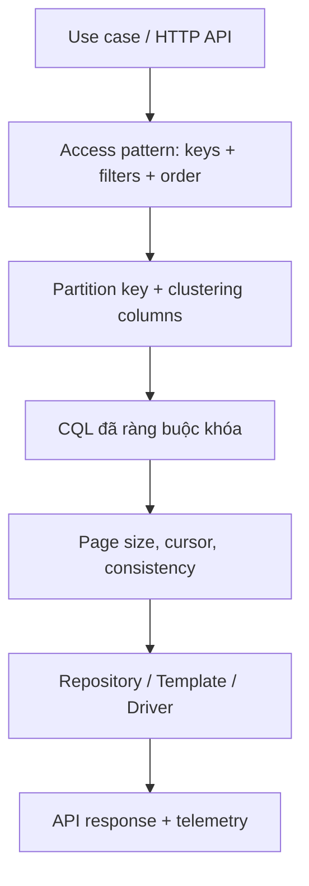
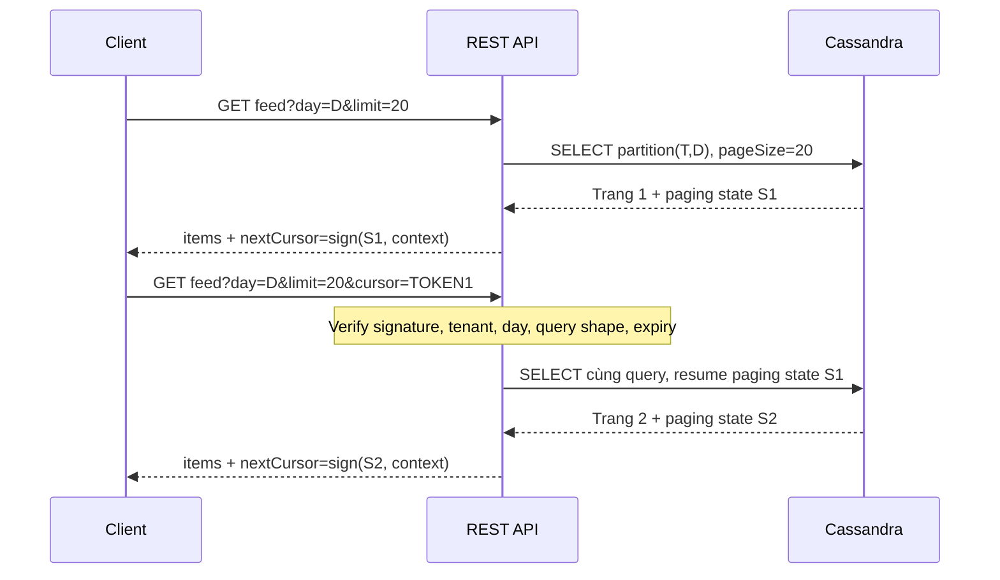

# Thiết kế API phù hợp các mẫu truy vấn và cursor

Một API liệt kê dữ liệu trông rất đơn giản: client gọi `GET /listings?page=3&size=20`, backend truy vấn cơ sở dữ liệu, trả một mảng JSON. Với Apache Cassandra, cách tiếp cận “tạo một bảng chuẩn hóa rồi cho API lọc, sắp xếp và nhảy trang tùy ý” thường **không phù hợp mô hình dữ liệu phân tán**. Cassandra phân phối dữ liệu dựa trên **partition key**, sắp xếp bên trong partition theo **clustering columns**, và hỗ trợ **paging state** để tiếp tục đọc; nó không cung cấp một offset-based pagination tổng quát và rẻ như cách nhiều ứng dụng SQL sử dụng.

Thiết kế tốt bắt đầu từ **những câu hỏi mà API phải trả lời**, rồi suy ra bảng, khóa, truy vấn CQL, giới hạn dữ liệu và hợp đồng cursor. Cursor là **dấu mốc tiếp tục một đường truy vấn cụ thể**, không phải một số trang tùy ý có thể thay thế qua lại giữa các filter, người dùng và bảng.

Bài này thuộc chương **Thiết kế ứng dụng** của module **`SPRING_DATA_CASSANDRA`**. Module giới thiệu truy cập Apache Cassandra bằng entity mapping, Repository, `CassandraTemplate` và CQL; chú trọng thiết kế bảng theo truy vấn, partition key, mức nhất quán, phân trang và hiệu năng trong hệ phân tán. Bài học đi từ **HTTP API contract** đến **data model**, sau đó minh họa Java Driver 4.x, Spring Data Cassandra và các vấn đề vận hành khi triển khai cursor.

**Sau bài học, bạn có thể:**

1. Chuyển use case sản phẩm thành danh sách **access patterns** và thiết kế bảng Cassandra phục vụ đúng từng mẫu.
2. Phân biệt `partition key`, `clustering order`, `LIMIT`, driver page size, paging state và offset.
3. Đề xuất contract REST có `limit`/`cursor`/`hasMore`/`nextCursor` phù hợp với Cassandra.
4. Thiết kế **cursor opaque**, gắn với tenant, filters, sort, query/schema version và thời hạn; bảo vệ bằng ký số.
5. Đọc một trang bằng Java Driver `AsyncResultSet` hoặc dùng Spring Data `Slice`/`CassandraPageRequest` khi API/version hỗ trợ.
6. Tránh thiết kế nhảy tới trang N, `COUNT(*)` trên dữ liệu lớn, `ALLOW FILTERING` và sort toàn cluster.
7. Xử lý **bucket theo thời gian**, nhiều partition, dữ liệu thay đổi giữa các trang, cursor hết hạn và lỗi truy cập.
8. Kiểm thử bảo mật, tính liên tục của paging, tải truy vấn và timeout trong môi trường có nhiều writer.

## 1. Bắt đầu bằng API use case, không bắt đầu bằng entity

Giả sử hệ thống quản lý tin đăng cho thuê có những màn hình:

| Use case | API dự kiến | Câu hỏi thực sự |
| --- | --- | --- |
| Xem chi tiết một tin | `GET /v1/listings/{id}` | Tìm đúng một tin theo ID |
| Xem tin gần đây của tenant | `GET /v1/tenants/{tenantId}/listings?day=...` | Tin của tenant X trong ngày D, mới trước |
| Xem tin của chủ nhà | `GET /v1/hosts/{hostId}/listings` | Tin theo chủ nhà, có phân trang |
| Xem trạng thái của booking | `GET /v1/bookings/{bookingId}` | Đọc trạng thái theo một khóa chính |
| Tra cứu tin theo khu vực | `GET /v1/areas/{areaId}/listings` | Tin theo khu vực, sắp xếp nào? |
| Tìm kiếm toàn văn | `GET /v1/listings/search?q=...` | Search text/filter tùy ý, không phải truy vấn Cassandra key đơn giản |

Một sơ đồ quan hệ chuẩn hóa duy nhất thường **không phục vụ hiệu quả tất cả** những truy vấn này. Cassandra khuyến khích **mỗi bảng hoặc một nhóm bảng được thiết kế cho một hoặc một vài access patterns có cấu trúc rõ ràng**.

### Bốn câu hỏi phải có cho mỗi endpoint

1. Client **biết trước khóa nào**? Tenant, host, ngày, ID, khu vực hay chỉ có một từ khóa?
2. Có thể trả kết quả từ **một partition** hay phải đọc nhiều partition?
3. Sắp xếp là theo **clustering key** hay yêu cầu sort tự do ngoài mô hình lưu?
4. Tối đa một request được phép đọc bao nhiêu **rows, partitions, bytes và thời gian**?

Nếu không trả lời được bốn câu này, không nên vội thêm tham số `page` hoặc `sort` cho endpoint.

## 2. Mô hình query-first của Cassandra

Ở RDBMS, lập trình viên có thể bắt đầu bằng `Listing` rồi thêm chỉ mục cho các truy vấn. Cassandra lại có những giới hạn phân tán cần tôn trọng:

- **Partition key** xác định nơi dữ liệu được phân phối đến các replica.
- **Clustering columns** xác định thứ tự lưu bên trong một partition và khả năng truy vấn/range theo prefix.
- **Regular columns** không tự tạo khả năng lọc hiệu quả cho mọi điều kiện.
- Một truy vấn thiếu khóa có thể cần đọc nhiều partition, chỉ mục hoặc giải pháp search riêng, tùy phiên bản và workload.
- `ORDER BY` trong CQL bị ràng buộc bởi schema/clustering order; không phải sort arbitrary mọi cột.



**Đừng đảo ngược** bằng cách: “Cứ chọn Repository.findAll() rồi thêm mọi filter/sort/pagination bên trên”. Một API có vẻ tiện lợi có thể tạo truy vấn không hiệu quả hoặc không hợp lệ ở tầng Cassandra.

## 3. Phân biệt lookup, bounded list, search và analytics

Không phải endpoint nào cũng nên dùng cùng một cơ chế pagination:

| Loại endpoint | Truy vấn | Cơ chế thường phù hợp |
| --- | --- | --- |
| **Point lookup** | `WHERE listing_id = ?` | Trả một entity/DTO; thường không có cursor |
| **Bounded list theo khóa** | `WHERE tenant_id = ? AND feed_day = ?` | Cursor/paging state |
| **Range trong partition** | Theo clustering key/time range | CQL range + paging/cursor theo thiết kế |
| **Search/filter linh hoạt** | Text, khoảng giá, tiện ích, geo, sort relevance | Search index/engine chuyên dụng hoặc bảng materialized theo query |
| **Analytics/đếm tổng lớn** | `COUNT(*)`/group nhiều partition | Bảng tổng hợp, pipeline analytics, không query nóng mỗi request |

Đừng ép một `GET /listings` không có khóa vào `ALLOW FILTERING` chỉ để giữ một API giống SQL. Nếu sản phẩm cần search đa điều kiện, phân chia trách nhiệm giữa **Cassandra cho key-based reads/writes** và **một đường tìm kiếm phù hợp**.

## 4. Ví dụ: feed tin đăng theo tenant và ngày

Ta chọn use case cụ thể: “Lấy tin đăng của tenant trong một ngày, **mới nhất trước**, 20 tin mỗi lượt”.

Đề xuất bảng:

```sql
CREATE TABLE IF NOT EXISTS listings_by_tenant_day (
    tenant_id uuid,
    feed_day date,
    created_at timestamp,
    listing_id uuid,
    host_id uuid,
    title text,
    state text,
    PRIMARY KEY (
        (tenant_id, feed_day),
        created_at,
        listing_id
    )
) WITH CLUSTERING ORDER BY (
    created_at DESC,
    listing_id ASC
);
```

**Ý nghĩa của khóa:**

| Thành phần | Loại | Vai trò |
| --- | --- | --- |
| `tenant_id` | Partition key, phần 1 | Khoanh vùng tenant |
| `feed_day` | Partition key, phần 2 | Giới hạn dữ liệu theo bucket thời gian |
| `created_at` | Clustering column 1 | Hỗ trợ thứ tự tin mới → cũ trong partition |
| `listing_id` | Clustering column 2 | Tie-breaker tất định khi hai tin có cùng `created_at` |
| `host_id`, `title`, `state` | Regular columns | Payload của feed, không tự là filter/index |

Với Cassandra, **cùng `(tenant_id, feed_day)` là cùng partition**. Dữ liệu được sắp theo clustering key đã định nghĩa; không cần sort toàn cluster cho một ngày/tenant.

### Truy vấn phục vụ endpoint

```sql
SELECT listing_id, created_at, host_id, title, state
FROM listings_by_tenant_day
WHERE tenant_id = ?
  AND feed_day = ?;
```

Thứ tự mặc định theo clustering order ở bảng trên là `created_at DESC, listing_id ASC`. Nếu cần `ORDER BY` tường minh, nó phải tương thích thứ tự clustering đã khai báo và ràng buộc khóa của CQL.

**Đánh đổi:** đây là feed theo **một ngày**. Nó **không tự trả dòng thời gian xuyên nhiều ngày** chỉ với một paging state.

## 5. Vì sao cần listing_id làm tie-breaker?

Hai tin có thể có cùng `created_at` tới microsecond/millisecond theo nguồn dữ liệu. Nếu chỉ dùng `created_at` làm clustering key duy nhất, hai tin có cùng tenant/ngày/thời điểm sẽ có **cùng primary key** và có thể ghi đè nhau.

```text
Tin A: created_at = 10:05:00.000, listing_id = A
Tin B: created_at = 10:05:00.000, listing_id = B

PRIMARY KEY((tenant, day), created_at)
    -> cùng khóa hàng, không lưu được hai tin tách biệt.

PRIMARY KEY((tenant, day), created_at, listing_id)
    -> hai hàng khác clustering key.
```

Tie-breaker cũng giúp thứ tự **ổn định trong một snapshot dữ liệu không thay đổi**, nhưng **không biến việc đọc nhiều trang thành snapshot transaction** khi writer đang thêm/xóa tin.

Nếu muốn thứ tự chỉ dựa trên ID, cần hiểu loại ID: random UUID không biểu diễn thời gian như time-based ID. Trên ví dụ này, **`created_at` là khóa sắp xếp chính**, `listing_id` chỉ phân biệt các hàng đồng thời điểm.

## 6. Phân biệt bucket theo ngày và timeline không giới hạn

Bucket `feed_day` giúp tránh một partition kéo dài nhiều năm, nhưng đưa ra một yêu cầu API:

```text
GET /tenants/T/listings?day=2026-11-25
    -> partition (T, 2026-11-25)

GET /tenants/T/listings?day=2026-11-24
    -> partition (T, 2026-11-24)
```

Nếu sản phẩm muốn “feed mới nhất của tenant, **không cần chọn ngày**”, có thể:

1. API giới hạn dữ liệu trong **một bucket hiện hành**, rồi client chuyển bucket có điều kiện.
2. Backend quản lý **chuỗi bucket hữu hạn** và chuyển sang ngày trước khi hết ngày hiện tại.
3. Thiết kế một bảng feed khác phù hợp truy vấn xuyên kỳ, với giới hạn partition/hot key cụ thể.
4. Dùng một aggregation/search/index layer nếu phạm vi dữ liệu và filter quá linh hoạt.

**Không lấy paging state của ngày 25 để tiếp tục SELECT ngày 24**. Một cursor Cassandra phụ thuộc **statement và tập điều kiện tương ứng**.

### Một cursor xuyên nhiều bucket phức tạp hơn

Nếu backend đang merge nhiều bucket, token có thể cần lưu **bucket đang đọc, cursor riêng từng bucket và trạng thái merge**, không chỉ một driver paging state. Phải giới hạn số bucket và định nghĩa thứ tự toàn cục/hành vi khi có tin mới.

## 7. API contract phải giới hạn filters và sort

Đề xuất contract đầu tiên:

```http
GET /v1/tenants/5e039fd0-19a2-4be5-a60c-d104b6fae7c1/listings?day=2026-11-25&limit=20
Authorization: Bearer <access-token>
Accept: application/json
```

Response minh họa:

```json
{
  "items": [
    {
      "listingId": "f1a7208a-271e-4e55-b12f-685c65fc8c15",
      "createdAt": "2026-11-25T08:40:00Z",
      "title": "Căn hộ gần công viên",
      "state": "PUBLISHED"
    }
  ],
  "hasMore": true,
  "nextCursor": "eyJ2IjoxLC4uLn0.signature",
  "limit": 20
}
```

`nextCursor` trong ví dụ là **chuỗi minh họa đã rút gọn**, không phải token hợp lệ có thể decode hoặc sử dụng thực tế.

**Hợp đồng được công bố:**

- `day` bắt buộc theo schema này; backend xác thực định dạng ngày và phạm vi được phép.
- `limit` là số lượng **tối đa mong muốn** cho một response, được clamp/validate.
- `cursor` là opaque; client chỉ được **gửi lại nguyên giá trị** với cùng truy vấn.
- `hasMore` biểu diễn khả năng còn trang tiếp theo theo cơ chế truy vấn; **không bảo đảm count toàn bộ**.
- Nếu `hasMore = false`, `nextCursor` là `null`.
- Không hỗ trợ `page=100` hay `offset=2000` trong contract này.

### Lưu ý về state filter

Nếu API muốn `state=PUBLISHED` nhưng `state` chỉ là regular column, **không tự thêm `WHERE state = ?`** rồi mong Cassandra lọc miễn phí. Cần bảng theo state, SAI/index phù hợp phiên bản, search layer hoặc lọc ở ứng dụng trên **một tập dữ liệu đã bị chặn kích thước** với semantics đã công bố.

## 8. Ví dụ response khi hết dữ liệu

```json
{
  "items": [],
  "hasMore": false,
  "nextCursor": null,
  "limit": 20
}
```

API không cần trả `totalPages` vì Cassandra không cung cấp một **count tổng rẻ và nhất quán** cho mọi truy vấn feed lớn. Việc trang cuối trả ít hơn `limit` là bình thường; điều đó không phải lỗi.

Nếu hệ thống không có quyền xác nhận chắc có thêm trang do query đang lỗi, **không trả `hasMore = false` như thể dữ liệu đã hết**. Lỗi phải thành lỗi API riêng.

## 9. LIMIT, page size và offset không phải một

| Khái niệm | Ý nghĩa | Có phù hợp với API cursor? |
| --- | --- | --- |
| `LIMIT n` trong CQL | Giới hạn lượng hàng mà **câu truy vấn** trả theo ngữ nghĩa CQL | Dùng cho query hữu hạn; **không thay cho paging cursor** |
| `setPageSize(n)` của driver | Kích thước trang/fetch size **được yêu cầu** | Phù hợp để đọc từng trang |
| `Pageable` của Spring Data | Abstraction yêu cầu trang | Chỉ dùng kiểu Cassandra hỗ trợ thật, không giả định offset SQL |
| `PagingState` | Trạng thái để tiếp tục một truy vấn phù hợp | Nền tảng cho cursor opaque |
| `offset` | Bỏ qua n hàng trước vị trí muốn đọc | Không phải cách Cassandra hỗ trợ nhảy ngẫu nhiên hiệu quả |
| `totalElements` | Tổng hàng khớp query | Có thể đòi truy vấn count tốn kém/không ổn định |

**Điểm dễ nhầm:** `setPageSize(20)` không có nghĩa “chỉ bao giờ tồn tại 20 kết quả”. Nó là cách driver lấy **một trang tại một thời điểm**; câu truy vấn có thể tiếp tục bằng paging state.

Nếu API tuyên bố “không trả quá 20 items”, cần **kiểm tra response shape và giới hạn dữ liệu thật**. Đừng tùy tiện cắt bỏ các hàng đã được fetch rồi dùng paging state của trang kế tiếp: điều đó có thể **bỏ sót những hàng bị cắt**. Kích thước page thực tế/phản hồi phải được kiểm thử trên driver/server đang dùng.

## 10. Vì sao Cassandra không hợp với page=1000?

Trong nhiều hệ SQL, client quen:

```sql
SELECT ...
FROM listings
ORDER BY created_at DESC
LIMIT 20 OFFSET 20000;
```

Ngay cả với SQL, offset lớn có thể tốn tài nguyên; trong Cassandra, yêu cầu **nhảy ngẫu nhiên tới vị trí thứ 20.000** không tương ứng với một phép tra cứu partition key/clustering key rẻ. Paging state được thiết kế cho **tiếp tục** chứ không có khả năng tính ngay token của mọi trang N tùy ý.

Một API Cassandra nên đề xuất:

```text
Trang đầu:  GET /listings?day=D&limit=20
Trang sau:  GET /listings?day=D&limit=20&cursor=TOKEN_1
Trang nữa: GET /listings?day=D&limit=20&cursor=TOKEN_2
```

Client điều hướng **tuần tự**, hoặc lưu lại cursor của những trang đã đi qua trong **phiên UI**. Không tự tính cursor của page 500.

### Nếu UX bắt buộc “tới trang 30”?

Xác định xem đó có phải yêu cầu sản phẩm thật không. Có thể thay bằng **load more**, **infinite scroll**, **lọc theo thời gian/khóa**, hoặc một **search engine** có phân trang/sort riêng. Nếu không đổi được, phải chấp nhận chi phí và kiến trúc dữ liệu khác, không giả vờ Cassandra hỗ trợ offset hiệu quả.

## 11. Paging state là gì?

Khi query có nhiều dữ liệu hơn một trang, Cassandra driver có thể nhận **paging state** giúp tiếp tục đọc ở vị trí phù hợp của **cùng một truy vấn**.



**Đặc tính quan trọng:**

- Paging state **không phải page number**.
- Token liên quan đến **câu truy vấn, bound values và cách truy vấn được thực thi**.
- Token có thể **không sử dụng được** sau thay đổi schema, query shape, driver/server version hoặc quá nhiều thời gian.
- Một token không bảo đảm dữ liệu ở các trang được chụp tại **cùng một thời điểm**.
- Không cho phép client sửa/ghép/chế tạo paging state trực tiếp.

Không dùng một paging state của request A để đọc dữ liệu request B, kể cả hai request đều trả cùng số cột.

## 12. Opaque cursor khác public paging state thô

Một endpoint có thể trả trực tiếp chuỗi paging state của driver. Cách này thường tạo **rủi ro bảo mật và coupling**:

1. Client có thể thử sửa token để điều khiển trạng thái truy vấn.
2. Paging state có thể mang metadata nội bộ/khóa/giá trị liên quan đến truy vấn; không nên tự coi là thông tin vô hại.
3. Không gắn rõ token với **tenant và quyền truy cập**.
4. Không có expiration/version để xử lý thay đổi API.
5. Client dễ phụ thuộc vào biểu diễn token của driver.

**Thay vào đó:** bọc paging state vào một **cursor riêng của API**, opaque với client. Server kiểm tra chữ ký, tuổi token, ngữ cảnh truy vấn, tenant và phiên bản trước khi đưa phần paging state đã kiểm tra cho driver.

### Opaque không nhất thiết là mã hóa

Một chuỗi Base64URL **chỉ là encoding**, không tự bí mật hay chống sửa. **HMAC** chứng minh token chưa bị chỉnh sửa bởi người không có key; nếu nội dung có thông tin nhạy cảm cần được giấu khỏi client, cân nhắc **authenticated encryption** hoặc lưu trạng thái server-side theo một ID ngẫu nhiên.

Không đặt secret HMAC trong source code, JSON response hay log.

## 13. Cursor nên chứa những trường gì?

Mẫu payload nội bộ **trước khi ký**:

```json
{
  "v": 1,
  "kind": "tenant-listings-day",
  "tenantId": "5e039fd0-19a2-4be5-a60c-d104b6fae7c1",
  "day": "2026-11-25",
  "queryVersion": "feed-v3",
  "sort": "created_at_desc_listing_id_asc",
  "limit": 20,
  "filtersHash": "sha256:canonical-filter-fingerprint",
  "pagingState": "driver-state-encoded-for-transport",
  "issuedAt": 1795572000,
  "expiresAt": 1795572900,
  "keyId": "cursor-key-2026-11"
}
```

Đây là **ví dụ cấu trúc**, không phải token đã được ký hay một paging state thật. Thời điểm là Unix seconds minh họa; ứng dụng phải tính bằng clock và chính sách của mình.

**Giải thích:**

| Field | Dùng để làm gì? |
| --- | --- |
| `v` | Version format của token |
| `kind` | Chặn dùng token ở endpoint/loại query khác |
| `tenantId` | Gắn dữ liệu với tenant được phép |
| `day` | Định danh partition/bucket của query |
| `queryVersion` | Vô hiệu token khi CQL/schema/sort thay đổi không tương thích |
| `sort` | Bảo đảm cùng thứ tự kết quả |
| `limit` | Ràng buộc paging contract cùng size, tránh đổi tùy ý |
| `filtersHash` | Hash của bộ filter chuẩn hóa |
| `pagingState` | Opaque driver continuation state |
| `issuedAt`/`expiresAt` | Cửa sổ hiệu lực |
| `keyId` | Hỗ trợ rotate signing keys |

**Không dùng `tenantId` nằm trong token thay cho authorization**: server vẫn phải lấy tenant được phép từ principal/session và kiểm tra quyền đối với tenant trong URL.

## 14. Ký cursor bằng HMAC

Một cách thiết kế token:

```text
payloadBytes = serializeCanonicalJson(cursorPayload)
payloadPart  = base64url(payloadBytes)
signature    = HMAC-SHA256(secret[keyId], payloadPart)
token        = payloadPart + "." + base64url(signature)
```

Khi nhận:

1. Giới hạn **độ dài token** trước khi parse.
2. Tách payload và signature, xác định version/key ID theo cấu trúc được thiết kế.
3. Chọn key **trong danh sách tin cậy**; không để header/token tự chỉ đường tới key ngoài.
4. Tính lại HMAC và so chữ ký bằng phép **constant-time comparison**.
5. Chỉ sau khi xác minh tính toàn vẹn mới tin nội dung payload để ra quyết định.
6. Kiểm tra `expiresAt`, `kind`, `tenantId`, `day`, `limit`, `queryVersion`, `filtersHash`.
7. Giải mã paging state bằng API driver tương ứng và áp lên **cùng CQL/bound parameters**.

**Không triển khai HMAC bằng `hashCode()`, MD5 tự ghép chuỗi hoặc một secret hard-code.** Ưu tiên các thư viện chuẩn, quản lý key trong secret manager, có key rotation và metrics lỗi token.

### Token stateless và server-side cursor

| Cách | Lợi ích | Đánh đổi |
| --- | --- | --- |
| **Stateless signed token** | API không cần lưu session cursor; dễ scale ngang | Khó thu hồi riêng lẻ; có expiry, version và rủi ro lộ metadata |
| **Encrypted authenticated token** | Giấu payload khỏi client và chống sửa | Mã hóa/rotate key phức tạp hơn |
| **Server-side cursor ID** | Token ngắn, có thể revoke và quản lý trạng thái merge | Cần storage/cache, TTL, đồng bộ và cleanup |

Chọn theo **bảo mật, độ dài cursor, khả năng retry và độ phức tạp**. Một cursor chỉ chứa một driver paging state nhỏ có thể dùng stateless, nhưng cursor merge nhiều partition có thể nên chuyển sang state server-side.

## 15. Thay filter/sort/limit giữa chừng: phải làm gì?

Giả sử client lấy trang 1:

```http
GET /v1/tenants/T/listings?day=2026-11-25&limit=20
```

Sau đó gọi:

```http
GET /v1/tenants/T/listings?day=2026-11-24&limit=50&cursor=TOKEN_CUA_NGAY_25
```

Đây **không phải** request continuation hợp lệ. Token gắn với **ngày 25 và page size 20**.

Quy ước nên công bố:

- Nếu người dùng **đổi filter/ngày/sort**, UI phải **bỏ cursor cũ và bắt đầu trang 1**.
- Nếu muốn đổi page size, nên **bắt đầu từ đầu** hoặc dùng một thiết kế resume position có ngữ nghĩa riêng; không tự tái sử dụng state.
- Server **từ chối token sai ngữ cảnh**, không âm thầm trả một trang từ partition khác.
- Không trả `200` với một token được “sửa đại” rồi để client tưởng feed vẫn nối tiếp.

### Canonical filter fingerprint

Các filter có thể có nhiều cách biểu diễn tương đương:

```text
state=PUBLISHED&host=H
host=H&state=PUBLISHED
```

Trước khi tính `filtersHash`, hãy **chuẩn hóa** tên/value, thứ tự tham số, mặc định, Unicode/case/whitespace theo contract. Nếu không, hai request logic giống nhau có thể tạo hash khác nhau; hoặc tệ hơn, hai request khác nhau có thể bị coi là cùng query.

## 16. Cursor hết hạn và cursor không hợp lệ

API cần một chính sách lỗi rõ ràng:

| Tình huống | Phản hồi gợi ý | Hành vi client |
| --- | --- | --- |
| Token sai format/không đúng chữ ký | `400 Bad Request` | Bỏ cursor, không retry nguyên token vô hạn |
| Token hết hạn | `410 Gone` hoặc `400` với mã riêng | Load lại trang đầu |
| Token đúng chữ ký nhưng sai tenant/query/limit | `400`/`403` theo policy | Không dùng token trong ngữ cảnh khác |
| User không có quyền tenant | `403 Forbidden` hoặc `404` theo policy | Không đọc dữ liệu |
| Query/schema version không còn hỗ trợ | `410 Gone` với mã `CURSOR_STALE` | Restart feed |
| Driver báo paging state không hợp lệ | `400`/`410`, log loại lỗi | Restart feed, không tiết lộ state nội bộ |
| Cassandra timeout/unavailable | `503`/`504` theo policy | Retry an toàn với **cùng cursor** nếu truy vấn chỉ đọc |

**Không đưa bytes của paging state, stack trace, query nguyên văn chứa dữ liệu riêng hoặc secret vào JSON lỗi.** Một response có thể chỉ chứa:

```json
{
  "code": "CURSOR_EXPIRED",
  "message": "Phiên phân trang đã hết hạn. Vui lòng tải lại danh sách.",
  "restart": true
}
```

## 17. Ví dụ DTO hợp đồng API

Đầu ra dạng Java record:

```java
package example.feed.api;

import java.time.Instant;
import java.util.List;
import java.util.UUID;

public record ListingCard(
        UUID listingId,
        Instant createdAt,
        String title,
        String state) {
}

public record CursorPage<T>(
        List<T> items,
        boolean hasMore,
        String nextCursor,
        int limit) {
}
```

Hai record minh họa shape của API; trong dự án Java, mỗi top-level public record nên được đặt ở file Java cùng tên hoặc tổ chức nested record phù hợp.

**Lưu ý thiết kế:**

- `nextCursor` nullable trên trang cuối; không tạo một chuỗi giả như `"end"`.
- `items` có thể rỗng; empty result không nhất thiết là lỗi.
- `limit` trong response giúp client biết giá trị backend đã chấp nhận.
- `hasMore` nên được suy ra từ khả năng resume được driver/backend xác nhận, không từ việc “items.size() == limit” một cách đơn giản.
- Không trả `totalPages` nếu chưa có nguồn tính total phù hợp.

## 18. Java Driver 4.x: đọc một trang AsyncResultSet

Java Driver có API bất đồng bộ:

```java
CompletionStage<AsyncResultSet> stage =
        session.executeAsync(boundStatement);
```

`AsyncResultSet` có:

- `currentPage()`: các hàng **đã tải của trang hiện tại**.
- `hasMorePages()`: có thêm trang theo kết quả/driver.
- `fetchNextPage()`: fetch trang kế tiếp nếu muốn tiếp tục trong **cùng pipeline**.
- `getExecutionInfo()`: thông tin thực thi, gồm paging state tùy kết quả/driver.

Điểm quan trọng cho HTTP API cursor: **thường chỉ trả một trang rồi cho client giữ continuation token**. Đừng tự gọi `fetchNextPage()` liên tục trong một request chỉ vì tiện; như vậy endpoint có thể quét hết partition, mất mục tiêu giới hạn tài nguyên.

### Dạng query một partition

```sql
SELECT listing_id, created_at, title, state
FROM listings_by_tenant_day
WHERE tenant_id = ? AND feed_day = ?;
```

Bind tenant/day từ request đã kiểm tra, cấu hình `setPageSize(limit)` và regular consistency theo yêu cầu.

## 19. Gateway Java Driver với cursor codec tách biệt

Đoạn code sau minh họa ranh giới giữa **CQL paging** và **token an toàn của API**. `CursorCodec` là interface do ứng dụng xây dựng, không phải class có sẵn của Cassandra:

```java
package example.feed.data;

import java.time.LocalDate;
import java.util.UUID;
import com.datastax.oss.driver.api.core.cql.PagingState;

public interface CursorCodec {
    PagingState decode(
            String opaqueToken,
            UUID authorizedTenant,
            LocalDate day,
            int limit,
            String queryVersion);

    String encode(
            PagingState state,
            UUID authorizedTenant,
            LocalDate day,
            int limit,
            String queryVersion);
}
```

Implementation thật phải làm **HMAC/AEAD hoặc lưu ID trong server-side store**, kiểm tra expiry, key rotation, endpoint kind, tenant và filter fingerprint. `decode` phải **throw một lỗi đã phân loại** nếu token sai; không trả paging state đã bị sửa để “thử xem Cassandra có chấp nhận không”.

**Vì sao không đưa codec trực tiếp vào Repository?** Bởi signing, authorization binding, API version và TTL là **trách nhiệm biên HTTP**, không phải của một câu CQL trần.

## 20. Ví dụ gateway đọc một trang

Ví dụ với Java Driver 4.x, Java 17+ và prepared statement:

```java
package example.feed.data;

import java.time.LocalDate;
import java.util.ArrayList;
import java.util.List;
import java.util.UUID;
import java.util.concurrent.CompletableFuture;

import com.datastax.oss.driver.api.core.CqlSession;
import com.datastax.oss.driver.api.core.DefaultConsistencyLevel;
import com.datastax.oss.driver.api.core.cql.AsyncResultSet;
import com.datastax.oss.driver.api.core.cql.BoundStatement;
import com.datastax.oss.driver.api.core.cql.PagingState;
import com.datastax.oss.driver.api.core.cql.PreparedStatement;
import com.datastax.oss.driver.api.core.cql.Row;

public final class ListingFeedGateway {
    private static final String QUERY_VERSION = "feed-v3";
    private final CqlSession session;
    private final CursorCodec cursorCodec;
    private final PreparedStatement findByTenantDay;

    public ListingFeedGateway(
            CqlSession session, CursorCodec cursorCodec) {
        this.session = session;
        this.cursorCodec = cursorCodec;
        this.findByTenantDay = session.prepare("""
            SELECT listing_id, created_at, title, state
            FROM listings_by_tenant_day
            WHERE tenant_id = ? AND feed_day = ?
            """);
    }

    public CompletableFuture<CursorPage<ListingCard>> load(
            UUID authorizedTenant,
            LocalDate day,
            int limit,
            String opaqueCursor) {

        if (limit < 1 || limit > 100) {
            throw new IllegalArgumentException(
                    "limit must be between 1 and 100");
        }

        BoundStatement statement = findByTenantDay
                .bind(authorizedTenant, day)
                .setConsistencyLevel(
                        DefaultConsistencyLevel.LOCAL_QUORUM)
                .setPageSize(limit)
                .setIdempotent(true);

        if (opaqueCursor != null && !opaqueCursor.isBlank()) {
            PagingState state = cursorCodec.decode(
                    opaqueCursor, authorizedTenant,
                    day, limit, QUERY_VERSION);
            statement = statement.setPagingState(state);
        }

        return session.executeAsync(statement)
                .thenApply(rs ->
                    toCursorPage(rs, authorizedTenant, day, limit))
                .toCompletableFuture();
    }

    private CursorPage<ListingCard> toCursorPage(
            AsyncResultSet rs,
            UUID tenant,
            LocalDate day,
            int limit) {
        List<ListingCard> items = new ArrayList<>();
        for (Row row : rs.currentPage()) {
            items.add(new ListingCard(
                    row.getUuid("listing_id"),
                    row.getInstant("created_at"),
                    row.getString("title"),
                    row.getString("state")));
        }

        boolean hasMore = rs.hasMorePages();
        PagingState nextState = hasMore
                ? rs.getExecutionInfo().getPagingState()
                : null;

        String nextCursor = nextState == null ? null
                : cursorCodec.encode(
                    nextState, tenant, day, limit, QUERY_VERSION);

        return new CursorPage<>(
                List.copyOf(items),
                nextCursor != null,
                nextCursor,
                limit);
    }
}
```

`ListingCard` và `CursorPage` là các DTO từ mục 17 (cần import vào gateway). `CursorCodec` phải được triển khai và kiểm thử riêng. Phương thức `ExecutionInfo.getPagingState()` và encoding/decoding state phải đối chiếu với **API chính xác của Java Driver phiên bản đang dùng**; khi driver không cung cấp một continuation state hợp lệ, **không phát nextCursor**.

**Điều code này không làm:** không đọc tất cả các trang, không tính total count, không cho phép client sort/filter tùy ý, không chứng minh các trang có cùng snapshot khi dữ liệu đang thay đổi.

**Cần bổ sung khi chạy production:** kiểm tra limit thực tế so với số rows của `currentPage()`, mapping lỗi/null, HTTP timeout, request cancellation, authorization ở service, telemetry và handling invalid paging state. Không tự cắt các rows đã fetch mà vẫn dùng state của trang sau vì sẽ **bỏ sót dữ liệu**.

## 21. Controller Spring Boot cho API cursor

Controller chịu trách nhiệm parse request, authentication/authorization và validation. Ví dụ:

```java
package example.feed.api;

import java.time.LocalDate;
import java.util.UUID;
import java.util.concurrent.CompletableFuture;
import org.springframework.format.annotation.DateTimeFormat;
import org.springframework.web.bind.annotation.GetMapping;
import org.springframework.web.bind.annotation.PathVariable;
import org.springframework.web.bind.annotation.RequestMapping;
import org.springframework.web.bind.annotation.RequestParam;
import org.springframework.web.bind.annotation.RestController;

@RestController
@RequestMapping("/v1/tenants")
public class ListingFeedController {
    private final ListingFeedService service;

    public ListingFeedController(ListingFeedService service) {
        this.service = service;
    }

    @GetMapping("/{tenantId}/listings")
    public CompletableFuture<CursorPage<ListingCard>> list(
            @PathVariable UUID tenantId,
            @RequestParam
            @DateTimeFormat(iso = DateTimeFormat.ISO.DATE)
            LocalDate day,
            @RequestParam(defaultValue = "20") int limit,
            @RequestParam(required = false) String cursor) {

        return service.listAuthorized(
                tenantId, day, limit, cursor);
    }
}
```

`ListingFeedService` là một service do ứng dụng định nghĩa. Nó phải:

1. Lấy principal thật từ security context.
2. **Xác minh principal có quyền với `tenantId`** trước khi gọi gateway.
3. Kiểm tra ngày không quá xa, limit/cursor length và filter contract.
4. Gọi gateway với **authorizedTenant** đã xác thực.
5. Ánh xạ lỗi cursor/Cassandra thành HTTP response thích hợp.

**Không coi `@PathVariable UUID tenantId` đã là bằng chứng quyền truy cập**. Chữ ký của cursor cũng không cấp quyền; một token hợp lệ bị đánh cắp vẫn phải chịu authorization hiện tại của người gọi.

### MVC hay WebFlux?

Spring MVC có hỗ trợ trả kết quả asynchronous như `CompletableFuture`, nhưng tổng thể I/O/thread model khác WebFlux. Cần hiểu application stack và timeout của server; tránh gọi `join()` trong controller để không vô hiệu hóa lợi ích async.

## 22. Spring Data Cassandra: Slice và CassandraPageRequest

Spring Data Cassandra có abstraction hỗ trợ phân trang dựa trên trạng thái như **`CassandraPageRequest`**, trả `Slice<T>`/phần dữ liệu phù hợp API/version.

Ví dụ ý tưởng:

```java
// Mẫu theo Spring Data Cassandra hỗ trợ CassandraPageRequest.
CassandraPageRequest first =
        CassandraPageRequest.first(20);

Slice<ListingFeedEntity> slice =
        repository.findByTenantIdAndFeedDay(
                tenantId, day, first);

boolean hasNext = slice.hasNext();
```

Đây là **mẫu minh họa cấp abstraction**, không cam kết chữ ký method `findByTenantIdAndFeedDay` và cách đọc tiếp cursor giống nhau ở mọi release. Một repository có thể cần đúng mapping của composite primary key, @Query và hỗ trợ paging của phiên bản Spring Data đang cài.

**Điểm cần nhớ:**

- `Slice` thường phù hợp hơn `Page` khi **không cần total count**.
- `Page` thường gợi ý tổng số hàng/trang; trong Cassandra, count tổng có thể tốn kém hoặc không được abstraction đáp ứng như SQL.
- Không giả định `PageRequest.of(100, 20)` là một phép nhảy offset hiệu quả vào Cassandra.
- Phương thức lưu/đọc `PagingState` trên `CassandraPageRequest` hoặc các loại tương ứng phải được kiểm chứng theo **Spring Data version**.
- Một số phiên bản mới có abstraction scrolling khác; không trộn `CassandraScrollPosition` của một bản mới vào ứng dụng đang chạy bản cũ mà không kiểm tra API.

Nếu API cần **cursor có chữ ký, TTL, query fingerprint và xử lý nhiều bucket**, custom gateway qua `CqlSession` có thể rõ ràng hơn việc expose trực tiếp `Pageable` của framework.

## 23. Tại sao không trả thẳng Pageable của Spring ra HTTP?

Kiểu `Pageable` là một **abstraction của tầng dữ liệu**. Nếu client gửi:

```http
GET /listings?page=50&size=20&sort=price,desc
```

thì ứng dụng phải chứng minh:

1. Cassandra có bảng/index trả được `price DESC` với query này không?
2. Backend có thể xác định row thứ 1000 mà không quét 1000 row trước không?
3. Đường read có partition key và giới hạn tải rõ không?
4. `Pageable` đang được Spring Data Cassandra biến thành truy vấn có semantics nào?

Nếu không, controller đang hứa với frontend một tính năng mà dữ liệu nền không hỗ trợ tốt.

**Thiết kế tốt:** HTTP contract công khai **chỉ các filter/sort mà query model hỗ trợ**, và expose một `cursor` opaque thay vì tên class `CassandraPageRequest`/`PagingState` ra client.

## 24. Sorting trong Cassandra là một quyết định schema

Với bảng mẫu:

```sql
PRIMARY KEY ((tenant_id, feed_day), created_at, listing_id)
WITH CLUSTERING ORDER BY (created_at DESC, listing_id ASC)
```

endpoint có thể trả theo thứ tự phù hợp clustering order.

Nhưng nếu UI muốn:

```http
GET /listings?sort=price_asc
GET /listings?sort=views_desc
GET /listings?sort=distance_asc
```

thì những sort này **không tự được hỗ trợ** chỉ vì `price`/`views`/`distance` là property trong entity.

Các lựa chọn:

- **Bảng phục vụ query riêng** theo sort/access pattern có giới hạn (denormalization).
- Search index/engine phù hợp để sắp xếp/filter linh hoạt.
- Sort một **tập nhỏ đã lấy đủ và có giới hạn** ở ứng dụng, đồng thời giải thích rõ phạm vi sort; không dùng kết quả đó như sort toàn bộ dataset.
- Thay đổi UX thành những sort được hỗ trợ có giá trị sản phẩm cao.

**Cấm ngộ nhận:** lấy 20 bản ghi theo `created_at` rồi sort 20 bản ghi đó theo `price` không có nghĩa đã lấy **20 bản ghi rẻ nhất toàn tenant**.

## 25. Filter theo state cần bảng khác hay index?

Giả sử endpoint muốn:

```http
GET /tenants/T/listings?state=PUBLISHED&day=D
```

Với `state` là regular column, query:

```sql
-- Không mặc định dùng được/hiệu quả với schema mục 4:
SELECT * FROM listings_by_tenant_day
WHERE tenant_id = ? AND feed_day = ?
  AND state = 'PUBLISHED'
ALLOW FILTERING;
```

Việc lọc ở Cassandra có thể tiêu tốn quét nhiều hàng và làm page count khó dự đoán. Một lựa chọn nếu đây là access pattern thường xuyên:

```sql
CREATE TABLE IF NOT EXISTS listings_by_tenant_state_day (
    tenant_id uuid,
    state text,
    feed_day date,
    created_at timestamp,
    listing_id uuid,
    title text,
    PRIMARY KEY (
        (tenant_id, state, feed_day),
        created_at,
        listing_id
    )
) WITH CLUSTERING ORDER BY (
    created_at DESC,
    listing_id ASC
);
```

Query:

```sql
SELECT listing_id, created_at, title
FROM listings_by_tenant_state_day
WHERE tenant_id = ? AND state = ? AND feed_day = ?;
```

**Đánh đổi:** khi `state` thay đổi, ứng dụng phải **xóa/cập nhật projection ở state cũ và ghi state mới**. Hai bảng/partition không tự thành một transaction ACID toàn diện; cần event-driven updates, idempotency và reconciliation.

**Không tạo một bảng cho mọi tổ hợp filter một cách vô hạn**. Đánh giá tần suất truy vấn, storage amplification, update cost và phương án index/search theo phiên bản cluster.

## 26. Dữ liệu thay đổi giữa các trang: chuyện gì xảy ra?

Giả sử trang đầu trả các tin có thời gian:

```text
10:00, 09:59, 09:58
nextCursor = S1
```

Trước khi client gọi trang hai:

1. Một tin mới lúc 10:01 được chèn.
2. Một tin 09:58 bị xóa.
3. Tin 09:57 bị chuyển state và rời projection.
4. Một writer cập nhật lại clustering key bằng xóa/chèn hàng mới (theo data model).

Khi dùng paging state, việc đọc tiếp **không phải snapshot bất biến**. Các hàng mới ở phía trước cursor có thể không xuất hiện trong phần còn lại; xóa/ghi làm thay đổi tập kết quả. Không hứa “mỗi hàng sẽ xuất hiện đúng một lần và đủ mọi hàng từng tồn tại” nếu không có cơ chế snapshot/version riêng.

### Chọn contract hợp lý cho feed

- **“Đọc tiếp vị trí trong kết quả, có thể thay đổi khi dữ liệu được cập nhật.”**
- **“Tin mới nhất xuất hiện khi refresh từ trang đầu.”**
- **“Không bảo đảm feed là snapshot lịch sử tại thời điểm trang 1.”**
- Nếu cần chống duplicate khi UI merge các trang, client có thể **dedup theo `listingId`** nhưng phải hiểu điều đó không đảm bảo không bỏ sót dưới mọi update.

Nếu sản phẩm thật sự cần **snapshot audit bất biến**, hãy thiết kế một export/query job được version hóa hoặc event snapshot riêng, không dựa đơn độc vào driver paging state.

## 27. Cursor và keyset pagination không hoàn toàn giống nhau

**Driver paging state** là continuation token được Cassandra/driver hiểu. **Keyset pagination** là thiết kế query tiếp tục dựa trên **giá trị khóa cuối đã thấy**, ví dụ cặp `(created_at, listing_id)`.

| Tiêu chí | Driver paging state | Keyset/clustering cursor do ứng dụng thiết kế |
| --- | --- | --- |
| Trạng thái continuation | Opaque token từ driver/server | Last seen clustering key và context |
| Query phải tương thích? | **Có** | **Có**, và cần range predicates đúng CQL |
| Nhảy ngẫu nhiên tới page N? | Không | Không |
| Phụ thuộc driver/Cassandra paging format? | Có | Ít hơn, nhưng phụ thuộc schema/clustering |
| Dễ xử lý token signed/TTL? | Có thể bọc | Có thể bọc |
| Hỗ trợ nhiều partition merge? | Một state thường chỉ một query | Phải tự quản lý nhiều last-seen keys |
| Snapshot bất biến? | Không | Không |

**Cảnh báo về CQL:** đừng viết ngay một điều kiện SQL tuple bất kỳ như:

```sql
-- KHÔNG mặc định là CQL hợp lệ/tối ưu cho mọi bảng:
-- WHERE (created_at, listing_id) < (?, ?)
```

Range trên clustering columns của Cassandra có quy tắc và hỗ trợ tuple relation phụ thuộc schema/phiên bản. Muốn tự xây keyset phải **chứng minh predicate, chiều sort, tie-breaker và giới hạn Cassandra version** trước khi dùng.

Với ứng dụng Spring Data Cassandra thông thường, **bọc driver paging state** là điểm bắt đầu dễ kiểm soát hơn, trừ khi có yêu cầu portability/traversal đặc biệt.

## 28. Cursor không phải ID của một bản ghi

Một số thiết kế trả:

```json
{"nextCursor": "last-listing-uuid"}
```

Chỉ một random UUID có thể **không đủ** để tiếp tục chính xác nếu sort theo `created_at DESC` và có nhiều tin cùng timestamp. Muốn định vị sau một hàng, cursor dạng keyset phải gắn với **đầy đủ khóa sắp xếp/tie-breaker**.

Tương tự, một API feed gồm nhiều ngày hoặc nhiều shard cần **phạm vi và vị trí** tương ứng, không chỉ một `listingId`.

**Quy tắc:** cursor phải chứa **đủ thông tin để tái tạo chính xác ý định query**, nhưng **không để lộ dữ liệu không cần thiết** và **không được sửa bởi client**.

## 29. Thiết kế cursor cho nhiều partition

Một endpoint `GET /listings?from=D1&to=D2` có thể cần đọc nhiều bucket/partition. Không thể đơn giản:

```text
paging state của partition D1
    -> đưa vào statement của D2
```

Một thiết kế có thể dùng **multi-cursor**:

```json
{
  "v": 2,
  "queryVersion": "merged-feed-v2",
  "buckets": [
    {"day": "2026-11-25", "state": "opaque-s1"},
    {"day": "2026-11-24", "state": "opaque-s2"}
  ],
  "mergeAfter": {
    "createdAt": "2026-11-24T20:00:00Z",
    "listingId": "f1a7208a-271e-4e55-b12f-685c65fc8c15"
  },
  "expiresAt": 1795572900
}
```

**Đây là cấu trúc khái niệm**, chưa phải thuật toán merge chạy được. Một implementation đúng phải giải quyết:

- Thứ tự toàn cục theo `(created_at, listing_id)`.
- Mỗi partition được đọc đến đâu, có rows prefetch chưa phát cho client không.
- Không bỏ sót những rows đã fetch nhưng chưa trả.
- Các bucket mới xuất hiện/kết thúc trong lúc đọc.
- Thời hạn, ký token và giới hạn kích thước.
- Giới hạn số partition truy vấn trên mỗi request.

Nếu quá phức tạp, cân nhắc **API tách bucket** hoặc **projection feed chuyên dụng**. Không nên giấu độ phức tạp bằng cách phát một paging state không đủ.

## 30. Paging state và phiên bản ứng dụng

Ứng dụng thường được triển khai dần:

```text
API v1: SELECT listing_id, title ...
API v2: SELECT listing_id, title, created_at ...
API v3: đổi bảng hoặc sort ...
```

Một cursor v1 không chắc tiếp tục được trên query v3. Vì vậy dùng:

- `queryVersion` riêng cho statement/shape, không chỉ `apiVersion`.
- Cursor codec phiên bản hóa format payload.
- Giữ hỗ trợ token đời cũ trong **thời gian ngắn, có giới hạn** nếu cần rolling deploy.
- Hoặc trả `CURSOR_STALE` và yêu cầu restart khi query không tương thích.

**Đừng thay đổi một prepared statement quan trọng mà không cân nhắc các cursor đang tồn tại**. Tốc độ deploy càng nhanh, expiry càng nên được chọn rõ ràng theo UX và mức thay đổi schema/query.

### Driver/server upgrades

Paging state là một biểu diễn gắn với protocol/driver/server execution. Trong các lần upgrade driver/Cassandra, kiểm thử **resume token đã cấp trước upgrade** hoặc có chính sách vô hiệu token cũ; không cam kết token tồn tại mãi.

## 31. Security: token không thay thế authorization

Một cursor đúng chữ ký có thể bị rò qua:

- Browser history hoặc log URL.
- Monitoring/tracing ghi nguyên query string.
- Người dùng copy link tới tài khoản khác.
- Ứng dụng bên thứ ba hoặc proxy quan sát request URL.

**Các biện pháp tối thiểu:**

1. Sử dụng HTTPS; hạn chế log toàn bộ cursor/query string.
2. Ký token; mã hóa nếu payload chứa thông tin cần giấu.
3. Gắn `tenantId`, endpoint kind, queryVersion và expiration vào token.
4. Mỗi request vẫn xác thực principal/tenant hiện tại.
5. Giới hạn token length, JSON depth và số bucket/shard trước khi sử dụng.
6. Không nhận nguyên CQL, tên bảng, arbitrary filters từ cursor như mã lệnh.
7. Có key rotation và metrics cho signature failure nhưng không log secret/token thô.
8. Tách lỗi token sai khỏi lỗi Cassandra để chặn retry vô hạn hoặc abuse.

**Nguyên tắc:** cursor là **input không đáng tin cậy**, dù nó mang chữ ký từ server. Hãy xác thực lại quyền và giới hạn tài nguyên ở thời điểm hiện tại.

## 32. Query budget: đặt trần cho một HTTP request

Một feed API nên có hạn mức được thiết kế:

| Tài nguyên | Hạn mức ví dụ | Vì sao cần? |
| --- | --- | --- |
| `limit` mỗi trang | 1–100 items | Tránh response quá lớn |
| Số partition/bucket | 1 cho endpoint theo ngày | Giữ query bounded |
| Số trang fetch trong request | 1 | Không đọc hết dữ liệu ngầm |
| Rows/bytes | Theo kích thước payload thực | Tránh trường hợp row nặng |
| Timeout | Theo SLO và driver timeout | Không giữ request vô hạn |
| In-flight reads | Theo service/tenant | Backpressure, tránh overload |
| Cursor TTL | Ví dụ 10–30 phút tùy UX | Giảm token stale và rủi ro |
| Token length | Theo codec + số bucket | Chặn payload bất thường |

Các số ở bảng là **gợi ý minh họa**, không phải thông số Cassandra bắt buộc. Đặt giá trị thật dựa trên benchmarking, row size, RF, DC latency và tốc độ dữ liệu thay đổi.

### Không xử lý lỗi bằng cách bỏ mọi giới hạn

Khi một trang mất nhiều thời gian, đừng chỉ tăng timeout từ 2 giây lên 60 giây. Kiểm tra partition size, query plan, compaction/tombstones, replica health, data distribution, page size và concurrency trước.

## 33. Consistency và cursor: hai vấn đề độc lập

Một read request có thể dùng `LOCAL_ONE`, `LOCAL_QUORUM` hoặc mức khác tùy yêu cầu. Việc chọn regular consistency ảnh hưởng cách replica phản hồi/khả năng nhìn thấy dữ liệu, nhưng:

- **Không biến nhiều trang thành một snapshot transaction**.
- **Không khiến cursor sử dụng được với filter khác**.
- **Không tạo sort theo regular column**.
- **Không biến paging state thành page number**.
- **Không thay thế kiểm tra quyền tenant**.

Với dữ liệu có nhiều DC, cùng query và cursor có thể được phục vụ tại DC khác sau failover; cần kiểm tra **topology, driver local DC, replication và khả năng resume paging state**. Nếu không thể bảo đảm continuation hợp lệ, ứng dụng nên **vô hiệu hóa cursor và yêu cầu restart** thay vì trả dữ liệu không xác định.

### LWT có liên quan không?

LWT/serial consistency dùng cho **ghi có điều kiện** như `IF NOT EXISTS` hoặc optimistic locking. Đọc feed qua cursor **không tự cần LWT**. Chỉ khi một nghiệp vụ đang ghi nhiều projection cần invariant, ta mới thiết kế CAS/workflow ở **đường ghi**, còn API feed vẫn theo query model riêng.

## 34. Denormalization: một write, nhiều read models

Một tin đăng được tạo có thể được ghi vào:

```text
listings_by_id
listings_by_tenant_day
listings_by_tenant_state_day
listings_by_host_day
search_index
```

Mỗi bảng phục vụ access pattern khác nhau. **Ưu điểm** là mỗi endpoint có truy vấn theo key cụ thể. **Đánh đổi** là phải đồng bộ các read models.

**Không mặc định** nhiều mutation trên các partition được ghi thành một transaction RDBMS chỉ vì dùng `LOGGED BATCH` hoặc `@Transactional`. Có thể cần:

- Idempotent projection updater.
- Event log/outbox và retry.
- Conditional version để chống event cũ ghi đè.
- Reconciliation khi một bảng chưa cập nhật.
- Chỉ định **nguồn sự thật** rõ ràng.

### Projection lag ảnh hưởng cursor thế nào?

Nếu một projection feed cập nhật chậm, API có thể thiếu tin trong thời gian ngắn. Cursor tiếp tục trên projection đó **không tự bù một bản ghi vừa xuất hiện ở vị trí đã đi qua**. Sản phẩm cần xác định UX: refresh từ đầu để nhận dữ liệu mới, hoặc một feed snapshot/export nếu cần completeness mạnh.

## 35. Cache và ETag trên API cursor

Một số trang đầu có thể được cache, nhưng phải xác định **cache key** đầy đủ:

```text
tenantId
day
limit
filters/sort
cursor token hoặc vị trí
authorization scope nếu ảnh hưởng nội dung
API/query version
```

**Rủi ro:** cache một response theo URL chung nhưng quên tenant/authorization có thể **rò rỉ dữ liệu**. Với endpoint có token Bearer, cấu hình `Cache-Control` và các lớp CDN/proxy phải tuân policy bảo mật.

ETag có thể hữu ích cho một resource hoặc một trang đã tính, nhưng **không biến nhiều trang thành snapshot nhất quán**. Nếu dữ liệu feed đổi giữa hai request, cache invalidation và cursor staleness vẫn cần chính sách riêng.

## 36. Logging và metrics để biết cursor API có khỏe không

Một endpoint có vẻ nhanh ở local có thể quá tải Cassandra khi production tăng traffic.

| Metric | Ý nghĩa |
| --- | --- |
| `requests/sec` theo endpoint/tenant | Phát hiện hot tenant hoặc abuse |
| `p50/p95/p99 latency` | Tail latency, không chỉ trung bình |
| `rows/page` và bytes/page | Page size có đúng kỳ vọng? |
| `cursorIssued`/`cursorConsumed` | Tần suất load more |
| `cursorInvalid`/`cursorExpired` | UX lỗi, tampering hoặc deploy incompatibility |
| Số partitions/query | Phát hiện fan-out ngoài ý định |
| CQL timeout/unavailable | Tải cluster, replica/chính sách consistency |
| Mapping/serialization time | Phân biệt lỗi service và lỗi cluster |
| In-flight, queue, rejection | Backpressure và capacity |
| Tombstone scan/compaction | Hiệu năng của schema/TTL/xóa |

**Không log paging state raw** để debug. Ghi một correlation ID, endpoint kind, query version, fingerprint rút gọn, tenant ID theo chính sách dữ liệu và loại lỗi là đủ cho đa số điều tra.

### Dấu hiệu API cần thiết kế lại

- Người dùng liên tục yêu cầu sort/filter không thể chuyển thành query bounded.
- Trang sau ngày càng chậm vì fan-out nhiều bucket.
- Cursor quá dài vì chứa hàng trăm shard states.
- `COUNT(*)` được gọi mỗi lần tải trang.
- p99 tăng theo số lượng hàng trong partition.
- Bảng projection thường xuyên lệch và thiếu reconciliation.

## 37. Bài thực hành A: từ access pattern sang schema

**Yêu cầu:** tenant T muốn xem 20 tin được tạo gần đây trong một ngày D.

1. Viết **API contract** với `tenantId`, `day`, `limit`, `cursor`.
2. Xác định chính xác **partition key** và **clustering columns**.
3. Tạo bảng `listings_by_tenant_day` như mục 4.
4. Chèn 60 tin thử nghiệm cho cùng tenant/day; cố ý có 3 tin cùng `created_at` nhưng `listing_id` khác.
5. Đọc với CQL `WHERE tenant_id = ? AND feed_day = ?`.
6. Xác minh thứ tự `created_at DESC` và tie-breaker bằng `listing_id` theo schema.
7. Đo response của trang đầu, trang giữa và trang cuối qua API.
8. Giải thích vì sao `page=100` không thể suy ra một paging state hợp lệ.
9. Thử tạo 60 tin ở **hai ngày**, xác nhận một query partition ngày D không tự trả ngày D-1.
10. Xác định có cần feed xuyên ngày hay chọn ngày trong UX là đủ.

**Tiêu chí đạt:** có một sơ đồ access pattern → schema → CQL → cursor, không cần `ALLOW FILTERING` và không có query toàn bảng.

## 38. Bài thực hành B: cursor tampering và binding

**Mục tiêu:** đảm bảo client không thể dùng cursor của tenant/ngày khác.

1. Tạo một cursor đã ký cho `tenant=T1`, `day=D1`, `limit=20`.
2. Gọi request tiếp theo cùng context: nhận trang hợp lệ.
3. **Sửa một ký tự** trong token: server từ chối chữ ký.
4. Thử gửi token của T1 cùng URL `tenant=T2`: server từ chối.
5. Thử thay `day=D2`, giữ token D1: từ chối.
6. Thử đổi `limit=50` trong khi token ghi 20: từ chối hoặc yêu cầu restart theo contract.
7. Thử token quá hạn: trả `CURSOR_EXPIRED`.
8. Thử token có `queryVersion` cũ: trả `CURSOR_STALE`.
9. Thử token dài bất thường: từ chối trước khi parse sâu.
10. Xác minh response lỗi không chứa paging state raw, stack trace hoặc secret.

**Kết quả mong đợi:** mọi thay đổi ngữ cảnh/token đều bị chặn; một cursor không thay thế authorization.

## 39. Bài thực hành C: phân trang khi dữ liệu đang thay đổi

**Bối cảnh:** 100 tin trong cùng tenant/ngày, sort mới trước.

1. Gọi trang đầu `limit=20` và lưu các `listingId`.
2. Chèn một tin **mới nhất** trước khi gọi trang hai.
3. Gọi trang hai với cursor cũ, quan sát rằng tin mới có thể **không xuất hiện trong phần continuation**.
4. Refresh từ trang đầu; xác nhận tin mới xuất hiện đúng vị trí theo clustering order.
5. Xóa hoặc đổi trạng thái một tin đã xuất hiện ở trang đầu.
6. Quan sát `hasMore`/`nextCursor` và thứ tự dưới dữ liệu thay đổi.
7. Thử dedup danh sách ở UI theo `listingId`.
8. Viết rõ contract: feed **không phải snapshot bất biến**.
9. Nếu cần audit, đề xuất snapshot/export versioned thay vì dựa vào một cursor.
10. Đo p95/p99 khi có writer đồng thời.

**Không đánh giá đúng/sai bằng một lần test duy nhất**: timing quyết định liệu concurrent write được nhìn thấy ở trang nào. Kiểm thử phải xác minh invariant thực sự được hứa trong API.

## 40. Bài thực hành D: so sánh Slice với driver paging

Trên đúng phiên bản Spring Data Cassandra của dự án:

1. Xây một Repository/query method theo composite primary key.
2. Thử API `CassandraPageRequest.first(20)` và kiểu `Slice` được phiên bản hỗ trợ.
3. Xác minh cách lấy continuation state của Spring Data **không dùng offset SQL**.
4. Xây một custom gateway `CqlSession.executeAsync` trả `AsyncResultSet.currentPage()`.
5. Bọc paging state driver bằng `CursorCodec` có ký token.
6. So sánh số CQL requests, rows/page, byte payload và latency.
7. So sánh độ thuận tiện khi version hóa token, đổi filter và kiểm tra tenant.
8. Viết test cursor từ phiên bản app cũ trong rolling deployment.
9. Xác nhận code xử lý null/no next-page state.
10. Chọn abstraction phù hợp dựa trên **tính đúng của API contract** trước hiệu năng vi mô.

**Lưu ý:** chữ ký các lớp/method có thể thay đổi theo Spring Data release; cần xem dependency cụ thể trước khi copy mẫu vào production.

## 41. Câu hỏi tự kiểm tra

**Câu 1.** Vì sao Cassandra API không nên mặc định có `page=500&size=20`?

<details>
<summary>Đáp án gợi ý</summary>

Vì Cassandra không hỗ trợ một cơ chế offset ngẫu nhiên rẻ trên toàn dữ liệu. Paging state dùng để **tiếp tục cùng truy vấn**, không tự tính ra trạng thái của trang 500.
</details>

**Câu 2.** Tại sao cần `listing_id` sau `created_at` trong clustering key?

<details>
<summary>Đáp án gợi ý</summary>

Vì nhiều tin có thể cùng timestamp. Tie-breaker giúp phân biệt primary key của mỗi row và xác định thứ tự tất định trong một tập dữ liệu ổn định.
</details>

**Câu 3.** Cursor của tenant A có được dùng cho tenant B nếu cùng ngày và limit?

<details>
<summary>Đáp án gợi ý</summary>

Không. Token phải gắn với tenant/authorization context, filter, query shape và version; server phải kiểm tra quyền hiện tại trước khi dùng paging state.
</details>

**Câu 4.** Base64URL encoding có đủ chống chỉnh sửa cursor không?

<details>
<summary>Đáp án gợi ý</summary>

Không. Base64 chỉ mã hóa biểu diễn. Cần **HMAC hoặc authenticated encryption**, expiry, context binding và giới hạn input.
</details>

**Câu 5.** `setPageSize(20)` và `LIMIT 20` có cùng ý nghĩa không?

<details>
<summary>Đáp án gợi ý</summary>

Không. Page size điều khiển việc fetch từng trang; `LIMIT` giới hạn lượng dữ liệu trả về theo semantics query. Không dùng `LIMIT` như cơ chế nhảy trang, và không coi page size là tổng rows của toàn query.
</details>

**Câu 6.** Khi nào `Slice` phù hợp hơn `Page` trong Cassandra?

<details>
<summary>Đáp án gợi ý</summary>

Khi API cần items và thông tin có trang tiếp theo nhưng **không cần total count** tốn kém hoặc không có contract tổng chính xác trên một dataset lớn.
</details>

**Câu 7.** Vì sao sort theo `price ASC` không thể tự thêm vào endpoint feed `created_at DESC`?

<details>
<summary>Đáp án gợi ý</summary>

Vì thứ tự hiệu quả của CQL bị ràng buộc bởi clustering columns/data model. Nếu giá là regular column, cần bảng/index/search riêng hoặc giới hạn rõ phạm vi sort.
</details>

**Câu 8.** Driver paging state có bảo đảm mọi trang là snapshot cùng thời điểm không?

<details>
<summary>Đáp án gợi ý</summary>

Không. Dữ liệu có thể được thêm, xóa hoặc cập nhật giữa các lần gọi trang. Paging state là continuation, không phải transaction snapshot.
</details>

**Câu 9.** Có thể dùng paging state ngày D để đọc ngày D-1 không?

<details>
<summary>Đáp án gợi ý</summary>

Không. Đó là query/bound parameters khác. Feed nhiều bucket cần cursor/phương án merge riêng hoặc endpoint theo từng ngày.
</details>

**Câu 10.** Một cursor đúng chữ ký có thay thế kiểm tra quyền tenant không?

<details>
<summary>Đáp án gợi ý</summary>

Không. Token có thể bị đánh cắp hoặc người dùng mất quyền sau khi được cấp. Backend phải xác thực principal/tenant trên **mỗi request**.
</details>

**Câu 11.** Vì sao `COUNT(*)` không nên được gọi mỗi lần client tải thêm feed lớn?

<details>
<summary>Đáp án gợi ý</summary>

Vì count có thể cần quét/đọc nhiều dữ liệu, gây tải và cũng không nhất thiết ổn định khi có concurrent updates. Nên dùng `hasMore` và tổng hợp riêng nếu sản phẩm thật sự cần total.
</details>

**Câu 12.** Bọc paging state trong HMAC giúp gì, và không giúp gì?

<details>
<summary>Đáp án gợi ý</summary>

HMAC giúp xác minh token chưa bị chỉnh sửa. Nó **không mã hóa bí mật payload**, **không cấp quyền tenant**, **không tạo snapshot** và không bảo đảm driver state sống mãi.
</details>

**Câu 13.** Nếu đọc 20 tin theo created_at rồi sort 20 tin đó theo price, kết quả có phải 20 tin rẻ nhất tenant không?

<details>
<summary>Đáp án gợi ý</summary>

Không. Đó chỉ là sort trên **20 hàng đã fetch**, không phải trên toàn bộ dataset. Cần access pattern/query model riêng để trả đúng top-N theo giá.
</details>

**Câu 14.** Tại sao không thể gộp nhiều partition bằng cách chép cùng một paging state?

<details>
<summary>Đáp án gợi ý</summary>

Paging state gắn với một statement/bound values/query shape cụ thể. Nhiều partition cần quản lý trạng thái riêng và thuật toán merge nếu muốn một feed toàn cục.
</details>

## 42. Checklist thiết kế API Cassandra trước production

1. **Access pattern** của endpoint đã được ghi rõ và có tần suất/độ lớn dự kiến?
2. Partition key tương ứng đúng các tham số mà client có thể cung cấp?
3. Có giới hạn kích thước partition và hot keys theo workload thật?
4. Sort có đúng clustering order hoặc index/search design đã được kiểm chứng?
5. Mọi filter có đường truy vấn phù hợp, không dựa tùy tiện vào `ALLOW FILTERING`?
6. Có dùng projection chọn đúng cột, tránh `SELECT *` cho card feed?
7. Cursor là **opaque signed/encrypted hoặc server-side**, không expose driver token thô?
8. Token gắn endpoint kind, tenant, filter, sort, limit, query/schema version?
9. Có expiry, key rotation và khả năng xử lý token không tương thích?
10. Mỗi request có kiểm tra authorization **ngoài** việc verify cursor?
11. API không hứa random page/offset hoặc total count khi backend không hỗ trợ?
12. `hasMore` và `nextCursor` được tính từ continuation state hợp lệ, không đoán từ số items?
13. Có tránh cắt những rows đã fetch rồi bỏ qua paging position?
14. Nếu nhiều bucket, có thuật toán cursor merge **không mất prefetch rows**?
15. Contract có nói rõ behavior dưới concurrent insert/delete/update?
16. Có giới hạn `limit`, rows/bytes, partitions, pages, in-flight và timeout?
17. Có map lỗi invalid/expired/stale cursor và Cassandra timeout thành error codes phân biệt?
18. Có tránh ghi token raw/PII/secret vào logs và analytics?
19. Có xác định regular consistency và DC/routing phù hợp?
20. Có reconciliation cho các bảng feed denormalized khi source data thay đổi?
21. Đã kiểm tra Spring Data version và tính tương thích `CassandraPageRequest`/`Slice`?
22. Có integration test với dữ liệu lớn, duplicate timestamp, page cuối, token đổi filter?
23. Có test security cross-tenant, tampering, expiry, key rotation?
24. Có metrics p95/p99, cursor errors, rows/page và read fan-out?
25. Có kế hoạch schema/query migration cho các cursor chưa hết hạn?

## 43. Ghi nhớ

- **Thiết kế API Cassandra phải bắt đầu từ access patterns.** Partition key và clustering order quyết định truy vấn hiệu quả, không phải tham số `Pageable` tự do từ frontend.
- **Cursor là continuation của cùng query**. Paging state không phải page number, không phải offset và không sử dụng tùy tiện với tenant/filter/limit khác.
- **`setPageSize` chỉ điều khiển trang fetch**, không phải total count hay snapshot. `LIMIT` không tự tạo cursor.
- **Opaque cursor cần bảo vệ**: ký HMAC hoặc authenticated encryption, gắn tenant/query/filter/sort/limit/version, có expiry và giới hạn kích thước. Base64 **không phải bảo mật**.
- **Authorization phải được kiểm tra trên mọi request**; token đúng chữ ký không cấp quyền cho tenant khác.
- **Không hứa snapshot bất biến**: concurrent writes/deletes có thể ảnh hưởng các trang tiếp theo. Refresh để thấy dữ liệu mới; audit snapshot cần cơ chế khác.
- **`Slice` thường phù hợp hơn `Page`** khi không cần tổng số hàng. Kiểm tra API `CassandraPageRequest` và scrolling theo Spring Data version.
- **Sort/filter tùy ý thường cần read model/index/search riêng**. Sort vài hàng đã fetch không phải sort toàn dataset.
- **Bucket theo thời gian và nhiều partition** đòi hỏi cursor riêng/merge logic; một paging state không di chuyển hợp lệ giữa bucket.
- **Giới hạn tài nguyên quan trọng bằng tính đúng**: limit, bytes, partitions, concurrency, timeout, error mapping và metrics phải là một phần hợp đồng API.
- **Repository, CassandraTemplate và Java Driver không đổi semantics của Cassandra**. Chọn abstraction cho phép thể hiện đúng query/cursor và kiểm soát các giới hạn.

### Tài liệu tham khảo

- [Apache Cassandra – Data modeling](https://cassandra.apache.org/doc/stable/cassandra/developing/data-modeling/intro.html)
- [Apache Cassandra – CQL DML and SELECT](https://cassandra.apache.org/doc/stable/cassandra/developing/cql/dml.html)
- [Apache Cassandra – CQL data definition](https://cassandra.apache.org/doc/stable/cassandra/developing/cql/ddl.html)
- [Apache Cassandra Java Driver – Paging](https://apache.github.io/cassandra-java-driver/4.18.0/core/paging/)
- [Apache Cassandra Java Driver – Prepared statements](https://apache.github.io/cassandra-java-driver/4.18.0/core/statements/prepared/)
- [Apache Cassandra Java Driver – Consistency](https://apache.github.io/cassandra-java-driver/4.18.0/core/consistency/)
- [Spring Data for Apache Cassandra – Pagination](https://docs.spring.io/spring-data/cassandra/reference/cassandra/repositories/query-methods.html)
- [Spring Data for Apache Cassandra – CassandraTemplate](https://docs.spring.io/spring-data/cassandra/reference/cassandra/template.html)
- [Spring Data for Apache Cassandra – Repository query methods](https://docs.spring.io/spring-data/cassandra/reference/cassandra/repositories/query-methods.html)
- [Spring Data for Apache Cassandra – Reference](https://docs.spring.io/spring-data/cassandra/reference/)
