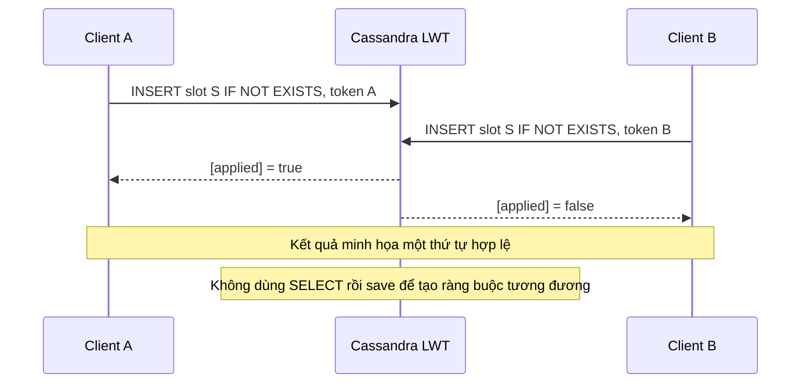
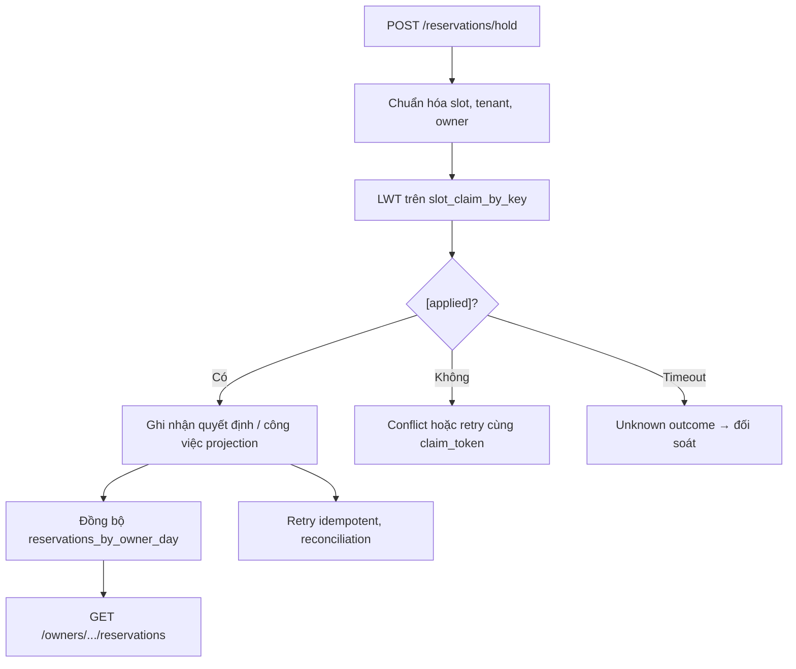

# Ranh giới aggregate và ràng buộc trong một partition

Trong thiết kế ứng dụng với **Spring Data Cassandra**, quyết định quan trọng không chỉ là ánh xạ Java entity vào bảng nào. Ta còn phải trả lời: **những trạng thái nào phải thay đổi nhất quán cùng nhau, ai có quyền quyết định một thay đổi hợp lệ, và dữ liệu được phân phối theo partition key nào?** Đây là điểm gặp nhau giữa khái niệm **aggregate** trong Domain-Driven Design (DDD) và mô hình phân tán của Apache Cassandra.

Một **aggregate** là nhóm đối tượng nghiệp vụ có một **ranh giới bất biến (invariant)**: bên ngoài chỉ được làm thay đổi trạng thái qua những thao tác được aggregate cho phép. Một **Cassandra partition** lại là phạm vi lưu trữ/định tuyến được xác định bởi partition key. Hai khái niệm liên quan, nhưng **không đồng nghĩa**. Đặt nhiều hàng cùng một partition không tự làm chúng trở thành một transaction có kiểm tra toàn bộ ràng buộc nghiệp vụ; chia aggregate qua nhiều partition cũng không có nghĩa Cassandra sẽ tự phối hợp cập nhật nguyên tử cho bạn.

Bài học thuộc chương **Thiết kế ứng dụng** của module `SPRING_DATA_CASSANDRA`: kết nối tư duy aggregate, entity mapping, repository, `CassandraTemplate`, `CqlTemplate` và CQL với **partition key, consistency, lightweight transaction (LWT), read model và hiệu năng**. Trọng tâm là chọn một **ranh giới ra quyết định** hợp lý cho nghiệp vụ và nhận diện nơi cần quy trình nhiều bước thay vì một lệnh ghi đơn giản.

## 1. Aggregate khác partition ở điểm nào?

| Góc nhìn | DDD aggregate | Cassandra partition |
| --- | --- | --- |
| Được định nghĩa bởi | Invariant và hành vi nghiệp vụ | **Partition key** trong CQL |
| Mục tiêu | Giữ trạng thái nghiệp vụ hợp lệ qua các lệnh | Định tuyến, nhóm dữ liệu và hỗ trợ truy vấn hiệu quả |
| Khái niệm “root” | Aggregate root kiểm soát mutation | Không có root DDD mặc định trong Cassandra |
| Quy tắc đồng thời | Do thiết kế ứng dụng/giao thức cập nhật quyết định | Cassandra có các ngữ nghĩa ghi/đọc và LWT với phạm vi, giới hạn riêng |
| Quan hệ nhiều đối tượng | Có thể gồm entities/value objects liên quan | Một partition có thể chứa nhiều clustering rows |
| Giới hạn kích thước | Theo sự phức tạp và contention của nghiệp vụ | Còn bị giới hạn thực tế bởi partition size, hot spot, paging và compaction |

Một aggregate **không bắt buộc** được nhồi thành một row. Nhưng nếu invariant đòi hỏi so sánh/cập nhật trạng thái **nguyên tử**, kiến trúc Cassandra phải có **một điểm ra quyết định** có khả năng thực thi điều kiện đó, thay vì hy vọng các thao tác độc lập ở nhiều bảng luôn hoàn tất cùng lúc.

Ví dụ: “Một ghế của một suất diễn chỉ được một người giữ” là invariant. “Lấy 30 vé gần nhất của một người dùng” là access pattern. Hai nhu cầu có thể cần **hai bảng khác nhau**: một bảng quyết định quyền giữ ghế, một bảng phục vụ danh sách của người dùng.

## 2. Partition key là ranh giới định tuyến, không phải chiếc khóa giao dịch tự động

Cassandra phân phối các partition dựa trên token của **partition key**. Nếu biết đầy đủ key, coordinator xác định được các replica liên quan; nếu chỉ biết một số cột thường, Cassandra không thể mặc nhiên dùng đường đọc hiệu quả.

Một bảng đọc theo đơn:

```sql
CREATE TABLE orders_by_tenant_day (
    tenant_id     text,
    order_day     date,
    created_at    timestamp,
    order_id      uuid,
    status_code   text,
    total_minor   bigint,
    PRIMARY KEY ((tenant_id, order_day), created_at, order_id)
) WITH CLUSTERING ORDER BY (created_at DESC, order_id DESC);
```

Trong bảng này:

- `(tenant_id, order_day)` là **composite partition key**.
- `(created_at, order_id)` là các **clustering columns**; những đơn trong cùng ngày/tenant có thể được đọc theo thứ tự.
- Hai `order_id` khác nhau trong cùng partition **không trở thành một aggregate duy nhất** chỉ vì được đặt cạnh nhau trong storage.

```sql
SELECT created_at, order_id, status_code, total_minor
FROM orders_by_tenant_day
WHERE tenant_id = ?
  AND order_day = ?
LIMIT 30;
```

Truy vấn hợp lệ và có đường đọc rõ ràng. Nhưng nếu nghiệp vụ yêu cầu **“không được bán quá 10 vé trong cùng ngày”**, việc đặt tất cả vé cùng partition **không tự bảo vệ ngưỡng 10**. Hai writer có thể cùng đọc tổng 9 rồi cùng thêm một vé. Cần **giao thức ra quyết định có điều kiện** hoặc kiến trúc điều phối khác.

### Một phân biệt cần nhớ

**Data locality** giúp truy vấn các row liên quan bằng cùng partition key. **Business atomicity** yêu cầu một thay đổi chỉ thành công nếu điều kiện nghiệp vụ đúng tại điểm ra quyết định. Cassandra cung cấp các công cụ như conditional write/LWT, nhưng bạn phải chủ động thiết kế **khóa và trạng thái được kiểm tra**.

## 3. Bắt đầu từ invariant, không từ danh sách entity

Hãy lấy ứng dụng đặt chỗ làm ví dụ xuyên suốt:

> Với một tenant, một tài nguyên và một time slot UTC xác định, tại một thời điểm chỉ có **một claim hợp lệ** được quyền giữ hoặc xác nhận slot đó.

Trước khi viết bảng, hãy làm rõ:

1. **Slot được định nghĩa thế nào?** Ví dụ `2026-11-25T10:00:00Z` là một khoảng 15 phút; mọi writer phải dùng cùng cách quy đổi thời gian.
2. **Ràng buộc “một” áp dụng ở đâu?** Theo tenant/resource/slot, hay theo resource trên tất cả tenant?
3. **Ai là chủ?** Một `owner_id` được xác thực và một token định danh lần giữ chỗ.
4. **Trạng thái hợp lệ là gì?** `HELD`, `CONFIRMED`; khi nào được release?
5. **Hết hạn xử lý thế nào?** Lease time, expiry worker, retry, clock skew.
6. **Có thể đổi quyền giữ chỗ không?** Nếu có, stale request phải không thể xóa/confirm claim của thế hệ mới.

Mỗi câu trả lời ảnh hưởng **canonical key, câu điều kiện và mô hình dữ liệu**, không đơn thuần là annotation trên Java class.

## 4. Chọn một canonical row làm điểm quyết định

Đối với invariant “một claim cho một slot”, có thể sử dụng một bảng mà **mỗi slot tương ứng đúng một hàng**:

```sql
CREATE TABLE slot_claim_by_key (
    tenant_id       text,
    resource_id     uuid,
    slot_start_utc  timestamp,
    reservation_id  uuid,
    owner_id        uuid,
    claim_token     uuid,
    status_code     text,
    held_until      timestamp,
    version         bigint,
    PRIMARY KEY ((tenant_id, resource_id, slot_start_utc))
);
```

Toàn bộ `(tenant_id, resource_id, slot_start_utc)` vừa là **partition key ghép**, vừa là **full primary key** (không có clustering column). Hai lời gọi giữ cùng slot phải đến **đúng cùng khóa**. Nếu hai producer chuẩn hóa thời gian khác nhau — ví dụ một bên dùng 10:00, bên khác dùng 10:01 cho cùng khoảng 15 phút — chúng tạo **hai partition khác nhau**, và bất cứ LWT nào cũng không thể tự biết đó là cùng slot.

`reservation_id` và `claim_token` **không nằm trong primary key** của bảng quyết định: nếu mỗi owner có khóa riêng, cả hai có thể tạo thành công claim cho cùng một tài nguyên.

| Thuộc tính | Vai trò |
| --- | --- |
| `tenant_id, resource_id, slot_start_utc` | Định danh **đơn vị tranh chấp** |
| `reservation_id` | Liên kết tới quy trình đặt chỗ lớn hơn |
| `owner_id` | Chủ sở hữu, phải được xác thực ở tầng ứng dụng |
| `claim_token` | Phân biệt các **thế hệ giữ chỗ** trên cùng khóa |
| `status_code` | Trạng thái của claim |
| `held_until` | Deadline nghiệp vụ, không tự động thành điều kiện atomic dựa trên giờ hiện tại |
| `version` | Phiên bản phục vụ CAS khi nghiệp vụ cần gia hạn hoặc thay đổi có điều kiện |

**Tư duy thiết kế:** đặt **bằng chứng sở hữu slot** ở một canonical row, không dùng bảng danh sách hoặc secondary index làm nơi quyết định uniqueness.

## 5. Giữ slot bằng `INSERT IF NOT EXISTS`

Cách không an toàn là `SELECT` thấy slot trống rồi `repository.save(...)`: hai request có thể cùng đọc “trống” và cả hai đều gửi ghi. Cách phù hợp hơn là **conditional insert**:

```sql
INSERT INTO slot_claim_by_key
    (tenant_id, resource_id, slot_start_utc,
     reservation_id, owner_id, claim_token,
     status_code, held_until, version)
VALUES (?, ?, ?, ?, ?, ?, 'HELD', ?, 1)
IF NOT EXISTS;
```

Đối với một canonical key, LWT sử dụng cơ chế đồng thuận để quyết định điều kiện `IF NOT EXISTS`. Ứng dụng phải đọc kết quả:

| Quan sát | Ý nghĩa | Hành động |
| --- | --- | --- |
| `[applied] = true` | Claim mới đã được áp dụng | Tiếp tục workflow giữ chỗ |
| `[applied] = false` | Hàng không còn thỏa điều kiện “chưa tồn tại” | Trả conflict hoặc đối soát idempotency |
| Timeout/unavailable | **Không rõ kết quả cuối** | Không đoán thất bại; đọc/đối soát bằng token |



Trong tình huống thực, client nào thắng không được quyết định bởi thứ tự dòng trên biểu đồ. Điều quan trọng là **tất cả writer dùng cùng key và cùng giao thức conditional write**.

### Không nhầm LWT với mọi thao tác Cassandra khác

Một `repository.save(...)` mặc định thường mang ngữ nghĩa **upsert**, không phải `IF NOT EXISTS`. Một `@Query` đặt tên khéo, index trên `resource_id` hay `LOCAL_QUORUM` cho cặp `SELECT`/`INSERT` cũng **không tự tạo** thao tác so sánh-và-ghi nguyên tử.

## 6. Confirm, release và bảo vệ thế hệ claim

Sau bước hold, service có thể phải xác nhận hoặc giải phóng slot. Cả hai đều cần tránh request cũ làm thay đổi claim mới.

### 6.1. Confirm khi đúng owner và token

```sql
UPDATE slot_claim_by_key
SET status_code = 'CONFIRMED',
    version = 2
WHERE tenant_id = ?
  AND resource_id = ?
  AND slot_start_utc = ?
IF claim_token = ?
   AND owner_id = ?
   AND status_code = 'HELD'
   AND version = 1;
```

Ví dụ trên minh họa bước chuyển `version 1 → 2` khi một claim đang ở version 1. Trong ứng dụng thật, version hiện tại được đọc/tái xác minh và giá trị kế tiếp được tính có kiểm soát. Nó **không tự tăng** chỉ vì trường được đặt tên `version`.

Nếu LWT không áp dụng, service cần phân biệt claim đã được xác nhận bằng chính token cũ, claim của người khác, lease đã đổi hoặc một yêu cầu sai trạng thái. **Không tự động retry một update theo version cũ** vô hạn.

### 6.2. Release bằng điều kiện

```sql
DELETE FROM slot_claim_by_key
WHERE tenant_id = ?
  AND resource_id = ?
  AND slot_start_utc = ?
IF claim_token = ?
   AND owner_id = ?
   AND status_code = 'HELD'
   AND version = ?;
```

Nếu token/version không còn khớp, request release cũ không được phép xóa một lần giữ chỗ đã gia hạn hoặc được tạo lại. DELETE thông thường tạo tombstone; cần cân nhắc TTL, repair và compaction khi cùng key được claim/release liên tục.

**Lưu ý về thời gian:** kiểm tra `held_until` trong code rồi gọi LWT không phải một điều kiện atomic “chỉ confirm trước deadline” nếu đồng hồ tiến trong khoảng giữa hai bước. Muốn bảo vệ rule nghiêm ngặt, cần định nghĩa giao thức expiry/confirm, phiên bản lease và điểm ra quyết định, đồng thời kiểm thử race sát deadline.

## 7. Java Driver 4 trong ứng dụng Spring: LWT ở ranh giới service

Đối với thao tác cần kiểm soát `[applied]`, Java Driver 4 là một cách diễn tả rõ ràng. Giả sử `CqlSession` đã được Spring Boot cấu hình và dùng chung:

```java
import java.time.Instant;
import java.util.UUID;
import com.datastax.oss.driver.api.core.CqlSession;
import com.datastax.oss.driver.api.core.DefaultConsistencyLevel;
import com.datastax.oss.driver.api.core.cql.BoundStatement;
import com.datastax.oss.driver.api.core.cql.PreparedStatement;
import com.datastax.oss.driver.api.core.cql.ResultSet;

public final class SlotClaimGateway {
    private final CqlSession session;
    private final PreparedStatement claimStatement;

    public record SlotKey(String tenantId, UUID resourceId, Instant startUtc) {}

    public SlotClaimGateway(CqlSession session) {
        this.session = session;
        this.claimStatement = session.prepare(
                "INSERT INTO slot_claim_by_key " +
                "(tenant_id, resource_id, slot_start_utc, " +
                " reservation_id, owner_id, claim_token, " +
                " status_code, held_until, version) " +
                "VALUES (?, ?, ?, ?, ?, ?, 'HELD', ?, 1) IF NOT EXISTS");
    }

    public boolean tryClaim(
            SlotKey key, UUID reservationId, UUID ownerId,
            UUID token, Instant heldUntil) {

        if (key == null || key.tenantId() == null
                || key.tenantId().isBlank()
                || key.resourceId() == null || key.startUtc() == null
                || reservationId == null || ownerId == null
                || token == null || heldUntil == null
                || !heldUntil.isAfter(key.startUtc())) {
            throw new IllegalArgumentException("Thông tin claim không hợp lệ");
        }

        BoundStatement statement = claimStatement.bind(
                key.tenantId(), key.resourceId(), key.startUtc(),
                reservationId, ownerId, token, heldUntil)
                .setConsistencyLevel(DefaultConsistencyLevel.LOCAL_QUORUM)
                .setSerialConsistencyLevel(DefaultConsistencyLevel.SERIAL);

        ResultSet result = session.execute(statement);
        return result.wasApplied();
    }
}
```

**Đọc đoạn mã đúng phạm vi:** đây là gateway của **một thao tác LWT**. Phần xác thực `ownerId`, quy tắc slot UTC, độ chính xác thời gian, quyền tenant và trạng thái reservation phải được xử lý ở application/domain layer. `startUtc` nên được chuẩn hóa theo khung slot và độ chính xác lưu trữ CQL `timestamp` (millisecond).

`LOCAL_QUORUM` và `SERIAL` là **ví dụ lựa chọn consistency**, không phải mặc định bắt buộc. Topology/RF và chính sách multi-DC phải được phân tích riêng. `wasApplied() == false` là kết quả điều kiện; một exception do timeout vẫn có thể mang **unknown outcome**.

**Không prepare statement ở mỗi request:** giữ `PreparedStatement` tái sử dụng. Không tự động đánh dấu toàn bộ conditional workflow là an toàn cho mọi retry bên ngoài, bởi những side effect khác như thu tiền hoặc ghi projection có thể không idempotent.

## 8. Entity mapping và repository không quyết định aggregate thay bạn

Entity dùng Spring Data có thể ánh xạ canonical key thành một `@PrimaryKeyClass`:

```java
import java.io.Serializable;
import java.time.Instant;
import java.util.UUID;
import org.springframework.data.cassandra.core.mapping.PrimaryKeyClass;
import org.springframework.data.cassandra.core.mapping.PrimaryKeyColumn;
import org.springframework.data.cassandra.core.mapping.PrimaryKeyType;

@PrimaryKeyClass
public class SlotClaimKey implements Serializable {
    @PrimaryKeyColumn(name = "tenant_id", ordinal = 0,
            type = PrimaryKeyType.PARTITIONED)
    private String tenantId;

    @PrimaryKeyColumn(name = "resource_id", ordinal = 1,
            type = PrimaryKeyType.PARTITIONED)
    private UUID resourceId;

    @PrimaryKeyColumn(name = "slot_start_utc", ordinal = 2,
            type = PrimaryKeyType.PARTITIONED)
    private Instant startUtc;

    public SlotClaimKey() {}
    // Cần bổ sung constructor, getter/setter, equals() và hashCode().
}
```

```java
import java.time.Instant;
import java.util.UUID;
import org.springframework.data.cassandra.core.mapping.Column;
import org.springframework.data.cassandra.core.mapping.PrimaryKey;
import org.springframework.data.cassandra.core.mapping.Table;

@Table("slot_claim_by_key")
public class SlotClaimRecord {
    @PrimaryKey
    private SlotClaimKey key;

    @Column("reservation_id")
    private UUID reservationId;

    @Column("owner_id")
    private UUID ownerId;

    @Column("claim_token")
    private UUID claimToken;

    @Column("status_code")
    private String statusCode;

    @Column("held_until")
    private Instant heldUntil;

    @Column("version")
    private Long version;

    public SlotClaimRecord() {}
    // Cần bổ sung constructor/getters/setters theo yêu cầu mapping.
}
```

Hai class chỉ là **khung ánh xạ**, cần hoàn thiện trước khi biên dịch/sử dụng. Có thể dùng `CassandraRepository<SlotClaimRecord, SlotClaimKey>` để tra cứu trạng thái, nhưng **không dùng `save(...)` thay cho conditional claim**.

Với `CassandraTemplate` hoặc `CqlTemplate`, nguyên tắc tương tự: template đơn giản hóa API truy cập dữ liệu; muốn bảo vệ invariant phải phát đúng CQL có điều kiện hoặc API phiên bản framework hỗ trợ, rồi **kiểm tra kết quả**. Annotation mapping không tự biến một loạt writes thành transaction DDD.

## 9. Cùng partition, nhiều row: lợi ích và giới hạn

Giả sử một aggregate đơn hàng gồm nhiều item. Một bảng đọc các item:

```sql
CREATE TABLE order_items_by_order (
    tenant_id     text,
    order_id      uuid,
    item_id       uuid,
    sku           text,
    quantity      int,
    price_minor   bigint,
    PRIMARY KEY ((tenant_id, order_id), item_id)
);
```

Toàn bộ item của một order có cùng partition key `(tenant_id, order_id)`. Đường đọc phù hợp:

```sql
SELECT item_id, sku, quantity, price_minor
FROM order_items_by_order
WHERE tenant_id = ? AND order_id = ?;
```

Lợi ích: dữ liệu nhóm theo truy vấn “các item của một đơn”, có thể đọc theo một partition (với paging/limit theo nhu cầu). Nhưng các điều kiện như **“tổng giá trị đơn không vượt hạn mức”** hay **“chỉ thêm item khi đơn vẫn ở trạng thái DRAFT”** không xuất hiện tự động chỉ vì nhiều item cùng partition.

### Không nhầm atomic batch và kiểm tra invariant

Một `BATCH` trong Cassandra là **cơ chế nhóm mutation** với ngữ nghĩa atomicity riêng của Cassandra; nó **không tương đương transaction quan hệ có isolation tùy ý**. Đặc biệt:

- Đặt hai `UPDATE` vào một batch **không tự kiểm tra** điều kiện `total + newPrice <= maxTotal`.
- Đọc aggregate, tính tổng ở Java rồi ghi batch vẫn có thể **race** với writer khác.
- Conditional batches có cú pháp và giới hạn theo phiên bản/partition; không giả định một batch có thể thực thi **mọi** điều kiện trên nhiều bảng/partition và giữ serializable isolation.
- Batch trải nhiều partition có chi phí/độ trễ và **không phải một tối ưu hiệu năng chung**; nên dùng khi đúng semantics và phạm vi hỗ trợ.

Nếu invariant gắn với **một hàng canonical state**, hãy xem xét một hàng summary/guard được quản lý bằng version/LWT hoặc **một command processor duy nhất** theo aggregate ID. Các item/read model khác có thể được cập nhật sau quyết định, với retry/reconciliation.

## 10. Đặt guard cho aggregate và tách read model

Một bảng canonical cho trạng thái tổng của đơn hàng:

```sql
CREATE TABLE order_guard_by_id (
    tenant_id      text,
    order_id       uuid,
    status_code    text,
    total_minor    bigint,
    version        bigint,
    PRIMARY KEY ((tenant_id, order_id))
);
```

Giả sử hàng hiện tại là `status_code='DRAFT', total_minor=1500, version=7`. Thêm một item giá trị 500 và cho phép tổng mới 2000 nếu domain đã xác thực giới hạn:

```sql
UPDATE order_guard_by_id
SET total_minor = 2000,
    version = 8
WHERE tenant_id = ?
  AND order_id = ?
IF status_code = 'DRAFT'
   AND total_minor = 1500
   AND version = 7;
```

Service đọc snapshot, tính toán với **kiểu số an toàn**, xác minh quy tắc nghiệp vụ và phát conditional update. Nếu `[applied] = false`, nó tải lại state hoặc trả conflict; không tự suy rằng mutation thứ hai thành công. Đây là **optimistic concurrency control** ở một canonical row. Khi một writer khác đã cập nhật version, một lệnh dùng version cũ không còn áp dụng.

**Nhưng:** lệnh này chỉ thay đổi `order_guard_by_id`. Nó **không tự thêm item** vào `order_items_by_order`. Hai bảng là hai đường lưu trữ riêng, dù cùng các cột tên `tenant_id/order_id`. Nếu hệ thống cần bảo đảm “đã cộng vào total thì nhất định có line item tương ứng”, cần thiết kế **workflow** bảo toàn bằng chứng command, idempotency và đối soát; không coi hai lệnh độc lập như một transaction duy nhất.

### Cách nghĩ có ích cho application layer

1. **Aggregate command**: `AddItem(orderId, itemId, expectedVersion)`.
2. **Quyết định**: kiểm tra aggregate ở canonical state, điều kiện và invariant.
3. **Bằng chứng quyết định**: lưu command/event ID, version hoặc trạng thái đủ để retry/rebuild (tùy kiến trúc).
4. **Projection**: cập nhật bảng `order_items_by_order`/feed phục vụ truy vấn.
5. **Khôi phục**: khi một bước phụ thất bại, worker xử lý lại dựa trên sự thật bền vững, không cộng lặp mù.

Nếu ứng dụng cần **atomicity chặt giữa nhiều item và state** mà giải pháp trên không đáp ứng, có thể phải thay đổi **cấu trúc aggregate**, giới hạn số item trong một trạng thái nhỏ hoặc chọn một hệ lưu trữ/transaction phù hợp hơn. Đừng hứa tính nguyên tử không được hệ thống hỗ trợ.

## 11. Bảng phục vụ đọc không nhất thiết là nơi quyết định invariant

Ứng dụng thường cần thêm một feed “reservation gần nhất của một người”:

```sql
CREATE TABLE reservations_by_owner_day (
    tenant_id       text,
    owner_id        uuid,
    reservation_day date,
    created_at      timestamp,
    reservation_id  uuid,
    resource_id     uuid,
    slot_start_utc  timestamp,
    status_code     text,
    PRIMARY KEY ((tenant_id, owner_id, reservation_day),
                 created_at, reservation_id)
) WITH CLUSTERING ORDER BY (created_at DESC, reservation_id DESC);
```

Query:

```sql
SELECT created_at, reservation_id, resource_id,
       slot_start_utc, status_code
FROM reservations_by_owner_day
WHERE tenant_id = ?
  AND owner_id = ?
  AND reservation_day = ?
LIMIT 20;
```

**Hai bảng, hai hợp đồng:**

| Bảng | Partition key | Điều nó phục vụ |
| --- | --- | --- |
| `slot_claim_by_key` | `(tenant_id,resource_id,slot_start_utc)` | Quyền claim **một slot** |
| `reservations_by_owner_day` | `(tenant_id,owner_id,reservation_day)` | Danh sách reservation theo **owner/ngày** |

Một workflow hợp lý:



**Projection lag** có thể khiến feed chưa hiển thị reservation vừa giữ, dù canonical claim đã được áp dụng. API phải chọn semantics phù hợp: trả token/ID của claim ngay sau LWT thành công; nếu cần thông báo “đã lưu cả read model”, phải chờ/kiểm tra projection theo hợp đồng và chịu chi phí tương ứng.

Đừng dùng `SELECT` trên `reservations_by_owner_day` để quyết định “slot còn trống không?”: bảng theo owner **không thể nhìn thấy đầy đủ các claim của owner khác** và không bảo vệ uniqueness.

## 12. Khi aggregate trải nhiều partition: saga và bù trừ

Một reservation có thể bao gồm **ba slot** liên tiếp. Mỗi slot có một canonical partition khác nhau. Nếu ba lệnh `INSERT IF NOT EXISTS` lần lượt cho S1, S2, S3:

```text
S1: claim thành công
S2: claim thành công
S3: đã có khách khác giữ → [applied] = false
```

Đây là trạng thái **claim một phần**. Cassandra không cung cấp giao dịch ACID tùy ý để tự rollback S1/S2 sau kết quả S3. Có thể dùng **saga**:

1. Tạo `reservation_id` và idempotency token ổn định cho toàn workflow.
2. Chuẩn hóa, sắp xếp các slot theo thứ tự cố định; áp dụng LWT từng canonical key.
3. Nếu toàn bộ thành công, chuyển reservation sang bước confirm/thanh toán theo giao thức nghiệp vụ.
4. Nếu một slot xung đột, gửi **conditional release** cho những slot đã giữ với đúng claim token và version.
5. Ghi log công việc bù trừ, retry có giới hạn, xử lý timeout chưa rõ kết quả và **đối soát** khi worker restart.
6. Chỉ trả “đã hoàn tất rollback” khi các claim liên quan đã được kiểm chứng.

**Saga không tạo atomicity tức thời**: trong một khoảng thời gian có thể tồn tại vài slot đã giữ trong lúc phần còn lại chưa quyết định. Nếu sản phẩm không chấp nhận trạng thái trung gian đó, phải cân nhắc **gộp phạm vi ra quyết định** hoặc dùng transactional coordinator khác.

### Khoảng thời gian giao nhau không giống một khóa giống nhau

Hai booking `[10:00,11:00)` và `[10:30,11:30)` có **khác slot start**, nhưng giao nhau. Nếu key chỉ là `slot_start_utc` tùy ý, hai LWT có thể cùng `[applied]=true`. Cần **chuẩn hóa khoảng thành các slot cố định**, claim hết các slot liên quan hoặc thiết kế aggregate kiểm tra interval overlap. Không thể lấy uniqueness theo khóa đơn lẻ thay cho bất biến **không chồng lịch** mà không có bước mô hình hóa.

## 13. Giữ aggregate nhỏ và giới hạn hot partition

Một thiết kế có vẻ tiện là đặt mọi bản ghi của tenant vào **một partition**, rồi cho rằng việc cập nhật/quản lý ràng buộc sẽ dễ dàng. Trong Cassandra, đây thường là quyết định rủi ro:

- Một tenant lớn có thể tạo partition **không giới hạn**, làm tăng I/O, memory, compaction và latency.
- Nhiều writer dồn vào cùng partition/key có thể gây **hot spot**, đặc biệt khi tranh chấp LWT.
- Lấy “toàn bộ aggregate” có thể đòi đọc một lượng hàng rất lớn; cần paging và giới hạn.
- TTL/delete cập nhật thường xuyên có thể tạo nhiều tombstone khiến đường đọc chậm.
- Shard tùy tiện có thể **phá invariant** nếu hai writer cạnh tranh được đưa tới hai khóa khác nhau.

| Lựa chọn | Lợi ích | Rủi ro/giới hạn |
| --- | --- | --- |
| Một canonical row cho một slot | LWT ra quyết định rõ cho một khóa | Hot key khi nhiều request giữ cùng slot |
| Một partition cho item của một order | Dễ đọc item theo order | Order cực lớn làm partition rộng |
| Bucket theo tenant/ngày cho feed | Giới hạn phạm vi đọc và retention | Truy vấn nhiều ngày cần hợp nhất nhiều partition |
| Shard cho dữ liệu thống kê | Phân tán write load | Không phù hợp nếu cần uniqueness toàn cục trên key chưa có điều phối |
| Một guard row + read models | Tách invariant và truy vấn | Projection có độ trễ và cần reconciliation |

Đo kích thước partition, số row, phân bố tenant, tốc độ ghi, p95/p99, tombstone và contention trước khi chọn bucket hoặc shard. **Đừng để một mong muốn “transaction trong partition” làm hỏng đường truy vấn và khả năng mở rộng.**

## 14. Consistency, timestamp và multi-DC không thay thế luật aggregate

**Read/write consistency** (ví dụ `LOCAL_ONE`, `LOCAL_QUORUM`) xác định điều kiện phản hồi replica, không tự buộc hai bước `SELECT rồi UPDATE` thành thao tác nguyên tử.

**Write timestamp** và last-write-wins hòa giải các mutation cạnh tranh nhưng không biết **luật chuyển trạng thái** của aggregate. Một ghi đến sau theo thời gian thực có thể thua một ghi mang timestamp lớn hơn; tăng consistency không biến so sánh timestamp thành so sánh version nghiệp vụ.

**Serial consistency** (`SERIAL`, `LOCAL_SERIAL`) là khái niệm khác, gắn với LWT. Nếu nhiều DC cùng có writer quyết định trên **một canonical key toàn cầu**, cần xem phạm vi serial consistency, topology, khả năng failover và thử các tình huống network partition. Không mặc định hai DC đều chọn `LOCAL_SERIAL` độc lập vẫn bảo đảm cùng một tổng thứ tự toàn hệ thống.

| Mong muốn | Công cụ/hợp đồng phù hợp hơn |
| --- | --- |
| Đọc feed mới nhất một tenant/ngày | Partition + clustering order đúng access pattern |
| Không cho hai người claim cùng một slot | Một canonical key + LWT với giao thức thống nhất |
| Không ghi đè version đơn hàng cũ | Optimistic concurrency trên state/guard row |
| Nhiều slot phải cùng được giữ hoặc cùng giải phóng | Saga/compensation hoặc aggregate/transaction phù hợp |
| Read-after-write giữa hai DC | Phân tích replication/routing/CL xuyên DC; không mặc định `LOCAL_QUORUM` đủ |
| Quota/đếm chính xác từng request | Ledger/idempotency/conditional state, không chỉ counter `+1` |

## 15. Idempotency, timeout và trạng thái trung gian

Một LWT có thể **đã thành công** tại Cassandra nhưng HTTP response bị mất. Client retry cùng `claim_token`; `INSERT IF NOT EXISTS` trả `[applied]=false` vì row đã tồn tại. Nếu service tự động trả `409 Conflict`, nó có thể đang từ chối **chính claim vừa tạo**.

Một cách xử lý:

1. Mỗi ý định giữ chỗ có **idempotency key/claim_token ổn định**.
2. Sau `false` hoặc timeout, đọc **canonical row** với consistency thích hợp.
3. Nếu owner/token/trạng thái phù hợp với ý định cũ, trả kết quả *đã được nhận* theo hợp đồng nghiệp vụ.
4. Nếu token của người khác, trả conflict mà **không tiết lộ PII** của người đang giữ.
5. Nếu vẫn không xác định, ghi nhận và đối soát; không tự thu tiền lại hay release một claim mới.

Quan trọng hơn, một workflow **LWT claim → ghi read model → tạo payment** có thể lỗi **giữa các bước**. Không có một phép read duy nhất đảm bảo tất cả side effect đã hoàn tất. Hãy lưu được **ý định/tiến độ**, tạo các bước **idempotent**, có timeout policy và reconciliation.

## 16. Kiểm thử aggregate boundary bằng tình huống cạnh tranh

| Tình huống | Điều cần kiểm tra |
| --- | --- |
| Hai khách cùng claim **một full key** | Tối đa một claim được áp dụng thành công khi không có release |
| Cùng claim gửi lại sau mất ACK | Token ổn định giúp nhận ra request của chính mình |
| Hai service chuẩn hóa slot thành **hai key khác nhau** | Test phát hiện lỗi canonicalization trước khi chạy LWT |
| Confirm cũ sau khi slot đã release/reclaim | CAS owner/token/version phải thất bại |
| Gia hạn lease và expiry worker chạy đồng thời | Worker không xóa nhầm claim đã gia hạn |
| Đặt 3 slot, slot thứ ba xung đột | Hai slot trước được giải phóng/đối soát theo saga |
| Guard update thành công, ghi read model thất bại | Quy trình retry/rebuild projection không làm sai invariant |
| Hai writer cập nhật tổng đơn cùng version | Chỉ một CAS áp dụng; writer còn lại thấy conflict/retry an toàn |
| Replica/node lỗi hoặc mất ACK | Không suy ra timeout có nghĩa chưa ghi |
| Hai writer ở các DC khác nhau | Phạm vi serial consistency và routing phù hợp invariant |
| Một tenant có dữ liệu hàng triệu row | Partition size, paging, compaction và p99 nằm trong ngân sách |

Integration test một node không đủ để chứng minh hành vi quorum/failover của cluster RF lớn hơn 1. Cũng không thể dùng **mock `CassandraRepository`** để chứng minh semantics của Paxos, timestamp, replica hay query validity. Cần test trên Cassandra thật/phân phối phù hợp và fault injection trong môi trường cô lập; không làm gián đoạn production để thử.

### Ví dụ kiểm tra response LWT

```java
boolean applied = slotClaimGateway.tryClaim(
        key, reservationId, ownerId, claimToken, heldUntil);

if (applied) {
    // Đã có quyết định claim: tiếp tục bước ghi nhận/projection.
} else {
    // Kiểm tra canonical row bằng owner/token để tách
    // retry cùng yêu cầu khỏi xung đột thật.
}
```

Đoạn mã cố ý **không** tự nuốt exception: timeout phải đi qua đường xử lý unknown outcome, không thể ép thành `applied=false`.

## 17. Checklist thiết kế aggregate trên Cassandra

1. **Viết invariant bằng câu nghiệp vụ.** Ai được giữ/đổi/xóa đối tượng, điều gì tuyệt đối không được vi phạm?
2. **Xác định canonical key.** Mọi writer cạnh tranh có tới đúng một full primary key không?
3. **Tách quyết định và hiển thị.** Bảng guard/claim nào có quyền quyết định; bảng feed/read model nào chỉ phục vụ query?
4. **Chọn phạm vi update nguyên tử.** Một conditional row/LWT đủ không, hay cần aggregate lớn/saga/transaction khác?
5. **Kiểm tra access patterns.** Partition/clustering key cho từng truy vấn có hợp lệ và giới hạn fan-out không?
6. **Tránh giả định batch = transaction.** Review semantics, restrictions và isolation theo phiên bản Cassandra.
7. **Thiết kế optimistic concurrency.** Version/token được kiểm tra trong chính mutation, không chỉ trước nó.
8. **Quy định idempotency và unknown outcome.** Retry, timeout, cancel, confirm không được làm sai thế hệ claim.
9. **Thiết kế TTL/lease/retention.** Có expiry worker, tombstone/repair và chuẩn thời gian UTC phù hợp.
10. **Chọn serial/regular consistency đúng topology.** Đặc biệt kiểm thử multi-DC.
11. **Giữ partition vừa phải.** Đo row count, hot key, bucket/shard và khả năng tăng trưởng.
12. **Có reconciliation.** Khi projection hoặc bước phụ thất bại, nguồn sự thật nào cho phép sửa?
13. **Kiểm thử các invariant dưới cạnh tranh.** Không chỉ gọi repository một lần trên local dev.

## 18. Bài tập tình huống

**Tình huống A — Cùng partition nhưng mất ràng buộc.** Một bảng `tickets_by_event` có toàn bộ vé trong partition của một sự kiện. Hai request cùng `SELECT COUNT(*)` thấy 99 vé, rồi mỗi bên thêm một vé; giới hạn là 100. Partition chung có tự ngăn quá bán không?

**Gợi ý:** Không. Read-then-write race vẫn tồn tại. Cần một canonical guard/state có conditional mutation hoặc bộ điều phối giữ invariant; chỉ nhóm row chung partition không tự tạo logic kiểm tra limit.

**Tình huống B — Primary key sai.** Bảng claim có `PRIMARY KEY ((event_id, seat_id, owner_id))`. Hai khách khác owner gửi `INSERT IF NOT EXISTS`. Có thể cả hai thành công không?

**Gợi ý:** Có, vì đó là **hai full primary key khác nhau**. Owner phải là thuộc tính được kiểm tra, còn key phải định danh chính ghế/slot mà mọi claimant tranh chấp.

**Tình huống C — Batch đa bảng.** Service cập nhật `order_guard_by_id` và `order_items_by_order` trong một batch, rồi khẳng định điều kiện `total < limit` luôn được bảo vệ. Nhận định đúng không?

**Gợi ý:** Không. Batch thông thường không tự đánh giá invariant hoặc cung cấp transaction quan hệ tùy ý. Cần CAS/conditional decision và cơ chế đảm bảo/đối soát bước ghi item.

**Tình huống D — Retry của chính mình.** `INSERT IF NOT EXISTS` thành công nhưng mất ACK; retry cùng token trả `false`. API nên trả ngay `409` không?

**Gợi ý:** Không nên mặc định. Đọc canonical state và kiểm tra token/owner để nhận ra retry cùng claim; nếu vẫn unknown, trả trạng thái cần đối soát theo hợp đồng.

**Tình huống E — Ba slot, một slot xung đột.** Reservation giữ được S1, S2 rồi S3 thất bại. Chỉ cần gọi `DELETE S1`, `DELETE S2` không điều kiện là đủ?

**Gợi ý:** Không. Nếu claim đã hết hạn và slot được người khác giữ lại, DELETE trễ có thể xóa nhầm. Cần conditional release theo đúng token/version và ghi nhận kết quả bù trừ.

**Tình huống F — Feed chưa thấy claim.** LWT `slot_claim_by_key` trả `true`, nhưng `reservations_by_owner_day` chưa được cập nhật. Có nghĩa claim chưa thành công?

**Gợi ý:** Không. Bảng read model có thể cập nhật bất đồng bộ. Phân biệt nguồn quyết định với projection; thiết kế SLA và read-your-write cho API một cách rõ ràng.

**Tình huống G — Hot partition.** Một tenant có 10 triệu order trong cùng partition. Developer muốn giữ nguyên vì “đơn thuộc cùng aggregate tenant”. Vấn đề là gì?

**Gợi ý:** Tenant không mặc nhiên là aggregate consistency boundary. Partition quá rộng làm đọc/ghi, compaction và latency tốn kém; cân nhắc partition theo query (ví dụ tenant/ngày) và canonical guards cho invariant thực sự.

**Tình huống H — Khoảng thời gian chồng lấn.** Hai request giữ `[10:00,11:00)` và `[10:30,11:30)`, mỗi request dùng start time làm key và LWT thành công. Vì sao ràng buộc không chồng lịch vẫn bị vi phạm?

**Gợi ý:** Hai start times không phải cùng một key. Phải thiết kế chuẩn slot/tập khóa được bảo vệ hoặc aggregate điều phối so sánh overlap, không nhầm uniqueness theo khóa với bất biến trên khoảng.

## Kết luận

**Ranh giới aggregate** diễn tả nơi phải bảo vệ **bất biến nghiệp vụ**, còn **Cassandra partition** diễn tả nơi dữ liệu được nhóm và định tuyến theo khóa. Hai ranh giới cần phối hợp nhưng **không thể đánh đồng**: cùng partition không tự mang tính cô lập giao dịch của một aggregate DDD, còn nhiều partition không tự có transaction ACID. Với invariant theo một khóa, một **canonical row** cùng `IF NOT EXISTS`/LWT hoặc optimistic version là điểm quyết định rõ ràng; với nhiều khóa, cần xem xét **saga, bù trừ, idempotency và đối soát**.

Trong Spring Data Cassandra, hãy thiết kế theo trình tự **phát biểu invariant → chọn canonical key/partition → bảo vệ quyết định bằng conditional write phù hợp → tổ chức read models theo truy vấn → xử lý các bước phụ và timeout → giới hạn partition/hot key → kiểm thử dưới tranh chấp và sự cố replica**. Cách làm này giúp xây dựng ứng dụng vừa đúng với ràng buộc nghiệp vụ, vừa tôn trọng giới hạn hiệu năng và tính nhất quán của dữ liệu phân tán.
