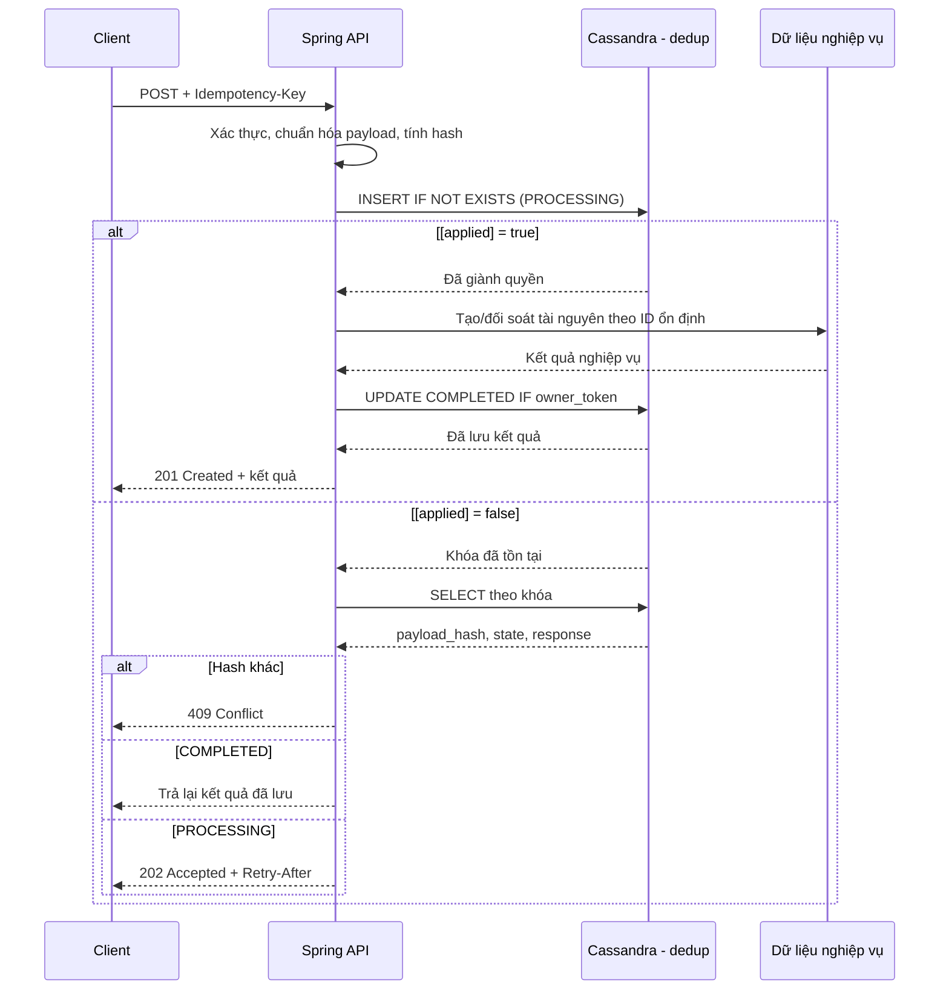

# Tính lũy đẳng, khóa chống trùng và xử lý yêu cầu gửi lại

Trong ứng dụng sử dụng **Spring Data Cassandra**, một yêu cầu có thể được gửi đến máy chủ nhiều lần dù người dùng chỉ thực hiện một thao tác. Nguyên nhân thường là mạng bị ngắt, client tự retry, gateway gửi lại request, consumer đọc lại message hoặc máy chủ gặp lỗi đúng lúc trả phản hồi. Bài học này trình bày cách thiết kế **tính lũy đẳng (idempotency)** ở tầng nghiệp vụ, lưu dấu yêu cầu trong **Apache Cassandra**, kiểm soát tranh chấp bằng **lightweight transaction (LWT)** và khôi phục sau lỗi trong hệ thống phân tán.

## 1. Vấn đề: thao tác đã thành công nhưng client không biết

Giả sử API `POST /reservations` tạo một đơn đặt chỗ:

1. Client gửi yêu cầu với khóa `Idempotency-Key: req-7f2...`.
2. Server đã ghi đơn đặt chỗ vào Cassandra.
3. Kết nối bị ngắt trước khi phản hồi `201 Created` đến client.
4. Client gửi lại yêu cầu. Nếu server tạo đơn mới, hệ thống xuất hiện hai đơn cho cùng một ý định.

Không thể suy ra rằng thao tác trước đó thất bại chỉ vì client nhận timeout. Một timeout có thể xảy ra **trước khi xử lý**, **khi đang xử lý** hoặc **sau khi đã ghi thành công**. Bài toán này cũng xuất hiện khi ứng dụng nhận message theo cơ chế *at-least-once delivery*.

**Mục tiêu thực tế:** các lần gửi cùng một *yêu cầu logic* phải cùng dẫn đến một kết quả nghiệp vụ, hoặc trả về trạng thái đang xử lý có thể truy vết, thay vì âm thầm tạo thêm tác động phụ.

## 2. Phân biệt các khái niệm

| Khái niệm | Ý nghĩa | Ví dụ |
| --- | --- | --- |
| Thao tác lũy đẳng | Thực hiện lại cùng thao tác không làm thay đổi kết quả cuối cùng ngoài lần đầu | Gán `status = 'CONFIRMED'` nhiều lần |
| Khóa chống trùng (*idempotency key*) | Định danh ổn định của một yêu cầu logic qua nhiều lần gửi | Header `Idempotency-Key` hoặc `event_id` |
| Bản ghi chống trùng (*deduplication record*) | Dấu vết đã tiếp nhận/đang xử lý/hoàn tất yêu cầu | Hàng `PROCESSING` hoặc `COMPLETED` trong Cassandra |
| Khóa phân vùng (*partition key*) | Xác định phân vùng dữ liệu Cassandra, phục vụ phân phối và truy vấn | `PRIMARY KEY ((tenant_id, operation, request_key))` |
| LWT | Ghi có điều kiện dựa trên cơ chế đồng thuận Paxos tại phân vùng liên quan | `INSERT ... IF NOT EXISTS` |

**Khóa chống trùng và partition key không đồng nghĩa.** Ta có thể đặt khóa chống trùng vào partition key để tra cứu theo định danh chính xác, nhưng chúng phục vụ hai mục tiêu khác nhau.

Cũng cần phân biệt **lũy đẳng ở mức câu lệnh CQL** và **lũy đẳng ở mức nghiệp vụ**:

- `UPDATE ... SET status = 'PAID'` với cùng giá trị thường lũy đẳng về trạng thái; `counter = counter + 1` hoặc thêm phần tử vào `list` có thể tạo kết quả khác khi chạy lại.
- `INSERT` thông thường trong Cassandra có ngữ nghĩa **upsert**: cùng primary key có thể ghi đè ô dữ liệu. Điều đó không ngăn hai đơn nghiệp vụ khác nhau khi mỗi lần retry tạo một UUID mới.
- `Repository.save(...)` và `CassandraTemplate` hỗ trợ ánh xạ entity và ghi dữ liệu; bản thân việc gọi `save` không cung cấp cam kết xử lý đúng một lần cho toàn bộ quy trình.
- Ghi có điều kiện bằng LWT giúp **một request giành quyền xử lý**; nó không tự biến các thao tác giữa nhiều bảng hoặc lời gọi dịch vụ ngoài thành một giao dịch nguyên tử.

## 3. Thiết kế khóa chống trùng

Khóa cần đại diện cho **ý định nghiệp vụ** và phải giữ nguyên trong mọi lần retry của cùng ý định.

- Với HTTP API, client tạo một khóa ngẫu nhiên đủ khó đoán (chẳng hạn UUID/ULID), gửi qua `Idempotency-Key` và **tái sử dụng chính khóa đó** khi retry. Yêu cầu mới cần khóa mới.
- Với event/message, dùng định danh sự kiện bất biến do producer tạo và giữ nguyên qua các lần phát lại.
- Phạm vi khóa thường bao gồm tenant, loại thao tác và khóa yêu cầu: `(tenant_id, operation, request_key)`. Với API có phân quyền chi tiết, cân nhắc thêm định danh chủ thể được phép thực hiện thao tác.
- Tính `payload_hash` từ nội dung đầu vào đã **chuẩn hóa** (ví dụ JSON có thứ tự trường ổn định, quy tắc thống nhất cho số và ngày giờ). Hash có thể dùng SHA-256; nội dung cùng ý nghĩa phải cho cùng hash.

Khi một khóa được dùng lại với payload khác, trả lỗi xung đột (ví dụ HTTP `409 Conflict`) thay vì xem là lần retry hợp lệ. Hash **không thay thế bước xác thực và kiểm tra quyền**; không được trả kết quả đã lưu cho người gọi không có quyền.

Không dùng timestamp nhận request hoặc UUID mới được tạo ở **mỗi lần retry** làm khóa chống trùng, vì những giá trị đó thay đổi và làm mất khả năng phát hiện gửi lại.

## 4. Thiết kế bảng Cassandra theo kiểu truy vấn cần thực hiện

Các truy vấn chính của luồng chống trùng gồm: **giành quyền** cho một khóa, **tra kết quả** theo đúng khóa đó và **đánh dấu hoàn tất** với điều kiện người ghi vẫn sở hữu yêu cầu. Thiết kế một hàng cho mỗi khóa logic:

```sql
CREATE TABLE idempotency_requests (
    tenant_id uuid,
    operation text,
    request_key text,
    payload_hash text,
    state text,
    owner_token uuid,
    resource_id uuid,
    http_status int,
    response_json text,
    created_at timestamp,
    updated_at timestamp,
    PRIMARY KEY ((tenant_id, operation, request_key))
);
```

Ý nghĩa các cột:

| Cột | Vai trò |
| --- | --- |
| `tenant_id`, `operation`, `request_key` | Phạm vi duy nhất để nhận diện một yêu cầu |
| `payload_hash` | Phát hiện trường hợp tái sử dụng khóa cho nội dung khác |
| `state` | `PROCESSING`, `COMPLETED`; có thể thêm trạng thái lỗi rõ nghĩa theo hợp đồng API |
| `owner_token` | Token của lượt xử lý được phép chuyển trạng thái; hỗ trợ kiểm soát worker cũ |
| `resource_id` | ID của tài nguyên nghiệp vụ liên quan, dùng cho đối soát khi có lỗi |
| `http_status`, `response_json` | Kết quả cần trả lại cho các lần gửi lặp; có thể thay bằng tham chiếu nếu dữ liệu lớn/nhạy cảm |

Với primary key trên, tra cứu theo đầy đủ ba thành phần là truy vấn điểm, không cần `ALLOW FILTERING`. Khóa có độ phân tán tốt giúp tránh một partition duy nhất chứa tất cả request của tenant. Không gom toàn bộ yêu cầu của một tenant vào cùng một partition lớn chỉ để tiện tìm kiếm.

Ví dụ giành quyền xử lý, sử dụng **LWT**:

```sql
INSERT INTO idempotency_requests (
    tenant_id, operation, request_key, payload_hash, state,
    owner_token, resource_id, created_at, updated_at
) VALUES (
    ?, ?, ?, ?, 'PROCESSING', ?, ?, ?, ?
) IF NOT EXISTS;
```

- Nếu kết quả `[applied] = true`, lượt gọi này đã tạo bản ghi và được phép tiếp tục.
- Nếu `[applied] = false`, đã có bản ghi cùng khóa. Đọc trạng thái của bản ghi đó; **không tự thực hiện lại tác động nghiệp vụ**.
- Nếu LWT bị timeout hoặc trả lỗi không xác định, không đoán là đã thất bại. Cần đối soát bằng **cùng khóa** trước khi quyết định xử lý tiếp.

Đánh dấu hoàn tất cũng nên là cập nhật có điều kiện:

```sql
UPDATE idempotency_requests
SET state = 'COMPLETED',
    http_status = ?,
    response_json = ?,
    updated_at = ?
WHERE tenant_id = ?
  AND operation = ?
  AND request_key = ?
IF state = 'PROCESSING' AND owner_token = ?;
```

Điều kiện `owner_token` ngăn một worker không còn quyền cập nhật kết quả sau khi quyền xử lý đã được chuyển sang lượt khác. Nếu cập nhật không áp dụng, phải đọc lại trạng thái và đối soát; không được mặc định thao tác hoàn tất đã được lưu.

## 5. Luồng xử lý một HTTP request



Một quy trình triển khai rõ ràng:

1. **Kiểm tra đầu vào và phân quyền.** Ràng buộc kích thước/định dạng khóa; tính hash từ payload chuẩn hóa. Nếu không thể xác định khóa ổn định, yêu cầu client gửi khóa hợp lệ.
2. **Claim bằng LWT.** Chỉ request giành quyền mới tiến hành xử lý; các request còn lại chuyển sang nhánh đọc trạng thái.
3. **Áp dụng nghiệp vụ có khả năng đối soát.** Tạo trước một `resource_id` ổn định và lưu cùng bản ghi claim. Khi xử lý bị ngắt rồi phục hồi, tra cứu tài nguyên theo ID này thay vì tạo ID khác.
4. **Ghi kết quả và hoàn tất có điều kiện.** Chỉ trả kết quả thành công chắc chắn khi cả nghiệp vụ lẫn trạng thái hoàn tất đã được xác minh. Nếu cập nhật marker lỗi, cần cơ chế đối soát khi retry.
5. **Trả lại kết quả.** Với cùng khóa + cùng payload, trả mã/trạng thái và tài nguyên nhất quán với lần trước. Nếu đang xử lý, trả trạng thái chờ theo hợp đồng API.

Một quy ước HTTP có thể áp dụng: lần đầu thành công trả `201 Created`, lần gửi lại sau khi hoàn tất trả cùng kết quả đã lưu; đang xử lý trả `202 Accepted` cùng `Retry-After`; khóa trùng nhưng nội dung khác trả `409 Conflict`. Đây là **quy ước thiết kế API**, không phải một cơ chế tự có của Cassandra.

## 6. Triển khai claim trong Spring Data Cassandra

Spring Data Cassandra có `CassandraRepository` và `CassandraTemplate` cho thao tác entity thông thường. Với trường hợp cần biết chính xác kết quả điều kiện `IF NOT EXISTS`, có thể dùng trực tiếp **DataStax Java Driver** qua `CqlSession` do ứng dụng Spring quản lý.

Ví dụ dưới đây chỉ minh họa bước **claim**, không thay thế các bước đọc lại, xử lý nghiệp vụ và hoàn tất đã nêu:

```java
import java.time.Instant;
import java.util.UUID;

import com.datastax.oss.driver.api.core.CqlSession;
import com.datastax.oss.driver.api.core.DefaultConsistencyLevel;
import com.datastax.oss.driver.api.core.cql.PreparedStatement;
import org.springframework.stereotype.Component;

@Component
public class IdempotencyClaimStore {
    private final CqlSession session;
    private final PreparedStatement claim;

    public IdempotencyClaimStore(CqlSession session) {
        this.session = session;
        this.claim = session.prepare("""
            INSERT INTO idempotency_requests (
                tenant_id, operation, request_key, payload_hash, state,
                owner_token, resource_id, created_at, updated_at
            ) VALUES (?, ?, ?, ?, 'PROCESSING', ?, ?, ?, ?)
            IF NOT EXISTS
            """);
    }

    public boolean tryClaim(
            UUID tenantId,
            String operation,
            String requestKey,
            String payloadHash,
            UUID ownerToken,
            UUID resourceId) {

        Instant now = Instant.now();
        var statement = claim.bind(
                tenantId, operation, requestKey, payloadHash,
                ownerToken, resourceId, now, now
            )
            .setConsistencyLevel(DefaultConsistencyLevel.LOCAL_QUORUM)
            .setSerialConsistencyLevel(DefaultConsistencyLevel.LOCAL_SERIAL);

        // false = bản ghi đã tồn tại; exception/timeout = chưa rõ kết quả.
        return session.execute(statement).wasApplied();
    }
}
```

`LOCAL_QUORUM` và `LOCAL_SERIAL` trong ví dụ phù hợp khi cơ chế giành quyền được điều phối **nhất quán trong cùng datacenter**. Nếu cùng khóa có thể được claim độc lập ở nhiều datacenter, cần thiết kế nhất quán xuyên datacenter (ví dụ cân nhắc `SERIAL`), thay vì mặc định rằng `LOCAL_SERIAL` đủ cho phạm vi toàn cầu. LWT có chi phí phối hợp cao hơn ghi thông thường; chỉ dùng ở điểm thực sự cần bảo đảm điều kiện.

Khi dùng Spring MVC/WebFlux, nên đặt phần kiểm tra khóa, hash, truy vấn trạng thái và phân loại lỗi trong một service chuyên trách. Controller chỉ chuyển kết quả của service sang HTTP; không phân tán logic chống trùng vào nhiều endpoint.

## 7. Retry an toàn, crash recovery và giới hạn của LWT

Điểm dễ sai nhất là **khoảng trống giữa ghi nghiệp vụ và đánh dấu `COMPLETED`**:

```text
Claim PROCESSING thành công
    -> ghi tài nguyên nghiệp vụ thành công
    -> server crash
    -> chưa kịp UPDATE marker thành COMPLETED
```

Khi retry, marker vẫn `PROCESSING`, nhưng tài nguyên đã tồn tại. Nếu xóa marker hoặc để request mới tự xử lý lại từ đầu, có thể tạo trùng. Cần chọn một chiến lược phục hồi:

**A. Gộp trạng thái và kết quả vào một thực thể có khóa ổn định khi mô hình nghiệp vụ cho phép.** Nếu việc ghi chính là thao tác duy nhất và có thể biểu diễn bằng một hàng Cassandra với primary key ổn định, `INSERT ... IF NOT EXISTS` trên hàng đó có thể vừa tạo tài nguyên vừa loại bỏ tạo trùng. Đây là mô hình đơn giản nhất khi thỏa điều kiện.

**B. Giữ marker riêng và đối soát tài nguyên nghiệp vụ.** Lưu `resource_id` từ khi claim; bản ghi tài nguyên dùng cùng ID ổn định. Lần phục hồi đọc tài nguyên đó: nếu đã tạo và trạng thái hợp lệ, hoàn tất marker; nếu chưa, thực hiện thao tác bảo đảm lũy đẳng trên cùng ID. Nếu bản ghi nghiệp vụ được ghi vào partition khác, quá trình này là **saga/đối soát theo trạng thái**, không phải giao dịch ACID xuyên partition.

**C. Với tác động bên ngoài** (thanh toán, gửi email, gọi dịch vụ khác), truyền khóa chống trùng sang dịch vụ đích nếu được hỗ trợ, hoặc dùng một cơ chế job/outbox có trạng thái bền vững và đối soát. Một marker trong Cassandra **không thể tự bảo đảm exactly-once** cho lời gọi bên ngoài đã được thực thi nhưng phản hồi bị mất.

Để phục hồi `PROCESSING` bị treo lâu:

- Lưu thời điểm bắt đầu, thời điểm cập nhật và — nếu cần — thông tin *lease* cùng `owner_token`.
- Chỉ trao quyền lại bằng một thao tác cập nhật có điều kiện sau khi kiểm tra lease và kết quả nghiệp vụ. Worker cũ có thể vẫn chạy sau khi lease hết hạn; cơ chế **fencing** hoặc tính lũy đẳng của tác động nghiệp vụ mới bảo vệ được trạng thái cuối cùng.
- Không coi việc **TTL làm biến mất marker** là đủ để xác nhận tác động trước đó chưa xảy ra. TTL có thể hết hạn khi nghiệp vụ vẫn đang chạy hoặc khi kết quả đã được tạo nhưng chưa đối soát.
- Khi client gặp timeout/`5xx`, retry với **cùng khóa và cùng payload**, theo exponential backoff có jitter và giới hạn số lần chờ. Không tự sinh khóa mới để “vượt qua” một marker đang xử lý.

### TTL và thời gian lưu chống trùng

Khóa chỉ có thể chống trùng trong **khoảng thời gian marker còn được duy trì**. Chọn thời gian lưu lớn hơn cửa sổ retry tối đa (kể cả độ trễ queue, quá trình phục hồi và trường hợp client ngoại tuyến). Với yêu cầu cần khả năng truy vết dài hạn, có thể cần lưu dấu vết bền vững hơn một bảng dedup có TTL ngắn.

Cassandra áp dụng TTL theo **ô dữ liệu**. Nếu thiết lập TTL cho một số cột nhưng cập nhật cột khác mà không duy trì cùng chính sách hết hạn, bản ghi có thể còn một phần dữ liệu và mất `payload_hash` hay kết quả trước khi toàn bộ dấu vết biến mất. Cần thiết kế vòng đời của **toàn bộ các cột dùng để ra quyết định**, không chỉ đặt TTL tùy ý vào câu lệnh claim. Việc hết hạn/xóa cũng tạo tombstone; đo lường chi phí đọc và compaction khi lưu lượng lớn.

## 8. Tính nhất quán và hiệu năng trong Cassandra

| Vấn đề | Cách tiếp cận |
| --- | --- |
| Hai request cùng khóa chạy đồng thời | Một LWT `IF NOT EXISTS` trên cùng partition để chọn người được xử lý |
| Đọc marker sau claim bị từ chối | Đọc theo primary key với consistency phù hợp; nếu chưa xác nhận được trạng thái, yêu cầu retry chậm thay vì tự chạy nghiệp vụ |
| Nhiều datacenter cùng xử lý khóa | Chọn phạm vi đồng thuận serial và định tuyến request nhất quán với kiến trúc triển khai |
| LWT bị dùng cho mọi thao tác | Chỉ dùng cho bước giành quyền/chuyển trạng thái cần CAS; dữ liệu bình thường vẫn dùng truy vấn đơn giản khi phù hợp |
| Partition nóng hoặc quá lớn | Dùng khóa phân vùng phân tán theo request, giới hạn kích thước payload/response, tránh gom mọi request cùng tenant vào một partition |
| Hàng dedup tăng không giới hạn | Chính sách lưu giữ, đối soát trước khi dọn và theo dõi tombstone/đĩa |

Không xem **logged batch** là giao dịch đa bảng có isolation tương đương hệ quản trị quan hệ; batch không giải quyết được việc lời gọi ngoài Cassandra bị thực thi trùng. Tương tự, thay mức consistency thông thường thành `QUORUM` không thể thay thế điều kiện `IF NOT EXISTS` khi nhiều request tranh quyền.

Các chỉ số đáng theo dõi gồm: tỷ lệ claim thành công/bị trùng, số lần cùng khóa khác hash, số marker `PROCESSING` quá hạn, thời gian LWT p95/p99, timeout/`Unavailable`, tỷ lệ đối soát thành công, độ lớn dữ liệu dedup và chi phí tombstone. Cảnh báo khi số marker treo tăng hoặc khi khối lượng LWT làm tăng độ trễ API.

## 9. Tình huống kiểm thử bắt buộc

| Kịch bản | Kết quả cần xác minh |
| --- | --- |
| Gửi hai request đồng thời với cùng khóa và cùng payload | Chỉ một request claim thành công; không có hai tài nguyên nghiệp vụ |
| Gửi lại khóa sau khi đã `COMPLETED` | Trả đúng tài nguyên/kết quả đã lưu; không tạo thêm |
| Dùng cùng khóa nhưng đổi payload | Bị phát hiện xung đột, không ghi nghiệp vụ |
| Timeout sau `INSERT IF NOT EXISTS`, chưa biết claim thành công hay chưa | Retry cùng khóa, đối soát trạng thái, không tự thực thi hai lần |
| Crash sau khi ghi tài nguyên nhưng trước khi hoàn tất marker | Phục hồi theo `resource_id`; marker có thể hoàn tất mà không tạo tài nguyên mới |
| Lease hết hạn khi worker cũ còn chạy | Worker cũ không ghi đè kết quả của chủ sở hữu mới; tác động nghiệp vụ có fencing/lũy đẳng |
| Retry sau khi vượt thời gian giữ dedup | Hợp đồng API quy định rõ giới hạn bảo đảm; không ngầm coi khóa đã hết hạn là bảo vệ vĩnh viễn |
| Lỗi Cassandra hoặc không đạt consistency cần thiết | Không suy đoán thành công/thất bại; trả lỗi có thể retry hoặc trạng thái chưa xác định |

Với bài kiểm thử đồng thời, hãy phát nhiều request thực tế vào cùng một `(tenant_id, operation, request_key)` và kiểm tra **số tài nguyên nghiệp vụ cuối cùng**, thay vì chỉ khẳng định rằng phương thức `tryClaim` trả về một giá trị `true`.

## 10. Checklist thiết kế trước khi đưa vào production

1. **Định danh:** khóa được tạo một lần cho một ý định, có phạm vi tenant/operation rõ ràng và cùng payload qua các retry.
2. **Dữ liệu:** bảng được thiết kế cho truy vấn điểm; lưu hash, trạng thái, chủ sở hữu và định danh tài nguyên đủ để đối soát.
3. **Đồng thời:** dùng LWT tại thời điểm giành quyền; cập nhật kết quả với điều kiện phù hợp; thống nhất cách dùng consistency giữa các node/datacenter.
4. **Phục hồi:** có đường xử lý khi timeout, crash sau ghi nghiệp vụ, marker treo và worker mất quyền.
5. **Tác động phụ:** ghi nghiệp vụ có ID ổn định hoặc downstream hỗ trợ idempotency; không tuyên bố exactly-once chỉ nhờ marker.
6. **Vòng đời:** xác định thời gian lưu khóa, TTL/cleanup, giới hạn kích thước và phương án theo dõi hiệu năng.
7. **API:** trả kết quả rõ ràng cho `COMPLETED`, `PROCESSING`, hash không khớp và trạng thái chưa xác định; client retry cùng khóa với backoff.

**Kết luận:** Trong Spring Data Cassandra, xử lý yêu cầu gửi lại an toàn là sự kết hợp giữa **khóa chống trùng ổn định**, **bản ghi theo truy vấn điểm**, **LWT để phân xử yêu cầu đồng thời** và **cơ chế đối soát nghiệp vụ sau lỗi**. LWT giúp tránh nhiều worker cùng giành một khóa; tính lũy đẳng của toàn bộ quy trình chỉ đạt được khi các bước tạo tài nguyên, cập nhật kết quả và gọi dịch vụ phụ thuộc đều được thiết kế để có thể kiểm tra và thực hiện lại một cách an toàn.
