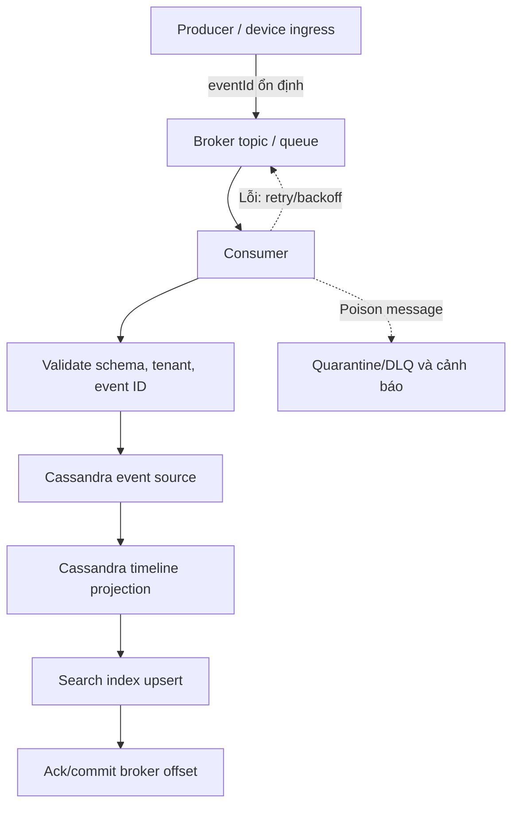
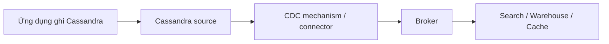

# Phối hợp Cassandra với hàng đợi hoặc hệ lưu trữ khác

## Mục tiêu học tập

Trong một hệ thống thực tế, **Apache Cassandra hiếm khi là thành phần lưu trữ duy nhất**. Một ứng dụng có thể nhận sự kiện qua Kafka/RabbitMQ hoặc một hàng đợi được quản lý, lưu bản ghi bền vững vào Cassandra, đưa dữ liệu sang công cụ tìm kiếm, cập nhật cache và chuyển sự kiện đến hệ thống phân tích. Mỗi công cụ giải quyết một loại truy vấn hoặc nhu cầu vận hành, nhưng chúng **không cùng chia sẻ một giao dịch ACID**.

Đây là bài thuộc chương **Thiết kế ứng dụng** của module `SPRING_DATA_CASSANDRA`: truy cập Cassandra bằng entity mapping, repository, `CassandraTemplate` và CQL; thiết kế bảng theo truy vấn, partition key, consistency, paging và kiểm soát hiệu năng của mô hình dữ liệu phân tán. Trọng tâm là **thiết kế luồng dữ liệu và giao thức phục hồi khi Cassandra phải phối hợp với message broker hoặc kho lưu trữ khác**.

Sau bài học, bạn có thể:

- Quy định rõ **nguồn sự thật** (*source of truth*), các bản sao phục vụ truy vấn (*projections*) và ranh giới giao dịch của từng thành phần.
- Giải thích **dual-write problem** và vì sao Cassandra `BATCH`, LWT hay Kafka transaction không tự tạo transaction xuyên tất cả hệ thống.
- So sánh hai luồng tích hợp: **broker-first** và **Cassandra-first/outbox**.
- Thiết kế khóa Cassandra theo nhu cầu đọc, mã sự kiện ổn định, deduplication, consumer idempotency và quá trình rebuild.
- Phân biệt at-most-once, at-least-once, exactly-once effect và **kết quả không xác định** khi timeout.
- Xử lý các lỗi: ghi Cassandra thành công nhưng ghi search thất bại, publish thành công nhưng mất xác nhận, consumer crash trước khi ack.
- Duy trì thứ tự cập nhật hợp lý bằng aggregate key, version, conditional write khi cần và quy tắc xử lý sự kiện đến muộn.
- Áp dụng retry, backoff, dead-letter queue, reconciliation, tracing, monitoring, TTL/retention và bảo mật dữ liệu.
- Viết CQL và mã Java/Spring theo mô hình tích hợp, rồi lập kế hoạch kiểm thử end-to-end bằng fault injection.

## 1. Chọn đúng vai trò cho từng thành phần

Cassandra mạnh khi dữ liệu được **mô hình hóa theo truy vấn**, khóa phân vùng xác định rõ, lượng ghi lớn và có nhu cầu phân phối/nhân bản. Nhưng một bảng Cassandra không tự cung cấp những gì message broker, full-text search hay object storage chuyên dụng đang làm tốt.

| Thành phần | Vai trò thường phù hợp | Không nên mặc định |
| --- | --- | --- |
| **Cassandra** | Bản ghi nghiệp vụ, trạng thái theo khóa, sự kiện theo bucket, read model phân tán. | Tự xử lý giao dịch nhiều hệ thống hoặc tìm kiếm văn bản tùy ý. |
| **Message broker/queue** | Truyền sự kiện bất đồng bộ, tách producer/consumer, điều tiết tải, phát lại theo hợp đồng. | Mọi broker đều bảo đảm đúng một lần end-to-end. |
| **Search engine** | Full-text search, lọc theo thuộc tính, xếp hạng kết quả, truy vấn khám phá. | Kết quả search luôn đồng bộ tức thì với Cassandra. |
| **Redis/cache** | Giảm latency đọc và tải vào Cassandra, lưu bản sao có TTL. | Cache là nguồn sự thật hoặc tự tránh stale data. |
| **Object storage** | Lưu payload lớn, ảnh, file, archive, dữ liệu gốc có vòng đời riêng. | Một object PUT và một Cassandra INSERT có thể commit/rollback chung. |
| **Warehouse/lake** | Báo cáo, phân tích lịch sử, aggregate trên khối dữ liệu lớn. | Dùng như kho giao dịch để sửa trạng thái request theo thời gian thực. |

### Câu hỏi phải trả lời trước khi vẽ kiến trúc

1. Dữ liệu **nào là nguồn sự thật** khi hai bản sao khác nhau?
2. Bản sao nào được phép trễ, và trễ bao lâu?
3. Khi một phần hệ thống lỗi, API trả “đã hoàn thành” hay “đang xử lý”?
4. Nếu message được gửi hoặc nhận **hai lần**, điều gì xảy ra?
5. Nếu consumer xử lý một nửa rồi crash, ai tiếp tục?
6. Khi cần rebuild search/cache, có dữ liệu nguồn và checkpoint không?
7. Query chính có khóa nào? Có vô tình biến Cassandra thành bảng quét toàn cụm không?

**Không có một “best practice” duy nhất cho mọi luồng.** Một lượt xem thống kê có thể chấp nhận trễ hoặc được đối soát, trong khi giao dịch tài chính hay giữ hàng cần bảo đảm mạnh hơn.

## 2. Ví dụ xuyên suốt: dữ liệu sự kiện thiết bị

Một nền tảng IoT nhận sự kiện từ thiết bị của nhiều tenant. Mỗi sự kiện có:

```text
tenantId       = 11111111-1111-4111-8111-111111111111
eventId        = 22222222-2222-4222-8222-222222222222
deviceId       = 33333333-3333-4333-8333-333333333333
eventAt        = 2026-11-25T09:30:00Z
eventType      = "TEMPERATURE_ALERT"
payload        = {"temperatureC": 42.7}
schemaVersion  = 1
```

Ba nhu cầu đọc khác nhau:

- **Theo event ID:** kiểm tra sự kiện đã được tiếp nhận hay chưa, dùng để đối soát/deduplicate.
- **Theo thiết bị và ngày:** hiển thị timeline sự kiện gần đây.
- **Tìm kiếm sự kiện:** lọc theo từ khóa/nhiều thuộc tính hoặc tìm toàn hệ thống theo quyền.

Không nên mặc định một bảng có thể xử lý hiệu quả cả ba truy vấn. Ta sẽ dùng:

```text
Broker / hàng đợi
    |
    v
Consumer
    |
    +--> Cassandra: sự kiện nguồn theo event ID
    |
    +--> Cassandra: timeline theo device/ngày
    |
    +--> Search: projection có khóa tài liệu ổn định
```

Trong ví dụ, Cassandra chứa **bản ghi sự kiện đã được chấp nhận**; timeline và search là **projections có thể xây lại** từ nguồn. Broker vận chuyển sự kiện và hỗ trợ redelivery theo cấu hình, nhưng không được coi là kho lưu vĩnh viễn nếu retention không bảo đảm.

### Quy định một hợp đồng sự kiện

Một envelope nên có:

| Trường | Ý nghĩa |
| --- | --- |
| `eventId` | ID **ổn định qua mọi retry/redelivery** của cùng một sự kiện. |
| `tenantId` | Phạm vi định danh, phân quyền và truy vấn. |
| `aggregateId`/`deviceId` | Khóa thực thể, có thể dùng làm message partition key. |
| `eventAt` | Thời điểm sự kiện theo nguồn; không nhất thiết là thời điểm broker nhận. |
| `eventType` | Phân loại sự kiện. |
| `schemaVersion` | Cho biết phiên bản payload cần deserialize/validate. |
| `payload`/`payloadRef` | Dữ liệu nhỏ được phép vận chuyển hoặc tham chiếu object lớn. |
| `traceId`/`correlationId` | Theo dõi hành trình, **không** phải khóa nghiệp vụ chống trùng. |
| `aggregateVersion` nếu có | Thứ tự trạng thái trên cùng thực thể, không phải thứ tự toàn cụm. |

Nếu một `eventId` được gửi lại với **payload khác**, không được âm thầm coi đó là cùng sự kiện hợp lệ. Hợp đồng producer phải quy định event ID là bất biến; consumer nên kiểm tra hash/nội dung đã chuẩn hóa hoặc từ chối bản tin mâu thuẫn.

## 3. Hiểu dual-write problem trước khi viết code

Giả sử API cần ghi Cassandra và công bố message:

```java
// Pseudocode phản ví dụ:
repository.save(event);   // 1. Cassandra
messageBroker.publish(event); // 2. Broker
return success();
```

Trình tự tưởng đơn giản này có hai điểm lỗi:

```text
Trường hợp A:
  Cassandra save -> thành công
  process crash -> chưa publish
  => dữ liệu tồn tại nhưng consumer khác không nhận event

Trường hợp B:
  publish -> thành công
  Cassandra save -> thất bại
  => consumer nhận event về dữ liệu nguồn chưa có
```

Thêm `try/catch` hoặc đảo thứ tự **không loại bỏ được khoảng trống lỗi**. Nếu publish hoặc write timeout, client còn có thể không biết kết quả thực sự của bước trước.

### Vì sao không dùng một transaction?

| Công nghệ | Ranh giới cần hiểu |
| --- | --- |
| Cassandra `BATCH` | Hỗ trợ nhóm mutation Cassandra theo ngữ nghĩa riêng, không bao gồm broker/search/object store và không cung cấp isolation kiểu RDBMS tùy ý. |
| Cassandra LWT/`IF` | Giúp quyết định điều kiện trên dữ liệu Cassandra trong phạm vi hỗ trợ, **không** đặt broker vào cùng vòng Paxos. |
| Kafka transaction | Có thể bảo vệ những thao tác trong hệ Kafka theo cấu hình/hợp đồng tương ứng; **không tự commit Cassandra cùng transaction**. |
| Search bulk API | Có thể gửi nhiều index operations; không rollback một write đã hoàn thành ở Cassandra. |
| Redis transaction/pipeline | Không làm Cassandra hoặc broker tham gia một transaction chung. |

Hãy đặt câu hỏi **“nếu crash sau mỗi dòng lệnh thì sao?”**. Đó là phép thử đầu tiên của mọi kiến trúc phối hợp hệ thống.

## 4. Ba mức bảo đảm giao nhận

Các khái niệm cần phân biệt:

| Khái niệm | Ý nghĩa thường gặp | Rủi ro còn lại |
| --- | --- | --- |
| **At-most-once** | Không chủ động phát lại sau khi đã coi message là xử lý. | Có thể mất message nếu ack trước khi hoàn tất ghi. |
| **At-least-once** | Message có thể giao lại cho đến khi nhận xác nhận hợp lệ. | Consumer có thể xử lý trùng. |
| **Exactly-once effect** | Mỗi ý định nghiệp vụ tạo đúng một **hiệu ứng quan sát được** theo hợp đồng. | Cần thiết kế idempotency/transaction hoặc protocol đối soát thực sự. |

“Exactly-once delivery” thường là một cách nói thiếu ranh giới. Một broker có thể hỗ trợ transaction hoặc dedup **trong phạm vi của nó**, nhưng điều đó không tự chứng minh hiệu ứng ở Cassandra và search đúng một lần trong mọi tình huống.

### Ack không giống ghi bền vững tại mọi nơi

Một consumer có thể:

```text
Nhận message
  → Cassandra ghi thành công
  → search index thành công
  → ack broker
```

Nếu crash **sau khi ghi hai nơi nhưng trước ack**, message có thể được giao lại. Nếu ack **trước khi ghi search**, crash có thể làm search vĩnh viễn thiếu dữ liệu khi không có đường rebuild. Vì vậy consumer cần **idempotent processing**, không chỉ “ack ở cuối”.

## 5. Phương án A: broker-first, consumer tạo các projection

Luồng broker-first hợp lý khi ingress có thể đưa sự kiện vào broker đáng tin cậy và business contract chấp nhận việc Cassandra/search được cập nhật bất đồng bộ.



Sơ đồ mô tả thứ tự xử lý cơ bản. Cơ chế retry thực tế phụ thuộc broker/framework: một số listener giữ offset và retry tại chỗ, một số dùng retry topic/queue; không phải mọi lỗi đều khiến message được đưa lại ngay vào queue ban đầu.

### Ưu điểm

- Producer không phải chờ Cassandra **và** search trong cùng HTTP request nếu API contract chấp nhận xử lý bất đồng bộ.
- Consumer có thể scale theo message partitions/queues, đồng thời áp dụng giới hạn tải.
- Nếu search tạm lỗi, message có thể được retry, trong khi Cassandra đã lưu source.
- Dễ thêm projection mới bằng replay/rebuild khi có dữ liệu nguồn và retention phù hợp.

### Đánh đổi

- Broker có thể là điểm nghẽn/điểm lỗi của luồng tiếp nhận.
- Độ trễ từ message đến khi xuất hiện trong Cassandra/search cần được đo.
- Consumer cần chịu **duplicate delivery** và out-of-order.
- Nếu retention của broker ngắn và Cassandra không lưu event source đủ, khả năng replay hữu hạn.
- Việc ghi 3 nơi vẫn không atomic; nguồn và projection có thể tạm khác nhau.

**API nên nói rõ “đã nhận yêu cầu” hay “đã tạo đầy đủ projection”.** Nếu producer chỉ nhận broker acknowledgment, trả “đã được index tìm kiếm” là khẳng định không có cơ sở.

## 6. Thiết kế Cassandra theo những query thật

### 6.1. Bảng nguồn theo event ID

Để kiểm tra/deduplicate một sự kiện bằng tenant + event ID:

```sql
CREATE TABLE device_events_by_id (
    tenant_id uuid,
    event_id uuid,
    device_id uuid,
    event_day date,
    event_at timestamp,
    event_type text,
    schema_version int,
    payload_json text,
    payload_hash text,
    PRIMARY KEY ((tenant_id, event_id))
);
```

Ở đây `(tenant_id, event_id)` là **composite partition key**, nên câu đọc theo định danh có thể:

```sql
SELECT device_id, event_at, event_type, payload_hash
FROM device_events_by_id
WHERE tenant_id = 11111111-1111-4111-8111-111111111111
  AND event_id = 22222222-2222-4222-8222-222222222222;
```

Khi mỗi event ID đủ phân biệt, thiết kế tạo nhiều partition nhỏ. Nhưng cần đánh giá số lượng partition cực lớn, áp lực metadata và mục tiêu retention trong workload thực tế. Không có schema nào tối ưu mà không có dự báo dữ liệu.

### 6.2. Bảng timeline theo device và ngày

Một API cần “20 sự kiện mới nhất của thiết bị D trong ngày X”:

```sql
CREATE TABLE device_events_by_device_day (
    tenant_id uuid,
    device_id uuid,
    event_day date,
    event_at timestamp,
    event_id uuid,
    event_type text,
    payload_json text,
    PRIMARY KEY (
        (tenant_id, device_id, event_day),
        event_at,
        event_id
    )
) WITH CLUSTERING ORDER BY (
    event_at DESC, event_id ASC
);
```

Đọc một bucket:

```sql
SELECT event_at, event_id, event_type, payload_json
FROM device_events_by_device_day
WHERE tenant_id = 11111111-1111-4111-8111-111111111111
  AND device_id = 33333333-3333-4333-8333-333333333333
  AND event_day = '2026-11-25'
LIMIT 20;
```

Nếu một thiết bị có hàng triệu sự kiện mỗi ngày, partition có thể quá lớn; cần bucket giờ hoặc shard được thiết kế theo query. Không tự thêm `ALLOW FILTERING` hoặc query toàn bảng chỉ vì projection thiếu khóa.

### 6.3. Vì sao hai bảng không phải hai nguồn sự thật?

Trong ví dụ:

- `device_events_by_id` chứa **sự kiện nguồn có event ID bất biến**.
- `device_events_by_device_day` là **projection** được xây từ cùng sự kiện.

Consumer có thể bị crash sau khi ghi nguồn nhưng trước projection. Lần xử lý lại phải **kiểm tra event ID nguồn, rồi tiếp tục cập nhật projection**. Nếu thấy nguồn đã tồn tại và bỏ qua toàn bộ công việc, timeline sẽ thiếu dữ liệu.

### 6.4. Search lưu document ID ổn định

Giả sử search document chứa một event:

```text
documentId = "<tenantId>:<eventId>"
fields:
  tenantId, deviceId, eventAt, eventType,
  searchableText, schemaVersion
```

Consumer nên dùng **upsert/index theo document ID xác định**, không dùng “tạo document với ID ngẫu nhiên” mỗi lần nhận message. Như vậy redelivery cùng sự kiện không tự tạo các hit tìm kiếm trùng.

Đó là **idempotence ở cấp document identity**; vẫn cần quyết định merge, version và cách xử lý payload khác nhau mang cùng event ID.

## 7. Ghi nguồn bằng IF NOT EXISTS và xác minh duplicate

Một sự kiện đã được nhận có thể phát lại nhiều lần. Nếu producer bảo đảm một event ID gắn với một payload bất biến, consumer có thể dùng LWT:

```sql
INSERT INTO device_events_by_id (
    tenant_id,
    event_id,
    device_id,
    event_day,
    event_at,
    event_type,
    schema_version,
    payload_json,
    payload_hash
) VALUES (?, ?, ?, ?, ?, ?, ?, ?, ?)
IF NOT EXISTS;
```

Kết quả:

| Kết quả | Ý nghĩa | Hành động |
| --- | --- | --- |
| `[applied]=true` | Record mới được chấp nhận. | Tiếp tục tạo các projection. |
| `[applied]=false` | Khóa sự kiện đã có theo kết quả LWT. | Đọc/đối chiếu nội dung/hash; nếu khớp thì tiếp tục bảo đảm projection, nếu khác thì xử lý conflict. |
| Timeout | **Không rõ** insert đã được áp dụng hay chưa. | Xác minh cùng event ID và trạng thái; không tự tuyên bố thất bại hoặc tạo ID mới. |

**Không đồng nhất `[applied]=false` với “toàn bộ event đã xử lý xong”.** Nó chỉ nói record nguồn không được insert bởi lần thử này. Search, timeline, cache hoặc các side effect khác **có thể vẫn chưa hoàn tất**.

### Hash cần có hợp đồng chuẩn hóa

Nếu payload được biểu diễn bằng JSON, hai chuỗi khác thứ tự key hoặc khác định dạng số có thể biểu diễn cùng nội dung logic. Nên xác định quy tắc **canonical serialization/hash** trong producer-consumer contract thay vì lấy hash không kiểm soát trên raw text và suy ra khác nghiệp vụ.

Nếu event ID đã có nhưng payload thực sự khác:

- Không ghi đè nguồn bất biến.
- Đưa message vào đường xử lý **invalid duplicate/conflict**.
- Ghi cảnh báo/correlation ID và kiểm tra producer.
- Không index phiên bản mâu thuẫn vào search.

## 8. Vì sao consumer phải chạy được nhiều lần?

Một lần xử lý có các bước:

```text
1. Cassandra nguồn (LWT insert hoặc verify)
2. Cassandra timeline (upsert deterministic key)
3. Search index (upsert deterministic document ID)
4. Ack broker
```

Bảng tình huống:

| Crash xảy ra sau | Trạng thái có thể đã tồn tại | Khi redelivery |
| --- | --- | --- |
| Chưa ghi nguồn | Chưa có source/projection. | Tạo nguồn, timeline, search. |
| Bước 1 | Có nguồn, thiếu timeline/search. | Verify source rồi tiếp tục hai projection. |
| Bước 2 | Có nguồn + timeline, thiếu search. | Verify source, upsert timeline và search. |
| Bước 3 | Cả ba nơi có thể đã cập nhật, chưa ack. | Verify và upsert lại theo ID ổn định, sau đó ack. |
| Bước 4 | Consumer đã ack theo contract. | Bình thường không redelivery bởi chính offset ấy, nhưng replay thủ công vẫn có thể xảy ra. |

**Thao tác projection lặp lại phải có kết quả nghiệp vụ tương đương**, không đơn giản là “câu CQL chạy lại được”. Nếu mỗi upsert ghi timestamp mới làm mất TTL cũ, phát notification hoặc tạo invoice, nó không còn idempotent theo hợp đồng cần thiết.

### Cẩn thận với TTL và replay

Nếu `device_events_by_id` tự hết hạn sau 7 ngày nhưng broker cho phép replay 30 ngày, event cũ có thể được coi là “chưa từng thấy” và được insert lại. Hãy quy định **deduplication horizon** ít nhất bao phủ nhu cầu retry/replay thực tế, hoặc giữ sự kiện nguồn lâu hơn/đặt quy tắc tái nạp riêng.

Với projection timeline có TTL, việc upsert lại một sự kiện cũ có thể **gia hạn TTL vô tình**. Muốn expiration bám theo `eventAt`, phải có chính sách expiration rõ ràng; không đánh đồng “mỗi replay USING TTL 7 ngày” với “giữ 7 ngày từ lúc event xảy ra”.

## 9. Spring Data Cassandra và Java Driver: thực hiện ghi có nhận diện sự kiện

Một gateway nên tách **ghi nguồn bất biến** khỏi thao tác dựng các bản chiếu. Trong ví dụ này, CQL có điều kiện được dùng để tạo event ID lần đầu, sau đó kiểm tra bản ghi cũ khi nhận redelivery.

### Mô hình sự kiện Java

```java
import java.time.Instant;
import java.time.LocalDate;
import java.util.UUID;

public record DeviceEvent(
        UUID tenantId,
        UUID eventId,
        UUID deviceId,
        LocalDate eventDay,
        Instant eventAt,
        String eventType,
        int schemaVersion,
        String payloadJson,
        String payloadHash) {
}
```

Giả định `payloadHash` được tính từ một dạng serialize chuẩn mà producer và consumer thống nhất. Không nhận hash do client chưa tin cậy gửi lên rồi xem đó là chứng cứ xác thực; consumer cần validate schema, quyền và tính toàn vẹn đầu vào.

### Gateway ghi nguồn Cassandra

```java
import java.util.Objects;

import com.datastax.oss.driver.api.core.CqlSession;
import com.datastax.oss.driver.api.core.DefaultConsistencyLevel;
import com.datastax.oss.driver.api.core.cql.BoundStatement;
import com.datastax.oss.driver.api.core.cql.PreparedStatement;
import com.datastax.oss.driver.api.core.cql.ResultSet;
import com.datastax.oss.driver.api.core.cql.Row;
import org.springframework.stereotype.Repository;

@Repository
public final class DeviceEventStore {

    private final CqlSession session;
    private final PreparedStatement insert;
    private final PreparedStatement lookup;

    public DeviceEventStore(CqlSession session) {
        this.session = session;

        this.insert = session.prepare("""
            INSERT INTO device_events_by_id (
                tenant_id, event_id, device_id, event_day,
                event_at, event_type, schema_version,
                payload_json, payload_hash
            ) VALUES (?, ?, ?, ?, ?, ?, ?, ?, ?)
            IF NOT EXISTS
            """);

        this.lookup = session.prepare("""
            SELECT payload_hash
            FROM device_events_by_id
            WHERE tenant_id = ?
              AND event_id = ?
            """);
    }

    public void ensureStored(DeviceEvent event) {
        BoundStatement write = insert.bind(
                event.tenantId(),
                event.eventId(),
                event.deviceId(),
                event.eventDay(),
                event.eventAt(),
                event.eventType(),
                event.schemaVersion(),
                event.payloadJson(),
                event.payloadHash())
            .setConsistencyLevel(
                    DefaultConsistencyLevel.LOCAL_QUORUM)
            .setSerialConsistencyLevel(
                    DefaultConsistencyLevel.LOCAL_SERIAL);

        ResultSet result = session.execute(write);
        if (result.wasApplied()) {
            return;
        }

        Row existing = session.execute(
                lookup.bind(event.tenantId(), event.eventId())
                      .setConsistencyLevel(
                              DefaultConsistencyLevel.LOCAL_QUORUM))
                .one();

        if (existing == null) {
            throw new IllegalStateException(
                    "Event exists according to CAS but cannot be read");
        }

        if (!Objects.equals(
                existing.getString("payload_hash"),
                event.payloadHash())) {
            throw new IllegalArgumentException(
                    "Conflicting payload for an existing event ID");
        }

        // Bản ghi nguồn đã tồn tại với cùng hash.
        // Consumer vẫn cần bảo đảm các projection được cập nhật.
    }
}
```

Mẫu này dùng **Java 17+ và Java Driver 4.x**; `CqlSession` được Spring tạo và inject. Nó chỉ minh họa **giao thức ghi nguồn**, chưa bao gồm validation đầu vào, xử lý lỗi LWT nâng cao hoặc xác minh mọi field khi hash collision/quy tắc canonicalization sai.

### Giới hạn về consistency

- `LOCAL_QUORUM` và `LOCAL_SERIAL` ở ví dụ dành cho một chính sách local-DC được thiết kế nhất quán.
- Với nhiều datacenter có writer ở nhiều vùng, phải đánh giá serial consistency/routing cẩn thận; hai local quorum khác DC không tự cung cấp một lịch sử CAS toàn cụm theo ý định.
- LWT timeout **không chứng minh insert đã thất bại**. Khi không rõ outcome, có thể kiểm tra lại khóa và cùng `eventId`; không tạo ID khác cho cùng event.
- Không hạ CL để “cho qua” khi nhiều replica lỗi nếu điều đó vi phạm bảo đảm dữ liệu của hệ thống.

### Vì sao không chỉ dùng CassandraRepository.save()?

`save(entity)` thường biểu diễn lưu/upsert một entity theo mapping. Nó **không tự là một `INSERT IF NOT EXISTS`** với kiểm tra payload bất biến hoặc protocol dedup. Repository/`CassandraTemplate` vẫn hữu ích cho đường đọc/ghi thông thường, nhưng khi cần CAS và kết quả `wasApplied()` rõ ràng, prepared CQL qua `CqlSession` hoặc template có API hỗ trợ phù hợp có thể dễ kiểm soát hơn.

## 10. Projection idempotent: timeline Cassandra và search

Ghi timeline theo **khóa cố định**:

```sql
INSERT INTO device_events_by_device_day (
    tenant_id, device_id, event_day,
    event_at, event_id, event_type, payload_json
) VALUES (?, ?, ?, ?, ?, ?, ?);
```

Với cùng `tenant_id/device_id/event_day/event_at/event_id`, ghi lại cùng nội dung sẽ không tạo **hàng timeline thứ hai với khóa khác**.

Tuy nhiên, tính idempotent nghiệp vụ cần thêm điều kiện:

- Không sinh `eventId` mới trong mỗi attempt.
- Không tạo timestamp `eventAt` mới khi replay một sự kiện cũ.
- Không thay `payload_json` sang nội dung mâu thuẫn.
- Không ngẫu nhiên thay thời hạn sống của event bằng một TTL “từ lúc replay”.
- Không gắn side effect như tăng counter, trừ quota hoặc gửi email mỗi lần upsert.

### Search cũng cần identity ổn định

Giao diện giả định:

```java
public interface EventSearchProjection {

    // Upsert/replace theo document ID xác định, ví dụ tenantId:eventId.
    void upsert(DeviceEvent event);
}
```

Đây là **interface của ứng dụng**, không phải API mặc định của một search engine cụ thể. Triển khai phải:

1. Ghi bằng ID cố định.
2. Đối chiếu `tenantId/eventId` và quyền index.
3. Có kết quả thành công/thất bại rõ ràng theo hợp đồng search client.
4. Tính đến index refresh: HTTP success của upsert **không nhất thiết** nghĩa query search ngay lập tức sẽ thấy document.
5. Khi có version, xử lý sự kiện đến muộn để không ghi đè trạng thái mới hơn.

### Thứ tự xử lý không làm ba nơi thành transaction

Ghi nguồn → timeline → search chỉ là một **thứ tự workflow có khả năng phục hồi**, không phải transaction ACID trên ba nơi. Nếu bước cuối thất bại, consumer giữ message chưa ack để thử lại, hoặc phát một công việc reconciliation được theo dõi.

## 11. Ví dụ consumer Spring Kafka: ack sau khi các projection hoàn tất

Khi dùng Spring Kafka với listener **đồng bộ** và manual acknowledgment đã cấu hình:

```java
import org.apache.kafka.clients.consumer.ConsumerRecord;
import org.springframework.kafka.annotation.KafkaListener;
import org.springframework.kafka.support.Acknowledgment;
import org.springframework.stereotype.Component;

@Component
public final class DeviceEventConsumer {

    private final DeviceEventStore store;
    private final DeviceTimelineProjection timeline;
    private final EventSearchProjection search;

    public DeviceEventConsumer(
            DeviceEventStore store,
            DeviceTimelineProjection timeline,
            EventSearchProjection search) {
        this.store = store;
        this.timeline = timeline;
        this.search = search;
    }

    @KafkaListener(topics = "device-events", groupId = "event-projectors")
    public void consume(
            ConsumerRecord<String, DeviceEvent> record,
            Acknowledgment acknowledgment) {

        DeviceEvent event = record.value();

        // 1. Validate schema, identity và tenant trước
        //    bằng một validator thực tế của ứng dụng.

        store.ensureStored(event);
        timeline.upsert(event);
        search.upsert(event);

        // Chỉ ack khi cả ba bước có kết quả thành công xác định.
        acknowledgment.acknowledge();
    }
}
```

Trong đó `DeviceTimelineProjection` là **interface của ứng dụng** tương tự `EventSearchProjection` và cần có triển khai theo CQL ở mục 10. Consumer cần dependency Spring Kafka, deserializer cho `DeviceEvent`, cấu hình listener container, authentication và schema validation thích hợp.

### Điều kiện để mẫu ack có ý nghĩa

- Container phải bật **manual acknowledgment** đúng cách (chọn mode và offset commit policy theo phiên bản Spring Kafka).
- Exception ở bất cứ bước nào trước ack phải được **truyền tới error handler** với chính sách retry/DLQ đã cấu hình; không nuốt lỗi rồi ack.
- Offset commit/ack có thể thất bại hoặc bị trì hoãn; **redelivery vẫn có thể xảy ra**.
- Việc ghi search có thể trả thành công trước khi thay đổi nhìn thấy trong truy vấn (refresh delay).
- Khi xử lý lâu, cần cấu hình `max.poll.interval.ms`, poll concurrency và batch/backpressure để tránh consumer bị rebalance ngoài ý định.
- Kafka partition/consumer ordering và Cassandra query semantics cần được thiết kế độc lập.

**Không kết luận Spring Kafka mặc định đã chạy manual ack chỉ vì method nhận `Acknowledgment`.** Container configuration phải tương thích, và nên có integration test xác minh hành vi ack, exception và restart.

### Vì sao không ack ngay sau Cassandra source?

Nếu search hỏng:

```text
Cassandra source = OK
Timeline         = OK
Search           = FAILED
Ack              = KHÔNG
```

Sau redelivery, `ensureStored` thấy source trùng và hợp lệ, timeline upsert cùng khóa, search tiếp tục. Nếu ack ngay sau bước source, bạn cần một **cơ chế khác** để đảm bảo search được cập nhật; message đơn lẻ đã bị coi là xong thì không tự trở lại.

### Nếu search luôn hỏng?

Không để một message chặn partition mãi:

- Retry có giới hạn và backoff/jitter.
- Cơ chế retry topic/queue khi phù hợp.
- Ghi lỗi vào DLQ/quarantine cùng event ID và nguyên nhân.
- Có cảnh báo, người sở hữu lỗi và quy trình **replay sau khi sửa nguyên nhân**.
- Bảo đảm dedup khi xử lý lại.

**DLQ là nơi chờ xử lý sự cố, không phải thùng rác để bỏ qua dữ liệu nghiệp vụ âm thầm.**

## 12. Java reactive consumer: không gọi subscribe rồi ack ngay

Một ứng dụng dùng `ReactiveCassandraRepository` có thể trả `Mono<Void>` từ workflow ghi. Sai lầm thường gặp:

```java
// Phản ví dụ: không chờ write hoàn tất.
public void onEvent(DeviceEvent e, Acknowledgment ack) {
    processReactively(e).subscribe();
    ack.acknowledge(); // Có thể xảy ra trước khi Cassandra/search ghi xong!
}
```

Subscription được tách rời có thể lỗi sau khi listener đã ack; broker không còn biết để redeliver theo hợp đồng.

Một workflow reactive đúng về mặt **composition**:

```java
public Mono<Void> processReactively(DeviceEvent event) {
    return reactiveEventSource.ensureStored(event)
            .then(reactiveTimeline.upsert(event))
            .then(reactiveSearch.upsert(event));
}
```

Các gateway reactive ở đây là **interface giả định của ứng dụng**. Việc tích hợp ack phải theo API asynchronous/manual-ack của phiên bản listener framework đang dùng và được kiểm thử. Nếu listener chủ ý synchronous và không chạy trên event loop, có thể dùng cơ chế bridge chờ kết quả **có deadline** như một lựa chọn thực tế, nhưng không gọi `block()` trên Reactor event-loop và không coi timeout là rollback của write.

### Reactor retry có thể thực thi lại CQL

```java
// Rủi ro nếu không biết ngữ nghĩa từng bước:
return processReactively(event)
        .retryWhen(Retry.backoff(3, Duration.ofMillis(100)));
```

Phép retry này có thể chạy lại **cả workflow** sau lỗi. Nó chỉ chấp nhận được khi từng bước được thiết kế idempotent hoặc có reconciliation tương ứng. Nếu một bước tăng Cassandra counter hoặc gọi payment API, redelivery có thể nhân đôi tác dụng phụ.

Do đó, nên có **retry policy theo loại operation**, không chia sẻ một `retryWhen` chung cho tất cả các bước.

## 13. Phương án B: Cassandra-first và outbox

Khi API phải lưu một sự kiện bền vững **trước khi** công bố ra broker, có thể cân nhắc **outbox**.

Ý tưởng:

```text
HTTP/API
   |
   v
Cassandra: lưu một record chứa ý định/sự kiện cần phát
   |
   v
Outbox relay: đọc record theo bucket/shard/checkpoint
   |
   v
Broker publish với event ID cố định
   |
   v
Consumer downstream
   |
   +--> search/cache/read models
```

### Lưu ý trước khi gọi là “transactional outbox”

Nếu service viết:

```text
1. UPDATE business table
2. INSERT outbox table
```

thì **vẫn là dual write** khi hai bước không thuộc một ranh giới nguyên tử có bảo đảm phù hợp. Chỉ đặt tên bảng là `outbox` không tự xóa nguy cơ crash giữa bước 1 và 2.

Một mô hình rõ ràng hơn là **record sự kiện/outbox chính là bản ghi có thẩm quyền của yêu cầu**, được lưu bằng **một mutation có khóa đã xác định**; mọi trạng thái nghiệp vụ khác được xây/áp dụng từ record ấy. Khi đó API chỉ có một **điểm commit đầu vào** tại Cassandra, còn projection downstream chấp nhận eventual consistency.

Nếu phải đồng thời thay đổi một business row hiện có và tạo outbox event, cần thiết kế riêng ranh giới atomicity được Cassandra hỗ trợ và kiểm tra kỹ tính nhất quán, khả năng tìm outbox, timeout, isolation và replay. Không được coi một logged batch nhiều partition là transaction RDBMS/2PC với broker.

### Schema outbox theo bucket để có đường quét

```sql
CREATE TABLE integration_events_by_bucket (
    tenant_id uuid,
    bucket_day date,
    shard_id int,
    enqueued_at timestamp,
    event_id uuid,
    aggregate_id uuid,
    event_type text,
    payload_json text,
    schema_version int,
    delivery_state text,
    published_at timestamp,
    PRIMARY KEY (
        (tenant_id, bucket_day, shard_id),
        enqueued_at,
        event_id
    )
) WITH CLUSTERING ORDER BY (
    enqueued_at ASC,
    event_id ASC
);
```

Ý nghĩa:

- `tenant_id/bucket_day/shard_id` xác định partition mà relay có thể quét có giới hạn.
- `enqueued_at/event_id` giúp duyệt sự kiện theo thứ tự trong partition.
- `delivery_state` chỉ là **regular column**, không phải index để tìm tất cả PENDING toàn cụm.
- `event_id` là identity ổn định của sự kiện cần publish.
- Bản ghi mới phải chứa payload và metadata đủ để relay có thể phát lại sau restart.

### Đọc theo đường truy vấn đã thiết kế

```sql
SELECT enqueued_at, event_id, aggregate_id,
       event_type, payload_json, schema_version,
       delivery_state
FROM integration_events_by_bucket
WHERE tenant_id = 11111111-1111-4111-8111-111111111111
  AND bucket_day = '2026-11-25'
  AND shard_id = 3
  AND enqueued_at >= '2026-11-25T09:00:00Z'
LIMIT 200;
```

Relay duyệt các **bucket/shard đang mở**, dùng clustering range/paging/checkpoint và bỏ qua record đã được xác nhận trong ứng dụng. Vì `delivery_state` không nằm trong khóa/index, câu lệnh kiểu:

```sql
-- Không phải đường tìm outbox hiệu quả mặc định:
-- SELECT * FROM integration_events_by_bucket
-- WHERE delivery_state = 'PENDING';
```

không được xem là một cách “tự nhiên” để truy vấn tất cả pending. Nếu khối lượng lớn, cần thiết kế **worklist theo trạng thái**/checkpoint riêng và đối soát mọi bước ghi worklist để không đánh mất sự kiện.

### Tránh duplicate khi API retry

Với schema dùng khóa gồm `enqueued_at`, nếu client retry và server tạo một `enqueued_at` hoàn toàn mới, cùng `eventId` có thể thành **hai hàng khác khóa**. Vì vậy producer phải giữ **cùng key đầy đủ**, bao gồm bucket, shard, timestamp và event ID, hoặc dùng một bảng định danh/operation ID với giao thức riêng để tra lại vị trí. Không chỉ nói “có eventId rồi nên chắc chắn dedup”.

## 14. Outbox relay: publish rồi đánh dấu, vẫn có duplicate

Một relay có thể:

```text
1. Đọc event có delivery_state=PENDING.
2. Publish event lên broker với cùng eventId.
3. Broker trả acknowledgment thành công.
4. Đánh dấu delivery_state=PUBLISHED.
```

Đánh dấu trạng thái:

```sql
UPDATE integration_events_by_bucket
SET delivery_state = 'PUBLISHED',
    published_at = '2026-11-25T09:31:00Z'
WHERE tenant_id = 11111111-1111-4111-8111-111111111111
  AND bucket_day = '2026-11-25'
  AND shard_id = 3
  AND enqueued_at = '2026-11-25T09:30:00Z'
  AND event_id = 22222222-2222-4222-8222-222222222222
IF delivery_state = 'PENDING';
```

LWT ở đây có thể bảo vệ **điều kiện đổi trạng thái trong Cassandra**, nhưng không gộp broker publish vào cùng transaction.

Nếu relay crash **sau khi broker đã xác nhận nhưng trước bước 4**, event vẫn có thể ở trạng thái PENDING và được publish lần nữa sau restart.

**Thiết kế đúng phải chấp nhận khả năng publish trùng** rồi buộc consumer downstream dùng event ID và idempotency.

### Không đánh dấu trước khi publish

Nếu làm:

```text
1. Mark PUBLISHED
2. Publish message
```

thì crash giữa bước 1 và 2 có thể làm sự kiện **không bao giờ được gửi**, nếu relay bỏ qua mọi record PUBLISHED. Với hệ thống cần ít nhất một lần giao, thường chọn publish trước rồi mark/ack sau, cùng chiến lược dedup downstream.

### Relay chạy nhiều instance

Hai relay có thể cùng quét một bucket và chọn cùng event. Có thể dùng lease/claim state với CAS và timeout hợp lý để giảm trùng, nhưng vẫn phải xét:

- Relay giữ lease rồi crash.
- Lease hết hạn khi publish vẫn đang chạy.
- Network timeout khiến kết quả mark/publish chưa rõ.
- Hai relay có đồng hồ lệch.

**Claim/lease không thay thế idempotency.** Đảm bảo một event không bao giờ bị publish trùng qua mọi lỗi rất khó; quan trọng là downstream xử lý lặp an toàn.

### Retention

Không được TTL/xóa outbox chưa phát trước khi bảo đảm có đường phục hồi. Retention cần xét tối thiểu:

1. Thời gian lỗi broker có thể kéo dài.
2. Số ngày cho phép replay/backfill.
3. Thời gian giải quyết DLQ.
4. Khả năng rebuild projections.
5. Chi phí tombstone/compaction khi hàng loạt outbox records hết hạn.

Nếu cần lịch sử lâu dài, tách archive/ledger có policy riêng; đừng giữ mọi trạng thái pending/published trong một partition nóng vô hạn.

## 15. Polling outbox không đơn giản là SELECT WHERE status = PENDING

Một queue chuyên dụng cung cấp cách phân phối công việc và tracking acknowledgment. Cassandra là **database được tối ưu theo khóa truy vấn**, không phải broker ẩn phía sau một cột `delivery_state`.

Với bảng `integration_events_by_bucket`, relay cần biết:

- **Bucket nào đang mở?** Ví dụ các ngày còn có message chưa xác nhận.
- **Shard nào thuộc trách nhiệm worker?** Có lease/checkpoint an toàn hay không?
- **Đã đi tới clustering key nào?** Có record bị bỏ qua khi restart không?
- **Có sự kiện đến muộn?** Một message cũ vừa được ghi vào bucket đã duyệt thì phát hiện thế nào?
- **Nếu trước mắt có 200 hàng PUBLISHED?** Relay có tiếp tục paging để gặp các PENDING phía sau không?

Không được dùng một `LIMIT 200` rồi kết luận “không còn công việc” khi 200 hàng đầu toàn PUBLISHED. Nếu không có index theo trạng thái, relay có thể cần duyệt các trang/partition được xác định trước và kiểm tra status trong ứng dụng. Việc này có chi phí ngày càng cao nếu tích lũy quá nhiều hàng hoàn tất.

### Một số lựa chọn

| Thiết kế | Lợi thế | Chi phí/rủi ro |
| --- | --- | --- |
| Quét bucket mở theo clustering order | Đơn giản nếu lưu lượng thấp và bucket nhỏ. | Tốn read khi nhiều hàng đã hoàn tất; cần checkpoint và xử lý late arrival. |
| Worklist riêng cho PENDING | Giảm việc quét hàng đã hoàn tất. | Lại phát sinh bài toán nhất quán khi ghi cả source và worklist. |
| Sự kiện nguồn nằm ngay trong broker | Consumer dùng cơ chế poll/offset của broker. | Phụ thuộc retention, broker availability và khả năng replay. |
| CDC trên write source | Có thể giảm việc tự duyệt outbox. | Cần connector/protocol CDC, checkpoint và semantics trùng/lỗi rõ ràng. |

**Không tự động biến Cassandra thành một job queue bằng cách thêm cột `status` và `ALLOW FILTERING`.** Nếu nhu cầu chủ yếu là xếp hàng/ack/retry công việc, một broker phù hợp thường đơn giản hơn.

## 16. Thứ tự message: thứ tự gửi không luôn là thứ tự áp dụng

Giả sử một thiết bị có trạng thái:

```text
Device D:
  version=7 -> status=ONLINE
  version=8 -> status=MAINTENANCE
  version=9 -> status=OFFLINE
```

Do retry, nhiều partition hoặc consumer chạy song song, projection có thể nhận:

```text
Nhận version=9 trước
Nhận version=8 sau
```

Nếu consumer ghi state bằng upsert thường:

```sql
UPDATE device_state_by_id
SET status = 'MAINTENANCE'
WHERE tenant_id = ...
  AND device_id = ...;
```

thì cập nhật version 8 đến sau có thể **ghi đè trạng thái OFFLINE của version 9**, tùy write timestamp/đường ghi. Không được suy “message có eventAt muộn hơn sẽ luôn thắng” vì Cassandra xử lý xung đột theo timestamp và các replica có thể nhận update ở thứ tự khác nhau.

### Tầng broker giúp được gì?

Với Kafka, lựa chọn **message key theo aggregate** (ví dụ `tenantId:deviceId`) có thể giúp các event của cùng aggregate đi vào cùng partition, nơi broker có **thứ tự offset**. Nhưng:

- Không có thứ tự toàn cục giữa nhiều partitions.
- Producer phải duy trì key/partitioning contract ổn định.
- Retry topic hoặc worker concurrency có thể thay đổi thứ tự xử lý ứng dụng.
- Consumer cập nhật nhiều sink không có transaction liên hệ với offset.
- Việc replay dữ liệu cũ vẫn có thể đưa một event đã xử lý trở lại.

**Broker ordering giúp một phần, không phải bảo đảm rằng Cassandra/search tự loại bỏ cập nhật cũ.**

## 17. Dùng aggregate version để chống event cũ ghi đè

Với **bảng trạng thái hiện tại** (không phải event history bất biến), nên cân nhắc lưu phiên bản:

```sql
CREATE TABLE device_state_by_id (
    tenant_id uuid,
    device_id uuid,
    status text,
    aggregate_version bigint,
    last_event_id uuid,
    PRIMARY KEY ((tenant_id, device_id))
);
```

Nếu phiên bản hiện tại là 8 và event mới mang version 9, một conditional update có thể là:

```sql
UPDATE device_state_by_id
SET status = 'OFFLINE',
    aggregate_version = 9,
    last_event_id = 99999999-9999-4999-8999-999999999999
WHERE tenant_id = 11111111-1111-4111-8111-111111111111
  AND device_id = 33333333-3333-4333-8333-333333333333
IF aggregate_version = 8;
```

Những quy tắc ở service:

1. Đọc trạng thái/aggregate version hiện tại.
2. Nếu event.version **nhỏ hơn** state.version: event cũ; không cập nhật state.
3. Nếu bằng nhau: so sánh event ID/hash để xác định duplicate hợp lệ hay dữ liệu mâu thuẫn.
4. Nếu cao hơn một đơn vị và contract yêu cầu tuần tự: thực thi CAS với expected version.
5. Nếu **có khoảng trống phiên bản**: chờ/replay/reconcile thay vì nhảy qua những transition bắt buộc.
6. Nếu CAS `applied=false`: đọc lại và đánh giá lại.
7. Nếu timeout: **outcome unknown**, xác minh trạng thái/operation ID thay vì tuyên bố không áp dụng.

### Khởi tạo row phải có giao thức riêng

Nếu state chưa tồn tại, không chỉ UPDATE thường rồi giả định version là 0. Có thể dùng `INSERT ... IF NOT EXISTS` với dữ liệu khởi tạo và kiểm tra kết quả. Khi row bị xóa/tạo lại, cần xác định **generation ID** nếu event cũ của thế hệ trước có thể đến muộn.

### Chỉ dùng version khi nguồn tạo version đáng tin

Nếu mỗi producer tự tăng một counter version trong memory trên nhiều instance, dễ tạo trùng hoặc nhảy version. Version phải xuất phát từ một giao thức có thể xác minh: chủ sở hữu aggregate, CAS có điều kiện, stream có key/thứ tự đã kiểm soát hoặc nguồn sự thật khác.

### Chi phí

LWT/CAS trên từng event có chi phí đồng thuận và có thể gây **hot partition**. Với telemetry chỉ cần event history bất biến, thường **không cần** LWT để dựng mọi event row. Chỉ dùng điều kiện mạnh cho **trạng thái/invariant thực sự cần bảo vệ**.

## 18. Search là projection eventually consistent

Giả sử Cassandra đã có sự kiện nhưng search engine đang lag 10 giây. Hai API khác nhau có thể trả:

```text
GET /events/{eventId}
  -> Cassandra đã có bản ghi

GET /events/search?q=temperature
  -> Search chưa index event tương ứng
```

Đây có thể là một trạng thái **bình thường của kiến trúc bất đồng bộ**, không nhất thiết chứng minh dữ liệu Cassandra sai.

### Hợp đồng API rõ ràng

| API | Kho dùng | Kỳ vọng nên công bố |
| --- | --- | --- |
| Tra cứu theo event ID | Cassandra source theo khóa | Đọc trạng thái nguồn theo consistency được chọn. |
| Timeline theo thiết bị/ngày | Cassandra projection | Có thể tạm thiếu event trong lúc projection chưa bắt kịp. |
| Full-text search | Search index | Eventual consistency và độ trễ index/refresh. |
| Báo cáo lịch sử | Warehouse/lake | Theo batch/stream watermark được công bố. |

Không nên trả “đã index và có thể tìm được ngay” chỉ vì `search.upsert(...)` trả success, nếu engine có refresh/visibility delay.

### Rebuild index

Một chiến lược rebuild cần:

1. Chọn **source of truth** (ví dụ `device_events_by_id` và một đường quét/export hợp lệ).
2. Có phương án duyệt nguồn theo token range/bucket hoặc snapshot/CDC phù hợp; bảng by-ID không tự hỗ trợ quét theo tenant tùy ý hiệu quả.
3. Xác định checkpoint/watermark của quá trình rebuild.
4. Index bằng **document ID ổn định**.
5. Áp dụng event/version mới đến trong lúc rebuild, tránh snapshot cũ ghi đè dữ liệu mới.
6. So sánh số lượng, checksum hoặc tập ID ở những phạm vi đo được.
7. Chuyển alias/index sau khi xác minh với chính sách rollback rõ ràng.

**Đừng quét toàn bảng Cassandra thường xuyên bằng một request `SELECT *` vô giới hạn** chỉ để khôi phục search; đối với hàng trăm triệu event cần một đường export/scanning được phân phối và điều tiết tải.

## 19. Cache: vấn đề mất hiệu lực và race giữa hai luồng

Với Redis/cache, mô hình phổ biến:

```text
Read:
  cache hit  -> trả cache
  cache miss -> đọc Cassandra -> cache result -> trả

Write:
  ghi Cassandra
  invalidate/update cache
```

Vấn đề: hai bước **ghi Cassandra và xóa cache** không atomic.

### Một race có thể trả dữ liệu cũ

```text
T1 Reader: cache miss
T2 Reader: đọc Cassandra, được status="DRAFT"
T3 Writer: Cassandra đổi status="APPROVED"
T4 Writer: xóa cache key
T5 Reader: ghi status="DRAFT" vào cache

=> Cache có thể chứa DRAFT dù Cassandra đã APPROVED.
```

Giải pháp tùy SLA:

- TTL cache ngắn và rõ chính sách stale.
- Cache value mang `aggregateVersion` để kiểm tra version khi ghi lại.
- Invalidate qua event stream/CDC và có cơ chế reconcile.
- Với những đọc bắt buộc strong invariant, bỏ qua cache hoặc kiểm tra nguồn đúng ranh giới.
- Tránh cache key chỉ gồm `deviceId` trong khi dữ liệu thuộc nhiều tenant.

### Cache không thay thế nguồn sự thật

Nếu cache bị flush, dữ liệu phải **dựng lại được từ Cassandra hoặc nguồn có thẩm quyền khác**. Không coi `INCR` trên cache rồi đồng bộ định kỳ sang Cassandra là an toàn cho hạn mức tài chính nếu chưa có protocol tránh mất ghi.

### Stale read và read-your-writes

Trong Cassandra, chọn consistency level và topology phù hợp có thể giúp bảo đảm đọc sau ghi trong những điều kiện nhất định; điều đó **không bao gồm cache/search**. Một request vừa ghi Cassandra có thể vẫn thấy cache cũ nếu không thiết kế đường read-your-writes của ứng dụng.

## 20. Object storage: dữ liệu lớn và con trỏ trong Cassandra

Với ảnh, log, file hoặc payload lớn, thường không nên nhét toàn bộ binary vào một cell Cassandra chỉ vì dùng entity mapping được.

Một phương án:

```text
Object storage:
  objects/tenant-1/event-123/blob.bin

Cassandra metadata:
  event_id
  object_key
  checksum
  content_type
  size_bytes
  status
```

Ví dụ schema metadata:

```sql
CREATE TABLE event_payload_refs_by_id (
    tenant_id uuid,
    event_id uuid,
    object_key text,
    sha256 text,
    content_type text,
    size_bytes bigint,
    transfer_state text,
    PRIMARY KEY ((tenant_id, event_id))
);
```

### Upload trước, ghi Cassandra sau

```text
PUT object -> success
INSERT Cassandra pointer -> failure

=> object mồ côi, chưa được tham chiếu
```

### Ghi Cassandra pointer trước, upload sau

```text
INSERT Cassandra pointer -> success
PUT object -> failure

=> pointer chưa có dữ liệu đích
```

Không có thứ tự nào tự bảo đảm commit chung.

### Một workflow có khả năng phục hồi

1. Tạo `eventId/objectKey` **ổn định** (theo namespace và operation ID).
2. Ghi hoặc nhận một trạng thái như `PENDING_UPLOAD` theo giao thức được thiết kế.
3. Upload object với checksum/etag và policy overwrite/idempotence rõ ràng.
4. Xác minh object trước khi chuyển trạng thái sang `AVAILABLE`.
5. Chỉ trả file qua API khi trạng thái và quyền truy cập hợp lệ.
6. Dùng job reconciliation tìm PENDING quá hạn và object mồ côi.
7. Quy định retention/xóa cho cả Cassandra metadata **và** object, kể cả backup.

Nếu dùng pre-signed URL, phải kiểm tra scope, thời gian sống, loại file, kích thước và quyền tenant. Không log secret/URL truy cập nhạy cảm vào broker hoặc audit log.

**TTL của Cassandra metadata không tự xóa object ở kho khác.** Nếu một bên hết hạn còn bên kia vẫn tồn tại, cần quy trình lifecycle được định nghĩa rõ.

## 21. CDC: một lựa chọn thay cho poll hoặc dual-write thủ công

**Change Data Capture (CDC)** có thể chuyển thay đổi Cassandra sang luồng downstream thông qua cơ chế/connector tương ứng với phiên bản triển khai.



Điểm hấp dẫn: ứng dụng không cần tự gọi publish ngay sau mỗi write. Tuy nhiên, CDC **không tự loại bỏ mọi rủi ro**:

- Cơ chế CDC/connector phải được **hỗ trợ và cấu hình đúng theo version Cassandra/distribution**.
- Connector cần checkpoint/offset và khả năng chạy lại.
- Khi mất kết nối hoặc restart, downstream có thể nhận duplicate.
- Phải hiểu CDC phản ánh **mutation** hay **business event**; một UPDATE nhỏ không chứa đầy đủ ngữ cảnh nghiệp vụ.
- Delete, TTL expiration, batch, counter, schema migration có behavior cần kiểm chứng riêng.
- Khi bootstrap dữ liệu cũ, snapshot và CDC stream phải có **điểm chuyển giao** để tránh thiếu hoặc nhân đôi.
- Retention/CDC log backlog cần được giám sát để không làm đầy disk hoặc mất khả năng catch-up.

### CDC không tự tạo audit event nghiệp vụ

Một mutation “status được đổi thành APPROVED” có thể không cho biết ai đã phê duyệt, vì sao, request/operation ID nào hoặc rule nào được kiểm tra. Muốn thông tin đó phải **ghi nghiệp vụ vào nguồn hoặc event envelope trước**, không mong connector tự suy ra.

### Khi nào chọn?

| Nhu cầu | Lựa chọn nên đánh giá |
| --- | --- |
| Ứng dụng đã có event envelope rõ ràng | Broker-first hoặc outbox có thể dễ kiểm soát business semantics. |
| Đồng bộ nhiều bảng hiện hữu sang search | CDC có thể phù hợp nếu connector hỗ trợ chính xác mutation/schema cần thiết. |
| Cần phát sự kiện miền với actor/operation ID | Event/outbox được ứng dụng tạo tường minh thường rõ ngữ nghĩa hơn. |
| Yêu cầu snapshot + stream liên tục | Cần chiến lược bootstrap/catch-up/checkpoint dù dùng CDC hay broker. |

**Không chọn CDC chỉ vì tránh viết code publish, nếu không có người chịu trách nhiệm vận hành và giám sát connector.**

## 22. Saga và giao dịch nghiệp vụ nhiều hệ thống

Một luồng giữ hàng/thanh toán có thể phải:

```text
Order service (Cassandra)
   |
   +--> Reserve inventory
   +--> Capture payment
   +--> Schedule shipment
   +--> Notify customer
```

Không thể biến mọi bước thành một Cassandra LWT hoặc `BATCH`. Một **Saga** chia nghiệp vụ thành các bước với trạng thái và hành động bù trừ có chủ đích.

Ví dụ state machine:

```text
REQUESTED
   |
   v
INVENTORY_RESERVED
   |
   v
PAYMENT_CAPTURED
   |
   v
CONFIRMED

Nếu payment thất bại:
  INVENTORY_RESERVED -> RELEASE_REQUESTED -> FAILED
```

### Compensation không phải rollback thời gian

“Hoàn hàng” sau khi reservation đã được ghi là **một hành động nghiệp vụ mới**, không có nghĩa lịch sử trước chưa từng xảy ra. Nếu có hành động không thể đảo ngược (email đã gửi, package đã giao), cần chính sách xử lý riêng.

Mỗi bước nên có:

- Operation ID/idempotency key ổn định.
- Trạng thái `PENDING/IN_PROGRESS/SUCCEEDED/FAILED/UNKNOWN` phù hợp.
- Deadline và retry policy theo loại tác dụng phụ.
- Thông điệp kết quả rõ ràng; xác minh trạng thái trước khi phát tiếp.
- Compensating action và reconciliation khi partial failure.
- Audit trail có actor và correlation ID khi nghiệp vụ yêu cầu.

### Đừng dùng Cassandra counter cho hạn mức nghiêm ngặt

Một counter increment/decrement không hỗ trợ LWT/TTL và **không idempotent**. Không dùng nó làm cơ chế duy nhất để bảo đảm tồn kho không âm hoặc số dư tài chính đúng tuyệt đối dưới retry.

Nếu invariant thuộc một state theo khóa, cân nhắc **regular row + version/LWT**, hoặc một dịch vụ/transaction store phù hợp hơn. Dù dùng LWT, việc thanh toán ngoài Cassandra vẫn phải có workflow/idempotency riêng.

## 23. Consistency, multi-DC và việc phát lại

Cassandra có replication/consistency cho **dữ liệu Cassandra**, còn broker/search/cache có cơ chế nhất quán và replication riêng.

| Vấn đề | Cần lưu ý |
| --- | --- |
| `LOCAL_QUORUM` ở Cassandra | Đếm phản hồi replica trong local DC; không đồng nghĩa một DC khác thấy cập nhật ngay. |
| Broker producer acknowledgment | Chỉ xác nhận theo hợp đồng broker/producer; không xác nhận mọi downstream projection. |
| Consumer offset commit | Xác nhận tiến độ tiêu thụ; không tạo transaction với Cassandra/search. |
| Search index refresh | Một write accepted có thể chưa hiển thị tức thì trong search. |
| Redis/cache TTL | Dữ liệu có thể stale dù Cassandra mới hơn. |
| LWT `SERIAL/LOCAL_SERIAL` | Bảo vệ conditional operations trong phạm vi cấu hình phù hợp, không bao gồm hệ thống khác. |
| Replay | Có thể lặp event cũ và gây ghi đè nếu thiếu version/idempotency. |

### Phân biệt ba mốc thời gian

Một event có thể có:

```text
eventAt       : thời điểm thiết bị ghi nhận sự kiện
receivedAt    : thời điểm ingress nhận
projectedAt   : thời điểm consumer cập nhật projection
```

Cassandra còn có `WRITETIME(column)` (microsecond) cho regular cell phù hợp; giá trị này **không tự là eventAt** và cũng không chứa actor/operation ID.

Đừng quyết định “sự kiện nào đúng” chỉ bằng timestamp tường minh thiếu kiểm soát. Nguồn nhiều múi giờ/client có thể lệch đồng hồ; bản ghi đến muộn vẫn phải được xử lý theo version/business ordering.

### Độ trễ liên vùng

Nếu broker tập trung ở vùng A nhưng Cassandra có replica ở nhiều DC:

- Consumer ở vùng A có thể ghi với `LOCAL_QUORUM`.
- Query ở vùng B có thể tạm chưa thấy projection.
- Search engine ở B có refresh/delivery lag riêng.

Thiết kế API phải xác định **chấp nhận eventual consistency đến đâu**; “ghi đã thành công” trong một kho không có nghĩa mọi vùng và mọi kho đã đồng bộ.

## 24. Retry theo lỗi và ngữ nghĩa thao tác

Không có một cấu hình `retryWhen` hoặc retry policy áp dụng an toàn cho toàn bộ pipeline.

### Bảng phân loại

| Tình huống | Nhận định | Hành động ưu tiên |
| --- | --- | --- |
| Read timeout Cassandra theo khóa | Có thể transient, không tạo side effect ghi. | Retry có giới hạn nếu deadline/tải cho phép. |
| Insert source `IF NOT EXISTS` trả `[applied]=false` | Duplicate/conflict **được xác định**. | Đọc và so hash; tiếp tục projection nếu hợp lệ. |
| Insert source LWT timeout | Outcome có thể chưa rõ. | Xác minh cùng event ID, không sinh ID mới. |
| Search upsert timeout | Có thể đã index xong, response mất. | Retry **cùng document ID/payload/version** sau khi phân tích idempotence. |
| Broker publish timeout | Có thể broker đã nhận message. | Kiểm tra producer semantics; cho phép publish trùng với event ID ổn định. |
| Counter increment timeout | Non-idempotent; có thể đã cộng. | Không retry mù quáng; dùng ledger/đối soát nếu cần chính xác. |
| LWT guard không thỏa | Không phải lỗi mạng. | Đọc lại, tính lại rule, CAS có giới hạn nếu còn hợp lệ. |
| Sai schema/version payload | Lỗi deterministic cho message hiện tại. | Quarantine/DLQ, sửa producer/consumer/schema; không retry vô hạn. |
| Authentication/authorization error | Có thể là cấu hình/quyền. | Chặn và cảnh báo; không coi như transient mặc định. |
| Search cluster quá tải | Có thể hồi phục. | Backoff, giới hạn concurrency, rate limit/circuit breaker. |
| Một tenant gửi event ID trùng payload khác | Vi phạm identity contract. | Từ chối/quarantine, không ghi đè bản ghi nguồn. |

### Backoff và jitter không chữa lỗi logic

Một policy minh họa:

```text
max attempts = 4
initial backoff = 100ms
max backoff = 2s
jitter = random 0..50%
overall processing deadline = theo SLA
```

Đây chỉ là **ví dụ**, không phải thông số phù hợp cho mọi hệ thống. Trong thực tế:

- Ngân sách retry cần xét toàn bộ tầng producer, consumer, SDK, driver và proxy.
- Không để một message chiếm consumer partition vô thời hạn.
- Không retry mapping exception với backoff rồi hy vọng schema tự đúng.
- Không tự hạ consistency level khi Cassandra unavailable nếu vi phạm hợp đồng dữ liệu.
- Với các write chưa rõ outcome, retry phải nằm trong **protocol idempotent**, không phải chỉ kiểm tra tên exception.

### Hạn chế speculative execution

Một số client/driver có thể hỗ trợ speculative execution hoặc retry tự động. Những cơ chế ấy cần được cấu hình theo **idempotence của statement**. Counter increment, thao tác phụ có side effect và một số conditional workflow không được coi tự động an toàn chỉ vì là câu CQL ngắn.

## 25. DLQ, poison messages và quy trình xử lý lại

Một **poison message** là message mà consumer lặp lại nhiều lần vẫn không thể xử lý thành công do lỗi dữ liệu/cấu hình/quy tắc chưa được giải quyết.

Ví dụ:

```text
eventType = TEMPERATURE_ALERT
schemaVersion = 999
consumer chỉ hỗ trợ version 1..3
```

Nếu cứ retry message này mãi trong cùng partition, các event hợp lệ phía sau có thể bị chặn.

### DLQ/quarantine record nên có

- Event ID, tenant/aggregate ID và schema version (được hạn chế theo quyền).
- Message envelope hoặc tham chiếu tới payload được lưu an toàn.
- Lỗi đã chuẩn hóa, số attempt và thời điểm xảy ra.
- Topic/partition/offset hoặc message delivery metadata phù hợp với broker.
- Correlation ID/trace ID để truy vết.
- Trạng thái xử lý: mới, đang điều tra, đã sửa, đã replay, từ chối có chủ đích.

### Đừng ack rồi mới thử ghi DLQ

Nếu consumer không xử lý được message và quy trình muốn “chuyển sang DLQ rồi tiếp tục”:

```text
1. Ghi/publish DLQ với kết quả xác định hoặc
   có giao thức đủ khả năng phục hồi.
2. Ghi nhận trạng thái theo policy.
3. Chỉ sau đó hoàn tất ack/offset của message gốc.
```

Nếu ack gốc trước rồi gửi DLQ thất bại, thông tin về event có thể **mất khỏi luồng xử lý đang theo dõi**.

Ngay cả khi DLQ publish thành công, response mất có thể khiến cùng poison message xuất hiện nhiều lần trong DLQ. Dùng **event ID và attempt identity** để quản lý trùng, không mặc định mỗi lỗi sinh một record độc nhất.

### Replay phải dùng dữ liệu đã sửa

Sau khi hỗ trợ `schemaVersion=999` hoặc sửa một lỗi dữ liệu:

1. Xác định nguyên nhân gốc, không chỉ xóa exception.
2. Quy định replay giữ nguyên `eventId` và identity của message gốc.
3. Kiểm tra record nguồn đã có chưa và hash/payload có mâu thuẫn không.
4. Replay vào đường consumer **idempotent**.
5. Kiểm tra Cassandra source/projection/search hội tụ.
6. Đánh dấu đã giải quyết và lưu đủ thông tin vận hành.

**DLQ không phải nơi lưu giữ vĩnh viễn vô hạn**. Retention và kiểm soát quyền phải đủ cho thời gian điều tra và replay đã cam kết.

## 26. Reconciliation: cơ chế phát hiện và sửa lệch trạng thái

Ngay cả một pipeline được thiết kế idempotent vẫn có thể gặp:

- Operator vô tình xóa index.
- Consumer bug bỏ sót một loại event.
- DLQ không được xử lý trong nhiều ngày.
- Bảng timeline bị mất một phần do lỗi triển khai.
- Search mapping đổi nhưng chưa rebuild.
- Cache chứa record stale do invalidation race.

Vì vậy, cần **reconciliation** ngoài luồng xử lý chính.

### Nguồn kiểm chứng

Với ví dụ bài này, xác định:

```text
device_events_by_id  = nguồn sự kiện đã chấp nhận
device_events_by_device_day = projection
search index         = projection
```

Một job kiểm tra theo khoảng thời gian có thể:

1. Lấy tập event ID từ một **đường quét/bucket/source export được thiết kế**.
2. Kiểm tra sự hiện diện trong timeline theo khóa device/ngày.
3. Kiểm tra document search theo ID cố định hoặc dùng bulk reconciliation API.
4. So sánh hash/version cần thiết.
5. Upsert những projection thiếu/sai theo quy tắc idempotent.
6. Ghi số liệu mismatch và cảnh báo nếu vượt ngưỡng.

**Không lấy count() toàn bảng hoặc query ALLOW FILTERING lớn làm một reconciliation job production mặc định.** Cần thiết kế một nguồn quét có giới hạn; có thể là event ledger theo thời gian, export theo token range, snapshot hoặc stream.

### Không chỉ đối chiếu số lượng

```text
Cassandra có 100 events
Search có 100 documents
```

không chứng minh chúng là cùng 100 event. Có thể thiếu 1 document và trùng 1 document khác. Với dữ liệu quan trọng, kiểm tra **identity, checksum/version và phạm vi tenant**, không chỉ số đếm.

### Reconciliation cũng có thể lỗi

Job phải có:

- Checkpoint.
- Resume sau restart.
- Giới hạn QPS và concurrency.
- Chính sách retry theo thao tác.
- Trạng thái xử lý/chỉ số còn backlog.
- Bảo vệ không ghi đè dữ liệu mới hơn khi áp dụng snapshot cũ.

## 27. Schema evolution và phiên bản hợp đồng message

Một producer và nhiều consumer có thể được deploy ở những thời điểm khác nhau. Nếu producer thêm trường hoặc đổi cách hiểu dữ liệu:

```json
{
  "eventId": "22222222-2222-4222-8222-222222222222",
  "schemaVersion": 2,
  "eventType": "TEMPERATURE_ALERT",
  "temperatureC": 42.7,
  "sensorZone": "ROOM_A"
}
```

thì consumer version cũ có thể chưa biết `sensorZone`.

### Chiến lược tương thích

- Thay đổi **thêm trường tùy chọn** thường dễ triển khai hơn xóa/đổi nghĩa trường cũ.
- Đừng đổi đơn vị `Celsius` sang `Fahrenheit` nhưng giữ nguyên tên trường và version.
- Có schema registry/version contract hoặc tài liệu tương thích rõ.
- Khi một field mới là bắt buộc, triển khai consumer tương thích trước hoặc theo quy trình nâng cấp có kiểm soát.
- Không tái sử dụng một event ID với nội dung mâu thuẫn để “sửa lỗi schema” mà bỏ qua quy tắc bất biến.
- Khi cần sửa một sự kiện cũ, phát **correction event** có identity và tham chiếu bản ghi nguồn, hoặc quy trình sửa có kiểm soát.

### Database migration và consumer rollout

Ví dụ cần thêm cột vào Cassandra:

1. Migration schema được áp dụng và kiểm tra **schema agreement**.
2. Consumer cũ vẫn chạy được với schema mới.
3. Producer bắt đầu gửi envelope mới.
4. Consumer mới xử lý cả version trước/sau trong thời gian chuyển tiếp.
5. Reconciliation/backfill nếu cần.

Không giả định deploy application mới là đủ để mọi replica ngay lập tức hiểu schema thay đổi hoặc mọi message cũ đã biến mất.

### Hash, serialization và version

Nếu payload hash phụ thuộc representation, thay cách serialize có thể khiến cùng event có hash khác. Trong giao thức dedup, cần quy định:

- Những trường nào nằm trong hash.
- Encoding/number representation và thứ tự key.
- Schema version có được đưa vào hash không.
- Có xử lý canonicalization trước khi so sánh không.
- Khi thiếu/trùng field thì hành động là gì.

Đây là phần của **event identity contract**, không chỉ một chi tiết thư viện JSON.

## 28. Phân vùng, batch và giới hạn tải khi tích hợp

Cassandra mở rộng tốt khi workload phân phối đều và query theo partition key. Tích hợp với broker có thể **tập trung workload vào một số key nóng**:

```text
1 triệu events/giây toàn hệ thống
  không đồng nghĩa 1 triệu partition khác nhau

Nếu 80% events thuộc một device/tenant lớn:
  một partition/time bucket có thể thành hotspot
```

### Những điểm phải đo

| Yếu tố | Câu hỏi |
| --- | --- |
| Partition key | Dữ liệu có phân phối đều theo token không? |
| Bucket size | Một device/ngày chứa bao nhiêu row và tombstone? |
| Broker partition key | Có vô tình đẩy tất cả event vào một message partition không? |
| Consumer concurrency | Có quá nhiều write đến cùng một Cassandra partition? |
| LWT | Có dùng IF NOT EXISTS trên từng event và chi phí Paxos tăng quá cao không? |
| TTL | Dữ liệu hết hạn có tạo tombstone/read amplification? |
| Payload size | Có đưa binary/JSON rất lớn vào mỗi write? |
| Search bulk throughput | Có giới hạn batch size/refresh interval phù hợp không? |
| Backpressure | Khi Cassandra chậm, consumer có giảm demand hoặc pause không? |

### Batch không phải mẹo tăng throughput tổng quát

Cassandra `BATCH` chủ yếu có ngữ nghĩa nhóm mutations Cassandra; các batch nhiều partition lớn có thể tạo coordinator bottleneck và không làm network I/O tự nhiên biến mất.

Không dùng:

```sql
-- Ý tưởng sai: đưa hàng nghìn events ở nhiều partition
-- vào một BATCH khổng lồ chỉ để "nhanh hơn".
-- BEGIN BATCH
--   INSERT INTO ...;
--   INSERT INTO ...;
--   ...
-- APPLY BATCH;
```

Nếu cần throughput, ưu tiên prepared statements, batching ở tầng network/consumer một cách có kiểm soát, async concurrency phù hợp và schema theo đường ghi/đọc. Với search/object store cũng cần giới hạn batch size và deadline riêng.

### Backpressure từ consumer

Khi Cassandra quá tải:

- Giảm số request in-flight.
- Điều tiết/pause consumer theo API framework tương ứng.
- Tôn trọng deadline và retry budget.
- Theo dõi consumer lag tăng.
- Đừng ack message chưa xử lý chỉ để giải phóng queue.
- Đừng để một tenant chiếm hết tài nguyên xử lý của các tenant còn lại.

**Tăng concurrency vô hạn không khắc phục cluster chậm**; nó có thể làm timeout và số bản tin bị gửi lại tăng thêm.

## 29. Bảo mật và quyền riêng tư xuyên hệ thống

Một event có thể xuất hiện trong:

```text
Broker topic
Cassandra event source
Cassandra projection
Search index
Redis cache
DLQ / retry topic
Logs, traces
Backups / object storage
```

Do đó, chính sách bảo mật/retention phải áp dụng **toàn hành trình**, không chỉ bảng Cassandra.

### Những yêu cầu thực tế

1. **Tenant isolation:** dùng tenant trong key/query và kiểm tra quyền cả ở consumer lẫn API đọc.
2. **Credential separation:** tài khoản Cassandra/search/broker chỉ có quyền cần thiết.
3. **Encryption:** TLS, encryption at rest và key management theo mức độ nhạy cảm.
4. **Payload minimization:** không đưa thông tin nhạy cảm vào topic/search không cần thiết.
5. **Log hygiene:** log event ID/correlation ID an toàn, tránh raw PII/token.
6. **DLQ access control:** lỗi thường chứa dữ liệu gốc, không được xem là log công khai.
7. **Retention:** TTL của Cassandra không tự xóa cùng dữ liệu trong broker, search, cache, archive và backup.
8. **Deletion workflow:** khi có yêu cầu xóa, phải xác định các bản sao/derivatives cần xóa hoặc giữ theo quy định.
9. **Schema validation:** không tin mọi payload từ broker; consumer vẫn xác thực nội dung/nguồn.
10. **Idempotency key privacy:** event ID, actor/tenant ID có thể tiết lộ hoạt động; giới hạn nơi chia sẻ.

### Một “DELETE” không tự lan truyền

```sql
DELETE FROM device_events_by_id
WHERE tenant_id = ...
  AND event_id = ...;
```

Câu DELETE ở Cassandra **không tự** xóa search document, Redis cache, object payload hoặc event đã lưu trong broker/archive. Nếu dữ liệu bị xóa theo yêu cầu, cần một **deletion event/workflow** rõ ràng, idempotent, có khả năng đối soát và chính sách bảo vệ để bản replay cũ không vô tình dựng lại dữ liệu đã xóa.

### Tombstone và replay zombie

Ở Cassandra, tombstone giúp biểu diễn xóa trong môi trường replication; `gc_grace_seconds`, repair và compaction ảnh hưởng vận hành. Ngoài ra còn có “zombie” ở **cấp ứng dụng**: một event cũ từ broker/search rebuild đưa dữ liệu trở lại sau khi workflow xóa đã hoàn tất.

Cần có **deletion marker/generation/version policy** và quy tắc replay để quyết định có được dựng lại một entity hay không, không chỉ dựa vào việc event source hiện tại không trả row.

## 30. Quan sát pipeline từ đầu đến cuối

Một request có thể trả thành công nhanh nhưng search chậm 20 phút. Nếu chỉ theo dõi HTTP 2xx hoặc Cassandra write latency, vận hành sẽ không thấy dữ liệu bị trễ.

### Bộ metric tối thiểu

| Chỉ số | Ý nghĩa |
| --- | --- |
| Producer publish success/failure | Producer có đưa message vào broker được không? |
| Consumer lag/backlog | Mức chậm của từng group/partition/tenant. |
| End-to-end event latency | `projectedAt - receivedAt` hoặc watermark phù hợp. |
| Cassandra write latency p50/p95/p99 | Chi phí ghi nguồn và projection. |
| LWT applied=false ratio | Duplicate hợp lệ, conflict hoặc lỗi producer tạo ID. |
| Search upsert/refresh lag | Độ trễ xuất hiện kết quả tìm kiếm. |
| Retry attempts theo reason | Transient lỗi nào, có retry storm không? |
| DLQ depth/oldest age | Poison message và backlog chưa xử lý. |
| Reconciliation mismatch | Projection nào thiếu/sai so với nguồn. |
| Unknown-outcome operations | Những ghi/publish timeout cần đối soát. |
| Hot partitions/shards | Key nào khiến Cassandra hoặc broker nghẽn. |
| Object orphan/pending count | Upload chưa được gắn metadata hoặc xác minh. |
| Security/authz failures | Truy cập sai tenant hoặc sai quyền. |

### Trace theo event ID

```text
eventId=E123
tenantId=T7
traceId=R91

ingress.accepted       09:30:00.100
broker.published       09:30:00.140
consumer.attempt=1     09:30:00.180
cassandra.source       OK
cassandra.timeline     OK
search.index           TIMEOUT

consumer.attempt=2     09:30:01.500
cassandra.source       DUPLICATE_MATCH
cassandra.timeline     OK
search.index           OK
broker.ack             OK
```

Đây là log minh họa, không phải dữ liệu từ hệ thống thực. Trong production, tránh log payload bí mật; dùng correlation ID và sampling để kiểm soát khối lượng.

### Cảnh báo theo tác động

Nên cảnh báo không chỉ khi một node chết, mà khi:

- Event chưa được xử lý sau deadline đã cam kết.
- DLQ tuổi lớn hơn ngưỡng.
- Projection mismatch kéo dài.
- Unknown-outcome write không được giải quyết.
- Search refresh lag làm API không đáp ứng SLA.
- Reconciliation backlog tăng liên tục.

**Mục tiêu vận hành là bảo đảm hội tụ/khôi phục, không chỉ làm từng câu lệnh CQL trả thành công.**

## 31. Kiểm thử integration và fault injection

Unit test các phép mapping/hash là cần thiết; nhưng những lỗi đáng sợ nhất xảy ra **giữa các hệ thống**. Nên có integration test với Cassandra, broker và một search client/test double có khả năng gây lỗi có kiểm soát.

### Ma trận kiểm thử

| Kịch bản | Kết quả cần xác minh |
| --- | --- |
| Một event hợp lệ | Source, timeline, search có cùng identity/content; ack sau cùng. |
| Nhận cùng event hai lần | Không có duplicate source/search document, timeline không tạo hàng khác. |
| Event ID trùng nhưng payload khác | Từ chối/quarantine; không ghi đè nguồn bất biến. |
| Crash sau Cassandra source | Redelivery tiếp tục timeline/search, không bỏ qua toàn bộ do source đã có. |
| Crash sau Cassandra timeline | Redelivery upsert an toàn rồi hoàn tất search. |
| Crash sau search nhưng trước ack | Broker có thể redeliver; idempotent sinks giữ kết quả đúng. |
| Broker publish đã nhận nhưng producer timeout | Có thể có duplicate; consumer dedup bằng event ID. |
| Search timeout nhiều lần | Backoff/DLQ/reconciliation theo policy, không ack sớm rồi mất event. |
| Schema version consumer không hỗ trợ | Quarantine rõ ràng, không retry bất tận chặn partition. |
| Event v9 đến trước v8 | State projection không bị event v8 cũ ghi đè. |
| Event thiếu version v8 rồi nhận v9 | Nếu cần tuần tự, gap được phát hiện và xử lý. |
| Hết retention/dedup TTL rồi replay | Không khôi phục dữ liệu sai hoặc nhân đôi một ý định. |
| Outbox relay crash sau publish | Có thể publish trùng; downstream vẫn đúng. |
| Outbox publisher nhiều instance | Lease/claim không làm mất event và idempotency vẫn hoạt động. |
| Cache invalidation race | API biết policy stale, dữ liệu được hội tụ lại. |
| Object PUT thành công nhưng Cassandra metadata lỗi | Orphan được phát hiện và xử lý. |
| Xóa dữ liệu rồi replay event cũ | Deletion policy ngăn dữ liệu tái xuất hiện trái phép. |
| Multi-DC network partition | Consistency/routing đúng hợp đồng, không giả định local quorum toàn cầu. |

### Test redelivery điển hình

```text
Given:
  event E có source record chưa tồn tại

Attempt 1:
  ghi Cassandra source -> OK
  ghi Cassandra timeline -> OK
  search.upsert(E) -> ném lỗi
  broker offset chưa được ack

Attempt 2:
  Cassandra source IF NOT EXISTS -> applied=false
  đọc hash -> khớp
  ghi timeline cùng khóa -> OK
  search.upsert cùng document ID -> OK
  broker ack -> OK

Then:
  source có đúng một event ID E
  timeline có một hàng cùng khóa sự kiện
  search có một document với ID E
  không phát side effect non-idempotent phụ
```

### Test timeout sau khi thao tác đã thành công

Một mock chỉ trả lỗi **trước khi làm gì** chưa mô phỏng đúng tình huống khó. Cần fault injection để:

1. Cho hệ đích thực sự hoàn thành ghi.
2. Chặn phản hồi về client.
3. Buộc application xử lý unknown outcome.
4. Quan sát retry/replay theo cùng event ID.
5. Xác minh source/projection cuối cùng hội tụ.

Với LWT, timeout không tự là `applied=false`; với counter increment, thao tác lặp lại có thể cộng thừa. Test phải giữ **đúng ngữ nghĩa của từng loại ghi**.

### Test performance/retention

Ngoài chức năng, đo:

- Consumer lag khi Cassandra chậm.
- p99 latency với partition lớn, tombstone và số lần retry cao.
- Chi phí source LWT ở QPS thực tế.
- Fan-out search/object store theo concurrency.
- Khả năng relay quét outbox nhiều hàng PUBLISHED.
- Trạng thái GC/compaction/repair khi TTL nhiều.
- Rebuild một khoảng dữ liệu lớn mà không gây quá tải cụm production.

Không chạy fault injection hay xóa/migration thử nghiệm trên dữ liệu production.

## 32. Chọn kiến trúc theo yêu cầu

| Yêu cầu chính | Mẫu nên đánh giá | Điều bắt buộc làm rõ |
| --- | --- | --- |
| Dòng event vào tốc độ cao, downstream bất đồng bộ | Broker-first, Cassandra event source + projections. | Retention, ack, idempotency, lag. |
| API phải ghi sự kiện vào Cassandra trước khi publish | Cassandra-first với event/outbox là nguồn đầu vào. | Ranh giới commit một mutation, relay/query bucket, duplicate publish. |
| Ứng dụng có bảng Cassandra hiện hữu cần đẩy sang search | CDC hoặc pipeline rebuild/catch-up. | Connector support/version, checkpoint, snapshot gap. |
| Dashboard tìm kiếm nhiều điều kiện | Search projection từ event source. | Refresh lag, rebuild, quyền tenant. |
| Cache giảm latency | Cache-aside/invalidation qua event. | Staleness, race, TTL và read-your-writes. |
| File/payload lớn | Object store + metadata Cassandra. | Orphan/dangling pointer, checksum, retention. |
| Giữ hàng/thanh toán nhiều dịch vụ | Saga/workflow với idempotency và compensation. | Không có rollback chung, unknown outcome, audit. |
| Quota nghiêm ngặt | Regular state + LWT hoặc hệ thống điều phối phù hợp. | Version, contention, timeout và tất cả writer. |

### Checklist ra quyết định

1. **Nguồn sự thật** là Cassandra, broker hay một event ledger khác?
2. Hợp đồng API là đồng bộ hoàn toàn hay chấp nhận kết quả `202 Accepted/PENDING`?
3. ID nào bền qua mọi retry và có scope theo tenant không?
4. Nếu một bước thành công rồi bước kế thất bại, hệ thống tiếp tục thế nào?
5. Consumer có idempotent với cả Cassandra, search và side effect không?
6. Có cách phát hiện duplicate payload **mâu thuẫn** hay chỉ thấy cùng key là bỏ qua?
7. Có cần thứ tự theo aggregate và nguồn tạo version đáng tin không?
8. TTL/retention của source, broker, DLQ, cache và archive có tương thích replay không?
9. Rebuild source/projection bằng đường truy vấn hoặc export nào?
10. Mức consistency/topology đa DC có được kiểm thử cùng broker/search không?
11. Observability có theo dõi lag, mismatch, unknown outcome và DLQ tuổi lớn không?
12. Có integration test cho crash trước/sau **từng** side effect không?

## 33. Bài tập vận dụng

**Câu 1 — Dual write.** API viết Cassandra thành công rồi crash trước khi publish message. Vì sao tăng consistency level của Cassandra lên QUORUM không sửa được vấn đề?

**Gợi ý:** QUORUM chỉ điều chỉnh xác nhận trong Cassandra. Nó không khiến broker tham gia cùng transaction; cần outbox/event nguồn có thể relay hoặc workflow tương đương.

**Câu 2 — Redelivery.** Consumer nhận event E lần đầu, tạo source xong nhưng search thất bại. Lần hai source LWT trả `[applied]=false`. Có được ack ngay không?

**Gợi ý:** Không. Phải xác minh record trùng hợp lệ rồi **tiếp tục bảo đảm các projections còn thiếu**.

**Câu 3 — Consumer ack.** Vì sao ack broker ngay sau khi bắt đầu một Mono bằng `subscribe()` là nguy hiểm?

**Gợi ý:** Write có thể còn đang chạy hoặc lỗi sau khi ack; message không còn được theo dõi để retry theo contract. Cần compose/chờ kết quả qua API listener phù hợp.

**Câu 4 — Outbox.** Relay publish một event thành công nhưng mất kết nối trước khi mark PUBLISHED. Lúc chạy lại nó có thể publish lần nữa không?

**Gợi ý:** Có. Broker không tham gia cùng Cassandra update; downstream phải dedup/idempotent.

**Câu 5 — TTL.** Source event có TTL 7 ngày, broker lưu message 30 ngày. Khi replay event ngày thứ 20, nguy cơ gì xảy ra?

**Gợi ý:** Dedup record có thể đã hết hạn; event cũ được coi là mới. Cần retention/dedup horizon hoặc policy replay riêng.

**Câu 6 — Ordering.** Search state đang ở version 9, consumer nhận event version 8 đến muộn. Có nên upsert nó bằng timestamp hiện tại?

**Gợi ý:** Không, vì có thể ghi đè trạng thái mới. Dùng version/guard hoặc index version strategy phù hợp.

**Câu 7 — Cassandra query design.** Cần tìm tất cả outbox có `delivery_state='PENDING'` nhưng cột đó không thuộc khóa/index. Có nên dùng `ALLOW FILTERING` toàn cụm làm đường poll mặc định?

**Gợi ý:** Không. Thiết kế bucket/shard, checkpoint/worklist hoặc cân nhắc broker/CDC.

**Câu 8 — Search.** Cassandra đã có event nhưng search chưa thấy. Có thể kết luận event chưa được lưu không?

**Gợi ý:** Không. Search là projection eventually consistent; kiểm tra event source theo ID và lag/reconciliation.

**Câu 9 — Cache.** Writer xóa cache sau khi ghi Cassandra; reader đang đọc giá trị cũ có thể ghi lại cache sau đó không?

**Gợi ý:** Có. Đây là invalidation race; cần TTL/version hoặc chiến lược chống stale phù hợp.

**Câu 10 — Object storage.** Upload object thành công nhưng insert metadata Cassandra lỗi. Đã có cách rollback tự động chưa?

**Gợi ý:** Chưa. Cần orphan detection, cleanup/retry và object key ổn định.

**Câu 11 — Transaction.** Kafka transaction được bật. Có thể kết luận Kafka + Cassandra + search đã commit cùng nhau không?

**Gợi ý:** Không. Ranh giới transaction Kafka không tự bao gồm Cassandra/search.

**Câu 12 — Exactly-once.** Consumer nhận message đúng một lần trong test happy-path. Điều đó đã chứng minh hiệu ứng exactly-once chưa?

**Gợi ý:** Không. Phải test crash, redelivery, timeout sau ghi, duplicate và các bước partial failure.

**Câu 13 — DLQ.** Message sai schema bị retry vô hạn, chặn hàng nghìn message hợp lệ. Cần làm gì?

**Gợi ý:** Phân loại permanent error, đưa vào quarantine/DLQ có theo dõi và replay sau khi sửa, không ack rồi âm thầm bỏ mất.

**Câu 14 — Multi-tenant.** Search document ID chỉ dùng `eventId` trong khi event ID chỉ duy nhất trong tenant. Rủi ro?

**Gợi ý:** Document giữa hai tenant có thể va chạm. Dùng identity có scope tenant và kiểm tra quyền index/search.

**Câu 15 — Reconciliation.** Cassandra và search đều có 100 record. Có đủ để khẳng định đồng bộ hoàn toàn không?

**Gợi ý:** Không. Cần so identity/hash/version; hai tập cùng số lượng vẫn có thể khác phần tử.

## Tổng kết

**Phối hợp Cassandra với hàng đợi hoặc hệ lưu trữ khác là bài toán thiết kế giao thức phân tán, không chỉ là gọi thêm một API sau `repository.save()`.** Cassandra, broker, search, cache và object store có ranh giới xác nhận, consistency, retry và retention riêng. Không được coi `BATCH`, LWT hoặc broker transaction là một transaction ACID chung xuyên mọi thành phần.

Hai kiến trúc chủ đạo là **broker-first** (consumer ghi event source và các projections rồi ack) và **Cassandra-first/outbox** (lưu một event/ý định có thẩm quyền, relay phát ra broker). Cả hai phải chấp nhận các tình huống crash, redelivery và **kết quả chưa rõ sau timeout**. Muốn dữ liệu hội tụ, cần **event ID ổn định, xác minh duplicate, projection idempotent, chính sách thứ tự/version, retry có giới hạn, DLQ và reconciliation**; không được dùng một dấu `[applied]=false` của source để kết luận mọi downstream đã xong.

Trong module `SPRING_DATA_CASSANDRA`, hãy giữ thiết kế **query-driven Cassandra**: partition key đầy đủ, bucket/shard hợp lý, hạn chế scan và LWT ở nơi cần thiết; sử dụng repository/`CassandraTemplate` cho entity mapping và prepared CQL/`CqlSession` khi cần kiểm soát IF/result/consistency. Kết hợp cùng giám sát lag, test crash từng bước, bảo mật tenant, TTL/retention và quy trình rebuild. Đó là nền tảng để nhiều hệ thống cùng phục vụ một sản phẩm mà vẫn phục hồi được khi bất kỳ thành phần nào gặp sự cố.
