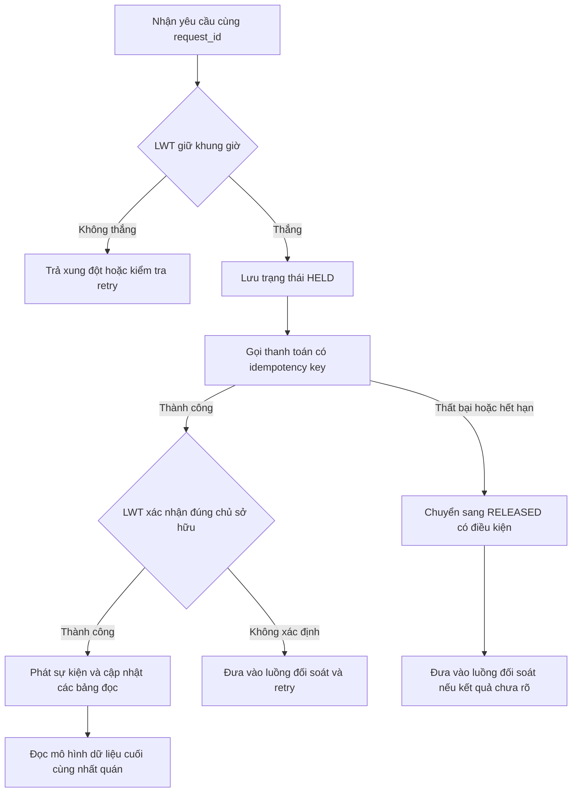

# Ranh giới của `@Transactional` và lựa chọn cơ chế bảo đảm dữ liệu

Trong **SPRING_DATA_CASSANDRA**, chúng ta truy cập Apache Cassandra bằng Spring Data Cassandra: ánh xạ entity, sử dụng repository, `CassandraTemplate` và thực thi truy vấn CQL. Các API này giúp viết mã thuận tiện, nhưng **không biến Cassandra thành cơ sở dữ liệu có transaction kiểu quan hệ**. Khi thiết kế ứng dụng, điều quan trọng là xác định chính xác dữ liệu nào phải được bảo vệ, cần bảo vệ khỏi loại lỗi nào và cơ chế nào thực sự đáp ứng yêu cầu đó.

Bài học thuộc chương **Thiết kế ứng dụng**, tập trung vào câu hỏi: **ranh giới của `@Transactional` nằm ở đâu, và khi cần bảo đảm tính đúng đắn dữ liệu với Cassandra thì nên chọn consistency level, lightweight transaction, batch, idempotency hay điều phối nghiệp vụ?** Những lựa chọn này phải đi cùng thiết kế bảng theo truy vấn, partition key, paging và kiểm soát hiệu năng trong mô hình dữ liệu phân tán.

## 1. Một tình huống dễ gây hiểu nhầm

Giả sử hệ thống đặt lịch cần thực hiện ba việc khi người dùng giữ một khung giờ:

1. Đánh dấu khung giờ đã được giữ để người khác không đặt trùng.
2. Ghi trạng thái yêu cầu đặt lịch để hiển thị trên màn hình người dùng.
3. Gửi lệnh thanh toán hoặc phát sự kiện cho dịch vụ khác.

Trong ứng dụng dùng cơ sở dữ liệu quan hệ, lập trình viên có thể quen với việc đặt `@Transactional` quanh phương thức dịch vụ. Nếu các câu lệnh SQL sử dụng cùng một transaction manager và cùng tài nguyên giao dịch, lỗi có thể làm toàn bộ các thay đổi thuộc transaction đó được rollback. Áp dụng nguyên mẫu suy nghĩ ấy cho Cassandra sẽ tạo ra lỗi nghiệp vụ:

```java
@Service
class BookingService {
    private final BookingRepository bookingRepository;
    private final PaymentGateway paymentGateway;

    BookingService(BookingRepository bookingRepository,
                   PaymentGateway paymentGateway) {
        this.bookingRepository = bookingRepository;
        this.paymentGateway = paymentGateway;
    }

    @Transactional // Không làm Cassandra + hệ thống thanh toán thành một ACID transaction.
    public void createBooking(Booking booking) {
        bookingRepository.save(booking);       // Ghi Cassandra.
        paymentGateway.authorize(booking.id()); // Gọi hệ thống ngoài.
    }
}
```

Nếu lời gọi thanh toán thất bại sau khi Cassandra đã nhận ghi, annotation không tự động hoàn tác bản ghi Cassandra. Thậm chí, nếu Spring không tìm được `PlatformTransactionManager` hoặc `ReactiveTransactionManager` phù hợp với kiểu ứng dụng, phương thức có thể thất bại ngay lúc thiết lập transaction. Nếu có transaction manager cho JDBC/JPA, manager đó **chỉ quản lý tài nguyên mà nó hỗ trợ**, không tự đưa CQL hay API thanh toán vào cùng một transaction.

Vấn đề không dừng ở rollback. Hai yêu cầu đặt lịch đồng thời có thể cùng đọc thấy khung giờ còn trống rồi đều ghi trạng thái “đã giữ”. `@Transactional` đặt trên hai phương thức dịch vụ không tự tạo khóa hay điều kiện thắng/thua cho một partition Cassandra.

> **Nguyên tắc xuyên suốt:** Trước khi chọn annotation hoặc API, hãy viết ra bất biến nghiệp vụ (*invariant*) cần giữ. Ví dụ: “Tại một thời điểm, một khung giờ chỉ có tối đa một yêu cầu đang sở hữu quyền đặt”. Sau đó chọn một thao tác mà Cassandra có khả năng bảo vệ bất biến ấy.

## 2. Hiểu đúng `@Transactional` trong Spring Data Cassandra

### 2.1. `@Transactional` là cơ chế điều phối của Spring, không phải lệnh CQL

`@Transactional` là metadata để hạ tầng transaction của Spring xác định nơi bắt đầu, commit hoặc rollback transaction. Trong cách dùng phổ biến, Spring áp dụng interception qua proxy và ủy quyền cho transaction manager được cấu hình. Vì vậy, tác dụng thực tế phụ thuộc vào **transaction manager**, **tài nguyên được quản lý** và **đường thực thi gọi phương thức**.

Với JDBC/JPA, transaction manager thường điều khiển transaction trên connection của cơ sở dữ liệu. Còn các thao tác Cassandra thực hiện qua Spring Data Cassandra hoặc Java driver, trong mô hình CQL thông thường, không được gắn vào một transaction JDBC/JPA để sau đó rollback. Spring Data Cassandra không cung cấp lời hứa “mọi `repository.save()` và `CassandraTemplate.update()` trong phương thức `@Transactional` sẽ cùng commit hoặc cùng rollback” như người dùng có thể kỳ vọng từ RDBMS.

Xem ba trường hợp sau:

| Trường hợp | Điều thực sự có thể xảy ra | Điều không được suy ra |
| --- | --- | --- |
| Chỉ dùng Cassandra, không có transaction manager phù hợp | Spring có thể báo lỗi vì không tìm được manager khi intercept phương thức. | Annotation không tự sinh transaction Cassandra. |
| Có `JpaTransactionManager`/`DataSourceTransactionManager`, đồng thời ghi Cassandra | Transaction của database quan hệ được quản lý; lệnh CQL chạy theo cơ chế riêng. | Rollback JPA/JDBC không rollback ghi Cassandra. |
| Một phương thức gọi Cassandra và API thanh toán/HTTP/Kafka | Mỗi hệ thống có ranh giới commit và khả năng thất bại khác nhau. | Không có một commit nguyên tử giữa các hệ thống nhờ `@Transactional`. |

Ngay cả ở một hệ thống có hỗ trợ Spring transaction, các quy tắc proxy như lời gọi nội bộ `this.someMethod()` không đi qua proxy cũng cần được hiểu; tuy nhiên, khắc phục vấn đề proxy **không giải quyết** giới hạn transaction của Cassandra.

Một số phiên bản nền tảng phân tán có thể giới thiệu khả năng transaction riêng. Nếu sử dụng một tính năng mới như vậy, phải xác nhận chính xác **phiên bản Cassandra, cú pháp CQL, driver và mức hỗ trợ của Spring Data**. Không suy diễn rằng khả năng đó tự động được kích hoạt bởi `@Transactional` trên repository thông thường.

### 2.2. Tách các loại bảo đảm thường bị gọi chung là “transaction”

| Bảo đảm cần hỏi | Câu hỏi kỹ thuật | Cơ chế thường liên quan |
| --- | --- | --- |
| Xác nhận ghi | Bao nhiêu replica phải phản hồi trước khi lệnh ghi được coi là thành công? | Write consistency level và chính sách retry/timeout. |
| Đọc dữ liệu vừa ghi | Một lượt đọc nên liên hệ bao nhiêu replica và chấp nhận độ trễ nào? | Read consistency level, topology, replica factor. |
| Chống ghi đè đồng thời | Hai tác nhân tranh chấp cùng một tài nguyên, ai được quyền thắng? | CQL conditional write / lightweight transaction (LWT). |
| Nhóm nhiều mutation | Có cần gửi các mutation thành một batch với phạm vi bảo đảm cụ thể? | CQL `BATCH`, phân biệt logged/unlogged và partition. |
| Nhiều partition hoặc dịch vụ | Nếu bước thứ ba hỏng sau hai bước thành công, phục hồi thế nào? | State machine, saga, outbox/CDC, retry, bù trừ. |
| Không thực hiện lặp tác dụng phụ | Retry sau timeout có làm đặt chỗ hoặc trừ tiền hai lần không? | Idempotency key, thao tác có điều kiện, lưu kết quả xử lý. |
| ACID nhiều thực thể | Có cần một commit nguyên tử và isolation xuyên nhiều bản ghi/tài nguyên không? | Cân nhắc hệ lưu trữ hỗ trợ transaction theo yêu cầu; kiểm chứng khả năng hệ đang dùng. |

Một lựa chọn tốt thường là **kết hợp nhiều cơ chế có phạm vi rõ ràng**. Ví dụ: LWT giành quyền sở hữu khung giờ, consistency level quyết định cách xác nhận/đọc, idempotency bảo vệ retry, saga phục hồi quy trình thanh toán.

## 3. Consistency level bảo đảm điều gì?

Cassandra sao chép dữ liệu giữa nhiều replica theo *replication factor* (RF). Consistency level (CL) cho biết số hoặc phạm vi replica cần tham gia phản hồi cho một thao tác đọc hay ghi. Đây là công cụ đánh đổi giữa tính sẵn sàng, độ trễ và mức nhất quán quan sát được.

Giả sử keyspace có **RF = 3 trong một data center**, các lựa chọn thường gặp là:

| Consistency level | Ý nghĩa thực tiễn trong ví dụ RF = 3 | Đánh đổi đáng lưu ý |
| --- | --- | --- |
| `LOCAL_ONE` | Một replica trong data center cục bộ phản hồi. | Độ trễ thấp hơn, nhưng có khả năng đọc replica chưa cập nhật. |
| `LOCAL_QUORUM` | Đa số replica trong data center cục bộ, tức 2/3, phản hồi. | Thường tăng xác suất đọc dữ liệu mới nhất từ các lượt ghi dùng quorum; cần đủ replica sẵn sàng. |
| `QUORUM` | Quorum tính theo phạm vi replication factor liên quan đến consistency level. | Trong cấu hình nhiều data center, phải xét topology; không đồng nghĩa `LOCAL_QUORUM`. |
| `EACH_QUORUM` | Với ghi, yêu cầu quorum tại mỗi data center có replica. | Phụ thuộc nhiều vùng; chi phí và rủi ro unavailable cao hơn. |

Trong một data center, quy tắc thường dùng là **R + W > RF** (R: số replica tham gia đọc; W: số replica xác nhận ghi). Khi mọi điều kiện của mô hình được đáp ứng, quorums đọc và ghi giao nhau, nhờ đó việc đọc có cơ hội phát hiện giá trị đã được ghi ở quorum. Quy tắc này **không** tự mang lại isolation, compare-and-set hoặc khả năng rollback. Trong nhiều data center, cần tính riêng replication strategy, CL và đường đi của yêu cầu; một `LOCAL_QUORUM` không được hiểu là đã đồng bộ tất cả vùng.

Ví dụ, hai request có thể cùng đọc `state = AVAILABLE` bằng `LOCAL_QUORUM`, rồi đều thực hiện `UPDATE` thông thường bằng `LOCAL_QUORUM`. Cả hai lệnh ghi có thể được chấp nhận; kết quả cuối phụ thuộc quy tắc xử lý xung đột của Cassandra. Quorum không thay thế điều kiện “chỉ cập nhật nếu trạng thái vẫn là AVAILABLE”.

`SERIAL` và `LOCAL_SERIAL` là **serial consistency level** dùng cho các thao tác LWT dựa trên Paxos; chúng khác với `LOCAL_QUORUM` của thao tác đọc/ghi thông thường. Không thể tăng CL thông thường lên `ALL` rồi coi đó là LWT. Với request có điều kiện, cần cấu hình hợp lý **cả ordinary consistency lẫn serial consistency**, theo kiến trúc data center và khả năng chịu lỗi của ứng dụng.

Một timeout cũng cần được đọc đúng: client không nhận phản hồi **không chứng minh** mutation chưa được áp dụng. Quy trình retry phải xử lý khả năng kết quả trước đó đã được ghi hoặc đang trong quá trình hoàn tất.

## 4. LWT: khi bất biến nằm trên một khóa tranh chấp

Lightweight transaction (LWT) là cơ chế Cassandra dùng cho các truy vấn CQL có điều kiện như `IF NOT EXISTS`, `IF EXISTS`, `IF column = value`. Nó sử dụng giao thức đồng thuận cho thao tác điều kiện và trả về thông tin điều kiện có được áp dụng hay không. Chi phí thường cao hơn ghi thông thường vì cần thêm các lượt trao đổi giữa replica.

LWT thích hợp khi nhiều request cần **quyết định ai có quyền sở hữu một giá trị hoặc trạng thái của cùng partition**. Cách thiết kế partition key quyết định các request có thật sự tranh chấp trên cùng phạm vi cần bảo vệ hay không.

### 4.1. Thiết kế bảng theo bất biến “một khung giờ chỉ có một chủ”

```sql
CREATE TABLE reservation_by_slot (
    resource_id  uuid,
    slot_start   timestamp,
    request_id   uuid,
    state        text,
    PRIMARY KEY ((resource_id), slot_start)
);
```

Trong ví dụ rút gọn này, `resource_id` là partition key, `slot_start` là clustering key. Một khung giờ được nhận diện bởi cặp `(resource_id, slot_start)`. Hai yêu cầu đặt cùng tài nguyên và thời điểm sẽ cạnh tranh trên **cùng hàng và cùng partition**.

```sql
INSERT INTO reservation_by_slot
    (resource_id, slot_start, request_id, state)
VALUES (?, ?, ?, 'HELD')
IF NOT EXISTS;
```

- Nếu điều kiện đúng, server cho phép tạo bản ghi và trả về `[applied] = true`.
- Nếu hàng đã tồn tại, thao tác không ghi đè hàng đó và trả về `[applied] = false`.
- Nếu timeout hoặc mất kết nối, trạng thái có thể **chưa xác định**; không tự kết luận request thất bại hay thành công.

Đọc kết quả `[applied]` quan trọng hơn việc chỉ xem lệnh CQL có phát sinh exception hay không. Trong Java driver được Spring Data Cassandra sử dụng, ta có thể thực hiện lệnh điều kiện trực tiếp:

```java
import java.time.Instant;
import java.util.UUID;

import com.datastax.oss.driver.api.core.CqlSession;
import com.datastax.oss.driver.api.core.DefaultConsistencyLevel;
import com.datastax.oss.driver.api.core.cql.BoundStatement;
import com.datastax.oss.driver.api.core.cql.PreparedStatement;
import org.springframework.stereotype.Repository;

@Repository
public class SlotReservationDao {
    private final CqlSession session;
    private final PreparedStatement reserveStatement;

    public SlotReservationDao(CqlSession session) {
        this.session = session;
        this.reserveStatement = session.prepare("""
            INSERT INTO reservation_by_slot
              (resource_id, slot_start, request_id, state)
            VALUES (?, ?, ?, 'HELD') IF NOT EXISTS
            """);
    }

    public boolean tryHold(UUID resourceId, Instant slotStart, UUID requestId) {
        BoundStatement statement = reserveStatement.bind(
                resourceId, slotStart, requestId)
            .setConsistencyLevel(DefaultConsistencyLevel.LOCAL_QUORUM)
            .setSerialConsistencyLevel(DefaultConsistencyLevel.LOCAL_SERIAL);

        return session.execute(statement).wasApplied();
    }
}
```

Đoạn mã minh họa cách lấy kết quả điều kiện; nó cần được đặt trong ứng dụng đã cấu hình keyspace, `CqlSession` và repository phù hợp. `LOCAL_QUORUM`/`LOCAL_SERIAL` chỉ là cấu hình ví dụ trong data center cục bộ, không phải lựa chọn mặc định đúng cho mọi topology. Trong luồng bất đồng bộ, có thể dùng biến thể async của driver; tránh chặn thread của reactive pipeline chỉ để tái sử dụng ví dụ đồng bộ này.

**Lưu ý về mô hình dữ liệu:** Partition chứa toàn bộ lịch sử khung giờ của một `resource_id` có thể tăng quá lớn và trở thành điểm nóng nếu một tài nguyên có lưu lượng cao. Trong sản phẩm thực, thường cần bucket theo ngày/tuần hoặc một khoảng có giới hạn, chẳng hạn partition key `((resource_id, slot_day))`, nhưng vẫn phải bảo đảm các request tranh chấp **cùng khung giờ** tính ra cùng khóa bucket. Nếu ghi hai khóa khác nhau rồi hy vọng LWT trên mỗi khóa ngăn trùng toàn cục, bất biến sẽ không được bảo vệ.

### 4.2. Quản lý vòng đời bằng conditional update

Sau khi giành quyền giữ chỗ, chỉ request đang sở hữu khung giờ mới được phép xác nhận:

```sql
UPDATE reservation_by_slot
SET state = 'CONFIRMED'
WHERE resource_id = ? AND slot_start = ?
IF state = 'HELD' AND request_id = ?;
```

Nếu thanh toán không hoàn thành và cần trả chỗ, có thể dùng điều kiện tương tự để chuyển `HELD` thành `RELEASED`. Cần đặc biệt lưu ý: **hàng `RELEASED` vẫn tồn tại**; lệnh `INSERT ... IF NOT EXISTS` sẽ không tự đặt lại chỗ trống. Muốn tái sử dụng khung giờ, thiết kế một chuyển trạng thái có điều kiện từ `RELEASED` sang `HELD` cùng `request_id` mới hoặc một chiến lược dữ liệu khác được xác minh bằng concurrent test.

```sql
UPDATE reservation_by_slot
SET state = 'HELD', request_id = ?
WHERE resource_id = ? AND slot_start = ?
IF state = 'RELEASED';
```

Quy trình này cần quy định rõ ai được giải phóng giữ chỗ, thời hạn giữ chỗ, xử lý request đến muộn, cũng như cách tránh một callback cũ xác nhận quyền sở hữu đã chuyển cho người khác. Đặt `request_id` trong điều kiện cập nhật giúp nhận diện đúng chủ sở hữu.

### 4.3. Retry sau timeout phải có định danh ổn định

Giả sử client gọi `INSERT ... IF NOT EXISTS`, kết nối đứt trước khi nhận `[applied]`. Retry có thể nhận `[applied] = false` vì **chính request trước đã thành công**. Vì vậy, không thể ánh xạ mọi `false` thành “khung giờ thuộc người khác”.

Một chiến lược phục hồi là:

1. Client sinh `request_id` duy nhất và giữ nguyên khi retry cùng hành động.
2. Gửi LWT; nếu nhận kết quả thành công, ghi nhận đã giữ chỗ.
3. Nếu nhận `false` hoặc timeout, đọc bản ghi hiện tại ở consistency phù hợp; nếu `request_id` bằng chính request và trạng thái hợp lệ, nhận diện thao tác đã thành công trước đó.
4. Nếu hàng thuộc request khác, trả về xung đột; nếu vẫn chưa xác định, retry có giới hạn với backoff và cơ chế hòa giải trạng thái.

LWT xử lý cuộc đua tại khóa dữ liệu; idempotency xử lý **lặp lại cùng yêu cầu**. Hai vấn đề liên quan nhưng không đồng nhất. Nếu dùng TTL để dọn `request_id` hoặc bản ghi giữ chỗ, phải xác định thời gian lưu vết dài hơn toàn bộ cửa sổ retry và callback; TTL hết hạn quá sớm có thể khiến hệ thống coi yêu cầu cũ là yêu cầu mới.

## 5. `BATCH` của Cassandra không phải transaction kiểu RDBMS

CQL cho phép nhóm mutation:

```sql
BEGIN LOGGED BATCH
    INSERT INTO booking_by_id (booking_id, state)
    VALUES (11111111-1111-1111-1111-111111111111, 'HELD');

    UPDATE resource_summary
    SET last_booking_id = 11111111-1111-1111-1111-111111111111
    WHERE resource_id = 22222222-2222-2222-2222-222222222222;
APPLY BATCH;
```

Với **logged batch**, Cassandra lưu thông tin batch để có thể hoàn tất các mutation ngay cả khi xảy ra lỗi một phần. Đây là bảo đảm về khả năng hoàn tất nhóm mutation, **không cung cấp isolation và rollback ACID tương đương transaction quan hệ**. Khi batch chạm nhiều partition, client khác có thể quan sát trạng thái trung gian; đọc giữa chừng không được giả định luôn thấy mọi hàng cùng cập nhật một thời điểm.

| Loại batch | Khi nào cân nhắc | Giới hạn phải nhớ |
| --- | --- | --- |
| `LOGGED BATCH` | Một nhóm mutation thực sự cần cơ chế batch log để hoàn tất, đặc biệt khi trải nhiều partition. | Tăng chi phí phối hợp và ghi log; không bảo đảm isolation đa partition, không thay thế saga. |
| `UNLOGGED BATCH` | Gom những mutation phù hợp, thường cùng partition, để giảm overhead khi log không cần thiết. | Với nhiều partition, không nhận bảo đảm khôi phục của logged batch. |
| `COUNTER BATCH` | Các thao tác counter được thiết kế riêng. | Không trộn thao tác counter và non-counter; counter không phải công cụ chống ghi trùng bằng idempotency key. |

Các mutation trong cùng partition có những bảo đảm hẹp hơn và mạnh hơn so với batch trải nhiều partition; phạm vi isolation cụ thể cần được đối chiếu với phiên bản Cassandra và hình dạng mutation. Dù vậy, batch **không** tự kiểm tra điều kiện tranh chấp nghiệp vụ như `IF NOT EXISTS` cho hàng khóa duy nhất.

Không nên dùng một logged batch khổng lồ để “tối ưu” việc ghi nhiều partition tùy ý. Batching trên Cassandra chủ yếu hợp lý khi có mục đích nhất quán cụ thể và tổ chức dữ liệu phù hợp. Batch cross-partition lớn làm coordinator/batchlog chịu tải, có thể tăng latency và làm vấn đề hot partition nghiêm trọng hơn. Nhiều lệnh ghi độc lập thường nên được điều phối theo khả năng chịu tải thay vì ép vào một batch.

Một batch chỉ xử lý mutation Cassandra. Nó không thể commit cùng giao dịch với lời gọi thanh toán HTTP, cơ sở dữ liệu của dịch vụ khác hoặc việc publish một message ra Kafka.

## 6. Khi quy trình đi qua nhiều partition hoặc nhiều hệ thống

Ở tình huống đặt chỗ, ta có thể giữ một bảng làm **nguồn sự thật cho quyền sở hữu khung giờ** (`reservation_by_slot`) và một bảng khác tối ưu truy vấn “lịch sử đặt chỗ của người dùng” (`reservation_by_user`). Cả hai phục vụ mẫu truy vấn khác nhau. Nếu partition key của chúng khác nhau, không được coi hai lần ghi là một ACID transaction nhờ annotation.

Một kiến trúc thực tế:



Trong quy trình này, **LWT bảo vệ quyền sở hữu**, còn điều phối trạng thái có thể chạy theo saga. Mỗi bước có kết quả và cách phục hồi riêng:

| Bước | Hỏng ở đâu? | Phản ứng thiết kế |
| --- | --- | --- |
| Giành quyền giữ chỗ | LWT timeout, không biết đã áp dụng hay chưa. | Kiểm tra theo `request_id`, retry có giới hạn, không giữ chỗ mới với ID khác. |
| Gọi thanh toán | Gateway timeout sau khi thực sự nhận yêu cầu. | Dùng idempotency key bên thanh toán; tra cứu/đối soát trạng thái trước khi tạo lệnh khác. |
| Xác nhận đặt chỗ | Tiền đã được giữ nhưng quyền khung giờ không thể chuyển sang `CONFIRMED`. | Trạng thái cần hòa giải; tùy quy tắc nghiệp vụ mà hoàn tiền, hủy ủy quyền hoặc xử lý thủ công. |
| Ghi bảng `reservation_by_user` | Nguồn sự thật đã xác nhận, nhưng bảng phục vụ truy vấn chưa cập nhật. | Retry cập nhật projection; cho phép độ trễ hiển thị có kiểm soát. |
| Phát sự kiện | Cassandra đã ghi nhưng producer chết trước khi publish. | Dùng cơ chế event bền vững phù hợp, CDC, outbox có phạm vi nguyên tử được chứng minh hoặc nguồn sự kiện độc lập. |

### 6.1. Saga không phải rollback tự động

Saga mô hình hóa chuỗi chuyển trạng thái nghiệp vụ: giữ chỗ → yêu cầu thanh toán → xác nhận; nếu cần, chạy bước bù trừ như trả chỗ hoặc hoàn ủy quyền thanh toán. Bù trừ có thể thất bại và phải retry. Không phải hành động nào cũng đảo ngược chính xác: email đã gửi không thể “thu hồi” về mặt vật lý, khoản tiền đã captured có thể phải refund thay vì undo.

Trong Spring Boot, có thể hiện thực saga bằng workflow worker hoặc consumer sự kiện. Dù chọn framework nào, nên lưu `request_id`, trạng thái hiện tại, mốc thời gian, lần retry, lý do lỗi và thời hạn chờ trong kho trạng thái bền vững. Worker có thể khởi động lại, quét yêu cầu quá hạn và tiếp tục từ trạng thái đã xác nhận, thay vì tin rằng toàn bộ tiến trình chỉ chạy đúng một lần.

### 6.2. Cẩn trọng khi nói “dùng outbox là xong”

Outbox đáng tin cậy khi thay đổi nghiệp vụ và bản ghi sự kiện được ghi trong **cùng phạm vi commit nguyên tử thực sự**. Với cơ sở dữ liệu quan hệ, có thể ghi entity và outbox row trong một transaction database. Sau đó một publisher phát sự kiện, consumer xử lý idempotent và chấp nhận ít nhất một lần giao hàng.

Trong Cassandra, đặt entity và outbox ở hai partition khác nhau rồi ghi bằng hai repository call **không tự tạo atomic commit**. Cần thiết kế cụ thể phạm vi ghi bảo đảm được (ví dụ co-partition theo một mô hình có thể chứng minh) hoặc dùng CDC/nguồn sự kiện bền vững và quy trình hòa giải phù hợp. Ngay cả khi phần ghi outbox được bảo vệ, việc phát message ra broker vẫn có thể lặp, nên consumer tiếp tục cần idempotency.

Một lựa chọn khác là để một transactional system hoặc event log bền vững giữ vai trò nguồn sự thật, sau đó materialize dữ liệu vào Cassandra để phục vụ truy vấn nhanh. Cách này phù hợp khi yêu cầu ACID mạnh hơn khả năng ràng buộc trong một partition Cassandra.

## 7. Thiết kế dữ liệu theo truy vấn và ranh giới bảo đảm

Trong Cassandra, thiết kế bảng bắt đầu từ cách đọc. Tuy nhiên, khi có tranh chấp đồng thời, cần xác định thêm **bất biến được bảo vệ ở khóa nào**. Hai câu hỏi này phải được giải cùng nhau:

- **Đọc:** Người dùng sẽ truy vấn theo tài nguyên, theo ngày, theo user hay theo booking ID? Có cần paging theo thứ tự thời gian không?
- **Ghi:** Mọi request có thể làm sai cùng một bất biến có gặp nhau tại cùng partition và cùng điều kiện hay không?

Ví dụ: `reservation_by_slot` bảo vệ khung giờ, `reservation_by_user` phục vụ trang lịch sử đặt chỗ. Nếu dùng paging trên `reservation_by_user`, mỗi trang chỉ phản ánh trạng thái dữ liệu tại thời điểm từng truy vấn; paging state không phải một snapshot transaction trên tất cả partition. Cần tính đến bản ghi mới xuất hiện, bản ghi thay đổi trạng thái và projection cập nhật trễ. Để tránh thứ tự khó đoán, thiết kế clustering key ổn định và sử dụng đúng cơ chế paging của driver/Spring Data thay vì tự tăng `OFFSET` như SQL quan hệ.

Một số nguyên tắc kiểm tra thiết kế:

1. **Xác định nguồn sự thật.** Bản ghi nào quyết định “khung giờ đã có chủ”? Mọi projection khác phải phục hồi được từ nguồn này.
2. **Định nghĩa invariant bằng câu có thể kiểm thử.** Ví dụ “mỗi `(resource_id, slot_start)` có tối đa một chủ hợp lệ”, “một `request_id` không phát sinh hai khoản thanh toán”.
3. **Đặt cạnh tranh đúng chỗ.** LWT chỉ bảo vệ nhóm ghi thực sự xung đột trong cùng partition/phạm vi CQL đã chọn; không bảo vệ uniqueness toàn hệ thống bằng nhiều partition độc lập.
4. **Giới hạn partition.** Khi bucket theo ngày, đảm bảo khóa bucketing ổn định, phạm vi truy vấn phù hợp và kích thước partition tăng có kiểm soát.
5. **Không lẫn ordering với isolation.** Clustering order giúp đọc có thứ tự trong partition; nó không cho phép rollback một chuỗi thao tác.
6. **Ghi rõ mức stale được chấp nhận.** Trạng thái sở hữu cần cơ chế chặt; trang lịch sử có thể chấp nhận cập nhật trễ vài giây tùy yêu cầu sản phẩm.

## 8. Chọn cơ chế theo loại yêu cầu

| Yêu cầu nghiệp vụ | Lựa chọn ưu tiên để đánh giá | Vì sao | Điều kiện cần xác minh |
| --- | --- | --- | --- |
| Ghi log/sự kiện không cần tranh chấp | `INSERT` thông thường, CL theo SLO, định danh sự kiện ổn định. | Không cần chi phí Paxos nếu không có bất biến cạnh tranh. | Tính idempotent khi retry, retention, partition size. |
| Đọc sau ghi trong một data center | Chọn read/write CL tương thích và đường đọc đúng partition. | Quorum giao nhau cải thiện khả năng thấy ghi vừa xác nhận. | RF, topology, latency, timeout; không coi quorum là isolation. |
| Chỉ một yêu cầu được đặt khung giờ | `INSERT ... IF NOT EXISTS` hoặc `UPDATE ... IF ...`. | Điều kiện được phân xử tại khóa tranh chấp bằng LWT. | Key modeling, serial CL, kết quả `[applied]`, throughput khi contention cao. |
| Chuyển trạng thái có chủ sở hữu | LWT kiểm tra trạng thái cũ và `request_id`. | Tránh callback muộn ghi đè trạng thái không còn thuộc mình. | Quy tắc state machine, release/expire/re-acquire. |
| Nhóm mutation Cassandra có mục đích rõ | `BATCH` với phạm vi và loại phù hợp. | Có thể giảm một số chi phí hoặc tăng bảo đảm hoàn tất của nhóm mutation. | Có cùng partition không, logged/unlogged, isolation và batch size. |
| Đồng bộ nhiều bảng theo các query pattern | Chọn bản ghi authoritative; cập nhật projection bất đồng bộ có retry. | Tránh phụ thuộc vào một commit đa partition không có bảo đảm tương ứng. | Độ trễ projection, rebuild, reconciliation. |
| Cassandra + thanh toán/API dịch vụ khác | Saga/workflow bền vững và idempotency key. | Mỗi hệ thống có commit riêng, cần tiến trình phục hồi. | Hết hạn, retry, bù trừ, quan sát lỗi từng bước. |
| Bắt buộc ACID xuyên nhiều tài nguyên | Xem xét transaction store phù hợp hoặc tính năng giao dịch được chứng thực ở chính phiên bản đang chạy. | Bất biến không thể bảo vệ bằng các thao tác đơn lẻ ở partition độc lập. | Isolation level, khả năng rollback, giới hạn driver, chi phí vận hành. |

Đừng lựa chọn dựa trên khẩu hiệu “mạnh nhất là an toàn nhất”. Ví dụ `LOCAL_QUORUM` giúp tăng yêu cầu phản hồi replica nhưng không giải quyết tranh chấp; LWT bảo vệ điều kiện nhưng tăng latency và không giải quyết tác dụng phụ ở hệ thanh toán; batch giúp nhóm mutation nhưng không thay thế workflow phục hồi.

## 9. Những lỗi thiết kế cần nhận diện sớm

### 9.1. Đọc rồi cập nhật mà không kiểm tra điều kiện

```text
Request A                         Request B
Đọc: slot = AVAILABLE             Đọc: slot = AVAILABLE
Quyết định giữ chỗ                Quyết định giữ chỗ
UPDATE state = HELD               UPDATE state = HELD
Trả thành công                    Trả thành công
```

Đây là lỗi *check-then-act*. Dù mỗi thao tác dùng quorum, hai quyết định vẫn có thể dựa vào cùng giá trị cũ. Với invariant một chủ, dùng CQL điều kiện và đọc `[applied]`.

### 9.2. “Bao `@Transactional` bên ngoài”

Annotation không đưa Cassandra, JDBC và API ngoài vào một phạm vi rollback chung. Cần xác định transaction manager quản lý gì, rồi thiết kế bù trừ hoặc sự nhất quán cuối cùng cho phần còn lại.

### 9.3. Gắn mọi thứ vào logged batch

Batch đa partition lớn có thể làm hệ thống chậm và không mang lại isolation quan hệ. Nên tách thao tác vì mục đích throughput khỏi thao tác vì bảo đảm dữ liệu; đo đạc kích thước batch và số partition thay vì giả định batch là tối ưu.

### 9.4. Retry vô hạn bằng request ID mới

Nếu mỗi lần timeout lại sinh một `request_id`, hệ thống không thể phân biệt lần thử lặp với yêu cầu mới. Cùng một hành động nghiệp vụ phải giữ nguyên khóa idempotency; giới hạn retry, backoff và có đường phục hồi cho trạng thái chưa biết.

### 9.5. Chỉ dựa vào “exactly once” của message broker

Một thông báo có thể được nhận lặp, consumer có thể crash sau khi ghi Cassandra nhưng trước khi xác nhận offset. Bảo vệ bằng khóa tác vụ và thao tác idempotent ở *đích ghi*, bên cạnh cơ chế giao hàng của broker. Khả năng exactly-once của một thành phần không tự làm cho toàn bộ HTTP → broker → Cassandra trở thành giao dịch xuyên hệ thống.

### 9.6. Chọn partition key thuận tiện cho đọc nhưng sai cho invariant

Nếu hai bản ghi đại diện cho cùng khung giờ lại mang partition key dựa trên hai `user_id`, mỗi request có thể thắng LWT của chính partition mình. Điều kiện đó không ngăn trùng lịch toàn cục. Phải đặt khóa duy nhất của tài nguyên tranh chấp ở bảng authoritative; các bảng theo user chỉ là projection.

## 10. Kiểm thử tính đúng đắn và quan sát vận hành

Một chức năng có vẻ đúng khi chạy đơn luồng vẫn có thể sai khi timeout, tranh chấp hoặc một node không sẵn sàng. Ít nhất cần mô phỏng những tình huống sau bằng dữ liệu thử tách biệt và cấu hình cluster phù hợp:

| Kịch bản kiểm thử | Kết quả mong đợi |
| --- | --- |
| Nhiều request giữ cùng `(resource_id, slot_start)` trong thời gian ngắn. | Tối đa một request trở thành chủ hợp lệ; các request khác nhận xung đột hoặc kết quả cần xác minh. |
| Gửi lại cùng `request_id` sau khi response đầu tiên bị mất. | Không tạo thêm quyền đặt hoặc trừ tiền lần thứ hai; client hòa giải được kết quả. |
| Gửi callback xác nhận cũ sau khi khung giờ đã chuyển chủ. | Conditional update thất bại; chủ mới không bị ghi đè. |
| Thanh toán thành công nhưng bước xác nhận Cassandra timeout. | Có trạng thái trung gian cần phục hồi; không tự mất dấu khoản thanh toán. |
| Projection `reservation_by_user` cập nhật trễ. | Nguồn sự thật vẫn đúng; hệ thống có thể retry/rebuild projection. |
| Một số replica chậm hoặc mất kết nối. | Ứng dụng xử lý timeout/unavailable theo CL đã chọn, không giả định thất bại nghĩa là chưa ghi. |
| Bucket dữ liệu tăng và có trang kết quả mới trong lúc paging. | Thứ tự và hành vi pagination được mô tả rõ; không hứa snapshot transaction. |

Các tín hiệu vận hành nên theo dõi gồm: latency p95/p99 của read/write và LWT, tỷ lệ `applied = false`, contention theo partition, số timeout/unavailable theo consistency level, số yêu cầu saga đang chờ, thời gian già hóa của trạng thái `HELD`, độ trễ projection, kích thước/hotspot partition và số job đối soát thất bại.

Khi thử chaos hoặc failover, nên bám vào **bất biến nghiệp vụ**, không chỉ kiểm tra số HTTP 200. Một hệ thống có thể trả 200 nhanh nhưng vẫn ghi sai hoặc bỏ sót bản ghi khi có retry.

## 11. Quy trình ra quyết định trong một ứng dụng mới

Khi nhận yêu cầu “cần transaction” cho một chức năng trên Cassandra, có thể làm theo trình tự:

1. **Viết bất biến và phạm vi dữ liệu.** Cần uniqueness một hàng, chuyển trạng thái có điều kiện, đọc dữ liệu mới nhất hay commit xuyên nhiều dịch vụ?
2. **Chỉ định nguồn sự thật và query pattern.** Chọn bảng/partition nơi các request tranh chấp thực sự gặp nhau; thiết kế bảng đọc riêng nếu cần.
3. **Chọn primitive nhỏ nhất có thể chứng minh.** Ghi thông thường cho append độc lập; LWT cho điều kiện cạnh tranh; batch chỉ khi cần đúng bảo đảm batch; saga cho nhiều bước có thể thất bại.
4. **Lập hợp đồng retry.** Quy định `request_id`, trạng thái chưa biết, số lần retry, backoff, deadline và cơ chế đối soát; bảo đảm tác dụng phụ tại đích idempotent.
5. **Cấu hình CL theo topology và SLO.** Xác định RF, data center, read/write CL và serial CL cho LWT; đo latency và availability thực tế.
6. **Kiểm thử race/failure trước khi mở rộng tải.** Dùng kiểm thử đồng thời và fault injection để chứng minh invariant vẫn đúng; theo dõi hot partition và projection lag khi tăng traffic.

### Câu hỏi tự kiểm tra

1. Nếu một phương thức `@Transactional` ghi cả JPA lẫn `CassandraTemplate`, JDBC rollback có đảo ngược ghi Cassandra không? Vì sao?
2. Vì sao cả read và write đều dùng `LOCAL_QUORUM` vẫn không ngăn được hai tiến trình cùng giữ một khung giờ?
3. Sau timeout của `INSERT ... IF NOT EXISTS`, kết quả `applied = false` ở lần retry có luôn đồng nghĩa “người khác đã giữ chỗ” không?
4. Tại sao logged batch qua nhiều partition không thay thế được isolation transaction hoặc saga cho thanh toán?
5. Nếu một ứng dụng cần đọc danh sách đặt chỗ theo người dùng và đồng thời chống trùng theo khung giờ, đâu là nguồn sự thật và đâu là projection?

**Điểm cần nắm:** Trong Spring Data Cassandra, `@Transactional` phải được đánh giá theo transaction manager và tài nguyên thực sự được quản lý. Tính đúng đắn nghiệp vụ đến từ việc phối hợp **thiết kế partition theo invariant**, **consistency level phù hợp**, **CQL điều kiện/LWT**, **idempotency**, và **quy trình phục hồi có trạng thái**. Mỗi cơ chế giải quyết một loại rủi ro khác nhau; nắm rõ ranh giới của chúng mới có thể thiết kế ứng dụng Cassandra an toàn và hiệu quả.
