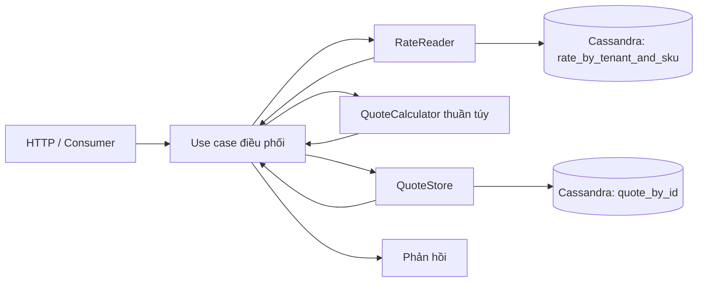

# Tách phép tính nghiệp vụ khỏi tác dụng phụ lưu trữ

Khi xây dựng ứng dụng với **Spring Data Cassandra**, một phương thức xử lý thường phải đọc dữ liệu bằng repository hoặc `CassandraTemplate`, áp dụng quy tắc nghiệp vụ, rồi ghi kết quả qua CQL. Nếu ba việc này trộn lẫn, một thay đổi nhỏ trong cách truy cập Cassandra có thể làm hỏng quy tắc tính toán; ngược lại, muốn kiểm tra phép tính lại phải chuẩn bị kết nối, dữ liệu và trạng thái của cụm Cassandra.

Thiết kế tốt là **đưa dữ liệu cần thiết vào một hàm tính toán thuần túy**, để việc đọc, ghi, chọn consistency level, xử lý lỗi mạng và retry nằm ở lớp điều phối hoặc adapter lưu trữ. Đây là nguyên tắc đặc biệt hữu ích với Apache Cassandra: bảng được thiết kế theo truy vấn, dữ liệu phân tán trên các partition, các thao tác ghi mặc định có tính chất upsert và không thể giả định có transaction ACID bao trùm nhiều partition như ở cơ sở dữ liệu quan hệ.

## 1. Nhận diện ranh giới nghiệp vụ và I/O

Xét chức năng tạo báo giá thuê thiết bị: người dùng chọn một thiết bị và khoảng ngày thuê; hệ thống đọc đơn giá hiện hành từ Cassandra, tính số ngày, tiền trước giảm giá, tiền giảm và tổng phải trả, sau đó lưu báo giá.

| Công việc | Thuộc lớp nào? | Lý do |
| --- | --- | --- |
| Đọc đơn giá theo `tenant_id` và `sku` | Tác dụng phụ đọc | Phụ thuộc cấu trúc bảng, độ trễ mạng, tính sẵn sàng và mức nhất quán của Cassandra. |
| Tính số ngày thuê từ ngày bắt đầu và kết thúc | Phép tính thuần túy | Với cùng hai ngày và quy tắc tính, kết quả luôn giống nhau. |
| Tính tiền, mức giảm giá và làm tròn | Phép tính thuần túy | Chỉ cần đầu vào và chính sách giá; không cần database. |
| Lấy thời điểm hiện tại, tạo ID ngẫu nhiên | Ranh giới tác dụng phụ | Phụ thuộc đồng hồ hoặc nguồn ngẫu nhiên; cần truyền giá trị vào phép tính nếu có sử dụng. |
| Lưu báo giá và kiểm tra `IF NOT EXISTS` | Tác dụng phụ ghi | Có thể thành công, thất bại, timeout hoặc nhận kết quả không chắc chắn. |
| Ghi log, phát sự kiện, gọi API thanh toán | Tác dụng phụ bên ngoài | Là hành động quan sát được, không được âm thầm thực hiện trong hàm tính giá. |

Một cách phân chia trách nhiệm dễ kiểm soát:



Điểm quan trọng: **"thuần túy" không có nghĩa là không dùng dữ liệu từ database**. Hàm thuần túy hoàn toàn có thể tính trên một *snapshot* vừa được đọc từ Cassandra, miễn là nó không tự đọc, ghi hoặc thay đổi trạng thái bên ngoài.

## 2. Đưa quy tắc tính giá vào một hàm thuần túy

Ví dụ sau dùng Java 17+, `BigDecimal` và quy ước `startInclusive`/`endExclusive`: ngày bắt đầu được tính, ngày kết thúc không được tính. Để tập trung vào kiến trúc, ví dụ dùng loại tiền có **hai chữ số thập phân**; trong hệ thống thực tế phải quy định cách làm tròn theo loại tiền và hợp đồng nghiệp vụ.

```java
import java.math.BigDecimal;
import java.math.RoundingMode;
import java.time.LocalDate;
import java.time.temporal.ChronoUnit;
import java.util.Objects;

record RateSnapshot(
        String version,
        String currency,
        BigDecimal dailyPrice,
        BigDecimal discountRate // Từ 0 đến 1; 0.10 tương đương giảm 10%.
) {}

record QuotePrice(
        int rentalDays,
        BigDecimal gross,
        BigDecimal discount,
        BigDecimal total
) {}

public final class QuoteCalculator {
    private QuoteCalculator() {}

    public static QuotePrice calculate(
            LocalDate startInclusive,
            LocalDate endExclusive,
            RateSnapshot rate
    ) {
        Objects.requireNonNull(startInclusive, "startInclusive");
        Objects.requireNonNull(endExclusive, "endExclusive");
        Objects.requireNonNull(rate, "rate");
        Objects.requireNonNull(rate.dailyPrice(), "dailyPrice");
        Objects.requireNonNull(rate.discountRate(), "discountRate");

        long days = ChronoUnit.DAYS.between(startInclusive, endExclusive);
        if (days < 1 || days > 90) {
            throw new IllegalArgumentException("Số ngày thuê phải từ 1 đến 90");
        }
        if (rate.dailyPrice().signum() < 0
                || rate.discountRate().compareTo(BigDecimal.ZERO) < 0
                || rate.discountRate().compareTo(BigDecimal.ONE) > 0) {
            throw new IllegalArgumentException("Đơn giá hoặc tỷ lệ giảm không hợp lệ");
        }

        BigDecimal gross = rate.dailyPrice()
                .multiply(BigDecimal.valueOf(days))
                .setScale(2, RoundingMode.HALF_UP);
        BigDecimal discount = gross.multiply(rate.discountRate())
                .setScale(2, RoundingMode.HALF_UP);
        BigDecimal total = gross.subtract(discount);

        return new QuotePrice(Math.toIntExact(days), gross, discount, total);
    }
}
```

Với khoảng ngày `[2026-12-01, 2026-12-04)`, đơn giá `100.00` và tỷ lệ giảm `0.10`, kết quả là **3 ngày**, tiền gốc **300.00**, giảm **30.00**, tổng **270.00**. Thay đổi endpoint HTTP, driver Cassandra, repository hay cách triển khai retry không làm thay đổi kết quả của `QuoteCalculator`.

Các tính chất cần duy trì:

- **Đầu vào tường minh:** ngày thuê, snapshot giá, phiên bản giá và chính sách làm tròn phải rõ ràng; không tự gọi repository hoặc lấy cấu hình động trong lúc tính.
- **Không thay đổi đối tượng bên ngoài:** dùng `record`/giá trị bất biến và trả một kết quả mới, không ghi vào entity có thể được chia sẻ giữa các bước.
- **Không phụ thuộc thời gian ngầm:** nếu quy tắc có hạn khuyến mại, lớp điều phối lấy `Instant` từ `Clock` và truyền thời điểm đó vào hàm.
- **Không dùng `double` cho tiền:** dùng `BigDecimal`, xác định thời điểm làm tròn, đơn vị tiền và cách xử lý các trường hợp biên.

## 3. Lớp điều phối chỉ ghép các bước

Use case biết **khi nào** phải đọc và ghi, còn `QuoteCalculator` biết **cách** tính giá. Hai cổng (`port`) che giấu chi tiết Cassandra để phần nghiệp vụ không phụ thuộc trực tiếp vào Spring Data hoặc DataStax Java Driver.

```java
import java.time.Clock;
import java.time.Instant;
import java.time.LocalDate;
import java.util.Optional;
import java.util.UUID;
import org.springframework.stereotype.Service;

record QuoteCommand(
        String tenantId,
        UUID requestId, // ID ổn định qua các lần retry của cùng yêu cầu.
        String sku,
        LocalDate startInclusive,
        LocalDate endExclusive
) {}

record StoredQuote(
        String tenantId,
        UUID requestId,
        String sku,
        LocalDate startInclusive,
        LocalDate endExclusive,
        String rateVersion,
        String currency,
        QuotePrice price,
        Instant createdAt
) {
    boolean matchesRequest(QuoteCommand command) {
        return tenantId.equals(command.tenantId())
                && requestId.equals(command.requestId())
                && sku.equals(command.sku())
                && startInclusive.equals(command.startInclusive())
                && endExclusive.equals(command.endExclusive());
    }
}

interface RateReader {
    RateSnapshot load(String tenantId, String sku);
}

interface QuoteStore {
    Optional<StoredQuote> find(String tenantId, UUID requestId);
    boolean insertIfAbsent(StoredQuote quote);
}

@Service
public final class CreateQuoteService {
    private final RateReader rateReader;
    private final QuoteStore quoteStore;
    private final Clock clock;

    public CreateQuoteService(RateReader rateReader, QuoteStore quoteStore, Clock clock) {
        this.rateReader = rateReader;
        this.quoteStore = quoteStore;
        this.clock = clock;
    }

    public StoredQuote create(QuoteCommand command) {
        // Đọc trước để yêu cầu retry giữ nguyên báo giá đã lưu.
        Optional<StoredQuote> existing = quoteStore.find(
                command.tenantId(), command.requestId());
        if (existing.isPresent()) {
            return validateAndReturn(existing.get(), command);
        }

        RateSnapshot rate = rateReader.load(command.tenantId(), command.sku());
        QuotePrice price = QuoteCalculator.calculate(
                command.startInclusive(), command.endExclusive(), rate);

        StoredQuote candidate = new StoredQuote(
                command.tenantId(), command.requestId(), command.sku(),
                command.startInclusive(), command.endExclusive(),
                rate.version(), rate.currency(), price, clock.instant());

        if (quoteStore.insertIfAbsent(candidate)) {
            return candidate;
        }

        // Một request đồng thời khác có thể vừa tạo cùng khóa.
        StoredQuote saved = quoteStore.find(command.tenantId(), command.requestId())
                .orElseThrow(() -> new IllegalStateException(
                        "Chưa đọc được báo giá đã tồn tại; cần retry có kiểm soát"));
        return validateAndReturn(saved, command);
    }

    private static StoredQuote validateAndReturn(
            StoredQuote stored, QuoteCommand command) {
        if (!stored.matchesRequest(command)) {
            throw new IllegalArgumentException("requestId đã dùng cho yêu cầu khác");
        }
        return stored;
    }
}
```

Đây là mã minh họa kiến trúc: ứng dụng cần kiểm tra xác thực/quyền truy cập `tenantId`, xác nhận các giá trị bắt buộc của `QuoteCommand`, cấu hình bean `Clock`, chuyển lỗi thành HTTP/API response và triển khai hai port phù hợp.

**Vì sao đọc báo giá cũ trước khi đọc đơn giá?** Nếu cùng `requestId` được gửi lại sau khi bảng giá thay đổi, hệ thống phải trả báo giá đã tạo thay vì âm thầm tính một số tiền mới. Lần đọc đầu chỉ là bước tối ưu và giữ nguyên kết quả; `insertIfAbsent` mới là hàng rào ngăn hai yêu cầu đồng thời cùng tạo một khóa.

## 4. Thiết kế bảng theo truy vấn, rồi triển khai adapter Cassandra

Trước khi viết repository, hãy xác định chính xác các truy vấn cần phục vụ:

1. `load(tenantId, sku)` — lấy **một** phiên bản đơn giá hiện hành cho thiết bị trong tenant.
2. `find(tenantId, requestId)` — tìm báo giá theo khóa định danh yêu cầu.
3. `insertIfAbsent(quote)` — chỉ tạo báo giá nếu khóa đó chưa tồn tại.

Một lược đồ tối giản đáp ứng ba thao tác này:

```sql
CREATE TABLE rate_by_tenant_and_sku (
    tenant_id text,
    sku text,
    version text,
    currency text,
    daily_price decimal,
    discount_rate decimal,
    PRIMARY KEY ((tenant_id, sku))
);

CREATE TABLE quote_by_id (
    tenant_id text,
    request_id uuid,
    sku text,
    start_date date,
    end_date date,
    rate_version text,
    currency text,
    rental_days int,
    gross decimal,
    discount decimal,
    total decimal,
    created_at timestamp,
    PRIMARY KEY ((tenant_id, request_id))
);
```

Trong ví dụ này, cặp `(tenant_id, request_id)` là **composite partition key**, nên mỗi ID báo giá tạo một partition nhỏ và tra cứu bằng đủ hai giá trị. Không dùng `ALLOW FILTERING` để cứu một truy vấn không khớp khóa. Nếu cần liệt kê báo giá theo khách hàng hoặc theo thời gian, phải thiết kế thêm bảng phục vụ truy vấn ấy với phân vùng và clustering phù hợp; không đọc hết `quote_by_id` rồi lọc bằng Java. Bảng đơn giá là snapshot đầu vào tại thời điểm tính; báo giá lưu cả `rate_version` và các giá trị tiền đã tính để giải thích kết quả sau này.

Ở adapter, `CassandraRepository` hoặc `CassandraTemplate` phù hợp cho ánh xạ entity, đọc theo khóa và những truy vấn được thiết kế rõ. Tuy nhiên **`repository.save(...)` thông thường là upsert**, không có nghĩa "chỉ lưu nếu chưa tồn tại". Với yêu cầu tạo một báo giá duy nhất cho một `requestId`, dùng CQL có điều kiện:

```sql
INSERT INTO quote_by_id (
    tenant_id, request_id, sku, start_date, end_date,
    rate_version, currency, rental_days, gross, discount, total, created_at
) VALUES (?, ?, ?, ?, ?, ?, ?, ?, ?, ?, ?, ?)
IF NOT EXISTS;
```

Ví dụ adapter sử dụng `CqlSession` của DataStax Java Driver 4.x để minh họa rõ tác dụng phụ ghi. Các trường hợp đọc thông thường có thể được triển khai bằng repository/template hoặc bằng truy vấn theo đúng partition key:

```java
import com.datastax.oss.driver.api.core.CqlSession;
import com.datastax.oss.driver.api.core.cql.ResultSet;
import com.datastax.oss.driver.api.core.cql.Row;
import com.datastax.oss.driver.api.core.cql.SimpleStatement;
import java.util.Optional;
import java.util.UUID;
import org.springframework.stereotype.Repository;

@Repository
public final class CassandraQuoteStore implements QuoteStore {
    private static final String FIND = """
        SELECT tenant_id, request_id, sku, start_date, end_date,
               rate_version, currency, rental_days, gross, discount,
               total, created_at
        FROM quote_by_id WHERE tenant_id = ? AND request_id = ?
        """;

    private static final String INSERT = """
        INSERT INTO quote_by_id (
            tenant_id, request_id, sku, start_date, end_date,
            rate_version, currency, rental_days, gross, discount,
            total, created_at
        ) VALUES (?, ?, ?, ?, ?, ?, ?, ?, ?, ?, ?, ?)
        IF NOT EXISTS
        """;

    private final CqlSession session;

    public CassandraQuoteStore(CqlSession session) {
        this.session = session;
    }

    @Override
    public Optional<StoredQuote> find(String tenantId, UUID requestId) {
        Row row = session.execute(
                SimpleStatement.newInstance(FIND, tenantId, requestId)).one();
        if (row == null) {
            return Optional.empty();
        }
        QuotePrice price = new QuotePrice(
                row.getInt("rental_days"), row.getBigDecimal("gross"),
                row.getBigDecimal("discount"), row.getBigDecimal("total"));
        return Optional.of(new StoredQuote(
                row.getString("tenant_id"), row.getUuid("request_id"),
                row.getString("sku"), row.getLocalDate("start_date"),
                row.getLocalDate("end_date"), row.getString("rate_version"),
                row.getString("currency"), price, row.getInstant("created_at")));
    }

    @Override
    public boolean insertIfAbsent(StoredQuote quote) {
        QuotePrice price = quote.price();
        SimpleStatement statement = SimpleStatement.newInstance(INSERT,
                quote.tenantId(), quote.requestId(), quote.sku(),
                quote.startInclusive(), quote.endExclusive(),
                quote.rateVersion(), quote.currency(), price.rentalDays(),
                price.gross(), price.discount(), price.total(), quote.createdAt());

        ResultSet result = session.execute(statement);
        return result.wasApplied();
    }
}
```

Đoạn mã trên dùng statement đơn giản cho dễ đọc. Khi triển khai thực tế, nên cân nhắc prepared statement cho câu lệnh gọi thường xuyên và cấu hình **consistency level, serial consistency, timeout, retry policy** theo yêu cầu của hệ thống, thay vì mặc nhiên dựa vào giá trị mặc định của driver. Các phần này thuộc adapter/cấu hình hạ tầng, không chèn vào `QuoteCalculator`.

### Vì sao cần phân biệt upsert và ghi có điều kiện?

Trong Cassandra, `INSERT` thông thường có thể ghi đè giá trị của cùng khóa. `IF NOT EXISTS` sử dụng *lightweight transaction* (LWT) để quyết định nguyên tử việc tạo bản ghi theo khóa được kiểm tra; nếu khóa đã tồn tại, `wasApplied()` trả `false`. Đổi lại, LWT có chi phí phối hợp cao hơn ghi thường nên chỉ dùng cho bất biến thật sự cần bảo đảm (ở đây là một báo giá cho một khóa idempotency).

LWT cho một partition **không tạo transaction xuyên nhiều partition/bảng**. Nếu quy trình còn cập nhật tồn kho, ghi booking và phát sự kiện, không được suy ra ba tác động đó sẽ commit hoặc rollback cùng nhau. Cần thiết kế trạng thái quy trình, idempotency riêng cho từng bước, hoặc cơ chế điều phối bù trừ phù hợp.

## 5. Thiết kế retry, idempotency và mức nhất quán

Ranh giới tách biệt làm rõ ba tình huống rất khác nhau:

| Tình huống | Cách xử lý hợp lý |
| --- | --- |
| Tính sai do ngày thuê hoặc tỷ lệ giảm không hợp lệ | Hàm thuần túy ném lỗi miền nghiệp vụ; trả lỗi đầu vào, không retry Cassandra. |
| Đã tạo báo giá nhưng client gửi lại cùng `requestId` | Đọc báo giá cũ, so khớp nội dung yêu cầu và trả kết quả đã lưu. |
| Ghi Cassandra timeout sau khi gửi lệnh | Trạng thái ghi có thể **chưa xác định**; đọc lại bằng khóa, hoặc retry có kiểm soát với cùng `requestId` và câu lệnh có điều kiện. |
| Hai request khác nhau dùng chung `requestId` | Trả lỗi xung đột khóa idempotency; không trả dữ liệu của yêu cầu khác như thể thành công. |
| Đọc lại ngay sau LWT chưa thấy hàng vừa tạo | Không suy diễn "chưa tồn tại" từ một lần đọc yếu; chọn consistency phù hợp, có retry hữu hạn và cơ chế báo lỗi có thể thử lại. |

Vì dữ liệu phân tán, **consistency không phải chi tiết có thể bỏ qua**. Bảo đảm nhìn thấy dữ liệu phụ thuộc mức nhất quán của đọc/ghi, replica, topology và cách dùng LWT. Với các thao tác có điều kiện, cần xem xét serial consistency như `LOCAL_SERIAL` (khi phù hợp phạm vi datacenter) và mức nhất quán của các lần đọc sau ghi. `LOCAL_QUORUM` thường là lựa chọn đáng cân nhắc trong một datacenter, nhưng không tự động giải quyết mọi bất biến hay xung đột giữa các bảng.

Các nguyên tắc thực tế:

- Sinh `requestId` ổn định ở ranh giới API; cùng một thao tác logic phải dùng lại ID khi retry. Đổi ID ở mỗi lần thử sẽ tạo nhiều báo giá hợp lệ nhưng trùng ý nghĩa.
- Không bắt lỗi timeout rồi kết luận ghi thất bại: coordinator có thể mất phản hồi sau khi replica đã ghi. Phải có chiến lược đối soát trạng thái.
- Không `save()` một entity cũ nhằm "khôi phục" sau lỗi mà không xét phiên bản và cạnh tranh ghi; upsert có thể ghi đè thay đổi mới hơn.
- Nếu đặt TTL cho bảng giữ khóa idempotency, xác định rõ thời hạn hiệu lực: sau khi bản ghi hết hạn, cùng ID có thể được dùng lại. Không để TTL tình cờ phá vỡ cam kết nghiệp vụ.
- Giới hạn số vòng retry, ghi nhận metrics và phân loại lỗi đầu vào, lỗi xung đột, lỗi tạm thời của Cassandra. Retry không giới hạn có thể khuếch đại tải lên cụm đang gặp sự cố.

## 6. Kiểm thử đúng chỗ

Phần lớn quy tắc nghiệp vụ nên được xác minh bằng **unit test không khởi động Spring và không dùng Cassandra**:

```java
import static org.junit.jupiter.api.Assertions.assertEquals;
import java.math.BigDecimal;
import java.time.LocalDate;
import org.junit.jupiter.api.Test;

class QuoteCalculatorTest {
    @Test
    void calculatesThreeDaysWithTenPercentDiscount() {
        RateSnapshot rate = new RateSnapshot(
                "v12", "USD", new BigDecimal("100.00"),
                new BigDecimal("0.10"));

        QuotePrice result = QuoteCalculator.calculate(
                LocalDate.of(2026, 12, 1), LocalDate.of(2026, 12, 4), rate);

        assertEquals(3, result.rentalDays());
        assertEquals(new BigDecimal("300.00"), result.gross());
        assertEquals(new BigDecimal("30.00"), result.discount());
        assertEquals(new BigDecimal("270.00"), result.total());
    }
}
```

Sau đó kiểm tra use case bằng fake/mock `RateReader`, `QuoteStore` và `Clock.fixed(...)`: khi báo giá đã có thì không tính lại; khi hai request đua nhau thì chỉ một bản ghi được tạo; khi dùng lại ID với dữ liệu khác thì báo xung đột. Cuối cùng dùng **integration test với Cassandra thực** (ví dụ Testcontainers) để xác minh câu CQL, codec `date`/`decimal`/`timestamp`, partition key, kết quả `IF NOT EXISTS` và hành vi đọc theo consistency đã cấu hình. Mock không thay thế được kiểm thử các đặc tính phân tán này.

Nên chia ranh giới kiểm thử thành ba lớp:

| Lớp | Điều cần chứng minh | Phụ thuộc Cassandra? |
| --- | --- | --- |
| `QuoteCalculator` | Đúng số ngày, giảm giá, quy tắc làm tròn, dữ liệu biên | Không |
| `CreateQuoteService` | Đúng thứ tự đọc/tính/ghi, xử lý trùng request và lỗi | Không, dùng fake/mock các port |
| `CassandraQuoteStore` | CQL tương thích schema, ánh xạ kiểu, LWT và consistency | Có, nên kiểm thử tích hợp |

## 7. Những dấu hiệu đang trộn lẫn trách nhiệm

**Hàm tính giá nhận `CassandraRepository` hoặc `CassandraTemplate`.** Khi phải mock Cassandra chỉ để kiểm tra một phép nhân, ranh giới đang đặt sai. Đọc snapshot trước, rồi gọi hàm nhận các giá trị rõ ràng.

**Vòng lặp tính tiền gọi database cho từng dòng.** Đây là mẫu N+1 I/O: chi phí mạng tăng theo số dòng và có thể đọc các phiên bản không đồng nhất. Thu thập một tập dữ liệu có giới hạn theo các truy vấn thiết kế sẵn, rồi tính trên snapshot đó. Với tập lớn, dùng paging theo token của Cassandra hoặc xử lý từng batch có giới hạn; đừng nạp cả partition không giới hạn vào bộ nhớ.

**Tính lại báo giá từ đơn giá mới khi người dùng retry.** Kết quả thay đổi dù request logic không đổi. Lưu snapshot kết quả và phiên bản chính sách đã dùng; dùng ID ổn định để truy xuất lại.

**Dựa vào `@Transactional` để mong nhiều bản ghi trên nhiều partition rollback cùng nhau.** Các bảo đảm transaction quen thuộc của RDBMS không thể áp thẳng vào Cassandra. Cần mô hình hóa từng bước ghi, trạng thái trung gian và khả năng phục hồi nếu nghiệp vụ chạm nhiều partition.

**Tự gọi `Instant.now()`, random UUID hoặc API ngoài trong hàm tính.** Kết quả không còn phụ thuộc duy nhất vào đối số. Đưa thời điểm, ID và dữ liệu bên ngoài thành input; để use case quyết định khi nào truy cập các nguồn đó.

## 8. Checklist áp dụng vào dự án Spring Data Cassandra

1. Xác định trước những truy vấn Cassandra thực sự cần phục vụ; thiết kế partition key/clustering key theo access pattern và giới hạn kích thước partition.
2. Tạo các DTO/snapshot bất biến cho dữ liệu nghiệp vụ, phân biệt chúng với entity dùng để mapping bảng Cassandra.
3. Viết hàm tính thuần túy không phụ thuộc Spring, driver, repository, đồng hồ hệ thống hoặc API ngoài.
4. Đặt thao tác đọc/ghi trong adapter; chỉ use case điều phối trình tự, quản lý ID, thời gian, lỗi và retry.
5. Phân biệt `save`/upsert với điều kiện `IF NOT EXISTS`; chỉ dùng LWT cho bất biến cần thiết và hiểu chi phí của nó.
6. Xác định yêu cầu consistency, chiến lược xử lý timeout, idempotency và thời hạn lưu bản ghi; không giả định transaction xuyên partition.
7. Kiểm tra quy tắc tính bằng unit test nhanh; kiểm tra mapping, CQL và hành vi phân tán bằng integration test.

**Nguyên tắc ghi nhớ:** Cassandra cung cấp dữ liệu đầu vào và nơi lưu kết quả; use case điều phối các tác dụng phụ; hàm nghiệp vụ nhận snapshot rõ ràng và trả kết quả xác định. Cách chia này giúp quy tắc dễ hiểu, dễ kiểm thử và giữ các quyết định đặc thù của hệ thống lưu trữ phân tán ở đúng ranh giới kỹ thuật.
