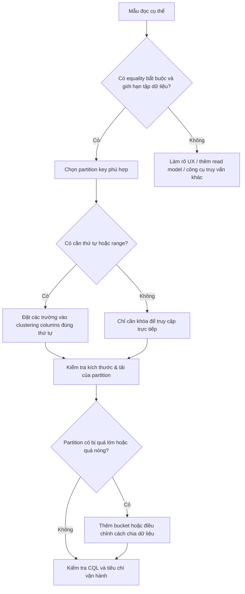

# Liệt kê mẫu đọc, điều kiện lọc và yêu cầu sắp xếp

Trong **Spring Data Cassandra**, việc thiết kế bảng nên bắt đầu bằng câu hỏi: **Ứng dụng cần đọc dữ liệu như thế nào?** Apache Cassandra phân phối dữ liệu theo **partition key** và sắp xếp các hàng *bên trong mỗi partition* theo **clustering columns**. Một bảng nhìn có vẻ hợp lý theo mô hình quan hệ chưa chắc đáp ứng được các màn hình danh sách, bộ lọc và cách sắp xếp của ứng dụng.

Bài này thuộc chương **Thiết kế theo truy vấn**. Mục tiêu là biến nhu cầu đọc của người dùng thành một **danh mục mẫu truy vấn (read/query patterns)** đủ rõ để quyết định partition key, clustering key, những bảng cần tạo và cách ứng dụng truy cập bằng CQL, repository hoặc `CassandraTemplate`. Các quyết định về consistency, paging và hiệu năng cần được ghi nhận ngay từ lúc thu thập yêu cầu.

> **Ý chính:** Với Cassandra, hãy liệt kê *ai đọc, đọc tập dữ liệu nào, lọc theo trường nào, sắp xếp ra sao, lấy bao nhiêu hàng* trước khi vẽ bảng. Không suy ra mọi màn hình truy vấn chỉ từ danh sách thuộc tính của entity.

## 1. Mẫu đọc (read pattern) là gì?

Một **mẫu đọc** mô tả một cách truy xuất dữ liệu cụ thể mà ứng dụng phải hỗ trợ. Mẫu đọc không chỉ là câu `SELECT`. Nó còn bao gồm vị trí gọi, tần suất, điều kiện bắt buộc, yêu cầu thứ tự, số hàng trả về, nhu cầu phân trang và kỳ vọng về độ trễ.

Ví dụ trong ứng dụng quản lý đơn hàng:

- Khách hàng mở **20 đơn hàng mới nhất** của chính mình.
- Khách hàng mở **chi tiết một đơn hàng** từ mã đơn.
- Nhân viên vận hành xem **đơn hàng đang chờ xử lý hôm nay** của một cửa hàng.
- Bộ phận báo cáo xem **doanh số tổng hợp theo tháng**.

Đó là bốn mẫu đọc khác nhau, dù cùng liên quan đến “đơn hàng”. Chúng không nhất thiết phù hợp với một bảng Cassandra duy nhất.

### Mẫu ghi nhận một yêu cầu đọc

| Thành phần | Cần ghi lại | Ví dụ |
| --- | --- | --- |
| **Mã mẫu đọc** | ID ổn định để trao đổi giữa sản phẩm, backend và dữ liệu | `R01` |
| **Nguồn gọi** | Màn hình/API/luồng nghiệp vụ nào sử dụng | `GET /customers/{id}/orders` |
| **Chủ thể và phạm vi** | Ai được phép đọc; giới hạn tenant/cửa hàng/khách hàng | Một khách hàng trong một tenant |
| **Điều kiện bắt buộc** | Trường luôn có giá trị khi truy vấn | `tenant_id`, `customer_id` |
| **Điều kiện tùy chọn** | Người dùng có thể thêm hoặc bỏ lọc nào | `status`, khoảng thời gian |
| **Sắp xếp** | Trường và chiều; có cần thứ tự ổn định không | `created_at DESC, order_id DESC` |
| **Phân trang/giới hạn** | Mỗi lần xem bao nhiêu hàng; có tải tiếp không | 20 đơn/trang; tải tiếp |
| **Đặc tính dữ liệu** | Số hàng dự kiến trong một phạm vi; mức tăng trưởng | Vài đơn đến nhiều năm lịch sử/khách |
| **Độ ưu tiên/SLO** | Tần suất và độ trễ chấp nhận được, nếu đã có | Mẫu thường dùng, p95 mục tiêu do sản phẩm xác nhận |
| **Nhất quán** | Có chấp nhận dữ liệu mới cập nhật chưa xuất hiện không | Danh sách có thể trễ ngắn; thanh toán cần quy tắc riêng |

Các số lượng và mục tiêu độ trễ trong bài đều là **ví dụ minh họa**. Khi triển khai, cần lấy số thực từ dữ liệu và yêu cầu sản phẩm.

## 2. Quy trình khảo sát mẫu đọc trước khi thiết kế bảng

### Bước 1 — Đi từ hành vi người dùng tới thao tác đọc

Đọc luồng giao diện, endpoint, hành vi tìm kiếm và tác vụ nền. Đừng dừng ở câu “cần bảng đơn hàng”. Hãy tách thành các câu hỏi có thể trả lời bằng dữ liệu:

1. Khi mở trang, cần hiển thị bản ghi nào đầu tiên?
2. Mỗi người dùng/tenant thấy tập dữ liệu nào?
3. Người dùng có thể thay đổi bộ lọc hoặc thứ tự nào?
4. Khi nhấn “Xem thêm”, tải tiếp cùng tập dữ liệu hay chạy truy vấn mới?
5. Dữ liệu sẽ tăng đến mức nào sau sáu tháng hoặc một năm?
6. Nếu các màn hình cùng đọc một thực thể nhưng khác đường truy cập, cần các mẫu đọc riêng nào?

Ví dụ “xem lịch sử đơn hàng” vẫn còn mơ hồ. Phiên bản có thể thiết kế phải giống:

> Trong tenant đã xác thực, khách hàng xem 20 đơn mới nhất của mình, có thể chọn tháng. Thứ tự mặc định là thời gian tạo giảm dần; hai đơn cùng thời gian được sắp bằng ID. Nút “Xem thêm” tiếp tục từ vị trí trước. Bộ lọc trạng thái là tùy chọn và có tỷ lệ sử dụng thấp.

Câu mô tả này đủ thông tin để đánh giá liệu truy vấn được phục vụ bởi một partition, cần bảng bổ sung hay cần điều chỉnh UX.

### Bước 2 — Tách điều kiện lọc thành ba nhóm

| Nhóm | Dấu hiệu | Hướng suy nghĩ trong Cassandra |
| --- | --- | --- |
| **Equality bắt buộc** | Luôn có `tenant_id = ...`, `customer_id = ...` | Ứng viên cho partition key; giúp định vị partition |
| **Khoảng/điều kiện thứ tự** | `created_at >= ... AND created_at < ...` | Ứng viên cho clustering column theo thứ tự truy cập |
| **Tùy chọn, nhiều tổ hợp** | `status`, giá tiền, từ khóa, thẻ | Có thể đòi hỏi bảng chuyên biệt, chỉ mục thích hợp hoặc xử lý ở tầng khác |

Một trường “có trong UI” **không đồng nghĩa** trường ấy có thể đưa vào `WHERE` tùy ý. Cassandra không tối ưu cho việc quét toàn bảng và kết hợp các filter tự do như một hệ quản trị quan hệ truyền thống.

### Bước 3 — Xác định sắp xếp từ yêu cầu thực

Ghi đủ **cột sắp xếp, chiều và quy tắc phá hòa (tie-breaker)**:

- “Mới nhất” → `created_at DESC`.
- “Cũ nhất” → `created_at ASC`.
- “Cùng thời điểm thì vẫn có thứ tự ổn định” → thêm `order_id` làm khóa phụ.
- “Sắp tùy ý theo tổng tiền, trạng thái hoặc tên” → một thiết kế theo thời gian khó đáp ứng trực tiếp; cần quyết định rõ tính năng và chiến lược dữ liệu.

Ở Cassandra, ordering hiệu quả dựa chủ yếu trên **clustering columns trong cùng partition**. Vì thế yêu cầu “sắp toàn bộ đơn của mọi khách trên thế giới theo thời gian” là một bài toán khác hẳn “sắp 20 đơn mới nhất của một khách hàng trong tháng”.

### Bước 4 — Ghi ràng buộc vận hành và độ lớn dữ liệu

Không thể chọn partition key chỉ từ cú pháp truy vấn. Cần biết:

- Số bản ghi/partition có thể đạt tới bao nhiêu và tăng nhanh thế nào.
- Có người dùng/cửa hàng đặc biệt “nóng” tạo tải rất lớn hay không.
- Một lần đọc thường trả bao nhiêu dữ liệu, có đọc trang tiếp hay không.
- Tỷ lệ đọc/ghi và tần suất đổi trạng thái.
- Độ trễ chấp nhận được và khả năng đọc dữ liệu chưa hội tụ giữa các replica/DC.
- Có cần nhất quán tức thời về nghiệp vụ, điều kiện cập nhật hay kiểm toán không.

Một partition quá lớn có thể làm đọc, compaction và repair nặng nề; một partition bị truy cập quá dày có thể tạo **hot partition** dù cluster có nhiều node. Bổ sung RF không tự phân tán tải của *một* partition sang vô hạn node.

## 3. Lập ma trận mẫu đọc cho một ứng dụng thực tế

Giả sử nền tảng bán hàng đa tenant có các thuộc tính: `tenant_id`, `order_id`, `customer_id`, `created_at`, `status`, `total_amount` và `updated_at`.

| Mã | Nhu cầu đọc | Equality bắt buộc | Filter khác | Thứ tự/giới hạn | Gợi ý đường truy cập |
| --- | --- | --- | --- | --- | --- |
| **R01** | Đơn gần nhất của khách trong tháng | `tenant_id`, `customer_id`, `bucket_month` | Khoảng `created_at` nếu cần | `created_at DESC, order_id DESC`; 20/trang | Bảng theo khách + tháng |
| **R02** | Chi tiết đơn bằng mã đơn | `tenant_id`, `order_id` | Không | Một bản ghi | Bảng tra cứu theo ID |
| **R03** | Đơn `PENDING` của tenant theo ngày | `tenant_id`, `status`, `bucket_day` | Mốc thời gian | Mới nhất trước; 50/trang | Bảng danh sách theo trạng thái + ngày |
| **R04** | Lịch sử tất cả đơn của khách trong nhiều năm | `tenant_id`, `customer_id` | Khoảng tháng | Mới nhất trước; đọc nhiều trang | Đọc nhiều bucket có giới hạn và ghép kết quả |
| **R05** | Báo cáo doanh thu theo tháng, nhóm trạng thái | `tenant_id`, tháng | Trạng thái | Tổng hợp | Dữ liệu tổng hợp đã chuẩn bị; cân nhắc công cụ phân tích |

Ma trận giúp phát hiện sớm hai điều: **R01 và R03 không có cùng khóa truy cập**, còn **R05 là bài toán tổng hợp** chứ không nên mặc nhiên biến thành một truy vấn quét mọi hàng đơn.

Đánh dấu mẫu nào thuộc tuyến truy cập quan trọng, mẫu nào có thể xử lý bất đồng bộ, và mẫu nào cần thay đổi UX để tránh bộ lọc bất khả thi.

## 4. Ánh xạ mẫu đọc sang partition key và clustering key

Một bảng Cassandra có `PRIMARY KEY` gồm:

- **Partition key**: xác định partition và nhóm replica nơi dữ liệu được lưu.
- **Clustering columns**: xác định thứ tự hàng **bên trong partition** và hỗ trợ phạm vi đọc theo điều kiện hợp lệ.

Có thể biểu diễn quyết định thiết kế như sau:



### Trường hợp R01: đơn theo khách, tháng, mới nhất trước

Bảng được thiết kế trực tiếp từ R01:

```sql
CREATE TABLE orders_by_customer_month (
    tenant_id uuid,
    customer_id uuid,
    bucket_month text,
    created_at timestamp,
    order_id uuid,
    status text,
    total_amount decimal,
    PRIMARY KEY (
        (tenant_id, customer_id, bucket_month),
        created_at,
        order_id
    )
) WITH CLUSTERING ORDER BY (
    created_at DESC,
    order_id DESC
);
```

Trong thiết kế này:

1. `(tenant_id, customer_id, bucket_month)` là **composite partition key**. Ứng dụng biết rõ cả ba thành phần khi gọi R01.
2. `created_at` là clustering column chính, sắp xếp giảm dần để ưu tiên đơn gần đây.
3. `order_id` là clustering column tiếp theo, giúp phân biệt nhiều đơn có cùng timestamp và tạo thứ tự xác định.
4. `status` và `total_amount` là dữ liệu cần hiển thị, **không tự nhiên trở thành điều kiện filter hiệu quả**.
5. `bucket_month` giới hạn dữ liệu của một khách theo tháng, giảm nguy cơ lịch sử nhiều năm dồn vào một partition.

Truy vấn phù hợp:

```sql
SELECT created_at, order_id, status, total_amount
FROM orders_by_customer_month
WHERE tenant_id = 11111111-1111-1111-1111-111111111111
  AND customer_id = 22222222-2222-2222-2222-222222222222
  AND bucket_month = '2026-11'
LIMIT 20;
```

Thứ tự mặc định là thứ tự đã khai báo ở `CLUSTERING ORDER BY`. Có thể nêu tường minh `ORDER BY created_at DESC, order_id DESC` khi phù hợp với quy tắc ordering của Cassandra và phiên bản đang dùng.

Nếu cần xem một khoảng thời gian thuộc tháng đó:

```sql
SELECT created_at, order_id, status, total_amount
FROM orders_by_customer_month
WHERE tenant_id = 11111111-1111-1111-1111-111111111111
  AND customer_id = 22222222-2222-2222-2222-222222222222
  AND bucket_month = '2026-11'
  AND created_at >= '2026-11-10T00:00:00Z'
  AND created_at < '2026-11-20T00:00:00Z'
LIMIT 20;
```

Đây là điều kiện range trên clustering column đầu tiên sau khi đã xác định đầy đủ partition key. Chú ý **múi giờ** của timestamp: cần thống nhất giờ lưu trữ và cách chuyển ngày/tháng ở API để không bỏ sót hoặc đếm trùng đơn giáp ranh tháng.

**Bucket không phải công thức cố định.** Nếu một khách tạo ít đơn, bucket tháng có thể thừa; nếu mỗi tháng có hàng triệu đơn hoặc lưu lượng quá lớn, bucket tháng vẫn có thể quá rộng. Phải dùng số liệu về phân bố dữ liệu và traffic để chọn bucket ngày/tháng hoặc chiến lược khác.

### Trường hợp R02: tra cứu chi tiết bằng ID

R02 có đầu vào `tenant_id + order_id`, trong khi R01 cần thêm `customer_id + bucket_month`. Không thể giả định truy vấn theo `order_id` trên bảng R01 sẽ tự tìm đúng partition.

Một bảng read model phù hợp hơn cho R02:

```sql
CREATE TABLE orders_by_id (
    tenant_id uuid,
    order_id uuid,
    customer_id uuid,
    created_at timestamp,
    status text,
    total_amount decimal,
    PRIMARY KEY ((tenant_id, order_id))
);
```

Truy vấn:

```sql
SELECT customer_id, created_at, status, total_amount
FROM orders_by_id
WHERE tenant_id = 11111111-1111-1111-1111-111111111111
  AND order_id = 33333333-3333-3333-3333-333333333333;
```

Đây là ví dụ **denormalization theo đường đọc**: cùng đơn hàng có thể xuất hiện ở các bảng khác nhau. Ứng dụng phải thiết kế việc ghi/cập nhật những bản sao logic đó, bao gồm xử lý retry, ghi một phần và yêu cầu nhất quán.

## 5. Xác định bộ lọc nào thực sự được CQL phục vụ

Trong Cassandra, `WHERE` hiệu quả nhất khi giới hạn **đúng partition key** và sau đó đi theo thứ tự/điều kiện hợp lệ trên clustering columns. Truy vấn hợp lệ cụ thể phụ thuộc schema, phiên bản Cassandra và loại index đang dùng.

| Yêu cầu lọc | Với bảng `orders_by_customer_month` | Hướng xử lý |
| --- | --- | --- |
| Đúng tenant, khách và tháng | Phù hợp partition key | Truy vấn trực tiếp |
| Tháng và khoảng `created_at` trong một partition | Phù hợp với clustering column đầu tiên | Dùng range hợp lệ |
| Chỉ `order_id`, không biết khách/tháng | Không định vị được partition của bảng R01 | Dùng `orders_by_id` |
| `status = 'PENDING'` trong tất cả khách | `status` là regular column, không phải đường truy cập của R01 | Bảng theo trạng thái hoặc index phù hợp sau khi đánh giá |
| `total_amount > X` cho mọi tenant | Không phải truy vấn tốt trên bảng R01 | Read model/bộ máy phân tích theo nhu cầu |
| Tìm chuỗi tự do trên mô tả đơn hàng | Không phải đường truy cập của schema này | Thiết kế search riêng nếu có yêu cầu |

Ví dụ truy vấn cần tránh nếu dùng schema R01:

```sql
-- Không phù hợp với partition key của orders_by_customer_month
SELECT *
FROM orders_by_customer_month
WHERE status = 'PENDING';
```

Thêm `ALLOW FILTERING` chỉ để câu query chạy được không biến nó thành giải pháp có thể mở rộng. Cassandra có thể phải đọc/đánh giá rất nhiều dữ liệu để trả vài bản ghi. Tương tự, không nên xem secondary index hoặc Storage-Attached Index (SAI) như phép thay thế tự động cho thiết kế theo truy vấn: khả năng sử dụng và hiệu năng phụ thuộc phiên bản, độ chọn lọc, cardinality và workload thực.

### Bộ lọc tùy chọn tạo ra nhiều mẫu đọc

Giả sử UI cung cấp:

- Lọc theo trạng thái: tất cả / `PENDING` / `PAID`.
- Lọc theo khoảng thời gian.
- Sắp theo “mới nhất” hoặc “giá trị đơn hàng cao nhất”.

Đây **không phải một mẫu đọc duy nhất**. Những tổ hợp thường dùng cần được liệt kê riêng:

| Tổ hợp | Khả năng dùng bảng R01 | Quyết định cần xác nhận |
| --- | --- | --- |
| Khách + tháng, mới nhất | Tốt | Mẫu đọc chuẩn |
| Khách + tháng + khoảng thời gian | Tốt nếu khoảng nằm trong cùng bucket và theo clustering key | Cách xử lý nhiều tháng |
| Khách + tháng + trạng thái | Không có đường filter status trực tiếp từ schema này | Tần suất/filter có xứng đáng làm bảng chuyên biệt không? |
| Khách + tháng, sắp `total_amount DESC` | Không được hỗ trợ bằng thứ tự clustering hiện tại | Tạo bảng/sắp trong tập rất nhỏ hoặc đổi UX |
| Mọi khách trong tenant, chỉ đơn `PENDING` hôm nay | Không cùng partition với R01 | Cần thiết kế R03 riêng |

Nếu một tùy chọn rất ít dùng và mỗi partition đã được giới hạn nhỏ, ứng dụng có thể **đọc tập kết quả đủ nhỏ rồi lọc trong bộ nhớ**, nhưng phải ghi rõ giới hạn số hàng và băng thông. Cách này không phù hợp khi muốn lọc trong hàng chục nghìn/hàng triệu bản ghi hoặc phân trang chính xác trên toàn bộ dữ liệu.

## 6. Thiết kế điều kiện sắp xếp từ đầu

Cassandra lưu clustering rows theo thứ tự khóa đã định nghĩa trong schema. Vì thế thứ tự cần lấy phải được phản ánh vào **clustering columns**, thay vì chờ tới lúc viết repository rồi truyền `Sort.by(...)` bất kỳ.

Ví dụ đối chiếu:

| Mong muốn | Gợi ý khóa | Đánh giá |
| --- | --- | --- |
| Đơn của một khách theo mới nhất | `PRIMARY KEY ((tenant_id, customer_id, bucket_month), created_at, order_id)` | Tốt trong một partition |
| Đơn của một khách theo giá trị giảm dần | Cần read model có `total_amount` làm clustering column thích hợp | Không tự có từ bảng theo thời gian |
| Đơn `PENDING` của một cửa hàng theo thời gian | `(tenant_id, status, bucket_day)` làm partition key; `created_at` là clustering | Cần read model bổ sung |
| Tất cả đơn trên nhiều bucket được sắp toàn cục | Không có một partition chung | Cần ghép/merge theo thứ tự tại ứng dụng hoặc thay đổi mô hình đọc |

**Thứ tự trong một partition khác thứ tự toàn hệ thống.** Khi đọc từ hai bucket, hai khách hoặc hai DC, ứng dụng không thể lấy các trang tùy ý rồi cho rằng chúng đã được Cassandra sắp xếp thành một danh sách thống nhất.

### Thứ tự ổn định và khóa phá hòa

Chỉ dùng `created_at` có thể gặp hai đơn cùng thời điểm. Thêm `order_id` vào clustering key cho phép biểu diễn một thứ tự xác định:

```text
2026-11-25T09:15:00Z | order_id = 9...
2026-11-25T09:15:00Z | order_id = 3...
2026-11-25T09:14:59Z | order_id = f...
```

Với `created_at DESC, order_id DESC`, hai trường xác định thứ tự thực tế của các hàng. Nếu màn hình cần “mới nhất theo thời gian cập nhật” (`updated_at`) thay cho thời gian tạo (`created_at`), hãy coi đó là **mẫu đọc khác**: trường sắp xếp có thể thay đổi sẽ ảnh hưởng đến clustering key và quy trình di chuyển hàng khi cập nhật.

## 7. Phân trang phải được ghi trong mẫu đọc

Một danh sách dài thường có nút “Xem thêm” hoặc cuộn vô hạn. Cassandra **không cung cấp pagination kiểu `OFFSET N`** như nhiều cơ sở dữ liệu quan hệ. Hai phương án thường gặp:

1. **Driver paging state**: driver cung cấp trạng thái trang tiếp theo cho cùng câu truy vấn và tập tham số. Đây là token mờ (opaque), không được tự giải mã; khi trả ra client cần cân nhắc xác thực/bao gói an toàn và không dùng lại cho truy vấn khác.
2. **Cursor dựa trên clustering key**: lưu cặp `created_at`, `order_id` cuối cùng đã hiển thị và tìm tiếp bằng một điều kiện phù hợp với schema/CQL. Cách này cần thiết kế cẩn thận để tránh trùng hoặc bỏ sót khi dữ liệu thay đổi.

`LIMIT 20` **không có nghĩa** ứng dụng đã có cơ chế “trang 2”. Nó chỉ giới hạn số hàng một câu truy vấn lấy ra. Driver page size, query limit, paging state và cơ chế tải trang của UI là các khái niệm riêng.

Khi thu thập yêu cầu, phải hỏi thêm:

- Có cần trang trước hay chỉ “Xem thêm”?
- Cursor có cần sống qua nhiều phút hoặc sau khi người dùng đổi bộ lọc?
- Có cần snapshot cố định khi dữ liệu mới liên tục chèn vào?
- Có được chấp nhận bản ghi mới xuất hiện hoặc thứ tự thay đổi giữa hai lần tải không?
- Một trang có được phép ghép kết quả từ nhiều bucket/partition không?

**Đổi bộ lọc hoặc thứ tự = mẫu truy vấn mới.** Khi đó không tái sử dụng paging state của truy vấn cũ.

### Tại sao bucket ảnh hưởng paging?

Với R01, dữ liệu tháng 11 và tháng 10 nằm ở **hai partition khác nhau**. Khi người dùng kéo hết đơn tháng 11, ứng dụng có thể:

1. Hoàn thành trang/cursor của tháng 11.
2. Chuyển sang partition tháng 10.
3. Tiếp tục trả dữ liệu và ghi rõ bucket nào đang được đọc.

Nếu một trang phải chứa dữ liệu của nhiều bucket, tầng service cần gom và ghép kết quả theo thứ tự mong muốn, giữ cursor cho các nguồn cần thiết. Không có bảo đảm một `ORDER BY` duy nhất trên bảng R01 sẽ sắp xếp toàn bộ lịch sử qua các partition.

## 8. Xem thêm R03: một nhu cầu lọc khác có thể cần bảng khác

Giả sử nhân viên vận hành phải xem đơn `PENDING` của một tenant theo ngày, mới nhất trước. Một read model dành riêng cho R03 có thể là:

```sql
CREATE TABLE orders_by_tenant_status_day (
    tenant_id uuid,
    status text,
    bucket_day date,
    created_at timestamp,
    order_id uuid,
    customer_id uuid,
    total_amount decimal,
    PRIMARY KEY (
        (tenant_id, status, bucket_day),
        created_at,
        order_id
    )
) WITH CLUSTERING ORDER BY (
    created_at DESC,
    order_id DESC
);
```

Truy vấn:

```sql
SELECT created_at, order_id, customer_id, total_amount
FROM orders_by_tenant_status_day
WHERE tenant_id = 11111111-1111-1111-1111-111111111111
  AND status = 'PENDING'
  AND bucket_day = '2026-11-25'
LIMIT 50;
```

Điểm đánh đổi: **`status` có thể thay đổi**. Nếu đơn từ `PENDING` sang `PAID`, hàng trong bảng theo trạng thái cần được cập nhật/di chuyển khỏi partition cũ theo logic nghiệp vụ. Trong Cassandra, việc ghi các read model khác nhau không tự trở thành một transaction quan hệ xuyên bảng. Vì vậy phải xác định quy trình đồng bộ và khả năng chấp nhận hiển thị tạm thời chưa nhất quán.

Nếu R03 đòi hỏi “đơn đang chờ nhưng phải sắp theo thời điểm chuyển sang trạng thái chờ”, không nên dùng `created_at` chỉ vì trường đó đã có sẵn: cần hỏi rõ timestamp của **sự kiện chuyển trạng thái** và cách duy trì read model.

## 9. Từ danh mục mẫu đọc sang Spring Data Cassandra

Trong Spring Data Cassandra, entity mapping, repository và `CassandraTemplate` là các cách thực thi truy vấn đã thiết kế. Chúng **không làm Cassandra hỗ trợ các bộ lọc hoặc thứ tự mà bảng không được thiết kế để phục vụ**.

Ví dụ repository minh họa cho bảng R01 (giả sử đã có entity `OrderByCustomerMonth` và khóa `OrderByCustomerMonthKey` ánh xạ đúng schema):

```java
import java.util.List;
import java.util.UUID;

import org.springframework.data.cassandra.repository.CassandraRepository;
import org.springframework.data.cassandra.repository.Query;

public interface OrderByCustomerMonthRepository
        extends CassandraRepository<OrderByCustomerMonth, OrderByCustomerMonthKey> {

    @Query("""
        SELECT tenant_id, customer_id, bucket_month,
               created_at, order_id, status, total_amount
        FROM orders_by_customer_month
        WHERE tenant_id = ?0
          AND customer_id = ?1
          AND bucket_month = ?2
        LIMIT 20
        """)
    List<OrderByCustomerMonth> findRecentInMonth(
        UUID tenantId,
        UUID customerId,
        String bucketMonth
    );
}
```

Ở đây `?0`, `?1`, `?2` là vị trí tham số của `@Query` trong Spring Data Cassandra, không phải chuỗi do người dùng ghép trực tiếp vào CQL. Entity/primary-key class cần khai báo mapping cho các thành phần khóa, bao gồm composite partition key và clustering columns, phù hợp với phiên bản Spring Data Cassandra đang sử dụng.

Khi truy vấn cần giới hạn, criteria động hoặc điều khiển paging chi tiết, có thể sử dụng `CassandraTemplate` hay trực tiếp driver/statement phù hợp. Dù chọn API nào, luôn đối chiếu câu CQL thực tế với **bảng + partition key + clustering order** đã được thiết kế.

### Không để API repository che lấp ràng buộc của Cassandra

Ví dụ, một hàm có vẻ tự nhiên như:

```java
// Chỉ là ý tưởng API; không có nghĩa schema R01 chạy hiệu quả:
List<OrderByCustomerMonth> findByStatusOrderByTotalAmountDesc(String status);
```

Tên phương thức không bảo đảm Cassandra có thể thực hiện truy vấn trên bảng R01: thiếu partition key và yêu cầu sort theo regular column. Spring Data có thể phát sinh truy vấn không được CQL chấp nhận hoặc gặp vấn đề hiệu năng. Thay vì thêm `ALLOW FILTERING` để vượt lỗi, hãy quay lại danh mục mẫu đọc và thiết kế read model đúng.

### Đưa thông tin phân trang/nhất quán vào hợp đồng API

Một bản đặc tả R01 có thể ghi:

```text
Read pattern: R01
Endpoint: GET /customers/{customerId}/orders?month=2026-11
Tenant scope: derived from authenticated caller
Required filters: tenant_id, customer_id, bucket_month
Optional filter: created_at range within bucket
Sort: created_at DESC, order_id DESC
Initial result: up to 20 records
Next page: opaque cursor or driver paging state for same query
Consistency: selected according to business requirement
Query table: orders_by_customer_month
```

Hợp đồng này giúp backend tránh các lỗi thường gặp: quên tenant scope, áp một kiểu sort mới mà không kiểm tra schema, trả paging state dùng cho query khác, hoặc đọc dữ liệu nhiều tháng nhưng không có cơ chế nối các bucket.

`tenant_id` trong khóa truy vấn chỉ giúp giới hạn đường đọc; **ủy quyền truy cập** vẫn phải được kiểm tra ở tầng ứng dụng. Không nhận tenant tùy ý từ request rồi coi đó là quyền truy cập hợp lệ.

## 10. Cần khảo sát cả consistency và chi phí đọc

Trong một cluster Cassandra phân tán, mỗi mẫu đọc nên xác định mức cần thiết về tính nhất quán:

- Danh sách hoạt động gần đây đôi khi chấp nhận dữ liệu mới ghi chưa hiện tức thì.
- Màn hình xác nhận thanh toán hoặc thay đổi trạng thái quan trọng có thể yêu cầu quy tắc kiểm tra riêng.
- Đọc đa datacenter với `LOCAL_QUORUM` tại các DC khác nhau vẫn có thể quan sát các giá trị khác nhau trong thời gian hội tụ.
- Nếu cần điều kiện cập nhật tranh chấp hoặc bảo đảm chặt chẽ, cân nhắc mô hình nghiệp vụ và các cơ chế phù hợp, không chỉ tăng RF.

Chi phí cần ghi riêng cho mỗi mẫu đọc:

| Chỉ số | Lý do cần biết |
| --- | --- |
| Số partition phải truy cập | Nhiều partition làm tăng số request/merge tại ứng dụng |
| Kích thước và số hàng/partition | Ảnh hưởng lưu trữ, đọc, compaction và repair |
| Kích thước kết quả | Ảnh hưởng network, serialization và bộ nhớ |
| Tần suất gọi/p95-p99 latency | Cho biết mẫu đọc nào cần tối ưu trước |
| Độ chọn lọc của filter | Giúp quyết định bảng mới, chỉ mục hay xử lý khác |
| Tỷ lệ cập nhật dữ liệu đã nhân bản | Quyết định chi phí đồng bộ nhiều read model |
| Mức tải của tenant/khách hàng lớn | Giúp phát hiện hot partition và lệch tải |

Độ chính xác của quyết định phụ thuộc dữ liệu thật. Một bộ lọc trên vài chục hàng khác hẳn một bộ lọc trên hàng triệu hàng, dù cú pháp API giống nhau.

## 11. Những lỗi cần tránh trong giai đoạn thu thập yêu cầu

| Biểu hiện | Vì sao nguy hiểm | Cách sửa |
| --- | --- | --- |
| “Cần bảng `orders` với đủ cột, rồi viết truy vấn sau.” | Dễ dẫn tới filter/sort trái cấu trúc khóa | Bắt đầu từ danh mục mẫu đọc |
| “Mọi trường trên màn hình đều lọc được.” | Tổ hợp filter tăng nhanh, khó đáp ứng bằng một bảng | Liệt kê tổ hợp thực sự bắt buộc và tần suất |
| “Cần sắp xếp bất kỳ cột nào.” | Ordering CQL phụ thuộc clustering key và phạm vi partition | Thống nhất thứ tự được sản phẩm hỗ trợ |
| “Chỉ cần `LIMIT` để phân trang.” | Không có cơ chế duy trì vị trí/cursor | Thiết kế paging state/cursor ngay từ đầu |
| “Có thể dùng `ALLOW FILTERING` cho mọi câu truy vấn.” | Dễ đọc rất nhiều dữ liệu để lấy ít hàng | Chọn read model/index phù hợp |
| “Đã có `order_id` ở bảng thì tra cứu bằng ID sẽ nhanh.” | `order_id` có thể chỉ là clustering column, thiếu partition key | Dùng bảng `orders_by_id` |
| “Dùng bucket tháng thì tự động không có hot partition.” | Tenant lớn vẫn có thể tạo tải cực cao trong một tháng | Đo cardinality và traffic, điều chỉnh bucket |
| “Dữ liệu trên hai bảng sẽ tự cập nhật đồng thời.” | Denormalization đòi hỏi chiến lược ghi và kiểm soát nhất quán | Thiết kế luồng cập nhật, retry và đối soát |

## 12. Bài thực hành: tạo danh mục mẫu đọc

**Bối cảnh:** Hệ thống quản lý thông báo cho người dùng của nhiều tenant. Một bản ghi có `tenant_id`, `user_id`, `notification_id`, `created_at`, `is_read`, `priority` và `title`.

Đầu bài yêu cầu:

1. Người dùng xem **30 thông báo mới nhất** của mình và tải trang tiếp.
2. Người dùng bật bộ lọc **chưa đọc**.
3. Quản trị viên xem **thông báo ưu tiên cao của toàn tenant** trong ngày.
4. Người dùng tìm thông báo có `title` chứa từ khóa bất kỳ.

Hãy lập bảng:

| ID | Điều kiện bắt buộc | Tùy chọn | Thứ tự | Giới hạn | Có cần read model riêng? |
| --- | --- | --- | --- | --- | --- |
| N01 | ... | ... | ... | ... | ... |
| N02 | ... | ... | ... | ... | ... |
| N03 | ... | ... | ... | ... | ... |
| N04 | ... | ... | ... | ... | ... |

<details>
<summary>Gợi ý đáp án</summary>

- **N01**: `tenant_id + user_id + bucket`, sắp `created_at DESC, notification_id DESC`, 30/trang. Có thể dùng bảng theo user và bucket, cộng với cursor/paging.
- **N02**: thêm `is_read = false` vào nhu cầu. Nếu bộ lọc phổ biến và cần phân trang chính xác, cân nhắc bảng theo user + unread + bucket; phải xử lý khi đánh dấu đã đọc.
- **N03**: `tenant_id + priority + bucket_day` làm ứng viên partition key; `created_at` là ứng viên clustering column. Đây là mẫu đọc khác phạm vi N01.
- **N04**: tìm kiếm chuỗi tự do đòi hỏi đánh giá khả năng search/index theo tính năng và khối lượng; không mặc nhiên dùng `ALLOW FILTERING` trên bảng N01.

Chưa có đủ thống kê dữ liệu nên câu trả lời mới là **thiết kế ứng viên**, chưa phải quyết định cuối cùng.

</details>

### Tiêu chí tự kiểm tra bài làm

- Có ghi rõ filter **luôn có** và filter **có thể bỏ** không?
- Mỗi màn hình có được diễn tả bằng thứ tự xác định và quy mô trang không?
- Đã phân biệt danh sách trong **một partition** với truy vấn trên **nhiều partition** chưa?
- Có nhận diện các tổ hợp filter/sort đòi hỏi bảng hoặc cơ chế riêng không?
- Có ghi cách xử lý dữ liệu cập nhật sau khi denormalize không?
- Có xác định được điều chưa biết để hỏi sản phẩm và đội vận hành không?

## 13. Mẫu checklist dùng khi nhận một tính năng mới

Trước khi viết entity, repository hoặc CQL, hãy xác nhận:

- [ ] Đã liệt kê toàn bộ màn hình/API/tác vụ nền quan trọng có đọc dữ liệu.
- [ ] Mỗi mẫu đọc có ID, chủ thể, phạm vi tenant và trường equality bắt buộc.
- [ ] Đã phân biệt filter tùy chọn, range, tìm kiếm chuỗi và tổng hợp.
- [ ] Đã xác định thứ tự, chiều và khóa phá hòa nếu cần.
- [ ] Đã thống nhất page size, cursor/paging state và hành vi khi đổi filter.
- [ ] Có ước lượng số bản ghi, dung lượng và tần suất cho từng pattern.
- [ ] Có thiết kế ứng viên partition key, clustering columns và bucket dựa trên mẫu đọc.
- [ ] Đã chỉ ra các pattern cần bảng denormalized hoặc hệ thống truy vấn khác.
- [ ] Đã cân nhắc consistency level và tính đúng đắn khi cập nhật nhiều read model.
- [ ] Đã có câu CQL mẫu để kiểm chứng đường truy cập, thay vì chỉ tên phương thức repository.

**Kết quả mong muốn của bước này** là một **ma trận mẫu đọc có thể kiểm chứng**: mỗi hàng nói rõ điều kiện lọc, yêu cầu sắp xếp, cách phân trang, giới hạn khối lượng và đường truy cập dự kiến. Ma trận đó mới là đầu vào đáng tin cậy để thiết kế bảng Cassandra, định nghĩa entity mapping và triển khai các truy vấn Spring Data Cassandra.
