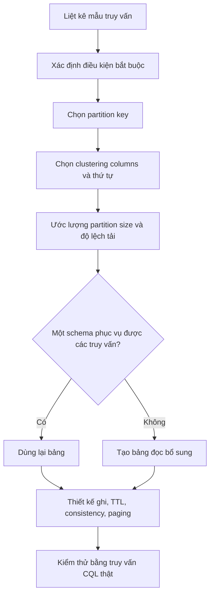
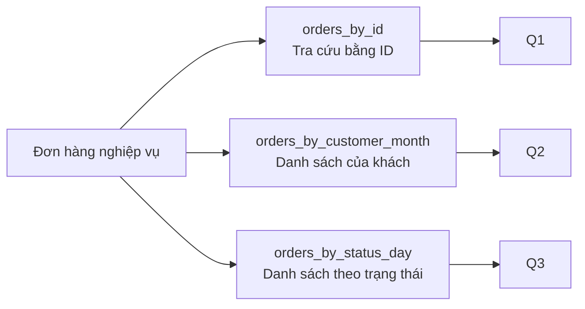

# Thiết kế một hoặc nhiều bảng phục vụ từng mẫu truy vấn trong Cassandra

Khi xây dựng ứng dụng bằng **Spring Data Cassandra**, cách thiết kế bảng cần bắt đầu từ **những truy vấn ứng dụng thực sự sẽ thực hiện**. Trong cơ sở dữ liệu quan hệ, ta thường chuẩn hóa dữ liệu thành các bảng thực thể, rồi dùng `JOIN`, `GROUP BY` và nhiều kiểu lọc để đáp ứng những nhu cầu đọc mới. Apache Cassandra ưu tiên mô hình phân tán: truy vấn hiệu quả thường xác định được **partition key**, đọc một phạm vi dữ liệu có thứ tự theo **clustering columns** và tránh quét dữ liệu trên nhiều node.

Vì thế, một thực thể nghiệp vụ như **đơn hàng** có thể được lưu trong **một bảng tra cứu theo ID**, đồng thời được sao chép có chủ đích sang **một hoặc nhiều bảng phục vụ danh sách**. Cách tổ chức này thường gọi là *query-driven data modeling*: thiết kế bảng theo mẫu truy vấn, chấp nhận phi chuẩn hóa để đánh đổi dung lượng và chi phí đồng bộ lấy đường đọc dự đoán được.

Bài học này thuộc chương **Thiết kế theo truy vấn** của `SPRING_DATA_CASSANDRA`. Trọng tâm là chuyển yêu cầu truy vấn thành schema CQL, nhận biết khi nào cần nhiều bảng, bảo đảm việc ghi vào các bản sao dữ liệu, và ánh xạ chúng bằng entity/repository/CassandraTemplate trong Spring Data Cassandra.

## 1. Trước khi viết CQL: liệt kê chính xác các mẫu truy vấn

Giả sử hệ thống nhận đơn hàng với những trường: `order_id`, `customer_id`, `created_at`, `status`, `total_amount`. Nhóm sản phẩm đề xuất ba màn hình:

| Mã | Mẫu truy vấn ứng dụng | Điều kiện đầu vào | Thứ tự/kích thước kết quả | Tính chất tải |
|---|---|---|---|---|
| Q1 | Xem chi tiết một đơn hàng | `order_id` | Đúng một đơn | Gọi thường xuyên, ưu tiên độ trễ thấp |
| Q2 | Xem các đơn gần đây của một khách | `customer_id` và tháng được chọn | Mới nhất trước, mỗi lần 20–50 đơn | Phân trang, khách có lượng đơn khác nhau |
| Q3 | Xem đơn đang ở một trạng thái để nhân viên xử lý | `status` và ngày, có thể nhiều shard | Cũ nhất trước, theo từng đợt | Khối lượng có thể lớn, `status` ít giá trị khác nhau |

Một yêu cầu mơ hồ như “tìm đơn hàng” chưa đủ để thiết kế bảng. Cần bổ sung: khóa nào luôn có sẵn, có lọc theo khoảng thời gian không, sắp xếp theo trường nào, giới hạn bao nhiêu hàng, tần suất truy vấn và mục tiêu độ trễ.

Ví dụ, “xem đơn của khách” có thể là **20 đơn gần nhất trong một tháng** hoặc **toàn bộ lịch sử 10 năm**. Hai yêu cầu này dẫn đến cách chia partition và chiến lược paging rất khác nhau.

### Mô hình tư duy



**Không cần mặc định mỗi câu truy vấn đều có một bảng.** Nếu nhiều truy vấn dùng cùng partition key, cùng thứ tự clustering và khác nhau chủ yếu ở giới hạn kết quả, chúng có thể chia sẻ một bảng. Chỉ thêm bảng khi một mẫu truy vấn quan trọng không thể được đáp ứng hiệu quả bằng schema hiện có.

## 2. Nắm ba quyết định cấu thành primary key Cassandra

Primary key Cassandra thường có dạng:

```sql
PRIMARY KEY ((partition_key_1, partition_key_2), clustering_1, clustering_2)
```

- **Partition key** xác định partition dữ liệu và tập replica lưu nó. Một khóa phân phối không đều có thể tạo *hot partition* và quá tải tại một nhóm node.
- **Clustering columns** xác định thứ tự hàng **bên trong mỗi partition**; chúng hỗ trợ đọc theo tiền tố clustering key, phạm vi và `LIMIT`.
- **Khóa tổng hợp** cho phép dùng nhiều cột làm một partition key hoặc thêm cột clustering để phân biệt các hàng.

Với bảng:

```sql
PRIMARY KEY ((customer_id, bucket_month), created_at, order_id)
```

`customer_id` và `bucket_month` **cùng nhau** tạo partition key. Không thể coi `customer_id` một mình là partition key đầy đủ. `created_at` và `order_id` quyết định thứ tự và tính duy nhất của hàng trong partition. Nếu hai đơn có cùng thời điểm tạo, `order_id` giúp chúng vẫn là hai hàng riêng.

Cassandra có các cơ chế lập chỉ mục phụ, trong đó có Storage-Attached Index (SAI) ở những phiên bản phù hợp, nhưng chúng không làm biến mất yêu cầu đánh giá tính chọn lọc, phân phối tải và chi phí của truy vấn. Với các đường đọc lõi cần phục vụ ổn định ở quy mô lớn, thiết kế theo partition key vẫn là điểm xuất phát dễ dự đoán nhất.

## 3. Bảng thứ nhất: tra cứu chính xác theo `order_id` (Q1)

Q1 đã có khóa xác định đơn duy nhất, nên bảng đơn giản là phù hợp:

```sql
CREATE TABLE orders_by_id (
    order_id uuid PRIMARY KEY,
    customer_id uuid,
    created_at timestamp,
    status text,
    total_amount decimal
);
```

Truy vấn tương ứng:

```sql
SELECT order_id, customer_id, created_at, status, total_amount
FROM orders_by_id
WHERE order_id = ?;
```

Ở đây, mỗi `order_id` là một partition key độc lập. Nếu ID được tạo đủ phân tán (chẳng hạn UUID ngẫu nhiên), tải thường phân bố tốt hơn so với partition key có rất ít giá trị như `status`.

Bảng này thích hợp làm **nguồn tham chiếu trạng thái hiện hành của một đơn** ở tầng ứng dụng. Tuy nhiên, câu hỏi “cho tôi 20 đơn gần nhất của khách X” không thể được trả lời hiệu quả bằng cách chỉ có bảng `orders_by_id`, vì `customer_id` không phải khóa truy vấn của bảng.

Ví dụ sau cần tránh coi là giải pháp chung:

```sql
-- Không nên dùng để thay cho thiết kế bảng theo khách.
SELECT * FROM orders_by_id
WHERE customer_id = ?
ALLOW FILTERING;
```

`ALLOW FILTERING` không tạo ra một access path có thể dự đoán được; chi phí có thể lớn và biến động khi dữ liệu tăng. Việc câu lệnh chạy được trên bộ dữ liệu phát triển nhỏ không chứng minh nó sẽ đáp ứng SLA ở production.

## 4. Bảng thứ hai: danh sách đơn gần đây theo khách và tháng (Q2)

Với Q2, ứng dụng luôn biết khách cần tìm và chọn một tháng dữ liệu. Một bảng đọc được thiết kế riêng:

```sql
CREATE TABLE orders_by_customer_month (
    customer_id uuid,
    bucket_month date,
    created_at timestamp,
    order_id uuid,
    status text,
    total_amount decimal,
    PRIMARY KEY ((customer_id, bucket_month), created_at, order_id)
) WITH CLUSTERING ORDER BY (created_at DESC, order_id DESC);
```

Quy ước `bucket_month` là **ngày đầu tháng** theo múi giờ nghiệp vụ đã thống nhất, chẳng hạn `2026-11-01` đại diện cho tháng 11/2026. Ứng dụng phải suy ra giá trị này khi ghi và khi đọc; Cassandra không tự sinh bucket từ `created_at`.

Truy vấn:

```sql
SELECT order_id, created_at, status, total_amount
FROM orders_by_customer_month
WHERE customer_id = ?
  AND bucket_month = ?
LIMIT 20;
```

Tại sao chọn schema này?

1. `customer_id + bucket_month` giới hạn dữ liệu vào **một partition** có thể dự đoán.
2. `created_at DESC` làm các đơn mới nhất xuất hiện đầu tiên mà không cần sắp xếp toàn bộ dữ liệu phía ứng dụng.
3. `order_id` bổ sung tính duy nhất và thứ tự ổn định khi nhiều đơn cùng timestamp.
4. Bản ghi cần cho màn hình danh sách đã nằm trong bảng, giảm nhu cầu đọc thêm từng `order_id`.

Một cách hình dung cấu trúc:

```text
Partition (customer_id = C01, bucket_month = 2026-11-01)
  ├─ 2026-11-25 10:15:00 | order O103 | PAID   | 350.00
  ├─ 2026-11-24 08:10:00 | order O102 | NEW    | 180.00
  └─ 2026-11-22 14:02:00 | order O101 | SHIPPED| 720.00

Partition (customer_id = C01, bucket_month = 2026-10-01)
  ├─ 2026-10-30 17:20:00 | order O099 | ...
  └─ ...
```

Đây là hình minh họa logic; UUID, timestamp và cấu trúc tệp vật lý thực tế có biểu diễn khác.

### Đọc lịch sử qua nhiều tháng

Cassandra không tự động nối và sắp xếp toàn bộ các partition của nhiều tháng như một truy vấn SQL quan hệ. Nếu người dùng mở “toàn bộ lịch sử”, ứng dụng có thể:

- Đọc tháng hiện tại, dùng paging state để lấy các trang tiếp theo **trong cùng mẫu truy vấn**.
- Khi hết dữ liệu tháng đó, chuyển sang bucket tháng trước.
- Dừng khi đạt đủ số hàng cần hiển thị; xác định ranh giới tháng rõ ràng để tránh thiếu hoặc lặp bản ghi.

**Paging state** do Cassandra driver cung cấp là con trỏ opaque gắn với ngữ cảnh truy vấn. Không coi nó là số trang hoặc dùng lại tùy ý cho một truy vấn khác. Tránh mô hình `OFFSET 100000`: Cassandra không được thiết kế để bỏ qua một số lượng hàng khổng lồ bằng offset như một số hệ SQL.

## 5. Bảng thứ ba: hàng đợi theo trạng thái và ngày (Q3)

Một mô hình ngây thơ là:

```sql
-- Ví dụ cần cân nhắc: ít trạng thái làm partition dễ nóng/lớn.
PRIMARY KEY (status, created_at, order_id)
```

Vì `status` thường chỉ có vài giá trị như `NEW`, `PAID`, `SHIPPED`, mọi đơn cùng trạng thái có thể đổ vào một partition khổng lồ; nhiều node khác trong cluster không chia đều được cùng một partition ấy.

Giải pháp điển hình là **chia theo ngày và shard**, nếu Q3 có tải lớn:

```sql
CREATE TABLE orders_by_status_day (
    status text,
    bucket_day date,
    shard int,
    created_at timestamp,
    order_id uuid,
    customer_id uuid,
    total_amount decimal,
    PRIMARY KEY ((status, bucket_day, shard), created_at, order_id)
) WITH CLUSTERING ORDER BY (created_at ASC, order_id ASC);
```

Để đọc danh sách cần xử lý ở một shard:

```sql
SELECT order_id, customer_id, created_at, total_amount
FROM orders_by_status_day
WHERE status = ?
  AND bucket_day = ?
  AND shard = ?
LIMIT 50;
```

Ở thời điểm ghi, có thể tính `shard = positiveHash(order_id) % shardCount` theo một thuật toán ổn định và lưu/quản lý `shardCount` theo cách có thể truy xuất khi đọc. `bucket_day` được tính từ `created_at` theo múi giờ nhất quán. Nếu hệ thống có 16 shard cho một ngày, màn hình tổng hợp phải đọc các shard cần thiết rồi **merge theo `created_at`**, giữ con trỏ phân trang cho từng shard nếu muốn tiếp tục đọc.

Bảng thứ ba minh họa một đánh đổi thực tế:

| Lựa chọn | Lợi ích | Chi phí |
|---|---|---|
| Chỉ có `status` làm partition key | Truy vấn rất đơn giản | Rủi ro partition nóng và không giới hạn theo thời gian |
| `(status, bucket_day)` | Giới hạn khối lượng theo ngày | Một trạng thái/ngày vẫn có thể nhận lưu lượng rất lớn |
| `(status, bucket_day, shard)` | Phân tán ghi và kích thước partition tốt hơn | Cần fan-out và hợp nhất kết quả khi đọc toàn bộ trạng thái |

**Sharding không miễn phí.** Chọn số shard dựa trên tốc độ ghi cao điểm, kích thước hàng, kích thước partition, mức độ đồng thời đọc và năng lực node. Nếu đổi số shard theo thời gian, ứng dụng cần biết cấu hình từng bucket để không bỏ sót dữ liệu cũ. Không có một con số shard tối ưu dùng cho mọi workload.

### Đặc biệt: `status` có thể thay đổi

Nếu đơn chuyển từ `NEW` sang `PAID`, hàng trong `orders_by_status_day` có `status` nằm trong **partition key**, nên không thể chỉ `UPDATE status` để chuyển nó sang partition khác. Ứng dụng cần:

1. Ghi/điều kiện hóa trạng thái mới trong `orders_by_id`.
2. **Xóa** hàng khỏi bảng chỉ mục theo trạng thái cũ bằng **đầy đủ primary key cũ**.
3. **Chèn** hàng vào partition của trạng thái mới với `bucket_day`, `shard`, `created_at` và `order_id` tương ứng.
4. Cập nhật trường `status` trong bảng `orders_by_customer_month` nếu danh sách khách cần hiển thị trạng thái hiện tại.

Các bước này có thể thất bại hoặc bị quan sát giữa chừng. Chúng không tự tạo thành một giao dịch nhiều bảng với tính cô lập như RDBMS. Nếu nghiệp vụ cần hàng đợi xử lý chính xác, một bảng projection theo trạng thái có thể cần **bộ đồng bộ có retry, idempotency, reconciliation và quy tắc xử lý sự kiện đảo thứ tự**. Trong một số hệ thống, hàng đợi chuyên dụng phù hợp hơn việc coi bảng Cassandra này là hàng đợi công việc có bảo đảm giao nhận.

## 6. So sánh “một bảng” và “nhiều bảng” bằng chi phí đọc–ghi

Với ba truy vấn ở trên, ánh xạ thiết kế là:

| Truy vấn | Bảng phục vụ | Khóa lọc bắt buộc | Phạm vi đọc |
|---|---|---|---|
| Q1: Chi tiết đơn | `orders_by_id` | `order_id` | Một partition nhỏ |
| Q2: Đơn của khách theo tháng | `orders_by_customer_month` | `customer_id`, `bucket_month` | Một partition có thứ tự gần nhất trước |
| Q3: Đơn theo trạng thái/ngày | `orders_by_status_day` | `status`, `bucket_day`, `shard` | Một partition/shard; fan-out nếu đọc nhiều shard |

Ba bảng không có nghĩa là ba loại thực thể độc lập. Chúng là **ba cách bố trí cùng một phần dữ liệu** cho ba đường đọc khác nhau:



Đánh đổi chính:

- **Đọc nhanh hơn:** dữ liệu phục vụ mỗi màn hình đã được nhóm, sắp thứ tự và chọn cột cần thiết.
- **Ghi tốn hơn:** tạo một đơn cần thêm mutation ở các bảng liên quan; update/delete phải quản lý các bản sao.
- **Tốn dung lượng hơn:** các cột dùng chung được lưu nhiều lần, và phát sinh thêm SSTable/compaction.
- **Nhất quán ứng dụng khó hơn:** một projection có thể bị chậm hoặc lệch khi ghi một phần thất bại.
- **Đổi yêu cầu đọc đòi hỏi thiết kế:** một mẫu truy vấn hoàn toàn mới có thể cần bảng mới và backfill.

Do đó, chỉ sao chép **những cột thực sự cần cho truy vấn**. Ví dụ, danh sách Q2 không cần chứa toàn bộ địa chỉ giao hàng hoặc nội dung JSON lớn nếu màn hình chỉ hiện ID, thời điểm, trạng thái và tổng tiền.

## 7. Quy trình ghi nhiều bảng: xác định hợp đồng nhất quán

Giả sử người dùng tạo đơn `O104`. Một luồng xử lý minh họa:

```text
1. Sinh order_id và created_at ổn định cho yêu cầu.
2. Tính bucket_month, bucket_day và shard bằng hàm xác định.
3. Ghi orders_by_id.
4. Ghi orders_by_customer_month.
5. Ghi orders_by_status_day.
6. Xác nhận kết quả theo hợp đồng nghiệp vụ;
   theo dõi và sửa các projection bị thiếu/thất bại.
```

Các bước 3–5 là các mutation khác partition. Cassandra không cung cấp giao dịch ACID đa bảng/đa partition với tính cô lập hoàn toàn giống hệ quan hệ. **Logged batch** có vai trò và chi phí riêng, hỗ trợ tính nguyên tử ở mức batch được Cassandra bảo đảm, nhưng không biến thao tác này thành một transaction nhiều bảng có khả năng đọc nhất quán tức thì mọi bản sao. Không nên dùng batch chỉ với kỳ vọng mọi ghi sẽ nhanh hơn.

Có hai chiến lược phổ biến:

| Chiến lược | Khi phù hợp | Điều cần giải quyết |
|---|---|---|
| **Cập nhật projection đồng bộ trong luồng request** | Các danh sách cần xuất hiện nhanh; số projection ít | Ghi chậm hơn; khi timeout/phần ghi thất bại phải retry và đối soát |
| **Cập nhật projection bất đồng bộ từ luồng sự kiện/CDC** | Chấp nhận độ trễ hiển thị; nhiều mẫu truy vấn cần dữ liệu riêng | Đảm bảo phát lại sự kiện, idempotency, theo dõi lag và khôi phục projection |

Không có “chế độ đúng” chung: phải thống nhất trước SLA về độ mới dữ liệu. Ví dụ, trang chi tiết Q1 cần thấy trạng thái mới ngay sau khi ứng dụng xác nhận thành công, còn màn hình lịch sử Q2 chấp nhận trễ vài giây thì có thể coi Q1 là đường ghi chính và Q2 là projection cập nhật sau.

### Idempotency khi timeout và retry

Một lời gọi qua driver bị timeout **không chứng minh mutation chưa được áp dụng**. Hãy giữ `order_id`, `created_at` và các khóa projection ổn định khi retry cùng một yêu cầu nghiệp vụ; nếu tạo UUID mới cho mỗi lần thử, mỗi retry có thể tạo thêm hàng mới.

Với cập nhật trạng thái có cạnh tranh, ví dụ “chỉ chuyển `NEW` thành `PAID` đúng một lần”, có thể dùng **lightweight transaction (LWT)**:

```sql
UPDATE orders_by_id
SET status = 'PAID'
WHERE order_id = ?
IF status = 'NEW';
```

Đây là điều kiện trên **hàng/partition trong bảng đó**, có chi phí đồng thuận riêng; nó **không tự đồng bộ các bảng projection**. Phần phản ánh sự kiện đã thành công sang Q2/Q3 vẫn cần xử lý riêng. Muốn tránh sự kiện cũ cập nhật đè trạng thái mới trong projection, có thể dùng phiên bản nghiệp vụ hoặc thứ tự sự kiện được kiểm soát; chỉ dựa vào timestamp tự sinh ở các node khác nhau không đủ để bảo đảm thứ tự nghiệp vụ.

### Consistency level không đồng nghĩa transaction

Tùy replication factor, topology và mục tiêu chịu lỗi, ứng dụng chọn `LOCAL_ONE`, `LOCAL_QUORUM` hoặc mức phù hợp. `LOCAL_QUORUM` giúp mỗi mutation có mức xác nhận cao hơn trong datacenter cục bộ, nhưng các mutation vào **ba partition/bảng khác nhau** vẫn có thể được quan sát tại những thời điểm khác nhau. Phải phân biệt:

- **Consistency của từng truy vấn/mutation giữa replica.**
- **Tính nhất quán của các bản sao nghiệp vụ giữa những bảng denormalized.**

Hai vấn đề này cần hai lớp thiết kế khác nhau.

## 8. Khi nào không nên thêm một bảng mới?

Không phải yêu cầu đọc nào cũng đủ quan trọng để tăng chi phí vận hành.

**Có thể dùng lại bảng** khi truy vấn mới có cùng đầy đủ partition key và điều kiện clustering phù hợp. Ví dụ Q2 có thể phục vụ cả “10 đơn gần nhất” và “50 đơn gần nhất của khách trong tháng” bằng thay đổi `LIMIT`.

**Có thể cân nhắc chỉ mục phù hợp** khi cần thêm một điều kiện lọc có tính chọn lọc tốt, phiên bản Cassandra hỗ trợ tính năng đó, và độ trễ đã được đo trên dữ liệu đại diện. Không dùng chỉ mục như một lối tắt để bỏ qua đánh giá cardinality, phân phối partition hoặc giới hạn của engine.

**Có thể dùng hệ thống tìm kiếm/phân tích riêng** nếu sản phẩm cần truy vấn tùy ý trên nhiều trường, `LIKE` phức tạp, thống kê `GROUP BY` toàn dữ liệu hoặc tìm kiếm văn bản toàn văn. Cassandra tối ưu cho những mô hình truy cập có thể dự kiến trước; không nên kỳ vọng một bảng Cassandra sẽ đóng vai trò data warehouse tổng quát.

**Có thể thay đổi yêu cầu UI** khi thao tác “xem tất cả không giới hạn” gây fan-out quá lớn. Ví dụ, bắt người dùng chọn khoảng ngày, chỉ hiện cửa sổ thời gian gần nhất hoặc dùng báo cáo offline đôi khi hợp lý hơn tạo hàng chục bảng projection.

## 9. Tối ưu partition size, bucketing và fan-out

Chọn partition key không chỉ là câu hỏi “truy vấn có chạy không?”. Cần ước lượng:

- **Số hàng trong một partition:** ví dụ số đơn của khách mỗi tháng hoặc số đơn ở một status/ngày/shard.
- **Kích thước trung bình mỗi hàng:** cột được lặp lại, metadata và chi phí lưu trữ thực tế.
- **Số mutation/giây đổ vào một partition:** cho biết nguy cơ hot partition, ngay cả khi dung lượng tổng chưa lớn.
- **Phần dữ liệu bị xóa/TTL:** ảnh hưởng tombstone và compaction.
- **Số partition phải đọc cho một màn hình:** fan-out tăng áp lực network và merge phía client.

Ví dụ Q3 có 240.000 đơn mới trong một ngày ở cùng trạng thái và 16 shard; trung bình khoảng 15.000 hàng/shard/ngày trước khi tính phân bố thực tế. Nếu mỗi hàng khoảng 1 KiB, dữ liệu thô là khoảng 15 MiB cho một partition, chưa tính overhead, replication, compaction và mức độ lệch shard. Con số này dùng để **ước lượng khởi đầu**, không phải ngưỡng cấu hình cố định. Cần đo bằng dữ liệu và tải đại diện.

Không nên nghĩ bucket càng nhỏ càng tốt. Bucket quá nhỏ khiến truy vấn lịch sử phải duyệt nhiều partition; bucket quá lớn gây partition rộng. Cần chọn dựa trên mẫu đọc chủ đạo và tốc độ tăng trưởng. Nên chuẩn hóa timezone khi tính bucket: timestamp lưu UTC, nhưng ngày/tháng nghiệp vụ có thể theo múi giờ được sản phẩm quy định; ghi và đọc phải cùng quy tắc.

## 10. Ánh xạ những bảng đọc bằng Spring Data Cassandra

Spring Data Cassandra cung cấp **entity mapping**, **repository**, **CassandraTemplate** và khả năng chạy CQL khi cần kiểm soát truy vấn. Mỗi bảng projection nên có mapping rõ ràng theo đúng primary key CQL; không nên cố ép một entity thành đại diện tự động cho mọi bảng denormalized.

Ví dụ mapping rút gọn cho Q1:

```java
import java.math.BigDecimal;
import java.time.Instant;
import java.util.UUID;
import org.springframework.data.cassandra.core.mapping.Column;
import org.springframework.data.cassandra.core.mapping.PrimaryKey;
import org.springframework.data.cassandra.core.mapping.Table;
import org.springframework.data.cassandra.repository.CassandraRepository;

@Table("orders_by_id")
public class OrderById {
    @PrimaryKey("order_id")
    private UUID orderId;

    @Column("customer_id")
    private UUID customerId;

    @Column("created_at")
    private Instant createdAt;

    private String status;

    @Column("total_amount")
    private BigDecimal totalAmount;

    // Constructor, getter và setter.
}

public interface OrderByIdRepository
        extends CassandraRepository<OrderById, UUID> {
}
```

Với Q2, primary key phức hợp phải được ánh xạ đủ **partitioned** và **clustered**:

```java
import java.io.Serializable;
import java.time.Instant;
import java.time.LocalDate;
import java.util.UUID;

import org.springframework.data.cassandra.core.cql.Ordering;
import org.springframework.data.cassandra.core.mapping.PrimaryKeyClass;
import org.springframework.data.cassandra.core.mapping.PrimaryKeyColumn;
import org.springframework.data.cassandra.core.mapping.PrimaryKeyType;

@PrimaryKeyClass
public class CustomerMonthOrderKey implements Serializable {
    @PrimaryKeyColumn(name = "customer_id", ordinal = 0,
        type = PrimaryKeyType.PARTITIONED)
    private UUID customerId;

    @PrimaryKeyColumn(name = "bucket_month", ordinal = 1,
        type = PrimaryKeyType.PARTITIONED)
    private LocalDate bucketMonth;

    @PrimaryKeyColumn(name = "created_at", ordinal = 2,
        type = PrimaryKeyType.CLUSTERED, ordering = Ordering.DESCENDING)
    private Instant createdAt;

    @PrimaryKeyColumn(name = "order_id", ordinal = 3,
        type = PrimaryKeyType.CLUSTERED, ordering = Ordering.DESCENDING)
    private UUID orderId;

    // Constructor, getter/setter, equals và hashCode.
}
```

```java
import java.math.BigDecimal;
import org.springframework.data.cassandra.core.mapping.Column;
import org.springframework.data.cassandra.core.mapping.PrimaryKey;
import org.springframework.data.cassandra.core.mapping.Table;
import org.springframework.data.cassandra.repository.CassandraRepository;

@Table("orders_by_customer_month")
public class OrderByCustomerMonth {
    @PrimaryKey
    private CustomerMonthOrderKey key;

    private String status;

    @Column("total_amount")
    private BigDecimal totalAmount;

    // Constructor, getter và setter.
}

public interface OrdersByCustomerMonthRepository
        extends CassandraRepository<OrderByCustomerMonth, CustomerMonthOrderKey> {
}
```

Các đoạn Java minh họa mapping; trong dự án thật, mỗi lớp/interface `public` thường ở tệp riêng, cần bổ sung constructor, getter/setter, `equals/hashCode` của khóa và cấu hình kết nối. Các kiểu `UUID`, `Instant`, `LocalDate`, `BigDecimal` tương ứng với những kiểu CQL đã dùng.

Lời gọi:

```java
orderByIdRepository.save(orderById);
ordersByCustomerMonthRepository.save(orderByCustomerMonth);
```

sẽ phát sinh thao tác ghi đến **hai bảng tương ứng**; repository không tự nhân bản dữ liệu từ `orders_by_id` sang `orders_by_customer_month`. Ứng dụng phải chủ động duy trì projection hoặc tổ chức pipeline cập nhật riêng.

### Dùng CQL và CassandraTemplate đúng vai trò

Với những truy vấn khó diễn đạt bằng derived method name, có thể dùng `@Query`, CassandraTemplate hoặc thao tác prepared statement của driver. Ví dụ repository cho một partition Q2:

```java
import java.time.LocalDate;
import java.util.List;
import java.util.UUID;
import org.springframework.data.cassandra.repository.Query;

public interface OrdersByCustomerMonthQueryRepository
        extends CassandraRepository<OrderByCustomerMonth, CustomerMonthOrderKey> {

    @Query("SELECT * FROM orders_by_customer_month " +
           "WHERE customer_id = ?0 AND bucket_month = ?1 LIMIT 20")
    List<OrderByCustomerMonth> latestInMonth(
        UUID customerId, LocalDate bucketMonth);
}
```

Trong trường hợp số hàng lớn, nên khai thác cơ chế phân trang của Spring Data Cassandra/driver thay vì trả `List` không giới hạn. Với logic paging state, consistency, fetch size hoặc truy vấn từ nhiều shard, tầng `CassandraTemplate` và driver giúp kiểm soát cụ thể hơn. Phiên bản dependency quyết định API và tùy chọn cấu hình chi tiết.

**Điều không đổi:** repository hay CassandraTemplate không biến `WHERE customer_id = ?` trên bảng chỉ có partition key `order_id` thành truy vấn hiệu quả. Schema phải xuất phát từ access pattern.

## 11. Kiểm thử một thiết kế trước khi vận hành

Một bảng “đúng về cú pháp” chưa chắc đáp ứng hiệu năng. Với mỗi Q1–Q3, nên kiểm tra những mặt sau:

| Kiểm thử | Mục tiêu | Câu hỏi kiểm chứng |
|---|---|---|
| **Đúng dữ liệu** | Đủ và đúng thứ tự hàng | Hai đơn có cùng `created_at` có bị gộp mất không? |
| **Phạm vi đọc** | Truy vấn đi theo khóa | Điều kiện có chỉ rõ partition key? Có dùng filtering rộng? |
| **Kích thước partition** | Không phình theo thời gian | Đã tính trường hợp khách có nhiều đơn hoặc ngày cao điểm? |
| **Độ trễ và tải** | Đáp ứng mục tiêu p95/p99 | Khi tăng dữ liệu và số người dùng, coordinator/replica có nghẽn? |
| **Đồng bộ projection** | Không mất bản ghi khi ghi một phần lỗi | Có thử timeout, duplicate event, retry và thứ tự đảo ngược? |
| **Chuyển trạng thái** | Không còn hàng cũ ở Q3 | Xóa đúng primary key cũ và chèn đúng key mới? |
| **Paging** | Không nhân bản hoặc bỏ qua hàng | Có giữ đúng cursor của từng partition/shard? |
| **Vận hành** | Chi phí ghi và đọc được kiểm soát | Theo dõi tombstone, compaction, SSTable, repair, latency? |

Có thể dùng truy vấn CQL thật với dữ liệu mô phỏng phân bố tương tự production, kết hợp tracing/metrics để quan sát số partition chạm tới, lưu lượng đĩa và độ trễ. Không kết luận từ vài chục hàng trong môi trường local, bởi vấn đề thiết kế theo truy vấn thường xuất hiện khi dữ liệu và sự phân bố khóa thay đổi.

## 12. Bài tập thiết kế: cùng một dữ liệu, thêm một yêu cầu mới

Nhóm sản phẩm thêm yêu cầu **Q4: “Xem 30 đơn gần nhất của một khách, bất kể trạng thái, trong tháng hiện tại.”**

**Cách giải:** dùng lại `orders_by_customer_month`. Bảng này đã có đầy đủ partition key `customer_id + bucket_month` và thứ tự `created_at DESC`. Chỉ thay `LIMIT 20` thành `LIMIT 30`, không cần một bảng mới.

Tiếp theo, họ yêu cầu **Q5: “Tìm tất cả đơn có `total_amount > 1.000.000` trong toàn bộ hệ thống và sắp theo số tiền giảm dần.”**

**Phân tích:** ba bảng hiện tại không được tổ chức theo `total_amount` trên quy mô toàn hệ thống. Thêm `ALLOW FILTERING` hoặc quét hết mọi partition là tín hiệu cần thiết kế lại yêu cầu. Nếu Q5 là tính năng thiết yếu và có giới hạn theo ngày/nhóm khách phù hợp, có thể thiết kế một bảng đọc theo bucket có khóa đáp ứng truy vấn. Nếu đây là báo cáo phân tích linh hoạt, nên cân nhắc hệ thống analytical/search chuyên biệt hoặc quy trình tổng hợp định kỳ.

Bài tập cho thấy tiêu chí quan trọng không phải “bao nhiêu bảng là đẹp”, mà là **mỗi truy vấn quan trọng có đường đọc rõ ràng, giới hạn được chi phí và có quy trình duy trì dữ liệu**.

## 13. Checklist trước khi chốt một bảng Cassandra mới

1. **Mẫu truy vấn:** biết đầu vào bắt buộc, thứ tự, số hàng và SLA; có minh họa CQL thực tế.
2. **Partition key:** điều kiện truy vấn cung cấp đủ khóa; phân phối tải và kích thước partition đã ước lượng.
3. **Clustering:** cột nào sắp xếp, cột nào cần unique trong partition, có truy vấn phạm vi nào không.
4. **Bucketing/sharding:** có lý do theo lưu lượng, kích thước và số partition fan-out; có quy tắc đổi bucket khi đọc.
5. **Số bảng:** kiểm tra có thể tái sử dụng schema hiện tại trước khi thêm projection.
6. **Dữ liệu trùng lặp:** mỗi bảng giữ đúng cột cần đọc; xác định bảng tham chiếu và hợp đồng về độ mới dữ liệu.
7. **Ghi và cập nhật:** xử lý retry, tính idempotent, cập nhật primary key, delete/tombstone và reconciliation.
8. **Nhất quán:** thống nhất RF, consistency level và phân biệt CL của mutation với tính đồng bộ nhiều projection.
9. **Paging và lỗi:** có chiến lược tiếp tục đọc, xử lý timeout và trả kết quả một phần.
10. **Đo thực tế:** thử data volume, hot partition, p95/p99, compaction và các tình huống hỏng node.

Một thiết kế Cassandra tốt không được quyết định bằng cách đếm số bảng. Nó được đánh giá bằng việc **mỗi đường đọc có thể xác định partition cần tìm**, dữ liệu được xếp đúng thứ tự để phục vụ truy vấn, và đội ngũ hiểu rõ chi phí ghi, đồng bộ và vận hành của những bản sao được tạo ra. Với Spring Data Cassandra, entity mapping và repository giúp viết code gọn hơn, còn chất lượng hệ thống vẫn bắt đầu từ những quyết định thiết kế bảng CQL theo truy vấn.
