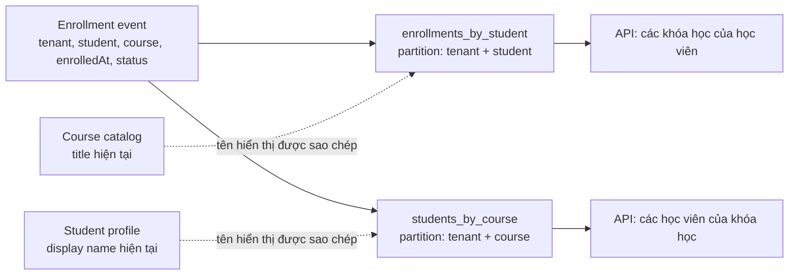
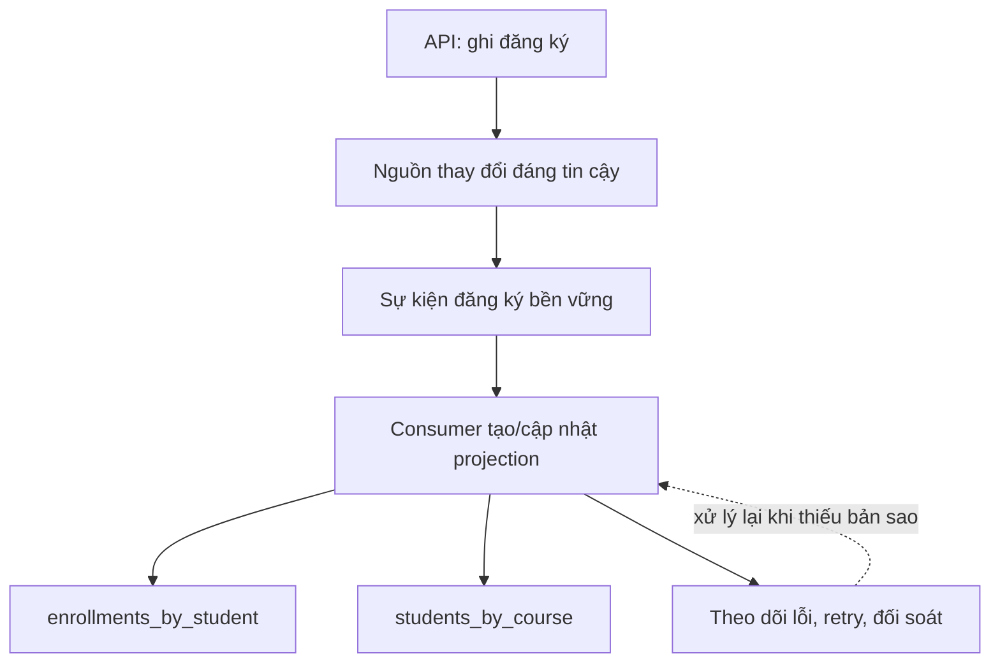

# Phi chuẩn hóa dữ liệu và lưu lặp có chủ đích

Trong cơ sở dữ liệu quan hệ, một thiết kế thường cố gắng lưu mỗi sự thật tại một nơi, rồi dùng `JOIN` để ghép dữ liệu cho nhiều màn hình. Với **Apache Cassandra**, cách tiếp cận thường hiệu quả hơn là **thiết kế bảng từ những truy vấn cụ thể** và lưu một phần dữ liệu lặp ở nhiều bảng để mỗi truy vấn tìm được đúng partition cần đọc. Đó là **phi chuẩn hóa dữ liệu (denormalization) có chủ đích**.

Spring Data Cassandra giúp ánh xạ entity, tổ chức repository và thực thi CQL qua `CassandraTemplate` hoặc Java Driver. Tuy nhiên, không API nào có thể tự biến một bảng thiết kế cho hướng đọc A thành bảng tối ưu cho hướng đọc B. Nhà phát triển vẫn phải quyết định **dữ liệu nào cần lặp, lặp ở đâu, cập nhật ra sao và chấp nhận độ trễ nhất quán đến mức nào**.

Sau bài này, bạn cần có thể:

- Xuất phát từ danh sách màn hình/API để quyết định có cần nhiều bảng biểu diễn cùng một sự kiện nghiệp vụ hay không.
- Phân biệt **lưu lặp theo mô hình truy vấn** với **replication giữa các node** của Cassandra.
- Thiết kế partition key và clustering column cho từng hướng đọc, giải thích truy vấn CQL nào được hỗ trợ.
- Chọn cách đồng bộ các bản sao, xử lý retry, thay đổi dữ liệu và kiểm soát chi phí lưu trữ/ghi.
- Áp dụng Spring Data Cassandra mà không giả định repository hay batch tạo ra transaction quan hệ.

## 1. Vì sao Cassandra khuyến khích thiết kế theo truy vấn?

Cassandra lưu dữ liệu phân tán theo **partition key**. Câu truy vấn xác định đầy đủ partition key thường có đường truy cập dễ dự đoán: hệ thống định tuyến đến các replica sở hữu partition đó, rồi đọc các dòng theo clustering column. Cassandra không cung cấp mô hình `JOIN` tổng quát giữa các bảng như một RDBMS.

Giả sử hệ thống học trực tuyến cần hai API:

1. `GET /tenants/{tenantId}/students/{studentId}/enrollments`: hiển thị các khóa học mà một học viên đã đăng ký, mới nhất trước.
2. `GET /tenants/{tenantId}/courses/{courseId}/students`: hiển thị danh sách học viên của một khóa học, mới nhất trước.

Hai API đều nói về cùng sự kiện **học viên đăng ký khóa học**, nhưng điểm bắt đầu của truy vấn khác nhau:

| Góc nhìn | Điều kiện luôn biết khi truy vấn | Dữ liệu cần đọc | Thứ tự mong muốn |
| --- | --- | --- | --- |
| Khóa học của học viên | `tenant_id`, `student_id` | `course_id`, tên khóa học, trạng thái đăng ký | Thời điểm đăng ký giảm dần |
| Học viên của khóa học | `tenant_id`, `course_id` | `student_id`, tên học viên, trạng thái đăng ký | Thời điểm đăng ký giảm dần |

Nếu chỉ có bảng với partition key `(tenant_id, student_id)`, truy vấn theo `course_id` đơn lẻ không biết partition cần đọc. Ngược lại, chỉ có bảng với partition key `(tenant_id, course_id)` thì API của học viên gặp vấn đề tương tự.

Đây là lúc tạo **hai bảng phục vụ hai cách đọc**, chấp nhận lưu cùng một sự kiện đăng ký ở cả hai nơi.

> **Phân biệt:** *Denormalization* là quyết định của mô hình dữ liệu ứng dụng: lưu cùng một thông tin trong nhiều bảng hoặc nhiều hàng phục vụ truy vấn. *Replication* là cơ chế Cassandra sao chép dữ liệu của **mỗi** partition tới nhiều node theo replication factor của keyspace. Có hai bảng phi chuẩn hóa không đồng nghĩa với replication factor bằng hai; các bản sao giữa node cũng không tự đồng bộ hai bảng ứng dụng với nhau.

## 2. Thiết kế hai bảng từ hai cách đọc

Giả sử keyspace `learning` đã tồn tại, một học viên không đăng ký trùng cùng một khóa học, và mỗi sự kiện đăng ký có `enrolled_at` ổn định. Mô hình minh họa:



### Bảng 1: đăng ký theo học viên

```sql
CREATE TABLE IF NOT EXISTS learning.enrollments_by_student (
    tenant_id uuid,
    student_id uuid,
    enrolled_at timestamp,
    course_id uuid,
    course_title text,
    enrollment_status text,
    PRIMARY KEY ((tenant_id, student_id), enrolled_at, course_id)
) WITH CLUSTERING ORDER BY (enrolled_at DESC, course_id ASC);
```

- `(tenant_id, student_id)` là **partition key ghép**: mỗi cặp tenant/học viên xác định một logical partition.
- `enrolled_at` và `course_id` là **clustering columns**: sắp xếp đăng ký theo thời gian giảm dần, đồng thời phân biệt các hàng nếu có cùng timestamp.
- `course_title` là dữ liệu **sao chép để hiển thị** trên danh sách, tránh phải tra cứu tên khóa học cho từng hàng.
- `enrollment_status` là thông tin về đăng ký; nếu trạng thái cũng xuất hiện ở bảng còn lại, nó cần được cập nhật ở cả hai.

Truy vấn phục vụ API thứ nhất:

```sql
SELECT enrolled_at, course_id, course_title, enrollment_status
FROM learning.enrollments_by_student
WHERE tenant_id = ? AND student_id = ?;
```

Ứng dụng có thể cấu hình **page size** trong Spring Data/Java Driver để đọc dần khi số lượng đăng ký lớn. Thứ tự mới nhất trước là thuộc tính clustering của bảng, không phải kết quả của một phép sort toàn cụm.

### Bảng 2: học viên theo khóa học

```sql
CREATE TABLE IF NOT EXISTS learning.students_by_course (
    tenant_id uuid,
    course_id uuid,
    enrolled_at timestamp,
    student_id uuid,
    student_display_name text,
    enrollment_status text,
    PRIMARY KEY ((tenant_id, course_id), enrolled_at, student_id)
) WITH CLUSTERING ORDER BY (enrolled_at DESC, student_id ASC);
```

Truy vấn phục vụ API thứ hai:

```sql
SELECT enrolled_at, student_id, student_display_name, enrollment_status
FROM learning.students_by_course
WHERE tenant_id = ? AND course_id = ?;
```

Ở bảng này, partition key đổi thành `(tenant_id, course_id)`. Cassandra xác định các hàng thuộc khóa học đó mà không phải quét từng học viên. `student_display_name` là bản sao thông tin hồ sơ phục vụ màn hình danh sách.

Với cùng một lần đăng ký, hai bảng sẽ có hai hàng mang cùng `tenant_id`, `student_id`, `course_id`, `enrolled_at` và `enrollment_status`. **Mỗi bảng trả lời một truy vấn cụ thể**, không phải một bảng tổng hợp tùy ý mọi trường hợp.

### Các truy vấn vẫn không được giải quyết

Hai bảng trên **không** tự hỗ trợ hiệu quả các câu hỏi như:

- “Tất cả đăng ký ở mọi tenant có `enrollment_status = 'ACTIVE'` là gì?”
- “Liệt kê mọi học viên có tên chứa từ khóa X” nếu không có hạ tầng tìm kiếm hoặc chỉ mục phù hợp.
- “Đếm chính xác số học viên đang hoạt động của mọi khóa học trên toàn hệ thống” bằng một thao tác quét rẻ.

Đừng tự thêm `ALLOW FILTERING` để khiến những truy vấn không khớp partition key có vẻ chạy được. Hãy xác định lại nhu cầu nghiệp vụ, cân nhắc bảng biểu diễn riêng, bộ đếm/phép tổng hợp phù hợp hoặc công cụ tìm kiếm nếu thật sự cần.

## 3. Chọn trường nào để lưu lặp?

Không phải dữ liệu nào cũng nên sao chép. Từ yêu cầu của màn hình, hãy phân loại:

| Trường dữ liệu | Quyết định gợi ý | Lý do |
| --- | --- | --- |
| `tenant_id`, `student_id`, `course_id` | Có trong các bảng cần định tuyến/trả về | Định danh, xác định partition và hàng |
| `enrolled_at` | Lưu cùng một giá trị ổn định ở cả hai bảng | Giữ đúng thứ tự và địa chỉ hàng khi cập nhật |
| `enrollment_status` | Lặp nếu cả hai màn hình hiển thị | Đọc một bảng là đủ, đổi lại phải đồng bộ |
| `course_title` | Lặp ở danh sách khóa học của học viên nếu cần | Tiết kiệm lượt đọc tên khóa học, nhưng đổi tên tạo nhiều lần ghi |
| `student_display_name` | Lặp ở danh sách học viên của khóa học nếu cần | Giảm thao tác ghép tại ứng dụng, nhưng đổi tên cần cập nhật |
| Mô tả khóa học dài, thông tin hồ sơ nhạy cảm | Thường giữ ở dữ liệu nguồn và lấy theo nhu cầu | Hạn chế phình hàng, số bản sao và chi phí sửa/xóa |

Một quyết định quan trọng là **ý nghĩa của bản sao**:

- **Snapshot tại thời điểm sự kiện:** `course_title` thể hiện tên khóa học khi học viên đăng ký. Đổi tên khóa học **không** cập nhật đăng ký lịch sử. Điều này hợp lý nếu màn hình hoặc báo cáo cần giữ dữ liệu tại thời điểm phát sinh.
- **Giá trị hiển thị hiện hành:** `course_title` phải phản ánh tên mới nhất. Khi tên đổi, cần cập nhật tất cả hàng có bản sao tên đó, hoặc thay đổi phương án đọc để lấy tên hiện tại từ nguồn chuẩn.

Hai ý nghĩa này khác nhau về sản phẩm. Đừng gọi bản sao là “luôn đồng bộ” khi nghiệp vụ thực ra muốn lưu snapshot lịch sử.

**Quy tắc lựa chọn:** chỉ sao chép trường có lợi ích đọc đủ lớn và có kế hoạch rõ ràng khi nó thay đổi, hết hạn hoặc cần xóa. Với trường đổi thường xuyên và được chia sẻ bởi hàng triệu hàng, một lần đọc bổ sung hoặc cache có thể rẻ hơn cập nhật hàng triệu bản sao.

## 4. Đưa hai bảng vào Spring Data Cassandra

Trong Spring Data Cassandra, mỗi bảng phục vụ truy vấn thường được ánh xạ thành một entity riêng. Hai entity có thể biểu diễn cùng sự kiện nghiệp vụ nhưng sở hữu **khóa chính khác nhau**.

Ví dụ rút gọn cho `enrollments_by_student`:

```java
import java.io.Serializable;
import java.time.Instant;
import java.util.UUID;
import org.springframework.data.cassandra.core.cql.PrimaryKeyType;
import org.springframework.data.cassandra.core.mapping.Column;
import org.springframework.data.cassandra.core.mapping.PrimaryKey;
import org.springframework.data.cassandra.core.mapping.PrimaryKeyClass;
import org.springframework.data.cassandra.core.mapping.PrimaryKeyColumn;
import org.springframework.data.cassandra.core.mapping.Table;

@PrimaryKeyClass
public class StudentEnrollmentKey implements Serializable {
    @PrimaryKeyColumn(name = "tenant_id", ordinal = 0,
                      type = PrimaryKeyType.PARTITIONED)
    private UUID tenantId;

    @PrimaryKeyColumn(name = "student_id", ordinal = 1,
                      type = PrimaryKeyType.PARTITIONED)
    private UUID studentId;

    @PrimaryKeyColumn(name = "enrolled_at", ordinal = 2,
                      type = PrimaryKeyType.CLUSTERED)
    private Instant enrolledAt;

    @PrimaryKeyColumn(name = "course_id", ordinal = 3,
                      type = PrimaryKeyType.CLUSTERED)
    private UUID courseId;

    // Bổ sung constructor, getters/setters, equals và hashCode.
}

@Table("enrollments_by_student")
public class EnrollmentByStudent {
    @PrimaryKey
    private StudentEnrollmentKey key;

    @Column("course_title")
    private String courseTitle;

    @Column("enrollment_status")
    private String enrollmentStatus;

    // Bổ sung constructor, getters/setters và logic tạo từ sự kiện.
}
```

Ở dự án thực, nên đặt hai lớp public vào các file Java riêng; đoạn trên tập trung mô tả mapping. `@PrimaryKeyClass` và `@PrimaryKeyColumn` nêu rõ phần khóa phân vùng và phần khóa sắp xếp. Chiều `DESC` được định nghĩa trong CQL schema ví dụ; nếu Spring Data chịu trách nhiệm tạo schema thì khai báo mapping tương ứng và kiểm tra schema thực tế.

Repository có thể diễn đạt truy vấn đọc đã thiết kế:

```java
import java.util.List;
import java.util.UUID;
import org.springframework.data.cassandra.repository.CassandraRepository;
import org.springframework.data.cassandra.repository.Query;

public interface EnrollmentByStudentRepository
        extends CassandraRepository<EnrollmentByStudent, StudentEnrollmentKey> {

    @Query("SELECT * FROM enrollments_by_student " +
           "WHERE tenant_id = ?0 AND student_id = ?1 LIMIT 50")
    List<EnrollmentByStudent> latestForStudent(UUID tenantId, UUID studentId);
}
```

`LIMIT 50` ở đây là giới hạn **tổng số hàng trả về của truy vấn ví dụ**, không phải cơ chế lấy trang thứ hai. Khi API cần phân trang thực sự, dùng khả năng paging của Spring Data Cassandra/Java Driver và trạng thái tiếp diễn, không giả định có thể nhảy tới trang bất kỳ bằng `OFFSET` như một số hệ SQL.

Nếu cần ghi cả hai biểu diễn, service có thể dùng `CassandraTemplate` với hai entity đã được mapping:

```java
import org.springframework.data.cassandra.core.CassandraTemplate;
import org.springframework.stereotype.Service;

@Service
public class EnrollmentProjectionWriter {
    private final CassandraTemplate template;

    public EnrollmentProjectionWriter(CassandraTemplate template) {
        this.template = template;
    }

    public void apply(EnrollmentEvent event) {
        EnrollmentByStudent byStudent = mapToStudentView(event);
        StudentByCourse byCourse = mapToCourseView(event);

        template.insert(byStudent);
        template.insert(byCourse);
    }

    // mapToStudentView/mapToCourseView và các DTO được lược bỏ
    // để tập trung vào cách lưu hai biểu diễn.
}
```

Đoạn ghi này minh họa **ý định ghi hai bảng**, chưa phải cơ chế bảo đảm đồng bộ khi lỗi. Nếu lệnh ghi đầu tiên thành công và lệnh thứ hai thất bại, hai màn hình có thể tạm thời khác nhau. `insert` trong Cassandra có ngữ nghĩa ghi/upsert thông thường, không mặc nhiên từ chối khi hàng đã tồn tại.

Điều cần nhớ: một entity mapping hoặc một tên method repository **không thể** bổ sung partition key đang thiếu. Luôn kiểm tra câu CQL và thiết kế bảng từ hướng đọc thực tế.

## 5. Vòng đời của một bản ghi phi chuẩn hóa

### 5.1. Tạo đăng ký

Khi có sự kiện `StudentEnrolled`, ứng dụng cần giữ một bộ giá trị ổn định:

```text
eventId         = ID sự kiện duy nhất
tenantId        = T
studentId       = S
courseId        = C
enrolledAt      = thời điểm đăng ký do nghiệp vụ ghi nhận
enrollmentStatus = ACTIVE
courseTitle     = tên khóa học hiển thị
studentName     = tên học viên hiển thị
```

Hai phép ghi tương ứng có thể được biểu diễn bằng CQL:

```sql
INSERT INTO learning.enrollments_by_student
    (tenant_id, student_id, enrolled_at, course_id,
     course_title, enrollment_status)
VALUES (?, ?, ?, ?, ?, ?);

INSERT INTO learning.students_by_course
    (tenant_id, course_id, enrolled_at, student_id,
     student_display_name, enrollment_status)
VALUES (?, ?, ?, ?, ?, ?);
```

Cần dùng **cùng `enrolled_at` và các khóa định danh từ sự kiện**, kể cả khi retry. Nếu mỗi lần thử lại tự lấy `Instant.now()` để tạo clustering key mới, ứng dụng sẽ sinh thêm hàng thay vì ghi lại đúng bản ghi cũ.

### 5.2. Đổi trạng thái

Nếu học viên hủy đăng ký, cả hai màn hình cần phản ánh trạng thái mới. Hai phép cập nhật phải nhắm đúng **khóa chính đầy đủ**:

```sql
UPDATE learning.enrollments_by_student
SET enrollment_status = 'CANCELLED'
WHERE tenant_id = ? AND student_id = ?
  AND enrolled_at = ? AND course_id = ?;

UPDATE learning.students_by_course
SET enrollment_status = 'CANCELLED'
WHERE tenant_id = ? AND course_id = ?
  AND enrolled_at = ? AND student_id = ?;
```

Nếu ứng dụng không lưu lại `enrolled_at` gốc, việc xác định đúng hàng để cập nhật trở nên khó khăn. Đây là lý do các giá trị trong primary key phải **ổn định**. Khi nghiệp vụ cần đổi khóa, thông thường phải tạo hàng mới và xóa hàng cũ có kiểm soát.

### 5.3. Sửa tên được sao chép

Đổi tên khóa học có thể yêu cầu cập nhật `course_title` của mọi học viên đã đăng ký khóa học đó. Nhưng trong `enrollments_by_student`, dữ liệu được chia partition **theo học viên**, không theo khóa học. Không có phép cập nhật CQL hiệu quả tự động trên toàn bộ partition dựa vào `course_id`.

Có ba phương án tùy yêu cầu:

1. **Giữ snapshot:** không cập nhật lịch sử; ghi rõ ý nghĩa “tên tại thời điểm đăng ký”.
2. **Đọc tên hiện tại từ nguồn chuẩn:** danh sách trả về `course_id`, tầng ứng dụng lấy/batch-get tên khóa học qua một mô hình đọc khác hoặc cache.
3. **Cập nhật fan-out có chủ đích:** có danh sách khóa bị ảnh hưởng, phát sự kiện `CourseRenamed`, tìm các khóa ghi cần cập nhật bằng một mô hình truy cập phù hợp rồi ghi từng bản sao; theo dõi tiến độ và retry.

Không chọn cách 3 chỉ vì đã lỡ lưu lặp: với một khóa học có rất nhiều học viên, số lượt ghi khi đổi tên có thể rất lớn. Nếu cần cập nhật fan-out, phải thiết kế trước cách tìm đầy đủ các bản sao và cách xử lý cập nhật dang dở.

### 5.4. Xóa, hết hạn và yêu cầu riêng tư

Xóa đăng ký hay xóa hồ sơ phải xác định **mọi biểu diễn đang chứa thông tin cần xóa**. Xóa một hàng ở bảng thứ nhất không tự xóa hàng tương ứng ở bảng thứ hai.

Nếu dùng `TTL`, cần xét thời điểm ghi, thời hạn sống và quy tắc cập nhật ở từng bảng. Dữ liệu hết hạn hoặc bị xóa sinh **tombstone** và có chi phí đọc/compaction; nhiều bản sao và TTL ngắn có thể làm vấn đề lớn hơn. Đối với dữ liệu cá nhân, càng ít trường sao chép thì phạm vi cần truy vết khi xóa/cập nhật càng nhỏ.

## 6. Nhất quán giữa các bản sao: chọn một hợp đồng rõ ràng

Lưu lặp giúp đọc nhanh, nhưng đặt ra câu hỏi: **một cập nhật đã được coi là hoàn tất khi nào?**

| Phương án | Cách làm | Đổi lại |
| --- | --- | --- |
| Ghi đồng bộ hai bảng ngay trong request | Service gửi lần lượt hai phép ghi, theo dõi lỗi và có cơ chế retry/đối soát | Có cửa sổ ghi một phần, tăng độ trễ request |
| Ghi nguồn sự thật rồi cập nhật projection qua sự kiện | Ghi thay đổi ở nguồn có quản lý, phát sự kiện bền vững và consumer cập nhật hai bảng đọc | Có độ trễ lan truyền; cần vận hành consumer, replay và đối soát |
| Không sao chép trường thay đổi thường xuyên | Chỉ lưu ID, khi đọc tra cứu giá trị hiện tại ở nguồn/cache | Tăng lượt đọc hoặc độ phức tạp hợp nhất kết quả |

Trong hệ thống lớn, có thể dùng một **nguồn sự thật** cho trạng thái đăng ký và coi các bảng `*_by_*` là **read projections**. Ví dụ:



Đây là một **mô hình kiến trúc**, không phải khả năng tự có của Spring Data Cassandra. Nếu dùng outbox, CDC hoặc message broker, phải thiết kế cách ghi thay đổi và phát sự kiện sao cho không mất sự kiện giữa các bước. Chỉ gọi hai lệnh `template.insert(...)` trong cùng một method chưa đủ để đạt bảo đảm đó.

### Vì sao `BATCH` và consistency level không tự giải quyết?

- **Logged batch** có cơ chế batch log để hỗ trợ hoàn tất các mutation của batch, nhưng không tạo isolation kiểu transaction quan hệ: các bảng/partition có thể được quan sát ở những thời điểm khác nhau. Batch trải nhiều partition còn tăng chi phí phối hợp; không nên dùng làm mẹo tăng tốc ghi hàng loạt.
- **`LOCAL_QUORUM`, `LOCAL_ONE`** và các consistency level khác điều khiển mức xác nhận/đọc trên **replica của một thao tác dữ liệu**, không đảm bảo hai hàng trong hai bảng ứng dụng lập tức có cùng phiên bản. Điều chỉnh consistency không thay thế quy trình cập nhật projection.
- **Lightweight transaction (LWT)** với điều kiện `IF` hữu ích khi cần compare-and-set trên dữ liệu cụ thể, nhưng có chi phí và ngữ nghĩa riêng. LWT không phải giải pháp mặc định để biến toàn bộ quá trình cập nhật nhiều bảng thành transaction ACID tổng quát.
- **`@Transactional`** trong code Java không nên bị hiểu mặc nhiên là rollback ACID nhiều partition/bảng Cassandra như trong một RDBMS. Hãy kiểm tra giao dịch và tầng tài nguyên thực sự được cấu hình.

Để tránh trạng thái “một API thấy `ACTIVE`, API khác thấy `CANCELLED`”, xác định rõ hợp đồng cho người dùng: có thể chấp nhận **eventual consistency** trong vài giây, cần hiện “đang xử lý”, hay cần đọc lại nguồn chuẩn trước một hành động quan trọng?

## 7. Retry, thứ tự sự kiện và khả năng tự phục hồi

Hệ phân tán có thể gặp timeout dù lệnh ghi đã được áp dụng. Vì vậy, worker xử lý projection phải chịu được tình huống **xử lý lại cùng sự kiện**.

**Khóa ghi xác định trước.** Một sự kiện đăng ký luôn sinh cùng partition key và clustering values, không dùng timestamp mới hoặc UUID ngẫu nhiên mới khi retry. Ghi lại cùng dữ liệu vào cùng khóa thường thuận lợi hơn tạo hàng mới.

**Idempotency chưa đủ nếu sự kiện đến sai thứ tự.** Ví dụ:

```text
E1: đăng ký ACTIVE, phiên bản 10
E2: hủy CANCELLED, phiên bản 11

Consumer xử lý E2 trước, sau đó retry E1 muộn
=> một ghi cũ có thể ghi đè trạng thái mới nếu không kiểm soát thứ tự.
```

Cassandra xử lý xung đột cell theo timestamp ghi và quy tắc hòa giải của hệ thống; một trường `version` nằm trong row **không tự chặn** việc ghi phiên bản cũ. Các cách giải quyết cần được lựa chọn có chủ đích: xử lý tuần tự theo khóa nghiệp vụ, kiểm soát phiên bản bằng compare-and-set/LWT khi phù hợp, hoặc dùng cơ chế timestamp sự kiện đáng tin cậy cùng quy tắc xử lý xóa và trùng lặp. Không tự giả định thời điểm consumer nhận sự kiện chính là thứ tự nghiệp vụ.

**Đối soát.** Nên có cách tìm trường hợp thiếu projection, kiểm tra tiến độ theo sự kiện/partition, chạy replay và sửa sai lệch. Với luồng ghi bất đồng bộ, cần quan sát ít nhất số sự kiện tồn đọng, độ trễ projection, tỉ lệ retry và số lỗi xử lý cuối cùng.

**Đọc khi projection chưa bắt kịp.** Nếu người dùng vừa đăng ký và ngay lập tức mở danh sách, cân nhắc trả kết quả từ thao tác vừa ghi, ghép trạng thái đang chờ hoặc đọc từ nguồn chuẩn cho ngữ cảnh cần “read-your-writes”. Chỉ mong chờ consistency level cao hơn trên bảng projection sẽ không giải quyết sự kiện chưa được áp dụng ở bảng đó.

## 8. Kiểm soát chi phí: thêm bảng không miễn phí

Phi chuẩn hóa là trao đổi giữa **chi phí đọc** và **chi phí ghi/lưu trữ/vận hành**.

| Hạng mục | Khi thêm một bảng projection | Điều cần đo |
| --- | --- | --- |
| Đọc | Truy vấn theo đúng partition rẻ và dễ dự đoán hơn | Latency p95/p99, số partition truy cập, page size |
| Ghi | Một sự kiện có thể dẫn đến nhiều mutation | Số ghi trên sự kiện, timeout, retry |
| Lưu trữ | Sao chép khóa và cột hiển thị, cộng thêm replication của mỗi bảng | Dung lượng trên đĩa, write amplification, compaction |
| Cập nhật | Đổi dữ liệu chung có thể tạo fan-out | Số hàng phải cập nhật, thời gian hội tụ |
| Vận hành | Thêm consumer, quá trình replay/đối soát và schema | Projection lag, lỗi đồng bộ, khối lượng tombstone |

### Partition phải có giới hạn thực tế

`enrollments_by_student` dùng partition theo học viên nên có thể tương đối nhỏ nếu mỗi học viên chỉ có vài chục hoặc vài trăm đăng ký. `students_by_course` có thể thành **partition rất lớn** nếu một khóa học thu hút hàng trăm nghìn hoặc hàng triệu học viên.

Trong trường hợp đó, cân nhắc **bucket** theo thời gian hoặc shard có kiểm soát, ví dụ:

```sql
CREATE TABLE IF NOT EXISTS learning.students_by_course_month (
    tenant_id uuid,
    course_id uuid,
    bucket_yyyymm int,
    enrolled_at timestamp,
    student_id uuid,
    student_display_name text,
    enrollment_status text,
    PRIMARY KEY ((tenant_id, course_id, bucket_yyyymm),
                 enrolled_at, student_id)
) WITH CLUSTERING ORDER BY (enrolled_at DESC, student_id ASC);
```

Lúc này, truy vấn **phải biết bucket** để định vị partition. Nếu muốn hiển thị dữ liệu nhiều tháng, ứng dụng phải đọc các bucket cần thiết và ghép kết quả đúng thứ tự. Bucketing giúp chia kích thước partition nhưng tăng trách nhiệm điều phối truy vấn; cần chọn độ rộng bucket dựa trên lưu lượng thật, retention và giới hạn chấp nhận được của mỗi partition.

### Phân trang đúng với Cassandra

Driver hỗ trợ paging theo **paging state** cho một truy vấn và bộ tham số cụ thể. Để tiếp tục lấy dữ liệu, giữ nguyên CQL, giá trị bind, cách sắp xếp và các điều kiện liên quan; không coi paging state là số trang dùng được cho mọi truy vấn. Phân trang không phải một snapshot bất biến nếu dữ liệu được sửa trong lúc duyệt.

Với API đọc danh sách, xác định page size và giới hạn trả về phù hợp. Nếu cần “trang tiếp theo”, ứng dụng nên truyền token tiếp diễn có kiểm soát hoặc dùng cơ chế paging do Spring Data/driver hỗ trợ. Không tải toàn bộ partition thành một `List` lớn rồi mới cắt trang trong bộ nhớ.

### TTL và tombstone

Nếu dữ liệu đăng ký tự hết hạn, TTL ở hai bảng cần có **ngữ nghĩa vòng đời tương thích**. Ghi sửa với TTL không đồng nhất có thể làm một bản sao tồn tại lâu hơn bản sao kia. Xóa nhiều hàng hay TTL ngắn tạo tombstone; đo đọc chậm, kích thước partition và áp lực compaction trước khi kết luận thêm bảng sẽ luôn nhanh.

## 9. Quy trình quyết định có nên phi chuẩn hóa

Một quy trình thực dụng trước khi viết `@Table` hay repository:

1. **Liệt kê truy vấn thực tế.** Với mỗi API, ghi đủ input bắt buộc, tập dữ liệu trả về, thứ tự, cách phân trang, mức tải và yêu cầu nhất quán.
2. **Thiết kế partition cho từng hướng đọc.** Nêu rõ `partition key`, `clustering columns` và CQL hợp lệ. Kiểm tra nguy cơ hot partition, partition tăng vô hạn và truy vấn thiếu khóa.
3. **Tối thiểu hóa dữ liệu nhân bản.** Chỉ đặt ở projection những cột cần cho màn hình hoặc cần để thao tác theo khóa, tránh sao chép toàn bộ entity nguồn.
4. **Quyết định nguồn sự thật và ý nghĩa bản sao.** Snapshot hay giá trị hiện hành? Ai cập nhật khi đổi tên, đổi trạng thái, xóa hoặc hết hạn?
5. **Định nghĩa hợp đồng nhất quán.** Có thể chấp nhận trễ bao lâu, cách phát hiện/cải thiện dữ liệu thiếu, retry ra sao và hành động nào cần xác minh nguồn chuẩn?
6. **Dự toán giá vận hành.** Đếm ghi và kích thước mỗi sự kiện, fan-out khi sửa, dung lượng sau replication, tải đọc, paging, tombstone, compaction.
7. **Kiểm chứng bằng CQL và tải đại diện.** Chạy với kích thước partition gần thực tế; kiểm tra metrics cả Java Driver, Spring Data và cụm Cassandra.

### Khi nào chưa nên thêm một bản sao?

Không cần tạo bảng mới chỉ vì có một cách lọc hiếm gặp. Nếu dữ liệu nhỏ, ít đọc, có thể đáp ứng bằng tra cứu theo khóa và kết hợp ở tầng ứng dụng với chi phí chấp nhận được, cách đơn giản đó có thể tốt hơn. Một số truy vấn phù hợp với khả năng index chuyên dụng của phiên bản Cassandra đang dùng; cần đánh giá theo phân bố dữ liệu, mức tải và kế hoạch vận hành thực tế. Đừng mặc định mọi yêu cầu tìm kiếm đều phải biến thành một bảng `*_by_*`.

Ngược lại, nếu một màn hình trọng yếu có tần suất đọc cao, truy vấn ổn định, đường truy cập rõ và việc cập nhật bản sao có thể kiểm soát, phi chuẩn hóa thường là lựa chọn đáng cân nhắc.

## 10. Bài tập thiết kế

Hệ thống có yêu cầu bổ sung: “Hiển thị 20 đăng ký mới nhất của một khóa học; cho phép đổi trạng thái `ACTIVE` → `COMPLETED`; tên học viên cần phản ánh thay đổi hồ sơ trong tối đa 5 phút”.

Hãy trả lời:

1. Bảng nào trong hai bảng ban đầu phục vụ truy vấn này? Partition key và clustering columns là gì?
2. Khi đổi trạng thái, cần cập nhật các hàng nào? Nếu lệnh thứ hai timeout, làm sao biết và sửa sai lệch?
3. Tên học viên là snapshot hay giá trị hiện hành? Nếu có một triệu học viên trong một khóa học, chi phí đổi tên khác gì so với thay đổi `enrollment_status` của một học viên?
4. Muốn hiển thị cả triệu học viên, tại sao `LIMIT 20` đơn thuần chưa đủ cho trải nghiệm phân trang dài hạn? Khi nào cần bucket?
5. Thêm `@Query` lọc `enrollment_status` nhưng bỏ `course_id` có làm truy vấn hiệu quả hơn không?

**Hướng giải:** API dùng `students_by_course` với `(tenant_id, course_id)`; trạng thái cần được đồng bộ ở cả hai projection; tên hiện hành có thể được cập nhật qua sự kiện hoặc lấy từ nguồn chuẩn tùy khả năng đáp ứng giới hạn 5 phút. Cần tính tải và độ lớn partition trước khi chọn giữ nguyên hay bucket. Repository và `@Query` không thay thế được partition key, nên truy vấn bỏ `course_id` vẫn cần thiết kế lại đường truy cập.

## Ghi nhớ

Trong Cassandra, **phi chuẩn hóa là một quyết định thiết kế truy vấn**: cùng một sự kiện có thể tồn tại trong nhiều bảng, mỗi bảng phục vụ một hướng đọc rõ ràng. Spring Data Cassandra đơn giản hóa entity mapping, repository và thao tác ghi/đọc, nhưng không tự giải quyết đồng bộ giữa các bảng, thứ tự sự kiện, paging hay partition quá lớn.

Một thiết kế tốt luôn đi kèm ba câu trả lời: **truy vấn nào được tối ưu, dữ liệu lặp được cập nhật thế nào, và chi phí vận hành có còn chấp nhận được khi dữ liệu tăng lên hay không**.
