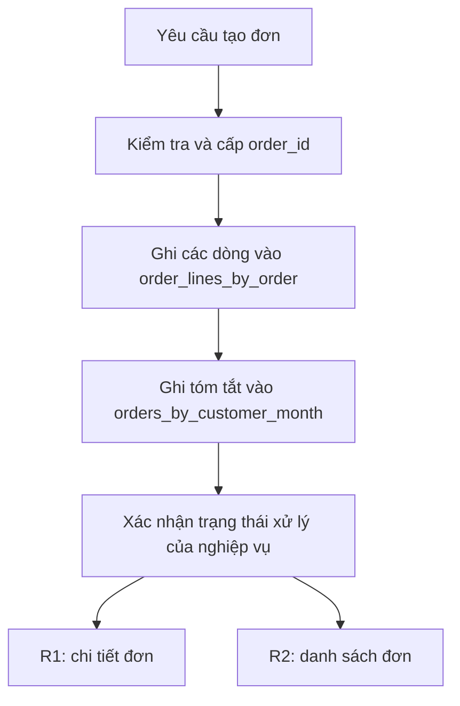

# Chọn dữ liệu cần ghi cùng nhau và đọc cùng nhau

## Mục tiêu học tập

Trong Apache Cassandra, câu hỏi “dữ liệu nào liên quan đến nhau?” chưa đủ để thiết kế bảng. Người thiết kế còn cần biết **dữ liệu nào thường được đọc trong cùng một yêu cầu**, **dữ liệu nào được tạo hoặc cập nhật cùng một nghiệp vụ**, và **ranh giới nào có thể phát triển thành partition quá lớn hoặc quá nóng**.

Sau bài này, bạn có thể:

- Chuyển một luồng nghiệp vụ thành các **mẫu truy vấn** và **mẫu ghi** cụ thể.
- Quyết định những bản ghi nào nên nằm **cùng partition** để giảm việc đọc phân tán.
- Phân biệt **đặt dữ liệu gần nhau** với **ghi nguyên tử hoặc giao dịch**: hai khái niệm này không đồng nghĩa.
- Thiết kế nhiều bảng phục vụ các cách đọc khác nhau, đồng thời nhận diện chi phí ghi lặp và đồng bộ dữ liệu.
- Áp dụng quyết định thiết kế vào **Spring Data Cassandra** qua entity mapping, repository, `CassandraTemplate` và truy vấn CQL, có xét đến partition key, paging, tính nhất quán và hiệu năng.

## 1. Tư duy truy vấn trước khi tư duy bảng

Trong cơ sở dữ liệu quan hệ, thiết kế thường xuất phát từ thực thể, quan hệ và chuẩn hóa dữ liệu; các cách đọc có thể sử dụng `JOIN` và chỉ mục. Cassandra là cơ sở dữ liệu phân tán theo mô hình **wide-column**: bảng được chia thành những **partition** theo partition key, và các hàng trong mỗi partition được xác định, sắp xếp bằng clustering columns.

Vì vậy, một thiết kế Cassandra tốt thường bắt đầu từ câu hỏi ứng dụng sẽ truy cập dữ liệu thế nào:

1. **Khi đọc:** request đã biết khóa nào? Cần lấy một hàng, nhiều hàng liên quan hay nhiều trang kết quả? Có điều kiện thời gian, thứ tự hoặc giới hạn số hàng không?
2. **Khi ghi:** một thao tác nghiệp vụ tạo/cập nhật những thông tin nào? Những thông tin nào cần xuất hiện ở các màn hình khác nhau? Điều gì xảy ra nếu một bước ghi thành công còn bước khác thất bại?
3. **Khi tăng trưởng:** mỗi khóa sẽ có bao nhiêu hàng, dung lượng bao nhiêu, được truy cập với tần suất nào? Có khách hàng hoặc khóa nào tạo phần lớn lưu lượng không?

Một quy tắc khởi đầu hữu ích là:

> **Nhóm dữ liệu được đọc cùng nhau vào cùng partition khi có thể giữ partition ở kích thước và mức tải hợp lý; thiết kế đường ghi để duy trì các cách nhìn dữ liệu mà ứng dụng cần.**

Quy tắc này có điều kiện. Không phải mọi dữ liệu “cùng nghiệp vụ” đều nên nằm trong một partition, và cũng không phải cứ ghi cùng lúc là Cassandra tự động đảm bảo tất cả các bản ghi cùng thành công.

## 2. Ba khái niệm dễ nhầm: cùng hàng, cùng partition, cùng thao tác nghiệp vụ

| Khái niệm | Ví dụ | Ý nghĩa thực tế |
| --- | --- | --- |
| **Cùng hàng CQL** | Trạng thái và tổng tiền của một đơn hàng trong một hàng tóm tắt. | Đọc các cột của hàng đó qua khóa chính; cập nhật có thể chỉ ghi một số cột. |
| **Cùng partition** | Các dòng hàng của đơn hàng `order_id = O1`. | Một truy vấn có đủ partition key có thể lấy các dòng hàng liên quan mà không phải tìm qua mọi partition. |
| **Cùng thao tác nghiệp vụ** | Tạo đơn hàng, ghi các dòng hàng và cập nhật danh sách đơn của khách. | Có thể chạm đến **nhiều partition, nhiều bảng**; cần thiết kế cách ghi, thử lại và xử lý sai lệch. |

**Đọc cùng nhau** thường là tín hiệu để lựa chọn partition key và clustering columns. **Ghi cùng nhau** là tín hiệu để xem xét mô hình cập nhật, tính lặp lại an toàn (*idempotency*) và nhu cầu nhất quán.

Cassandra không cung cấp giao dịch quan hệ nhiều bảng tùy ý với khả năng cách ly như trong một RDBMS. Không nên suy ra rằng hai bảng cùng được cập nhật từ một service thì các client khác luôn thấy trạng thái mới đồng thời. CQL `BATCH` cũng không phải cơ chế để biến các cập nhật nhiều partition thành một giao dịch ACID có cách ly đầy đủ.

## 3. Ví dụ xuyên suốt: hệ thống đơn hàng

Giả sử một dịch vụ bán hàng có các đối tượng: khách hàng, đơn hàng và dòng sản phẩm trong đơn. Hệ thống cần phục vụ ba thao tác:

| Mã | Thao tác của ứng dụng | Những gì request biết | Kết quả mong muốn |
| --- | --- | --- | --- |
| R1 | Xem **chi tiết đơn hàng** | `tenant_id` và `order_id` | Trạng thái, tổng tiền và toàn bộ dòng hàng theo thứ tự. |
| R2 | Xem **20 đơn gần nhất** của khách trong một tháng | `tenant_id`, `customer_id` và `order_month` | Danh sách đơn theo thời điểm tạo giảm dần, có thể phân trang. |
| W1 | **Tạo đơn hàng** | Thông tin đơn, nhiều dòng hàng | Sau khi xử lý, đơn có thể được tìm qua cả R1 và R2. |

Khi đơn thay đổi trạng thái từ `CREATED` sang `SHIPPED`, cả trang chi tiết và trang danh sách cần phản ánh thay đổi đó. Đây là mẫu ghi W2.

Nếu chỉ tạo một bảng `orders` theo `order_id`, truy vấn R1 tương đối tự nhiên nhưng R2 không có cách xác định các đơn của một khách theo tháng mà không bổ sung mô hình truy cập khác. Nếu chỉ chia dữ liệu theo `customer_id`, việc đọc chi tiết từng đơn có thể phải truy cập một partition rất lớn và lọc nhiều dòng.

Vì hai cách đọc khác nhau, ta sẽ thiết kế **hai bảng theo truy vấn**, với trách nhiệm rõ ràng.

## 4. Đọc chi tiết: đặt các dòng hàng của một đơn vào một partition

### 4.1. Thiết kế từ truy vấn R1

R1 luôn biết `tenant_id` và `order_id`. Hai giá trị này có thể tạo **partition key tổng hợp**. Mỗi dòng hàng có một `line_no`, là **clustering column**.

```sql
CREATE TABLE order_lines_by_order (
    tenant_id uuid,
    order_id uuid,
    line_no int,
    sku text,
    quantity int,
    unit_price_cents bigint,
    customer_id uuid STATIC,
    placed_at timestamp STATIC,
    order_status text STATIC,
    total_amount_cents bigint STATIC,
    PRIMARY KEY ((tenant_id, order_id), line_no)
) WITH CLUSTERING ORDER BY (line_no ASC);
```

**Cách đọc khóa chính:**

- `(tenant_id, order_id)` là **partition key**: các dòng của cùng đơn trong cùng tenant thuộc một partition logic.
- `line_no` là **clustering column**: phân biệt các dòng và sắp chúng theo thứ tự dòng.
- `sku`, `quantity`, `unit_price_cents` là các cột riêng của từng dòng.
- `customer_id`, `placed_at`, `order_status` và `total_amount_cents` là **static columns**: giữ dữ liệu chung ở cấp partition. Khi truy vấn trả về nhiều dòng, các giá trị static có thể xuất hiện cùng từng hàng kết quả dù chúng được lưu theo phạm vi partition.

Sơ đồ logic:

```text
order_lines_by_order
  Partition (tenant=T1, order=O100)
    Static: customer=C7, status=CREATED, total=450000
    line_no=1 -> sku=BOOK-A, quantity=2, unit_price_cents=100000
    line_no=2 -> sku=PEN-B,  quantity=5, unit_price_cents=50000

  Partition (tenant=T1, order=O101)
    Static: customer=C7, status=SHIPPED, ...
    line_no=1 -> ...
```

Sơ đồ trên biểu diễn việc **gom dữ liệu theo khóa** chứ không mô tả một partition luôn nằm trên đúng một node. Cassandra phân phối và nhân bản partition trong cụm theo token và cấu hình replication.

### 4.2. Ghi dữ liệu của một đơn

Các ví dụ sau giả định bảng đã được tạo trong keyspace của ứng dụng. Giá tiền dùng đơn vị nhỏ nhất (*cents*) để minh họa; trong hệ thống thực, quy ước tiền tệ và đơn vị phải thống nhất.

```sql
INSERT INTO order_lines_by_order (
    tenant_id, order_id, line_no,
    customer_id, placed_at, order_status, total_amount_cents,
    sku, quantity, unit_price_cents
) VALUES (
    aaaaaaaa-aaaa-4aaa-8aaa-aaaaaaaaaaaa,
    bbbbbbbb-bbbb-4bbb-8bbb-bbbbbbbbbbbb,
    1,
    cccccccc-cccc-4ccc-8ccc-cccccccccccc,
    '2026-11-25T08:15:00Z', 'CREATED', 450000,
    'BOOK-A', 2, 100000
);

INSERT INTO order_lines_by_order (
    tenant_id, order_id, line_no, sku, quantity, unit_price_cents
) VALUES (
    aaaaaaaa-aaaa-4aaa-8aaa-aaaaaaaaaaaa,
    bbbbbbbb-bbbb-4bbb-8bbb-bbbbbbbbbbbb,
    2, 'PEN-B', 5, 50000
);
```

Hai lệnh ghi vào cùng partition vì `tenant_id` và `order_id` trùng nhau; `line_no` khác nhau nên tạo hai hàng CQL. Các static columns được ghi ở lệnh đầu và dùng chung cho partition. Lưu ý: **hai lệnh `INSERT` độc lập không bảo đảm người đọc luôn thấy cả hai dòng cùng một thời điểm**. Nếu nghiệp vụ đòi hỏi chỉ công bố đơn khi mọi dòng đã sẵn sàng, cần thiết kế trạng thái hoàn tất và trình tự công bố phù hợp.

### 4.3. Đọc chi tiết với một partition key đầy đủ

```sql
SELECT line_no, sku, quantity, unit_price_cents,
       customer_id, placed_at, order_status, total_amount_cents
FROM order_lines_by_order
WHERE tenant_id = aaaaaaaa-aaaa-4aaa-8aaa-aaaaaaaaaaaa
  AND order_id = bbbbbbbb-bbbb-4bbb-8bbb-bbbbbbbbbbbb;
```

Câu truy vấn định vị một partition và trả các dòng theo thứ tự `line_no ASC`. Đây là lợi ích của việc **đặt các dữ liệu thường đọc cùng nhau trong cùng partition**.

Nhưng nếu một đơn có hàng triệu dòng, thiết kế này lại gây **partition lớn**, đọc nhiều, compaction nặng và nguy cơ phân trang tốn kém. Cùng partition chỉ phù hợp khi khối lượng dữ liệu của một đơn có giới hạn thực tế chấp nhận được. Với đối tượng tăng vô hạn như nhật ký sự kiện, thường cần thêm **time bucket** hoặc phân đoạn theo dung lượng/tải.

## 5. Đọc danh sách: tạo cách nhìn riêng cho mỗi khách hàng

R2 không biết `order_id` trước khi hiển thị danh sách. Nó biết `tenant_id`, `customer_id` và tháng đang xem; người dùng muốn đơn mới nhất xuất hiện trước.

Vì vậy, tạo bảng dành riêng cho R2:

```sql
CREATE TABLE orders_by_customer_month (
    tenant_id uuid,
    customer_id uuid,
    order_month text,
    placed_at timestamp,
    order_id uuid,
    order_status text,
    total_amount_cents bigint,
    PRIMARY KEY ((tenant_id, customer_id, order_month), placed_at, order_id)
) WITH CLUSTERING ORDER BY (placed_at DESC, order_id ASC);
```

Trong bảng này:

- `(tenant_id, customer_id, order_month)` xác định partition.
- `placed_at` và `order_id` là clustering columns, giúp duy trì thứ tự mới đến cũ và phân biệt các đơn trùng thời điểm tạo.
- Các cột `order_status`, `total_amount_cents` được nhân bản thành dữ liệu phục vụ màn hình danh sách; không cần tải toàn bộ dòng hàng để tạo một thẻ đơn hàng.

Một bản ghi tóm tắt cho đơn vừa tạo:

```sql
INSERT INTO orders_by_customer_month (
    tenant_id, customer_id, order_month,
    placed_at, order_id, order_status, total_amount_cents
) VALUES (
    aaaaaaaa-aaaa-4aaa-8aaa-aaaaaaaaaaaa,
    cccccccc-cccc-4ccc-8ccc-cccccccccccc,
    '2026-11',
    '2026-11-25T08:15:00Z',
    bbbbbbbb-bbbb-4bbb-8bbb-bbbbbbbbbbbb,
    'CREATED', 450000
);
```

Truy vấn R2:

```sql
SELECT placed_at, order_id, order_status, total_amount_cents
FROM orders_by_customer_month
WHERE tenant_id = aaaaaaaa-aaaa-4aaa-8aaa-aaaaaaaaaaaa
  AND customer_id = cccccccc-cccc-4ccc-8ccc-cccccccccccc
  AND order_month = '2026-11'
LIMIT 20;
```

Ứng dụng lấy các đơn mới nhất **trong partition của khách hàng và tháng đã chọn**. Đây không phải truy vấn “20 đơn mới nhất của khách hàng qua mọi tháng”. Để đọc xuyên nhiều tháng, ứng dụng cần lần lượt truy vấn các bucket phù hợp rồi tổng hợp kết quả, hoặc thiết kế một cách nhìn khác nếu đây là truy vấn thường xuyên.

### Vì sao cần `order_month`?

Nếu chỉ dùng `(tenant_id, customer_id)` làm partition key, mọi đơn tích lũy qua nhiều năm của một khách sẽ thuộc cùng partition. Chia theo tháng giúp giới hạn số đơn mỗi partition, nhưng tạo thêm trách nhiệm cho ứng dụng:

- Phải xác định `order_month` nhất quán, ví dụ chuỗi `YYYY-MM` từ `placed_at` theo UTC.
- Khi tải lịch sử qua nhiều tháng, phải biết cần đọc những partition nào và ghép các trang kết quả ra sao.
- Với khách có lưu lượng đặc biệt lớn, bucket theo tháng vẫn có thể quá lớn; cần chọn độ mịn theo số hàng, kích thước hàng và tải thực tế.

Không có quy tắc “mọi bảng Cassandra đều phải chia theo tháng”. Bucket theo ngày, giờ hoặc một chiều phân đoạn khác chỉ có ý nghĩa khi phục vụ truy vấn và giới hạn được kích thước/tải.

## 6. Ghi cùng nhau: từ một nghiệp vụ đến nhiều bảng

Sau khi thiết kế hai cách nhìn, đường ghi W1 để tạo đơn có thể diễn đạt như sau:



Sơ đồ mô tả **trình tự nghiệp vụ tham khảo**, không biểu thị giao dịch phân tán tự động. Một yêu cầu có thể thất bại giữa C và D. Nếu chỉ ghi được bảng chi tiết, người dùng có thể mở đơn theo mã nhưng chưa thấy đơn trong danh sách.

### 6.1. Phân biệt ba mục tiêu

| Mục tiêu | Giải pháp thiết kế | Giới hạn cần hiểu |
| --- | --- | --- |
| **Đọc các dòng của một đơn cùng nhau** | Dùng `(tenant_id, order_id)` làm partition key cho bảng chi tiết. | Không nên tạo partition vô hạn hoặc quá nóng. |
| **Đọc danh sách đơn của khách nhanh** | Tạo bảng tóm tắt theo khách và tháng. | Cần ghi thêm bản sao dữ liệu và duy trì đồng bộ. |
| **Nghiệp vụ tạo đơn không bị mất bước** | Xác định trạng thái xử lý, ghi có khả năng thử lại, đối soát/khôi phục khi lỗi. | Không tự động trở thành giao dịch ACID xuyên nhiều partition. |

Trong hệ thống yêu cầu tính nhất quán rất mạnh đối với những thao tác như trừ tồn kho hay thanh toán, cần thiết kế ràng buộc nghiệp vụ và cơ chế phối hợp thích hợp; **chỉ lựa chọn cùng partition hoặc tăng consistency level chưa đủ để bảo đảm toàn bộ quy trình đúng trong mọi tình huống**.

### 6.2. Vì sao không gộp tất cả vào một `BATCH`?

Cassandra hỗ trợ `BEGIN BATCH ... APPLY BATCH` với các ngữ nghĩa và chi phí riêng, nhưng `BATCH` **không phải nút tăng tốc ghi hàng loạt** và cũng không cung cấp cách ly giao dịch quan hệ khi chạm nhiều partition.

- Các ghi cùng partition có thể được nhóm khi thích hợp, nhưng cần hiểu ngữ nghĩa nguyên tử của kiểu thao tác đang dùng.
- Logged batch nhiều partition tạo chi phí phối hợp và lưu batch log; lạm dụng cho ghi số lượng lớn có thể giảm hiệu năng.
- Kể cả khi một batch hỗ trợ tính nguyên tử của tập mutation, các thao tác đọc đồng thời không nên được giả định là nhìn thấy “ảnh chụp giao dịch” cô lập xuyên nhiều partition.

Lựa chọn phổ biến hơn cho hai bảng phục vụ hai cách đọc là đường ghi có **khóa định danh ổn định**, retry an toàn, theo dõi tiến độ và cơ chế sửa dữ liệu chưa đồng bộ. Ví dụ, sử dụng lại đúng `order_id` và các khóa dòng hàng khi thử lại tránh tạo thêm đơn logic mới do lần gọi trước đã thành công nhưng client mất phản hồi.

### 6.3. Khi trạng thái đơn thay đổi

Giả sử trạng thái đổi từ `CREATED` sang `SHIPPED`. Cần cập nhật cả bảng chi tiết và bảng danh sách:

```sql
UPDATE order_lines_by_order
SET order_status = 'SHIPPED'
WHERE tenant_id = aaaaaaaa-aaaa-4aaa-8aaa-aaaaaaaaaaaa
  AND order_id = bbbbbbbb-bbbb-4bbb-8bbb-bbbbbbbbbbbb;

UPDATE orders_by_customer_month
SET order_status = 'SHIPPED'
WHERE tenant_id = aaaaaaaa-aaaa-4aaa-8aaa-aaaaaaaaaaaa
  AND customer_id = cccccccc-cccc-4ccc-8ccc-cccccccccccc
  AND order_month = '2026-11'
  AND placed_at = '2026-11-25T08:15:00Z'
  AND order_id = bbbbbbbb-bbbb-4bbb-8bbb-bbbbbbbbbbbb;
```

Lệnh `UPDATE` thứ hai phải biết **đầy đủ khóa chính** của hàng danh sách. Do đó, luồng ghi cần giữ hoặc tra được `customer_id`, `order_month`, `placed_at` và `order_id`; Cassandra không tự động dò bảng khác bằng `JOIN`.

Hai lệnh có thể tạm thời tạo hai cách nhìn khác trạng thái. Hãy quyết định bảng nào là **nguồn dữ liệu chuẩn** cho mỗi trường, cách phát hiện bảng phụ chậm cập nhật và mức trễ chấp nhận được. Với các cập nhật đến không đúng thứ tự, cần cơ chế xử lý phiên bản/trình tự sự kiện hoặc quy tắc xung đột rõ ràng; retry mù quáng một giá trị trạng thái cũ có thể làm sai kết quả.

## 7. Cùng partition có ích, nhưng không phải càng nhiều càng tốt

Giả sử thay vì thiết kế theo từng đơn, ta đặt **mọi đơn và mọi dòng hàng của một khách vào cùng một partition** theo `customer_id`. Khi mở chi tiết một đơn, ứng dụng có thể phải xử lý một partition rất lớn. Khách hàng có nhiều đơn sẽ trở thành khóa nóng; phân bố tải giữa các node kém hơn.

Những tín hiệu cần kiểm tra khi chọn dữ liệu cùng partition:

| Câu hỏi | Nếu câu trả lời là “có” | Hướng xử lý |
| --- | --- | --- |
| Request thường đọc toàn bộ hoặc một khoảng có thứ tự trong nhóm này? | Nhóm dữ liệu có lợi khi đặt cùng partition. | Chọn partition key theo điều kiện request biết sẵn. |
| Số hàng trong nhóm tăng vô hạn? | Partition có nguy cơ quá lớn. | Thêm time bucket hoặc phân đoạn có thể truy vấn được. |
| Một nhóm nhận phần lớn request? | Nguy cơ hot partition dù dung lượng không lớn. | Đánh giá độ phân tán khóa, caching, phân đoạn và cách tổng hợp kết quả. |
| Màn hình chỉ cần vài trường tóm tắt? | Đọc toàn bộ chi tiết gây truyền dữ liệu thừa. | Tạo bảng tóm tắt phục vụ đúng truy vấn. |
| Một giá trị cần cập nhật ở nhiều bảng? | Phát sinh write amplification và sai lệch tạm thời. | Thiết kế nguồn dữ liệu chuẩn, retry và đối soát. |

**Không suy diễn:** “Cassandra luôn nhanh nếu dữ liệu cùng partition.” Truy cập một partition lớn, chứa nhiều tombstone hoặc bị tải quá nặng vẫn có thể chậm. Ngược lại, không phải mọi truy vấn nhiều partition đều bị cấm; cần đánh giá chi phí, tần suất, số partition và giới hạn hệ thống cụ thể.

### Chọn clustering columns theo cách đọc

Clustering columns giúp **định danh và sắp thứ tự hàng bên trong partition**. Trong bảng danh sách, `placed_at DESC` hỗ trợ đọc đơn mới nhất trước; `order_id` tránh hai đơn có cùng thời điểm tạo đè lên một hàng.

Một thiết kế sai thường gặp là đặt `customer_id` làm regular column, rồi kỳ vọng có thể `WHERE customer_id = ... ORDER BY placed_at DESC` trên toàn bảng như SQL. CQL có giới hạn về điều kiện khóa và sắp xếp; thêm `ALLOW FILTERING` không giải quyết được căn nguyên là mô hình bảng chưa phục vụ đúng truy vấn.

### Chọn cột tóm tắt và cột chi tiết

Đối với danh sách đơn, chỉ lưu dữ liệu cần để hiển thị từng mục: mã đơn, thời gian, trạng thái, tổng tiền. Không cần sao chép tất cả từng dòng sản phẩm vào bảng danh sách nếu màn hình không dùng đến. Mỗi cột nhân bản làm tăng dung lượng lưu trữ và chi phí cập nhật.

Ngược lại, nếu màn hình danh sách **luôn** hiện tên sản phẩm đại diện, việc nhân bản một trường tóm tắt có thể hợp lý hơn việc thêm một truy vấn chi tiết cho từng đơn. Quyết định nên dựa vào đường đọc thực tế và chi phí duy trì dữ liệu.

## 8. Tính nhất quán, paging và hiệu năng tác động đến quyết định ra sao?

### Consistency level giải quyết một bài toán khác

Cassandra nhân bản partition theo cấu hình keyspace. Consistency level của từng thao tác, chẳng hạn `LOCAL_QUORUM` khi topology và số replica phù hợp, quy định số replica cần phản hồi cho đọc hoặc ghi. Lựa chọn này liên quan đến mức nhất quán quan sát được, độ trễ và khả dụng.

Consistency level **không biến hai bảng độc lập thành một bảng có transaction**, không thêm khả năng `JOIN`, và không thay thế yêu cầu thiết kế phân vùng. Nếu một nghiệp vụ cập nhật hai bảng qua hai request, không thể chỉ tăng consistency level rồi mặc định hai cách nhìn được cập nhật đồng thời.

### Paging không giống `OFFSET`

Ở R2, `LIMIT 20` mô tả số hàng tối đa trả về trong một truy vấn mẫu; khi cần cuộn nhiều trang, client/driver Cassandra có thể sử dụng **page size** và **paging state** để tiếp tục đọc. Paging state là trạng thái tiếp diễn của truy vấn, không phải chỉ số hàng tùy ý như `OFFSET 10000` của nhiều hệ SQL.

Để paging nhất quán về mặt trải nghiệm, ứng dụng cần giữ đúng các điều kiện truy vấn và xử lý trường hợp dữ liệu mới được ghi hoặc xóa giữa các lần lấy trang. Paging không tạo một ảnh chụp bất biến của toàn bộ kết quả và không tự giải quyết bài toán tổng hợp dữ liệu từ nhiều bucket.

### Những chỉ số cần đo

Trước khi cố định schema, hãy ước lượng và đo với dữ liệu đại diện:

- **Số hàng và kích thước mỗi partition:** lượng đơn mỗi khách mỗi tháng, số dòng trong từng đơn.
- **Phân bố lưu lượng theo partition key:** khách nào đọc/ghi nhiều nhất, có hot key không.
- **Read/write latency và số request:** việc thêm bảng phụ tiết kiệm bao nhiêu lượt đọc, phát sinh bao nhiêu lượt ghi.
- **Paging, dữ liệu quét và tombstone:** truy vấn có đọc nhiều hàng không cần thiết hoặc bị ảnh hưởng bởi xóa/TTL không.
- **Độ trễ đồng bộ giữa các cách nhìn:** cập nhật đơn ở bảng chi tiết và bảng danh sách mất bao lâu để hội tụ.

Không nên quyết định mức bucket chỉ bằng số hàng trung bình. Một số ít khách có lưu lượng rất lớn có thể quyết định giới hạn vận hành thực tế.

## 9. Đem thiết kế vào Spring Data Cassandra

Sau khi chốt bảng CQL, mới đến bước ánh xạ trong ứng dụng Java:

1. Ánh xạ `order_lines_by_order` thành entity với `@Table`, khai báo khóa tổng hợp bằng `@PrimaryKeyClass` và các `@PrimaryKeyColumn` phân biệt partition key với clustering column.
2. Tạo repository cho truy vấn đọc theo **đủ** `tenant_id` và `order_id`. Không đặt tên phương thức repository như thể Cassandra có thể tự động liên kết bảng danh sách và bảng chi tiết.
3. Ánh xạ riêng `orders_by_customer_month` để thực hiện truy vấn R2 có đầy đủ partition key và trả kết quả theo clustering order.
4. Dùng `CassandraTemplate` hoặc prepared CQL khi cần kiểm soát cách ghi, đọc và cấu hình truy vấn. Luôn truyền tham số qua binding thay vì ghép chuỗi từ đầu vào người dùng.
5. Tại tầng nghiệp vụ, điều phối các ghi W1/W2, giữ định danh ổn định, retry phù hợp và theo dõi trạng thái đồng bộ giữa bảng chi tiết và bảng danh sách.

Ví dụ repository cho truy vấn R1 (giả định các entity và lớp khóa tổng hợp đã được ánh xạ đúng):

```java
public interface OrderLineRepository
        extends CassandraRepository<OrderLine, OrderLineKey> {

    @Query("""
        SELECT *
        FROM order_lines_by_order
        WHERE tenant_id = ?0 AND order_id = ?1
        """)
    List<OrderLine> findLinesOfOrder(UUID tenantId, UUID orderId);
}
```

Ở đây `?0` và `?1` là tham số được bind; hai cột lọc trùng với partition key. Việc truy vấn được viết qua Spring Data repository không thay đổi đường truy cập bên dưới của Cassandra. Với đơn có số dòng lớn, nên cân nhắc API đọc có phân trang hoặc streaming thích hợp thay cho việc tải toàn bộ vào một `List`.

Spring Data Cassandra giúp thuận tiện hơn khi thao tác dữ liệu, nhưng các câu hỏi **“partition nào?”, “bao nhiêu dòng?”, “đọc theo thứ tự nào?” và “ghi nhiều cách nhìn ra sao?”** vẫn phải được trả lời ở mức mô hình CQL và luồng nghiệp vụ.

## 10. Quy trình ra quyết định có thể áp dụng cho dự án

Khi thiết kế một tính năng mới, có thể ghi nhanh một “phiếu truy cập dữ liệu”:

| Mục | Ví dụ với hệ thống đơn hàng |
| --- | --- |
| **Truy vấn chính** | Xem chi tiết đơn R1; danh sách đơn theo khách/tháng R2. |
| **Khóa request luôn biết** | R1: `tenant_id + order_id`; R2: `tenant_id + customer_id + order_month`. |
| **Thứ tự/khoảng cần đọc** | R1: `line_no ASC`; R2: `placed_at DESC`. |
| **Dữ liệu cần hiển thị** | R1: dòng hàng và metadata; R2: metadata tóm tắt. |
| **Dữ liệu cần ghi/cập nhật cùng nghiệp vụ** | Dòng hàng, thông tin đơn và bản tóm tắt danh sách. |
| **Ranh giới tăng trưởng** | Số dòng mỗi đơn; số đơn mỗi khách mỗi tháng. |
| **Hành vi khi ghi một phần** | Có trạng thái xử lý; retry với `order_id` ổn định; đối soát bảng phụ. |
| **Chỉ số xác nhận** | Partition size, phân bố tải, latency, độ trễ đồng bộ, paging. |

Từ phiếu này, lần lượt:

1. Viết trước các câu `SELECT` quan trọng, bao gồm điều kiện `WHERE`, thứ tự và kỳ vọng số hàng.
2. Chọn partition key có thể biết từ request, rồi chọn clustering columns hỗ trợ thứ tự/điều kiện phạm vi.
3. Kiểm tra nhóm dữ liệu dự kiến trong partition có giới hạn và phân bố tải hợp lý không.
4. Bổ sung bảng theo truy vấn khác nếu cần; ghi rõ trường nào là nguồn chuẩn, trường nào là bản sao phục vụ đọc.
5. Mô tả đường ghi trong tình huống bình thường, retry, cập nhật muộn, thất bại giữa chừng.
6. Triển khai ánh xạ Spring Data Cassandra và đo đạc với khối lượng đủ đại diện; điều chỉnh schema theo kết quả.

## 11. Bài tập vận dụng

**Tình huống:** Một ứng dụng hỗ trợ khách hàng lưu tin nhắn. API A đọc 50 tin mới nhất của một cuộc hội thoại; API B liệt kê 20 cuộc hội thoại có hoạt động gần nhất của một người dùng; một cuộc hội thoại có thể tích lũy hàng triệu tin nhắn.

Hãy tự trả lời:

1. Nếu đặt tất cả tin của cuộc hội thoại vào partition key `conversation_id`, hệ thống gặp rủi ro gì theo thời gian?
2. API A và API B có nên dùng đúng một bảng CQL không?
3. Khi có tin mới, thông tin nào được ghi để phục vụ từng API?
4. Nếu ghi tin nhắn thành công nhưng cập nhật danh sách hội thoại thất bại, làm thế nào để khôi phục?

**Gợi ý lời giải:** API A có thể cần bảng tin nhắn theo `conversation_id` và time bucket (hoặc một phương án phân đoạn có thể truy vấn theo thứ tự thời gian), vì một partition cho toàn bộ hội thoại tăng vô hạn. API B thường cần bảng tóm tắt riêng theo người dùng, chứa cuộc hội thoại và thời điểm hoạt động gần nhất; thứ tự giữa các cuộc hội thoại cần được phản ánh bằng một khóa/clustering phù hợp với truy vấn cụ thể. Tin nhắn mới có thể cập nhật dữ liệu chi tiết và cách nhìn danh sách, nhưng các ghi có thể thất bại riêng; cần định danh sự kiện bền vững, retry an toàn và cơ chế sửa bảng phụ. Để tránh dữ liệu trùng hoặc thứ tự sai, phải xác định rõ cách xử lý các cập nhật đồng thời và cập nhật đến muộn.

## Kết luận

Trong Cassandra, chọn dữ liệu “ghi cùng nhau và đọc cùng nhau” là chọn **ranh giới partition và các cách nhìn dữ liệu theo nhu cầu truy vấn**, đồng thời thiết kế **đường ghi đủ tin cậy** để duy trì những cách nhìn đó. Đặt các hàng được đọc cùng nhau vào một partition có thể làm truy vấn nhanh và rõ ràng, nhưng phải kiểm soát kích thước và tải. Nhân bản dữ liệu vào nhiều bảng giúp các màn hình đọc đúng khóa của mình, đổi lại phải trả chi phí ghi và quản lý đồng bộ.

Hiểu các đánh đổi này trước khi viết entity, repository hay `CassandraTemplate` giúp ứng dụng Spring Data Cassandra tận dụng được khả năng phân tán của Apache Cassandra mà không mang nguyên giả định về `JOIN`, transaction và truy vấn tùy ý của cơ sở dữ liệu quan hệ sang CQL.
