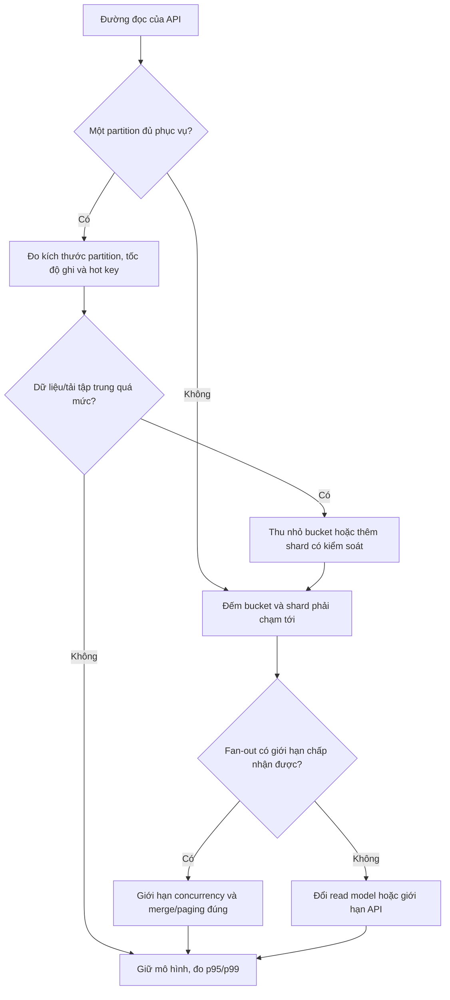

# Đánh đổi giữa số partition cần đọc và lượng dữ liệu trong mỗi partition

Trong Apache Cassandra, chọn **partition key** là quyết định thiết kế đường truy cập dữ liệu. Một khóa gom quá nhiều bản ghi vào cùng partition có thể gây partition lớn, tập trung tải và khiến việc bảo trì khó dự đoán. Ngược lại, chia dữ liệu thành quá nhiều partition nhỏ có thể buộc một yêu cầu API truy cập hàng chục hoặc hàng trăm partition, tăng chi phí truy vấn, xử lý kết quả và phân trang.

Khi làm việc với **Spring Data Cassandra** qua entity mapping, repository, `CassandraTemplate` và CQL, ứng dụng vẫn phải tự chọn cách chia partition phù hợp với các truy vấn cần phục vụ. Repository không tự giải quyết sự đánh đổi giữa **độ rộng partition** và **số partition mà một truy vấn phải đọc**. Bài này tập trung vào cách định lượng, lựa chọn mô hình và đưa quyết định đó vào API ứng dụng.

## 1. Hai loại chi phí cần cân bằng

**Partition** là nhóm các hàng chia sẻ cùng giá trị partition key. Cassandra dùng partition key để phân phối và định vị dữ liệu trong cụm; các hàng thuộc cùng partition được tổ chức theo clustering columns. Một truy vấn biết đầy đủ partition key thường có đường đọc dễ dự đoán hơn truy vấn cần tìm dữ liệu ở nhiều partition.

| Đặc điểm | Ít partition, mỗi partition lớn | Nhiều partition, mỗi partition nhỏ |
| --- | --- | --- |
| Định vị dữ liệu | Một yêu cầu có thể đọc ít partition hơn | Phải xác định và truy cập nhiều khóa partition |
| Phân tán tải | Dễ tập trung tải vào partition nóng nếu khóa quá thô | Có thể phân tán tải tốt hơn khi chia khóa phù hợp |
| Kích thước và vòng đời | Partition dễ tăng theo thời gian lưu dữ liệu | Mỗi partition nhỏ hơn, dễ giới hạn phạm vi |
| Truy vấn theo thời gian | Có thể đọc một khoảng theo clustering key trong cùng partition | Cần duyệt các bucket giao với khoảng thời gian |
| Sắp xếp kết quả | Clustering order có tác dụng trong một partition | Ứng dụng phải nối/merge nếu đọc nhiều partition |
| Phân trang | Có thể dùng paging state của một truy vấn partition | Cursor cần biểu diễn vị trí trên nhiều partition |
| Độ trễ | Có nguy cơ partition lớn, hot partition, tombstone | Có chi phí điều phối và nhiều lần đọc, đặc biệt ở p95/p99 |

Hai hiểu lầm cần tránh:

1. **Một partition lớn không có nghĩa mọi truy vấn đều quét hết partition.** Nếu clustering columns phù hợp, Cassandra có thể đọc một dải hàng nhỏ. Tuy vậy, partition cực lớn vẫn gây rủi ro về phân bố tải, vận hành và các truy vấn không đủ chọn lọc.
2. **Một truy vấn đọc nhiều partition không nhất thiết chậm.** Một vài partition nhỏ có thể rất phù hợp. Vấn đề là số partition tăng không giới hạn theo thời gian, số tenant, số shard hoặc các bộ lọc.

Mục tiêu không phải giảm tuyệt đối một trong hai đại lượng, mà là giữ **kích thước partition, số partition chạm tới và số hàng thực đọc** trong giới hạn có thể kiểm soát theo truy vấn quan trọng nhất.

## 2. Bắt đầu từ truy vấn thay vì chọn bucket theo cảm tính

Giả sử hệ thống lưu sự kiện cho từng tenant. API cần:

- `GET /tenants/{tenantId}/events?limit=50`: xem sự kiện mới nhất.
- `GET /tenants/{tenantId}/events?from=...&to=...`: xem sự kiện trong khoảng thời gian.
- `GET /tenants/{tenantId}/events?from=...&to=...&cursor=...`: duyệt kết quả theo từng trang.

Mỗi bản ghi có `event_id`, `tenant_id`, `occurred_at`, `event_type` và `payload`. Giả sử hệ thống lưu dữ liệu trong 30 ngày; tenant thông thường tạo 2.000 sự kiện/ngày, tenant có lưu lượng cao tạo 500.000 sự kiện/ngày. Tạm lấy **500 byte dữ liệu logic mỗi hàng** để tính sơ bộ, chưa bao gồm metadata, index, replication, compaction hay chênh lệch kích thước thực tế.

Ước lượng cho tenant lưu lượng cao:

| Cửa sổ gom dữ liệu | Số sự kiện trung bình | Lượng dữ liệu logic ước tính |
| --- | ---: | ---: |
| 30 ngày | 15.000.000 | 7,5 GB |
| 1 ngày | 500.000 | 250 MB |
| 1 giờ | Khoảng 20.833 | Khoảng 10,4 MB |
| 1 giờ, chia đều 4 shard | Khoảng 5.208/shard | Khoảng 2,6 MB/shard |

Các con số chỉ có ý nghĩa minh họa: tải thực tế thường có đỉnh theo giờ, payload không đồng đều và có tenant lớn hơn nhiều so với trung bình. Khi đánh giá một partition, hãy dựa vào **giá trị lớn nhất hợp lý hoặc phân vị cao** của lưu lượng, không chỉ trung bình của tất cả tenant.

### Công thức ước lượng ban đầu

Với lượng ghi tương đối ổn định, có thể ước tính:

\[
\text{Dung lượng logic/partition} \approx
\frac{\text{hàng/giây} \times \text{giây/bucket} \times \text{byte/hàng}}{\text{số shard}}
\]

Nếu một API phải quét đủ một cửa sổ thời gian:

\[
\text{Số partition cần xét} \approx
\text{số bucket giao với cửa sổ} \times \text{số shard/bucket}
\]

Đây là mô hình định hướng thiết kế, **không phải công thức dự đoán latency**. Độ trễ còn phụ thuộc số hàng được trả về, phân bố replica, cache, tombstone, độ chọn lọc clustering range, concurrency và giới hạn tài nguyên của cụm. Không có một kích thước partition hoặc một số lượng fan-out cố định an toàn cho mọi hệ thống Cassandra.

## 3. Phương án A: partition theo tenant, không chia thời gian

```sql
CREATE TABLE events_by_tenant (
    tenant_id uuid,
    occurred_at timestamp,
    event_id uuid,
    event_type text,
    payload text,
    PRIMARY KEY ((tenant_id), occurred_at, event_id)
) WITH CLUSTERING ORDER BY (occurred_at DESC, event_id ASC);
```

Truy vấn danh sách sự kiện của một tenant:

```sql
SELECT event_id, occurred_at, event_type, payload
FROM events_by_tenant
WHERE tenant_id = ?
LIMIT 50;
```

**Ưu điểm:** API đọc sự kiện của một tenant từ một partition. Clustering order hỗ trợ đọc sự kiện mới nhất trước và ràng buộc khoảng thời gian.

**Nhược điểm:** partition của tenant tăng theo số hàng còn lưu. Với tenant lớn trong ví dụ, 30 ngày đã có khoảng 7,5 GB dữ liệu logic cho một partition; khi thay đổi retention hoặc tải tăng, partition có thể lớn hơn đáng kể. Nhiều yêu cầu cùng tra cứu tenant này sẽ tập trung vào các replica đang giữ partition đó.

Thiết kế này có thể vẫn phù hợp nếu mỗi tenant chỉ có ít dữ liệu, giới hạn retention chặt và truy vấn luôn có phạm vi rõ ràng. Không nên loại bỏ chỉ vì nó đơn giản; cũng không nên chấp nhận mà bỏ qua phép đo kích thước và tải ở tenant lớn nhất.

## 4. Phương án B: chia partition theo khoảng thời gian

Thêm `bucket_day` vào **partition key phức hợp**:

```sql
CREATE TABLE events_by_tenant_day (
    tenant_id uuid,
    bucket_day date,
    occurred_at timestamp,
    event_id uuid,
    event_type text,
    payload text,
    PRIMARY KEY ((tenant_id, bucket_day), occurred_at, event_id)
) WITH CLUSTERING ORDER BY (occurred_at DESC, event_id ASC);
```

Ở đây, `(tenant_id, bucket_day)` xác định partition; `(occurred_at, event_id)` xác định vị trí hàng **bên trong partition**. `bucket_day` là ngày UTC được tính từ `occurred_at`, không phải một cột tự sinh của Cassandra.

Đọc một ngày:

```sql
SELECT event_id, occurred_at, event_type, payload
FROM events_by_tenant_day
WHERE tenant_id = ?
  AND bucket_day = ?
  AND occurred_at >= ?
  AND occurred_at < ?
LIMIT 50;
```

Đối với tenant lớn, một partition theo ngày chỉ chứa dữ liệu khoảng một ngày thay vì toàn bộ 30 ngày. Nhưng truy vấn trong **bảy ngày** có thể phải đọc **bảy partition**; với bucket theo giờ, cùng cửa sổ có thể giao **168 partition**. Các partition khác nhau có thể nằm trên các replica khác nhau và không được Cassandra tự ghép thành một dòng thời gian sắp xếp toàn cục.

### API lấy bản ghi mới nhất nên đọc thế nào?

Với `GET /tenants/{id}/events?limit=50`, service có thể:

1. Xác định bucket hiện tại theo UTC.
2. Đọc tối đa 50 hàng mới nhất trong bucket đó.
3. Nếu chưa đủ 50 và còn trong thời gian lưu trữ, đọc bucket liền trước; tiếp tục đến khi đủ hoặc hết phạm vi.
4. Trả về `nextCursor` để khách tiếp tục duyệt từ vị trí đã đọc.

Nếu tenant hoạt động thường xuyên, hầu hết yêu cầu chỉ cần một bucket gần nhất. Nếu tenant ít hoạt động hoặc lọc vào một khoảng cũ, yêu cầu có thể phải thử nhiều bucket rỗng. Do đó, **số bucket có khả năng giao với truy vấn** là mức fan-out cần chuẩn bị; số bucket thực sự đọc của một lần lấy `LIMIT 50` có thể ít hơn.

### Đổi bucket từ ngày sang giờ khi nào?

Bucket theo giờ giảm kích thước tối đa dự kiến mỗi partition nhưng tăng số partition ở các truy vấn lịch sử. Từ ví dụ:

| Thiết kế | Dữ liệu logic/partition của tenant lớn | Partition cho truy vấn bao phủ trọn 7 ngày |
| --- | ---: | ---: |
| Chỉ `tenant_id`, retention 30 ngày | Khoảng 7,5 GB | 1 |
| `tenant_id + bucket_day` | Khoảng 250 MB | 7 |
| `tenant_id + bucket_hour` | Khoảng 10,4 MB | 168 |

Các con số áp dụng cho một tenant theo giả định tải đều. Với truy vấn giới hạn 50 hàng mới nhất, số partition thực đọc thường nhỏ hơn cột cuối; với truy vấn thực sự bao phủ toàn bộ dữ liệu bảy ngày, số partition trong bảng là số cần xét.

Việc giảm một partition từ 250 MB xuống khoảng 10,4 MB có thể đáng giá nếu workload gặp vấn đề về kích thước/hot partition. Nhưng nếu API thường xuyên đọc lịch sử dài, fan-out 168 partition cho một tenant có thể quá tốn kém. Cần quyết định dựa trên **số lượng, độ dài và tần suất từng loại truy vấn**, không chỉ dựa trên kích thước trung bình.

## 5. Phương án C: thêm shard để giảm partition nóng

Bucket theo thời gian vẫn có thể bị quá tải khi một tenant ghi hoặc đọc rất nhiều vào bucket hiện tại. Khi đó có thể chia thêm bằng shard ổn định, ví dụ:

```sql
CREATE TABLE events_by_tenant_hour_shard (
    tenant_id uuid,
    bucket_hour timestamp,
    shard smallint,
    occurred_at timestamp,
    event_id uuid,
    event_type text,
    payload text,
    PRIMARY KEY ((tenant_id, bucket_hour, shard), occurred_at, event_id)
) WITH CLUSTERING ORDER BY (occurred_at DESC, event_id ASC);
```

Khi ghi, ứng dụng xác định `bucket_hour` bằng giờ UTC và tính `shard = stableHash(eventId) % 4`. Hàm băm và số lượng shard phải thống nhất giữa các bên ghi và được quản lý khi thay đổi cấu trúc dữ liệu.

**Lợi ích:** mỗi giờ có bốn partition thay vì một. Nếu băm phân bố tương đối đều, mỗi partition lưu khoảng một phần tư số sự kiện và tải ghi có thể được trải ra nhiều vị trí dữ liệu.

**Chi phí:** API lấy sự kiện mới nhất của giờ hiện tại phải đọc **cả bốn shard**, vì sự kiện mới nhất có thể nằm ở bất kỳ shard nào. Kết quả mỗi shard đã được sắp xếp theo `occurred_at`, nhưng service cần gộp thành một dòng kết quả theo `(occurred_at DESC, event_id ASC)`. Nếu yêu cầu bao phủ bảy ngày, fan-out có thể tăng lên `168 × 4 = 672` partition ở thiết kế bucket theo giờ và bốn shard.

Ví dụ đơn giản về cách merge:

```text
Shard 0: 10:07 E9, 10:03 E5, ...
Shard 1: 10:06 E8, 10:02 E4, ...
Shard 2: 10:08 E10, 10:04 E6, ...
Shard 3: 10:05 E7, 10:01 E3, ...

Kết quả merge toàn cục:
10:08 E10, 10:07 E9, 10:06 E8, 10:05 E7, 10:04 E6, ...
```

Những điều phải lưu ý:

- Sharding theo ID giúp phân tán ghi nhưng làm truy vấn theo thời gian phải đọc nhiều shard. Nếu endpoint chỉ cần truy vấn chính xác theo ID, cần biết thuật toán và đủ dữ liệu để tính lại shard, hoặc duy trì bảng tra cứu riêng theo ID.
- Shard count không nên thay đổi tùy tiện. Nếu tăng từ 4 lên 8 mà vẫn giữ dữ liệu cũ, ứng dụng phải biết giai đoạn nào dùng sơ đồ nào, hoặc thực hiện backfill/migration có kiểm soát.
- Tránh tạo một lượng lớn truy vấn song song không giới hạn. Giới hạn concurrency, giới hạn khoảng thời gian và có chính sách timeout; càng nhiều partition yêu cầu cùng lúc, nguy cơ tail latency càng lớn.
- Partition nhỏ không đồng nghĩa đọc rẻ khi API phải gom nhiều hàng. Nếu kết quả trả về rất nhiều bản ghi, lượng dữ liệu mạng và chi phí merge vẫn lớn.

## 6. Nhìn vào tổng chi phí: fan-out, read amplification và hot partition

Không có công thức chính xác cho latency từ duy nhất kích thước partition, nhưng có thể dùng cách nhìn sau để đặt câu hỏi:



Các loại chi phí cần đo riêng:

| Chi phí | Câu hỏi cần trả lời | Gợi ý theo dõi |
| --- | --- | --- |
| Partition size | Khóa nào chứa nhiều dữ liệu nhất? | Kích thước partition, độ lệch giữa tenant |
| Partition hotness | Truy vấn và ghi có tập trung vào một vài khóa? | Request theo khóa, độ trễ p95/p99, tải replica |
| Fan-out | Một request phải đọc bao nhiêu partition? | Số bucket/shard chạm tới trên mỗi API call |
| Read amplification | Để trả 50 hàng, thực tế đã đọc/duyệt bao nhiêu hàng? | Số hàng trả về, hàng duyệt, tombstone, payload |
| Network & coordinator | Có quá nhiều request nhỏ song song? | Timeout, queue, tải coordinator, traffic |
| Kết hợp kết quả | Có cần sắp xếp/loại trùng nhiều nguồn? | CPU/memory service, số phần tử cần merge |

Một thiết kế có thể có **ít partition nhưng read amplification cao** nếu truy vấn phải lọc qua nhiều hàng hoặc tombstone. Thiết kế khác có thể có **nhiều partition nhưng tổng hàng đọc nhỏ** nếu mỗi partition được chọn lọc tốt. Vì vậy không nên chỉ nhìn một chỉ số.

**`ALLOW FILTERING` không phải công cụ giảm fan-out.** Nó không tự biến việc lọc dữ liệu không phù hợp khóa thành một đường đọc có giới hạn. Với các API quan trọng, nên lựa chọn partition/clustering key theo mẫu truy vấn hoặc tạo read model chuyên biệt. Chỉ mục cũng phải được đánh giá cho trường hợp sử dụng, phiên bản Cassandra và phân bố dữ liệu cụ thể.

## 7. Tác động đến Spring Data Cassandra và hợp đồng API

### Repository cho đúng một bucket

Với entity `TenantEventByDay` ánh xạ bảng `events_by_tenant_day` và khóa phức hợp `TenantEventByDayKey`, có thể khai báo một truy vấn giới hạn trong **một partition**:

```java
import java.time.Instant;
import java.time.LocalDate;
import java.util.List;
import java.util.UUID;

import org.springframework.data.cassandra.repository.CassandraRepository;
import org.springframework.data.cassandra.repository.Query;

public interface TenantEventByDayRepository
        extends CassandraRepository<TenantEventByDay, TenantEventByDayKey> {

    @Query("""
        SELECT * FROM events_by_tenant_day
        WHERE tenant_id = ?0
          AND bucket_day = ?1
          AND occurred_at >= ?2
          AND occurred_at < ?3
        LIMIT ?4
        """)
    List<TenantEventByDay> findInBucket(
            UUID tenantId,
            LocalDate day,
            Instant fromInclusive,
            Instant toExclusive,
            int limit);
}
```

Đây là ví dụ về **truy vấn một bucket**, không phải endpoint truy vấn tùy ý toàn bộ lịch sử. Entity tương ứng phải ánh xạ partition key `(tenant_id, bucket_day)` và clustering columns `(occurred_at, event_id)`. Trong ứng dụng, service xác định những ngày giao với khoảng thời gian được yêu cầu và gọi repository cho từng ngày cần thiết.

Khi cần điều khiển truy vấn CQL động, chính sách `fetchSize`, consistency level hoặc paging state ở mức chi tiết, có thể dùng `CassandraTemplate` hay API của Cassandra Java Driver phù hợp. Dù công cụ nào tạo truy vấn, **tập partition thực sự truy cập vẫn do khóa và CQL quyết định**.

### Cách tổ chức service đọc qua nhiều bucket

Mã giả sau mô tả trường hợp bucket theo ngày, không dùng shard:

```text
function loadEvents(tenantId, from, to, limit, cursor):
    validateTenantAndTimeRange()
    validateLimitAndCursor()
    days = enumerateUtcDaysNewestFirst(from, to)
    state = restoreCursorState(cursor)
    results = []

    for day in days startingAt state.day:
        slice = readBucketWithPagingState(
            tenantId, day, from, to,
            limit - results.size, state.pagingStateForDay
        )
        append results with slice.rows

        if results.size == limit:
            return { items: results,
                     nextCursor: encode(day, slice.nextState, filters) }

        state = moveToPreviousDay()

    return { items: results, nextCursor: null }
```

Đây là **thuật toán khái niệm**: việc xử lý `pagingState`, ranh giới trang, bucket rỗng và vị trí hàng cuối cùng cần được hiện thực và kiểm thử kỹ. Không được bỏ qua hàng hoặc đọc trùng khi một trang kết thúc đúng ranh giới bucket. Nếu truy vấn chia shard và phải merge toàn cục, cursor có thể cần lưu vị trí **của từng shard**, cùng khóa sắp xếp cuối cùng và thông tin bucket hiện tại.

Trong Spring Data Cassandra, `Slice` và hỗ trợ paging state giúp thực hiện phân trang theo dữ liệu Cassandra trả về. Tuy nhiên, paging state của **một truy vấn** không tự giải quyết phân trang tổng hợp trên nhiều partition hoặc nhiều truy vấn độc lập. Service phải sở hữu quy tắc gộp và cursor cấp API.

### Hợp đồng API cần phản ánh giới hạn fan-out

Ví dụ:

```http
GET /tenants/{tenantId}/events?from=2026-11-18T00:00:00Z&to=2026-11-25T00:00:00Z&limit=50&cursor=...
```

Một hợp đồng thực tế nên định nghĩa:

- `tenantId` bắt buộc để định vị nhóm partition cần đọc.
- `from`, `to` dùng khoảng nửa mở `[from, to)` và có giới hạn độ dài khoảng thời gian. Xác định rõ múi giờ UTC khi tính bucket.
- `limit` có giá trị mặc định và tối đa. Giới hạn này kiểm soát lượng **kết quả**, nhưng không thay thế giới hạn fan-out hoặc ngân sách truy vấn.
- `cursor` là giá trị opaque liên kết với tenant, khoảng thời gian, bộ lọc và phiên bản sơ đồ bucket. Không coi cursor như số trang `OFFSET` và không phơi bày tùy tiện paging state của driver.
- `sort` chỉ hỗ trợ thứ tự có thể thực hiện được, ví dụ mới nhất trước theo `(occurred_at, event_id)`. Nếu có shard, backend phải merge đúng thứ tự.
- API có thể từ chối truy vấn quá rộng hoặc chuyển sang tác vụ xuất dữ liệu bất đồng bộ khi chi phí vượt ngân sách tương tác.

Khi đang duyệt nhiều trang mà có sự kiện mới, sửa hoặc xóa, kết quả có thể thay đổi; các truy vấn qua nhiều bucket **không mặc nhiên tạo snapshot**. Nếu cần một mốc nhất quán, phải định nghĩa và triển khai quy tắc chốt thời gian cùng cơ chế tiếp tục từ khóa cuối phù hợp.

## 8. Truy vấn đa partition: tuần tự hay song song?

Lấy ví dụ truy vấn khoảng bảy ngày theo bucket ngày:

**Đọc tuần tự từ mới đến cũ:** phù hợp với `limit=50` và dữ liệu mới được tạo thường xuyên. Service dừng khi đủ kết quả, nên có thể chỉ chạm tới một hoặc hai ngày. Rủi ro là phải lần lượt thử nhiều bucket trống với tenant ít hoạt động.

**Đọc song song có giới hạn:** phù hợp khi chắc chắn cần so sánh các kết quả từ nhiều partition, đặc biệt khi sử dụng shard. Đổi lại là thêm tải đồng thời, bộ nhớ đệm kết quả và bước merge; không nên bắn đồng thời hàng trăm truy vấn không giới hạn.

**Đọc nhiều partition với `IN`:** một số truy vấn CQL có thể cho phép chọn nhiều khóa partition bằng `IN`, nhưng điều đó không làm biến mất chi phí truy cập nhiều partition. Cần xét giới hạn cú pháp, kế hoạch thực thi, phạm vi khóa và độ trễ; khi cần kiểm soát fan-out, nhiều truy vấn được quản lý tường minh thường dễ quan sát và giới hạn hơn.

Nếu sản phẩm yêu cầu tìm kiếm rộng trên hàng nghìn tenant hoặc tổng hợp nhiều tháng dữ liệu, việc nhân rộng số bucket hoặc shard không phải giải pháp đầy đủ. Có thể cần một read model khác theo truy vấn báo cáo, pipeline tổng hợp, hoặc hệ phân tích/tìm kiếm chuyên dụng. Đường đọc phục vụ một tenant nên được tối ưu riêng với truy vấn phân tích xuyên tenant.

## 9. TTL, tombstone và tính nhất quán làm thay đổi bài toán

**TTL và retention:** chia bucket theo ngày/giờ giúp quản lý phạm vi dữ liệu theo thời gian, nhưng không tự xóa dữ liệu cũ. Khi dùng TTL hoặc `DELETE`, Cassandra có thể tạo tombstone; truy vấn đọc nhiều dữ liệu hết hạn có thể chậm dù partition không đặc biệt lớn. Cần đánh giá TTL, kiểu compaction, thời điểm hết hạn và mẫu truy vấn; không suy ra cứ chia bucket nhỏ là hết vấn đề tombstone.

**Consistency level:** mỗi truy vấn có mức nhất quán đọc riêng theo cấu hình. Đọc bảy partition không phải một thao tác snapshot nguyên tử xuyên các partition. Giữa các lần đọc, sự kiện mới có thể xuất hiện hoặc dữ liệu có thể thay đổi. Điều này ảnh hưởng tới paging và khả năng lặp lại kết quả.

**Thay đổi độ rộng bucket:** nếu từ ngày chuyển sang giờ, một hàng cũ phải vẫn đọc được từ bucket ngày hoặc được di chuyển/backfill. Hệ thống không thể suy ra khóa mới từ dữ liệu cũ mà không có kế hoạch tương thích. Thông thường cần lưu phiên bản bố cục, đọc song song trong giai đoạn chuyển tiếp, kiểm tra dữ liệu và dừng đường đọc cũ sau khi hoàn tất.

**Định tuyến theo thời gian:** với sự kiện đến muộn, quyết định bucket từ `occurred_at` hay từ thời điểm ingest là một phần của hợp đồng ghi/đọc. Nếu thiết kế bucket theo `occurred_at`, một sự kiện đến muộn có thể ghi vào bucket quá khứ. Trường hợp này phải được tính khi ước lượng tải, TTL và tính đúng của API.

## 10. Khung lựa chọn thiết kế

Trước khi chốt partition key, lập bảng cho **từng truy vấn chính**:

| Câu hỏi | Điều cần ghi lại |
| --- | --- |
| API tra cứu theo gì? | Tenant, khoảng thời gian, ID, trạng thái hoặc tổ hợp khóa |
| API thường đọc bao xa? | 50 sự kiện gần nhất, một ngày, bảy ngày hay lịch sử dài |
| Có tenant/hot key đặc biệt lớn không? | Hàng/ngày và request/giây của nhóm tải cao |
| Retention bao lâu? | Số bucket tồn tại đồng thời và xu hướng tăng |
| Kích thước partition dự kiến? | Số hàng × kích thước hàng, kèm biên độ tăng trưởng |
| Fan-out cao nhất chấp nhận được? | Partition/request, số truy vấn đồng thời, timeout |
| Có cần thứ tự toàn cục? | Yêu cầu merge nhiều bucket/shard hoặc read model khác |
| Có yêu cầu phân trang/nhất quán nào? | Cursor, khả năng thay đổi dữ liệu giữa các trang |
| Thành công được đo bằng gì? | p95/p99 latency, throughput, lỗi, tải replica và chi phí vận hành |

Quy tắc định hướng:

1. **Bắt đầu với partition key phục vụ truy vấn phổ biến nhất.** Nếu khóa có nguy cơ tăng vô hạn, bổ sung bucket có thể dự đoán được từ tham số API.
2. **Chọn bucket đủ nhỏ để giới hạn dữ liệu và tải cục bộ, nhưng đủ lớn để truy vấn phổ biến không phải truy cập quá nhiều partition.** Kiểm tra với tenant nhiều dữ liệu nhất và các cửa sổ thời gian phổ biến.
3. **Chỉ thêm shard khi có căn cứ về hot partition hoặc phân bố tải.** Shard làm tăng fan-out và độ phức tạp của sắp xếp/phân trang.
4. **Định nghĩa ngân sách truy vấn ở tầng API.** Giới hạn phạm vi thời gian, số bản ghi, concurrency và tổng partition/request; có phương án cho truy vấn quá rộng.
5. **Đo với dữ liệu và lưu lượng đại diện.** Kiểm tra trường hợp bình thường, tenant lớn, thời gian cao điểm, dữ liệu hết hạn và nhiều yêu cầu đồng thời. Sau đó điều chỉnh bucket/shard dựa trên số liệu.

### Bài tập tình huống

Một tenant tạo trung bình 120.000 sự kiện/ngày, nhưng mỗi tối có một giờ cao điểm chiếm 60% lưu lượng. Payload trung bình 900 byte; hệ thống giữ 14 ngày. API phổ biến nhất lấy 30 sự kiện gần nhất, nhưng một API báo cáo cần duyệt đủ dữ liệu trong ba ngày.

Hãy tự trả lời:

1. Nếu chọn bucket theo ngày, ước lượng dung lượng logic của một partition ngày trung bình. Giờ cao điểm sẽ ảnh hưởng thế nào đến hot partition dù tổng dung lượng ngày chưa quá lớn?
2. Nếu chọn bucket theo giờ, truy vấn báo cáo ba ngày phải xét tối đa bao nhiêu partition cho một tenant? Với bốn shard/giờ thì sao?
3. Endpoint 30 sự kiện mới nhất có cần quét đủ 72 bucket giờ trong mọi trường hợp không? Khi nào nó phải thử nhiều bucket?
4. Cần quan sát chỉ số nào trước khi quyết định bổ sung shard? Việc thêm shard thay đổi thuật toán cursor như thế nào?
5. Nếu yêu cầu báo cáo mở rộng từ ba ngày lên sáu tháng, có nên dùng lại cùng đường đọc phục vụ trang sự kiện gần nhất không?

## Kết luận

Trong thiết kế dữ liệu theo truy vấn của **Spring Data Cassandra**, một partition quá rộng có thể tạo điểm nóng và rủi ro vận hành; chia quá nhỏ lại khiến API phải tìm và ghép kết quả từ nhiều partition. Time bucketing và sharding là hai công cụ để đổi **kích thước và tải trên từng partition** lấy **fan-out cùng độ phức tạp ở tầng truy vấn**. Quyết định hợp lý xuất phát từ kiểu đọc thực tế, số liệu của nhóm tải lớn, retention, yêu cầu phân trang và mục tiêu p95/p99 — sau đó được thể hiện rõ trong CQL, repository/`CassandraTemplate` và hợp đồng API.
