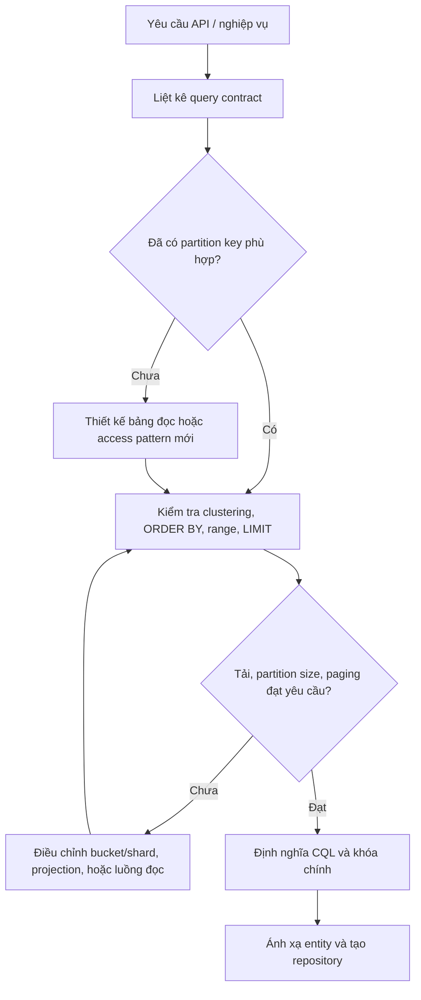

# Xác định ràng buộc truy vấn trước khi tạo repository

Trong **Spring Data Cassandra**, việc viết một interface `CassandraRepository` chỉ nên diễn ra **sau khi** đã xác định ứng dụng cần đọc và ghi dữ liệu bằng cách nào. Repository giúp truy cập Apache Cassandra thông qua entity mapping và các phương thức Java, nhưng không tự tạo ra một mô hình dữ liệu phù hợp với mọi truy vấn.

Khác với cách thiết kế quen thuộc ở nhiều cơ sở dữ liệu quan hệ (chuẩn hóa bảng trước, sau đó ghép dữ liệu và bổ sung truy vấn), Cassandra thường đòi hỏi **thiết kế bảng theo truy vấn** (*query-driven design*). Partition key quyết định nơi dữ liệu được phân bố; clustering column quyết định cách sắp xếp trong một partition. Một phương thức repository chỉ hoạt động đúng và hiệu quả khi điều kiện lọc, thứ tự sắp xếp, khối lượng kết quả và cách phân trang phù hợp với các quyết định thiết kế đó.

Bài học này thuộc chương **Thiết kế theo truy vấn**. Mục tiêu là chuyển yêu cầu nghiệp vụ thành **hợp đồng truy vấn** (*query contract*), đánh giá khả năng đáp ứng bằng CQL, rồi mới tạo bảng, entity và repository. Kỹ năng này cũng áp dụng khi về sau lựa chọn `CassandraTemplate`, `CqlTemplate` hoặc `CqlSession`.

## 1. Vì sao phải xác định truy vấn trước repository?

Giả sử hệ thống lưu sự kiện kiểm toán (*audit events*) của nhiều khách hàng (*tenant*). Nhà phát triển có thể nghĩ đến một bảng chứa tất cả trường:

```text
AuditEvent
  eventId, tenantId, actorId, eventType, occurredAt, payload
```

Sau đó họ dự định tạo:

```java
List<AuditEvent> findByTenantId(String tenantId);
List<AuditEvent> findByActorId(String actorId);
List<AuditEvent> findByEventType(String eventType);
```

Các chữ ký Java này **không chứng minh được** Cassandra sẽ chạy truy vấn tương ứng. Nếu bảng được phân vùng theo `tenant_id` và ngày, truy vấn chỉ có `actor_id` có thể không xác định được partition nào cần đọc. Nếu muốn sắp xếp toàn bộ sự kiện từ nhiều partition theo thời gian, clustering order trong một partition không tự cung cấp thứ tự toàn cục.

Repository chỉ mô tả **cách gọi** truy vấn; thiết kế bảng và câu CQL quyết định **nơi đọc** và **chi phí đọc**. Vì vậy, cần thu thập các ràng buộc trước:

- Người dùng lọc theo trường nào? Trường nào **bắt buộc**, trường nào **tùy chọn**?
- Kết quả có cần sắp xếp không? Theo cột nào, tăng hay giảm, trên một partition hay nhiều partition?
- Mỗi lần đọc cần 1 hàng, 50 hàng gần nhất hay toàn bộ lịch sử?
- Tần suất đọc/ghi, độ trễ mục tiêu, mức đồng thời và phân bố lưu lượng ra sao?
- Dữ liệu được lưu bao lâu? Có tenant hoặc khóa nào tăng trưởng đột biến không?
- Có cần đọc ngay sau ghi, đọc qua nhiều data center, hoặc ghi có điều kiện không?

Một repository tạo quá sớm có thể khiến thiết kế bảng bị lệ thuộc vào mô hình object và dẫn đến dùng `ALLOW FILTERING`, quét diện rộng hoặc xây dựng thêm tầng xử lý tốn kém về sau.

## 2. Định nghĩa query contract trước khi viết CQL

**Query contract** là mô tả rõ ràng của một thao tác dữ liệu mà màn hình, API hoặc nghiệp vụ thực sự cần. Không nhất thiết phải là một tài liệu phức tạp; một bảng được thống nhất giữa nghiệp vụ và kỹ thuật đã đủ để phát hiện nhiều rủi ro.

| Thành phần cần chốt | Câu hỏi phải trả lời | Ví dụ cho hệ thống audit |
| --- | --- | --- |
| Mục đích | Người dùng thực hiện tác vụ gì? | Xem 50 sự kiện mới nhất của tenant trong một ngày |
| Khóa lọc bắt buộc | Mỗi yêu cầu luôn cung cấp trường nào? | `tenantId` và `eventDay` |
| Điều kiện tùy chọn | Có filter nào có thể xuất hiện hoặc bị bỏ qua? | `actorId`, `eventType` |
| Thứ tự kết quả | Theo trường nào, tăng hay giảm? | `eventTime DESC` |
| Phạm vi thời gian | Một ngày, khoảng ngày, hay không giới hạn? | Một ngày theo UTC |
| Kích thước kết quả | Tối đa bao nhiêu hàng mỗi lần? | 50 hàng/trang |
| Phân trang | Xem tiếp, nhảy đến trang số N, hay export hết? | Xem tiếp theo cursor |
| Tải và độ trễ | Số request, độ lớn payload, p95/p99 mục tiêu? | Đo theo lưu lượng thực tế; chưa chốt số |
| Tính nhất quán | Dữ liệu có phải xuất hiện ngay sau ghi? | Chấp nhận độ trễ đồng bộ nhỏ giữa các bảng đọc |
| Vòng đời dữ liệu | Dữ liệu hết hạn hoặc cập nhật thế nào? | Lưu 90 ngày, có thể dùng TTL |
| Phạm vi truy cập | Có bắt buộc giới hạn theo tenant/người dùng? | Mọi truy vấn nghiệp vụ gắn với tenant |

Các giá trị như 50 hàng/trang hay 90 ngày ở đây là **giả định minh họa**, không phải giới hạn mặc định của Cassandra. Trong dự án thực tế phải xác nhận từ yêu cầu nghiệp vụ và đo trên dữ liệu đại diện.

Nếu một trường là *tùy chọn*, hãy hỏi thêm: khi trường đó vắng mặt, ứng dụng dùng cùng đường truy cập hay một đường khác? Cassandra không bảo đảm mọi tổ hợp filter đều được hỗ trợ bằng một bảng duy nhất. Nhiều truy vấn tưởng như giống nhau cần hai bảng phục vụ hai **access pattern** khác nhau.

### Ghi lại cả quy tắc ghi và thay đổi dữ liệu

Đọc là trung tâm của query-driven design, nhưng hợp đồng cũng phải nêu cách ghi: một sự kiện có bị sửa không; có ghi lặp khi retry không; nhiều bảng phục vụ truy vấn có cần nhận cùng dữ liệu không; có yêu cầu xóa theo tenant hay TTL không. Thiết kế được nhiều hướng đọc thường đánh đổi bằng **ghi ra nhiều bảng** và việc duy trì tính nhất quán giữa chúng.

## 3. Lập ma trận truy vấn cho một tình huống cụ thể

Giả sử ứng dụng audit có bốn yêu cầu:

| Mã | Truy vấn nghiệp vụ | Input bắt buộc | Thứ tự/giới hạn | Nhận xét ban đầu |
| --- | --- | --- | --- | --- |
| Q1 | Danh sách sự kiện mới nhất của một tenant trong ngày | `tenantId`, `eventDay` | Mới nhất trước, tối đa 50 | Phù hợp với partition theo tenant + ngày |
| Q2 | Xem chi tiết sự kiện từ ID trong một đường link | `eventId` | Tối đa 1 | Cần đường tra cứu bằng ID |
| Q3 | Xem hoạt động của một người trong ngày | `tenantId`, `actorId`, `eventDay` | Mới nhất trước, tối đa 50 | Có thể cần bảng theo actor |
| Q4 | Đếm sự kiện theo loại trong 30 ngày | `tenantId`, loại và khoảng ngày | Tổng hợp | Cần cân nhắc bảng tổng hợp/luồng xử lý riêng |

Không nên gộp Q1–Q4 vào một phương thức repository với nhiều tham số optional rồi mong Cassandra tự tìm cách chạy hiệu quả. Trước hết phải xác định một **đường đọc có thể dự đoán được** cho từng truy vấn.

Sơ đồ quyết định:



## 4. Từ Q1 đến khóa chính Cassandra

Q1 luôn có `tenantId` và một ngày, yêu cầu trả kết quả mới nhất trước. Một thiết kế khả thi:

```sql
CREATE TABLE audit_events_by_tenant_day (
    tenant_id   text,
    event_day   date,
    event_time  timeuuid,
    event_id    uuid,
    actor_id    text,
    event_type  text,
    payload     text,
    PRIMARY KEY ((tenant_id, event_day), event_time)
) WITH CLUSTERING ORDER BY (event_time DESC);
```

Trong khóa `PRIMARY KEY ((tenant_id, event_day), event_time)`:

1. `tenant_id` và `event_day` tạo **partition key ghép**. Cần cung cấp đủ cả hai thành phần để truy cập chính xác partition theo thiết kế này.
2. `event_time` là **clustering column** kiểu `timeuuid`, dùng để sắp xếp các hàng trong cùng partition. Kiểu này kết hợp thông tin thời gian với thành phần giúp phân biệt các sự kiện.
3. `event_id` là ID nghiệp vụ lưu trong hàng, **không tự trở thành khóa để tra cứu toàn bảng**. Nếu Q2 chỉ biết `eventId`, cần thêm đường truy cập khác.
4. `CLUSTERING ORDER BY (event_time DESC)` phục vụ Q1 đọc dữ liệu mới nhất trước mà không cần sắp xếp hàng loạt kết quả phía ứng dụng.

Câu CQL thể hiện Q1:

```sql
SELECT tenant_id, event_day, event_time, event_id,
       actor_id, event_type, payload
FROM audit_events_by_tenant_day
WHERE tenant_id = ? AND event_day = ?
LIMIT 50;
```

Tất cả điều kiện của partition key là phép bằng, và hệ thống chỉ cần trả một số hàng có giới hạn. Nếu ứng dụng chọn một khoảng `event_time` trong cùng ngày, có thể thêm điều kiện range trên clustering column, ví dụ `event_time < ?` cho trang tiếp theo.

**Lưu ý mô hình thời gian:** `event_day` phải được suy ra theo một quy tắc nhất quán (ví dụ ngày UTC của thời điểm phát sinh sự kiện). Nếu UI hiển thị ngày theo múi giờ của người dùng, service phải chuyển khoảng thời gian sang các bucket UTC phù hợp; không được giả định ngày địa phương luôn trùng với một ngày UTC.

### Vì sao không dùng một partition cho mọi sự kiện của tenant?

Nếu partition key chỉ gồm `tenant_id`, dữ liệu của một tenant lớn có thể tích tụ trong một partition rất lớn và tạo **hot partition** khi liên tục ghi/đọc. Thêm bucket ngày hạn chế lượng dữ liệu mỗi partition, đổi lại truy vấn qua nhiều ngày phải đọc nhiều partition rồi tổng hợp ở ứng dụng hoặc một tầng xử lý riêng.

Chọn bucket theo ngày, giờ hoặc theo shard không có đáp án cố định. Nó phụ thuộc tốc độ ghi trên từng tenant, kích thước hàng, thời gian lưu, cách phân bố traffic và chi phí fan-out mà truy vấn có thể chấp nhận.

## 5. Phát hiện truy vấn nào chưa được bảng hỗ trợ

Với bảng `audit_events_by_tenant_day` ở trên:

| Yêu cầu hoặc CQL | Đánh giá | Nguyên nhân |
| --- | --- | --- |
| `WHERE tenant_id = ? AND event_day = ?` | Phù hợp | Cung cấp đủ partition key |
| Thêm `AND event_time < ?` | Phù hợp | Giới hạn trên clustering column trong partition |
| `WHERE tenant_id = ?` | Không phù hợp với đường đọc đã chọn | Thiếu thành phần `event_day` của partition key |
| `WHERE actor_id = ?` | Không phù hợp | `actor_id` không phải partition key trong bảng này |
| `WHERE tenant_id = ? AND event_day = ? ORDER BY event_type` | Không được phục vụ bởi clustering order hiện tại | `event_type` không phải clustering column |
| `SELECT * FROM audit_events_by_tenant_day LIMIT 50` | Có thể chạy nhưng không phải truy vấn sản phẩm có chi phí dự đoán | Không giới hạn một partition; phải duyệt qua phạm vi dữ liệu |
| `SELECT count(*)` toàn bảng để vẽ phân trang | Không nên dùng làm đường đọc nóng | Có thể buộc đọc lượng lớn dữ liệu |

Một số tính năng Cassandra như secondary index, Storage-Attached Index (ở phiên bản/triển khai hỗ trợ), materialized view hoặc `ALLOW FILTERING` có thể mở rộng một số truy vấn. Chúng **không tự động làm mọi truy vấn hiệu quả**: cần kiểm tra khả năng hỗ trợ của cluster, selectivity, phân bố dữ liệu và kế hoạch vận hành trước khi chọn. Đặc biệt, `ALLOW FILTERING` không nên là cách chữa mặc định cho một partition key không phù hợp.

Đây là lý do phải kiểm tra **CQL dự kiến trước khi viết `findByActorId(...)`**. Tên phương thức Spring Data không làm thay đổi cách Cassandra định tuyến hay đọc dữ liệu.

## 6. Thiết kế bảng bổ sung cho truy vấn khác

### Q2: tra cứu bằng `eventId`

Nếu API nhận một `eventId` độc lập, hãy tạo bảng phục vụ trực tiếp khóa đó:

```sql
CREATE TABLE audit_events_by_id (
    event_id    uuid PRIMARY KEY,
    tenant_id   text,
    event_day   date,
    event_time  timeuuid,
    actor_id    text,
    event_type  text,
    payload     text
);
```

```sql
SELECT * FROM audit_events_by_id
WHERE event_id = ?;
```

Ở API, vẫn phải kiểm tra quyền xem của tenant hiện tại. Khi `event_id` chỉ dùng để tìm ID toàn cục, application có thể lấy hàng theo ID rồi đối chiếu `tenant_id` với context đã xác thực; nếu yêu cầu isolation bắt buộc được thực hiện ngay ở truy vấn, hãy đánh giá khóa `(tenant_id, event_id)` và thay đổi hợp đồng API để luôn có `tenantId`.

### Q3: xem hoạt động theo người thực hiện

Nếu Q3 là đường đọc thường xuyên, tạo một bảng theo actor:

```sql
CREATE TABLE audit_events_by_actor_day (
    tenant_id   text,
    actor_id    text,
    event_day   date,
    event_time  timeuuid,
    event_id    uuid,
    event_type  text,
    PRIMARY KEY ((tenant_id, actor_id, event_day), event_time)
) WITH CLUSTERING ORDER BY (event_time DESC);
```

```sql
SELECT event_id, event_time, event_type
FROM audit_events_by_actor_day
WHERE tenant_id = ? AND actor_id = ? AND event_day = ?
LIMIT 50;
```

Bảng này chỉ lưu các cột cần cho danh sách Q3. Nếu cần `payload` chi tiết, có thể tra theo `event_id` ở Q2; đây là đánh đổi giữa kích thước dữ liệu nhân bản và số lần đọc.

### Q4: số liệu tổng hợp

Yêu cầu “đếm sự kiện theo loại trong 30 ngày” không nên mặc nhiên trở thành `repository.countByEventType(...)` trên bảng sự kiện. Hãy xác định rõ cần số liệu tức thời hay chấp nhận độ trễ, rồi cân nhắc **bảng tổng hợp theo tenant/loại/ngày** do luồng xử lý dữ liệu cập nhật. Tránh giả định `COUNT(*)` sẽ rẻ vì repository trả về một số nguyên.

**Đánh đổi cần chốt trước:** mỗi sự kiện có thể phải ghi vào `audit_events_by_tenant_day`, `audit_events_by_id` và `audit_events_by_actor_day`. Cassandra không cung cấp một giao dịch ACID quan hệ bao trùm tùy ý nhiều bảng; hệ thống phải xác định cách xử lý retry, ghi một phần, đồng bộ lại và mức độ nhất quán chấp nhận được. Không dùng batch như cách chung để “làm mọi ghi an toàn và nhanh hơn”; batch lớn, phân tán trên nhiều partition có thể gây chi phí đáng kể.

## 7. Kiểm tra tải, kích thước partition và khả năng phân trang

Một truy vấn có cú pháp hợp lệ vẫn có thể hoạt động kém ở quy mô thật. Trước khi hoàn thiện schema, đánh giá ít nhất ba khía cạnh.

### 7.1. Kích thước và độ nóng của partition

Ước lượng sơ bộ:

```text
rows_per_partition ≈ events_per_second_per_key × seconds_per_bucket
raw_payload_bytes ≈ rows_per_partition × average_event_bytes
```

Ví dụ minh họa: một tenant phát sinh trung bình **20 sự kiện/giây**. Nếu bucket theo ngày, partition này có khoảng `20 × 86.400 = 1.728.000` sự kiện/ngày. Với dữ liệu bình quân 1 KiB/sự kiện, riêng dữ liệu thô đã khoảng 1,65 GiB trước khi tính overhead, index, compression và replica. Một partition lớn như vậy cần đánh giá lại và thử tải, thay vì mặc định phân vùng theo ngày là an toàn.

Có thể cân nhắc bucket theo giờ hoặc thêm một số shard xác định theo hash của ID sự kiện, nhưng mỗi shard bổ sung sẽ khiến thao tác “50 sự kiện mới nhất” phải truy vấn nhiều partition và trộn kết quả ở client. Hãy quyết định bằng **phân bố tenant lớn nhất và truy vấn thật**, không chỉ bằng mức trung bình toàn hệ thống.

### 7.2. Phân trang

Cassandra dùng cơ chế **paging state** để tiếp tục đọc dữ liệu; đây không phải là mô hình `OFFSET` tùy ý. Khi hợp đồng yêu cầu người dùng nhảy thẳng đến “trang số 1000”, phải xem lại UX hoặc thiết kế truy vấn. Với luồng sự kiện mới nhất, một mô hình khả thi là **cursor theo clustering key**:

```sql
-- Trang đầu của một partition
SELECT * FROM audit_events_by_tenant_day
WHERE tenant_id = ? AND event_day = ?
LIMIT 50;

-- Trang sau: event_time nhỏ hơn khóa cuối trang trước
SELECT * FROM audit_events_by_tenant_day
WHERE tenant_id = ? AND event_day = ?
  AND event_time < ?
LIMIT 50;
```

Ví dụ này giả định `event_time` là duy nhất cho mỗi hàng và sắp xếp giảm dần. Cursor cần đi kèm đúng tenant, bucket ngày và điều kiện của truy vấn, đồng thời được kiểm tra quyền truy cập. Nếu muốn sử dụng paging state của driver, hãy xử lý token như dữ liệu opaque và chỉ tái sử dụng cho cùng truy vấn, cùng tham số; không coi token là một số trang có thể tăng giảm.

**Phân biệt:** `LIMIT 50` giới hạn số hàng trả về bởi câu truy vấn; `page size` của driver chủ yếu điều chỉnh số hàng mỗi lần tải một trang qua mạng. Hai cơ chế phục vụ các mục đích khác nhau.

### 7.3. Độ trễ, consistency và thời gian lưu

Hợp đồng cần ghi nhận p95/p99 latency mục tiêu, tần suất gọi và consistency level dự kiến. Ví dụ, `LOCAL_ONE` thường giảm số replica cần phản hồi so với `LOCAL_QUORUM`, nhưng lựa chọn thực tế phải dựa trên replication factor, topology, khả năng chịu lỗi và yêu cầu nhất quán đọc/ghi. Không thể suy luận rằng chỉ cần đổi từ Repository sang `CqlTemplate` là đáp ứng SLA.

Nếu dữ liệu audit cần lưu 90 ngày, hãy xem xét TTL theo chính sách lưu trữ và ảnh hưởng của tombstone đến truy vấn. TTL không thay cho việc chọn partition bucket hợp lý; dữ liệu hết hạn đồng loạt và quét trên nhiều tombstone có thể ảnh hưởng hiệu năng.

## 8. Sau khi chốt hợp đồng mới tạo entity và repository

Khi đã xác định Q1 phù hợp bảng `audit_events_by_tenant_day`, có thể ánh xạ khóa ghép bằng Spring Data Cassandra:

```java
import java.io.Serializable;
import java.time.LocalDate;
import java.util.UUID;
import org.springframework.data.cassandra.core.cql.Ordering;
import org.springframework.data.cassandra.core.mapping.PrimaryKeyClass;
import org.springframework.data.cassandra.core.mapping.PrimaryKeyColumn;
import org.springframework.data.cassandra.core.mapping.PrimaryKeyType;

@PrimaryKeyClass
public class AuditEventKey implements Serializable {

    @PrimaryKeyColumn(name = "tenant_id", ordinal = 0,
            type = PrimaryKeyType.PARTITIONED)
    private String tenantId;

    @PrimaryKeyColumn(name = "event_day", ordinal = 1,
            type = PrimaryKeyType.PARTITIONED)
    private LocalDate eventDay;

    @PrimaryKeyColumn(name = "event_time", ordinal = 2,
            type = PrimaryKeyType.CLUSTERED,
            ordering = Ordering.DESCENDING)
    private UUID eventTime;

    public AuditEventKey() {}

    // Hoàn thiện constructor, getter/setter, equals() và hashCode().
}
```

```java
import java.util.UUID;
import org.springframework.data.cassandra.core.mapping.Column;
import org.springframework.data.cassandra.core.mapping.PrimaryKey;
import org.springframework.data.cassandra.core.mapping.Table;

@Table("audit_events_by_tenant_day")
public class AuditEvent {

    @PrimaryKey
    private AuditEventKey key;

    @Column("event_id")
    private UUID eventId;

    @Column("actor_id")
    private String actorId;

    @Column("event_type")
    private String eventType;

    @Column("payload")
    private String payload;

    public AuditEvent() {}

    // Hoàn thiện constructor, getter/setter.
}
```

`AuditEventKey` là ID của entity ở bảng Q1, gồm đủ tenant, ngày và thời điểm sự kiện; nó **khác** `eventId` của nghiệp vụ. Phần code minh họa tập trung vào mapping, nên trước khi dùng trong ứng dụng phải bổ sung các phương thức được ghi chú. `equals()` và `hashCode()` của khóa cần so sánh theo giá trị.

Chỉ lúc này mới khai báo repository có câu truy vấn khớp với partition key:

```java
import java.time.LocalDate;
import java.util.List;
import java.util.UUID;
import org.springframework.data.cassandra.repository.CassandraRepository;
import org.springframework.data.cassandra.repository.Query;

public interface AuditEventByTenantDayRepository
        extends CassandraRepository<AuditEvent, AuditEventKey> {

    @Query("SELECT * FROM audit_events_by_tenant_day " +
           "WHERE tenant_id = ?0 AND event_day = ?1 LIMIT 50")
    List<AuditEvent> findLatest(String tenantId, LocalDate eventDay);

    @Query("SELECT * FROM audit_events_by_tenant_day " +
           "WHERE tenant_id = ?0 AND event_day = ?1 " +
           "AND event_time < ?2 LIMIT 50")
    List<AuditEvent> findBefore(
            String tenantId, LocalDate eventDay, UUID beforeEventTime);
}
```

Ưu điểm là chữ ký `findLatest` và `findBefore` biểu diễn **đúng hợp đồng Q1**, hạn chế khả năng người gọi vô tình bỏ quên partition key. Tuy nhiên, tầng service vẫn phải xác thực `tenantId`, kiểm tra input/cursor, giới hạn quyền truy cập và chuyển đổi ngày theo quy tắc đã thống nhất.

Đối với Q2 và Q3, nên tạo entity và repository ứng với các bảng phục vụ riêng, hoặc dùng `CassandraTemplate` cho truy vấn động có kiểm soát. Nếu cần CQL hoặc tùy chọn statement ở mức thấp, dùng `CqlTemplate` hay `CqlSession`. **Việc đổi API không làm một câu truy vấn thiếu khóa phân vùng trở nên hiệu quả.**

### Repository có thể che giấu những gì?

- `findById(...)` chỉ tra cứu hiệu quả theo **khóa chính của bảng mà entity đại diện**, không tự hiểu `eventId` nghiệp vụ ở bảng Q1.
- `findAll()` trên dữ liệu lớn có thể dẫn tới quét rộng; không phải endpoint mặc định phù hợp để duyệt toàn bộ lịch sử.
- Một derived query như `findByActorId(...)` vẫn chịu quy tắc CQL. Nếu schema chưa hỗ trợ, việc đổi tên phương thức hay thêm `@Query` không giải quyết được lỗi thiết kế.
- Repository và template xử lý mapping/truy cập dữ liệu; chúng không thay thế quyết định về consistency, TTL, idempotency hay giới hạn tài nguyên của cluster.

## 9. Checklist trước khi chấp nhận một repository mới

Trước khi tạo hoặc review repository, có thể dùng checklist sau:

1. **Tên use case rõ ràng:** mỗi phương thức gắn với một yêu cầu nghiệp vụ cụ thể và có tần suất dự kiến.
2. **Input không mơ hồ:** phân biệt các filter bắt buộc, optional và điều kiện phân quyền của tenant.
3. **Đã chỉ ra access pattern:** biết truy vấn đi vào bảng nào, bằng partition key nào và cần một hay nhiều partition.
4. **CQL được kiểm tra:** điều kiện clustering, `ORDER BY`, `LIMIT` và dự kiến sắp xếp trong/ngoài Cassandra hợp lệ.
5. **Có giới hạn tài nguyên:** xác định cỡ trang, số kết quả tối đa, lưu lượng cao điểm, partition hot và chính sách retention.
6. **Có mô hình trang tiếp theo:** cursor theo clustering key hoặc paging state; không mặc định dùng offset và tổng số hàng.
7. **Có cách ghi đồng bộ các bảng đọc:** nêu rõ idempotency, retry, TTL, thay đổi schema và mức nhất quán chấp nhận được.
8. **Đã đo bằng dữ liệu đại diện:** kiểm tra p95/p99, truy vấn qua driver, kích thước partition, số round trip và lỗi timeout trước khi công bố đạt SLA.

Khi một mục chưa có đáp án, nên quay lại thiết kế truy vấn hoặc bảng trước khi bổ sung method vào repository.

## 10. Tự luyện tập

**Tình huống A:** UI cho phép xem mọi sự kiện của tenant trong 7 ngày, sắp xếp mới nhất trước. Bảng Q1 có phục vụ bằng một câu CQL đơn giản không?

**Gợi ý:** Q1 chia partition theo từng ngày. Cần truy vấn các ngày liên quan và trộn kết quả theo thời gian ở ứng dụng, hoặc thiết kế đường đọc khác nếu lưu lượng/tần suất đòi hỏi. Clustering order chỉ bảo đảm thứ tự trong một partition.

**Tình huống B:** Product bổ sung bộ lọc tùy chọn `eventType` trên màn hình Q1. Có nên thêm ngay `findByTenantIdAndEventDayAndEventType`?

**Gợi ý:** Trước hết ghi lại tần suất, độ chọn lọc và giới hạn dữ liệu. Với schema hiện tại, `event_type` không phải một thành phần khóa phục vụ filter đó. Có thể phải dùng bảng phục vụ một đường truy vấn mới hoặc tính năng chỉ mục phù hợp sau khi đánh giá, thay vì đặt thêm tên method.

**Tình huống C:** Một endpoint dùng `count()` để hiển thị tổng số event toàn cluster. Kết quả trả về chỉ một số, vậy có nhanh không?

**Gợi ý:** Kích thước kết quả không nói lên số hàng Cassandra phải đọc để tính tổng. Cần đánh giá chi phí quét và cân nhắc mô hình thống kê/tổng hợp riêng.

## Kết luận

Trong Spring Data Cassandra, **repository là kết quả của một thiết kế truy vấn đã được kiểm chứng**, không phải điểm xuất phát để tìm schema sau đó. Trước khi viết `CassandraRepository`, hãy chốt truy vấn nghiệp vụ, filter bắt buộc, partition key, clustering order, giới hạn dữ liệu, phân trang, tải, consistency và đường ghi. Từ các ràng buộc đó, thiết kế bảng đúng access pattern, kiểm tra CQL và chỉ sau cùng mới tạo entity mapping cùng phương thức repository.
