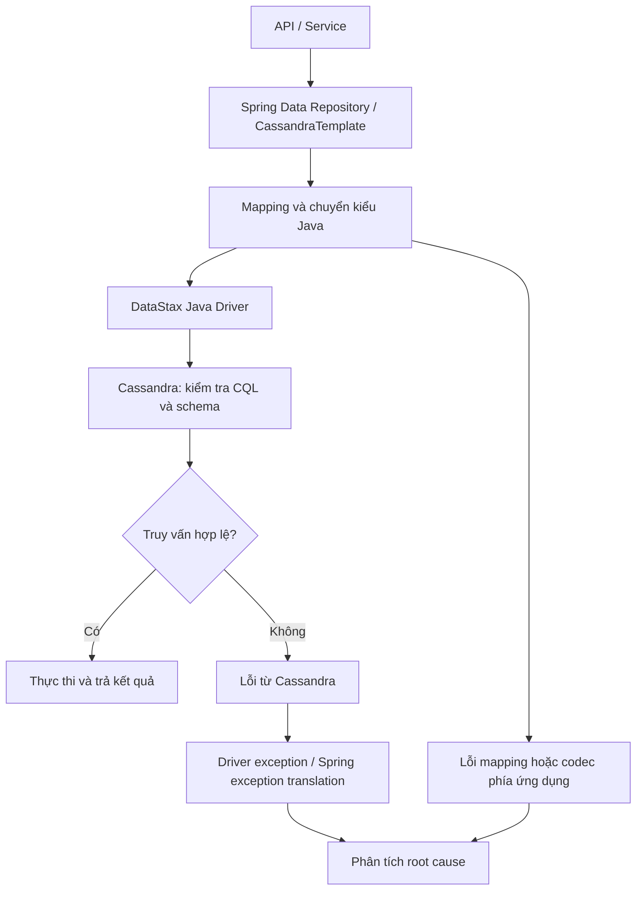

# Truy vấn không hợp lệ theo khóa, chỉ mục hoặc kiểu dữ liệu

Trong **Spring Data Cassandra**, một phương thức repository có thể biên dịch thành công nhưng truy vấn CQL vẫn bị Apache Cassandra từ chối khi chạy. Nguyên nhân thường nằm ở ba nhóm: điều kiện `WHERE` không phù hợp với **partition key / clustering key**, lọc hoặc sắp xếp trên cột **không có đường truy cập dữ liệu phù hợp**, và **kiểu dữ liệu CQL không khớp** với giá trị Java hoặc schema thực tế. Hiểu đúng các lỗi này giúp sửa mô hình dữ liệu hoặc câu truy vấn từ gốc, thay vì thêm `ALLOW FILTERING` để tạm vượt qua lỗi.

## 1. Vì sao truy vấn hợp lệ về cú pháp vẫn có thể thất bại?

Cassandra phân phối dữ liệu theo **partition key**; bên trong mỗi partition, dữ liệu được sắp theo **clustering columns**. Khác với các hệ quản trị quan hệ thường có bộ tối ưu hóa thực hiện nhiều kiểu quét hoặc join, một truy vấn Cassandra hiệu quả cần có đường đi rõ ràng tới những partition và hàng cần đọc. Một `SELECT` đúng cú pháp SQL-like chưa chắc là truy vấn CQL được phép thực thi.

Ví dụ, hệ thống lưu đơn hàng theo khách hàng và thời gian:

```sql
CREATE TABLE IF NOT EXISTS shop.orders_by_customer (
    customer_id uuid,
    placed_at timestamp,
    order_id uuid,
    status text,
    total_amount decimal,
    PRIMARY KEY ((customer_id), placed_at, order_id)
) WITH CLUSTERING ORDER BY (placed_at DESC, order_id ASC);
```

Trong bảng này:

| Thành phần | Vai trò | Hệ quả đối với truy vấn |
| --- | --- | --- |
| `customer_id` | Partition key | Xác định partition chứa đơn hàng của một khách hàng. |
| `placed_at` | Clustering column thứ nhất | Cho phép giới hạn khoảng thời gian sau khi đã xác định partition. |
| `order_id` | Clustering column thứ hai | Phân biệt các đơn cùng thời điểm; khi lọc theo clustering key phải tôn trọng thứ tự khóa. |
| `status`, `total_amount` | Cột thường | Không tự tạo đường truy cập để lọc/sắp xếp tùy ý. |

Truy vấn sau là một mẫu truy cập phù hợp với cấu trúc bảng:

```sql
SELECT *
FROM shop.orders_by_customer
WHERE customer_id = ?
  AND placed_at >= ?
  AND placed_at < ?;
```

Dấu `?` là **bind marker** cho truy vấn có tham số trong ứng dụng hoặc driver; khi thử trực tiếp bằng `cqlsh`, hãy thay bằng các giá trị CQL hợp lệ. Điều kiện có partition key chính xác và khoảng giá trị của clustering column đứng đầu.

> **Nguyên tắc:** Thiết kế bảng Cassandra theo các mẫu truy vấn cần phục vụ. Việc một cột tồn tại trong bảng không đồng nghĩa có thể dùng cột đó làm điều kiện lọc hoặc sắp xếp tùy ý.

## 2. Nhóm lỗi về partition key và clustering key

### 2.1. Thiếu partition key

```sql
-- Không xác định partition của khách hàng nào
SELECT * FROM shop.orders_by_customer
WHERE placed_at >= ?;
```

Đây là yêu cầu tìm theo thời gian trên nhiều partition. Cassandra thường từ chối truy vấn vì không có đường truy cập phù hợp, hoặc yêu cầu lọc dữ liệu khi chưa có cơ chế truy cập khác. Việc thêm `LIMIT` không sửa được vấn đề định tuyến: giới hạn số hàng trả về không đảm bảo giới hạn lượng dữ liệu phải quét.

**Cách xử lý:** Nếu tính năng cần xem đơn theo khách hàng, bổ sung `customer_id` trong `WHERE`. Nếu cần xem mọi đơn trong một khoảng thời gian, thiết kế **bảng truy vấn riêng** theo bucket thời gian hoặc một mô hình partition thích hợp với lưu lượng thực tế; xác định rõ số partition phải đọc.

### 2.2. Bỏ qua clustering column đứng trước

```sql
-- Có customer_id nhưng bỏ qua placed_at, lọc trực tiếp order_id
SELECT * FROM shop.orders_by_customer
WHERE customer_id = ? AND order_id = ?;
```

Vì `order_id` đứng sau `placed_at` trong clustering key, truy vấn không thể tùy ý bỏ qua cột đứng trước rồi coi `order_id` như khóa tra cứu độc lập. Tương tự, việc đặt điều kiện bằng/range lên clustering columns phải tuân theo các hạn chế thứ tự và loại phép so sánh mà phiên bản Cassandra hỗ trợ.

**Cách xử lý:** Nếu biết thời gian, truy vấn bằng `customer_id` cùng các clustering column hợp lệ. Nếu nghiệp vụ thường xuyên tìm đơn chỉ bằng `order_id`, tạo bảng như `orders_by_id` với `order_id` làm partition key, rồi ghi dữ liệu tương ứng ở cả hai bảng theo quy trình cập nhật có kiểm soát.

### 2.3. Sắp xếp sai cột hoặc sai phạm vi

```sql
-- status không phải clustering column của bảng
SELECT * FROM shop.orders_by_customer
WHERE customer_id = ?
ORDER BY status ASC;
```

Trong CQL, `ORDER BY` chủ yếu dựa trên **clustering columns** của partition đang được truy vấn; một secondary index trên `status` cũng không biến cột đó thành khóa sắp xếp của bảng. Muốn hiển thị theo trạng thái hoặc một thứ tự mới ở quy mô lớn, cần cân nhắc bảng phục vụ đúng thứ tự truy cập, hoặc sắp xếp phía ứng dụng **chỉ khi tập kết quả đã được giới hạn nhỏ và rõ ràng**.

### 2.4. Partition key gồm nhiều thành phần

Với khóa `PRIMARY KEY ((tenant_id, customer_id), placed_at)`, `tenant_id` và `customer_id` **cùng tạo thành partition key**, khác với trường hợp một cột chỉ là clustering key. Bỏ một thành phần partition key trong truy vấn tra cứu thông thường có thể làm truy vấn không hợp lệ. Đừng nhầm dấu ngoặc kép `((...))` của partition key tổng hợp với thứ tự clustering column bên ngoài.

## 3. Nhóm lỗi về chỉ mục và điều kiện lọc

### 3.1. Lọc theo cột thường không có đường truy cập phù hợp

```sql
-- status là cột thường, chưa có index/bảng truy cập phù hợp
SELECT * FROM shop.orders_by_customer
WHERE status = ?;
```

Thông báo từ máy chủ thường đề cập việc truy vấn **có thể cần filtering** hoặc không đủ điều kiện khóa. Điều này khác với lỗi cú pháp: Cassandra hiểu câu lệnh nhưng không có chiến lược truy cập chấp nhận được theo schema và các điều kiện hiện tại.

Các lựa chọn sửa lỗi cần đặt trong bối cảnh mẫu truy vấn:

1. **Bảng theo truy vấn**: nếu thường tra cứu đơn theo trạng thái trong một tenant/khoảng thời gian, thiết kế bảng như `orders_by_tenant_status_day`, với partition và clustering key cho phép giới hạn lượng dữ liệu đọc. Tránh partition quá lớn hoặc một partition duy nhất cho mọi bản ghi cùng trạng thái.
2. **Secondary index / Storage-Attached Index (SAI)**: cân nhắc khi phiên bản, cấu hình Cassandra và kiểu truy vấn hỗ trợ; kiểm tra độ chọn lọc, quy mô dữ liệu, số partition bị chạm và hiệu năng thực tế. SAI không hiện diện ở mọi phiên bản/triển khai.
3. **Lọc trong ứng dụng**: chỉ phù hợp khi đã đọc một tập nhỏ bằng partition key và giới hạn rõ ràng, đồng thời có thể chấp nhận chi phí truyền dữ liệu.

Ví dụ về cú pháp tạo **secondary index truyền thống** (cần đánh giá trước khi dùng trong hệ thống thật):

```sql
CREATE INDEX IF NOT EXISTS orders_by_customer_status_idx
ON shop.orders_by_customer (status);
```

Tạo index không đảm bảo mọi truy vấn theo `status` đều hiệu quả, đặc biệt khi giá trị có độ chọn lọc thấp và dữ liệu nằm rải rác trên nhiều partition. Hãy kiểm tra bằng dữ liệu và tải gần với thực tế.

### 3.2. Vì sao không nên chữa lỗi bằng `ALLOW FILTERING`?

```sql
-- Có thể ép Cassandra lọc nhiều dữ liệu; không phải phương án mặc định
SELECT * FROM shop.orders_by_customer
WHERE status = ? ALLOW FILTERING;
```

`ALLOW FILTERING` là xác nhận cho phép máy chủ thực hiện công việc lọc mà truy vấn bình thường có thể bị từ chối. Nó **không tạo index**, không biến điều kiện lọc thành truy cập theo partition key, và có thể gây độ trễ/chi phí I/O rất cao khi dữ liệu tăng. Một số ràng buộc CQL khác vẫn có thể khiến truy vấn bị từ chối dù có mệnh đề này. Chỉ xem xét nó sau khi đo đạc, biết rõ phạm vi dữ liệu và chấp nhận được chi phí.

## 4. Nhóm lỗi kiểu dữ liệu, ánh xạ entity và schema

### 4.1. Giá trị truy vấn không khớp kiểu CQL

Schema ví dụ khai báo:

| Cột CQL | Kiểu Cassandra | Kiểu Java thường dùng |
| --- | --- | --- |
| `customer_id`, `order_id` | `uuid` | `java.util.UUID` |
| `placed_at` | `timestamp` | `java.time.Instant` |
| `status` | `text` | `String` |
| `total_amount` | `decimal` | `java.math.BigDecimal` |

Ví dụ sai về kiểu:

```sql
-- customer_id là uuid, không phải một chuỗi tùy ý
SELECT * FROM shop.orders_by_customer
WHERE customer_id = 'khach-hang-A';
```

Trong ứng dụng, cũng không nên truyền `String` bất kỳ vào tham số được định nghĩa là `UUID`. Hãy kiểm tra/parse dữ liệu ở lớp API trước khi gọi repository:

```java
UUID customerId;
try {
    customerId = UUID.fromString(rawCustomerId);
} catch (IllegalArgumentException ex) {
    throw new IllegalArgumentException("customerId phải là UUID hợp lệ", ex);
}
```

Các lỗi khác có thể xuất hiện **trước khi** yêu cầu tới máy chủ nếu driver không tìm được codec chuyển giá trị Java sang kiểu CQL, hoặc khi Spring Data không ánh xạ được thuộc tính. Đừng mặc định mọi lỗi kiểu dữ liệu đều là `InvalidQueryException` từ Cassandra.

### 4.2. Khóa trong entity phải khớp khóa của bảng

Một cách ánh xạ cho schema ở trên (lược bỏ import, constructor và accessor để tập trung vào khóa):

```java
@PrimaryKeyClass
public class OrderKey implements java.io.Serializable {
    @PrimaryKeyColumn(
        name = "customer_id", ordinal = 0,
        type = PrimaryKeyType.PARTITIONED
    )
    private UUID customerId;

    @PrimaryKeyColumn(
        name = "placed_at", ordinal = 1,
        type = PrimaryKeyType.CLUSTERED,
        ordering = Ordering.DESCENDING
    )
    private Instant placedAt;

    @PrimaryKeyColumn(
        name = "order_id", ordinal = 2,
        type = PrimaryKeyType.CLUSTERED,
        ordering = Ordering.ASCENDING
    )
    private UUID orderId;

    // Constructor, getter/setter, equals và hashCode phù hợp.
}

@Table("orders_by_customer")
public class OrderByCustomer {
    @PrimaryKey
    private OrderKey key;

    @Column("status")
    private String status;

    @Column("total_amount")
    private BigDecimal totalAmount;

    // Constructor và getter/setter.
}
```

Chú ý `@PrimaryKeyColumn` phân biệt `PARTITIONED` và `CLUSTERED`, đồng thời `ordinal` phản ánh thứ tự từng thành phần khóa. Kiểu Java của từng trường phải tương thích với schema CQL. Một thay đổi schema nhưng không cập nhật entity, repository và truy vấn tương ứng có thể tạo lỗi lúc khởi động, lúc bind giá trị, hoặc khi thực thi.

### 4.3. Truy vấn repository sử dụng bind parameter

```java
public interface OrderByCustomerRepository
        extends CassandraRepository<OrderByCustomer, OrderKey> {

    @Query("SELECT * FROM orders_by_customer " +
           "WHERE customer_id = ?0 AND placed_at >= ?1 AND placed_at < ?2")
    List<OrderByCustomer> findInRange(
        UUID customerId, Instant fromInclusive, Instant toExclusive
    );
}
```

Ví dụ này giả định ứng dụng đã cấu hình keyspace `shop`. Spring Data Cassandra bind tham số và chuyển đổi các kiểu phù hợp; phương thức Java tồn tại không có nghĩa Cassandra sẽ chấp nhận một `WHERE` sai khóa. Với truy vấn phát sinh từ tên phương thức repository, vẫn phải kiểm tra CQL thực tế và schema, thay vì suy ra chỉ từ tên phương thức.

Khi cần ghép điều kiện theo nghiệp vụ, `CassandraTemplate` cũng cung cấp API `Query`/`Criteria`:

```java
Query query = Query.query(Criteria.where("customer_id").is(customerId))
    .and(Criteria.where("placed_at").gte(fromInclusive))
    .and(Criteria.where("placed_at").lt(toExclusive));

List<OrderByCustomer> rows = cassandraTemplate.select(
    query, OrderByCustomer.class
);
```

API xây dựng truy vấn giúp tránh tự nối chuỗi CQL và hỗ trợ ánh xạ cột; nó **không tự sửa** các điều kiện trái với thiết kế khóa Cassandra. Đối với dữ liệu đầu vào từ người dùng, luôn kiểm tra kiểu, null và khoảng thời gian (`fromInclusive < toExclusive`) trước khi tạo truy vấn.

### 4.4. Schema thật khác schema ứng dụng kỳ vọng

Các trường hợp dễ bỏ sót:

- Entity khai báo `@Column("order_status")` nhưng bảng chỉ có `status`.
- Một môi trường dùng `customer_id uuid`, môi trường khác từng tạo cột là `text`.
- Cấu hình keyspace trỏ nhầm môi trường hoặc bảng chưa được triển khai.
- Thứ tự/clustering key trong migration khác định nghĩa `@PrimaryKeyColumn`.
- Trường collection, UDT hoặc `frozen` không có cấu hình mapping/codec tương ứng.

Kiểm tra schema thực sự đang hoạt động bằng `cqlsh`:

```sql
DESCRIBE TABLE shop.orders_by_customer;
```

So sánh kết quả với migration và entity, rồi sửa **đúng nguồn sai lệch**. Không tự thay kiểu một cột khóa trên hệ thống đang có dữ liệu nếu chưa lập kế hoạch di trú và tương thích truy vấn.

## 5. Đọc lỗi ở đúng lớp

Một truy vấn thất bại có thể đi qua nhiều lớp của hệ thống:



| Biểu hiện / ngoại lệ tiêu biểu | Đầu mối cần kiểm tra | Hướng xử lý |
| --- | --- | --- |
| Driver báo `InvalidQueryException`, hoặc thông báo cần filtering | Điều kiện `WHERE`, partition/clustering key, index | Viết lại truy vấn hoặc thiết kế bảng theo mẫu truy cập. |
| Lỗi cú pháp CQL (`SyntaxError` ở phía driver) | Câu lệnh, tên cột, dấu câu, từ khóa | Sửa cú pháp và kiểm tra bằng CQL tương đương. |
| `CodecNotFoundException` hoặc lỗi chuyển đổi | Kiểu Java được bind và kiểu CQL/codec | Dùng kiểu tương thích; bổ sung converter/codec khi thật sự cần. |
| Lỗi mapping hoặc thiếu thuộc tính | `@Table`, `@Column`, `@PrimaryKey`, tên field | Đồng bộ entity với schema và repository. |
| `unconfigured table` hoặc không tìm thấy cột | Keyspace/bảng/schema đã triển khai | Kiểm tra cấu hình kết nối và migration ở đúng môi trường. |
| Timeout hoặc unavailable | Tải, kết nối, consistency, trạng thái cluster | Điều tra vận hành riêng; không kết luận là câu CQL sai. |

Tên ngoại lệ bọc ngoài có thể khác theo **phiên bản Spring Data Cassandra, driver và API được gọi**. Khi đi qua Spring Data, lỗi thường được bọc/biên dịch thành các loại `DataAccessException`; với driver trực tiếp, có thể nhận ngoại lệ gốc từ driver. Vì vậy cần đọc **chuỗi `cause`**, thông báo máy chủ và ngữ cảnh truy vấn, không chỉ tên lớp exception ngoài cùng.

Ví dụ xử lý ở ranh giới service:

```java
try {
    return repository.findInRange(customerId, fromInclusive, toExclusive);
} catch (DataAccessException ex) {
    Throwable rootCause = ex.getMostSpecificCause();
    log.error("Cassandra query failed; operation=findInRange, cause={}",
              rootCause.toString(), ex);
    throw ex;
}
```

Đoạn minh họa này chỉ bao quát lỗi được Spring Data chuyển thành `DataAccessException`; kiểm tra thêm đường gọi trực tiếp driver nếu ứng dụng dùng cả hai API. Không ghi giá trị dữ liệu nhạy cảm, token hoặc toàn bộ payload vào log. Ở tầng HTTP, **đầu vào API sai định dạng** có thể trả `400`, còn **CQL/schema do lập trình sai** là lỗi phía máy chủ cần sửa, không nên mặc nhiên quy thành lỗi nhập liệu của người dùng.

## 6. Quy trình gỡ lỗi thực tế

Khi một repository method hoặc truy vấn `CassandraTemplate` thất bại, thực hiện theo thứ tự sau:

1. **Ghi nhận truy vấn thực thi:** lấy CQL (không ghép lộ giá trị nhạy cảm), loại thao tác, keyspace, tên bảng, kiểu Java của tham số và thông báo/root cause. Phân biệt lỗi khi bind, khi gửi và lỗi máy chủ.
2. **Đối chiếu schema thật:** đọc `DESCRIBE TABLE`, xác nhận các cột, kiểu dữ liệu, partition key, thứ tự clustering key và index của môi trường xảy ra lỗi.
3. **Kiểm tra đường truy cập:** điều kiện `WHERE` đã cung cấp partition key hợp lệ chưa? Có bỏ qua clustering column, dùng range sai thứ tự hoặc `ORDER BY` trên cột thường không?
4. **Kiểm tra kiểu và giá trị:** `UUID`/`Instant`/`BigDecimal` có đúng với `uuid`/`timestamp`/`decimal`? Có giá trị null, kiểu collection/UDT hoặc converter không phù hợp không?
5. **Chọn sửa chữa theo mẫu truy vấn:** thêm điều kiện khóa hợp lệ; hoặc tạo bảng truy vấn/index sau khi đánh giá workload. Tránh vá bằng `ALLOW FILTERING` khi chưa có giới hạn và benchmark.
6. **Xác minh lại:** chạy CQL tương đương với giá trị thử an toàn, sau đó kiểm tra repository/template trên schema gần môi trường thật. Đo latency, số partition đọc, kích thước trang và tác động khi dữ liệu lớn.

Một bảng nhanh để ra quyết định:

| Nhu cầu | Vì sao gặp lỗi trên `orders_by_customer` | Thiết kế/gọi truy vấn nên cân nhắc |
| --- | --- | --- |
| Danh sách đơn của một khách trong khoảng ngày | Hợp lệ nếu có `customer_id` và điều kiện `placed_at` phù hợp | Giữ bảng hiện tại; dùng bind parameters và phân trang. |
| Tra cứu một đơn chỉ qua `order_id` | `order_id` không phải partition key và đi sau `placed_at` | Bảng `orders_by_id` hoặc đường tra cứu được thiết kế riêng. |
| Thống kê tất cả đơn ở trạng thái `PAID` | `status` là cột thường; có thể phải quét nhiều partition | Bảng tổng hợp/tra cứu theo tenant, trạng thái, thời gian; xem xét index khi phù hợp. |
| Sắp xếp đơn của mọi khách theo `total_amount` | Không có clustering order tương ứng, phạm vi xuyên partition | Mô hình dữ liệu/tiền tổng hợp phục vụ báo cáo hoặc công cụ phân tích khác. |

## 7. Paging, hiệu năng và tính nhất quán sau khi sửa

Sửa để truy vấn **chạy được** mới là bước đầu. Với các danh sách lớn, tiếp tục kiểm tra:

- **Paging:** Cassandra dùng cơ chế paging state và fetch size; không giả định hỗ trợ phân trang theo `OFFSET` kiểu cơ sở dữ liệu quan hệ. Cần giữ nguyên điều kiện truy vấn và thứ tự khi chuyển trang.
- **Partition size:** partition có quá nhiều bản ghi vẫn có thể gây truy vấn chậm dù có đúng partition key. Cân nhắc bucketing theo thời gian và giới hạn kích thước partition.
- **Độ chọn lọc của index:** đánh giá số partition/hàng cần đọc ở quy mô thật. Một index có thể làm truy vấn hợp lệ nhưng vẫn có latency không phù hợp.
- **Consistency:** lựa chọn consistency level tác động đến độ trễ/khả dụng và mức nhất quán đọc/ghi. Đổi consistency không sửa lỗi cấu trúc `WHERE` hoặc kiểu dữ liệu.
- **Cập nhật nhiều bảng:** nếu duy trì bảng theo từng cách tra cứu, phải thiết kế luồng ghi, idempotency và phương án xử lý dữ liệu lệch giữa các bảng. Cassandra không tự cung cấp join giữa các bảng phục vụ truy vấn đó.

## 8. Tình huống thực hành

Một API nhận `GET /orders?customerId=...&status=PAID&from=...&to=...` và lập trình viên thêm `AND status = ?` vào truy vấn trên `orders_by_customer`. API bắt đầu báo lỗi cần filtering ở production.

**Phân tích:** `customer_id` cùng khoảng `placed_at` giúp truy cập đúng partition và khoảng clustering key, nhưng `status` vẫn là cột thường. Việc thêm nó vào `WHERE` không bảo đảm server có thể lọc hiệu quả theo cấu trúc hiện tại.

**Phương án xử lý:** Nếu mỗi khách chỉ có ít đơn trong khoảng ngày, có thể truy vấn theo `customer_id` + `placed_at`, rồi lọc `status` trong ứng dụng với giới hạn dữ liệu được đo và kiểm soát. Nếu dữ liệu lớn hoặc thao tác lọc trạng thái được dùng thường xuyên, thiết kế bảng truy cập như `orders_by_customer_status_day`, cân bằng giữa phân vùng, số lượt đọc và chi phí ghi duy trì các bản sao. Một index chỉ nên chọn sau khi kiểm tra hỗ trợ phiên bản và thử trên tải thực tế.

**Kiểm chứng cần đạt:** API trả đúng đơn; không phát sinh lỗi CQL/mapping; hiệu năng ổn định khi dữ liệu tăng; phân trang không bỏ sót hoặc lặp bản ghi do cách kết hợp bộ lọc và paging; kiểm tra cập nhật trạng thái không khiến hai đường tra cứu trả dữ liệu sai lệch ngoài mức ứng dụng chấp nhận.

## Ghi nhớ

Lỗi truy vấn Cassandra không hợp lệ thường bộc lộ sự lệch nhau giữa **mẫu truy cập, thiết kế bảng và kiểu dữ liệu**. Trong Spring Data Cassandra, hãy bắt đầu từ CQL thật, schema thật và root cause; sau đó sửa điều kiện khóa, mapping hoặc mô hình bảng. `Repository`, `CassandraTemplate` và index giúp hiện thực cách truy cập, nhưng không thay thế các quy tắc phân vùng, sắp xếp và phân tán của Cassandra.
