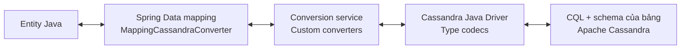

# Lỗi ánh xạ, chuyển đổi và lược đồ không khớp trong Spring Data Cassandra

## 1. Vì sao những lỗi này khó nhận diện?

Trong **Spring Data Cassandra**, một đối tượng Java không được ghi thẳng vào Apache Cassandra. Dữ liệu đi qua nhiều lớp: metadata của entity (`@Table`, `@PrimaryKey`, `@Column`), bộ chuyển đổi của Spring Data, codec của Cassandra Java Driver, câu lệnh CQL, rồi mới đến bảng thực tế trong cluster. Chiều đọc diễn ra theo hướng ngược lại. Một sai lệch tại bất kỳ lớp nào cũng có thể làm thao tác `repository.save(...)`, `repository.findById(...)`, `CassandraTemplate` hoặc truy vấn CQL thất bại.



Trong cơ sở dữ liệu quan hệ, lập trình viên thường nghĩ đến entity và bảng trước rồi mới thiết kế truy vấn. Cassandra có đặc trưng **thiết kế bảng theo truy vấn**: partition key quyết định vị trí dữ liệu, clustering key quyết định thứ tự trong partition, còn kiểu CQL quyết định cách driver đọc/ghi dữ liệu. Vì vậy, lỗi ánh xạ đôi khi bộc lộ thành lỗi CQL; lỗi truy vấn hoặc kiểu dữ liệu lại có thể xuất hiện khi một repository đang chuyển đổi entity.

Sau bài này, bạn cần có khả năng phân biệt ba nhóm sự cố:

1. **Ánh xạ (mapping):** tên bảng/cột, tên thuộc tính, primary key hoặc metadata entity không khớp.
2. **Chuyển đổi (conversion/codec):** kiểu Java, kiểu CQL hoặc quy tắc chuyển đổi giá trị không tương thích.
3. **Lược đồ (schema):** bảng thật trong keyspace khác với cấu trúc mà ứng dụng đang giả định, kể cả sai lệch giữa các môi trường hoặc phiên bản triển khai.

## 2. Một mô hình đúng để làm mốc đối chiếu

Giả sử dịch vụ cần liệt kê đơn hàng theo khách hàng, mới nhất trước. Một bảng Cassandra phù hợp với truy vấn đó có thể là:

```sql
-- Keyspace commerce đã được tạo và cấu hình trước.
CREATE TABLE IF NOT EXISTS commerce.orders_by_customer (
    customer_id text,
    created_at  timestamp,
    order_id    timeuuid,
    amount      decimal,
    status      text,
    PRIMARY KEY ((customer_id), created_at, order_id)
) WITH CLUSTERING ORDER BY (created_at DESC, order_id ASC);
```

Ở đây, `customer_id` là **partition key**; `created_at` và `order_id` là **clustering columns**. Một đơn hàng được xác định bởi đủ ba thành phần của khóa. CQL `timestamp` tương ứng tự nhiên với `Instant`, `timeuuid` với `UUID`, và `decimal` với `BigDecimal` trong Java.

Một ánh xạ minh họa:

```java
// OrderKey.java
@PrimaryKeyClass
public class OrderKey implements Serializable {
    @PrimaryKeyColumn(name = "customer_id", ordinal = 0,
                      type = PrimaryKeyType.PARTITIONED)
    private String customerId;

    @PrimaryKeyColumn(name = "created_at", ordinal = 1,
                      type = PrimaryKeyType.CLUSTERED)
    private Instant createdAt;

    @PrimaryKeyColumn(name = "order_id", ordinal = 2,
                      type = PrimaryKeyType.CLUSTERED)
    private UUID orderId;

    // Constructor, getter/setter, equals và hashCode được lược bớt.
}

// OrderByCustomer.java
@Table("orders_by_customer")
public class OrderByCustomer {
    @PrimaryKey
    private OrderKey key;

    @Column("amount")
    private BigDecimal amount;

    @Column("status")
    private String status;

    // Constructor và getter/setter được lược bớt.
}
```

Các annotation là của Spring Data Cassandra (`org.springframework.data.cassandra.core.mapping`). Để ví dụ chạy trong dự án thật, cần bổ sung import, constructor, accessor và `equals`/`hashCode` nhất quán cho kiểu khóa. Phải cấu hình keyspace `commerce` cho kết nối hoặc truy vấn được chỉ rõ keyspace; `@Table("orders_by_customer")` chỉ cung cấp tên bảng, không tự bảo đảm ứng dụng kết nối đúng keyspace.

Đối chiếu hai phía trước khi xử lý lỗi:

| Thành phần | Khai báo CQL | Khai báo Java | Điều cần khớp |
| --- | --- | --- | --- |
| Bảng | `commerce.orders_by_customer` | `@Table("orders_by_customer")` | Tên bảng và keyspace hiệu lực |
| Partition key | `customer_id text` | `String customerId` | Tên cột, kiểu, vai trò `PARTITIONED` |
| Clustering key | `created_at timestamp` | `Instant createdAt` | Vị trí khóa, kiểu và thứ tự clustering |
| Clustering key | `order_id timeuuid` | `UUID orderId` | Vị trí khóa, kiểu UUID phù hợp |
| Giá trị | `amount decimal` | `BigDecimal amount` | Kiểu số có độ chính xác phù hợp |
| Giá trị | `status text` | `String status` | Cách mã hóa giá trị và quy tắc chuyển đổi |

`@PrimaryKeyColumn(ordinal = ...)` mô tả vị trí thành phần khóa ở phía mapping; thứ tự `DESC`/`ASC` của dữ liệu là đặc tính **schema CQL**, cần kiểm tra riêng. Không nên suy ra rằng chỉ đổi annotation Java sẽ làm Cassandra đổi primary key hoặc clustering order.

## 3. Phân biệt lỗi theo tầng phát sinh

| Nhóm | Dấu hiệu thường gặp | Kiểm tra đầu tiên |
| --- | --- | --- |
| Metadata/ánh xạ | `MappingException`, thông báo không tìm thấy property hay key mapping không hợp lệ | `@Table`, `@Column`, `@PrimaryKeyClass`, tên field/getter/constructor |
| Spring conversion | `ConverterNotFoundException`, `ConversionFailedException`, lỗi trong converter tự viết | Kiểu property, `@ReadingConverter`, `@WritingConverter`, dữ liệu đầu vào |
| Driver codec | `CodecNotFoundException` hoặc thông báo không thể mã hóa/giải mã một giá trị CQL | Kiểu CQL, kiểu Java nhận từ driver, codec đã đăng ký |
| CQL/schema | `InvalidQueryException`, `unconfigured table`, `Undefined column name`, lỗi kiểu của bind marker | Keyspace thực tế, `system_schema`, câu CQL phát sinh |

**Tên exception chỉ là manh mối, không phải kết luận.** Spring có thể chuyển một số lỗi truy vấn từ driver thành `DataAccessException` hoặc exception chuyên biệt; exception từ mapping, converter hoặc driver cũng có thể nằm trong chuỗi `cause`. Tên lớp và cách bọc exception phụ thuộc phiên bản Spring Data Cassandra, Spring và Cassandra Java Driver. Hãy đọc **root cause** và câu CQL liên quan trước khi chọn cách khắc phục.

### 3.1. Lỗi tên bảng, cột và thuộc tính

Ví dụ: entity khai báo `@Column("order_status")` trong khi bảng chỉ có `status text`. Khi ứng dụng ghi hoặc sinh truy vấn sử dụng `order_status`, Cassandra có thể trả về lỗi cột không tồn tại. Nếu truy vấn đọc không chọn cột dự kiến, một property có thể thành `null` hoặc phát sinh lỗi tùy đường đọc và cấu hình; sự thiếu vắng giá trị **không luôn** gây exception ngay lập tức.

Các nguyên nhân phổ biến:

- Đổi tên field Java nhưng chưa cập nhật `@Column`, hoặc tin rằng quy tắc chuyển `camelCase` sang `snake_case` sẽ tự đúng trong mọi cấu hình.
- Dùng sai tên bảng, sai keyspace, hoặc chạy ứng dụng vào cluster khác môi trường dự định.
- Entity thiếu constructor/accessor khả dụng, cấu hình immutable object không phù hợp, hoặc metadata khóa chính không đầy đủ.
- Đổi tên cột trong code trước khi schema đã được triển khai.

**Cách xử lý:** so sánh tên cột thật với annotation, xác minh keyspace của session, và dùng `@Column("tên_cột_cql")` tường minh ở những điểm dễ nhầm. Nếu cần đổi tên cột trên hệ thống đang chạy, hãy thiết kế migration có tương thích giữa các phiên bản thay vì đổi đồng loạt một phía.

### 3.2. Lỗi primary key và truy vấn theo khóa

Trong Cassandra, primary key là cấu trúc lưu trữ, không chỉ là định danh bản ghi. Nếu ánh xạ một clustering column thành partition column hoặc bỏ thành phần khóa, câu lệnh do repository/CassandraTemplate tạo ra có thể không còn hợp lệ hay không truy cập đúng dữ liệu.

Ví dụ, với bảng ở mục 2, truy vấn sau **không phù hợp** với khóa được thiết kế:

```sql
-- Sai kỳ vọng: status không phải partition key/clustering key của bảng.
SELECT * FROM commerce.orders_by_customer WHERE status = 'PAID';
```

Không nên thêm `ALLOW FILTERING` chỉ để câu truy vấn qua được bước kiểm tra: Cassandra có thể phải quét nhiều partition, gây độ trễ và tải cao. Nếu truy vấn theo trạng thái là nhu cầu chính, cần đánh giá một mô hình bảng chuyên cho mẫu truy vấn đó (ví dụ bảng theo trạng thái và khoảng thời gian) cùng cách cập nhật dữ liệu tương ứng; lựa chọn index phải được cân nhắc theo phiên bản Cassandra, phân bố dữ liệu và tải thực tế.

Với `findById`, phải cung cấp **đúng đối tượng khóa gồm mọi thành phần**. Một `OrderKey` thiếu `customerId`, `createdAt` hoặc `orderId` không biểu diễn đủ khóa của hàng này. Việc thay primary key hoặc clustering order không thể giải quyết bằng cách chỉ sửa annotation Java; thông thường cần bảng mới và quá trình chuyển dữ liệu.

### 3.3. Lỗi kiểu Java ↔ CQL và codec

Đừng coi các kiểu có tên gần giống là luôn đổi được cho nhau:

| Kiểu CQL | Kiểu Java phù hợp thường dùng | Ví dụ bất tương thích |
| --- | --- | --- |
| `text`/`varchar` | `String` | Entity dùng `BigDecimal` nhưng dữ liệu lưu chuỗi định dạng tiền tệ |
| `decimal` | `BigDecimal` | Ghi chuỗi `"1.250,00"` vào cột số; sai quy tắc phân tích |
| `timestamp` | `Instant` | Dùng `LocalDate` như thể timestamp chỉ chứa ngày |
| `date` | `LocalDate` | Gán `Instant` vào cột ngày không có giờ |
| `uuid`/`timeuuid` | `UUID` | Dùng chuỗi không phải UUID hoặc `UUID` không đúng phiên bản cho `timeuuid` |
| `list<text>` | `List<String>` | Entity dùng `List<Integer>` nhưng CQL đòi phần tử `text` |

Codec của driver xử lý biểu diễn **Java ↔ CQL** đã hỗ trợ; converter của Spring Data xử lý thêm **kiểu domain ↔ kiểu lưu trữ**. Ví dụ, enum `OrderStatus` của ứng dụng được lưu thành chuỗi mã `N`/`P`: phần này nên có converter tường minh, thay vì mong driver hiểu ý nghĩa nghiệp vụ của enum.

#### Ví dụ: đọc/ghi mã trạng thái cũ bằng custom converter

Giả sử cột `status text` đang lưu `N` cho đơn mới và `P` cho đơn đã thanh toán:

```java
enum OrderStatus { NEW, PAID }

@ReadingConverter
public class OrderStatusReadConverter implements Converter<String, OrderStatus> {
    @Override
    public OrderStatus convert(String value) {
        return switch (value) {
            case "N" -> OrderStatus.NEW;
            case "P" -> OrderStatus.PAID;
            default -> throw new IllegalArgumentException(
                    "Unknown order status code: " + value);
        };
    }
}

@WritingConverter
public class OrderStatusWriteConverter implements Converter<OrderStatus, String> {
    @Override
    public String convert(OrderStatus value) {
        return switch (value) {
            case NEW -> "N";
            case PAID -> "P";
        };
    }
}

@Configuration
public class CassandraConversionsConfig {
    @Bean
    CassandraCustomConversions cassandraCustomConversions() {
        return new CassandraCustomConversions(List.of(
                new OrderStatusReadConverter(),
                new OrderStatusWriteConverter()));
    }
}
```

Trong entity, property tương ứng đổi thành `@Column("status") private OrderStatus status;`. Các converter trên dùng `org.springframework.core.convert.converter.Converter`, `@ReadingConverter`/`@WritingConverter` của Spring Data và `CassandraCustomConversions` của Spring Data Cassandra. Ví dụ dùng cú pháp switch của Java 17+; các lớp được trình bày cùng nhau để minh họa, khi triển khai phải đặt đúng file/import và kiểm tra cách cấu hình custom conversions theo phiên bản dự án.

Việc **đọc** mã `X` chưa được hỗ trợ sẽ tạo lỗi có chủ đích. Đây là tín hiệu dữ liệu thực tế không còn tuân theo quy ước mà service biết, thay vì âm thầm chuyển sang một giá trị mặc định và làm sai nghiệp vụ. Trước khi bổ sung mã mới, cần đánh giá tương thích với các bản ứng dụng cũ có thể cùng truy cập bảng.

### 3.4. Lược đồ không khớp qua các lần triển khai

Một lỗi thường khó tái hiện là code chạy ở local nhưng thất bại khi lên staging/production. Chẳng hạn:

- Local có `amount decimal`; production vẫn là cột `amount text` từ phiên bản cũ.
- Một phiên bản ứng dụng mới ghi `source` nhưng migration thêm cột `source text` chưa hoàn thành.
- Service đọc đúng table name nhưng session kết nối keyspace khác.
- Những instance triển khai xen kẽ đang đọc/ghi dữ liệu theo hai quy ước mã hóa khác nhau.

Trong Cassandra, **sửa Java class không đồng nghĩa sửa schema cluster**. Bảng mới/cột mới và quá trình cập nhật dữ liệu cần được quản lý bằng migration có kiểm soát. Đặc biệt, không thể tùy ý thay cấu trúc primary key của một bảng đang tồn tại bằng `ALTER TABLE`; giải pháp thông dụng là tạo bảng mới theo truy vấn, chuyển/backfill dữ liệu, chuyển luồng đọc/ghi rồi ngừng dùng bảng cũ.

## 4. Quy trình chẩn đoán có thể áp dụng trong thực tế

### Bước 1 — Xác định thao tác và lỗi gốc

Ghi nhận thao tác `save`, `findById`, truy vấn repository tùy biến hay `CassandraTemplate`, phiên bản ứng dụng, bảng/keyspace, entity, thời điểm phát sinh. Tìm exception sâu nhất trong chuỗi `cause`, cùng câu CQL hoặc prepared statement liên quan. Không đưa toàn bộ tham số bind, dữ liệu cá nhân hoặc thông tin xác thực vào log.

Một số cách hiểu thông báo:

| Triệu chứng | Giả thuyết ưu tiên | Hành động xác minh |
| --- | --- | --- |
| `unconfigured table ...` | Sai bảng hoặc keyspace, migration chưa chạy | Kiểm tra session và `system_schema.tables` |
| `Undefined column name ...` | Tên property/`@Column` lệch schema | So sánh cột trong CQL thực tế và câu truy vấn |
| `CodecNotFoundException` | Driver không có đường chuyển kiểu phù hợp | So kiểu Java runtime với kiểu CQL, codec của driver |
| `ConverterNotFoundException` | Thiếu hoặc đăng ký sai Spring converter | Kiểm tra input/output converter và cấu hình bean |
| `ConversionFailedException` | Converter hoặc dữ liệu đọc không đáp ứng định dạng | Kiểm tra giá trị cụ thể và root cause |
| Lỗi ràng buộc PRIMARY KEY | Truy vấn không phù hợp partition/clustering key | Đối chiếu `PRIMARY KEY` và điều kiện `WHERE` |
| Chỉ một môi trường bị lỗi | Schema hoặc dữ liệu có khác biệt giữa các môi trường | So phiên bản migration, keyspace, metadata cột |

### Bước 2 — Xác minh lược đồ thật của cluster

Trong `cqlsh`, có thể dùng lệnh mô tả bảng:

```text
DESCRIBE TABLE commerce.orders_by_customer;
```

`DESCRIBE` là lệnh của công cụ `cqlsh` (không phải câu CQL chạy trực tiếp qua driver). Để truy vấn metadata bằng CQL, dùng:

```sql
SELECT column_name, type, kind, position, clustering_order
FROM system_schema.columns
WHERE keyspace_name = 'commerce'
  AND table_name = 'orders_by_customer';
```

Đọc kết quả để xác minh tên cột, kiểu, partition/clustering column và vị trí. Kiểm tra cả keyspace đang được `CqlSession` và Spring repository sử dụng; không suy ra môi trường chỉ từ tên profile của ứng dụng. Đối chiếu schema tại cluster/keyspace thật mà instance đang kết nối.

### Bước 3 — Khoanh vùng mapper hay driver/CQL

Nếu nghi ngờ conversion, có thể tạm thực hiện truy vấn CQL tối giản với `CqlSession` trong môi trường chẩn đoán:

```java
Row row = cqlSession.execute(SimpleStatement.newInstance(
        "SELECT amount, status FROM commerce.orders_by_customer " +
        "WHERE customer_id = ? LIMIT 1",
        customerId)).one();

if (row != null) {
    BigDecimal amount = row.getBigDecimal("amount");
    String statusCode = row.getString("status");
    // Kiểm tra kiểu/giá trị trước khi đi qua converter của entity.
}
```

Ví dụ sử dụng API của Cassandra Java Driver 4 (`CqlSession`, `SimpleStatement`, `Row`). Chỉ chạy với dữ liệu thử nghiệm hoặc công cụ chẩn đoán có kiểm soát, và tránh đưa cách gọi truy vấn động này vào đường xử lý tải cao khi prepared statement/repository đã phù hợp.

Nếu truy vấn CQL và các getter kiểu CQL thành công nhưng việc đọc entity thất bại, nên tập trung vào mapping/converter. Nếu ngay cả truy vấn CQL cũng lỗi, ưu tiên xác minh schema, keyspace, giá trị bind hoặc giới hạn truy vấn. Phép thử này giúp **khoanh vùng**, không thay thế việc đọc root cause và kiểm tra kết nối.

### Bước 4 — Kiểm tra tính hợp lệ và sự hiện diện của dữ liệu

Đừng kết luận mọi trường `null` là lỗi ánh xạ. Có thể hàng không tồn tại, giá trị cột chưa từng được ghi, dữ liệu đã hết TTL, hoặc phiên bản cũ không lưu trường đó. Ngược lại, nếu Java dùng primitive như `int`, việc thiếu giá trị có thể dẫn đến mặc định `0` ở một số đường ánh xạ, gây sai nghĩa nghiệp vụ mà không có exception rõ ràng. Cân nhắc wrapper `Integer`/`Long` cho thuộc tính tùy chọn và kiểm tra quy ước null ở tầng nghiệp vụ.

Khi hệ thống phân tán vừa ghi vừa đọc, kết quả đọc thiếu cũng có thể liên quan **consistency level**, độ trễ đồng bộ replica hoặc việc đọc nhầm partition. Đừng sửa converter khi nguyên nhân thật là khóa truy vấn khác, TTL hoặc độ nhất quán đọc/ghi. Tương tự, truy vấn scan quá rộng và paging thiếu kiểm soát thường biểu hiện bằng timeout/hiệu năng kém, không phải lỗi chuyển đổi dữ liệu.

### Bước 5 — Tái hiện bằng kiểm thử tích hợp

Các bài test chỉ dùng object mock không thể phát hiện đầy đủ lỗi schema/codec. Nên có kiểm thử tích hợp với Cassandra thật (có thể qua Testcontainers hoặc môi trường kiểm thử), chạy **cùng CQL migration** của service và xác minh tối thiểu:

1. Ghi một entity có khóa và đầy đủ kiểu dữ liệu; đọc lại bằng `findById` hoặc `CassandraTemplate`.
2. Đọc dữ liệu legacy (ví dụ mã `N`/`P`) và dữ liệu có cột tùy chọn `null`.
3. Kiểm tra converter hai chiều và quy tắc đối với mã không hợp lệ.
4. Kiểm tra truy vấn theo partition/clustering key, phân trang bằng paging state/`Slice` theo cơ chế Cassandra thay vì giả định offset SQL.
5. Xác nhận ứng dụng phiên bản cũ và mới đọc được schema trong giai đoạn migration tương thích.

## 5. Sửa lỗi mà không gây tác dụng phụ

### 5.1. Chọn cách sửa đúng lớp

| Nguyên nhân đã xác nhận | Hướng xử lý | Không nên làm |
| --- | --- | --- |
| Sai annotation/tên cột | Sửa `@Table`/`@Column`/primary key metadata theo schema chuẩn | Đổi tên cột tùy tiện trên cluster đang chạy |
| Kiểu Java không phù hợp | Dùng kiểu Java tương ứng CQL (`BigDecimal`, `Instant`, `UUID`, ...) | Ép giá trị thành chuỗi rồi ghi vào cột bất kỳ |
| Định dạng domain có mã riêng | Định nghĩa converter hai chiều, kiểm tra dữ liệu legacy | Nuốt exception và trả giá trị mặc định gây sai nghĩa |
| Thiếu cột thực tế | Triển khai migration thêm cột và kế hoạch tương thích trước khi dùng | Mong annotation tự sinh migration ở production |
| Sai primary key/mẫu truy vấn | Thiết kế bảng phục vụ truy vấn và chuyển dữ liệu có kiểm soát | Thêm `ALLOW FILTERING` để che vấn đề thiết kế |
| Sai khác môi trường | Đối chiếu version migration/schema trên từng keyspace | Sửa riêng production thủ công không lưu lại thay đổi |

### 5.2. Triển khai thay đổi schema có tương thích

Với **cột không nằm trong primary key**, một lộ trình an toàn thường là:

1. Thêm cột mới có thể null bằng migration, chẳng hạn `ALTER TABLE commerce.orders_by_customer ADD source text;`.
2. Triển khai phiên bản đọc được cả bản ghi cũ chưa có `source` và bản ghi mới có `source`.
3. Bắt đầu ghi trường mới; backfill khi cần theo tải và chính sách dữ liệu.
4. Chỉ sau khi các phiên bản cũ đã được thay thế mới dựa vào trường mới cho logic bắt buộc.

Với thay đổi **kiểu cột, partition key hoặc clustering key**, cần đánh giá tạo bảng mới và chuyển luồng truy cập; việc Cassandra cho phép hay không cho phép một thao tác `ALTER` không đồng nghĩa thao tác đó giữ nguyên đúng nghĩa dữ liệu. Đồng thời, trong giai đoạn dual-write cần xử lý lỗi từng nhánh, idempotency và chiến lược đối soát dữ liệu.

### 5.3. Phân loại lỗi để xử lý ở service/API

- **Lỗi cấu hình/mapping/conversion/schema mang tính xác định:** sửa code, converter, migration hoặc dữ liệu. Retry cùng một input sẽ thường thất bại như cũ; không nên retry vô hạn.
- **Lỗi tạm thời của cluster hoặc kết nối:** có thể xem xét retry với giới hạn, backoff và điều kiện **idempotent** phù hợp. Việc retry ghi vào Cassandra cần hiểu ý nghĩa consistency, timeout và khả năng câu lệnh đã được áp dụng ở một số replica.
- **Dữ liệu đầu vào không hợp lệ:** validate ở API/domain trước khi lưu, trả thông báo phù hợp cho client; tránh để exception codec/schema trở thành cơ chế kiểm tra dữ liệu đầu vào.

Không biến lỗi mapping hoặc conversion thành `Optional.empty()` hay “không tìm thấy”. Với endpoint đọc dữ liệu, sự cố nội bộ nên được ghi log có correlation ID và trả lỗi hệ thống có kiểm soát; không trả raw stack trace, câu CQL chứa giá trị bind hoặc thông tin cluster ra bên ngoài. Metric theo loại lỗi, bảng và phiên bản triển khai hữu ích để phát hiện schema drift.

## 6. Tình huống thực hành: một thay đổi nhỏ gây lỗi lớn

**Bối cảnh.** Bảng `orders_by_customer` có `amount decimal`, entity cũ khai báo `BigDecimal amount`. Sau khi cập nhật giao diện, một lập trình viên đổi field thành `String amount` để giữ chuỗi hiển thị như `"1.250,00"`, nhưng không đổi kiểu trong Cassandra. API ghi đơn hàng bắt đầu thất bại khi truy vấn được bind hoặc chuyển đổi kiểu.

**Phân tích.** Chuỗi hiển thị phụ thuộc locale, trong khi `decimal` biểu diễn số thập phân. Thay đổi này trộn hai trách nhiệm: lưu giá trị tiền và định dạng cho người dùng. Exception có thể xuất hiện ở Spring conversion hoặc driver codec, tùy đường truy cập và converter đã đăng ký. Root cause cùng metadata cột `amount decimal` cho thấy vấn đề kiểu; thêm retry hoặc tự động tạo bảng không giải quyết được.

**Cách sửa.** Khôi phục `BigDecimal amount` trong entity; chuyển `"1.250,00"` thành số ở biên API theo quy tắc locale rõ ràng, validate và lưu `BigDecimal`; chỉ định dạng thành chuỗi khi trả DTO cho giao diện. Thêm kiểm thử tích hợp ghi/đọc số thập phân và kiểm thử API cho định dạng đầu vào hợp lệ/không hợp lệ.

**Biến thể schema.** Nếu một phiên bản rất cũ đã tạo `amount text` ở một môi trường, không thể chỉ sửa entity rồi coi như hoàn tất. Phải xác minh từng schema, chọn migration/bảng mới tương thích và chuyển dữ liệu có kiểm soát trước khi triển khai đồng loạt.

## 7. Checklist trước khi đóng sự cố

- [ ] Xác nhận phiên bản ứng dụng, Cassandra Java Driver/Spring Data, cluster, keyspace và bảng thực tế.
- [ ] Đã đọc root cause và xác định lỗi phát sinh từ mapping, conversion, codec hay CQL/schema.
- [ ] So sánh `@Table`, `@Column`, `@PrimaryKeyClass` với `system_schema`, gồm cả thứ tự partition/clustering key.
- [ ] Kiểm tra kiểu Java/CQL, dữ liệu `null`, định dạng legacy và đăng ký converter hai chiều.
- [ ] Kiểm tra câu truy vấn phù hợp partition key, tránh truy vấn quét tùy tiện và kiểm soát paging/hiệu năng.
- [ ] Có migration/chiến lược tương thích nếu schema hoặc cách mã hóa dữ liệu thay đổi.
- [ ] Có kiểm thử tích hợp ghi/đọc với schema thật và dữ liệu cũ, mới, bất thường.
- [ ] Có log/metric đủ để đối soát mà không làm lộ dữ liệu nhạy cảm; không retry vô hạn các lỗi xác định.

Trong Spring Data Cassandra, cách xử lý đáng tin cậy là **truy nguyên đúng lớp lỗi** và đối chiếu đồng thời entity, bộ chuyển đổi, CQL cùng schema đang chạy. Hiểu đúng partition key, kiểu dữ liệu và đường đọc/ghi sẽ giúp sửa sự cố tận gốc, giữ tính nhất quán dữ liệu và tránh biến một lỗi mapping thành vấn đề hiệu năng hoặc tính đúng đắn của toàn hệ thống.
