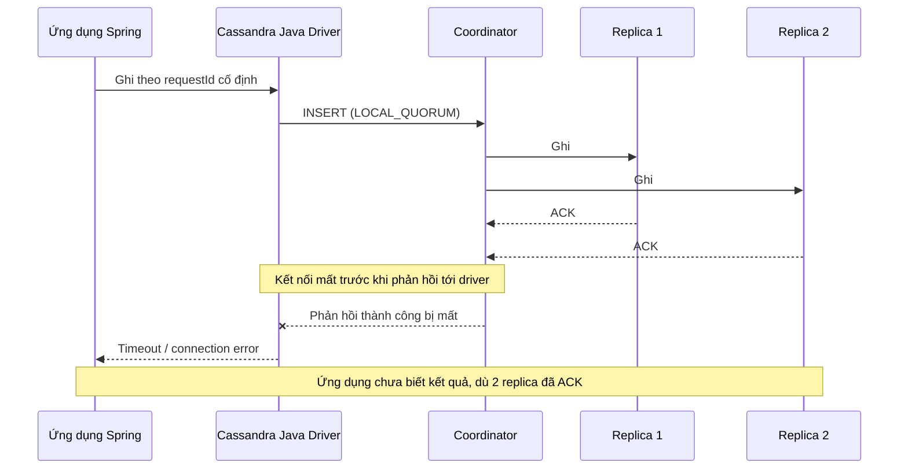
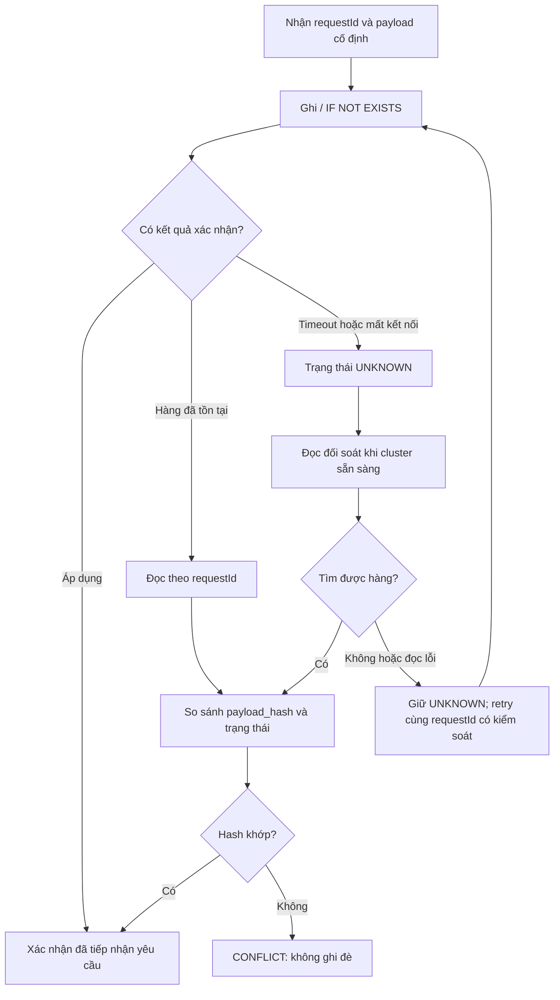

# Node lỗi, kết nối gián đoạn và kết quả ghi chưa xác định trong Spring Data Cassandra

Khi ứng dụng dùng **Spring Data Cassandra** ghi dữ liệu vào Apache Cassandra, một lời gọi `repository.save(...)` hoặc `CassandraTemplate.insert(...)` có thể kết thúc bằng timeout hoặc lỗi kết nối. Điều khó nhất là: **ứng dụng không nhận được phản hồi thành công không đồng nghĩa với việc Cassandra chưa ghi dữ liệu**. Lệnh có thể đã được một hoặc nhiều replica xử lý, thậm chí đạt mức nhất quán yêu cầu, nhưng phản hồi bị mất trên đường về.

Chủ đề này thuộc nhóm **xử lý lỗi** trong hệ thống Cassandra phân tán. Để xử lý đúng, cần hiểu vai trò của node, coordinator, consistency level, khả năng retry của Java Driver và tính *idempotent* (thực hiện lại mà không gây thêm tác dụng nghiệp vụ). Các kỹ thuật dưới đây áp dụng cho Spring Data Cassandra dùng repository, `CassandraTemplate`, CQL trực tiếp và cả luồng reactive.

## 1. Vì sao một lần ghi có thể có kết quả chưa xác định?

Một truy vấn ghi đi qua các chặng:

1. Spring Data Cassandra chuyển thao tác trên entity/repository/template thành CQL và gửi qua **DataStax/Apache Cassandra Java Driver**.
2. Driver chọn một node làm **coordinator** cho request; coordinator định tuyến ghi đến các replica sở hữu partition key.
3. Replica xử lý ghi và gửi ACK về coordinator.
4. Coordinator trả thành công khi đạt đủ số ACK theo **consistency level (CL)**; driver chuyển kết quả về ứng dụng.

Nếu đứt kết nối ở bước 4, ứng dụng có thể thấy timeout trong khi dữ liệu đã được ghi đủ replica. Nếu timeout ở bước 3, một số replica có thể đã nhận ghi nhưng coordinator chưa thu đủ ACK. Vì vậy cần tách biệt hai khái niệm:

- **Trạng thái phản hồi của request:** thành công, có lỗi, hoặc quá hạn.
- **Trạng thái thực tế của dữ liệu:** có thể đã ghi, đang lan truyền đến replica, hoặc chưa được ghi.



Trong ví dụ replication factor (RF) của datacenter cục bộ là 3, `LOCAL_QUORUM` cần ít nhất 2 ACK. Đạt 2 ACK rồi mất phản hồi là tình huống điển hình của **unknown write outcome** (kết quả ghi chưa xác định từ góc nhìn của caller).

## 2. Phân biệt node lỗi, đứt kết nối và timeout

| Tình huống | Ứng dụng/driver có thể quan sát | Có thể kết luận gì về lệnh ghi? |
|---|---|---|
| Một replica ngừng hoạt động nhưng vẫn đủ replica đáp ứng CL | Request vẫn thành công, có thể tăng độ trễ | Ghi được xác nhận ở mức CL đã chọn; node hỏng không nhất thiết làm request thất bại. |
| Thiếu replica hoạt động ngay khi coordinator xét CL | Phản hồi kiểu `UnavailableException` | Coordinator không thể đáp ứng CL tại thời điểm kiểm tra; không nên suy rộng thành trạng thái của các lần thử khác. |
| Coordinator chờ replica quá lâu | `WriteTimeoutException` | Chưa nhận đủ ACK đúng hạn; một phần hoặc toàn bộ tác dụng ghi có thể đã xảy ra. |
| Một số replica trả lỗi khi ghi | `WriteFailureException` | Không đạt điều kiện thành công; vẫn có khả năng một số replica đã xử lý ghi. |
| Ứng dụng mất kết nối đến coordinator, coordinator chết hoặc driver hết thời gian chờ | Lỗi kết nối, `AllNodesFailedException`, `DriverTimeoutException` hay lỗi được Spring chuyển đổi | Không thể dựa riêng vào ngoại lệ để khẳng định ghi chưa xảy ra; request có thể đã rời client. |
| CQL sai cú pháp, kiểu dữ liệu không hợp lệ, thiếu quyền | Lỗi xác thực/ủy quyền/validation cụ thể | Sửa nguyên nhân; retry cùng CQL thường không giúp được. |

**Cần phân loại lỗi theo giai đoạn xảy ra.** `UnavailableException` do thiếu replica *trước khi thực thi* khác với timeout xảy ra *sau khi gửi lệnh*. Tuy nhiên trong thực tế một lời gọi ở tầng ứng dụng có thể trải qua nhiều lần thử tại driver hoặc ở tầng mạng; vì vậy việc nhận được một lỗi cuối cùng không phải lúc nào cũng mô tả được toàn bộ các attempt trước đó.

### Node bị lỗi không đồng nghĩa cluster ngừng phục vụ

Cassandra phân tán partition theo token, duy trì các replica và cho phép các node khác tiếp tục phục vụ khi còn đủ replica theo mức CL. Driver hỗ trợ phát hiện trạng thái node, quản lý kết nối, cân bằng request và tái kết nối. Ứng dụng không nên tự tạo một `CqlSession` mới mỗi khi một node lỗi.

Ví dụ, với RF = 3 trong một datacenter:

| Consistency level ghi | Số ACK cần trong ví dụ | Khi một replica không đáp ứng |
|---|---:|---|
| `LOCAL_ONE` | 1 | Vẫn có thể thành công nếu một replica cục bộ ACK. |
| `LOCAL_QUORUM` | 2 | Vẫn có thể thành công nếu hai replica cục bộ ACK. |
| `ALL` | 3 | Không thể thành công nếu một replica không ACK. |

CL cao hơn thường đòi hỏi nhiều ACK hơn, tăng yêu cầu sẵn sàng của replica và có thể tăng độ trễ. Không có mức CL nào khiến lỗi mất phản hồi từ coordinator trở thành bằng chứng rằng ghi đã thất bại.

Trong nhiều datacenter, phân biệt `QUORUM` với `LOCAL_QUORUM`: `LOCAL_QUORUM` tính quorum trong datacenter cục bộ; cần cấu hình đúng **local datacenter** của driver và replication strategy của keyspace. Công thức quorum đối với RF lẻ hay chẵn là `floor(RF / 2) + 1`. Khi cần quan sát bản ghi vừa được xác nhận, cặp ghi/đọc `LOCAL_QUORUM` trong cùng datacenter thường cung cấp giao nhau giữa các tập replica, nhưng không tự giải quyết tranh chấp giữa các lần ghi đồng thời hoặc sai lệch timestamp.

## 3. Các trạng thái ghi cần thể hiện ở tầng nghiệp vụ

Thay vì gom mọi kết quả vào `SUCCESS` và `FAILED`, hãy phân biệt:

- **`CONFIRMED`:** đã nhận ACK thành công tại CL đã chọn. Đây là xác nhận của Cassandra, không tự đồng nghĩa mọi hệ thống bên ngoài đã hoàn tất xử lý.
- **`REJECTED`:** biết chắc request không thể thực hiện do lỗi cố định như thiếu quyền, vi phạm kiểu dữ liệu hoặc tham số không hợp lệ. Chỉ dùng khi nguyên nhân đủ rõ.
- **`UNKNOWN` / `UNCONFIRMED`:** request đã có khả năng được gửi, nhưng client không nhận được xác nhận đủ tin cậy. Cần đối soát hoặc thử lại an toàn.

Không nên phản hồi nghiệp vụ “thanh toán thất bại”, “đơn hàng chưa tạo” hoặc tự tạo một mã đơn mới chỉ vì có `WriteTimeoutException`. Nếu thao tác có tác dụng ngoài Cassandra (ví dụ gọi cổng thanh toán), cần một cơ chế idempotency bao phủ cả hệ thống đó.

Ví dụ API có thể dùng khóa yêu cầu do client tạo trước:

```http
PUT /api/commands/7d8dd43e-65a0-4fb1-8d6a-e9c1c7a67f60
Content-Type: application/json

{"customerId":"C128","action":"CREATE_ORDER","amount":150000}
```

Khi ghi chưa được xác nhận, API trả lỗi tạm thời với cùng `requestId` và mô tả rõ trạng thái chưa xác định; client được phép gửi lại **cùng requestId, cùng payload** theo chính sách retry. Chỉ trả `202 Accepted` nếu hệ thống có cơ chế đáng tin cậy để tiếp nhận và theo dõi công việc về sau; timeout đơn thuần chưa chứng minh đã tiếp nhận.

## 4. Idempotency là điều kiện trung tâm của retry an toàn

*Idempotent* nghĩa là thực hiện lại cùng một yêu cầu vẫn đưa dữ liệu/nghiệp vụ đến cùng trạng thái mong muốn. Cần xét **tác dụng nghiệp vụ**, không chỉ việc driver có thể gửi lại CQL.

| Thao tác | Khi chạy lại | Có thể tự coi là idempotent? |
|---|---|---|
| Ghi cùng nội dung vào cùng primary key với timestamp/TTL được quản lý ổn định | Trạng thái cuối có thể tương đương lần đầu | Thường có, sau khi kiểm tra đồng thời, timestamp và TTL. |
| `repository.save(entity)` nhưng mỗi lần retry sinh UUID mới | Tạo thêm partition/bản ghi mới | Không. |
| `UPDATE ... SET quantity = quantity + 1` kiểu counter | Mỗi lần gọi tăng thêm một lần | Không. |
| Ghi với TTL được tính lại tại mỗi attempt | Lần retry làm dịch thời điểm hết hạn | Không hoàn toàn. |
| `INSERT ... IF NOT EXISTS` với request ID và payload bất biến | Lần sau không tạo thêm cùng key; có thể nhận `[applied]=false` | Có thể dùng để chống tạo trùng tại **một bản ghi**, nhưng phải kiểm tra payload hiện có. |
| Ghi Cassandra rồi gọi API thanh toán | CQL có thể an toàn, API ngoài vẫn gây thu tiền hai lần | Chưa; cần khóa idempotency cả phía thanh toán. |

Một vài quy tắc thực dụng:

1. Tạo `requestId` **một lần**, trước attempt đầu tiên; mọi retry giữ nguyên khóa và payload.
2. Nếu cho phép retry từ nhiều client, lưu và so sánh thêm `payload_hash` để phát hiện cùng mã nhưng khác nội dung.
3. Chọn partition key hỗ trợ truy vấn đối soát trực tiếp bằng khóa; tránh phải quét bảng để tìm kết quả.
4. Không đánh dấu mọi CQL là idempotent. `setIdempotent(true)` là một cam kết của ứng dụng cho driver, không biến thao tác không an toàn thành an toàn.

## 5. Ví dụ Spring Data Cassandra: ghi và đối soát theo request ID

Giả sử hệ thống nhận lệnh tạo đơn và cần chống tạo trùng do gửi lại. Mỗi lệnh có `request_id` cố định. Một bảng lookup theo yêu cầu có thể là:

```sql
CREATE TABLE command_by_id (
    request_id uuid PRIMARY KEY,
    payload_hash text,
    state text
);
```

Thiết kế này cho phép truy vấn chính xác `WHERE request_id = ?`. Với bảng thực tế, cần chọn thời hạn lưu bản ghi chống trùng ít nhất bằng thời gian hệ thống/client còn có thể retry, cân nhắc dung lượng và không làm mất dấu yêu cầu trước khi hết cửa sổ đối soát.

### 5.1. Entity/repository thông thường chưa tạo bảo đảm chống trùng

Spring Data Cassandra có thể ánh xạ bảng bằng `@Table`, `@PrimaryKey` và `@Column`, sau đó truy cập bằng `CassandraRepository<CommandRecord, UUID>` hoặc `CassandraTemplate`. Tuy nhiên:

```java
// Minh họa đường ghi thông thường:
repository.save(record);
// Hoặc:
cassandraTemplate.insert(record);
```

Việc gọi `save` nhiều lần với cùng khóa thường hoạt động như một upsert; nó **không mặc định thực hiện so sánh điều kiện** và không kiểm tra rằng hai request cùng khóa có payload giống nhau. Nếu cần “chỉ nhận yêu cầu đầu tiên”, phải sử dụng thao tác điều kiện, chẳng hạn CQL `IF NOT EXISTS` (lightweight transaction, LWT), hoặc một cơ chế idempotency tương đương.

### 5.2. Ghi điều kiện với LWT và driver trong ứng dụng Spring

Ví dụ dùng `CqlSession` do Spring quản lý và prepared statement để biểu đạt rõ CL, khóa yêu cầu và kết quả khi có bản ghi từ trước:

```java
import java.util.UUID;

import com.datastax.oss.driver.api.core.CqlSession;
import com.datastax.oss.driver.api.core.DefaultConsistencyLevel;
import com.datastax.oss.driver.api.core.cql.BoundStatement;
import com.datastax.oss.driver.api.core.cql.PreparedStatement;
import com.datastax.oss.driver.api.core.cql.Row;
import org.springframework.stereotype.Service;

@Service
public class CommandClaimService {
    public enum ClaimResult {
        CREATED, ALREADY_EXISTS, CONFLICT, NEEDS_RECONCILIATION
    }

    private final CqlSession session;
    private final PreparedStatement claim;
    private final PreparedStatement find;

    public CommandClaimService(CqlSession session) {
        this.session = session;
        this.claim = session.prepare(
            "INSERT INTO command_by_id (request_id, payload_hash, state) " +
            "VALUES (?, ?, ?) IF NOT EXISTS");
        this.find = session.prepare(
            "SELECT payload_hash, state FROM command_by_id WHERE request_id = ?");
    }

    public ClaimResult claim(UUID requestId, String payloadHash) {
        BoundStatement command = claim.bind(requestId, payloadHash, "RECEIVED")
            .setConsistencyLevel(DefaultConsistencyLevel.LOCAL_QUORUM)
            .setSerialConsistencyLevel(DefaultConsistencyLevel.LOCAL_SERIAL)
            .setIdempotent(true); // Chỉ an toàn vì ID và payload cố định.

        // Có thể ném ngoại lệ: caller phải phân loại và đối soát.
        Row result = session.execute(command).one();
        if (result == null) {
            return ClaimResult.NEEDS_RECONCILIATION;
        }
        if (result.getBoolean("[applied]")) {
            return ClaimResult.CREATED;
        }

        Row existing = session.execute(
            find.bind(requestId)
                .setConsistencyLevel(DefaultConsistencyLevel.LOCAL_QUORUM)
        ).one();

        if (existing == null) {
            return ClaimResult.NEEDS_RECONCILIATION;
        }
        return payloadHash.equals(existing.getString("payload_hash"))
            ? ClaimResult.ALREADY_EXISTS
            : ClaimResult.CONFLICT;
    }
}
```

Ở đây, `[applied]=false` nghĩa là điều kiện `IF NOT EXISTS` không được áp dụng vì hàng đã tồn tại; nó **không phải lỗi kết nối**. Cần so sánh `payload_hash`: cùng request ID nhưng nội dung khác phải được xử lý như xung đột, không mặc định coi là thành công. Kết quả `CREATED` chỉ xác nhận **bản ghi yêu cầu**; các bước tạo đơn hay gửi thông báo phía sau cần quy trình xử lý riêng, có thể là state machine/idempotent consumer.

LWT cung cấp điều kiện tuần tự cho bản ghi/partition được thao tác, có chi phí phối hợp cao hơn ghi thường. `LOCAL_SERIAL` và `LOCAL_QUORUM` trong ví dụ phải phù hợp chiến lược replication và yêu cầu nhiều datacenter của hệ thống. LWT **không phải transaction tổng quát** giữa nhiều partition, nhiều bảng hoặc hệ thống ngoài.

**Điểm quan trọng:** ngay cả một LWT cũng có thể timeout sau khi đã được chấp nhận. Nếu lời gọi `session.execute(command)` ném ngoại lệ mất phản hồi, caller phải báo `UNKNOWN`, đọc đối soát và/hoặc thử lại **chính xác câu lệnh với requestId cũ**. Việc đánh dấu `setIdempotent(true)` chỉ cho phép một số cơ chế retry/speculative execution cân nhắc thao tác; driver vẫn tuân theo retry policy và loại lỗi, không bảo đảm luôn tự thử lại.

### 5.3. Quy trình đối soát sau timeout

Một tiến trình ở tầng service/API có thể tuân theo chu trình sau:



Trong mô hình phân tán, một lần đọc không thấy bản ghi **ngay sau timeout** chưa chắc chứng minh attempt trước không thể còn được xử lý hoặc đồng bộ. Vì vậy bước “không tìm thấy” nên dẫn đến retry idempotent có giới hạn hoặc cơ chế đối soát sau, thay vì tự tạo một request ID khác.

## 6. Retry: khi nào nên làm, khi nào phải dừng?

Driver có sẵn cơ chế phân phối request, quản lý node và retry policy. Spring Data chuyển nhiều lỗi driver sang họ `DataAccessException`; chi tiết ngoại lệ cần được kiểm tra theo phiên bản driver/Spring Data đang dùng. Không nên áp dụng blanket retry cho mọi `DataAccessException` hoặc mọi HTTP 5xx.

| Lỗi/đặc điểm | Hướng xử lý |
|---|---|
| Kết nối tạm đứt, node coordinator không dùng được | Cho driver định tuyến lại; retry với backoff/jitter khi thao tác đã chứng minh idempotent. |
| `WriteTimeoutException` hoặc timeout ở driver với thao tác ghi | Trạng thái `UNKNOWN`; chỉ retry nếu có khóa và ngữ nghĩa idempotency phù hợp; nếu không, ưu tiên đối soát. |
| `UnavailableException` do chưa đủ replica | Kiểm tra tình trạng replica/CL; retry có giới hạn sau khi tình trạng hệ thống cải thiện, tránh bắn liên tục. |
| Lỗi cú pháp CQL, quyền truy cập, schema mapping | Sửa cấu hình hoặc chương trình; retry nguyên trạng thường vô ích. |
| LWT đã có hàng `[applied]=false` | Đọc/so sánh dữ liệu hiện có; không biến thành lỗi để retry vô hạn. |
| Counter increment, phát hành giao dịch tài chính hoặc gọi API ngoài thiếu idempotency | Không tự động retry khi kết quả chưa xác định; phải có quy trình đối soát nghiệp vụ. |

Một chính sách retry lành mạnh bao gồm giới hạn số lần, **exponential backoff và jitter**, timeout tổng của request và giới hạn số request đồng thời. Khi nhiều client cùng retry vào cluster đang quá tải, retry storm có thể làm sự cố trầm trọng hơn. Nếu phục vụ API đồng bộ, tổng thời gian thử lại phải còn nằm trong ngân sách timeout của caller; khi không đủ thời gian, trả trạng thái chưa xác định và chuyển sang đối soát.

**Không dùng speculative execution cho ghi có tác dụng phụ nếu chưa chứng minh được idempotency.** Speculative execution có thể phát sinh nhiều attempt song song để giảm latency đuôi; nếu các attempt cùng làm một tác vụ không idempotent, tác dụng nghiệp vụ có thể bị nhân đôi.

### Reactive Cassandra: timeout và hủy subscription

Với `ReactiveCassandraTemplate`/`ReactiveCassandraRepository`, `timeout(...)` hoặc client hủy subscription chỉ thể hiện rằng phía gọi đã ngừng chờ. Điều đó **không bảo đảm request CQL đã bị hủy tại replica**. `retryWhen(...)` của Reactor cần lọc ngoại lệ và chỉ dùng cho luồng idempotent; giữ cùng request ID qua toàn bộ các lần subscribe/retry.

## 7. Cấu hình, tính nhất quán và lưu ý vận hành

### Kết nối và chọn datacenter

- Sử dụng một `CqlSession` được quản lý theo vòng đời ứng dụng để driver tái sử dụng connection pool, metadata về node và chính sách định tuyến.
- Cấu hình đúng contact points, local datacenter, TLS, xác thực và timeout cho môi trường. Contact points giúp khám phá cluster; chúng không phải toàn bộ các node mà driver luôn phải kết nối trực tiếp theo danh sách cố định.
- Theo dõi tình trạng replica, độ trễ, số request in-flight, timeouts, retries, lỗi connection và tình trạng hàng đợi. Đặt cảnh báo theo xu hướng thay vì chỉ theo một lần timeout.
- Kiểm soát traffic khi node đang khôi phục. Tăng retry đồng loạt hoặc hạ CL hàng loạt để “hết lỗi” có thể thay đổi cam kết nhất quán của ứng dụng.

### Tránh nhầm eventual consistency với tính đúng đắn của workflow

Cassandra có các cơ chế như hinted handoff và repair để hỗ trợ hội tụ dữ liệu giữa replica, nhưng những cơ chế này không thay cho việc ứng dụng xác nhận kết quả ghi hoặc thiết kế idempotency. Ghi thành công ở `LOCAL_ONE` không có cùng mức xác nhận như `LOCAL_QUORUM`. BATCH thông thường cũng không biến một workflow gồm nhiều partition và API ngoài thành transaction nguyên tử, có rollback toàn phần.

Nếu hệ thống cần **đọc sau ghi** để xác định kết quả, hãy dùng truy vấn theo primary key, CL phù hợp và kiểm tra giá trị/hash/state. Với nhiều writer cùng sửa một hàng, cần xét cơ chế hòa giải theo timestamp (last-write-wins), nguy cơ clock skew, LWT hoặc quy tắc phiên bản nghiệp vụ. Mức CL cao không tự ngăn lost update.

### Kiểm thử tình huống lỗi có chủ đích

Để xác nhận ứng dụng hoạt động đúng trong thực tế, nên kiểm thử trên môi trường có nhiều node và tạo lỗi mạng có kiểm soát:

1. Tắt một replica trong khi RF = 3, ghi ở `LOCAL_QUORUM`: request vẫn có thể thành công khi hai replica còn lại ACK.
2. Làm mất kết nối sau khi request đã gửi nhưng trước khi ứng dụng nhận phản hồi: API phải trả `UNKNOWN` hoặc tín hiệu phù hợp, không tạo request ID mới.
3. Gửi lại cùng `requestId` và cùng payload: chỉ có một bản ghi nhận yêu cầu; nội dung không bị nhân đôi.
4. Gửi cùng `requestId` nhưng payload khác: hệ thống phát hiện `CONFLICT`.
5. Tăng latency replica vượt timeout, sau đó phục hồi: tiến trình đối soát phải tìm và nhận diện được bản ghi, kể cả khi attempt ban đầu không có ACK ở client.
6. Thử với một thao tác **không idempotent** để bảo đảm cấu hình retry không vô tình nhân đôi tác dụng.

## 8. Những sai lầm thường gặp

**“Có exception nghĩa là Cassandra rollback.”** Cassandra không cung cấp rollback chung cho mọi ghi đã đến replica. Timeout và lỗi kết nối có thể để lại tác dụng ghi, dù caller không nhận được ACK.

**“Chỉ cần bật retry là hết lỗi.”** Retry không tạo ra tính idempotent. Dùng request ID mới, cộng counter hoặc gọi API ngoài lần nữa có thể khiến dữ liệu/chi phí tăng thêm.

**“`repository.save` là idempotent trong mọi trường hợp.”** `save` là thao tác thuận tiện để lưu entity, nhưng idempotency còn phụ thuộc cách tạo khóa, concurrent writers, giá trị, TTL, timestamp và tác dụng phụ.

**“Đọc không thấy ngay sau timeout thì lần ghi trước chắc chắn thất bại.”** Kết quả đọc phụ thuộc thời điểm, mức CL, replica và việc ghi có thể vẫn đang xử lý. Với kết quả chưa xác định, phải giữ được cùng khóa để retry/đối soát an toàn.

**“LWT giải quyết mọi transaction.”** `IF NOT EXISTS` hữu ích để nhận một request duy nhất tại một khóa, nhưng không tự cung cấp exactly-once cho toàn bộ quy trình nhiều bước hoặc tác vụ ngoài Cassandra.

## 9. Checklist khi thiết kế một API ghi tin cậy

- Có **request ID ổn định** và quy định rõ thời gian giữ idempotency key hay chưa?
- Primary key có cho phép đọc đối soát trực tiếp thay vì scan bảng hay chưa?
- Đã phân biệt `CONFIRMED`, `REJECTED` và `UNKNOWN` trong API/log/tracing hay chưa?
- Mọi nơi bật retry, `setIdempotent(true)` hay `retryWhen` đã được đánh giá tính idempotent thật sự hay chưa?
- Consistency level và local datacenter có phù hợp RF, latency và yêu cầu đọc sau ghi hay chưa?
- Có giới hạn retry, backoff/jitter, timeout tổng và theo dõi retry storm hay chưa?
- Khi hết thời gian chờ, caller có biết phải **giữ nguyên request ID** để thử lại hoặc tra cứu trạng thái hay chưa?
- Đã kiểm thử mất phản hồi sau ghi, node lỗi, duplicate request và xung đột payload hay chưa?

**Ghi nhớ:** Với Apache Cassandra, lỗi node và lỗi kết nối là điều kiện vận hành bình thường của hệ phân tán. Điều làm ứng dụng Spring Data Cassandra đáng tin cậy là biết khi nào ghi được xác nhận, khi nào chưa thể xác định, và thiết kế retry/đối soát sao cho dù request được gửi lại nhiều lần thì tác dụng nghiệp vụ vẫn đúng.
