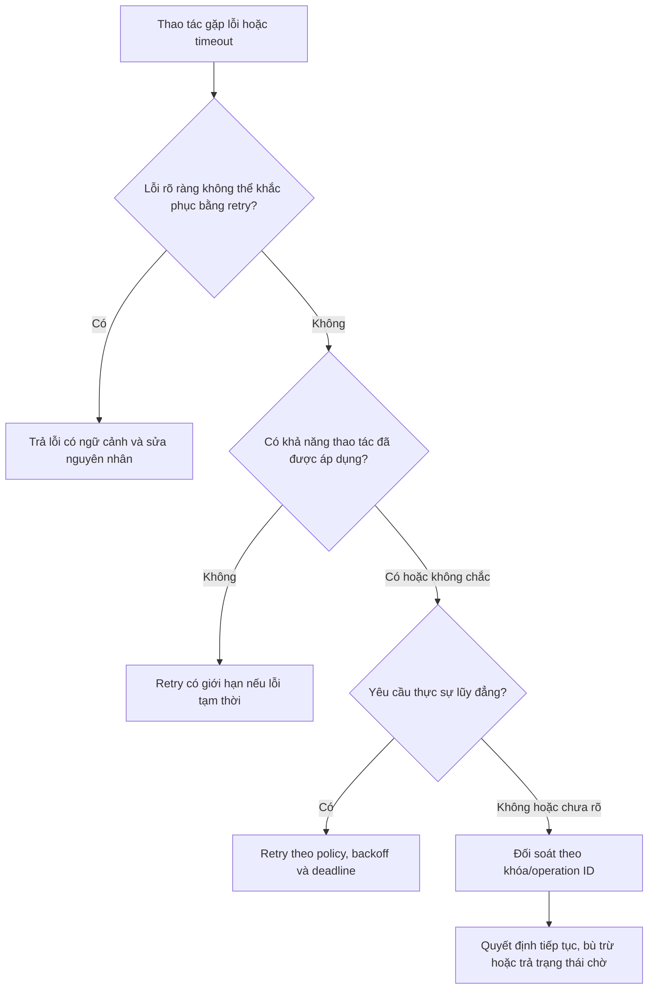

# Phân loại thao tác có thể thử lại theo tính lũy đẳng

## 1. Vì sao phải phân loại trước khi retry?

Trong một ứng dụng dùng **Spring Data Cassandra**, thao tác đi qua repository, `CassandraTemplate` hoặc `CqlSession` để đến cụm Apache Cassandra. Cụm phân tán có thể đã nhận và áp dụng một lệnh ghi nhưng phản hồi bị mất, kết nối bị ngắt hoặc phía client hết thời gian chờ. Vì vậy, khi gặp timeout, ứng dụng **không thể mặc nhiên kết luận rằng lệnh chưa chạy**.

Giả sử dịch vụ lưu trạng thái đơn hàng gửi một lệnh cập nhật. Cassandra đã ghi dữ liệu nhưng phản hồi về dịch vụ bị timeout. Nếu dịch vụ phát lại lệnh, có hai khả năng rất khác nhau:

- `UPDATE ... SET status = 'PAID'`: ghi lại cùng một giá trị cho cùng một bản ghi thường không làm thay đổi kết quả nghiệp vụ mong muốn.
- `UPDATE ... SET total = total + 1` đối với cột `counter`: chạy thêm lần nữa làm tổng tăng hai lần.

Đó là lý do **tính lũy đẳng (*idempotency*)** là tiêu chí trung tâm khi quyết định thao tác nào có thể thử lại. Chủ đề này gắn trực tiếp với xử lý lỗi, thiết kế bảng theo truy vấn, partition key, mức nhất quán và hiệu năng trong Spring Data Cassandra; chỉ bật cơ chế retry mà không xét ý nghĩa của câu lệnh có thể tạo dữ liệu sai.

Sau bài này, bạn cần có khả năng:

1. Phân biệt lỗi *không biết kết quả* với lỗi chắc chắn chưa được thực thi.
2. Đánh giá tính lũy đẳng từ **CQL + dữ liệu đầu vào + điều kiện thời gian + tác dụng phụ nghiệp vụ**, không chỉ từ tên API `save()`, `update()` hay `delete()`.
3. Đánh dấu chính xác câu lệnh tại Java Driver và đặt giới hạn retry phù hợp.
4. Chọn biện pháp đối soát hoặc chống trùng cho thao tác không lũy đẳng.

## 2. Hiểu đúng tính lũy đẳng

Về ý nghĩa trạng thái, thao tác `f` được coi là lũy đẳng khi áp dụng lặp lại cùng thao tác đó không làm thay đổi kết quả cuối so với áp dụng một lần:

\[
f(f(S)) = f(S)
\]

Trong đó `S` là trạng thái dữ liệu trước thao tác. Định nghĩa này cần đọc theo **trạng thái quan sát được mà nghiệp vụ quan tâm**, đồng thời phải xét bối cảnh Cassandra: timestamp, TTL, cạnh tranh ghi đồng thời và các hệ thống nhận tác dụng phụ.

Hai ví dụ đơn giản:

```sql
-- Gán cùng giá trị cho cùng khóa: thường lũy đẳng về giá trị dữ liệu.
UPDATE profile_by_user
SET display_name = 'Lan'
WHERE user_id = 8a207f30-5835-4af6-8bf6-d85d90f91b11;

-- Tăng counter: không lũy đẳng.
UPDATE view_count_by_page
SET views = views + 1
WHERE page_id = 8a207f30-5835-4af6-8bf6-d85d90f91b11;
```

Chạy lại lệnh thứ nhất thường cho `display_name = 'Lan'` như cũ; chạy lại lệnh thứ hai làm `views` tăng lần nữa.

**Ba điểm cần tách bạch:**

- **Lũy đẳng về dữ liệu không đồng nghĩa phản hồi giống nhau.** Một lệnh `INSERT ... IF NOT EXISTS` có thể trả `[applied] = true` lần đầu và `false` lần sau, dù chỉ có một hàng được tạo.
- **Lũy đẳng của một câu CQL không bảo đảm lũy đẳng của toàn luồng nghiệp vụ.** Nếu sau ghi dữ liệu ứng dụng còn gửi email, phát sự kiện hoặc thu tiền, việc chạy lại toàn bộ hàm vẫn có thể gây tác dụng phụ trùng.
- **Được đánh dấu lũy đẳng không đồng nghĩa luôn nên retry.** Cần xem loại lỗi, số lần thử, deadline, tải hệ thống và chính sách của driver.

## 3. Ma trận phân loại thao tác Cassandra

Các nhận định dưới đây áp dụng khi retry **cùng một thao tác với cùng khóa và cùng tham số**; các điều kiện ở cột cuối quyết định tính an toàn thực tế.

| Thao tác | Phân loại thực dụng | Điều kiện và rủi ro cần kiểm tra |
|---|---|---|
| `SELECT` theo partition key | Thường có thể retry | Không làm đổi dữ liệu Cassandra; kết quả hai lần có thể khác do ghi đồng thời hoặc mức nhất quán. |
| `INSERT` cùng primary key, cùng giá trị | Có điều kiện | Là upsert, thường an toàn về giá trị; tránh TTL động, timestamp tạo lại, UUID mới và tác dụng phụ ngoài Cassandra. |
| `UPDATE SET col = giá_trị_cố_định` | Có điều kiện | Cùng khóa và giá trị; ghi đồng thời, timestamp và TTL có thể thay đổi hành vi cuối cùng. |
| `DELETE` cùng khóa | Có điều kiện | Xóa lặp thường không làm thay đổi trạng thái nhìn thấy; cần xét timestamp/tombstone và ghi cạnh tranh. |
| Thêm phần tử vào `set` | Có điều kiện | Phép hợp tập hợp không tạo phần tử trùng về mặt giá trị; vẫn cần xét TTL, timestamp và concurrency. |
| Gán `map[key] = value` cố định | Có điều kiện | Cùng khóa map và giá trị thường an toàn về mặt giá trị; phải xét yếu tố thời gian. |
| `counter = counter + n` | **Không lũy đẳng** | Một lần retry có thể cộng thêm `n` lần nữa. |
| `list = list + [...]` hoặc thêm đầu danh sách | **Không lũy đẳng** | Có thể thêm cùng phần tử nhiều lần, làm thay đổi thứ tự hoặc kích thước. |
| `INSERT/UPDATE ... USING TTL n` | **Không lũy đẳng nghiêm ngặt theo thời gian** | Ghi lại có thể làm mới thời điểm hết hạn của dữ liệu. |
| CQL dùng giá trị được sinh lại mỗi lần thử | **Không an toàn nếu sinh lại đầu vào** | `now()`, UUID mới, timestamp mới hoặc dữ liệu thay đổi có thể tạo hiệu ứng khác. |
| `INSERT/UPDATE/DELETE ... IF ...` (LWT) | **Phải xử lý riêng** | Kết quả điều kiện có thể khác giữa các lần; timeout khiến việc lệnh trước đã áp dụng hay chưa trở nên không rõ. |
| `BATCH` | Phụ thuộc toàn bộ câu lệnh con | Một counter/list không an toàn làm cả yêu cầu retry không an toàn; `LOGGED BATCH` không tự biến thao tác thành lũy đẳng. |

Không nên quy toàn bộ `INSERT` thành an toàn hoặc toàn bộ `UPDATE` thành không an toàn. Câu hỏi cốt lõi là **phát lại chính yêu cầu đó sẽ tác động thế nào đến cùng dữ liệu trong trạng thái hiện tại và trạng thái có ghi đồng thời?**

## 4. Nhóm thường có thể thử lại

### 4.1. Truy vấn đọc `SELECT`

```sql
SELECT booking_id, status, updated_at
FROM booking_by_id
WHERE booking_id = ?;
```

Đọc lại không sửa trạng thái Cassandra. Với lỗi kết nối ngắn hoặc read timeout phù hợp, driver/chương trình có thể thử lại trong ngân sách cho phép. Tuy nhiên:

- `CONSISTENCY ONE`, `LOCAL_QUORUM` hay mức nhất quán khác ảnh hưởng kết quả đọc và khả năng thành công, **không định nghĩa tính lũy đẳng**.
- Hai lần `SELECT` không bắt buộc trả cùng giá trị nếu một client khác đang cập nhật hoặc replica chưa đồng bộ hoàn toàn.
- Query rộng không có partition key, truy vấn nặng hoặc nhiều lần phân trang có thể gây thêm tải; retry quá nhiều làm tình trạng quá tải nặng hơn.
- Nếu chương trình xử lý kết quả bằng cách cộng doanh thu, ghi file hoặc gửi sự kiện, phải chống chạy trùng ở **bước xử lý kết quả**, dù bản thân lệnh `SELECT` an toàn để đọc lại.

### 4.2. Ghi kiểu gán giá trị ổn định

```sql
-- Khóa và dữ liệu phải giống nhau giữa các lần thử.
INSERT INTO booking_by_id (booking_id, guest_id, status)
VALUES (?, ?, 'CONFIRMED');

UPDATE booking_by_id
SET status = 'CONFIRMED'
WHERE booking_id = ?;
```

Trong Cassandra, `INSERT` thông thường là **upsert** theo primary key: gửi lại cùng khóa không tạo hàng thứ hai với cùng primary key. `UPDATE SET` gán giá trị cố định cũng thường cho cùng giá trị cuối. Đây là nhóm phù hợp nhất để cân nhắc retry, với các điều kiện:

1. Khóa phân vùng và khóa phân cụm không đổi trong mỗi lần thử.
2. Các giá trị ghi được chuẩn bị **một lần** trước khi retry; không sinh UUID hoặc dữ liệu mới bên trong từng lượt thử.
3. Không dùng phép tích lũy hoặc cập nhật danh sách tạo phần tử mới.
4. TTL, timestamp và tác động của thao tác cạnh tranh đã được phân tích.
5. Luồng xung quanh không phát lại tác dụng phụ ngoài Cassandra.

Trong ứng dụng có nhiều writer cùng cập nhật một ô dữ liệu, cần chú ý Cassandra phân giải xung đột bằng timestamp theo cơ chế *last-write-wins*. Một thao tác gán cùng giá trị nhưng được phát lại với **timestamp mới** có thể che khuất một bản cập nhật hợp lệ vừa đến từ writer khác. Vì vậy, tính lũy đẳng về giá trị khi chạy tuần tự không đủ để khẳng định an toàn trong mọi tình huống cạnh tranh.

### 4.3. Xóa lặp và thao tác tập hợp

```sql
DELETE FROM booking_by_id WHERE booking_id = ?;

UPDATE guest_preferences_by_id
SET tags = tags + {'quiet-room'}
WHERE guest_id = ?;
```

Xóa cùng khóa nhiều lần thường cho kết quả bản ghi không còn hiện diện; hợp của `set` với cùng một phần tử không tạo nhiều bản sao của phần tử đó. Nhưng các lần `DELETE` có thể sinh tombstone và thời điểm ghi khác nhau; xóa lặp quá mức gây chi phí lưu trữ/đọc, đồng thời có thể tương tác với các bản ghi cập nhật đồng thời. Vì vậy nên đánh giá an toàn với timestamp và đặc tính truy vấn thực tế, thay vì mặc định mọi lệnh xóa đều an toàn tuyệt đối.

## 5. Nhóm không được retry một cách mù quáng

### 5.1. Counter: tăng/giảm là thay đổi tích lũy

```sql
UPDATE view_count_by_page
SET views = views + 1
WHERE page_id = ?;
```

Nếu Cassandra đã tăng `views` từ 10 lên 11 nhưng phản hồi bị mất, retry có thể tăng thành 12. Counter là trường hợp điển hình **không lũy đẳng**. Trường hợp này không thể giải quyết bằng việc thêm `.setIdempotent(true)` hoặc tăng consistency level.

Hướng xử lý phụ thuộc nghiệp vụ: chấp nhận số liệu xấp xỉ, xử lý sự kiện có mã định danh duy nhất và một cơ chế ghi nhận chống trùng phù hợp, hoặc thiết kế lại dữ liệu thành các bản ghi sự kiện có khóa ổn định để tổng hợp. Không được giả định có thể dùng một dòng đánh dấu `processed` ở partition khác rồi cập nhật counter như **một giao dịch nguyên tử**.

### 5.2. List append/prepend: thêm lặp thành phần tử trùng

```sql
UPDATE audit_by_booking
SET remarks = remarks + ['confirmed']
WHERE booking_id = ?;
```

Phát lại lệnh có thể sinh `['confirmed', 'confirmed']` thay vì một phần tử. Với lịch sử sự kiện, cách thiết kế Cassandra phù hợp hơn thường là **mỗi sự kiện một hàng có event ID ổn định**, chẳng hạn một bảng đọc theo `(booking_id, event_time, event_id)` tùy pattern truy vấn. Khi cần làm lại, ghi cùng primary key và nội dung sẽ dễ kiểm soát hơn phép nối list.

### 5.3. TTL: trạng thái giá trị giống nhưng hạn sống khác

```sql
INSERT INTO session_by_id (session_id, state)
VALUES (?, 'ACTIVE') USING TTL 600;
```

Giả sử lệnh đầu được áp dụng lúc 10:00, dự kiến hết hạn khoảng 10:10. Nếu retry lúc 10:01 và Cassandra áp dụng TTL lại, thời điểm hết hạn có thể chuyển về khoảng 10:11. Hai lệnh không tương đương theo thời gian, dù giá trị `state` vẫn là `ACTIVE`.

Nếu nghiệp vụ yêu cầu hạn chót tuyệt đối, hãy lưu và dùng **thời điểm hết hạn do nghiệp vụ xác định** để kiểm tra, hoặc tính lại TTL một cách có kiểm soát từ cùng deadline. Việc này vẫn cần được đánh giá theo các thao tác cạnh tranh, đồng hồ và độ chính xác yêu cầu; đừng đánh dấu an toàn chỉ vì primary key không đổi.

### 5.4. Sinh dữ liệu lại trong vòng retry

```java
// Không phù hợp nếu mục tiêu là một yêu cầu logic duy nhất.
for (int attempt = 0; attempt < 3; attempt++) {
    UUID eventId = UUID.randomUUID(); // Mỗi lần là một khóa khác nhau.
    // Ghi một event mới dựa trên eventId...
}
```

Nếu lần ghi đầu đã thành công nhưng timeout, vòng lặp sẽ tạo event thứ hai. Hãy xác định `eventId` ở phía caller từ **một yêu cầu nghiệp vụ**, giữ nguyên nó và payload trong các lượt gửi lại. Cũng áp dụng nguyên tắc này với `now()`/timestamp, giá trị ngẫu nhiên, số thứ tự được cấp phát và mọi dữ liệu được tính từ thời gian hiện hành.

## 6. Trường hợp đặc biệt: điều kiện `IF` và lightweight transaction (LWT)

```sql
INSERT INTO booking_by_id (booking_id, status)
VALUES (?, 'CREATED')
IF NOT EXISTS;

UPDATE booking_by_id
SET status = 'CONFIRMED'
WHERE booking_id = ?
IF status = 'PENDING';
```

Cassandra dùng LWT/compare-and-set để kiểm tra điều kiện. Với `INSERT ... IF NOT EXISTS`, lần đầu có thể trả `[applied] = true`; sau khi thành công, lặp lại cùng lệnh có thể trả `[applied] = false`. Với `UPDATE ... IF status = 'PENDING'`, lần thử tiếp theo có thể thất bại vì lần đầu đã chuyển trạng thái sang `CONFIRMED`.

Do đó **không được giải thích `[applied] = false` của lần thử lại như bằng chứng thao tác ban đầu thất bại**. Khi gặp timeout với thao tác điều kiện, cần xác minh trạng thái hiện tại qua khóa cụ thể, đối chiếu mã lệnh/phiên bản hoặc một cơ chế xác nhận nghiệp vụ tương ứng rồi mới quyết định tiếp tục. Nếu có nhiều client cạnh tranh, chỉ nhìn một cột trạng thái có thể chưa đủ xác định writer nào đã thực hiện thay đổi.

LWT hỗ trợ kiểm tra điều kiện trong phạm vi dữ liệu Cassandra tương ứng nhưng không cấp khả năng giao dịch nguyên tử xuyên nhiều partition, bảng, hệ thống ngoài hoặc thao tác thanh toán. `IF NOT EXISTS` ở bảng chống trùng riêng cũng không tự bảo đảm cập nhật dữ liệu nghiệp vụ ở nơi khác sẽ thành công cùng lúc.

## 7. Phân loại ở cấp batch và paging

### Batch

Một batch chỉ an toàn cho retry khi **mọi câu lệnh con và toàn bộ hiệu ứng nghiệp vụ đều an toàn khi phát lại**. Batch chứa gán giá trị ổn định có thể xem xét; batch có phép tăng counter, list append hoặc TTL cần đánh giá riêng. Cassandra yêu cầu các cập nhật counter phải nằm trong batch counter riêng, không trộn với mutation thông thường. `LOGGED BATCH` giúp xử lý việc các mutation trong batch được đưa đến replica, nhưng không cung cấp tính lũy đẳng cho nội dung lệnh và không phải giao dịch cách ly kiểu cơ sở dữ liệu quan hệ. Batch lớn hoặc trải qua nhiều partition cũng tăng độ trễ và áp lực hệ thống.

### Paging

Đọc lại cùng một trang bằng paging state về cơ bản là thao tác đọc, nhưng kết quả không phải ảnh chụp bất biến của toàn bộ tập dữ liệu. Nếu ứng dụng đã tiêu thụ một phần trang rồi retry và **append lại tất cả kết quả**, hệ thống downstream có thể nhận bản ghi trùng. Cần giữ đúng query/parameters/paging state, thiết kế checkpoint và chống trùng theo khóa bản ghi hoặc sự kiện ở nơi nhận khi xử lý luồng dữ liệu.

## 8. Đánh dấu idempotency trong Spring Data Cassandra và Java Driver

Spring Data Cassandra cung cấp entity mapping, repository và `CassandraTemplate` để thao tác thuận tiện. Tuy nhiên, tên phương thức như `save()`, `insert()` hay `delete()` **không đủ để biết yêu cầu có an toàn khi phát lại hay không**. Phân loại phải dựa trên CQL thực tế và các tác dụng phụ của ca sử dụng. Việc đánh dấu tính lũy đẳng trên statement là một cơ chế của **DataStax/Apache Cassandra Java Driver 4.x**; cách tích hợp cấu hình hoặc statement tùy phiên bản Spring Data và driver đang sử dụng.

Khi cần kiểm soát trực tiếp từng lệnh, một Spring service có thể dùng `CqlSession` được cấu hình trong ứng dụng:

```java
import java.util.UUID;

import org.springframework.stereotype.Service;

import com.datastax.oss.driver.api.core.CqlSession;
import com.datastax.oss.driver.api.core.cql.SimpleStatement;

@Service
public class BookingWriteService {

    private final CqlSession session;

    public BookingWriteService(CqlSession session) {
        this.session = session;
    }

    public void setStatus(UUID bookingId, String status) {
        // Cùng bookingId + status; không TTL, không phép cộng.
        SimpleStatement statement = SimpleStatement.builder(
                "UPDATE booking_by_id SET status = ? WHERE booking_id = ?")
            .addPositionalValues(status, bookingId)
            .setIdempotent(true)
            .build();

        session.execute(statement);
    }

    public void recordView(UUID pageId) {
        // Counter tăng một lần cho mỗi lần thực sự thực thi.
        SimpleStatement statement = SimpleStatement.builder(
                "UPDATE view_count_by_page SET views = views + 1 WHERE page_id = ?")
            .addPositionalValues(pageId)
            .setIdempotent(false)
            .build();

        session.execute(statement);
    }
}
```

Trong ví dụ, `.setIdempotent(true)` truyền **khai báo của lập trình viên** cho driver. Driver không chứng minh rằng CQL hay toàn bộ nghiệp vụ thực sự lũy đẳng. Khai báo này giúp các thành phần như retry policy và speculative execution xét khả năng thực hiện lại yêu cầu theo cấu hình. Nó **không bắt buộc driver phải retry mọi lỗi** và không biến counter thành thao tác an toàn.

Một số lưu ý khi sử dụng:

1. Với `PreparedStatement`/`BoundStatement`, đặt thuộc tính idempotency trên statement được thực thi, theo API của phiên bản driver đang dùng.
2. Một câu lệnh không được đánh dấu có thể dùng giá trị mặc định từ execution profile/cấu hình driver; không nên đoán mặc định rồi dựa vào đó để bảo vệ dữ liệu.
3. Kiểm tra retry policy và speculative execution đang bật hay tắt, số lần thực thi, deadline và metric theo đúng phiên bản driver. **Speculative execution** có thể gửi thêm một bản yêu cầu trước khi bản đầu kết thúc, nên cũng cần tính lũy đẳng.
4. Với repository hoặc `CassandraTemplate`, xác định statement và chính sách áp dụng thực tế; nếu cần thuộc tính riêng cho từng loại mutation, cân nhắc cách tùy chỉnh được phiên bản Spring Data hỗ trợ hoặc dùng `CqlSession` ở điểm kiểm soát rõ ràng.
5. Không bật retry ở nhiều tầng (driver, Spring Retry, HTTP/message consumer) mà thiếu ngân sách chung, vì tổng số lần thực thi có thể tăng theo cấp số nhân.

Ví dụ, nếu driver thử tối đa 3 lần và service cũng gọi lại tối đa 3 lần, một yêu cầu nghiệp vụ có thể phát sinh tới 9 lượt gửi trong trường hợp tất cả đường retry đều kích hoạt. Giới hạn số lần thực thi và độ trễ phải được thiết kế nhất quán xuyên các tầng.

## 9. Xử lý lỗi theo khả năng đã ghi thành công

Với hệ phân tán, một timeout có thể xuất hiện **trước**, **trong** hoặc **sau** lúc Cassandra áp dụng lệnh; thông tin mà driver trả về phụ thuộc loại lỗi và trạng thái thực thi quan sát được. Cần phân biệt:

| Tình huống | Cách xử lý phù hợp |
|---|---|
| Lỗi cú pháp CQL, sai kiểu dữ liệu, truy cập bị từ chối | Sửa yêu cầu/cấu hình; retry cùng dữ liệu thường không giải quyết. |
| Lỗi tạm thời, chắc chắn chưa gửi yêu cầu | Có thể thử lại có giới hạn nếu lỗi thực sự tạm thời; vẫn cần xem deadline và tải cụm. |
| Read timeout của query đọc | Có thể xét retry theo retry policy và consistency; không tạo chuỗi vô hạn. |
| Write timeout hoặc mất kết nối sau khi có thể đã gửi | **Trạng thái ghi có thể không xác định**; chỉ tự động phát lại khi đã chứng minh an toàn, còn lại đối soát. |
| Timeout hoặc kết quả không rõ của LWT | Đọc/đối chiếu trạng thái và operation ID trước khi quyết định. |
| Quá tải, quá nhiều yêu cầu, thiếu replica đáp ứng consistency | Giới hạn retry, backoff có jitter, theo dõi sức khỏe và ưu tiên phục hồi hệ thống. |

Đừng hard-code giả định rằng mọi `WriteTimeoutException` đồng nghĩa với việc dữ liệu chưa được ghi. Retry policy mặc định của driver cũng không nhất thiết sẽ thử lại mọi kiểu timeout. Ứng dụng cần dựa trên loại lỗi thực tế, chính sách của phiên bản driver và khả năng phát lại an toàn của yêu cầu.

### Phân biệt ba hướng xử lý



Trong sơ đồ, "lũy đẳng" có nghĩa là đã kiểm tra cả timestamp/TTL, cạnh tranh, các câu lệnh con và tác dụng phụ; không chỉ quan sát rằng hai lệnh CQL trông giống nhau.

## 10. Thiết kế chống trùng cho thao tác nghiệp vụ quan trọng

Một lệnh không lũy đẳng vẫn có thể cần khả năng chịu lỗi. Khi đó nên chuyển trọng tâm từ “retry câu lệnh bất kỳ” sang **retry một yêu cầu nghiệp vụ có định danh ổn định**.

Ví dụ, dịch vụ nhận sự kiện `booking-confirmed` ít nhất một lần (*at-least-once delivery*). Thay vì nối chuỗi vào list lịch sử hoặc tự tạo event ID mỗi lần xử lý:

1. Nhận `operationId` hoặc `eventId` bền vững từ bên phát, gắn với một sự kiện logic duy nhất.
2. Dùng khóa chính dựa trên `bookingId` và `eventId` cho bảng lưu sự kiện theo nhu cầu truy vấn, với payload ổn định.
3. Nếu một consumer phải chạy lại, nó ghi theo **cùng khóa** và không tự sinh một sự kiện mới.
4. Nếu cần kiểm tra “chỉ xử lý một lần” ở nhiều tác vụ, thiết kế trạng thái/đánh dấu xử lý và cơ chế phục hồi khi dừng giữa chừng. LWT có thể hỗ trợ tranh chấp trong phạm vi phù hợp, nhưng không tạo giao dịch nguyên tử với dịch vụ hoặc partition khác.
5. Có đường đối soát dựa trên `operationId` để giải quyết timeout không biết kết quả.

Ví dụ mô hình lưu sự kiện định hướng truy vấn lịch sử theo từng booking:

```sql
CREATE TABLE booking_event_by_booking (
    booking_id uuid,
    event_time timestamp,
    event_id uuid,
    event_type text,
    payload text,
    PRIMARY KEY ((booking_id), event_time, event_id)
) WITH CLUSTERING ORDER BY (event_time DESC, event_id ASC);
```

`event_time` và `event_id` phải được **giữ nguyên khi retry**. Bảng minh họa tối ưu cho truy vấn sự kiện theo booking; với partition lớn cần xem xét giới hạn kích thước, phân bucket theo thời gian hoặc mô hình khác. Khi sử dụng thời gian làm thành phần clustering key, phát lại cùng sự kiện với thời gian mới vẫn có thể tạo hàng thứ hai.

**Lưu ý về counter:** ghi log sự kiện theo khóa ổn định giúp phát hiện trùng và tạo dữ liệu nguồn để tính toán lại, nhưng **không tự làm cho lệnh tăng counter trở nên exactly-once**. Cách đồng bộ giữa log và tổng cần được thiết kế riêng, đặc biệt khi chúng nằm ở các partition khác nhau.

## 11. Bài tập tình huống: nên retry thao tác nào?

### Tình huống A — Cập nhật trạng thái booking

Ứng dụng gọi:

```sql
UPDATE booking_by_id
SET status = 'CANCELLED'
WHERE booking_id = ?;
```

Trả về write timeout. Nếu `booking_id` được giữ cố định, không có TTL, trạng thái không được điều khiển bởi một phiên bản cạnh tranh và không phát lại side effect, việc gửi lại có thể chấp nhận được về mặt giá trị. Nhưng nếu một worker khác vừa chuyển đơn từ `CANCELLED` sang `REFUNDED`, retry với timestamp mới có thể ghi đè trạng thái hợp lệ. Khi có luồng trạng thái cạnh tranh, nên dùng phiên bản/điều kiện phù hợp hoặc đối soát thay vì chỉ retry.

### Tình huống B — Tăng số lượt xem

Ứng dụng gọi:

```sql
UPDATE view_count_by_page
SET views = views + 1
WHERE page_id = ?;
```

Không tự phát lại sau timeout không rõ kết quả. Nếu số liệu chấp nhận chênh lệch nhỏ, ứng dụng có thể ghi nhận độ bất định. Nếu yêu cầu đếm chính xác, cần thiết kế luồng sự kiện chống trùng và tổng hợp phù hợp; tăng mức consistency hoặc đánh dấu `idempotent=true` không giải quyết nguy cơ tăng hai lần.

### Tình huống C — Giữ phiên truy cập 10 phút

Ứng dụng ghi `INSERT ... USING TTL 600` lúc 10:00, rồi timeout và retry lúc 10:01. Trạng thái có thể vẫn là `ACTIVE` nhưng thời gian sống bị kéo dài. Nếu hợp đồng nghiệp vụ là hết hạn vào 10:10, nên biểu diễn deadline rõ ràng và kiểm tra khi đọc/ghi; không giả định một phép upsert cùng khóa là lũy đẳng về thời gian.

### Tình huống D — Tạo booking có `IF NOT EXISTS`

Lần đầu được áp dụng nhưng trả lời timeout; lần thứ hai nhận `[applied] = false`. Không nên lập tức trả lỗi “booking đã tồn tại” như thể yêu cầu đầu tiên thất bại. Hệ thống phải phân biệt booking do chính `operationId` này tạo với booking tồn tại từ thao tác khác, rồi trả kết quả phù hợp hoặc đưa vào quy trình đối soát.

## 12. Quy trình kiểm tra trước khi bật retry

Khi review một chức năng dùng Spring Data Cassandra, có thể dùng bảng kiểm sau:

| Câu hỏi | Nếu câu trả lời là “không” hoặc “chưa rõ” |
|---|---|
| Có thể xác định chính xác CQL thực thi qua repository/template/driver? | Xem mapping và statement thực tế trước khi phân loại. |
| Mọi lần retry dùng cùng partition key, clustering key và payload? | Cố định ID, timestamp và đầu vào ở cấp một yêu cầu logic. |
| Phát lại thao tác có cho cùng kết quả dữ liệu và nghiệp vụ? | Không đánh dấu `idempotent=true` nếu chưa xử lý phép cộng, list hoặc tác dụng phụ. |
| Có TTL, timestamp hoặc ghi đồng thời ảnh hưởng kết quả? | Phân tích quy tắc hết hạn, thứ tự phiên bản và LWT nếu cần. |
| Các mutation trong batch đều được đánh giá? | Phân loại theo phần tử rủi ro nhất. |
| Lỗi có thể đã xảy ra sau khi Cassandra áp dụng lệnh? | Chuẩn bị cơ chế đọc lại/đối soát cho trường hợp không rõ kết quả. |
| Chính sách driver, speculative execution và retry ngoài driver đã có ngân sách? | Đặt timeout, số lần, backoff/jitter và theo dõi metric. |
| Có thử nghiệm với lỗi xảy ra *sau khi ghi thành công nhưng trước phản hồi*? | Bổ sung thử nghiệm tiêm lỗi để phát hiện trùng ghi hoặc sai deadline. |

Các ca kiểm thử có giá trị nhất là: gửi một mutation lũy đẳng hai lần; mô phỏng mất phản hồi sau khi ghi; phát lại cùng sự kiện với `eventId` ổn định; tạo ghi cạnh tranh giữa hai lượt thử; kiểm tra TTL trước/sau retry; và xác minh rằng counter/list không bị gửi lại tự động bởi chính sách dành cho thao tác an toàn.

## 13. Những nhầm lẫn thường gặp

**“Gọi `repository.save(entity)` hai lần thì luôn an toàn.”** Không hẳn. Cần xem khóa, dữ liệu, timestamp/TTL và side effect; repository không thể suy ra toàn bộ ngữ nghĩa nghiệp vụ.

**“Cassandra không tạo hàng trùng theo primary key, vậy mọi `INSERT` đều lũy đẳng.”** Chỉ đúng ở khía cạnh không tạo hai hàng có cùng primary key. Nếu khóa sinh mới, TTL bị làm mới hoặc timestamp gây ghi đè, hiệu ứng vẫn khác.

**“Đánh dấu `idempotent=true` sẽ chống ghi trùng.”** Không. Đây là metadata cho driver và policy; driver không tạo khóa chống trùng và không thay đổi ý nghĩa CQL.

**“`IF NOT EXISTS` khiến mọi retry đều trả kết quả như lần đầu.”** Sai. Điều kiện có thể thất bại sau khi lần đầu đã thành công. Cần phân biệt kết quả thao tác với trạng thái hiện tại.

**“Tăng consistency level sẽ xử lý exactly-once.”** Không. Consistency ảnh hưởng mức xác nhận đọc/ghi và độ sẵn sàng; nó không ngăn việc hai yêu cầu tăng counter cùng được áp dụng.

**“`LOGGED BATCH` xử lý vấn đề retry cho tất cả câu lệnh.”** Không. Batch không sửa tính chất tích lũy của counter/list hay tác dụng của TTL và ghi cạnh tranh.

## 14. Ghi nhớ

- **Thường có thể retry:** lệnh đọc và ghi cùng khóa/cùng giá trị ổn định, khi đã kiểm tra timestamp, TTL, concurrency và side effect.
- **Không retry mù quáng:** counter increment/decrement, list append/prepend, giá trị/ID được tạo lại, yêu cầu có tác dụng phụ ngoài Cassandra.
- **Cần đối soát riêng:** thao tác điều kiện/LWT và write timeout không biết kết quả của yêu cầu không lũy đẳng.
- **Ở tầng kỹ thuật:** khai báo idempotency đúng trên statement Java Driver; phối hợp retry policy, speculative execution, consistency, giới hạn lần thử và backoff.
- **Ở tầng thiết kế:** dùng khóa/operation ID ổn định, bảng phù hợp truy vấn và quy trình phục hồi để xử lý duplicate delivery mà không giả định giao dịch xuyên partition.

Quy tắc thực hành quan trọng nhất: **chỉ cho phép tự động thực thi lại khi bạn chứng minh được việc lặp lại cùng yêu cầu là an toàn, kể cả khi lần đầu thực tế đã thành công.**
