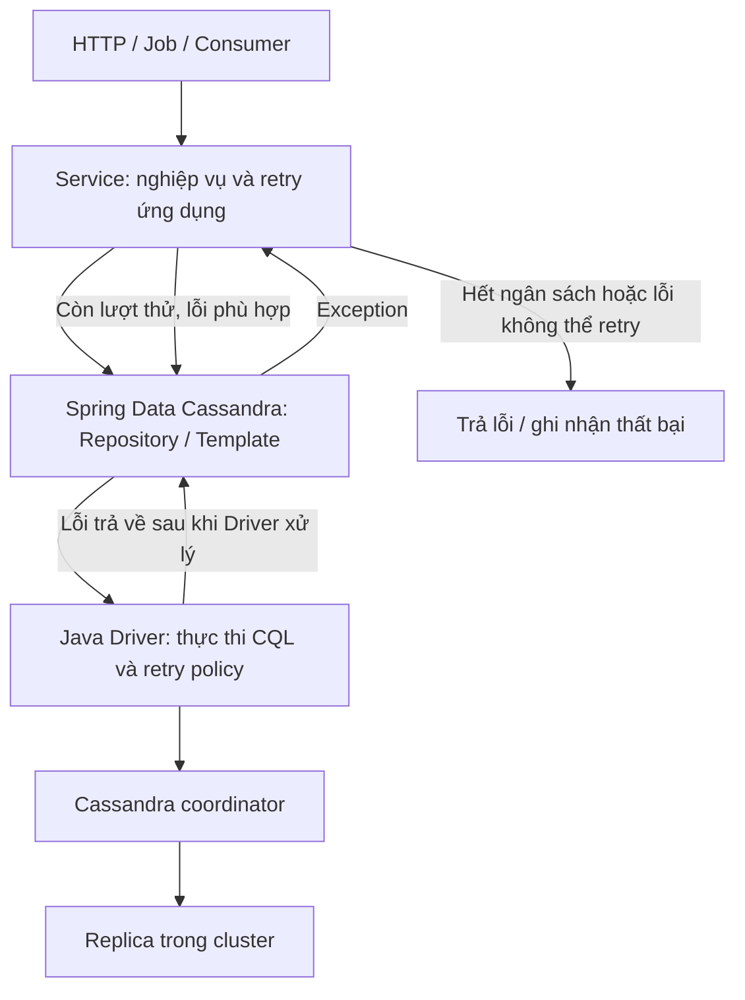
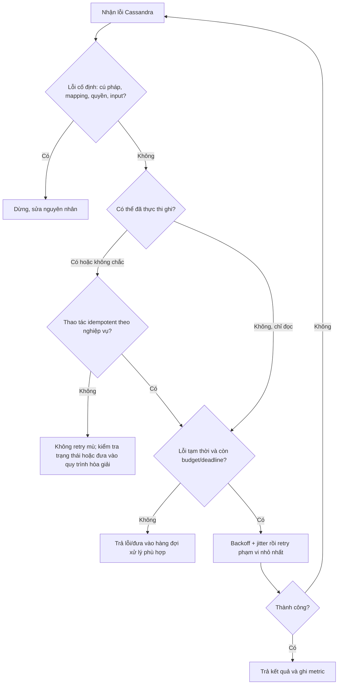

# Retry policy của Driver và retry tại lớp ứng dụng

Trong **Spring Data Cassandra**, một lời gọi `CassandraRepository`, `CassandraTemplate` hay `ReactiveCassandraRepository` cuối cùng được chuyển thành yêu cầu CQL gửi qua **Apache Cassandra Java Driver**. Khi một node chậm, kết nối gián đoạn hoặc không đủ replica phản hồi, yêu cầu có thể thất bại dù thao tác đã được xử lý một phần hoặc hoàn tất trong cluster. Vì vậy, quyết định **có retry hay không, retry ở đâu và retry bao nhiêu lần** ảnh hưởng trực tiếp đến tính đúng đắn của dữ liệu, độ trễ và tải hệ thống.

Bài học thuộc chương **Xử lý lỗi** và tập trung vào hai tầng:

- **Retry policy của Driver:** quyết định cách xử lý một số lỗi của *một lần thực thi câu CQL*, tại lớp giao tiếp Cassandra.
- **Retry tại lớp ứng dụng:** quyết định có thực hiện lại *một thao tác nghiệp vụ* hay không, dựa trên ngữ nghĩa đọc/ghi, thời hạn xử lý, tính idempotent và trạng thái các bước trước đó.

Sau bài này, bạn có thể phân biệt các nhóm lỗi, chọn tầng retry phù hợp, viết retry có giới hạn với Spring Retry hoặc Reactor, và thiết kế phép ghi để việc thử lại không tạo dữ liệu sai.

## 1. Retry nằm ở đâu trong đường đi của yêu cầu?

Giả sử API tra cứu đơn hàng dùng `OrderRepository.findById(orderId)`. Luồng thực thi thường là:



| Tầng | Đơn vị được thử lại | Biết điều gì? | Phù hợp khi |
| --- | --- | --- | --- |
| **Java Driver** | Một yêu cầu CQL, có thể qua coordinator khác | Tình trạng kết nối, phản hồi lỗi Cassandra, cấu hình statement | Xử lý một số lỗi ngắn hạn ở mức request với chính sách an toàn |
| **Spring Service / use case** | Một lần gọi repository hoặc một quy trình được thiết kế để thử lại | Mục đích nghiệp vụ, idempotency key, deadline, khả năng trùng tác dụng | Cần backoff, giới hạn tổng thời gian, quyết định theo loại thao tác |
| **Job / message consumer** | Một công việc được giao lại ở thời điểm khác | Số lần giao lại, trạng thái xử lý, dead-letter queue | Lỗi kéo dài cần thử lại sau, không giữ request đồng bộ quá lâu |

**Retry của Driver và retry của ứng dụng có thể cùng xảy ra.** Nếu ứng dụng thử tối đa 3 lần và mỗi lần Driver cũng phát thêm request, số lần CQL thực tế có thể lớn hơn 3. Speculative execution (gửi thêm yêu cầu để giảm độ trễ ở mức Driver) là cơ chế **khác** với retry và cũng có thể làm tăng số lần thực thi; nó đòi hỏi câu lệnh an toàn khi được thực hiện nhiều lần.

## 2. Hiểu lỗi trước khi quyết định retry

### 2.1. Timeout không có nghĩa là Cassandra đã rollback

Cassandra là hệ cơ sở dữ liệu phân tán. Với một phép ghi, coordinator gửi yêu cầu đến các replica và chờ đủ phản hồi theo *consistency level* (ví dụ `LOCAL_QUORUM`). Nếu thời hạn chờ hết trước khi nhận đủ xác nhận, phía client nhận timeout. Nhưng một hoặc nhiều replica **có thể đã ghi dữ liệu**; thậm chí toàn bộ thao tác có thể hoàn tất sau khi client đã nhận lỗi.

Do đó phải phân biệt:

1. **Lỗi được xác nhận trước khi thực hiện:** chẳng hạn một coordinator báo `UnavailableException` vì không đủ replica sẵn sàng để đáp ứng consistency level được yêu cầu.
2. **Không biết chắc kết quả cuối cùng:** chẳng hạn `WriteTimeoutException`, mất kết nối sau khi gửi request hoặc timeout phía client.
3. **Lỗi không thể khắc phục bằng chờ ngắn:** CQL sai, quyền truy cập bị từ chối, mapping không phù hợp hoặc dữ liệu không hợp lệ.

Nhóm (2) là lý do quan trọng nhất khiến retry ghi phải dựa trên **idempotency**, thay vì dựa vào câu hỏi “lỗi này có vẻ tạm thời không?”.

### 2.2. Ma trận lỗi và cách xử lý khởi đầu

| Tín hiệu | Diễn giải thường gặp | Hướng xử lý |
| --- | --- | --- |
| `ReadTimeoutException` | Không nhận đủ phản hồi hoặc dữ liệu đọc trong thời hạn | Có thể retry đọc, với giới hạn và backoff; xem xét tải và consistency level |
| `WriteTimeoutException` | Chưa nhận đủ xác nhận ghi; **kết quả có thể đã có hiệu lực** | Chỉ retry khi phép ghi an toàn khi lặp lại hoặc có cơ chế xác minh/deduplicate |
| `UnavailableException` | Coordinator thấy không đủ replica đáp ứng consistency level | Retry có giới hạn có thể hữu ích nếu tình trạng cluster ngắn hạn; không tự hạ consistency level |
| `OverloadedException` / lỗi quá tải | Node đang từ chối hoặc không kịp xử lý | Giảm tải, backoff có jitter; retry dồn dập sẽ làm lỗi nặng hơn |
| `DriverTimeoutException`, kết nối đứt, `AllNodesFailedException` | Client/Driver không nhận được kết quả tin cậy; nguyên nhân chi tiết có thể nằm trong cause | Xem xét khả năng request đã được gửi; retry đọc thường đơn giản hơn retry ghi |
| Query sai, sai kiểu dữ liệu, thiếu quyền, cấu hình xác thực sai | Lỗi ổn định cho đến khi mã nguồn/cấu hình được sửa | **Không retry** cùng một request |

Tên exception cụ thể phụ thuộc phiên bản Java Driver, đường gọi và cách Spring Data dịch lỗi. Một exception `DataAccessException` ở tầng repository có thể bọc exception gốc của Driver. Khi phân loại lỗi, cần kiểm tra chuỗi `cause` thực tế trong phiên bản đang dùng.

> **Không tự động giảm `LOCAL_QUORUM` xuống `LOCAL_ONE` chỉ để retry thành công.** Thay đổi consistency level là thay đổi cam kết đọc/ghi của ứng dụng, phải được quyết định ở thiết kế nghiệp vụ.

## 3. Retry policy của Cassandra Java Driver

### 3.1. Driver giải quyết những gì?

Java Driver cung cấp giao diện `RetryPolicy` để quyết định cách tiếp tục khi một request gặp các lỗi như read timeout, write timeout, unavailable, request aborted hoặc một số error response từ coordinator. Tùy tình huống, policy có thể trả về quyết định **retry cùng node**, **retry node khác** hoặc **dừng và trả lỗi**.

Các policy được nhắc tới phổ biến gồm:

- **`DefaultRetryPolicy`:** chính sách mặc định của Driver, thiên về lựa chọn có giới hạn trong một số tình huống xác định. Đây không phải lời hứa rằng mọi lỗi timeout đều được thử lại.
- **`FallthroughRetryPolicy`:** không yêu cầu retry từ retry policy; lỗi được chuyển về caller để tầng ứng dụng tự quyết định.
- **Policy tùy chỉnh:** có thể được sử dụng khi cần quy tắc ở cấp request mà policy có sẵn không đáp ứng, nhưng phải kiểm soát chặt các trường hợp thử lại và nguy cơ thực thi lặp.

Chi tiết quyết định của `DefaultRetryPolicy` phụ thuộc loại lỗi, dữ liệu phản hồi và phiên bản Driver. Ví dụ, khi read timeout xảy ra trong trường hợp đã nhận đủ số phản hồi nhưng chưa có phần dữ liệu cần thiết, Driver có thể thử lại yêu cầu đọc; với write timeout, Driver xử lý bảo thủ hơn vì việc ghi có thể đã xảy ra. Không nên viết logic nghiệp vụ dựa trên giả định “Driver luôn retry một lần”.

### 3.2. Khai báo tính idempotent cho statement

Driver dùng thuộc tính **idempotent** của statement để đánh giá việc phát lại request có an toàn hay không đối với những cơ chế có thể dẫn đến thực thi lặp. Đánh dấu `true` chỉ khi bạn hiểu rõ tác dụng của câu CQL đó:

```java
import com.datastax.oss.driver.api.core.DefaultConsistencyLevel;
import com.datastax.oss.driver.api.core.cql.Row;
import com.datastax.oss.driver.api.core.cql.SimpleStatement;

SimpleStatement statement = SimpleStatement.builder(
        "SELECT order_id, status " +
        "FROM orders_by_customer " +
        "WHERE customer_id = ? AND order_id = ?")
    .addPositionalValues(customerId, orderId)
    .setConsistencyLevel(DefaultConsistencyLevel.LOCAL_QUORUM)
    .setIdempotent(true) // SELECT thuần đọc: an toàn khi gửi lại.
    .build();

Row row = cqlSession.execute(statement).one();
```

Đây là ví dụ dùng `CqlSession` trực tiếp để minh họa thuộc tính của Driver. Với `CassandraRepository`/`CassandraTemplate`, Spring Data chịu trách nhiệm tạo statement và cách áp dụng setting có thể khác nhau theo phiên bản; **không giả định** mọi truy vấn repository đều được đánh dấu idempotent. Nếu cần kiểm soát thuộc tính này cho một câu CQL cụ thể, xác minh API của phiên bản Spring Data đang sử dụng hoặc thực thi statement được cấu hình rõ ràng qua Driver.

### 3.3. Retry policy không thay thế các cơ chế khác

- **Reconnection policy** tìm cách khôi phục kết nối/sessions khi host gián đoạn, không có nghĩa request cũ tự động được thực thi lại đến khi thành công.
- **Request timeout** giới hạn thời gian chờ của một request; hết timeout có thể dẫn đến kết quả không xác định đối với phép ghi.
- **Speculative execution** có thể gửi yêu cầu thứ hai trước khi yêu cầu đầu kết thúc để giảm tail latency; không dùng cho thao tác không idempotent.
- **Consistency level** xác định số replica cần phản hồi; retry không giải quyết thiết kế sai về mức nhất quán.

Không nên mở rộng `RetryPolicy` tùy biến chỉ để “retry mọi lỗi”; bắt đầu với policy mặc định, quan sát thực tế và đưa retry cần hiểu nghiệp vụ lên tầng service.

## 4. Thiết kế retry ở lớp ứng dụng Spring Data Cassandra

### 4.1. Xác định ranh giới retry

Một hàm service chỉ đọc bản ghi có thể retry riêng lời gọi `repository.findById(...)`. Nhưng một use case có các bước **ghi Cassandra → gọi dịch vụ ngoài → phát sự kiện** thì retry toàn bộ hàm có thể gọi dịch vụ ngoài hoặc phát sự kiện hai lần.

Chọn phạm vi nhỏ nhất có ý nghĩa: retry thao tác đọc cụ thể, hoặc retry một phép ghi đã được thiết kế idempotent. Với quy trình nhiều bước, cần thiết kế điều phối, idempotency key, trạng thái hoàn tất và cơ chế bù/truy hồi rõ ràng trước khi thử lại toàn bộ.

### 4.2. Ví dụ đồng bộ với Spring Retry `RetryTemplate`

Giả sử ứng dụng có `OrderRepository extends CassandraRepository<Order, OrderKey>`. Ví dụ sau giới hạn **3 lần thực hiện tổng cộng** (lần đầu + tối đa 2 lần thử lại), dùng backoff tăng dần và jitter:

```java
import org.springframework.context.annotation.Bean;
import org.springframework.context.annotation.Configuration;
import org.springframework.dao.TransientDataAccessException;
import org.springframework.retry.support.RetryTemplate;

@Configuration
public class CassandraReadRetryConfig {

    @Bean
    RetryTemplate cassandraReadRetryTemplate() {
        return RetryTemplate.builder()
            .maxAttempts(3)
            .exponentialBackoff(100L, 2.0, 800L, true)
            .retryOn(TransientDataAccessException.class)
            .build();
    }
}
```

```java
import java.util.Optional;
import org.springframework.retry.support.RetryTemplate;
import org.springframework.stereotype.Service;

@Service
public class OrderLookupService {

    private final OrderRepository repository;
    private final RetryTemplate cassandraReadRetryTemplate;

    public OrderLookupService(OrderRepository repository,
                              RetryTemplate cassandraReadRetryTemplate) {
        this.repository = repository;
        this.cassandraReadRetryTemplate = cassandraReadRetryTemplate;
    }

    public Optional<Order> findOrder(OrderKey key) {
        return cassandraReadRetryTemplate.execute(
            context -> repository.findById(key));
    }
}
```

Điều kiện áp dụng:

1. Dự án có dependency **Spring Retry** tương thích với phiên bản Spring đang chạy; `Order`, `OrderKey` và `OrderRepository` là các kiểu domain đã được ứng dụng định nghĩa.
2. Chỉ những lỗi được dịch thành `TransientDataAccessException` mới khớp với bộ lọc trong ví dụ. **Không phải mọi lỗi Cassandra tạm thời đều tự động thuộc kiểu này**. Cần kiểm thử exception thực tế và thiết lập bộ phân loại chính xác cho phiên bản Driver/Spring Data của dự án.
3. `RetryTemplate` là **blocking**: phù hợp luồng đồng bộ; không đưa `Thread.sleep()` hoặc mẫu này vào event loop của Reactor.
4. Retry nên nằm ở **service boundary** để cùng một lỗi không bị retry riêng tại nhiều lớp do những cấu hình độc lập khó kiểm soát.

Nếu muốn retry `UnavailableException` hoặc lỗi kết nối bị bọc trong `DataAccessException`, hãy xây dựng classifier dựa trên **loại lỗi và chuỗi nguyên nhân đã quan sát**, thay vì cấu hình `.retryOn(Exception.class)` hoặc `.retryOn(DataAccessException.class)` một cách tràn lan. Luôn loại lỗi schema, truy vấn và phân quyền ra khỏi nhóm retryable.

### 4.3. Ví dụ Reactive Cassandra với Reactor

Với `ReactiveCassandraRepository`, đặt retry trên publisher thay vì chặn thread:

```java
import java.time.Duration;
import org.springframework.dao.TransientDataAccessException;
import reactor.core.publisher.Mono;
import reactor.util.retry.Retry;

public Mono<Order> findOrderReactive(OrderKey key) {
    return reactiveOrderRepository.findById(key)
        .retryWhen(
            Retry.backoff(2, Duration.ofMillis(100))
                .maxBackoff(Duration.ofMillis(800))
                .jitter(0.5)
                .filter(this::isRetryableReadFailure)
        );
}

private boolean isRetryableReadFailure(Throwable error) {
    return error instanceof TransientDataAccessException;
}
```

Ở Reactor, `Retry.backoff(2, ...)` nghĩa là **tối đa 2 lần retry** sau lần subscribe đầu tiên, tức tổng tối đa 3 lần chạy truy vấn. Publisher được subscribe lại nên side effect nằm trong nguồn reactive cũng có thể chạy lại; ví dụ chỉ dùng thao tác đọc. Khi cần deadline toàn nghiệp vụ, cân nhắc `timeout(...)` và chính sách retry phù hợp để thời gian tổng không vượt SLA của API. Bộ lọc exception trong đoạn mã cũng phải được hiệu chỉnh theo lỗi thực tế trong hệ thống.

## 5. Idempotency: điều kiện thiết yếu để retry ghi

Một thao tác **idempotent** là thao tác có thể thực thi nhiều lần với cùng đầu vào mà không tạo thêm tác dụng nghiệp vụ ngoài ý muốn. Với Cassandra, cần xem xét câu CQL, timestamp, TTL, counter, collection, LWT và các side effect bên ngoài.

| Thao tác | Có thể retry mù quáng? | Giải thích |
| --- | --- | --- |
| `SELECT` không có side effect | Thường có | Chạy lại không thay đổi dữ liệu; kết quả có thể thay đổi vì có ghi đồng thời |
| `UPDATE ... SET status = 'PAID'` trên cùng khóa | Có điều kiện | Lặp lại cùng giá trị là gần với idempotent; kiểm tra tác động timestamp, TTL, ghi đồng thời và sự kiện phát kèm |
| `INSERT`/upsert cùng khóa và cùng nội dung | Có điều kiện | Cassandra là upsert theo khóa; lưu ý timestamp/TTL có thể làm thay đổi ưu tiên hoặc thời điểm hết hạn |
| `INSERT ... IF NOT EXISTS` với **khóa nghiệp vụ cố định** | Có thể thiết kế an toàn | Lần hai có thể trả `applied=false` vì lần một đã thành công; phải xử lý kết quả và kiểm tra bản ghi hiện có |
| `UPDATE ... SET total = total + 1` trên counter | **Không** | Mỗi lần phát lại có thể tăng counter thêm một lần |
| Append/prepend vào `list` | **Không** | Phát lại có thể tạo thêm phần tử hoặc thay đổi thứ tự |
| Ghi với ID mới sinh **mỗi lần retry** | **Không** | Có thể tạo nhiều bản ghi cho cùng một yêu cầu nghiệp vụ |
| Ghi Cassandra kèm gửi email/thanh toán/phát message | **Không nếu chưa thiết kế riêng** | Retry toàn workflow có thể lặp tác dụng bên ngoài Cassandra |

### Ví dụ: tạo đơn hàng với khóa ổn định

Giả sử client gửi `requestId` cố định cho cùng một yêu cầu tạo đơn. Ứng dụng ánh xạ nó đến `orderId` cố định và dùng lightweight transaction (LWT) trên một hàng:

```sql
INSERT INTO orders_by_id (order_id, customer_id, status)
VALUES (?, ?, 'CREATED')
IF NOT EXISTS;
```

Nếu mất phản hồi sau khi Cassandra đã tạo hàng, lần thử lại với **cùng `order_id`** có thể nhận `[applied] = false`. Đây không nhất thiết là thất bại nghiệp vụ; hãy đọc hoặc đối chiếu giá trị hiện có để xác nhận bản ghi thuộc cùng yêu cầu. Nếu nhận dữ liệu khác với mong đợi, phải xử lý xung đột thay vì xem như thành công. LWT có chi phí và semantics riêng, không phải giải pháp mặc định cho mọi truy vấn.

Một bảng “đã xử lý requestId” tách riêng, nếu ghi độc lập với bảng nghiệp vụ, **không tự tạo ra exactly-once**. Hệ thống có thể lỗi ở khoảng giữa hai bước. Với nhiều bảng Cassandra hoặc nhiều dịch vụ, cần một thiết kế nhất quán cho trạng thái tiến độ, cách khôi phục và idempotent side effect; không suy ra tính nguyên tử xuyên hệ thống từ một lần `IF NOT EXISTS`.

> Với Cassandra, “idempotent theo CQL” và “idempotent theo nghiệp vụ” là hai câu hỏi khác nhau. Dù một phép upsert không nhân đôi hàng, việc retry vẫn có thể tạo thêm thông báo, kéo dài TTL hoặc ghi đè thay đổi mới hơn.

## 6. Chọn giới hạn retry, backoff và deadline

Retry có ích với lỗi ngắn hạn, nhưng khi cluster đang quá tải, mọi yêu cầu đồng loạt thử lại có thể tạo **retry storm**. Cần cấu hình các giới hạn cùng nhau:

| Tham số | Ý nghĩa | Gợi ý thiết kế |
| --- | --- | --- |
| `maxAttempts` | Tổng số lần thực thi, gồm lần đầu | Khởi đầu nhỏ (ví dụ 2–3) và đo dưới tải thực tế |
| Backoff | Thời gian chờ giữa hai lần thử | Tăng dần theo hàm mũ, có trần |
| Jitter | Ngẫu nhiên hóa thời điểm retry | Giảm nhiều request cùng thử lại một lúc |
| Deadline / timeout tổng | Thời gian tối đa cho cả nghiệp vụ | Không để nhiều timeout nối tiếp vượt SLA của API |
| Retry budget | Phần tải bổ sung được phép do retry | Hạn chế retry khi lỗi diện rộng; kết hợp rate limit/circuit breaker khi phù hợp |
| Phạm vi exception | Nhóm lỗi thực sự có khả năng hồi phục | Không retry lỗi truy vấn, cấu hình, xác thực hoặc nghiệp vụ |

Ví dụ: `maxAttempts = 3`, backoff ban đầu `100 ms`, multiplier `2` cho hai khoảng chờ xấp xỉ `100 ms` và `200 ms` trước jitter. **300 ms chỉ là tổng thời gian chờ**, chưa bao gồm thời gian thực thi CQL, timeout của từng lượt và xử lý ứng dụng. Khi Driver cũng retry hoặc có speculative execution, cần đo **số request thực tế** chứ không chỉ đếm số lần hàm service được gọi.

Đối với API đồng bộ có deadline ngắn, ưu tiên lỗi có kiểm soát thay vì giữ request đến lúc hết toàn bộ nhiều lượt timeout. Với worker hàng đợi, có thể dùng delayed redelivery và dead-letter queue sau một số lần thất bại, miễn nghiệp vụ được thiết kế chịu được việc giao lại thông điệp.

## 7. Ba kịch bản quyết định retry

### Kịch bản A — Đọc một hàng bằng partition key

**Tình huống:** `findById` gặp read timeout do một coordinator phản hồi chậm.

**Cách làm:** Cho Driver xử lý theo policy hiện hành. Nếu vẫn thất bại và lỗi thuộc nhóm tạm thời đã được phân loại, service có thể retry đọc với backoff và deadline. Ghi lại attempt count, latency và consistency level; xem xét tình trạng replica hoặc query nếu lỗi lặp lại. Phép đọc không làm phát sinh bản ghi mới nên thường là ứng viên retry rõ ràng nhất.

### Kịch bản B — Cộng counter số lượt xem

**Tình huống:** thao tác tăng counter nhận `WriteTimeoutException`.

**Cách làm:** Không tự động phát lại phép tăng counter. Kết quả lần đầu không xác định; retry có thể đếm đôi. Nếu nghiệp vụ cần số liệu đáng tin cậy, cân nhắc ghi sự kiện với mã duy nhất để deduplicate ở tầng tổng hợp, hoặc thiết kế cấu trúc dữ liệu/luồng xử lý khác. Chỉ tăng giá trị counter một lần khi client nhìn thấy `success` không thể suy ra từ việc retry.

### Kịch bản C — Tạo đơn và phát sự kiện

**Tình huống:** service tạo đơn trong Cassandra thành công, nhưng việc gửi event bị timeout; caller retry toàn bộ API.

**Cách làm:** Giữ `requestId`/`orderId` ổn định, kiểm tra trạng thái tạo đơn và tách việc phát sự kiện thành bước có mã định danh để bên nhận deduplicate. Nếu dùng outbox, cần thiết kế việc lưu và chuyển trạng thái phù hợp với giới hạn giao dịch của Cassandra, rồi giao lại có kiểm soát. Đừng gọi lại toàn bộ chuỗi mà không biết bước nào đã hoàn thành.

## 8. Cách kiểm tra hoạt động retry trong dự án

Một cơ chế retry chỉ đáng tin khi có thể quan sát và thử nghiệm. Nên ghi nhận:

- **Số retry của Driver và ứng dụng**, tách theo tên truy vấn/operation, loại lỗi và outcome cuối cùng; tránh nhúng partition key, query parameter hoặc dữ liệu cá nhân vào metric label.
- **Latency tổng và p95/p99** cùng số request CQL phát sinh. Một tỉ lệ “API thành công sau retry” cao có thể che giấu cluster đang suy giảm.
- **Thời gian backoff, lỗi bị bỏ qua, lần retry cuối** để phát hiện vòng lặp hoặc phân loại lỗi sai.
- **Tỷ lệ timeout/overload theo node và consistency level**, dựa trên metric/log có sẵn của Driver và cluster.

Các tình huống nên có trong kiểm thử tích hợp hoặc kiểm thử lỗi có kiểm soát:

| Trường hợp | Kỳ vọng |
| --- | --- |
| Đọc thất bại tạm thời rồi thành công | Số lần thử không vượt cấu hình; kết quả đúng |
| CQL sai hoặc access denied | Không retry |
| Read timeout liên tục | Dừng ở giới hạn attempt/deadline, trả lỗi rõ ràng |
| Ghi idempotent bị mất phản hồi sau khi đã áp dụng | Retry không tạo bản ghi thứ hai hoặc side effect thứ hai |
| Tăng counter bị timeout | Không tự phát lại thao tác tăng khi chưa có thiết kế deduplicate |
| Nhiều request cùng gặp overload | Backoff/jitter giúp tránh dồn tải; quan sát được retry budget |
| Driver và service đều bật retry | Đo và giới hạn được tổng request thực tế |

Không cần cố ép cluster tạo lỗi trong môi trường production. Có thể dùng môi trường thử nghiệm, fault injection hoặc giả lập tầng repository để xác minh bộ phân loại và giới hạn retry; kiểm thử tích hợp dùng Cassandra thật giúp kiểm tra hành vi exception và timeout thực tế.

## 9. Quy trình ra quyết định khi một thao tác Cassandra thất bại



Khi áp dụng vào Spring Data Cassandra, có thể sử dụng checklist ngắn:

1. Xác định thao tác nằm ở `Repository`, `CassandraTemplate` hay Driver trực tiếp; biết policy của Driver và mức consistency đang dùng.
2. Phân loại lỗi từ exception gốc, ghi rõ những lỗi cho phép retry.
3. Chứng minh tính idempotent của thao tác và toàn bộ side effect trước khi retry ghi.
4. Chọn một ranh giới retry rõ ràng ở service, thêm giới hạn attempt, backoff, jitter và deadline.
5. Quan sát **tổng** số lần thực thi CQL khi có retry ở nhiều tầng.
6. Thử nghiệm cả trường hợp ghi **đã thành công nhưng client nhận timeout**.

## 10. Câu hỏi tự kiểm tra

1. Vì sao `WriteTimeoutException` không đủ để kết luận câu lệnh `INSERT` thất bại hoàn toàn?
2. `DefaultRetryPolicy` và retry ở `OrderLookupService` xử lý hai phạm vi nào khác nhau?
3. `maxAttempts(3)` trong Spring Retry khác gì với `Retry.backoff(2, ...)` trong Reactor về cách đếm?
4. Vì sao đánh dấu `.setIdempotent(true)` cho phép tăng counter là nguy hiểm?
5. Nếu một lệnh `INSERT ... IF NOT EXISTS` trả `applied=false` sau khi retry, bạn cần kiểm tra điều gì trước khi trả thành công cho client?
6. Khi cluster đang quá tải, vì sao backoff có jitter và retry budget thường quan trọng hơn tăng số lần retry?

**Ghi nhớ:** Retry đúng trong Cassandra bắt đầu bằng hiểu *kết quả nào còn không chắc chắn* và *tác dụng nào được phép lặp lại*. Driver xử lý lỗi ở cấp request; Spring service chịu trách nhiệm bảo vệ tính đúng đắn của nghiệp vụ và ngân sách tài nguyên cho mỗi lần thử lại.
