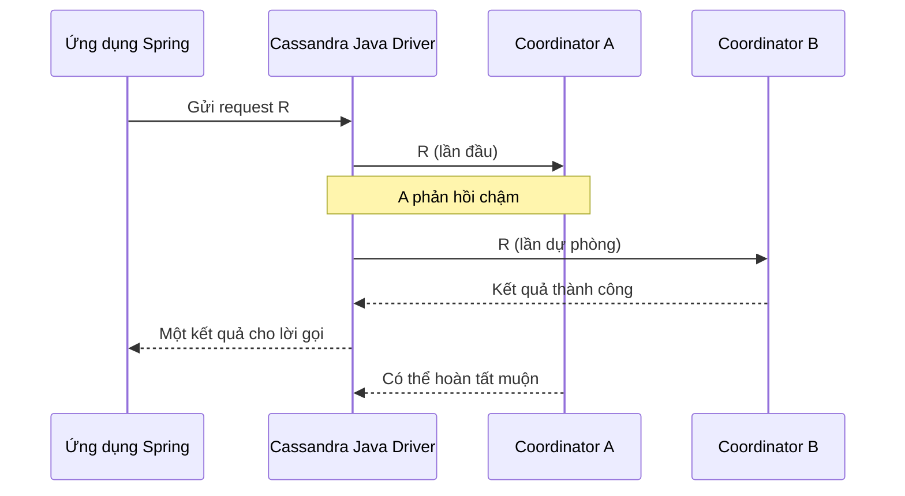

# Speculative execution và nguy cơ lặp thao tác ghi

Trong ứng dụng sử dụng **Spring Data Cassandra**, một thao tác truy cập cơ sở dữ liệu thường đi qua `Repository`, `CassandraTemplate` hoặc `CqlSession` của Apache Cassandra Java Driver. Khi một node phản hồi chậm, driver có thể gửi **cùng một request CQL** tới coordinator khác nhằm nhận kết quả sớm hơn. Cơ chế này gọi là *speculative execution* (thực thi dự phòng). Nó có thể cải thiện độ trễ của các truy vấn phù hợp, nhưng sẽ nguy hiểm nếu request làm thay đổi dữ liệu theo cách không thể lặp lại an toàn.

Bài học thuộc chương **Xử lý lỗi**, tập trung vào cơ chế speculative execution ở **phía client/driver**, cách nhận biết ghi bị thực thi nhiều lần, và cách sử dụng an toàn khi thiết kế bảng theo truy vấn, làm việc với `Repository`, `CassandraTemplate` và CQL trên một hệ Cassandra phân tán.

## 1. Speculative execution hoạt động như thế nào?

Với một request bình thường, driver chọn một Cassandra node làm **coordinator** và chờ phản hồi. Nếu đã bật speculative execution cho request phù hợp, driver có thể bắt đầu một lần thực thi bổ sung qua coordinator khác khi lần đầu vẫn chưa hoàn thành sau một ngưỡng thời gian. Driver nhận kết quả thành công phù hợp theo cơ chế của nó; các request đã gửi có thể vẫn đang được xử lý tại cluster.

Ví dụ với ngưỡng chờ minh họa là `120 ms`:

| Thời điểm | Diễn biến |
| --- | --- |
| `t = 0 ms` | Driver gửi request `R` đến coordinator A. |
| `t = 120 ms` | A chưa phản hồi; nếu policy cho phép và có node phù hợp, driver gửi **cùng request R** đến coordinator B. |
| `t = 150 ms` | B phản hồi thành công; ứng dụng có thể nhận kết quả từ B. |
| `t = 200 ms` | A có thể đã thực hiện thao tác trước khi bị hủy, hoặc vẫn hoàn tất muộn. Không được coi việc ứng dụng chỉ nhận một phản hồi là bằng chứng chỉ có một lần thực thi. |



**Điểm quyết định:** speculative execution tăng **số lần gửi cùng request**, không tăng số lần gọi phương thức Java trong ứng dụng. Hai coordinator có thể tiếp tục ghi tới các replica tương ứng ngay cả khi ứng dụng đã nhận một kết quả.

Cần phân biệt ba khái niệm:

| Cơ chế | Khi nào xảy ra? | Điều cần lưu ý |
| --- | --- | --- |
| **Speculative execution của Java Driver** | Một request chưa hoàn thành đủ nhanh; driver chủ động gửi thêm lần thực thi trong khi lần đầu có thể vẫn đang chạy. | Có khả năng **thực thi song song** cùng CQL. |
| **Retry của driver/ứng dụng** | Gặp lỗi hoặc timeout; một policy hoặc mã ứng dụng quyết định thử lại. | Lần trước có thể đã ghi thành công dù client không nhận được ACK. |
| **`speculative_retry` phía Cassandra** | Cơ chế nội bộ coordinator khi đọc từ replica; đây là tùy chọn liên quan đến đường đọc trong Cassandra. | Khác với speculative execution do Java Driver phát động và không phải cách chống ghi trùng. |

Mức consistency như `ONE` hay `LOCAL_QUORUM` quy định yêu cầu xác nhận và tính nhất quán của request; **không** biến request thành một thao tác *exactly once* và **không** tự loại bỏ lần ghi trùng.

## 2. Vì sao một lệnh ghi có thể bị lặp?

Giả sử hệ thống quản lý số lượng đã giữ chỗ bằng bảng counter:

```sql
CREATE TABLE reservations_counter_by_sku (
    sku text PRIMARY KEY,
    reserved counter
);

UPDATE reservations_counter_by_sku
SET reserved = reserved + 1
WHERE sku = 'SKU-42';
```

Mục tiêu nghiệp vụ là tăng `reserved` **một lần**. Nếu request trên bị đánh dấu nhầm là an toàn để speculative execution, cả A và B có thể thực hiện `UPDATE`. Mỗi lần thực thi counter update đều có tác dụng cộng `1`, vì vậy kết quả có thể là **tăng `2` dù ứng dụng chỉ gọi `execute(...)` một lần**.

Nguy cơ tương tự xuất hiện ở các thao tác:

- `UPDATE ... SET counter_col = counter_col + 1`: mỗi lần xử lý là một lần tăng counter.
- `UPDATE ... SET events = events + ['item']`: thêm phần tử vào **list** có thể tạo hai phần tử giống nhau.
- `INSERT` hoặc `UPDATE` có TTL tính từ thời điểm ghi: thực thi lại có thể làm thay đổi thời điểm hết hạn.
- CQL có biểu thức không xác định như `now()` tạo `timeuuid`: các lần thực thi có thể tạo giá trị khác nhau.
- `INSERT ... IF NOT EXISTS` hoặc `UPDATE ... IF ...`: kết quả điều kiện của lần thứ hai có thể khác lần đầu, khiến ứng dụng diễn giải sai việc gì đã xảy ra.

Hai lần ghi cùng giá trị vào một ô thường có vẻ vô hại vì Cassandra áp dụng quy tắc xung đột dựa trên timestamp. Tuy nhiên, cách nhìn này chỉ đúng trong những điều kiện nhất định. Nếu có TTL, timestamp khác nhau, các cập nhật đồng thời hoặc xử lý ngoài Cassandra, kết quả có thể không còn tương đương một lần ghi. Do đó, **không suy ra mọi `INSERT`/`UPDATE` đều an toàn chỉ vì Cassandra dùng upsert**.

### Idempotence là điều kiện cốt lõi

Một thao tác *idempotent* nếu thực hiện nó nhiều lần với cùng đầu vào vẫn tạo ra hiệu ứng mong muốn tương đương một lần thực hiện. Khái niệm này được xét theo **ngữ nghĩa thực tế của ứng dụng**, không chỉ theo tên lệnh CQL.

| Thao tác | Đánh giá thực tế |
| --- | --- |
| `SELECT` thông thường, không gây tác dụng phụ nghiệp vụ | Thường **idempotent**, thích hợp để cân nhắc speculative execution. |
| Gán `status = 'CONFIRMED'` cho cùng khóa và giá trị cố định, không TTL hoặc hiệu ứng phụ | **Có thể idempotent** về trạng thái hàng; vẫn cần xét cập nhật đồng thời và timestamp. |
| `INSERT` cùng primary key và các giá trị cố định | **Có điều kiện**; phải kiểm tra TTL, timestamp, trường được sinh động và các hiệu ứng đi kèm. |
| Tăng counter, nối list, cập nhật dựa trên hiệu ứng tích lũy | **Không idempotent**; gửi hai lần có thể thay đổi dữ liệu hai lần. |
| CQL sử dụng `now()`, `uuid()` hay tạo ID mới khi thực thi | **Không mặc nhiên idempotent**; kết quả có thể khác ở mỗi lần. |
| `IF NOT EXISTS`, `IF <điều kiện>` (LWT) | **Không tự cho là an toàn**; lần lặp có thể trả `[applied] = false` sau một lần thành công. |

Ví dụ về điểm khác biệt:

```sql
-- Có khả năng an toàn về trạng thái hàng nếu mọi điều kiện khác giữ nguyên:
UPDATE orders_by_id
SET status = 'PAID'
WHERE tenant_id = 7 AND order_id = 105;

-- Không an toàn để lặp khi muốn một lần tăng counter:
UPDATE reservations_counter_by_sku
SET reserved = reserved + 1
WHERE sku = 'SKU-42';
```

Với lệnh gán `status`, hãy vẫn kiểm tra cạnh tranh cập nhật: một lần ghi đến muộn với timestamp khác có thể ảnh hưởng trạng thái mới hơn. Idempotence về kết quả khi chạy lặp trong môi trường tĩnh **không có nghĩa** an toàn tuyệt đối trước mọi thứ tự thực thi đồng thời.

## 3. Java Driver quyết định speculative execution dựa trên điều gì?

Trong Cassandra Java Driver 4.x, cơ chế speculative execution được cấu hình bởi **speculative execution policy** và trạng thái **idempotent của statement**. Theo cấu hình mặc định thông dụng, speculative execution bị tắt; ứng dụng cần bật chủ động khi có lý do và số liệu hỗ trợ.

- Driver chỉ được phép speculative execute những statement được xác định là idempotent theo metadata/cấu hình của driver.
- `setIdempotent(true)` là **khai báo của lập trình viên**, không phải phép kiểm chứng rằng CQL chắc chắn an toàn. Driver không thể hiểu toàn bộ quy tắc nghiệp vụ, callback và cập nhật đồng thời của ứng dụng.
- `setIdempotent(false)` cho biết statement không an toàn để thực thi lại; tránh cho request đó bị speculative execution theo cơ chế thông thường của driver.
- Retry policy và speculative execution là hai quyết định khác nhau; phải đánh giá cả hai nếu ứng dụng cần kiểm soát ghi lặp.

Điều này đặc biệt quan trọng với **Spring Data Cassandra**. `Repository.save(...)` hoặc `CassandraTemplate` có thể che đi cách tạo statement ở tầng driver. Không nên xem mọi `save()` là idempotent, cũng không nên bật speculative execution toàn cục rồi giả định tất cả thao tác ghi đã được bảo vệ. Cần xem cách framework ánh xạ entity, xác định ID, TTL, timestamp, conditional write, callback và execution profile được áp dụng ở phiên bản đang sử dụng.

## 4. Cấu hình an toàn: ưu tiên truy vấn đọc

Một cách triển khai dễ kiểm soát là để **profile mặc định không dùng speculative execution**, đồng thời tạo profile riêng cho các truy vấn đọc đã được đánh giá là idempotent.

Ví dụ cấu hình HOCON của Java Driver 4.x trong `application.conf` trên classpath (các khóa và cách tích hợp có thể cần điều chỉnh theo phiên bản driver/Spring Boot):

```hocon
datastax-java-driver {
  profiles {
    fast_reads {
      advanced.speculative-execution-policy {
        class = ConstantSpeculativeExecutionPolicy
        delay = 120 milliseconds
        max-executions = 1
      }
    }
  }
}
```

Ý nghĩa:

- `fast_reads` là tên **execution profile** chỉ dùng khi ứng dụng chủ động chọn nó.
- `delay` là khoảng chờ trước khi cân nhắc gửi một lần speculative execution.
- `max-executions` giới hạn số lần **thực thi dự phòng thêm**, không phải số dòng CQL hay số replica Cassandra.
- Giá trị `120 ms` chỉ để minh họa. Cần chọn theo phân bố độ trễ thực tế, tải cluster và yêu cầu dịch vụ; đặt quá thấp có thể tạo thêm lưu lượng đáng kể khi hệ thống vốn đang chậm.

Ví dụ dùng `CqlSession` được Spring quản lý, một API driver nền tảng mà Spring Data Cassandra sử dụng:

```java
import com.datastax.oss.driver.api.core.CqlSession;
import com.datastax.oss.driver.api.core.cql.Row;
import com.datastax.oss.driver.api.core.cql.SimpleStatement;
import java.util.UUID;

public final class OrderQueryGateway {
    private final CqlSession session;

    public OrderQueryGateway(CqlSession session) {
        this.session = session;
    }

    public String findStatus(UUID tenantId, UUID orderId) {
        SimpleStatement read = SimpleStatement.builder(
                "SELECT status FROM orders_by_id " +
                "WHERE tenant_id = ? AND order_id = ?")
            .addPositionalValues(tenantId, orderId)
            .setExecutionProfileName("fast_reads")
            .setIdempotent(true)
            .build();

        Row row = session.execute(read).one();
        return row == null ? null : row.getString("status");
    }
}
```

Ví dụ giả định bảng `orders_by_id` đã được thiết kế để truy cập bằng `(tenant_id, order_id)` theo khóa phù hợp. Việc chỉ định `fast_reads` giúp khoanh vùng tối ưu độ trễ cho truy vấn đọc; `setIdempotent(true)` thể hiện rằng ứng dụng đã đánh giá lệnh đọc này có thể chạy nhiều lần.

Với thao tác cập nhật counter, khai báo rõ tính không idempotent:

```java
SimpleStatement increaseReserved = SimpleStatement.builder(
        "UPDATE reservations_counter_by_sku " +
        "SET reserved = reserved + ? WHERE sku = ?")
    .addPositionalValues(1L, "SKU-42")
    .setIdempotent(false)
    .build();

session.execute(increaseReserved);
```

Ở ví dụ này, statement ghi **không chọn profile `fast_reads`** và được đánh dấu `false`. Với các thao tác qua `CassandraRepository`, `CassandraTemplate` hoặc `ReactiveCassandraTemplate`, cần kiểm tra cơ chế đặt idempotence/execution profile tại đường đi thực tế; nếu cần kiểm soát chính xác từng request, có thể đưa câu CQL nhạy cảm vào lớp gateway sử dụng `CqlSession` như trên. Không nên gắn `true` cho toàn bộ thao tác ghi chỉ nhằm đạt lợi ích độ trễ.

## 5. Khi timeout, không thể kết luận thao tác ghi chưa xảy ra

Trong hệ phân tán, mất phản hồi không đồng nghĩa với mất thao tác. Một coordinator có thể đã gửi mutation đến replica và nhận xác nhận đủ, nhưng ACK về client bị trễ hoặc đứt kết nối. Khi driver báo timeout, ứng dụng không luôn biết liệu request trước đã được áp dụng hay chưa.

Hệ quả:

1. **Không retry mù** lệnh tăng counter, nối list, thu tiền hoặc cập nhật có tác dụng tích lũy.
2. Không dùng thành công của một speculative execution để suy ra lần thực thi khác không tác động dữ liệu.
3. Không coi tăng consistency level, dùng batch hay bật LWT là công tắc tự động bảo đảm *exactly once*.
4. Khi cần chống lặp ở nghiệp vụ, thiết kế **idempotency key** ổn định cho mỗi yêu cầu, quy trình xác nhận trạng thái và ranh giới ghi rõ ràng.

Ví dụ nhận thanh toán với `payment_id` cố định: hệ thống có thể dùng một bản ghi trạng thái yêu cầu và ghi có điều kiện (`IF NOT EXISTS`/`IF status = ...`) để kiểm soát chuyển trạng thái. Tuy nhiên, nếu sau đó còn tăng counter ở bảng khác hoặc gọi dịch vụ thanh toán ngoài, **một LWT đơn lẻ không tạo giao dịch nguyên tử xuyên các hệ thống**. Phải thiết kế quy trình riêng, chẳng hạn lưu yêu cầu duy nhất, consumer idempotent, outbox hoặc cơ chế đối soát, để việc chạy lại không tạo tác dụng phụ hai lần.

### LWT có giải quyết hoàn toàn vấn đề không?

Không. Xét:

```sql
INSERT INTO processed_events (event_id, status)
VALUES (8f1a4b39-68d9-47a4-aafc-2fe11b919c15, 'DONE')
IF NOT EXISTS;
```

Nếu lần đầu đã được áp dụng nhưng phản hồi thất lạc, lần kế tiếp có thể trả `[applied] = false`. Kết quả `false` lúc này có thể có nghĩa **lần trước của chính yêu cầu này đã thành công**. Ứng dụng cần đọc trạng thái theo event ID và đối chiếu dữ liệu đã lưu để phân biệt yêu cầu lặp với một yêu cầu xung đột; không diễn giải `false` một cách máy móc thành thất bại nghiệp vụ.

## 6. Hiệu năng, quan sát và kiểm thử

Speculative execution thường được xem xét khi muốn giảm **tail latency** (độ trễ ở các percentile cao) của những truy vấn đọc idempotent. Nó đánh đổi độ trễ lấy tải: cùng một request có thể tiêu thụ thêm CPU, mạng, connection pool và công việc tại các replica. Nếu tất cả coordinator đều chậm vì overload, gửi thêm request có thể làm tình hình nặng hơn.

Khi đưa vào vận hành, nên theo dõi:

| Nhóm chỉ số | Câu hỏi cần trả lời |
| --- | --- |
| Latency `p95/p99` và timeout theo loại truy vấn | Có cải thiện đáng kể sau khi bật speculative execution không? |
| Số lần speculative execution và tỷ lệ request cần thực thi bổ sung (nếu driver bật metric tương ứng) | Cơ chế này được kích hoạt thường xuyên đến mức nào? |
| CPU, request rate, network, hàng đợi và lỗi tại các node Cassandra | Cluster có chịu thêm tải vượt lợi ích độ trễ không? |
| Số lượng yêu cầu nghiệp vụ theo `request_id`/`event_id` và hiệu ứng thực tế | Có dấu hiệu ghi trùng hay cập nhật bất thường không? |

Tên metric cụ thể phụ thuộc phiên bản Java Driver, framework tích hợp Micrometer/metrics và cấu hình quan sát. Không giả định mọi metric đều tự bật.

Kiểm thử nên bao gồm trường hợp coordinator A chậm, coordinator B trả nhanh, và **cả hai có thể cùng hoàn tất**. Với profile đọc, xác minh kết quả truy vấn và mức giảm độ trễ. Với counter, list append và các thao tác ghi nhạy cảm, xác minh đường gọi thực tế không cho phép speculative execution; đồng thời thử timeout/retry ở tầng ứng dụng để đánh giá xử lý kết quả không xác định. Nên thực hiện kiểm thử gây trễ trên môi trường thử nghiệm có kiểm soát.

## 7. Checklist trước khi bật speculative execution

- [ ] Xác định **CQL thực sự được gửi** qua `Repository`, `CassandraTemplate` hay `CqlSession`.
- [ ] Phân loại idempotence theo hiệu ứng nghiệp vụ, kiểm tra counter, list, TTL, timestamp, LWT, giá trị sinh động và cập nhật đồng thời.
- [ ] Bật speculative execution bằng execution profile cho các truy vấn đọc đã xác minh; tránh áp dụng tràn lan vào mọi statement.
- [ ] Chỉ đặt `setIdempotent(true)` khi có cơ sở; đặt `false` cho thao tác tích lũy hoặc chưa đủ chắc chắn.
- [ ] Rà soát retry policy, timeout và logic retry của ứng dụng vì cả ba có thể dẫn đến xử lý lặp.
- [ ] Đo `p95/p99`, timeout, số lần gửi bổ sung và tải Cassandra trước/sau thay đổi.
- [ ] Với yêu cầu có tác dụng ngoài Cassandra, thiết kế khóa chống trùng và quy trình khôi phục theo trạng thái lưu bền vững.

**Ghi nhớ:** speculative execution là kỹ thuật **giảm độ trễ khi một coordinator phản hồi chậm**, không phải tính năng bảo đảm ghi thành công đúng một lần. Trong Spring Data Cassandra, cách an toàn là quản lý rõ **loại request**, **idempotence** và **execution profile** từ tầng gọi CQL đến quy tắc nghiệp vụ. Chỉ tối ưu sau khi đã chứng minh rằng chạy cùng request nhiều lần không gây hậu quả ngoài ý muốn.
