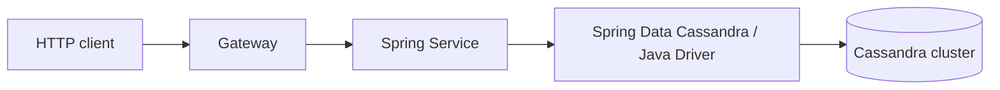
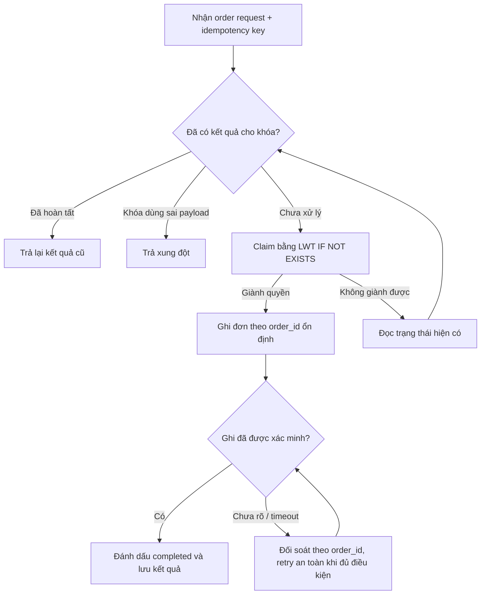

# Giới hạn số lần thử, thời gian chờ tăng dần và ngân sách yêu cầu

Trong ứng dụng **Spring Data Cassandra**, một thao tác đọc hoặc ghi Apache Cassandra có thể gặp lỗi tạm thời do node đang bận, kết nối chập chờn, timeout, chuyển đổi topology hoặc không đủ replica đáp ứng mức nhất quán yêu cầu. Thử lại (*retry*) đôi khi giúp thao tác thành công, nhưng thử lại không có giới hạn có thể khiến một sự cố nhỏ thành quá tải diện rộng.

Bài này thuộc chủ đề **Xử lý lỗi**: thiết kế retry có kiểm soát cho `CassandraRepository`, `CassandraTemplate` và truy vấn CQL; phân biệt lỗi có thể thử lại với lỗi cần dừng; áp dụng **giới hạn số lần thử**, **exponential backoff có jitter**, **ngân sách thời gian cho yêu cầu** và **ngân sách lưu lượng retry**. Các chính sách này cần đi cùng thiết kế bảng theo truy vấn, partition key, consistency và paging vì retry không thể sửa được truy vấn vốn đã quá tốn tài nguyên.

## 1. Vì sao retry thiếu kiểm soát gây hại?

Giả sử ứng dụng nhận 1.000 yêu cầu/giây; mỗi yêu cầu đọc một hàng Cassandra. Nếu một lỗi tạm thời khiến mọi yêu cầu đều thử tối đa ba lần ngay lập tức, Cassandra có thể phải tiếp nhận gần **3.000 lượt đọc/giây** trong khi đang suy giảm khả năng phục vụ. Khi client, API gateway, service và Cassandra driver đều retry độc lập, số lượt gửi có thể nhân lên.

Ví dụ: gateway cho tối đa 3 lần gọi service và service cho tối đa 3 lần gọi Cassandra. Một yêu cầu người dùng có thể tạo tới **9 lượt gọi xuống Cassandra** (chưa tính retry hoặc speculative execution nội bộ của driver). Việc các client đồng loạt thử lại sau cùng một khoảng chờ cố định còn tạo đỉnh tải mới.

Retry tốt phải đồng thời trả lời năm câu hỏi:

1. **Có nên thử lại không?** Lỗi có khả năng tạm thời và thao tác có an toàn khi thực hiện lại không?
2. **Thử lại bao nhiêu lần?** Một lần gọi gồm tối đa bao nhiêu *attempt*, tính cả lần đầu?
3. **Chờ bao lâu?** Có exponential backoff và jitter để tránh đồng bộ đỉnh tải không?
4. **Còn đủ thời gian không?** Yêu cầu có deadline tổng thể; không retry khi kết quả đến quá muộn.
5. **Hệ thống còn cho phép retry không?** Mỗi retry phải chịu giới hạn lưu lượng riêng, tránh khuếch đại tải.

## 2. Phân loại lỗi trước khi quyết định retry

Không nên cấu hình `retry mọi Exception`. Cần xét **loại lỗi**, **mức nhất quán**, **ngữ nghĩa truy vấn** và **thời gian còn lại**.

| Tình huống | Định hướng xử lý | Lý do |
| --- | --- | --- |
| Lỗi kết nối tạm thời, node thay đổi, driver không tìm được node phù hợp | Có thể retry có giới hạn nếu còn deadline và thao tác an toàn | Có thể thành công khi chọn lại một kết nối/node; nếu cả cluster quá tải, retry thêm có thể làm nặng hơn |
| `ReadTimeoutException` / lỗi đọc tạm thời | Cân nhắc retry với `SELECT` lũy đẳng, có backoff | Đọc lại thường không tạo tác động phụ; vẫn phải tránh tăng tải lên partition nóng |
| `WriteTimeoutException` hoặc mất phản hồi sau ghi | **Kết quả chưa xác định**; chỉ retry khi đã chứng minh thao tác lũy đẳng hoặc có cơ chế đối soát | Replica có thể đã ghi thành công nhưng client chưa nhận xác nhận |
| `UnavailableException`, không đủ replica ở consistency yêu cầu | Thường cần backoff và giới hạn; nếu kéo dài, trả lỗi sớm và xử lý sự cố | Retry liên tục không làm xuất hiện replica còn thiếu |
| Cassandra quá tải, queue đầy hoặc service nhận `429/503` | Giảm tốc, giới hạn concurrency, tôn trọng `Retry-After` nếu giao thức có cung cấp | Lưu lượng retry có thể làm quá tải nghiêm trọng hơn |
| CQL sai cú pháp, bảng/cột không tồn tại, bind sai kiểu, vi phạm quyền | Không retry | Lỗi sẽ không tự hết nếu không thay đổi cấu hình, truy vấn hoặc quyền |
| Lỗi validation của nghiệp vụ, payload không hợp lệ | Không retry | Cùng đầu vào sẽ tiếp tục bị từ chối |
| LWT trả `[applied] = false` | Đọc và xử lý trạng thái hiện có, không coi là lỗi mạng | Điều kiện không thỏa mãn là kết quả nghiệp vụ hợp lệ |

Những lỗi như `ReadTimeoutException`, `WriteTimeoutException`, `UnavailableException`, `DriverTimeoutException` là các nhóm tiêu biểu của Java Driver hiện đại; tên lớp và khả năng tự retry phụ thuộc phiên bản driver và cấu hình. Một timeout phía client không bảo đảm rằng Cassandra chưa nhận hoặc chưa hoàn tất thao tác.

**Không tự hạ mức consistency từ `QUORUM` xuống `ONE` khi retry.** Làm vậy có thể thay đổi cam kết về tính nhất quán của API, đặc biệt với đọc sau ghi hoặc nghiệp vụ cần xác minh dữ liệu. Nếu muốn hỗ trợ chế độ nhất quán yếu hơn, đó phải là quyết định thiết kế được công bố rõ ràng.

## 3. Điều kiện tiên quyết: thao tác phải an toàn khi gửi lại

Trước khi chọn số lần retry, phân loại từng câu truy vấn theo **tính lũy đẳng (idempotency)**.

| Loại thao tác | Có thể retry an toàn? | Điều kiện cần nhớ |
| --- | --- | --- |
| `SELECT` theo đầy đủ primary key | Thường có | Đọc có thể trả dữ liệu khác nếu ghi đồng thời hoặc consistency khác; đây là thay đổi trạng thái hợp lệ, không phải lỗi của retry |
| `INSERT`/`UPDATE` đặt cùng giá trị trên **cùng primary key** | Có thể, khi xét cả tác động nghiệp vụ | Tránh phát sinh ID mới mỗi attempt; chú ý timestamp, TTL và các side effect |
| `DELETE` cùng một tài nguyên | Thường có về trạng thái logic | Cần xét tombstone, timestamp và tác động nghiệp vụ ngoài Cassandra |
| `UPDATE counter`, thao tác cộng dồn | Không mặc định | Retry có thể làm tăng counter nhiều lần |
| Thêm phần tử vào `list` hoặc ghi theo semantics không lũy đẳng | Không mặc định | Mỗi lần chạy lại có thể tạo thêm phần tử |
| `INSERT ... IF NOT EXISTS` | Có thể dùng để phân xử cạnh tranh | Nếu timeout rồi retry nhận `[applied] = false`, lần đầu có thể đã thành công; cần đọc trạng thái hiện có |
| Tạo đơn hàng/thanh toán/gửi thông báo | Chỉ khi có khóa chống trùng và cách đối soát | Một lần ghi Cassandra thành công không đồng nghĩa toàn bộ quy trình phân tán chỉ diễn ra một lần |

Với DataStax Java Driver, thuộc tính `setIdempotent(true)` thông báo cho driver rằng câu lệnh được ứng dụng đánh giá là an toàn để thực hiện lại. **Driver không chứng minh điều đó thay ứng dụng**; đánh dấu sai có thể gây ghi trùng hoặc sai lệch dữ liệu. Ghi vào cùng partition key nhưng dùng `now()`, timestamp thay đổi, TTL được làm mới hoặc ID được sinh lại ở mỗi attempt vẫn cần xem xét riêng.

Một nguyên tắc quan trọng: **khóa chống trùng phải giữ nguyên qua mọi retry của cùng yêu cầu logic**. Nếu mỗi attempt tạo một `order_id` mới, cơ chế giới hạn retry không ngăn được đơn hàng trùng. Với xử lý bất đồng bộ, event/message cũng cần ID ổn định để consumer nhận lại không gây tác động phụ hai lần.

## 4. Giới hạn số lần thử: đếm attempt và retry khác nhau

Quy ước rõ ràng khi cấu hình:

- **`maxAttempts = 3`** nghĩa là tối đa ba lần thực thi: lần đầu + tối đa hai retry.
- **`maxRetries = 2`** cũng tương đương tối đa ba attempt nếu không có lớp khác tự retry.
- Không để từng tầng tùy ý áp dụng chính sách riêng. Chọn tầng sở hữu retry và tính tổng số attempt thực tế xuống Cassandra.

Giới hạn có thể phụ thuộc loại tác vụ:

| Loại công việc | Ví dụ chính sách khởi điểm | Mục đích |
| --- | --- | --- |
| API đọc đồng bộ, cần phản hồi nhanh | 1 lần đầu + tối đa 1–2 retry | Còn cơ hội khắc phục lỗi ngắn mà vẫn tôn trọng latency |
| API ghi không bảo đảm lũy đẳng | Không retry tự động | Tránh tạo tác động phụ lặp |
| API ghi có khóa chống trùng, có đối soát | Retry hữu hạn theo deadline | Giảm lỗi tạm thời nhưng không đánh đổi tính đúng |
| Job nền có thể tiếp tục sau | Retry vài lần, sau đó đưa vào hàng chờ có lịch xử lý lại | Tránh giữ luồng vô hạn; theo dõi được yêu cầu thất bại |

Đây là các **giá trị minh họa để bắt đầu đo đạc**, không phải mặc định khuyến nghị của Spring Data Cassandra. Số lần thích hợp phụ thuộc phân phối latency, mức tải, consistency và tính đúng của thao tác.

## 5. Exponential backoff và jitter

Retry ngay lập tức thường thất bại vì điều kiện gây lỗi chưa thay đổi. Một cơ chế chờ phổ biến là **exponential backoff**: khoảng chờ lớn dần sau mỗi lần thất bại, nhưng có trần để không chờ quá lâu.

Với `n = 1` là **lần retry đầu tiên**:

\[
d_{\mathrm{cap}}(n)=\min\left(d_{\max},d_0\,2^{n-1}\right)
\]

Trong đó `d_0` là độ trễ cơ sở và `d_{\max}` là trần độ trễ. Nếu tất cả client dùng đúng `d_{\mathrm{cap}}(n)`, chúng có thể thức dậy cùng thời điểm. Vì vậy, sử dụng **full jitter**:

\[
d_{\mathrm{sleep}}(n)\sim U(0,d_{\mathrm{cap}}(n))
\]

Ví dụ, với `d_0 = 100 ms` và `d_{\max} = 800 ms`:

| Retry thứ `n` | Trần chờ | Khoảng jitter có thể chọn |
| ---: | ---: | ---: |
| 1 | 100 ms | 0–100 ms |
| 2 | 200 ms | 0–200 ms |
| 3 | 400 ms | 0–400 ms |
| 4 | 800 ms | 0–800 ms |
| 5 | 800 ms | 0–800 ms |

Các giá trị trên biểu diễn **khoảng ngẫu nhiên**, không phải độ trễ cố định bắt buộc. Ở workload nhạy cảm với tải, có thể chọn khoảng tối thiểu phù hợp để tránh các retry gần như tức thì.

`Retry-After` là tín hiệu của một số giao thức HTTP và dịch vụ trung gian, **không phải header của CQL**. Nếu service/gateway trả thông tin này, chỉ thử lại sau thời điểm phù hợp **và chỉ khi deadline còn cho phép**. Nếu thời gian cần chờ vượt thời gian còn lại, kết thúc yêu cầu thay vì xếp thêm retry.

## 6. Hai loại ngân sách: thời gian và lưu lượng retry

### 6.1. Ngân sách thời gian cho từng yêu cầu (*request deadline*)

Ví dụ một API có thời hạn đáp ứng **1.500 ms** từ lúc nhận request. Quá trình xác thực, ánh xạ entity, chọn connection, thực thi CQL, chờ backoff và tạo phản hồi đều tiêu tốn cùng ngân sách:

```text
Client deadline:        1.500 ms
  API / business logic:   200 ms
  Ngân sách Cassandra:  1.100 ms
  Dự phòng phản hồi:      200 ms

Trong 1.100 ms dành cho Cassandra:
  attempt #1 + backoff + attempt #2 + backoff + attempt #3
  Tất cả phải kết thúc trước khi ngân sách còn lại về 0.
```

**Timeout mỗi attempt** là giới hạn một lần gọi; **deadline** là giới hạn tổng của toàn bộ yêu cầu. Nếu thiết lập ba attempt, mỗi attempt timeout 1 giây, cộng hai lần chờ, tổng thời gian có thể vượt thời hạn API 1,5 giây nếu không kiểm soát deadline.

Quy tắc cho mỗi attempt:

1. Tính `remaining = deadline - now` bằng đồng hồ **monotonic** (như `System.nanoTime()` trong Java).
2. Nếu `remaining <= 0`, dừng ngay, trả lỗi deadline/hết thời gian.
3. Chọn `attemptTimeout = min(configuredPerAttemptTimeout, remaining)`.
4. Chỉ ngủ backoff nếu khoảng chờ đó **và** thời gian tối thiểu cho attempt tiếp theo còn nằm trong deadline.
5. Truyền deadline còn lại xuống các service phụ thuộc khi giao thức cho phép; hủy tác vụ không còn cần thiết nếu API hỗ trợ hủy.

Không cộng riêng các timeout của từng tầng rồi coi chúng là deadline tổng. Trong hệ thống gọi chuỗi, service con phải dùng **phần thời gian còn lại**, không bắt đầu lại đồng hồ khi nhận request.

### 6.2. Ngân sách lưu lượng retry (*retry budget*)

Dù mỗi request chỉ thử lại hai lần, hàng nghìn request lỗi cùng lúc vẫn có thể tạo bão retry. Vì thế cần một **ngân sách retry chung** cho một service/luồng phụ thuộc, thường triển khai bằng token bucket hoặc giới hạn tỷ lệ retry.

Ví dụ thiết kế: dịch vụ xử lý khoảng 1.000 attempt đầu tiên trong mỗi phút và chỉ cấp ngân sách khoảng **100 attempt retry bổ sung/phút** (10% lưu lượng gốc), với một burst nhỏ được giới hạn. Mỗi attempt từ lần thứ hai trở đi phải tiêu thụ một token. Khi hết token, dừng retry và trả lỗi sớm để Cassandra có cơ hội phục hồi. Các số này dùng để minh họa; hệ thống thực cần chọn theo tải và SLO.

Không nhầm lẫn ba cơ chế:

| Cơ chế | Chặn điều gì? |
| --- | --- |
| `maxAttempts` | Một yêu cầu lặp quá nhiều lần |
| Deadline tổng | Một yêu cầu chiếm tài nguyên quá lâu |
| Retry budget / token bucket | Tổng số request retry làm khuếch đại lưu lượng hệ thống |

Ngoài ra, **concurrency limit** giới hạn số truy vấn đang chạy; nó bổ trợ cho retry budget, không thay thế. Với Cassandra bị nghẽn, giảm số request đồng thời hoặc giới hạn queue có thể hiệu quả hơn tăng số lần retry.

## 7. Đặt chính sách retry ở đúng tầng

Một luồng thường có nhiều lớp:



Có nhiều cơ chế có thể làm tăng số lượt truy vấn:

- HTTP client/gateway retry cả HTTP request;
- thư viện resilience ở service như Spring Retry hoặc Resilience4j;
- retry policy của **DataStax Java Driver**;
- **speculative execution** của driver, phát thêm truy vấn khi phản hồi chậm.

**Speculative execution không phải retry sau lỗi**: nó có thể gửi thêm truy vấn **song song** trước khi attempt đầu hoàn tất. Vì vậy số request thực tế ở Cassandra có thể lớn hơn số attempt mà service đếm. Đặc biệt phải cân nhắc với LWT và truy vấn ghi; không tùy tiện bật speculative execution cho thao tác chưa xác nhận lũy đẳng.

Chọn một tầng làm **chủ sở hữu chính sách retry ở mức nghiệp vụ**. Nếu cho phép driver retry các trường hợp được xác định an toàn, hãy tính chúng vào ngân sách tải thực tế; quan sát chỉ số driver và tránh thêm hai, ba vòng retry ngoài mà không có kế hoạch. Ở tầng service, deadline và ngân sách retry nên bao phủ cả tổng thời gian của tầng driver.

### Tham số cấu hình cần biết

Trong Java Driver 4.x, khái niệm timeout yêu cầu được cấu hình bằng `basic.request.timeout`; từng câu lệnh cũng có thể ghi đè timeout. Ví dụ HOCON minh họa cho file cấu hình driver:

```hocon
datastax-java-driver {
  basic.request.timeout = 700 milliseconds
}
```

Đây là **timeout một lần thực thi statement qua driver**, không phải deadline toàn bộ HTTP request. Cấu hình thực tế có thể được Spring Boot ánh xạ sang properties riêng theo phiên bản; cần kiểm tra phiên bản Spring Boot/Spring Data Cassandra/driver của dự án trước khi chọn khóa cấu hình tương ứng.

Driver còn có retry policy điều khiển xử lý lỗi CQL; ứng dụng nên hiểu chính sách đang được nạp thay vì giả định driver luôn tự retry mọi timeout. Truy vấn `CassandraTemplate` và `CassandraRepository` vẫn đi qua tầng truy cập driver, nên các cơ chế retry/timeout nội bộ liên quan đến chúng.

## 8. Ví dụ Java: đọc CQL với số lần thử, deadline, backoff và retry budget

Ví dụ này minh họa việc đọc **một hàng theo khóa chính**. Truy vấn `SELECT` phù hợp với retry hơn các thao tác ghi có tác động phụ. Mã dùng `CqlSession` để điều khiển timeout từng lần; khi triển khai với `CassandraRepository` hoặc `CassandraTemplate`, có thể áp dụng cùng chính sách ở service bao quanh thao tác truy cập dữ liệu.

```java
import java.time.Duration;
import java.util.UUID;
import java.util.concurrent.ThreadLocalRandom;
import java.util.concurrent.TimeUnit;

import com.datastax.oss.driver.api.core.CqlSession;
import com.datastax.oss.driver.api.core.DriverException;
import com.datastax.oss.driver.api.core.DriverTimeoutException;
import com.datastax.oss.driver.api.core.cql.Row;
import com.datastax.oss.driver.api.core.cql.SimpleStatement;
import com.datastax.oss.driver.api.core.servererrors.ReadTimeoutException;
import com.datastax.oss.driver.api.core.servererrors.UnavailableException;

public final class BudgetedCustomerReader {
    private static final int MAX_ATTEMPTS = 3; // Gồm lần đầu.
    private static final long DEADLINE_MS = 1_100;
    private static final long PER_ATTEMPT_MS = 400;
    private static final long BASE_BACKOFF_MS = 100;
    private static final long MAX_BACKOFF_MS = 400;

    private final CqlSession session;
    private final RetryBudget retryBudget;

    // Dùng token bucket chia sẻ ở tầng service trong môi trường thật.
    public interface RetryBudget {
        boolean tryAcquireRetryToken();
    }

    public BudgetedCustomerReader(CqlSession session, RetryBudget retryBudget) {
        this.session = session;
        this.retryBudget = retryBudget;
    }

    public Row readById(UUID tenantId, UUID customerId) {
        long deadline = System.nanoTime()
            + TimeUnit.MILLISECONDS.toNanos(DEADLINE_MS);

        var query = SimpleStatement.builder("""
                SELECT tenant_id, customer_id, name
                FROM customers_by_tenant
                WHERE tenant_id = ? AND customer_id = ?
                """)
            .addPositionalValues(tenantId, customerId)
            .setIdempotent(true) // SELECT không tạo side effect.
            .build();

        DriverException lastFailure = null;
        for (int attempt = 1; attempt <= MAX_ATTEMPTS; attempt++) {
            long remaining = deadline - System.nanoTime();
            if (remaining <= 0) {
                break;
            }

            Duration attemptTimeout = Duration.ofNanos(
                Math.min(remaining,
                    TimeUnit.MILLISECONDS.toNanos(PER_ATTEMPT_MS)));

            try {
                return session.execute(query.setTimeout(attemptTimeout)).one();
                // null nghĩa là không tìm thấy hàng; không phải lỗi để retry.
            } catch (DriverException ex) {
                lastFailure = ex;
                if (attempt == MAX_ATTEMPTS
                        || !isRetryableReadError(ex)
                        || !retryBudget.tryAcquireRetryToken()) {
                    throw ex;
                }

                // attempt = 1 -> trần 100 ms; attempt = 2 -> 200 ms.
                long cap = Math.min(MAX_BACKOFF_MS,
                    BASE_BACKOFF_MS * (1L << (attempt - 1)));
                long delay = ThreadLocalRandom.current().nextLong(cap + 1);
                long remainingMs = TimeUnit.NANOSECONDS.toMillis(
                    Math.max(0, deadline - System.nanoTime()));

                // Không đợi nếu đã hết ngân sách cho lần tiếp theo.
                if (delay >= remainingMs) {
                    throw ex;
                }
                try {
                    Thread.sleep(delay);
                } catch (InterruptedException interrupted) {
                    Thread.currentThread().interrupt();
                    throw new IllegalStateException(
                        "Đã bị hủy trong lúc chờ retry", interrupted);
                }
            }
        }
        throw new IllegalStateException(
            "Hết deadline đọc Cassandra", lastFailure);
    }

    private static boolean isRetryableReadError(DriverException ex) {
        return ex instanceof DriverTimeoutException
            || ex instanceof ReadTimeoutException
            || ex instanceof UnavailableException;
    }
}
```

**Cách đọc ví dụ:**

- Dùng thời gian monotonic để tính deadline; `setTimeout` bị giới hạn bởi phần deadline còn lại.
- Chỉ retry nhóm lỗi tạm thời được chọn cho **truy vấn đọc**; các lỗi khác được ném ra ngay.
- Mỗi retry phải lấy được token từ `RetryBudget`; triển khai thật cần cấu hình token bucket dùng chung và gắn số liệu quan sát.
- Khoảng chờ được rút ngẫu nhiên theo full jitter; nếu ngân sách thời gian cạn, kết thúc.
- `Row == null` là kết quả “không tìm thấy”; không nên retry chỉ vì chưa có dữ liệu.
- Ví dụ mang tính đồng bộ, dùng `Thread.sleep`; trong WebFlux/reactive pipeline, thay bằng backoff bất đồng bộ để không chặn event loop.

**Giới hạn của ví dụ:** hàm phân loại chỉ minh họa ba nhóm lỗi thường gặp. Ứng dụng phải xem thêm nguyên nhân của `AllNodesFailedException`, phân biệt quá tải kéo dài và ghi nhận ngữ cảnh lỗi trước khi quyết định retry. Mã không đếm các retry/speculative execution tự phát sinh bên trong driver; cần cấu hình và đo lường chúng. Với read có latency rất cao, chi phí của `session.execute` và timeout có thể chiếm gần hết deadline, vì vậy cần đo đạc để chọn các mốc phù hợp.

## 9. Với ghi Cassandra, retry cần thêm đối soát

Đối với `INSERT`, `UPDATE` hoặc `DELETE`, timeout có thể xảy ra **sau khi một số replica đã nhận ghi**. Retry sẽ an toàn hơn khi:

1. Tài nguyên có **primary key ổn định**, không sinh ID mới trong mỗi attempt.
2. Thao tác là đặt trạng thái/giá trị mong muốn, hoặc có cơ chế kiểm tra đã hoàn tất.
3. Với cùng yêu cầu logic, **idempotency key** và dữ liệu gửi lại không đổi.
4. Nếu dùng `IF NOT EXISTS` / compare-and-set, ứng dụng phân biệt kết quả điều kiện không thỏa mãn với lỗi thực thi và có bước đọc lại khi kết quả không rõ.
5. Các side effect bên ngoài Cassandra (thanh toán, email, message) được bảo vệ riêng.

Ví dụ API tạo đơn hàng:



Không đặt một vòng retry mù xung quanh toàn bộ hàm “tạo đơn + trừ tiền + gửi email”. LWT giúp phân xử cập nhật có điều kiện trên dữ liệu Cassandra, nhưng không cung cấp giao dịch nguyên tử cho mọi thao tác qua các hệ thống.

## 10. Trường hợp đặc biệt: paging, truy vấn nặng và job nền

**Paging:** Khi đọc nhiều trang qua `CassandraRepository` hoặc CQL paging state, mỗi trang có thể gây một lượt truy vấn mới. Deadline và retry budget cần tính trên toàn bộ việc lấy các trang, không chỉ trang đầu. Nếu đọc trang sau bị timeout, chỉ retry an toàn cho đúng thao tác đọc trang đó với paging state hợp lệ; tránh tự khởi động lại toàn bộ đợt quét rồi phát sinh xử lý trùng ở downstream. Giới hạn số trang và số bản ghi mỗi yêu cầu để tránh chiếm kết nối lâu.

**Partition nóng:** Retry truy vấn không có partition key phù hợp, dùng `ALLOW FILTERING` hay đọc partition quá lớn thường làm tình hình tệ hơn. Cách xử lý đúng là sửa mô hình dữ liệu theo truy vấn, giới hạn page size và giảm concurrency; backoff chỉ giảm tác động trong ngắn hạn.

**Job nền / consumer:** Nếu hết deadline của lần xử lý hiện tại, có thể đưa message vào queue với thời điểm xử lý lại thay vì giữ thread và ngủ hàng phút. Cần lưu số lần thử và event ID qua các lần xử lý, dùng dead-letter queue hoặc khu vực kiểm tra lỗi sau ngưỡng cho phép. Phân biệt retry nội bộ trong một lần nhận message với *redelivery* do broker; cả hai đều phải tôn trọng tính lũy đẳng.

**Bảo vệ cluster:** Khi lỗi tăng mạnh, circuit breaker và giới hạn concurrency có thể từ chối nhanh yêu cầu mới thay vì tiếp tục thử lại trên một Cassandra cluster đang quá tải. Khi phục hồi, cho phép lưu lượng tăng dần để tránh nhiều request cùng quay lại một lúc.

## 11. Quan sát, cảnh báo và kiểm thử

Không thể chọn chính sách retry chỉ bằng trực giác. Theo dõi tối thiểu:

| Chỉ số | Ý nghĩa |
| --- | --- |
| Số attempt và retry trên mỗi request | Phát hiện retry vượt mức và retry lồng nhau |
| Retry theo loại exception, CQL operation và consistency | Biết lỗi nào đang gây lặp; tránh gắn label chứa dữ liệu nhạy cảm/khóa riêng của user |
| Số request hết deadline, số retry bị chặn do hết token | Phân biệt sự cố kết nối với quá tải kéo dài |
| Latency p50/p95/p99 của API và CQL | Kiểm tra retry có làm trễ yêu cầu thành công hay không |
| Lỗi `Unavailable`, read/write timeout, overload, connection failure | Theo dõi trạng thái cluster và driver |
| Kích thước queue, concurrency, in-flight requests, token bucket | Phát hiện khả năng tạo bão retry |
| Tỷ lệ trùng nghiệp vụ, LWT `[applied] = false` và tác vụ cần đối soát | Kiểm tra tính đúng sau timeout/ghi chưa rõ kết quả |

Các kịch bản kiểm thử cần bao gồm:

1. **Lỗi tạm thời rồi phục hồi:** một lần đọc thất bại, lần sau thành công; số attempt không vượt giới hạn.
2. **Lỗi kéo dài:** mọi attempt thất bại; service dừng theo deadline và retry budget, không treo vô hạn.
3. **Lỗi không thể retry:** truy vấn sai hoặc input sai; chỉ thực hiện một attempt.
4. **Đồng thời:** hàng trăm yêu cầu cùng lỗi; tổng retry bị giới hạn bởi token bucket, không tạo đỉnh tải vượt mục tiêu.
5. **Hết deadline ngay trước backoff:** bỏ retry tiếp theo.
6. **Ghi thành công nhưng mất phản hồi:** đối soát được tài nguyên đã tồn tại, không nhân đôi tác động nghiệp vụ.
7. **Nhiều tầng cùng retry:** đo số truy vấn thực tế ở Cassandra, bao gồm driver retry và speculative execution.
8. **Paged read lỗi ở trang giữa:** bảo toàn tiến trình đúng hợp đồng, không xử lý lại các trang trước.
9. **Hủy request hoặc ngắt thread:** dừng chờ đúng cách và không giữ kết nối/tài nguyên không cần thiết.

Nên kiểm thử ở môi trường có số replica, consistency level và mô hình dữ liệu gần với production: độ trễ, lỗi partial và khả năng phục hồi thay đổi đáng kể theo topology.

## 12. Checklist áp dụng cho Spring Data Cassandra

- [ ] Phân loại từng truy vấn (đọc, ghi lũy đẳng, ghi không lũy đẳng, LWT, counter) trước khi cho retry.
- [ ] Quy định rõ `maxAttempts` gồm cả lần đầu; tránh nhiều tầng cùng nhân số attempt.
- [ ] Dùng exponential backoff với jitter và trần chờ; không retry ngay lập tức hàng loạt.
- [ ] Có deadline tổng từ API đến CQL; timeout từng attempt không vượt thời gian còn lại.
- [ ] Có retry budget dùng chung và giới hạn concurrency khi Cassandra suy giảm.
- [ ] Kiểm tra cơ chế retry của driver và speculative execution; chỉ đánh dấu `setIdempotent(true)` khi chắc chắn.
- [ ] Giữ nguyên khóa logic/primary key qua retry; đối soát khi ghi bị timeout và kết quả chưa xác định.
- [ ] Không tự thay consistency level để che lỗi; ưu tiên sửa partition key, paging và truy vấn nặng.
- [ ] Ghi metric số attempt, nguyên nhân retry, deadline exceeded, retry budget exhausted và kết quả đối soát.
- [ ] Kiểm thử lỗi tạm thời, lỗi kéo dài, các request đồng thời, timeout sau ghi và hủy xử lý.

**Kết luận:** Một chiến lược retry đáng tin cậy cho Spring Data Cassandra kết hợp **điều kiện được phép retry**, **số attempt hữu hạn**, **exponential backoff có jitter**, **deadline đầu cuối** và **ngân sách retry của hệ thống**. Đối với ghi Cassandra, còn phải bảo đảm tính lũy đẳng và có khả năng đối soát khi phản hồi bị mất. Mục tiêu của retry là phục hồi từ lỗi ngắn hạn trong giới hạn có kiểm soát, đồng thời bảo vệ cluster và tính đúng đắn của dữ liệu khi lỗi kéo dài.
