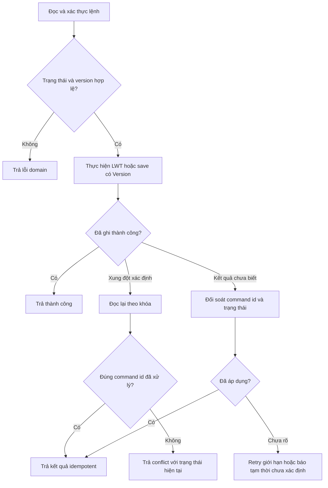

# Xử lý xung đột LWT hoặc `@Version` theo nghiệp vụ trong Spring Data Cassandra

Khi nhiều yêu cầu cùng thay đổi một thực thể trong **Spring Data Cassandra**, hệ thống phải quyết định thao tác nào được thực hiện, thao tác nào bị từ chối và phải phản hồi thế nào cho người dùng. Apache Cassandra hỗ trợ **Lightweight Transaction (LWT)** để ghi có điều kiện; Spring Data Cassandra có thể dùng `@Version` để triển khai **optimistic locking** cho entity. Cả hai giúp phát hiện thay đổi cạnh tranh, nhưng **phát hiện xung đột chỉ là bước kỹ thuật**. Kết quả nghiệp vụ còn phụ thuộc trạng thái hiện tại, tính lặp lại an toàn của lệnh và điều kiện hệ thống phân tán.

Bài thuộc chương **Xử lý lỗi** của module `SPRING_DATA_CASSANDRA`, gắn với kiến thức entity mapping, repository, `CassandraTemplate`, CQL, partition key, consistency và kiểm soát hiệu năng. Ví dụ xuyên suốt là một yêu cầu đặt chỗ: `PENDING` có thể chuyển sang `CONFIRMED` hoặc `CANCELLED`, nhưng một yêu cầu đã hủy không thể được xác nhận bằng dữ liệu cũ.

## 1. Hiểu đúng xung đột trong Cassandra

### 1.1. Vì sao đọc trước rồi ghi vẫn có thể sai?

Giả sử hai nhân viên cùng tải yêu cầu `R-42` ở trạng thái `PENDING`:

```text
T0: A đọc R-42 = PENDING, version = 7
T1: B đọc R-42 = PENDING, version = 7
T2: A ghi status = CONFIRMED
T3: B ghi status = CANCELLED
T4: Kết quả phụ thuộc các mutation và timestamp,
    có thể trái với quyết định mà A/B đã thấy ban đầu
```

Nếu dùng ghi CQL không điều kiện (`UPDATE ... SET status = ...`), Cassandra không tự động hiểu rằng `CONFIRMED` và `CANCELLED` là hai chuyển trạng thái loại trừ nhau. Cơ chế hòa giải ghi của Cassandra dựa trên timestamp, khác với một bộ kiểm soát phiên bản theo nghiệp vụ. Tăng consistency level cho đọc/ghi **không thay thế** điều kiện so sánh trạng thái tại thời điểm mutation.

Với LWT, hệ thống gửi thông điệp tương đương: “Chỉ đổi sang `CONFIRMED` **nếu** bản ghi vẫn là `PENDING` và phiên bản vẫn là `7`”. Kết quả `[applied] = false` cho biết điều kiện không được áp dụng; đây thường là **xung đột đã phát hiện**, không phải sự cố mạng cần tự động gửi lại vô hạn.

### 1.2. Phân biệt ba lớp kết quả

| Tín hiệu | Ý nghĩa | Hành động phù hợp |
| --- | --- | --- |
| LWT trả `[applied] = true` | Điều kiện được thỏa và mutation đã áp dụng | Trả kết quả thành công; tiếp tục các công việc sau ghi theo thiết kế |
| LWT trả `[applied] = false` | Điều kiện không đúng với trạng thái được kiểm tra | Đọc lại, phân loại thành đã xử lý, trạng thái không hợp lệ hoặc phiên bản cũ |
| `@Version` gây `OptimisticLockingFailureException` | Bản ghi không khớp điều kiện phiên bản khi lưu qua cơ chế optimistic locking | Coi là xung đột có thể xử lý theo domain; đọc lại nếu cần phân loại |
| Driver báo timeout, unavailable, connection error | Không nhận được kết quả đáng tin cậy hoặc không thể thực hiện yêu cầu | Phân biệt **không biết kết quả đã áp dụng hay chưa** với thất bại chắc chắn; đối soát và retry có giới hạn |
| Lỗi cú pháp CQL, mapping, kiểu dữ liệu | Lỗi triển khai hoặc dữ liệu đầu vào | Sửa lỗi kỹ thuật; không retry theo nhánh xung đột nghiệp vụ |

Không nên gom tất cả vào một `catch (Exception)` rồi trả HTTP `409`. Đặc biệt, timeout sau khi gửi mutation **không chứng minh** mutation chưa xảy ra. Với một thao tác có hiệu ứng ngoài Cassandra, retry sai có thể kích hoạt hiệu ứng hai lần.

## 2. Thiết kế trạng thái và partition trước khi chọn cơ chế khóa

LWT kiểm tra điều kiện trong phạm vi partition liên quan. Thiết kế một bảng đọc/ghi theo khóa đầy đủ:

```sql
CREATE TABLE bookings_by_id (
    tenant_id uuid,
    booking_id uuid,
    status text,
    version bigint,
    confirmed_at timestamp,
    cancelled_at timestamp,
    last_command_id uuid,
    PRIMARY KEY ((tenant_id, booking_id))
);
```

Khóa partition là cặp `(tenant_id, booking_id)`. Mọi thao tác trên một booking phải có đủ hai giá trị; không truy vấn toàn bảng chỉ để tìm hàng có `status = 'PENDING'`. Nếu ứng dụng còn cần liệt kê booking theo người dùng hoặc ngày, nên thiết kế các bảng đọc chuyên biệt theo truy vấn. **Điều kiện LWT trên một partition không tạo giao dịch nguyên tử giữa nhiều bảng hoặc nhiều partition.**

Trước khi viết code, hãy định nghĩa trạng thái như một máy trạng thái:

| Trạng thái hiện tại | Lệnh `Confirm` | Lệnh `Cancel` |
| --- | --- | --- |
| `PENDING` | Cho phép sang `CONFIRMED` | Cho phép sang `CANCELLED` |
| `CONFIRMED` | Kiểm tra cùng lệnh đã xử lý hay chưa; nếu khác lệnh, áp chính sách trùng nghiệp vụ | Từ chối hoặc chuyển vào quy trình hủy sau xác nhận riêng |
| `CANCELLED` | Từ chối, không tự phục hồi | Nếu là lần gửi lại đúng lệnh thì trả kết quả trước; nếu không, xử lý theo chính sách |

Thực tế còn có thể có `EXPIRED`, `REFUNDED`, quyền người dùng, giới hạn thời gian hoặc hạn mức tài nguyên. Những điều kiện ấy phải được kiểm tra ở service/domain. Trạng thái mà client thấy trước đó không đủ để chứng minh một chuyển trạng thái vẫn còn hợp lệ lúc ghi.

## 3. Cách 1: optimistic locking bằng `@Version`

### 3.1. Khi nào phù hợp?

`@Version` phù hợp khi ứng dụng thường xuyên đọc entity, sửa vài thuộc tính rồi lưu bằng Spring Data Cassandra repository hoặc `CassandraTemplate`, và mong muốn **không ghi đè thay đổi của một phiên bản đã cũ**. Spring Data Cassandra sử dụng cơ chế ghi có điều kiện để kiểm soát phiên bản; khi phiên bản không còn khớp, thao tác lưu có thể báo `OptimisticLockingFailureException`.

Ví dụ entity đơn giản với một cột làm partition key:

```java
import java.util.UUID;
import org.springframework.data.annotation.Version;
import org.springframework.data.cassandra.core.mapping.PrimaryKey;
import org.springframework.data.cassandra.core.mapping.Table;

@Table("booking_demo_by_id")
public class BookingDemo {
    @PrimaryKey
    private UUID bookingId;

    private String status;

    @Version
    private Long version;

    // Constructor, getters và setters
}

public interface BookingDemoRepository
        extends CassandraRepository<BookingDemo, UUID> {
}
```

Đây là ví dụ độc lập, đơn giản hóa khóa để tập trung vào `@Version`. Ở hệ thống nhiều tenant, dùng mapping khóa ghép đúng theo bảng thực tế. Cột `version` cần hiện diện trong schema và thuộc dữ liệu được quản lý ổn định; tránh đặt TTL riêng khiến version biến mất trong khi trạng thái nghiệp vụ vẫn tồn tại.

**Nguyên tắc:** không tự sửa giá trị `version` để “ép lưu thành công”. Để framework kiểm tra và tăng phiên bản. Kiểm tra hợp đồng `@Version` của đúng phiên bản Spring Data Cassandra trong dự án, đặc biệt với `save` khi entity mới, bản ghi không còn tồn tại, hoặc khi mix repository với CQL thủ công.

### 3.2. Đọc - xác nhận ý định - lưu - xử lý xung đột

Ví dụ một lệnh cập nhật ghi chú với `expectedVersion` do client gửi:

```java
public BookingDemo updateStatus(
        UUID bookingId,
        String requestedStatus,
        long expectedVersion) {

    BookingDemo booking = repository.findById(bookingId)
        .orElseThrow(() -> new BookingNotFoundException(bookingId));

    if (!Objects.equals(booking.getVersion(), expectedVersion)) {
        throw new BusinessConflictException(
            "STALE_VERSION", "Dữ liệu đã thay đổi, hãy tải lại");
    }

    assertTransitionAllowed(booking.getStatus(), requestedStatus);
    booking.setStatus(requestedStatus);

    try {
        return repository.save(booking);
    } catch (OptimisticLockingFailureException e) {
        throw new BusinessConflictException(
            "CONCURRENT_MODIFICATION", "Trạng thái đã đổi khi lưu", e);
    }
}
```

`BusinessConflictException`, `BookingNotFoundException`, `assertTransitionAllowed` là thành phần domain minh họa và cần được định nghĩa trong ứng dụng. Các import Spring liên quan là `org.springframework.dao.OptimisticLockingFailureException` và `org.springframework.data.cassandra.repository.CassandraRepository`.

Điểm quan trọng có **hai lần kiểm tra**:

1. `expectedVersion` so với entity mới tải bảo vệ **ý định của client cũ**, ví dụ form được mở 10 phút trước. Nếu bỏ bước này và luôn lấy phiên bản mới từ DB rồi sửa, `@Version` có thể vẫn lưu thành công dù người dùng đang thao tác trên trạng thái cũ.
2. `repository.save` với `@Version` bảo vệ **khoảng thời gian giữa lúc service đọc và lúc ghi**. Một writer khác có thể ghi sau lần đọc nhưng trước lần save.

`@Version` bảo vệ đúng khi tất cả writer sửa entity đều tham gia cùng một giao thức phiên bản. Lệnh CQL thủ công hoặc hệ thống khác ghi không điều kiện có thể phá vỡ kỳ vọng của ứng dụng Spring Data Cassandra.

### 3.3. Phân loại exception theo nghiệp vụ

Sau `OptimisticLockingFailureException`, có thể đọc lại booking bằng đầy đủ primary key để xác định nguyên nhân. Chẳng hạn:

- Booking không còn tồn tại: trả `404`, `410` hoặc kết quả nghiệp vụ tương ứng theo hợp đồng API.
- Booking đã sang trạng thái đích bởi **đúng cùng command id**: trả lại kết quả cũ nếu thao tác được định nghĩa idempotent.
- Booking sang trạng thái đích bởi một lệnh khác: có thể vẫn là xung đột nếu người thực hiện, điều kiện duyệt hoặc hiệu ứng ngoài khác nhau.
- Booking đang ở trạng thái loại trừ (`CANCELLED` khi muốn `CONFIRMED`): trả lỗi chuyển trạng thái, không tự sửa lại.
- Booking vẫn `PENDING` nhưng phiên bản thay đổi do sửa thuộc tính khác: tùy phạm vi xung đột, yêu cầu tải lại hoặc rebase có kiểm soát.

Đừng chuyển mọi xung đột thành “thành công vì trạng thái cuối trông giống nhau”. Với thanh toán, cấp quyền hoặc đặt chỗ, **ai thực hiện, command id nào và side effect nào đã phát sinh** có thể là phần thiết yếu của tính idempotent.

## 4. Cách 2: viết điều kiện nghiệp vụ trực tiếp bằng LWT

### 4.1. CQL compare-and-set trên trạng thái và version

Khi cần điều kiện rõ ràng như “chỉ xác nhận booking đang `PENDING` với phiên bản được đọc”, LWT cho phép nêu điều kiện ngay trong CQL:

```sql
UPDATE bookings_by_id
SET status = 'CONFIRMED',
    version = 8,
    confirmed_at = ?,
    last_command_id = ?
WHERE tenant_id = ? AND booking_id = ?
IF status = 'PENDING' AND version = 7;
```

Ở hệ thống thực, `7` và `8` lấy từ `expectedVersion` và `expectedVersion + 1`; không hardcode. Với mỗi booking, cần thống nhất version ban đầu và quy tắc tăng. Cột `status`/`version` phải được khởi tạo khi tạo mới. Một điều kiện `IF version = 7` sẽ không thành công nếu version hiện tại là `null` hoặc hàng chưa có trạng thái đúng.

Nếu chỉ quan tâm trạng thái, có thể dùng `IF status = 'PENDING'`, nhưng thêm `version` giúp phát hiện các cập nhật đồng thời khác mà không làm đổi `status`. Cũng có thể dùng `INSERT ... IF NOT EXISTS` khi tạo mới hoặc `DELETE ... IF ...` cho yêu cầu có điều kiện; mỗi trường hợp có ý nghĩa nghiệp vụ và chi phí LWT riêng.

### 4.2. Ví dụ dùng Java Driver trong ứng dụng Spring

Khi muốn tự đọc cờ `[applied]` và phân loại kết quả, `CqlSession` là cách trực tiếp. Ví dụ cập nhật có điều kiện, với `expectedVersion` đã xác thực:

```java
public boolean confirmWithLwt(
        UUID tenantId,
        UUID bookingId,
        long expectedVersion,
        UUID commandId,
        Instant confirmedAt) {

    long nextVersion = Math.addExact(expectedVersion, 1);

    SimpleStatement statement = SimpleStatement.newInstance(
        "UPDATE bookings_by_id " +
        "SET status = ?, version = ?, confirmed_at = ?, " +
        "last_command_id = ? " +
        "WHERE tenant_id = ? AND booking_id = ? " +
        "IF status = ? AND version = ?",
        "CONFIRMED", nextVersion, confirmedAt, commandId,
        tenantId, bookingId, "PENDING", expectedVersion
    );

    Row result = cqlSession.execute(statement).one();
    if (result == null) {
        throw new IllegalStateException("LWT không trả hàng kết quả");
    }
    return result.getBoolean("[applied]");
}
```

Các kiểu `SimpleStatement`, `Row` và `CqlSession` thuộc DataStax/Apache Cassandra Java Driver 4.x. `Math.addExact` giúp phát hiện tràn số thay vì âm thầm quay vòng phiên bản. Đối với thao tác lặp lại với lưu lượng lớn, nên dùng `PreparedStatement` rồi bind giá trị, đồng thời đặt timeout/consistency phù hợp thiết kế.

Kết quả `false` chỉ nói **điều kiện không khớp**. Nó không phân biệt booking chưa tồn tại, đã xác nhận, đã hủy hoặc version đã thay đổi. Dùng một lần đọc lại theo khóa để phân loại; đừng dựa vào các cột bổ sung của result LWT như một hợp đồng bất biến cho tất cả biến thể CQL/driver.

### 4.3. Vị trí phù hợp của `CassandraTemplate` và repository

Repository hoặc `CassandraTemplate` hỗ trợ mapping và CRUD thông thường; `@Version` phù hợp với kiểu đọc-sửa-lưu entity. LWT CQL cho phép nêu **điều kiện domain nhiều cột** ở một lệnh và xử lý `[applied]` theo ý định. Có thể kết hợp hai cách trong một ứng dụng, nhưng phải thống nhất protocol:

| Nhu cầu | Gợi ý | Vì sao |
| --- | --- | --- |
| Chống ghi đè một entity khi nhiều người sửa | `@Version` với repository/template hỗ trợ version | Ít CQL thủ công, kiểm tra phiên bản theo mapping |
| `Confirm` chỉ khi `status = PENDING` và `version` đúng | LWT CQL có `IF status = ... AND version = ...` | Điều kiện nghiệp vụ hiện rõ tại điểm ghi |
| Tạo booking chỉ nếu khóa chưa tồn tại | `INSERT ... IF NOT EXISTS` | Tránh tạo trùng primary key nếu đúng yêu cầu |
| Thống kê hoặc ghi sự kiện không có điều kiện cạnh tranh trên cùng trạng thái | Cân nhắc ghi thường, thiết kế idempotency riêng | LWT có chi phí phối hợp lớn hơn ghi thường |

Không đặt `@Version` lên entity rồi mặc nhiên cho rằng **mọi** `cqlSession.execute` đều tự động kiểm tra version. Nếu cập nhật thủ công, phải tự đưa điều kiện và thay đổi version vào mutation. Ngược lại, nếu dùng repository `save`, đừng tự tăng version trước khi gọi save vì sẽ làm lệch phiên bản được framework mong đợi.

## 5. Dịch kết quả kỹ thuật thành phản hồi nghiệp vụ

### 5.1. Cây quyết định sau thao tác ghi



Một request HTTP cần có **định danh thao tác** (`commandId`/idempotency key) nếu client có thể gửi lặp do mạng chập chờn. Lưu `last_command_id` minh họa cho một luồng cập nhật tuần tự trên cùng booking; với yêu cầu đối soát nhiều thao tác trong thời gian dài, cần một thiết kế command ledger có vòng đời, khóa và quy tắc truy vấn riêng. Một cột `last_command_id` có thể bị lần ghi sau ghi đè nên **không đủ** làm lịch sử idempotency lâu dài.

### 5.2. Ví dụ phản hồi API

Với REST API, mã lỗi nên phản ánh kết quả mà caller có thể xử lý:

| Tình huống | Mã HTTP thường dùng | Nội dung nên gửi |
| --- | --- | --- |
| Mutation được áp dụng | `200` hoặc `204` | Booking/version mới hoặc kết quả lệnh |
| Đã thực hiện đúng lệnh trước đó | Mã thành công theo hợp đồng | Cùng kết quả của lệnh gốc, không tạo thêm side effect |
| Trạng thái không cho phép chuyển tiếp | `409 Conflict` | `INVALID_STATE_TRANSITION`, trạng thái mới nếu caller có quyền xem |
| Version trong body không còn đúng | `409 Conflict` | `STALE_VERSION`, hướng dẫn tải lại |
| Client dùng header `If-Match` sai | `412 Precondition Failed` | Version/ETag không khớp, theo hợp đồng HTTP |
| Không tìm thấy booking | `404 Not Found` | Mã lỗi phù hợp, không lộ dữ liệu tenant khác |
| Cassandra tạm thời không khả dụng | `503 Service Unavailable` hoặc lỗi hạ tầng phù hợp | Cho biết có thể retry sau; không giả định mutation chắc chắn chưa thực hiện |

Ví dụ payload minh họa cho `409`:

```json
{
  "code": "INVALID_STATE_TRANSITION",
  "message": "Không thể xác nhận yêu cầu đã bị hủy",
  "bookingId": "e0a11456-3173-4c41-b1e1-f21e8a63d33d",
  "currentStatus": "CANCELLED",
  "currentVersion": 8,
  "retryable": false
}
```

Chỉ trả `currentStatus`/`currentVersion` khi người gọi có quyền đọc booking. Không dùng một lần đọc lại với consistency quá yếu để khẳng định tuyệt đối thứ tự cập nhật trong hệ nhiều replica; chính sách consistency phải phù hợp mức chính xác API cam kết.

## 6. Retry: khi nào nên và không nên?

**Không retry mù với phiên bản cũ.** Khi `IF version = 7` đã trả `[applied] = false`, gửi lại cùng điều kiện mà không thay đổi gì thường vẫn thất bại, gây thêm chi phí LWT. Nếu đọc lại được version 8, cũng không được tự động chuyển sang điều kiện 8 mà **không kiểm tra lại quy tắc nghiệp vụ**: đặt chỗ có thể đã chuyển sang `CANCELLED`.

| Loại thao tác | Có thể tự retry? | Điều kiện |
| --- | --- | --- |
| Chỉnh sửa mô tả hiển thị, hợp nhất được | Có thể | Đọc lại, tính toán lại thay đổi, xác thực invariant, giới hạn số lần |
| Xác nhận/hủy booking | Thường không tự đổi theo version mới | Phải kiểm tra trạng thái; chỉ lặp đúng lệnh nếu idempotency được bảo đảm |
| Trừ tiền, phát vé, gửi sự kiện ngoài | Chỉ khi có cơ chế idempotency và đối soát | LWT thành công trong DB không tự làm side effect bên ngoài nguyên tử |
| Timeout/network error | Có thể sau đối soát, với backoff | Kết quả lần gửi trước có thể chưa xác định; tránh thực hiện hai lần |
| Xung đột được xác nhận qua `[applied] = false` | Không lặp nguyên trạng | Đây là điều kiện sai, cần quyết định nghiệp vụ mới |

Nếu nghiệp vụ cho phép retry ở server, cần số lần tối đa nhỏ, exponential backoff có jitter, deadline tổng và số liệu contention. Với tác vụ có tính quyết định, ưu tiên **trả xung đột rõ ràng cho client** để người dùng xem trạng thái mới.

### 6.1. Mẫu retry có kiểm tra lại invariant

Giả sử hai tiến trình cùng cập nhật một trường mô tả có thể hợp nhất. Một cách an toàn là:

```text
repeat at most N attempts:
    current = readByPrimaryKey()
    if current missing: stop NOT_FOUND
    if current.status no longer permits edit: stop INVALID_STATE
    nextValue = merge(userIntent, current.value)
    result = compareAndSet(current.version, nextValue)
    if result applied: return SUCCESS
    if result condition false: repeat after bounded backoff
stop CONFLICT
```

`merge` phải là hàm phù hợp với ý định ban đầu; không chỉ lấy giá trị của client ghi đè lên toàn bộ giá trị hiện tại. Mẫu này không áp dụng mặc định cho lệnh xác nhận, thanh toán hoặc chuyển trạng thái không thể đảo ngược.

### 6.2. Kết quả chưa xác định sau timeout

Khi client không nhận được kết quả từ Cassandra, có thể xảy ra các trường hợp: lệnh chưa chạy, đang chạy hoặc đã được áp dụng nhưng phản hồi bị mất. Với thao tác quan trọng:

1. Ghi một `commandId` ổn định cùng mutation có điều kiện khi có thể.
2. Đọc trạng thái nguồn bằng khóa đầy đủ và chính sách nhất quán phù hợp để xác định lệnh có được áp dụng hay không.
3. Nếu chưa chứng minh được, dùng cơ chế đối soát hoặc hàng đợi thử lại có kiểm soát; không lập tức kích hoạt lại side effect không idempotent.
4. Cung cấp trạng thái xử lý rõ ràng như `PROCESSING`/`UNKNOWN` trong hệ thống cần xác nhận bất đồng bộ, với cơ chế tra cứu kết quả theo `commandId`.

Chỉ một lần đọc sau timeout đôi khi vẫn **chưa đủ** để kết luận lệnh chắc chắn không xảy ra, do trễ mạng hoặc thay đổi chưa hội tụ theo mức nhất quán được chọn. Với quy trình có giao dịch tài chính hoặc hệ thống ngoài, cần thiết kế idempotency và đối soát ở cấp nghiệp vụ, thay vì trông chờ một lần SELECT.

## 7. Consistency, giới hạn nguyên tử và hiệu năng

### 7.1. LWT không phải transaction đa bảng

LWT dùng cơ chế đồng thuận để đảm bảo điều kiện cập nhật cho dữ liệu trong phạm vi hỗ trợ của partition. Nếu booking được phản chiếu sang `bookings_by_customer` hoặc một bảng danh sách theo ngày, câu `UPDATE bookings_by_id ... IF ...` **không tự động cập nhật nguyên tử** các bảng đó.

Một kiến trúc thực tế là:

```text
API Confirm
    |
    v
LWT trên bookings_by_id (nguồn trạng thái)
    |
    +-- applied=false --> phân loại conflict
    |
    +-- applied=true --> ghi/đẩy thay đổi cho bảng đọc, sự kiện
                           |
                           +--> retry / reconciliation khi lỗi từng phần
```

Giữa lúc ghi trạng thái nguồn và cập nhật bảng danh sách, có thể có độ trễ. Nếu việc xác nhận lại booking là hành động nhạy cảm, service phải kiểm tra bản ghi nguồn trước khi hành động. Khi publish sự kiện hoặc gọi hệ ngoài, cần kiến trúc idempotent, outbox/ledger hoặc quy trình đối soát phù hợp; Cassandra không cung cấp giao dịch phân tán nguyên tử với message broker.

### 7.2. SERIAL/LOCAL_SERIAL và consistency thông thường

LWT có **serial consistency** cho pha điều kiện/đồng thuận và consistency level cho pha ghi/đọc thông thường. Chọn `SERIAL` hay `LOCAL_SERIAL` phải phù hợp số data center, phạm vi nhất quán mong muốn và topology triển khai. Chọn `LOCAL_SERIAL` chỉ vì ít độ trễ hơn có thể không phù hợp nếu lệnh cạnh tranh xuyên data center và yêu cầu tính nhất quán toàn cục.

Consistency level `QUORUM`/`LOCAL_QUORUM` cho đọc/ghi cũng không làm cho lệnh `UPDATE` thông thường trở thành CAS. Dùng `IF` hoặc `@Version` khi cần điều kiện cạnh tranh. Mọi service cùng sửa trạng thái cần nhất quán về giao thức ghi và chính sách consistency.

### 7.3. Chi phí khi tranh chấp cao

LWT cần thêm các vòng phối hợp so với ghi thông thường. Khi nhiều writer cùng tranh chấp một partition, tỷ lệ `[applied] = false` tăng, CPU/network và độ trễ đuôi có thể tăng mạnh. Theo dõi:

- Số lần LWT thành công và thất bại theo **loại lệnh** (`Confirm`, `Cancel`, `Update`).
- Tỷ lệ optimistic locking conflict được phân loại theo **nguyên nhân domain** thay vì chỉ tổng lỗi.
- p95/p99 latency, timeout, unavailable, số lần retry và số partition bị truy cập nóng.
- Kích thước partition, số mutation/giây trên cùng khóa và độ trễ đồng bộ các bảng đọc.

Giảm contention bằng cách phân ranh giới trạng thái rõ ràng, không ghi version vì những thay đổi không liên quan nếu có thể thiết kế tách dữ liệu phù hợp, và phân tách luồng ghi theo nhu cầu. Không chia một invariant bắt buộc nguyên tử sang nhiều partition chỉ để tăng throughput mà không thiết kế lại quy tắc nghiệp vụ.

## 8. Lỗi triển khai thường gặp

| Sai lầm | Hậu quả | Cách khắc phục |
| --- | --- | --- |
| Bắt mọi lỗi Cassandra thành HTTP `409` | Timeout/bug bị che thành xung đột, retry sai | Phân biệt conflict xác định, hạ tầng và lỗi lập trình |
| `@Version` nhưng ghi CQL không điều kiện từ service khác | Có thể ghi đè hoặc bỏ qua kiểm tra version | Tất cả writer tuân thủ cùng CAS/version protocol |
| Client không gửi phiên bản đã nhìn thấy | Service dùng bản mới nhất rồi ghi, vẫn làm mất ý định client | Dùng `expectedVersion` hoặc HTTP `If-Match` |
| LWT false thì coi như booking không tồn tại | Trả sai lỗi cho trạng thái đã hủy hoặc version thay đổi | Đọc lại và phân loại theo domain |
| Tự tăng version trước khi `repository.save` với `@Version` | So sánh phiên bản có thể sai | Để framework quản lý version khi dùng mapping |
| Retry vô hạn sau xung đột | Tăng tải LWT, có thể đảo quyết định nghiệp vụ | Dừng/đọc lại/revalidate, retry có giới hạn nếu hợp nhất được |
| TTL làm mất `version` hoặc `status` trước các cột khác | Điều kiện không còn ý nghĩa, có thể tạo bản ghi nửa sống | Quản lý vòng đời các cột nhất quán; không để marker/version mất bất ngờ |
| Dùng một cột `last_command_id` như sổ cái vĩnh viễn | Lần cập nhật mới ghi đè dấu lệnh cũ | Thiết kế idempotency ledger/retention khi cần lịch sử |
| Chuyển trạng thái DB rồi ngay lập tức gửi email/thanh toán không có chống trùng | Retry tạo side effect lặp | Idempotency key, outbox hoặc đối soát |

## 9. Chiến lược kiểm thử

Kiểm thử tích hợp nên chạy trên Cassandra tương thích với phiên bản driver/framework đang dùng. Mock `repository.save` để ném exception có thể kiểm tra nhánh service nhưng **không chứng minh** LWT thật sự xử lý cạnh tranh đúng.

### 9.1. Các ca bắt buộc

1. **Hai yêu cầu từ cùng snapshot:** cả hai đọc `version = 7`; một xác nhận, một hủy; xác minh chỉ một mutation điều kiện thành công.
2. **Xung đột version từ client cũ:** request mang `expectedVersion = 7` trong khi DB đã lên 8; trả conflict trước khi tạo side effect.
3. **Sai chuyển trạng thái:** booking đã `CANCELLED` không được xác nhận dù client thử lại với version mới.
4. **Idempotency:** gửi lại *đúng* `commandId` không tạo thêm kết quả; gửi `commandId` khác được xử lý theo quy tắc domain.
5. **Không tồn tại:** `UPDATE ... IF version = ...` không được coi là tạo mới; phân loại hàng thiếu theo hợp đồng.
6. **Timeout sau mutation:** giả lập kết quả chưa biết; bảo đảm không gọi hệ ngoài hai lần và có đường đối soát.
7. **Writer không tuân thủ:** phát hiện bằng kiểm thử/tích hợp rằng lệnh ghi khác không được bypass version protocol.
8. **Đa tenant:** khóa đọc/ghi luôn gồm đúng partition key; không trả trạng thái của tenant khác.
9. **Nhiều replica/data center:** kiểm tra consistency, timeout và độ trễ dưới cấu hình triển khai thực tế.
10. **Quan sát vận hành:** metric phân biệt `[applied]=false`, `OptimisticLockingFailureException` và lỗi hạ tầng.

### 9.2. Cách kiểm chứng tranh chấp

Trong integration test, tạo một booking có `version = 7`, cho hai worker đọc **cùng phiên bản** trước khi mở chốt đồng bộ, rồi thực hiện hai mutation cạnh tranh. Kiểm tra rằng chỉ một kết quả `applied=true` hoặc một `save` thành công; trạng thái cuối không vi phạm máy trạng thái. Chạy lặp để phát hiện đường ghi bỏ qua CAS. Tránh test chỉ dựa vào `Thread.sleep` vì không đảm bảo hai request thực sự cùng snapshot.

Với `@Version`, cần xác nhận phương thức lưu đang dùng thực sự thực hiện optimistic locking và exception được dịch về kiểu mà service bắt. Với CQL thủ công, kiểm tra `[applied]` và version tăng đúng một lần khi thành công.

## 10. Checklist trước khi đưa vào sản xuất

- Mô tả trạng thái hợp lệ và các chuyển trạng thái dưới dạng quy tắc domain, bao gồm khi thao tác bị gửi lặp.
- Xác định dữ liệu dùng làm điều kiện (`status`, `version`, thời hạn, quyền) và bản ghi nguồn theo khóa partition đầy đủ.
- Chọn `@Version` cho luồng entity read-modify-save hoặc LWT CQL khi cần `IF` thể hiện trực tiếp invariant.
- Buộc mọi writer tuân thủ một giao thức kiểm soát cạnh tranh; không trộn tùy tiện save có version với update không điều kiện.
- Truyền `expectedVersion` từ snapshot của client khi thao tác có nguy cơ ghi đè ý định cũ.
- Phân biệt xung đột xác định với kết quả chưa biết do timeout; chỉ retry khi đã kiểm tra lại điều kiện nghiệp vụ.
- Thiết kế idempotency bằng command ID và quy trình đối soát cho các tác động ra ngoài Cassandra.
- Chọn consistency theo topology và mức bảo đảm nghiệp vụ; theo dõi contention, latency và timeout LWT.
- Kiểm thử đồng thời trên Cassandra thật, bao gồm trạng thái xung đột và kịch bản mạng chập chờn.

**Kết luận:** `@Version` và LWT giúp phát hiện rằng dữ liệu đã thay đổi trước khi một ghi có điều kiện được chấp nhận. Trong Spring Data Cassandra, service còn phải quyết định **xung đột có được hợp nhất, phải từ chối, hay là một lệnh đã hoàn tất cần trả lại kết quả cũ**. Thiết kế theo trạng thái nghiệp vụ, partition key, idempotency và consistency giúp quyết định đó nhất quán cả khi có nhiều writer và lỗi mạng.
