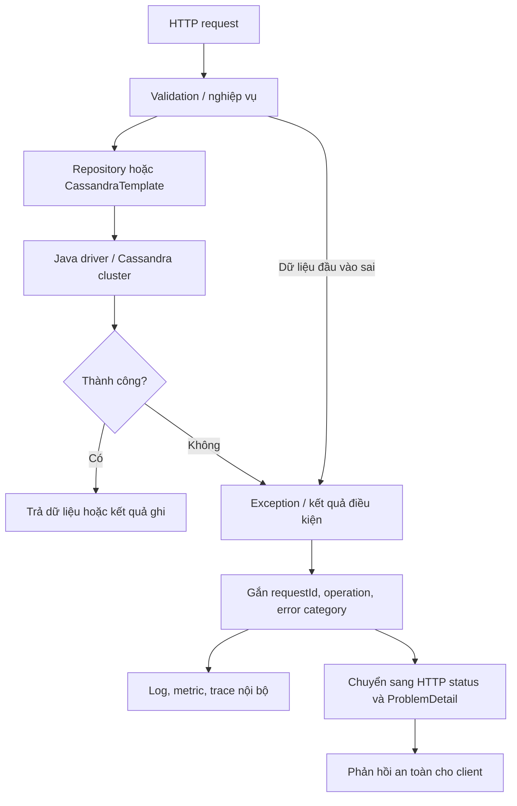
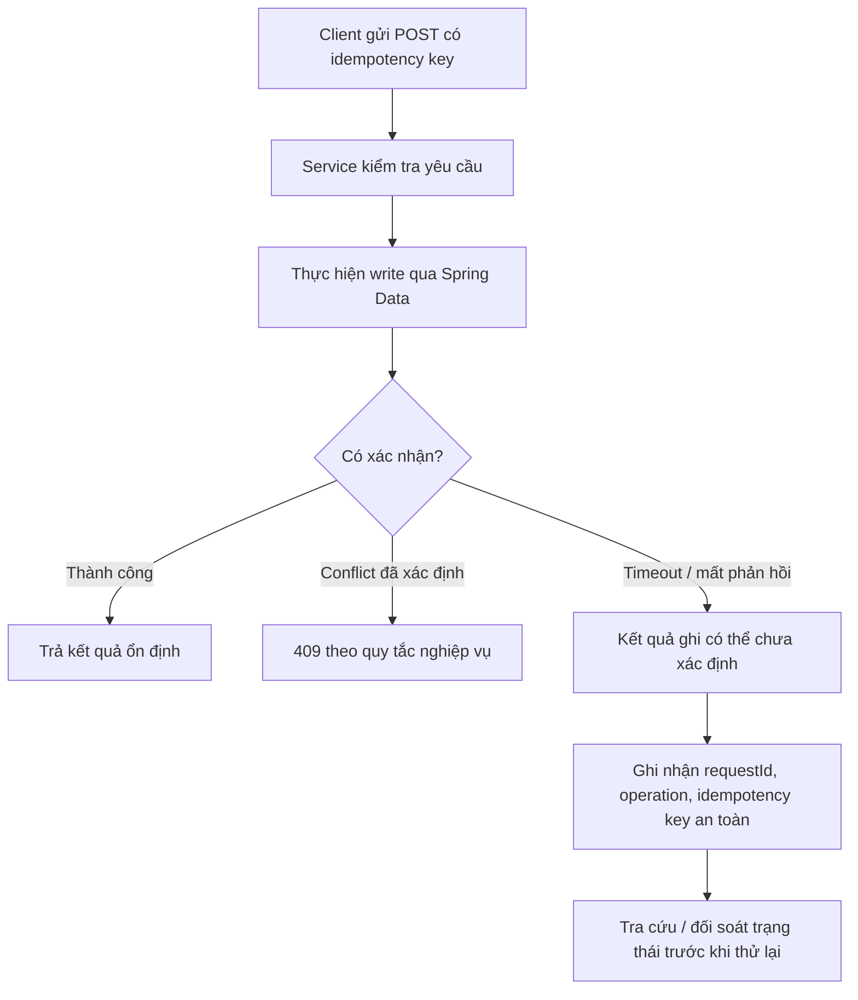

# Thu thập ngữ cảnh lỗi và chuyển thành phản hồi API phù hợp

Trong **Spring Data Cassandra**, một lỗi từ Apache Cassandra có thể xuất hiện dưới dạng ngoại lệ ở repository, `CassandraTemplate`, driver hoặc tầng mạng. Nếu chỉ trả nội dung `exception.getMessage()` cho HTTP client, API có thể lộ CQL, tên bảng, địa chỉ node và cả giá trị dữ liệu. Ngược lại, nếu mọi lỗi đều trả `500` mà không thu thập ngữ cảnh, đội vận hành khó phân biệt truy vấn sai, cluster quá tải, lỗi kết nối hay đơn giản là bản ghi không tồn tại.

Bài học thuộc chương **Xử lý lỗi** của **SPRING_DATA_CASSANDRA**. Trọng tâm là thiết kế một luồng xử lý có thể truy vết, cho phép giải thích lỗi ở phía máy chủ và cung cấp cho client **mã HTTP, mã lỗi nghiệp vụ và hướng xử lý an toàn**. Các ví dụ dùng Spring Boot 3, Spring MVC, Spring Data Cassandra, entity mapping, repository/CassandraTemplate và truy vấn CQL; với ứng dụng reactive cần điều chỉnh cách lan truyền ngữ cảnh.

## 1. Tách ba việc: phát hiện, phân loại, công bố



- **Phát hiện:** xác định lỗi xảy ra khi kiểm tra request, tạo CQL/bind giá trị, kết nối, xử lý ở Cassandra hay đọc kết quả.
- **Phân loại:** quyết định đây là lỗi của request/nghiệp vụ, lỗi triển khai/schema, lỗi hạ tầng tạm thời hay kết quả ghi chưa xác định.
- **Công bố:** trả về thông tin tối thiểu để client hành động. Chi tiết kỹ thuật chỉ đi vào log/trace nội bộ có kiểm soát.

Cùng một ngoại lệ kỹ thuật có thể cần cách xử lý khác nhau tùy thao tác. Ví dụ, timeout khi **đọc** thường phù hợp với retry có giới hạn, còn timeout khi **ghi** không chứng minh ghi thất bại: Cassandra có thể đã áp dụng thay đổi dù client chưa nhận được xác nhận.

## 2. Thu thập ngữ cảnh đủ để điều tra

### 2.1. Những trường nên ghi nhận

| Nhóm | Trường gợi ý | Mục đích |
| --- | --- | --- |
| Theo dõi request | `requestId`, `traceId`, `spanId` nếu hệ thống tracing cung cấp | Nối log API với các span và sự kiện liên quan. |
| Nghiệp vụ | Tên thao tác như `findOrdersByCustomer`, phương thức HTTP, route dạng mẫu | Xác định luồng gặp lỗi mà không ghi tham số nhạy cảm. |
| Cassandra | Keyspace, bảng, tên truy vấn/statement, kiểu `SELECT`/`INSERT`/`UPDATE`/`DELETE`, consistency level | So sánh lỗi với thiết kế partition key, index và cấu hình đọc/ghi. |
| Thời điểm/chi phí | Timestamp, elapsed time, timeout đã cấu hình, số lần thử lại | Phân biệt lỗi đến nhanh và lỗi do chờ lâu; theo dõi tác động của retry. |
| Chẩn đoán | Exception class, root cause class, nhóm lỗi, driver error code nếu có | Điều tra mà không cần trả raw message cho client. |
| Kết quả ghi | Loại thao tác, đã nhận xác nhận chưa, có LWT hay idempotency key không | Đánh giá khả năng kết quả ghi chưa xác định. |
| Phạm vi | Tên môi trường, phiên bản dịch vụ, mã triển khai, thông tin node/coordinator nếu driver cung cấp | Liên hệ sự cố với triển khai hoặc trạng thái cluster. |

Không phải trường nào cũng luôn có sẵn. Chẳng hạn, coordinator/node được driver cung cấp tùy lỗi và cơ chế tracing; không tự điền giá trị giả. **Không ghi mật khẩu, token, toàn bộ payload, CQL đã nối giá trị, keyspace chứa thông tin nhạy cảm, hay giá trị khóa định danh cá nhân** nếu không có cơ sở và chính sách bảo vệ dữ liệu phù hợp. Với metrics, không dùng `requestId` hoặc UUID làm label vì sẽ gây bùng nổ cardinality.

Ví dụ bản ghi log có cấu trúc (giá trị minh họa, không chứa giá trị tham số CQL):

```json
{
  "event": "cassandra.operation.failed",
  "requestId": "d6260c28-978a-4a2a-9f90-c74a2367028a",
  "operation": "findOrdersByCustomer",
  "table": "orders_by_customer",
  "statementKind": "SELECT",
  "consistency": "LOCAL_QUORUM",
  "elapsedMs": 180,
  "errorCategory": "DATASTORE_TIMEOUT",
  "rootExceptionType": "ReadTimeoutException"
}
```

Đây là cấu trúc gợi ý, không phải log tự động được Spring Data tạo ra. Cần chủ động lấy các trường khả dụng tại điểm truy cập database hoặc qua instrumentation; `elapsedMs` và `consistency` chỉ ghi giá trị đã đo hoặc đã cấu hình thực sự.

### 2.2. Tạo correlation ID cho mỗi HTTP request

Có thể dùng `OncePerRequestFilter` để tạo một định danh do máy chủ kiểm soát, đặt vào request attribute, response header và MDC. Ví dụ cho Spring MVC/Servlet:

```java
import java.io.IOException;
import java.util.UUID;

import jakarta.servlet.FilterChain;
import jakarta.servlet.ServletException;
import jakarta.servlet.http.HttpServletRequest;
import jakarta.servlet.http.HttpServletResponse;

import org.slf4j.MDC;
import org.springframework.stereotype.Component;
import org.springframework.web.filter.OncePerRequestFilter;

@Component
public class RequestIdFilter extends OncePerRequestFilter {
    public static final String ATTRIBUTE = "app.requestId";

    @Override
    protected void doFilterInternal(
            HttpServletRequest request,
            HttpServletResponse response,
            FilterChain chain
    ) throws ServletException, IOException {
        String requestId = UUID.randomUUID().toString();
        request.setAttribute(ATTRIBUTE, requestId);
        response.setHeader("X-Request-ID", requestId);

        try (MDC.MDCCloseable ignored =
                     MDC.putCloseable("requestId", requestId)) {
            chain.doFilter(request, response);
        }
    }
}
```

MDC giúp cấu hình log pattern hoặc JSON logger tự gắn `requestId` cho log được phát sinh **trên luồng đang mang MDC**. Cấu trúc `try-with-resources` dọn giá trị khi request kết thúc trên luồng này, tránh lẫn ID giữa các request dùng chung thread. Không giả định MDC tự đi qua `CompletableFuture`, scheduler hay Reactor: với Spring WebFlux/reactive và tác vụ bất đồng bộ cần dùng Reactor Context, Micrometer Context Propagation hoặc cơ chế truyền context của hệ thống đang triển khai.

Nếu muốn nhận `X-Request-ID` từ client/gateway, phải kiểm tra độ dài, tập ký tự, độ tin cậy và chính sách nhận header; ví dụ trên **luôn tự tạo ID** để tránh đưa dữ liệu tùy ý từ client vào log.

## 3. Đọc đúng lỗi từ Spring Data Cassandra và driver

Có nhiều tầng ngoại lệ, nên phân loại dựa trên **root cause kết hợp thao tác thực tế**, không chỉ tên class ngoài cùng.

| Nguồn/biểu hiện | Ý nghĩa thường gặp | Việc cần làm |
| --- | --- | --- |
| `MethodArgumentNotValidException` hoặc lỗi chuyển kiểu tham số HTTP | Body/path/query parameter từ client không hợp lệ | Trả lỗi request rõ ràng, không gọi Cassandra. |
| Repository trả `Optional.empty()` / không có bản ghi | Truy vấn hợp lệ nhưng không tìm thấy dữ liệu | Xét ngữ nghĩa endpoint để trả `404`, danh sách rỗng hoặc kết quả khác. |
| Driver `InvalidQueryException`, `SyntaxError` | CQL sai quy tắc key/index, không tồn tại cột, cú pháp sai… | Kiểm tra schema, câu truy vấn và triển khai; thường là lỗi phía dịch vụ. |
| Lỗi mapping/conversion/codec | Entity hoặc giá trị Java không tương thích cột CQL | Kiểm tra `@Table`, `@PrimaryKey`, converter và kiểu dữ liệu. |
| `QueryTimeoutException` của Spring, lỗi timeout từ driver | Không có phản hồi kịp thời trong ngưỡng chờ | Xác định thao tác đọc hay ghi và kết quả có thể chưa biết. |
| Lỗi unavailable/overloaded/không kết nối được node | Cluster không thể phục vụ ở điều kiện hiện tại | Kiểm tra health, consistency, retry policy, công suất và kết nối. |
| Conditional write (LWT) có `[applied] = false` | Điều kiện ghi không thỏa; đây có thể là **kết quả hợp lệ**, không phải exception | Chuyển thành phản hồi nghiệp vụ như conflict khi phù hợp. |

Spring Data có thể chuyển ngoại lệ driver thành `DataAccessException` và các lớp con; driver được gọi trực tiếp có thể trả exception khác. Do phiên bản driver/Spring và cách gọi khác nhau, **không áp một mapping cố định dựa trên mọi tên class kể trên**. Kiểm tra `getCause()`, `getMostSpecificCause()` khi dùng `DataAccessException`, loại statement và ngữ cảnh thao tác.

Lỗi **CQL không hợp lệ** do lập trình hoặc schema lệch không trở thành `400 Bad Request` chỉ vì Cassandra dùng từ “invalid”. Client có thể đã gửi request hoàn toàn hợp lệ. Tương tự, thông báo `Unauthorized` từ tài khoản kết nối Cassandra là lỗi cấu hình/quyền của **dịch vụ**, không phải lý do trả `401` cho người gọi API.

## 4. Quy tắc chuyển lỗi thành HTTP status

Bảng sau là **chính sách tham khảo** cho API Spring MVC gọi Cassandra. Hãy nhất quán với hợp đồng API và tình huống thực tế.

| Tình huống | HTTP | Mã lỗi công khai gợi ý | Lý do |
| --- | --- | --- | --- |
| JSON sai cú pháp, UUID sai định dạng, Bean Validation không đạt | `400 Bad Request` | `INVALID_REQUEST` | Client có thể sửa input. |
| Một tài nguyên được tìm theo ID nhưng không tồn tại | `404 Not Found` | `ORDER_NOT_FOUND` | Kết quả truy vấn thành công nhưng không có tài nguyên. |
| Vi phạm quy tắc nghiệp vụ, đơn đã tồn tại hoặc LWT từ chối do xung đột | `409 Conflict` | `ORDER_CONFLICT` | Client cần làm mới hoặc thay đổi yêu cầu. |
| CQL sai, mapping lỗi, keyspace/bảng chưa triển khai, lỗi lập trình | `500 Internal Server Error` | `INTERNAL_ERROR` | Sửa mã ứng dụng hoặc schema, không yêu cầu client sửa CQL. |
| Cassandra tạm thời unavailable, quá tải hoặc lỗi kết nối đã được phân loại là tạm thời | `503 Service Unavailable` | `DATASTORE_UNAVAILABLE` | Dịch vụ tạm thời không hoàn thành yêu cầu. |
| Hết thời gian chờ datastore; chính sách dịch vụ xem là lỗi phụ thuộc tạm thời | `503 Service Unavailable` | `DATASTORE_TIMEOUT` | Không coi mọi timeout là lỗi nhập liệu. |
| API có giới hạn lưu lượng do **chính API** áp dụng | `429 Too Many Requests` | `RATE_LIMITED` | Chỉ dùng khi thực sự có chính sách rate limit phía API. |

`504 Gateway Timeout` thường phù hợp khi dịch vụ đang thực sự làm **gateway/proxy** và hết thời gian chờ phản hồi từ upstream theo hợp đồng của hệ thống; ứng dụng nghiệp vụ gọi Cassandra không cần mặc định trả `504`. Đừng tự ánh xạ Cassandra overload thành `429` hay lỗi xác thực datastore thành `401/403`. Mã `Retry-After` chỉ nên gửi khi có chính sách/ước lượng thời gian chờ hợp lệ, không tự đặt một con số tùy ý.

Lưu ý về kết quả truy vấn:

- `SELECT` trả **danh sách rỗng** thường là `200 OK` với `[]` (hoặc hợp đồng phân trang), không phải `404`.
- `findById` trả không có dữ liệu có thể tương ứng `404` nếu route đại diện một tài nguyên.
- Khi `INSERT IF NOT EXISTS` trả `[applied] = false`, quyết định `409` dựa trên quy tắc chống trùng và idempotency; driver không nhất thiết ném ngoại lệ.
- Timeout khi ghi có thể mang trạng thái **outcome unknown**. Trước khi yêu cầu client gửi lại, cần cách kiểm tra kết quả hoặc khóa idempotency để tránh tạo hai đơn hàng/giao dịch.

## 5. Thiết kế hợp đồng phản hồi với Problem Details

Spring Framework 6 / Spring Boot 3 có `ProblemDetail` để biểu diễn phản hồi lỗi dạng Problem Details (RFC 9457). Một phản hồi an toàn nên có:

- `type`: định danh loại lỗi ổn định (mặc định có thể là `about:blank`).
- `title`, `status`, `detail`: mô tả ngắn, dễ hiểu và không chứa nội tình Cassandra.
- `code`: mã máy đọc ổn định theo hợp đồng API.
- `requestId`: khớp header `X-Request-ID` để người dùng cung cấp khi báo lỗi.

Ví dụ phản hồi khi không truy vấn được vì phụ thuộc tạm thời:

```http
HTTP/1.1 503 Service Unavailable
Content-Type: application/problem+json
X-Request-ID: d6260c28-978a-4a2a-9f90-c74a2367028a

{
  "type": "about:blank",
  "title": "Service Unavailable",
  "status": 503,
  "detail": "Dịch vụ tạm thời không xử lý được yêu cầu.",
  "code": "DATASTORE_UNAVAILABLE",
  "requestId": "d6260c28-978a-4a2a-9f90-c74a2367028a"
}
```

Không đưa vào response những trường như `clusterHost`, CQL, stack trace, tên keyspace, tên bảng, username datastore, SQL/CQL parameters hay thông điệp gốc của driver. Dù client có gửi `debug=true`, chỉ hệ thống quan sát nội bộ có phân quyền mới được phép xem thông tin nhạy cảm.

## 6. Ví dụ `@RestControllerAdvice` với Spring MVC

Dưới đây là ví dụ minh họa một chính sách **tối thiểu và có chủ đích**. Hai exception `OrderNotFoundException` và `OrderConflictException` là exception nghiệp vụ do ứng dụng tự định nghĩa; service phát sinh chúng sau khi xác định trạng thái, không ném chúng chỉ vì Cassandra không truy cập được.

```java
import jakarta.servlet.http.HttpServletRequest;

import org.slf4j.Logger;
import org.slf4j.LoggerFactory;
import org.springframework.dao.DataAccessException;
import org.springframework.dao.QueryTimeoutException;
import org.springframework.http.HttpStatus;
import org.springframework.http.ProblemDetail;
import org.springframework.http.ResponseEntity;
import org.springframework.http.converter.HttpMessageNotReadableException;
import org.springframework.web.bind.MethodArgumentNotValidException;
import org.springframework.web.bind.annotation.ExceptionHandler;
import org.springframework.web.bind.annotation.RestControllerAdvice;
import org.springframework.web.method.annotation.MethodArgumentTypeMismatchException;

class OrderNotFoundException extends RuntimeException {}
class OrderConflictException extends RuntimeException {}

@RestControllerAdvice
public class ApiErrorAdvice {
    private static final Logger log =
            LoggerFactory.getLogger(ApiErrorAdvice.class);

    // Chỉ những lỗi xác thực/giải mã request đã biết mới được trả 400.
    @ExceptionHandler({
        MethodArgumentNotValidException.class,
        MethodArgumentTypeMismatchException.class,
        HttpMessageNotReadableException.class
    })
    public ResponseEntity<ProblemDetail> badRequest(
            Exception ex, HttpServletRequest request) {
        return respond(HttpStatus.BAD_REQUEST,
                "INVALID_REQUEST", "Dữ liệu yêu cầu không hợp lệ.", request);
    }

    @ExceptionHandler(OrderNotFoundException.class)
    public ResponseEntity<ProblemDetail> notFound(
            OrderNotFoundException ex, HttpServletRequest request) {
        return respond(HttpStatus.NOT_FOUND,
                "ORDER_NOT_FOUND", "Không tìm thấy đơn hàng.", request);
    }

    @ExceptionHandler(OrderConflictException.class)
    public ResponseEntity<ProblemDetail> conflict(
            OrderConflictException ex, HttpServletRequest request) {
        return respond(HttpStatus.CONFLICT,
                "ORDER_CONFLICT", "Trạng thái đơn hàng không cho phép thao tác.",
                request);
    }

    // Ví dụ này phân loại rõ QueryTimeoutException đã được Spring dịch.
    @ExceptionHandler(QueryTimeoutException.class)
    public ResponseEntity<ProblemDetail> datastoreTimeout(
            QueryTimeoutException ex, HttpServletRequest request) {
        log.warn("event=cassandra.timeout requestId={} type={}",
                id(request), ex.getClass().getName());
        return respond(HttpStatus.SERVICE_UNAVAILABLE,
                "DATASTORE_TIMEOUT",
                "Dịch vụ tạm thời không xử lý được yêu cầu.", request);
    }

    // Mặc định bảo thủ: các lỗi datastore chưa phân loại là lỗi phía server.
    @ExceptionHandler(DataAccessException.class)
    public ResponseEntity<ProblemDetail> dataAccess(
            DataAccessException ex, HttpServletRequest request) {
        Throwable root = ex.getMostSpecificCause();
        log.error("event=cassandra.failure requestId={} wrapper={} rootType={}",
                id(request), ex.getClass().getName(),
                root.getClass().getName());
        return respond(HttpStatus.INTERNAL_SERVER_ERROR,
                "INTERNAL_ERROR", "Có lỗi nội bộ xảy ra.", request);
    }

    private ResponseEntity<ProblemDetail> respond(
            HttpStatus status, String code, String detail,
            HttpServletRequest request) {
        ProblemDetail body = ProblemDetail.forStatusAndDetail(status, detail);
        body.setProperty("code", code);
        body.setProperty("requestId", id(request));
        return ResponseEntity.status(status).body(body);
    }

    private static String id(HttpServletRequest request) {
        Object value = request.getAttribute(RequestIdFilter.ATTRIBUTE);
        return value instanceof String ? (String) value : "unknown";
    }
}
```

Ví dụ trên **không cố gắng bắt tất cả** exception driver: nó xử lý những exception Spring đã dịch và hai exception nghiệp vụ. Khi hệ thống dùng driver trực tiếp, API reactive hoặc một số lỗi kết nối được bọc dưới lớp khác, hãy bổ sung adapter ở tầng dữ liệu để chuyển thành **nhóm lỗi nội bộ** rõ ràng, rồi dùng nhóm đó trong advice. Không nên bắt mọi `RuntimeException` và trả `503` vì làm che giấu lỗi lập trình.

Nếu muốn trả `503` cho unavailable/overloaded, cần **nhận diện chính xác** các trạng thái đó từ driver và tầng dịch ngoại lệ phù hợp với phiên bản thư viện đang dùng. `DataAccessException` là nhóm quá rộng để mặc định coi mọi lỗi của nó là tạm thời. Ngay cả `QueryTimeoutException` cũng không cho biết một phép ghi đã được áp dụng hay chưa; quy tắc retry phải xét thao tác tương ứng.

### Khi nào log thêm stack trace?

Ở ví dụ, log mặc định lưu mã lỗi và loại exception, tránh vô tình in giá trị truy vấn. Khi điều tra sự cố sâu hơn, có thể ghi stack trace và thông điệp gốc vào **kênh log nội bộ có phân quyền, lọc bí mật, giới hạn retention và sampling**. Cấu hình logger phù hợp với mức độ nhạy cảm của driver/ORM đang sử dụng; không bật log toàn bộ bound values trong môi trường thật.

## 7. Thu thập ngữ cảnh tại service/repository thay vì đoán ở advice

`@RestControllerAdvice` biết HTTP request và exception, nhưng thường không biết thao tác CQL vừa chạy, consistency level, timeout hay **ghi đã thành công hay chưa**. Những dữ liệu này nên được tạo ngay trước/sau lệnh repository hoặc `CassandraTemplate`.

Ví dụ một service chỉ đọc, đo thời gian và log ngữ cảnh có nhãn ổn định:

```java
@Service
public class OrderQueryService {
    private static final Logger log =
            LoggerFactory.getLogger(OrderQueryService.class);

    private final OrderByIdRepository repository;

    public OrderQueryService(OrderByIdRepository repository) {
        this.repository = repository;
    }

    public OrderById load(UUID orderId) {
        long started = System.nanoTime();
        try {
            // Đọc theo partition key order_id của bảng orders_by_id.
            return repository.findById(orderId)
                    .orElseThrow(OrderNotFoundException::new);
        } catch (DataAccessException ex) {
            long elapsedMs =
                    java.util.concurrent.TimeUnit.NANOSECONDS.toMillis(
                            System.nanoTime() - started);
            log.warn("event=cassandra.operation.failed operation=findOrderById "
                    + "table=orders_by_id durationMs={} exceptionType={}",
                    elapsedMs, ex.getClass().getName());
            throw ex; // Giữ loại lỗi để advice phân loại tiếp.
        }
    }
}
```

Đoạn trên giả định `OrderByIdRepository`, `OrderById` và `OrderNotFoundException` đã được định nghĩa; entity `OrderById` ánh xạ bảng có partition key là `order_id`. Các class import không liên quan đến logic được lược bỏ cho dễ đọc.

Nếu dùng `CassandraTemplate.selectOne(Query, Entity.class)`, vị trí thu thập ngữ cảnh tương tự. Một truy vấn có `SELECT`, nhưng dùng sai partition key hoặc cần `ALLOW FILTERING`, phải sửa thiết kế query/table trước; mapping lỗi sang `503` không giải quyết nguyên nhân. Với thao tác lấy danh sách, nên theo dõi paging/fetch size và thời gian tải từng trang; không log toàn bộ kết quả.

**Đừng log cùng một exception ở mọi tầng.** Chọn điểm log chính có đủ operation + ngữ cảnh; advice có thể chỉ gắn mã phản hồi và request ID hoặc log ở mức tóm tắt. Nếu chọn log cả hai, dùng `requestId` và tên event để phát hiện và loại bỏ bản ghi trùng trong pipeline quan sát.

## 8. Timeout khi ghi và idempotency

Giả sử client gửi `POST /orders`, ứng dụng đã gửi `INSERT` đến Cassandra nhưng gặp timeout trước khi nhận xác nhận.

1. Không thể kết luận đơn hàng **chắc chắn chưa được tạo** chỉ dựa vào timeout. Một phần hoặc toàn bộ replica có thể đã ghi dữ liệu tùy loại timeout/consistency.
2. Nếu client gửi lại một yêu cầu sinh ID mới, hệ thống có thể tạo **hai đơn**. Với thao tác ghi không idempotent hoặc có side effect, tự động retry là rủi ro.
3. Nên thiết kế **idempotency key** do API quản lý hoặc định danh đơn ổn định; áp dụng kiểm tra trạng thái sau timeout và quy trình hòa giải phù hợp với nghiệp vụ.
4. Với LWT (lightweight transaction), kiểm tra kết quả `[applied]` khi **nhận được phản hồi bình thường**. `[applied] = false` không giống timeout và không mặc định là sự cố cluster.
5. Nếu không thể xác nhận kết quả ngay, trả thông điệp an toàn thể hiện trạng thái chưa chắc chắn theo hợp đồng API; có thể cung cấp endpoint kiểm tra theo request/idempotency key.



Idempotency key cũng có thể là dữ liệu cần bảo vệ; nếu log, tuân theo chính sách dữ liệu, cân nhắc chỉ ghi mã tham chiếu không chứa nội dung người dùng. Không giả định consistency level cao hơn sẽ xóa bỏ hoàn toàn trạng thái chưa xác định khi timeout.

## 9. Vận hành: metrics, tracing và cảnh báo

Sau khi chuyển lỗi thành HTTP status, cần giám sát để phân biệt tải tăng với lỗi triển khai:

- **Metrics:** tỉ lệ lỗi theo `operation`, `errorCategory`, `status`; latency p50/p95/p99; thời gian chờ driver; retry count; connection/pool saturation. Dùng label có tập giá trị nhỏ và ổn định.
- **Distributed tracing:** gắn span cho request HTTP và lời gọi Cassandra qua instrumentation được cấu hình; lưu `traceId` để đối chiếu, tuyệt đối không thu thập query bind values mặc định.
- **Alert:** cảnh báo theo tỉ lệ `5xx`, timeout, unavailable/overloaded trong khoảng thời gian có ý nghĩa; xem xét số lượng request và baseline để tránh cảnh báo nhiễu.
- **Khả năng phục hồi:** timeout, retry/backoff có giới hạn, circuit breaker khi phù hợp. Retry cho phép đọc hay ghi phải dựa trên tính idempotent và đặc tính kết quả không xác định.
- **Cách biệt lỗi:** kiểm tra health Cassandra và app; không đánh đồng lỗi xác thực datastore, lỗi schema và thiếu tài nguyên với lỗi hạ tầng tạm thời.
- **Kiểm chứng môi trường:** thử mapping trên phiên bản Spring Data Cassandra + driver thực tế; đối chiếu log, response JSON, header correlation và metric cho từng loại lỗi.

Trong dịch vụ dùng `Spring Data Cassandra`, consistency, paging và mô hình bảng theo truy vấn ảnh hưởng trực tiếp tới latency và độ ổn định. Timeout hoặc lỗi đọc nhiều trang đôi khi là tín hiệu thiết kế partition quá lớn hoặc một truy vấn chạy qua nhiều partition, chứ không chỉ là giá trị timeout quá thấp.

## 10. Tình huống thực hành và checklist

### Tình huống A: Truy vấn CQL do server tạo bị từ chối

Một repository truy vấn `orders_by_customer` theo `status` dù bảng chỉ có partition key `customer_id` và không có đường truy cập phù hợp. Cassandra báo lỗi về filtering/điều kiện khóa.

**Phân tích:** Input của client có thể hoàn toàn hợp lệ. Đây là lỗi thiết kế truy vấn hoặc schema; trả `500 INTERNAL_ERROR` với `requestId` cho client, đồng thời log tên operation, tên bảng và loại lỗi để kỹ sư sửa CQL hoặc tạo bảng phục vụ query. Không trả raw CQL cho client và không thêm `ALLOW FILTERING` như cách chữa lỗi chung.

### Tình huống B: GET hợp lệ, bản ghi không tồn tại

`GET /orders/{id}` nhận UUID hợp lệ, repository tìm bằng partition key và trả `Optional.empty()`. Service ném `OrderNotFoundException` để advice trả `404 ORDER_NOT_FOUND`. Đây không phải sự cố Cassandra; không tăng metric `datastore.failure`.

### Tình huống C: Cassandra timeout sau khi nhận yêu cầu ghi

API `POST /orders` gặp timeout. Response có thể là `503 DATASTORE_TIMEOUT` theo chính sách, nhưng client cần biết cách **kiểm tra trạng thái đơn bằng định danh/idempotency key** trước khi thử lại. Log lưu operation, request ID, kết quả đã xác nhận hay chưa; không khẳng định “ghi thất bại” khi thiếu bằng chứng.

### Checklist trước khi triển khai

| Câu hỏi | Kỳ vọng |
| --- | --- |
| Có phân biệt lỗi input, not found, business conflict, lỗi CQL/schema và lỗi cluster không? | Có bảng mapping tường minh và ví dụ cho từng loại. |
| Response có `code` ổn định, `requestId` và nội dung an toàn không? | Client biết phải sửa request, xem trạng thái, hay thử lại có kiểm soát. |
| Log có đủ operation, loại lỗi, thời gian và tương quan request không? | Điều tra được mà không cần lộ PII/bound values. |
| Có phân biệt đọc và ghi khi timeout không? | Không retry gây trùng dữ liệu hoặc kết quả ngoài ý muốn. |
| Đã kiểm thử trên schema, driver và phiên bản Spring thật chưa? | Lỗi được phân loại đúng cả khi exception bị wrap/translate. |
| Có đo ảnh hưởng của paging, partition size, consistency và retry không? | Không che lỗi mô hình dữ liệu bằng tăng timeout hoặc lọc toàn bảng. |

## Kết luận

**Một phản hồi API tốt phải chính xác về trách nhiệm và hữu ích cho hành động tiếp theo của client; một bản ghi lỗi tốt phải đủ ngữ cảnh để kỹ sư tìm được nguyên nhân.** Với Spring Data Cassandra, hãy thu thập thông tin ở đúng tầng truy cập dữ liệu, theo dấu mỗi request, phân biệt lỗi CQL/mapping với lỗi hạ tầng và trạng thái ghi chưa xác định, rồi dùng hợp đồng Problem Details để trả thông điệp ổn định, an toàn.
