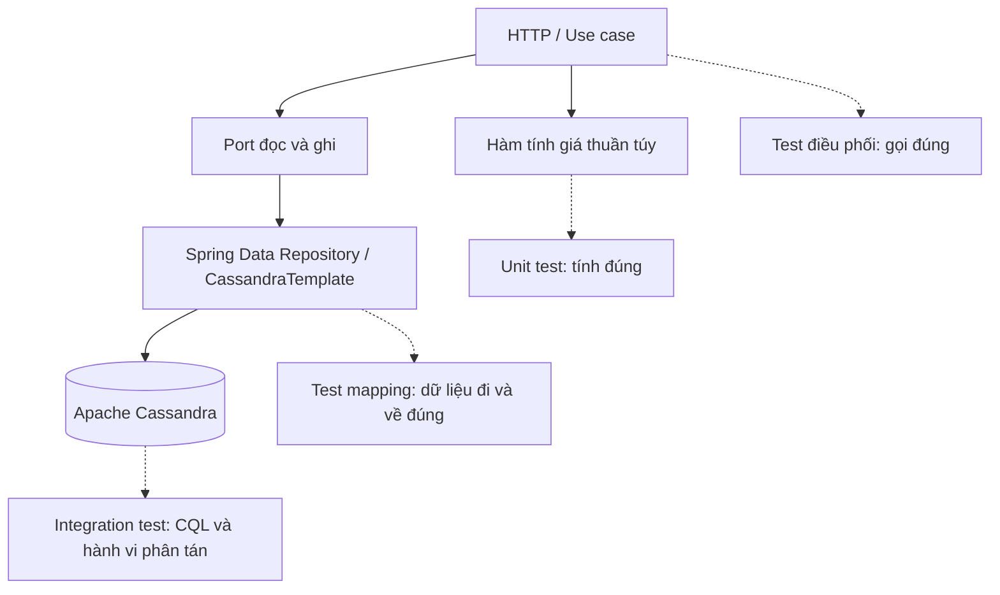

# Phân lớp kiểm thử nghiệp vụ, ánh xạ và tích hợp Cassandra

Một ứng dụng dùng **Spring Data Cassandra** có ít nhất ba nguồn lỗi khác nhau: quy tắc nghiệp vụ tính sai, entity/repository ánh xạ sai bảng hoặc khóa, và câu lệnh CQL hoạt động không như dự kiến khi chạy trên Apache Cassandra thật. Gộp tất cả vào các bài test khởi động toàn bộ ứng dụng sẽ khiến kiểm thử chậm, khó chẩn đoán và dễ bỏ sót các đặc tính của hệ dữ liệu phân tán.

Trong chương **Kiểm thử**, mục tiêu là xây dựng chiến lược phân lớp: **unit test cho phép tính nghiệp vụ**, **test ánh xạ và repository cho hợp đồng dữ liệu**, **integration test với Cassandra thật cho truy vấn, consistency, paging và hành vi khi có cạnh tranh**. Spring Data Cassandra cung cấp entity mapping, `CassandraRepository`, `CassandraTemplate` và cách thực thi CQL; mỗi công cụ cần được kiểm thử ở ranh giới phù hợp.

## 1. Quyết định nội dung kiểm thử theo rủi ro

Xét chức năng tạo báo giá thuê thiết bị. Khách hàng nhập số ngày, hệ thống đọc đơn giá và mức giảm, tính tiền rồi lưu một báo giá với khóa `(tenant_id, request_id)`.



| Lớp kiểm thử | Câu hỏi chính | Công cụ điển hình | Cần Cassandra thật? |
| --- | --- | --- | --- |
| Nghiệp vụ thuần túy | Với cùng input, kết quả tính toán có chính xác và ổn định không? | JUnit 5, AssertJ | Không |
| Điều phối use case | Có đọc dữ liệu, kiểm tra điều kiện, ghi và xử lý lỗi đúng thứ tự không? | JUnit 5, fake hoặc Mockito | Không |
| Ánh xạ entity và repository | Kiểu Java có chuyển đúng sang `uuid`, `decimal`, tên cột, partition key và ngược lại không? | `@DataCassandraTest`, Testcontainers | Nên có |
| CQL và adapter lưu trữ | Truy vấn có dùng đúng khóa, `IF NOT EXISTS` có chặn ghi trùng, phân trang có giữ đúng vị trí không? | Driver, `CassandraTemplate`, Testcontainers | Có |
| Luồng ứng dụng | Controller, validation, service và adapter có phối hợp đúng không? | `@SpringBootTest` với Cassandra container | Có, cho luồng quan trọng |
| Tải và khả năng chịu lỗi | Partition có tăng quá lớn, p95/p99 latency, timeout, retry, mất node ra sao? | Kịch bản đo tải/chaos trên môi trường phù hợp | Có, cần topology đại diện |

**Nguyên tắc:** test nghiệp vụ nên nhiều và chạy nhanh; test với Cassandra ít hơn nhưng kiểm tra đúng những thuộc tính chỉ database thật mới chứng minh được. Mock `CassandraRepository` có thể xác nhận service gọi phương thức nào, nhưng **không thể chứng minh CQL hợp lệ, mapping đúng hoặc LWT hoạt động**.

## 2. Unit test cho quy tắc nghiệp vụ

Đưa việc tính tổng tiền vào hàm không phụ thuộc Spring, repository, đồng hồ hoặc mạng. Ví dụ sau giả định đơn giá là số tiền cho một ngày, tỷ lệ giảm trong khoảng `[0, 1]`, làm tròn hai chữ số bằng `HALF_UP` và giới hạn thời gian thuê từ 1 đến 90 ngày.

```java
import java.math.BigDecimal;
import java.math.RoundingMode;
import java.util.Objects;

record QuotePrice(BigDecimal gross, BigDecimal discount, BigDecimal total) {}

final class QuoteCalculator {
    private QuoteCalculator() {}

    static QuotePrice calculate(BigDecimal dailyRate,
                                int days,
                                BigDecimal discountRate) {
        Objects.requireNonNull(dailyRate, "dailyRate");
        Objects.requireNonNull(discountRate, "discountRate");

        if (days < 1 || days > 90
                || dailyRate.signum() < 0
                || discountRate.compareTo(BigDecimal.ZERO) < 0
                || discountRate.compareTo(BigDecimal.ONE) > 0) {
            throw new IllegalArgumentException("Dữ liệu báo giá không hợp lệ");
        }

        BigDecimal gross = dailyRate.multiply(BigDecimal.valueOf(days))
                .setScale(2, RoundingMode.HALF_UP);
        BigDecimal discount = gross.multiply(discountRate)
                .setScale(2, RoundingMode.HALF_UP);
        return new QuotePrice(gross, discount, gross.subtract(discount));
    }
}
```

Test dùng `BigDecimal` để tránh sai số tiền tệ do `double` và so sánh **giá trị số** thay vì phụ thuộc scale không cần thiết:

```java
import static org.assertj.core.api.Assertions.assertThat;
import static org.assertj.core.api.Assertions.assertThatThrownBy;
import java.math.BigDecimal;
import org.junit.jupiter.api.Test;

class QuoteCalculatorTest {
    @Test
    void tinhGiaBaNgayGiamMuoiPhanTram() {
        QuotePrice result = QuoteCalculator.calculate(
                new BigDecimal("100.00"), 3, new BigDecimal("0.10"));

        assertThat(result.gross()).isEqualByComparingTo("300.00");
        assertThat(result.discount()).isEqualByComparingTo("30.00");
        assertThat(result.total()).isEqualByComparingTo("270.00");
    }

    @Test
    void tuChoiSoNgayBangKhong() {
        assertThatThrownBy(() -> QuoteCalculator.calculate(
                new BigDecimal("100.00"), 0, BigDecimal.ZERO))
                .isInstanceOf(IllegalArgumentException.class);
    }

    @Test
    void tongCongVoiGiamGiaPhaiBangTienGoc() {
        QuotePrice result = QuoteCalculator.calculate(
                new BigDecimal("13.33"), 7, new BigDecimal("0.15"));

        assertThat(result.total().add(result.discount()))
                .isEqualByComparingTo(result.gross());
    }
}
```

Ngoài ví dụ cơ bản, nên dùng **parameterized test** cho ngày thuê tối thiểu/tối đa, mức giảm `0`, `1`, đơn giá bằng `0`, tỷ lệ giảm âm và lớn hơn `1`. Các bất biến có ích gồm `total >= 0`, `discount <= gross` và `total + discount = gross`; khi đổi chính sách làm tròn, test phải thể hiện quy tắc mới một cách tường minh.

**Không khởi động `@SpringBootTest` cho những bài test trên.** Kết quả của hàm chỉ phụ thuộc đối số, do đó JUnit thuần là đủ và nhanh hơn đáng kể.

## 3. Test use case: xác minh cách điều phối I/O

Use case đọc đơn giá, tính tiền và yêu cầu lưu. Nên đặt các truy cập Cassandra sau interface để test hành vi bằng fake/mock:

```java
interface RateReader {
    BigDecimal loadDailyRate(String tenantId, String sku);
}

interface QuoteWriter {
    boolean insertIfAbsent(String tenantId, UUID requestId, QuotePrice price);
}
```

Ví dụ sau kiểm tra **hợp đồng tương tác** bằng Mockito; lớp `CreateQuoteService` minh họa nhận hai port trong constructor và thực hiện `create(tenantId, requestId, sku, days, discountRate)`:

```java
import static org.assertj.core.api.Assertions.assertThat;
import static org.mockito.Mockito.*;
import java.math.BigDecimal;
import java.util.UUID;
import org.junit.jupiter.api.Test;

class CreateQuoteServiceTest {
    @Test
    void ghiKetQuaDuocTinhTuDonGiaDaDoc() {
        RateReader reader = mock(RateReader.class);
        QuoteWriter writer = mock(QuoteWriter.class);
        CreateQuoteService service = new CreateQuoteService(reader, writer);
        UUID id = UUID.randomUUID();

        when(reader.loadDailyRate("t1", "CAM-01"))
                .thenReturn(new BigDecimal("100.00"));
        when(writer.insertIfAbsent(eq("t1"), eq(id), any(QuotePrice.class)))
                .thenReturn(true);

        QuotePrice result = service.create(
                "t1", id, "CAM-01", 3, new BigDecimal("0.10"));

        assertThat(result.total()).isEqualByComparingTo("270.00");
        verify(writer).insertIfAbsent(eq("t1"), eq(id), argThat(
                price -> price.total().compareTo(new BigDecimal("270.00")) == 0));
    }
}
```

Đây là **mã test minh họa hợp đồng của use case**; `CreateQuoteService` do ứng dụng triển khai. Chú ý các tình huống độc lập cần có: dữ liệu đầu vào sai thì không ghi, đọc đơn giá lỗi thì không ghi, `insertIfAbsent` trả `false` thì xử lý khóa đã tồn tại, timeout ghi thì **không** được kết luận chắc chắn rằng dữ liệu chưa lưu. Với idempotency, nên có test việc gửi lại cùng `requestId` trả đúng báo giá đã lưu và request khác dùng cùng ID bị từ chối.

Test interaction không nên xác nhận từng lệnh nội bộ vụn vặt nếu không phản ánh yêu cầu nghiệp vụ. Ưu tiên kiểm tra giá trị trả về, trạng thái và các cuộc gọi có ý nghĩa như "không ghi khi đầu vào sai" hoặc "chỉ thực hiện một yêu cầu ghi có điều kiện".

## 4. Kiểm thử ánh xạ entity và primary key

Ở Cassandra, tên trường Java không đảm bảo trùng tên cột CQL. Những sai sót như annotation thiếu `@Column`, dùng sai thứ tự khóa, `BigDecimal` chuyển kiểu không mong muốn hoặc quên cấu trúc partition key thường chỉ bộc lộ khi truy cập database.

Với tra cứu báo giá bằng `(tenant_id, request_id)`, một bảng minh họa là:

```sql
CREATE TABLE quote_by_id (
    tenant_id text,
    request_id uuid,
    sku text,
    days int,
    gross decimal,
    discount decimal,
    total decimal,
    PRIMARY KEY ((tenant_id, request_id))
);
```

Cả hai thành phần của khóa nằm trong **partition key**. Điều này hỗ trợ tra cứu bằng đúng cả hai giá trị, đồng thời buộc thiết kế riêng một bảng khác nếu cần liệt kê báo giá theo người dùng hoặc theo tháng. Không thể tự động dùng truy vấn `WHERE tenant_id = ?` cho bảng này vì chỉ cung cấp một phần của composite partition key.

Ánh xạ Spring Data Cassandra có thể khai báo như sau (mỗi lớp đặt trong tệp Java riêng):

```java
import java.io.Serializable;
import java.math.BigDecimal;
import java.util.UUID;
import org.springframework.data.cassandra.core.mapping.*;

@PrimaryKeyClass
class QuoteKey implements Serializable {
    @PrimaryKeyColumn(name = "tenant_id", ordinal = 0,
            type = PrimaryKeyType.PARTITIONED)
    private String tenantId;

    @PrimaryKeyColumn(name = "request_id", ordinal = 1,
            type = PrimaryKeyType.PARTITIONED)
    private UUID requestId;

    protected QuoteKey() {}

    QuoteKey(String tenantId, UUID requestId) {
        this.tenantId = tenantId;
        this.requestId = requestId;
    }

    String getTenantId() { return tenantId; }
    UUID getRequestId() { return requestId; }

    @Override
    public boolean equals(Object other) {
        if (this == other) return true;
        if (!(other instanceof QuoteKey key)) return false;
        return java.util.Objects.equals(tenantId, key.tenantId)
                && java.util.Objects.equals(requestId, key.requestId);
    }

    @Override
    public int hashCode() {
        return java.util.Objects.hash(tenantId, requestId);
    }
}

@Table("quote_by_id")
class QuoteRow {
    @PrimaryKey
    private QuoteKey key;

    @Column("sku")
    private String sku;

    @Column("days")
    private int days;

    @Column("gross")
    private BigDecimal gross;

    @Column("discount")
    private BigDecimal discount;

    @Column("total")
    private BigDecimal total;

    protected QuoteRow() {}

    QuoteRow(QuoteKey key, String sku, int days, QuotePrice price) {
        this.key = key;
        this.sku = sku;
        this.days = days;
        this.gross = price.gross();
        this.discount = price.discount();
        this.total = price.total();
    }

    QuoteKey getKey() { return key; }
    String getSku() { return sku; }
    int getDays() { return days; }
    BigDecimal getGross() { return gross; }
    BigDecimal getDiscount() { return discount; }
    BigDecimal getTotal() { return total; }
}
```

Repository tương ứng:

```java
import org.springframework.data.cassandra.repository.CassandraRepository;

interface QuoteRepository extends CassandraRepository<QuoteRow, QuoteKey> {}
```

**Kiểm thử ánh xạ cần kiểm tra đồng thời chiều ghi và chiều đọc.** Một `save` không ném lỗi chưa chứng minh đã ghi đúng các cột. Nên `save`, `findById` rồi xác nhận toàn bộ khóa, `sku`, số ngày, `gross`, `discount`, `total`. Nếu dùng `CassandraTemplate`, kiểm tra thêm `insert`/`selectOneById` và các truy vấn có điều kiện do ứng dụng viết. Các custom converter (enum, `Instant`, UDT, `LocalDate`, collection) cần test round-trip, null và dữ liệu tương thích phiên bản cũ.

## 5. Integration test với Testcontainers và `@DataCassandraTest`

Apache Cassandra có giao thức, kiểu dữ liệu, partitioning và cơ chế thực thi riêng. **H2, HSQLDB hay mock `CqlSession` không thay thế được test tích hợp Cassandra**. Testcontainers cung cấp instance Cassandra thật, chạy trong Docker với phiên bản có chủ đích.

Tùy bộ build, thêm các thành phần test tương ứng: `spring-boot-starter-test`, `spring-boot-test-autoconfigure`, `org.testcontainers:cassandra`, tích hợp Testcontainers/JUnit Jupiter và driver Cassandra do dự án sử dụng. Tên group/artifact cũng như dependency management phụ thuộc phiên bản Spring Boot và Testcontainers; cần đồng bộ BOM thay vì tự ghép phiên bản không tương thích.

Tạo file minh họa `src/test/resources/cassandra/schema.cql` cho container:

```sql
CREATE KEYSPACE IF NOT EXISTS learning_test
WITH replication = {'class': 'SimpleStrategy', 'replication_factor': 1};

USE learning_test;

CREATE TABLE IF NOT EXISTS quote_by_id (
    tenant_id text,
    request_id uuid,
    sku text,
    days int,
    gross decimal,
    discount decimal,
    total decimal,
    PRIMARY KEY ((tenant_id, request_id))
);
```

Ví dụ sau dùng Spring Boot có hỗ trợ `@DataCassandraTest`, driver 4.x và Testcontainers. `@DataCassandraTest` chỉ khởi tạo phần Spring Data Cassandra cần cho slice, không tải toàn bộ controller/service. Tệp schema đã chuẩn bị keyspace và bảng trước khi Spring kết nối. Các biến cấu hình có tên `spring.cassandra.*` theo Spring Boot 3.x; nếu dùng phiên bản khác cần kiểm tra tên thuộc tính tương ứng.

```java
import static org.assertj.core.api.Assertions.assertThat;
import java.math.BigDecimal;
import java.util.UUID;
import org.junit.jupiter.api.Test;
import org.springframework.beans.factory.annotation.Autowired;
import org.springframework.boot.test.autoconfigure.data.cassandra.DataCassandraTest;
import org.springframework.test.context.DynamicPropertyRegistry;
import org.springframework.test.context.DynamicPropertySource;
import org.testcontainers.cassandra.CassandraContainer;
import org.testcontainers.utility.DockerImageName;

@DataCassandraTest
class QuoteRepositoryIT {
    private static final CassandraContainer CASSANDRA =
            new CassandraContainer(DockerImageName.parse("cassandra:4.1"))
                    .withInitScript("cassandra/schema.cql");

    static {
        CASSANDRA.start(); // Khởi động trước khi Spring tạo context.
    }

    @DynamicPropertySource
    static void connect(DynamicPropertyRegistry registry) {
        registry.add("spring.cassandra.contact-points", CASSANDRA::getHost);
        registry.add("spring.cassandra.port", () -> CASSANDRA.getMappedPort(9042));
        registry.add("spring.cassandra.local-datacenter", CASSANDRA::getLocalDatacenter);
        registry.add("spring.cassandra.keyspace-name", () -> "learning_test");
        registry.add("spring.cassandra.schema-action", () -> "NONE");
    }

    @Autowired
    QuoteRepository repository;

    @Test
    void luuVaDocLaiDungKhoaVaGiaTriDecimal() {
        QuoteKey key = new QuoteKey("tenant-a", UUID.randomUUID());
        QuotePrice price = new QuotePrice(
                new BigDecimal("300.00"),
                new BigDecimal("30.00"),
                new BigDecimal("270.00"));

        repository.save(new QuoteRow(key, "CAM-01", 3, price));

        QuoteRow actual = repository.findById(key).orElseThrow();
        assertThat(actual.getKey().getTenantId()).isEqualTo("tenant-a");
        assertThat(actual.getKey().getRequestId()).isEqualTo(key.getRequestId());
        assertThat(actual.getSku()).isEqualTo("CAM-01");
        assertThat(actual.getDays()).isEqualTo(3);
        assertThat(actual.getGross()).isEqualByComparingTo("300.00");
        assertThat(actual.getDiscount()).isEqualByComparingTo("30.00");
        assertThat(actual.getTotal()).isEqualByComparingTo("270.00");
    }
}
```

**Điều kiện để sao chép và chạy ví dụ:** đặt entity và repository trong phạm vi scan phù hợp và bảo đảm thư viện Testcontainers Cassandra đúng phiên bản đã khai báo. Trong một số dòng phiên bản Testcontainers, package `CassandraContainer` có thể khác; cần dùng import tương ứng với dependency thực tế. Chọn Cassandra image có phiên bản tương thích driver/Spring Boot đang chạy. Container cần môi trường Docker sẵn sàng; test không nên phụ thuộc Cassandra cài sẵn trên máy lập trình viên.

Nếu dự án sử dụng `@SpringBootTest` cho luồng xuyên controller/service, có thể dùng cùng cách cấp thông tin kết nối, nhưng chỉ nên làm ở những kịch bản cần xác minh nhiều lớp cùng lúc. Cấu hình `schema-action=NONE` hữu ích khi muốn test schema được kiểm soát bằng migration/init script; điều đó giúp phát hiện entity và database lệch nhau thay vì âm thầm tạo lại bảng theo entity.

## 6. Test CQL, ghi có điều kiện và idempotency

`CassandraRepository.save(entity)` là thao tác có tính chất **upsert**. Nó không chứng minh được quy tắc nghiệp vụ "một `requestId` chỉ tạo một báo giá". Nếu cần bất biến này, adapter phải sử dụng câu lệnh có điều kiện `IF NOT EXISTS` và integration test xác minh `wasApplied()`.

```java
import static org.assertj.core.api.Assertions.assertThat;
import com.datastax.oss.driver.api.core.CqlSession;
import com.datastax.oss.driver.api.core.cql.PreparedStatement;
import java.math.BigDecimal;
import java.util.UUID;
import org.junit.jupiter.api.Test;
import org.springframework.beans.factory.annotation.Autowired;

// Phương thức đặt trong lớp integration test đã cấu hình Cassandra container.
@Autowired CqlSession session;

@Test
void lenhInsertIfNotExistsChiDuocApDungMotLan() {
    String cql = """
        INSERT INTO quote_by_id
        (tenant_id, request_id, sku, days, gross, discount, total)
        VALUES (?, ?, ?, ?, ?, ?, ?) IF NOT EXISTS
        """;
    PreparedStatement insert = session.prepare(cql);
    UUID id = UUID.randomUUID();

    boolean first = session.execute(insert.bind(
            "tenant-a", id, "CAM-01", 3,
            new BigDecimal("300.00"), new BigDecimal("30.00"),
            new BigDecimal("270.00"))).wasApplied();

    boolean second = session.execute(insert.bind(
            "tenant-a", id, "CAM-01", 3,
            new BigDecimal("300.00"), new BigDecimal("30.00"),
            new BigDecimal("999.00"))).wasApplied();

    assertThat(first).isTrue();
    assertThat(second).isFalse();
}
```

Test tiếp theo cần đọc lại bản ghi và xác minh **`total` vẫn là `270.00`**, không bị lần ghi thứ hai thay thành `999.00`. Ứng dụng cần phân biệt hai trường hợp: cùng một yêu cầu retry với dữ liệu giống nhau thì trả kết quả đã lưu; request khác dùng lại cùng khóa thì báo xung đột. `wasApplied() == false` chỉ có nghĩa điều kiện ghi không được thỏa mãn, **không tự động đồng nghĩa với request thành công theo nghiệp vụ**.

LWT (*lightweight transaction*) sử dụng cơ chế phối hợp có điều kiện trên dữ liệu liên quan; nó tốn tài nguyên hơn ghi bình thường và **không cung cấp transaction ACID tổng quát cho nhiều partition**. Test LWT phải dùng Cassandra thật. Khi cấu hình serial consistency, ví dụ `LOCAL_SERIAL`, cần đánh giá cả regular consistency của thao tác và topology datacenter; integration test một node chỉ chứng minh câu CQL và trường hợp cạnh tranh đơn giản, không chứng minh bảo đảm của một cụm nhiều node.

## 7. Test consistency, timeout và phân trang

### 7.1 Consistency và lỗi phân tán

Đọc ngay sau ghi thành công ở container **một node** là smoke test hữu ích, nhưng không đủ để kết luận một cụm nhiều node đáp ứng cam kết nhất quán. Để kiểm tra các yêu cầu như đọc theo `LOCAL_QUORUM`, retry khi coordinator mất kết nối, hoặc ảnh hưởng của replica không phản hồi, cần môi trường nhiều node/topology đại diện và kịch bản lỗi kiểm soát.

| Kịch bản | Cần xác minh | Phạm vi phù hợp |
| --- | --- | --- |
| Đọc sau ghi ở cùng partition | Giá trị mapping và dữ liệu được ghi đúng | Testcontainers một node |
| Nhiều lời gọi cùng `requestId` | Chỉ một LWT áp dụng; dữ liệu lưu là nhất quán theo khóa | Test tích hợp với yêu cầu đồng thời |
| Timeout sau khi gửi lệnh ghi | Không suy diễn thất bại chắc chắn; hệ thống đối soát trước khi retry | Test adapter/use case với lỗi mô phỏng, sau đó test lỗi thực |
| Một replica hoặc node không phản hồi | Hành vi consistency, timeout, retry và khả năng phục hồi | Cluster nhiều node hoặc staging |
| Ghi sang nhiều bảng/partition | Không mặc định coi các ghi là transaction chung | Kịch bản tích hợp quy trình, có kiểm tra trạng thái trung gian |

Ở lớp use case, có thể dùng fake `QuoteWriter` ném timeout để xác minh chính sách trả lỗi "chưa rõ kết quả" hoặc luồng đọc đối soát. Ở lớp tích hợp, cố ý tắt một node chỉ có ý nghĩa khi topology có đủ replica và mức nhất quán tương ứng. Không nên gắn các bài test chaos tốn kém vào mỗi lần chạy unit test.

### 7.2 Paging gắn với partition key

Cassandra dùng **paging state/continuation token**, không cung cấp offset paging tổng quát có chi phí ổn định như `OFFSET n` trong SQL quan hệ. Để liệt kê báo giá theo khách hàng và tháng, có thể bổ sung một bảng đọc riêng, ví dụ:

```sql
CREATE TABLE quote_by_customer_month (
    tenant_id text,
    customer_id uuid,
    month_bucket text,
    created_at timestamp,
    request_id uuid,
    total decimal,
    PRIMARY KEY ((tenant_id, customer_id, month_bucket), created_at, request_id)
) WITH CLUSTERING ORDER BY (created_at DESC, request_id ASC);
```

Truy vấn phải cung cấp đầy đủ `(tenant_id, customer_id, month_bucket)`. Partition được bucket theo tháng để hạn chế tăng trưởng vô hạn; kích thước bucket vẫn phải được đo theo tải thực tế. `CassandraTemplate`, repository trả `Slice` hoặc driver có thể hỗ trợ phân trang theo cơ chế paging; lựa chọn API phụ thuộc phiên bản Spring Data Cassandra.

Integration test cho paging cần kiểm tra:

1. Tạo 25 bản ghi thuộc **một partition** với `created_at` và `request_id` có thứ tự dự kiến; chọn page size 10.
2. Duyệt ba trang liên tiếp bằng paging state do driver/framework trả về; xác minh số phần tử lần lượt là 10, 10, 5.
3. Ghép kết quả và bảo đảm không trùng hoặc mất bản ghi khi **không có ghi đồng thời**; xác minh thứ tự giảm dần của `created_at` và thứ tự phụ của `request_id`.
4. Truy vấn partition khác (tenant/customer/month khác) và xác minh dữ liệu không bị lẫn.
5. Kiểm tra việc sử dụng lại token với truy vấn hoặc tham số khác bị ngăn ở lớp API; token nên được gắn với truy vấn/partition và được xử lý như dữ liệu đầu vào không đáng tin cậy.

Lưu ý: nếu dữ liệu thay đổi giữa các trang, paging state **không tự tạo snapshot cô lập** của toàn bộ tập kết quả. Kiểm thử cần tách trường hợp dữ liệu tĩnh khỏi trường hợp có ghi đồng thời và xác định rõ cam kết của API (ví dụ chấp nhận biến động hoặc dùng mốc thời gian chốt danh sách).

## 8. Test hiệu năng và tính ổn định

Một câu CQL đúng cú pháp vẫn có thể gây áp lực lên cluster nếu partition quá lớn, fetch size không hợp lý hoặc service gọi nhiều truy vấn trong vòng lặp. Không nên biến bài test hiệu năng thành điều kiện "phải chạy dưới 20 ms" trên máy CI chia sẻ tài nguyên vì kết quả thường nhiễu. Thay vào đó, chuẩn bị test với dữ liệu có quy mô đại diện và đo:

- **p50/p95/p99 latency** cho truy vấn quan trọng theo từng mức tải, đồng thời ghi nhận throughput và tỷ lệ lỗi.
- Số câu lệnh CQL trên mỗi request, số lần retry, timeout, số row/page được đọc và lượng dữ liệu trả về.
- Kích thước và phân phối partition, hiệu ứng hot partition, giới hạn lưu trữ theo `month_bucket` hoặc tenant.
- Độ trễ và tải khi bật `LOCAL_QUORUM`/LWT, khác biệt giữa một node test và topology production.
- Việc dùng prepared statement, fetch size và concurrency có phù hợp với memory budget và backpressure của ứng dụng hay không.

Test tải cần dữ liệu và môi trường đủ giống production để kết quả có ý nghĩa, sau đó so sánh **đường cơ sở** qua các lần chạy. Một node Testcontainers phù hợp để kiểm tra chức năng CQL, nhưng **không đại diện cho hiệu năng của Cassandra phân tán**.

## 9. Tổ chức bộ test và quy tắc vận hành

Có thể tổ chức theo vai trò thay vì chỉ theo tên lớp:

```text
src/test/java/
  .../domain/QuoteCalculatorTest.java       # Unit thuần túy
  .../application/CreateQuoteServiceTest.java # Fake/mock các port
  .../persistence/QuoteRepositoryIT.java    # Mapping + truy vấn trên container
  .../persistence/QuoteLwtIT.java           # LWT và idempotency
  .../api/CreateQuoteFlowIT.java            # Luồng tích hợp quan trọng
src/test/resources/
  cassandra/schema.cql                       # Schema dành cho integration test
```

Một vài quy tắc giúp bộ test tin cậy:

- **Cố định dữ liệu đầu vào khi cần:** dùng `Clock.fixed(...)` cho thời gian, test fixture rõ ràng cho tiền và thứ tự; không so sánh với `Instant.now()` rồi hy vọng chính xác tuyệt đối.
- **Giữ test độc lập:** dùng ID ngẫu nhiên/cố định riêng cho từng test, tránh shared state có thể khiến kết quả phụ thuộc thứ tự. Nếu cleanup, cân nhắc chi phí và tác động của `TRUNCATE` trên Cassandra; mỗi test nên chủ động cô lập khóa của mình.
- **Schema có nguồn chuẩn:** dùng migration tương thích production hoặc cùng cấu trúc CQL đã kiểm soát; không để test vô tình chạy với bảng tự sinh khác production.
- **Không phụ thuộc timing tùy ý:** thay `Thread.sleep(...)` dài bằng kiểm tra điều kiện có timeout hữu hạn khi hệ thống thực sự bất đồng bộ.
- **Kiểm tra dữ liệu sau tác động:** `insert` không ném lỗi chưa chứng minh đọc lại đúng. Xác minh cả cột, khóa, phiên bản dữ liệu và tính bất biến khi retry.
- **Phân tách pipeline:** unit test chạy ở mỗi commit, integration test có Docker chạy ở pipeline thích hợp; performance và chaos test chạy theo lịch hoặc trước các thay đổi quan trọng.

### Chọn test nào khi gặp lỗi?

| Triệu chứng | Tầng cần xem trước | Lý do |
| --- | --- | --- |
| Tổng tiền sai nhưng dữ liệu đầu vào đúng | Unit test `QuoteCalculator` | Cô lập công thức và làm tròn |
| Service ghi khi request không hợp lệ | Test use case | Kiểm tra thứ tự và điều kiện điều phối |
| `InvalidQueryException`, thiếu cột hoặc lỗi chuyển kiểu | Test mapping/CQL tích hợp | Entity, schema và CQL đang lệch nhau |
| `save` ghi đè báo giá tồn tại | Test ghi có điều kiện | `save` là upsert, cần LWT nếu yêu cầu tạo duy nhất |
| Phân trang trùng/mất dữ liệu hoặc trộn tenant | Test query/paging tích hợp | Kiểm tra partition, ordering và paging token |
| Timeout tăng khi tải lớn | Test tải và topology | Cần quan sát partition, consistency, retry và độ trễ |

## 10. Checklist trước khi coi một chức năng Cassandra đã được kiểm thử

1. Quy tắc nghiệp vụ quan trọng có unit test cho trường hợp chuẩn, biên và bất biến; không phải khởi động Cassandra để kiểm tra phép tính.
2. Use case có test điều phối, xác nhận không ghi khi dữ liệu sai và hành vi rõ ràng khi retry/xung đột khóa.
3. Entity, `@PrimaryKey`/`@PrimaryKeyClass`, tên cột, kiểu `decimal`/`uuid`/`timestamp` và custom converter có test round-trip.
4. Repository, `CassandraTemplate` và CQL quan trọng được chạy trên Cassandra thật với schema do dự án kiểm soát.
5. Các yêu cầu idempotency được kiểm tra bằng `IF NOT EXISTS`/LWT và đọc lại dữ liệu, không chỉ mock kết quả `save`.
6. Query theo đúng partition key, paging state, giới hạn partition và cách xử lý thay đổi dữ liệu giữa các trang đã được kiểm chứng.
7. Mức nhất quán, retry, timeout và khả năng chịu lỗi được kiểm tra ở môi trường có topology đại diện khi đó là một yêu cầu nghiệp vụ.
8. Các chỉ số tải và hiệu năng được so với baseline phù hợp; không suy diễn hiệu năng production từ container một node.

**Điểm cần ghi nhớ:** kiểm thử nghiệp vụ trả lời "tính có đúng?", kiểm thử mapping trả lời "dữ liệu có được ánh xạ đúng?", còn kiểm thử tích hợp Cassandra trả lời "CQL và cơ chế phân tán có thực hiện đúng hợp đồng?". Phân lớp rõ ràng giúp bắt lỗi ở đúng nơi, giữ suite unit nhanh và buộc các quyết định quan trọng về partition key, consistency, paging, LWT cùng hiệu năng phải được chứng minh trên hệ thống lưu trữ phù hợp.
