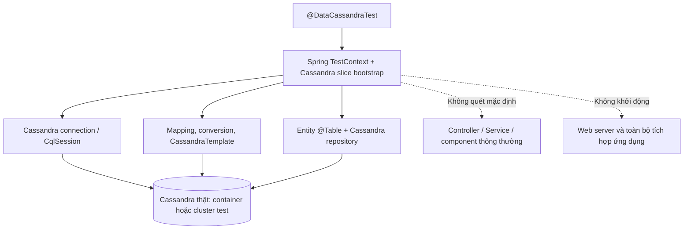

# `@DataCassandraTest` và phạm vi cấu hình được nạp

Trong module **SPRING_DATA_CASSANDRA**, ứng dụng dùng Spring Data Cassandra để truy cập Apache Cassandra qua entity mapping, repository, `CassandraTemplate` và CQL. Khi kiểm thử, ta cần xác minh lớp ánh xạ và truy vấn thực sự chạy đúng trên Cassandra, đồng thời hạn chế những thành phần ứng dụng không liên quan để kết quả dễ chẩn đoán.

Bài học thuộc chương **Kiểm thử**, tập trung vào **`@DataCassandraTest` và phạm vi cấu hình được nạp**: test slice này khởi tạo những bean nào, bỏ qua những bean nào, cách kết nối Cassandra thật trong môi trường test và khi nào phải mở rộng context. Phần thực hành dùng mô hình bảng theo truy vấn, partition key, repository và `CassandraTemplate`; các lưu ý về paging, tính nhất quán và hiệu năng được đặt trong đúng phạm vi của kiểm thử dữ liệu phân tán.

## 1. Vì sao cần một test slice cho Cassandra?

Giả sử ứng dụng có các lớp sau:

- `Inventory` được ánh xạ bằng `@Table` vào bảng Cassandra.
- `InventoryRepository` kế thừa `CassandraRepository`.
- `InventoryService` dùng repository để xử lý quy tắc giữ hàng.
- `InventoryController` nhận HTTP request.
- Một số component khác kết nối Kafka, gọi HTTP, chạy scheduler hoặc cấu hình bảo mật.

Ta muốn kiểm chứng câu hỏi **“entity và repository có lưu/đọc đúng bảng Cassandra không?”**. Khởi chạy mọi controller, service, message consumer và integration client sẽ làm bài kiểm thử tốn tài nguyên, khó cô lập nguyên nhân và có thể thất bại vì một dependency không liên quan.

`@DataCassandraTest` là một **test slice** do Spring Boot cung cấp. Nó cấu hình phần ứng dụng liên quan đến Spring Data Cassandra thay vì nạp toàn bộ các auto-configuration và component thông thường của ứng dụng.



**Hai ranh giới cần tách biệt:**

1. **Ranh giới Spring ApplicationContext:** `@DataCassandraTest` giới hạn bean và auto-configuration được nạp.
2. **Ranh giới hệ thống dữ liệu:** test slice vẫn thực thi CQL trên một Cassandra có thể kết nối tới. Một context nhỏ **không đồng nghĩa** sử dụng cơ sở dữ liệu giả hoặc chạy hoàn toàn trong bộ nhớ.

Vì thế, đây thường là **integration test theo lát cắt tầng persistence**, không phải unit test thuần túy. Nếu cần kiểm tra riêng thuật toán Java, ta vẫn nên dùng unit test không cần khởi tạo Spring context.

## 2. Bean nào được nạp, bean nào bị loại?

### 2.1. Những thành phần thường được nạp

Theo tài liệu Spring Boot, `@DataCassandraTest` mặc định cấu hình `CassandraTemplate`, tìm các entity `@Table` và cấu hình Spring Data Cassandra repository. Phía dưới chúng, những auto-configuration tương ứng có thể thiết lập kết nối Cassandra, session, mapping context, converter và các bean hạ tầng cần thiết.

| Nhóm | Hành vi mặc định | Mục đích kiểm thử |
| --- | --- | --- |
| Entity đánh dấu `@Table` | Được nhận diện trong phạm vi quét entity của slice. | Xác minh tên bảng, partition/clustering key và conversion. |
| Spring Data Cassandra repository | Được tạo từ các interface repository phù hợp phạm vi quét. | Kiểm tra `save`, `findById`, query method và CQL khai báo. |
| `CassandraTemplate` | Được tự động cấu hình khi điều kiện phụ thuộc phù hợp. | Kiểm tra thao tác mapping/CQL thông qua template. |
| `CqlSession` / cấu hình kết nối | Hạ tầng Cassandra được cấu hình để truy cập cluster. | Chạy CQL, tạo dữ liệu nền hoặc dọn dữ liệu test. |
| Mapping/converter và các bean hỗ trợ | Được cấu hình theo khả năng của Spring Data và classpath. | Xác minh serializing, deserializing và custom conversion. |
| Reactive Cassandra | Có thể được cấu hình nếu các thư viện và điều kiện cần thiết hiện diện. | Test `ReactiveCassandraRepository` / `ReactiveCassandraTemplate` trong ứng dụng reactive. |

Không nên coi mọi tên bean trong bảng là bảo đảm vô điều kiện: danh sách thực tế còn phụ thuộc **phiên bản Spring Boot, Spring Data, dependency trên classpath và cấu hình dự án**. Ví dụ, nếu dự án không thêm hỗ trợ reactive thì không thể kỳ vọng reactive repository xuất hiện.

### 2.2. Những thành phần không được quét thông thường

| Thành phần | Mặc định trong slice | Cách xử lý khi thật sự cần |
| --- | --- | --- |
| `@Service` như `InventoryService` | Không tự động được component scan để nạp toàn bộ nghiệp vụ. | `@Import` lớp cụ thể hoặc chọn `@SpringBootTest` nếu kiểm thử luồng đầy đủ. |
| `@RestController`, MVC endpoint, security filter | Không có toàn bộ web application context. | `@WebMvcTest` cho web slice, `@SpringBootTest` cho tích hợp toàn ứng dụng. |
| `@Component` thông thường | Không được quét mặc định chỉ vì có annotation. | `@Import` hoặc cấu hình test có chủ đích. |
| `@ConfigurationProperties` tùy biến | Không được quét mặc định như một bean ứng dụng. | `@EnableConfigurationProperties(MyProperties.class)`. |
| Integration Kafka, message listener, scheduler, HTTP client | Không được bật như trong full application chỉ do chúng có mặt trong project. | Tách integration test phù hợp; chỉ thêm dependency cần kiểm tra. |
| Toàn bộ `@Configuration` của ứng dụng | Không mặc nhiên nạp toàn bộ cấu hình riêng của app. | Import cấu hình tối thiểu, chú ý cấu hình nhập gián tiếp. |

**Ngoại lệ quan trọng:** Một bean không nằm trong slice mặc định vẫn có thể xuất hiện nếu được đưa vào bằng `@Import`, `@TestConfiguration`, cơ chế auto-configuration được bật, bean definition đặc biệt hoặc cấu hình của ứng dụng. Vì vậy câu “`@Service` không bao giờ được nạp trong `@DataCassandraTest`” là quá tuyệt đối.

### 2.3. Annotation làm gì bên dưới?

Ở các thế hệ Spring Boot thường gặp, `@DataCassandraTest` kết hợp hạ tầng Spring Test, một bootstrapper cho Cassandra slice, bộ lọc loại component không thuộc phạm vi, lệnh **tắt auto-configuration đầy đủ** và chỉ import những auto-configuration liên quan Cassandra.

Một số thành phần thường nằm trong danh sách auto-configuration của slice:

- Auto-configuration cho kết nối/session Cassandra.
- Spring Data Cassandra mapping, template, repository.
- Các biến thể reactive có điều kiện.
- Một số cấu hình hỗ trợ như SSL; ở một số phiên bản có thêm cache auto-configuration.
- Tích hợp `ServiceConnectionAutoConfiguration` từ Testcontainers nếu dependency tương ứng có mặt và được sử dụng.

Tên package và danh sách chính xác **thay đổi giữa Spring Boot 3.x và 4.x**. Không nên sao chép nguyên danh sách class auto-configuration của một phiên bản vào dự án dùng phiên bản khác. Phụ lục **Test Slices** của đúng phiên bản Spring Boot là nguồn kiểm tra cuối cùng.

## 3. Chuẩn bị dependency và import theo phiên bản

API của `@DataCassandraTest` khác về **package import** khi chuyển từ Spring Boot 3.x sang 4.x; trong Spring Boot 4.x test slice được cung cấp qua module test Cassandra chuyên biệt.

| Hạng mục | Spring Boot 3.x | Spring Boot 4.x |
| --- | --- | --- |
| Import annotation | `org.springframework.boot.test.autoconfigure.data.cassandra.DataCassandraTest` | `org.springframework.boot.data.cassandra.test.autoconfigure.DataCassandraTest` |
| Test dependency | Thường có qua `spring-boot-starter-test` và test autoconfigure tương ứng. | Bổ sung module `spring-boot-data-cassandra-test` theo cấu trúc dependency của Boot 4. |
| Tầng dữ liệu | `spring-boot-starter-data-cassandra`. | Dependency Spring Data Cassandra phù hợp với BOM/starter của Boot 4. |
| Testcontainers | Có thể dùng `@ServiceConnection` từ Boot 3.1+ nếu đã thêm `spring-boot-testcontainers`. | Tiếp tục dùng Service Connection theo module Boot 4 phù hợp. |
| Package Testcontainers | Phụ thuộc major version Testcontainers; ví dụ 1.x dùng `org.testcontainers.containers.CassandraContainer`. | Testcontainers 2.x dùng artifact/package module Cassandra mới; phải kiểm tra bản đang quản lý. |

Ví dụ **Gradle, Spring Boot 3.x**:

```groovy
dependencies {
    implementation 'org.springframework.boot:spring-boot-starter-data-cassandra'

    testImplementation 'org.springframework.boot:spring-boot-starter-test'
    testImplementation 'org.springframework.boot:spring-boot-testcontainers'
    testImplementation 'org.testcontainers:junit-jupiter'
    testImplementation 'org.testcontainers:cassandra'
}
```

Các dependency này mô tả cơ chế, không pin phiên bản. Để Spring Boot dependency management/BOM giải quyết phiên bản tương thích. Với Boot 4.x và Testcontainers 2.x, thay artifact và import theo BOM tương ứng; đặc biệt cần module `spring-boot-data-cassandra-test`.

**Không thêm `@AutoConfigureTestDatabase` để mong thay Cassandra bằng H2.** Cơ chế thay DataSource trong test quan hệ không biến CQL và Cassandra repository thành SQL repository. Một `@DataCassandraTest` kết nối Cassandra phải có endpoint Cassandra thật: ví dụ Testcontainers, cluster local hoặc môi trường test được cấp riêng.

## 4. Ví dụ hoàn chỉnh: kiểm thử repository trên Cassandra bằng Testcontainers

Ta xây dựng một phép thử từ đầu đến cuối ở **tầng persistence**, nhưng chỉ nạp Cassandra slice. Ví dụ này hướng tới **Spring Boot 3.x + Testcontainers 1.x + JUnit Jupiter**. Với Boot 4, thay các import/dependency vừa nêu.

### 4.1. Entity được ánh xạ với bảng theo khóa truy vấn

Giả sử nghiệp vụ cần tìm tồn kho theo SKU; mỗi SKU là một khóa độc lập.

```java
import org.springframework.data.cassandra.core.mapping.PrimaryKey;
import org.springframework.data.cassandra.core.mapping.Table;

@Table("inventory_by_sku")
public class Inventory {

    @PrimaryKey
    private String sku;

    private int available;

    public Inventory() {
    }

    public Inventory(String sku, int available) {
        this.sku = sku;
        this.available = available;
    }

    public String getSku() {
        return sku;
    }

    public void setSku(String sku) {
        this.sku = sku;
    }

    public int getAvailable() {
        return available;
    }

    public void setAvailable(int available) {
        this.available = available;
    }
}
```

Ở đây, `sku` là partition key cũng như primary key một cột. Test cần kiểm tra cách mapping và round trip thực tế; chỉ kiểm tra object Java trong bộ nhớ không chứng minh được mapping Cassandra.

Repository:

```java
import org.springframework.data.cassandra.repository.CassandraRepository;

public interface InventoryRepository
        extends CassandraRepository<Inventory, String> {
}
```

`@DataCassandraTest` đủ để tạo repository proxy, mapping và template nếu các lớp nằm đúng phạm vi quét. Không cần import `InventoryService` hoặc khởi động HTTP server.

### 4.2. Tạo keyspace và bảng rõ ràng

Đặt file `src/test/resources/cql/inventory-schema.cql`:

```sql
CREATE KEYSPACE IF NOT EXISTS learning_test
WITH replication = {
    'class': 'SimpleStrategy',
    'replication_factor': 1
};

CREATE TABLE IF NOT EXISTS learning_test.inventory_by_sku (
    sku text PRIMARY KEY,
    available int
);
```

Đây là schema dành cho **một node Cassandra test**, không phải đề xuất replication factor cho production. `SimpleStrategy` và RF=1 phù hợp ví dụ container đơn giản; triển khai nhiều data center phải chọn replication strategy, RF và consistency level theo yêu cầu thực tế.

Điểm quan trọng: `@Table` là thông tin mapping, **không phải lời hứa rằng Cassandra tự có keyspace/table**. Có thể dùng schema initialization khác, nhưng một test đáng tin nên kiểm soát schema một cách tường minh. Ví dụ dưới dùng `withInitScript` của Testcontainers để tạo schema trước khi Spring Data thực thi repository query.

### 4.3. Chạy test slice với container

```java
import com.datastax.oss.driver.api.core.CqlSession;
import org.junit.jupiter.api.BeforeEach;
import org.junit.jupiter.api.Test;
import org.springframework.beans.factory.annotation.Autowired;
import org.springframework.boot.test.autoconfigure.data.cassandra.DataCassandraTest;
import org.springframework.boot.testcontainers.service.connection.ServiceConnection;
import org.springframework.data.cassandra.core.CassandraTemplate;
import org.testcontainers.containers.CassandraContainer;
import org.testcontainers.junit.jupiter.Container;
import org.testcontainers.junit.jupiter.Testcontainers;

import static org.assertj.core.api.Assertions.assertThat;

@Testcontainers
@DataCassandraTest(properties = "spring.cassandra.keyspace-name=learning_test")
class InventoryRepositorySliceTest {

    @Container
    @ServiceConnection
    static final CassandraContainer<?> cassandra =
            new CassandraContainer<>("cassandra:4.1")
                    .withInitScript("cql/inventory-schema.cql");

    @Autowired InventoryRepository repository;
    @Autowired CassandraTemplate template;
    @Autowired CqlSession session;

    @BeforeEach
    void clearData() {
        session.execute("TRUNCATE learning_test.inventory_by_sku");
    }

    @Test
    void repositoryPersistsAndReadsMappedEntity() {
        repository.save(new Inventory("SKU-001", 12));

        assertThat(repository.findById("SKU-001"))
                .hasValueSatisfying(saved ->
                        assertThat(saved.getAvailable()).isEqualTo(12));
    }

    @Test
    void templateSeesTheSamePersistedRow() {
        repository.save(new Inventory("SKU-002", 7));

        Inventory found =
                template.selectOneById("SKU-002", Inventory.class);

        assertThat(found).isNotNull();
        assertThat(found.getSku()).isEqualTo("SKU-002");
        assertThat(found.getAvailable()).isEqualTo(7);
    }
}
```

Các điểm cần hiểu:

1. `@Testcontainers` kết hợp `@Container` quản lý vòng đời container cho test class. Container static được chia sẻ giữa các test method trong class.
2. `@ServiceConnection` tạo thông tin kết nối Cassandra cho Spring Boot từ container (cần `spring-boot-testcontainers`), tránh hard-code host/port vốn thay đổi theo lần chạy.
3. Property `spring.cassandra.keyspace-name` chọn keyspace mặc định. Service connection chủ yếu cung cấp connection details; **schema/keyspace vẫn phải được khởi tạo**.
4. `CassandraTemplate` và repository dùng cùng cấu hình Spring Data Cassandra trong slice. Kiểm thử round trip sẽ phát hiện lỗi tên bảng, loại cột, khóa và conversion.
5. `TRUNCATE` giúp dữ liệu ban đầu của từng test rõ ràng. Đây là cách đơn giản cho **test class chạy tuần tự**; không nên dùng chung bảng với test chạy song song rồi truncate lẫn nhau.
6. Test này cần Docker/Testcontainers và thời gian khởi động Cassandra. Nó không phải một unit test không phụ thuộc môi trường.

**Chú ý tương thích:** Với Testcontainers 2.x, namespace `CassandraContainer` và artifact module đã thay đổi. Khi chuyển ví dụ sang Spring Boot 4, sửa đồng thời import Spring Boot, module test slice và Testcontainers theo BOM dự án.

### 4.4. Nếu không dùng `@ServiceConnection`

Có thể đăng ký thuộc tính kết nối bằng `@DynamicPropertySource`. Đây là phương án rõ ràng khi dự án chưa dùng Service Connection hoặc cần kiểm soát địa chỉ/port theo môi trường:

```java
@Testcontainers
@DataCassandraTest
class InventoryWithDynamicPropertiesTest {

    @Container
    static final CassandraContainer<?> cassandra =
            new CassandraContainer<>("cassandra:4.1")
                    .withInitScript("cql/inventory-schema.cql");

    @DynamicPropertySource
    static void cassandraProperties(DynamicPropertyRegistry registry) {
        registry.add("spring.cassandra.contact-points",
                () -> cassandra.getHost() + ":"
                        + cassandra.getMappedPort(9042));
        registry.add("spring.cassandra.local-datacenter",
                cassandra::getLocalDatacenter);
        registry.add("spring.cassandra.keyspace-name",
                () -> "learning_test");
    }

    @Autowired InventoryRepository repository;
}
```

Đoạn trích này cần import các annotation/test class như ví dụ trước, thêm `org.springframework.test.context.DynamicPropertyRegistry` và `DynamicPropertySource`. Với Testcontainers 1.x, `CassandraContainer` cung cấp thông tin datacenter và mapped port; giá trị không nên được đoán cố định.

Chọn **một cơ chế cấp connection details làm nguồn chính** để tránh cấu hình gây khó hiểu. Nếu dùng `@ServiceConnection`, Spring Boot ưu tiên connection details do nó cung cấp so với các connection property tương ứng. Các property khác như keyspace vẫn cần được chỉ định khi cần.

## 5. Nạp thêm bean mà không biến slice thành full context

Nhu cầu thường gặp: repository dùng custom converter, entity callback hoặc một helper đơn giản mà slice mặc định không quét. Có vài cách rõ ràng để bổ sung đúng phần cần thiết.

### 5.1. `@Import` một cấu hình hoặc bean cụ thể

```java
@DataCassandraTest
@Import(InventoryCassandraMappingConfig.class)
class InventoryMappingTest {

    @Autowired InventoryRepository repository;
}
```

Trong ví dụ này, `InventoryCassandraMappingConfig` là một cấu hình có thật của ứng dụng, chỉ đăng ký mapping/conversion liên quan đến test. Spring có thể đưa cả dependency của cấu hình đó vào context; vì vậy nên chọn cấu hình nhỏ, không kéo theo HTTP client, broker hoặc toàn bộ service layer.

Nếu một repository cần một callback tùy biến (ví dụ chuẩn hóa dữ liệu trước ghi), việc import callback thật có thể cần thiết để test phản ánh hành vi production. Ngược lại, nếu test mục tiêu là **mapping mặc định**, không nên tự động import hàng loạt cấu hình không liên quan.

### 5.2. `@TestConfiguration` cho bean chỉ phục vụ test

```java
@DataCassandraTest
class InventoryWithClockTest {

    @TestConfiguration(proxyBeanMethods = false)
    static class ExtraBeans {

        @Bean
        Clock clock() {
            return Clock.fixed(
                    Instant.parse("2026-01-01T00:00:00Z"),
                    ZoneOffset.UTC);
        }
    }

    @Autowired Clock clock;
}
```

Cần import `Clock`, `Instant`, `ZoneOffset` từ `java.time` và `@Bean`, `@TestConfiguration` từ Spring tương ứng. Cấu hình nested này minh họa cách cấp một dependency có kiểm soát khi bài test thật sự dùng nó. **Không tạo bean giả chỉ để khiến context khởi động** nếu việc thiếu bean đang báo hiệu thiết kế phụ thuộc chưa phù hợp.

### 5.3. Nạp `@ConfigurationProperties` có chủ đích

Theo tài liệu Spring Boot, bean `@ConfigurationProperties` thông thường không được scan trong `@DataCassandraTest`. Nếu custom Cassandra mapper cần một properties object:

```java
@DataCassandraTest
@EnableConfigurationProperties(MyMappingProperties.class)
class InventoryPropertiesTest {

    @Autowired MyMappingProperties properties;
}
```

Đây là ví dụ cấu trúc: `MyMappingProperties` phải là lớp `@ConfigurationProperties` đã khai báo trong ứng dụng. Việc Boot bind các property nội bộ `spring.cassandra.*` cho auto-configuration **không có nghĩa** tất cả custom properties class cũng được scan.

### 5.4. `includeFilters` / `excludeFilters` dùng khi cần kiểm soát scan

`@DataCassandraTest` cung cấp `includeFilters` và `excludeFilters` để điều chỉnh các bean đi qua component scan; `excludeAutoConfiguration` để loại auto-configuration cụ thể. Ví dụ:

```java
@DataCassandraTest(
    includeFilters = @ComponentScan.Filter(
        type = FilterType.ASSIGNABLE_TYPE,
        classes = CustomMappingHelper.class
    )
)
class InventoryWithHelperTest {
    // CustomMappingHelper phải nằm trong phạm vi quét phù hợp.
}
```

`includeFilters` không phải giải pháp cho mọi vấn đề thiếu bean: hiệu lực phụ thuộc component scan, package boundary và bộ lọc của test slice. Khi chỉ cần một lớp cụ thể, `@Import` thường dễ đọc và dễ kiểm soát hơn.

**Tránh dùng `@SpringBootApplication` trên cấu hình test phụ** hoặc tự khai báo `@ComponentScan` quá rộng mà không hiểu TypeExcludeFilter; việc đó có thể đưa các bean service/controller và tích hợp ngoài dự kiến vào slice.

## 6. Xác minh thực tế phạm vi ApplicationContext

Đừng chỉ dựa vào tên annotation. Có thể kiểm tra bean thật sự tồn tại hoặc bị loại trong test:

```java
@DataCassandraTest
class CassandraSliceBoundaryTest {

    @Autowired ApplicationContext context;

    @Test
    void containsPersistenceInfrastructure() {
        assertThat(context.getBeansOfType(CassandraTemplate.class))
                .isNotEmpty();
        assertThat(context.getBeansOfType(InventoryRepository.class))
                .isNotEmpty();
    }

    @Test
    void doesNotScanBusinessServiceByDefault() {
        assertThat(context.getBeansOfType(InventoryService.class))
                .isEmpty();
    }
}
```

Các đoạn test này giả định `InventoryRepository` nằm trong package được quét và `InventoryService` là `@Service` thông thường không bị `@Import` thủ công. Cần import `ApplicationContext` và các lớp JUnit/Spring/AssertJ tương ứng.

Nếu `InventoryService` vô tình xuất hiện, hãy kiểm tra:

- `@Import` hoặc `@TestConfiguration` trong lớp test hay base test class.
- `@ComponentScan` và `@EnableCassandraRepositories` khai báo thủ công trong cấu hình ứng dụng.
- Các cấu hình được import gián tiếp từ `@SpringBootConfiguration` được tìm thấy.
- Auto-configuration hoặc bean definition đặc biệt do thư viện cung cấp.

Một slice cần đủ cấu hình để chạy phần persistence, nhưng phải có **ranh giới phụ thuộc có thể giải thích được**. Cố “vá” test bằng cách nạp toàn bộ ứng dụng sẽ làm mất lợi ích phát hiện coupling sai tầng.

## 7. Nên kiểm thử gì trong `@DataCassandraTest`?

### 7.1. Entity mapping và khóa dữ liệu

Một test có ý nghĩa cần phát hiện mapping sai, chẳng hạn:

- `@Table` trỏ sai bảng hoặc keyspace.
- `@PrimaryKey`, `@PrimaryKeyClass`, `@PrimaryKeyColumn` không khớp cấu trúc primary key của Cassandra.
- Clustering column có thứ tự/sort order không đúng với truy vấn cần phục vụ.
- Java type và Cassandra type không tương thích; converter custom bị thiếu.
- Tên cột CQL và tên field Java không được ánh xạ đúng.

Ví dụ với bảng theo user:

```sql
CREATE TABLE learning_test.orders_by_customer (
    customer_id uuid,
    created_at timestamp,
    order_id uuid,
    state text,
    PRIMARY KEY ((customer_id), created_at, order_id)
) WITH CLUSTERING ORDER BY (created_at DESC, order_id ASC);
```

Nếu entity dùng composite key, một bài test chỉ gọi constructor không thể phát hiện việc code xác định sai `customer_id` là partition key hoặc đảo thứ tự clustering key. Hãy lưu nhiều hàng, rồi chạy truy vấn theo `customer_id` và kiểm tra thứ tự trả về phù hợp thiết kế bảng; nếu có phân trang, kiểm tra cả việc đi tiếp bằng paging state/cơ chế paging của API đang dùng.

### 7.2. Repository query và CQL

Nên có test cho các thao tác quan trọng:

1. `save` và `findById` round trip.
2. Query method hoặc `@Query` chạy đúng với khóa truy vấn thực tế.
3. Các thao tác trả nhiều dòng có paging/sort đúng với partition/clustering key.
4. Truy vấn CQL có điều kiện (`IF NOT EXISTS` hoặc `IF ...`) được xử lý qua kết quả `[applied]`, không chỉ xem có exception.
5. Các loại dữ liệu đặc biệt (timestamp, UUID, collection, enum/converter) được chuyển đổi chính xác.

Ví dụ `@Query` đơn giản, chỉ truy vấn theo partition key đã có:

```java
public interface InventoryRepository
        extends CassandraRepository<Inventory, String> {

    @Query("SELECT * FROM inventory_by_sku WHERE sku = ?0")
    Inventory readBySku(String sku);
}
```

Khi chạy thật trên Cassandra, truy vấn không hợp lệ theo mô hình partition/clustering key có thể thất bại; đó chính là loại sai sót mà mock repository không phát hiện.

### 7.3. Phân biệt “đã ghi” và “đã thấy” khi kiểm thử

Cassandra là hệ thống phân tán. Một bài test chạy container đơn node có thể chứng minh mapping và CQL nhưng **không chứng minh** được hành vi consistency khi replica/network phân tán. Muốn đánh giá `LOCAL_QUORUM`, `LOCAL_ONE`, serial consistency, failover và availability, cần topology test thích hợp và trường hợp lỗi thực tế.

Tương tự, test slice không tự chứng minh:

- Độ trễ p95/p99 ở tải production.
- Không có hot partition khi hàng triệu bản ghi dùng chung partition key.
- Một luồng nhiều dịch vụ có rollback nguyên tử.
- Không trùng giao dịch thanh toán khi client retry qua HTTP.
- Paging ổn định dưới mọi mẫu ghi đồng thời trên nhiều partition.

Các yêu cầu ấy cần bổ sung kiểm thử tải, concurrency, integration xuyên dịch vụ và fault injection theo từng mục tiêu.

## 8. Dữ liệu test, isolation và vấn đề rollback

Một khác biệt quan trọng so với `@DataJpaTest`: không được giả định `@DataCassandraTest` sẽ mở transaction cho mỗi test rồi tự rollback dữ liệu.

| Điều dễ hiểu nhầm | Sự thật đối với Cassandra slice | Hành động phù hợp |
| --- | --- | --- |
| “Có `@DataCassandraTest` nên mỗi test tự rollback.” | Slice không cấp transaction ACID/rollback Cassandra kiểu JDBC. | Chủ động xóa/ghi đè dữ liệu hoặc dùng keyspace test cô lập. |
| “`@DirtiesContext` sẽ xóa bản ghi Cassandra.” | Annotation này làm Spring không tái sử dụng context; dữ liệu ở Cassandra là tài nguyên ngoài. | Dọn dữ liệu bằng CQL hoặc thay dataset/keyspace. |
| “Mọi test chạy chung container và keyspace đều độc lập.” | Test khác có thể nhìn thấy dữ liệu hoặc `TRUNCATE` của nhau. | Dùng khóa test độc nhất, keyspace riêng hoặc tuần tự hóa test phá dữ liệu. |
| “Có thể chạy test trên keyspace dev/prod mà chỉ cần rollback.” | CQL write/truncate là tác động thật trên cluster đang kết nối. | Dùng container hay cluster test được cấp riêng, profile tách biệt. |

Một số cách thiết kế dữ liệu test:

- **Key duy nhất từng test:** thêm UUID vào SKU/partition key; dọn đúng các khóa do test tạo ra ở phần cleanup.
- **`TRUNCATE` tuần tự:** dễ hiểu, phù hợp ví dụ, nhưng chỉ an toàn khi không có test khác dùng cùng bảng đồng thời.
- **Keyspace/container riêng mỗi nhóm test:** mạnh về isolation, chi phí khởi tạo cao hơn.
- **Fixture CQL có version:** quản lý schema/seed rõ ràng; tránh phụ thuộc thứ tự chạy giữa các test.

Không nên sử dụng `Thread.sleep(...)` để “chờ Cassandra nhất quán” như phương án mặc định. Nếu bất biến cần kiểm chứng có tính eventually consistent, hãy định nghĩa điều kiện chờ, deadline và khả năng thất bại có thể chẩn đoán. Với query đồng bộ cùng một node, chèn sleep thường chỉ che giấu lỗi cấu hình hoặc xử lý bất đồng bộ của ứng dụng.

## 9. Chẩn đoán lỗi test slice thường gặp

| Triệu chứng | Nguyên nhân cần kiểm tra trước | Hướng giải quyết |
| --- | --- | --- |
| `NoSuchBeanDefinitionException` cho `InventoryService` | `@Service` không được quét mặc định. | Chọn `@Import` nếu cần một collaborator thật, hoặc `@SpringBootTest` nếu muốn full flow. |
| `NoSuchBeanDefinitionException` cho repository | Package test/app không bao phủ repository, thiếu starter hoặc repository không hợp lệ. | Kiểm tra cấu trúc package, dependency và scan boundary. |
| Không tìm thấy `@SpringBootConfiguration` | Test nằm ngoài nhánh package mà bootstrapper tìm cấu hình ứng dụng. | Đặt test đúng package hoặc khai báo cấu hình context tối thiểu rõ ràng. |
| Kết nối đến `localhost:9042` thất bại | Không có cluster chạy; Testcontainers hoặc property kết nối chưa được nạp. | Kiểm tra Docker, `@Container`, `@ServiceConnection`/`@DynamicPropertySource` và port. |
| `InvalidQueryException: Keyspace ... does not exist` | Keyspace chưa tạo hoặc tên sai. | Tạo keyspace trong init script trước khi test context thực hiện query. |
| `unconfigured table` | CQL DDL chưa chạy, bảng khác keyspace hoặc mapping sai tên. | Kiểm tra script, thứ tự khởi tạo và `@Table`. |
| Query thất bại do primary key/filter | Truy vấn không phù hợp partition/clustering key hoặc schema. | Sửa thiết kế bảng theo query pattern; không bật `ALLOW FILTERING` chỉ để test xanh. |
| Test chạy riêng lẻ pass, chạy suite fail | Chia sẻ keyspace, `TRUNCATE`, static container hay fixture phụ thuộc thứ tự. | Cô lập dữ liệu, cân nhắc context cache và lifecycle container. |
| Test chậm bất thường | Cassandra startup, migration/schema chậm, quá nhiều context không tái sử dụng. | Tách unit test, chia sẻ fixture có kiểm soát, đo thời gian setup và chạy query. |
| `@ConfigurationProperties` của ứng dụng không xuất hiện | Slice không scan custom properties mặc định. | `@EnableConfigurationProperties` cho đúng lớp. |
| Test bắt đầu nạp web/service ngoài dự kiến | `@ComponentScan`/`@Import` quá rộng. | Thu hẹp cấu hình, xác minh bean trong context. |

### Vì sao context cache có thể gây bất ngờ?

Spring TestContext có cơ chế **cache ApplicationContext** để tránh khởi tạo lặp. Một container static do JUnit quản lý có thể được dừng sau khi test class kết thúc, trong khi Spring context đủ điều kiện được dùng lại ở test class khác. Nếu context còn giữ kết nối trỏ đến container đã dừng, test sau có thể lỗi ngắt quãng.

Với test suite lớn, cần thống nhất vòng đời container và context: dùng container được quản lý theo context hoặc cơ chế Testcontainers import phù hợp, thiết kế chia sẻ fixture có chủ đích, và tránh thay đổi connection properties làm lẫn cấu hình cache. Nếu chọn `@DirtiesContext` để giải quyết lifecycle, cần nhớ nó tăng chi phí khởi tạo và **không xóa dữ liệu Cassandra**.

## 10. Chọn loại test đúng mục tiêu

| Mục tiêu | Lựa chọn phù hợp | Khả năng bao phủ |
| --- | --- | --- |
| Kiểm tra thuật toán tính tồn kho thuần Java | JUnit + Mockito, không khởi Spring | Logic nhanh, không kiểm tra CQL/mapping. |
| Kiểm tra entity mapping, repository, `CassandraTemplate` | **`@DataCassandraTest` + Cassandra test** | Persistence thật, context nhỏ. |
| Kiểm tra controller serialization, validation, HTTP route | `@WebMvcTest` và mock dependency | Web slice, không kiểm tra Cassandra thật. |
| Kiểm tra service + repository + cấu hình app kết hợp | `@SpringBootTest` + Cassandra test | Nhiều bean, wiring toàn ứng dụng, chậm hơn. |
| Kiểm tra HTTP → service → Cassandra → event broker | `@SpringBootTest` và các dependency thật/test container cần thiết | Hành trình tích hợp liên hệ nhiều hệ thống. |
| Kiểm tra quorum, failover, contention, latency tải lớn | Integration/performance test với cluster topology phù hợp | Thuộc tính vận hành phân tán; vượt phạm vi slice thông thường. |

`@DataCassandraTest` là lựa chọn hợp lý khi **đối tượng cần xác minh nằm ở tầng dữ liệu Cassandra**. Nếu mục tiêu là nghiệp vụ dịch vụ, hãy xác định phần nào kiểm tra bằng unit test và phần nào phải kiểm tra bằng integration test. Việc chuyển mọi phép thử thành `@SpringBootTest` khiến thời gian chạy lâu và khó hiểu lỗi, còn mock hết repository trong test slice lại bỏ qua chính phần mà slice cần chứng minh.

## 11. Quy trình thực hành cho dự án Spring Data Cassandra

Trước khi thêm một lớp `@DataCassandraTest`, có thể đi qua các bước sau:

1. **Xác nhận phiên bản.** Kiểm tra Spring Boot major version, package annotation và dependency test slice/Testcontainers tương thích.
2. **Chọn bất biến kỹ thuật cần kiểm thử.** Mapping cột/khóa, repository query, `CassandraTemplate`, conversion, paging hay CQL có điều kiện?
3. **Cung cấp Cassandra test thật.** Dùng Testcontainers hoặc cluster riêng; cung cấp contact points, local datacenter, keyspace và credentials nếu cần.
4. **Chuẩn bị schema minh bạch.** Tạo keyspace và bảng theo mô hình query thực, tránh phụ thuộc cấu hình/schema còn sót ở máy người chạy.
5. **Để slice nạp mức tối thiểu.** Chỉ import custom converter/configuration/props có liên quan; không kéo mọi service vào để sửa lỗi thiếu bean.
6. **Quản lý fixture và isolation.** Dùng khóa duy nhất, cleanup hoặc keyspace riêng; không dựa vào rollback tự động.
7. **Kiểm tra kết quả lưu/đọc thực.** Viết assert dựa trên hàng đã ghi và truy vấn repository/template, kể cả trường hợp sai/empty/boundary.
8. **Mở rộng bài test theo rủi ro.** Concurrency, consistency level, multi-node, performance và end-to-end được kiểm chứng bằng loại test có môi trường phù hợp.

### Câu hỏi tự kiểm tra

1. `@DataCassandraTest` có tự động nạp `@Service` và `@RestController` bình thường không? Khi nào một bean như vậy vẫn có thể xuất hiện?
2. Khi autowire `CassandraTemplate` thành công, có thể kết luận keyspace và tất cả bảng đã tồn tại chưa?
3. Vì sao một bài test repository dùng Mockito thay cho Cassandra thật không chứng minh được cấu trúc partition key và CQL query?
4. Sau khi test gọi `repository.save(...)`, có được kỳ vọng Spring rollback dữ liệu Cassandra khi test kết thúc không?
5. Nếu một test cần custom converter và `@ConfigurationProperties`, làm thế nào thêm đúng các bean mà vẫn giữ phạm vi slice?
6. Tại sao test Cassandra đơn node chạy pass chưa thể chứng minh tính nhất quán và tính sẵn sàng trong cluster nhiều replica?
7. Spring Boot 3.x và 4.x khác nhau ở điểm nào khi import và thêm dependency cho `@DataCassandraTest`?

### Tài liệu đối chiếu

- [Spring Boot — Auto-configured Data Cassandra Tests (tài liệu hiện hành)](https://docs.spring.io/spring-boot/reference/testing/spring-boot-applications.html)
- [Spring Boot 3.5 — Testing Spring Boot Applications](https://docs.spring.io/spring-boot/3.5/reference/testing/spring-boot-applications.html)
- [Spring Boot — Test Slices, danh sách auto-configuration](https://docs.spring.io/spring-boot/appendix/test-auto-configuration/slices.html)
- [Spring Boot — Testcontainers và Service Connections](https://docs.spring.io/spring-boot/reference/testing/testcontainers.html)
- [Testcontainers for Java — Cassandra module](https://java.testcontainers.org/modules/databases/cassandra/)

**Điểm cần nắm:** `@DataCassandraTest` tạo một **Spring context tập trung vào Cassandra**, gồm entity mapping, template và repository cùng hạ tầng dữ liệu cần thiết, trong khi hạn chế component nghiệp vụ/web. Nó vẫn cần Cassandra thật và dữ liệu test được quản lý rõ ràng; không tự cung cấp rollback như transaction quan hệ. Muốn kiểm thử đáng tin cậy, hãy xác định đúng **phạm vi bean, phiên bản dependency, schema, connection và isolation** trước khi viết assertion.
