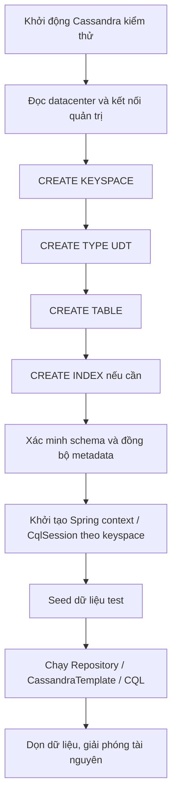

# Khởi tạo keyspace, bảng, UDT và chỉ mục cho bài kiểm thử

Khi kiểm thử một ứng dụng sử dụng **Spring Data Cassandra**, việc tạo vài object trong cơ sở dữ liệu là chưa đủ. Bộ kiểm thử cần một **schema đúng, có thể tái tạo và sẵn sàng trước khi chạy truy vấn**, gồm keyspace, user-defined type (UDT), bảng, khóa phân vùng, clustering key và chỉ mục nếu tình huống kiểm thử cần đến. Schema thiếu hoặc được tạo sai thứ tự có thể khiến kiểm thử thất bại ngay lúc khởi tạo Spring context; schema còn sót từ lần chạy trước có thể khiến kết quả kiểm thử sai mà khó phát hiện.

Bài học thuộc chương **Kiểm thử** của `SPRING_DATA_CASSANDRA`. Mục tiêu là khởi tạo schema cho bài kiểm thử tích hợp với Apache Cassandra thông qua CQL và Java Driver, sau đó kết nối `Repository`/`CassandraTemplate` của Spring Data Cassandra với schema đó. Cách làm áp dụng cho kiểm thử entity mapping, truy vấn theo partition key, UDT, chỉ mục, consistency và paging; các chủ đề hiệu năng cần được xác minh trên môi trường phù hợp hơn một container đơn lẻ.

## 1. Khi nào cần khởi tạo schema thật?

Phân biệt hai lớp kiểm thử:

| Loại kiểm thử | Cơ sở dữ liệu | Điều xác minh được |
| --- | --- | --- |
| Unit test cho service và logic nghiệp vụ | Có thể mock `Repository` hoặc `CassandraOperations` | Phân nhánh logic, mapping ở tầng ứng dụng, xử lý exception do mock phát ra. |
| Integration test với Cassandra thật | Cassandra chạy bằng Testcontainers hoặc cluster kiểm thử | CQL hợp lệ, khóa chính, codec, UDT, CRUD, query method, index, schema thực tế và hành vi kết nối. |

Mock không thể chứng minh rằng một `SELECT` đúng quy tắc partition key hoặc rằng `@UserDefinedType` khớp với định nghĩa CQL. Với các yêu cầu này, cần chạy test trên Cassandra thật. **Không dùng H2 hay cơ sở dữ liệu quan hệ in-memory để giả lập Cassandra**: mô hình partition/clustering, CQL và indexing khác biệt đáng kể.

Quy trình tổng quát:



**Nguyên tắc quan trọng:** tạo keyspace trước vì session của ứng dụng có thể được cấu hình kết nối trực tiếp vào keyspace; UDT phải tồn tại trước khi tạo bảng có cột sử dụng UDT; chỉ mục chỉ được tạo sau bảng tương ứng.

## 2. Thiết kế một schema ví dụ theo truy vấn

Giả sử chức năng đặt hàng cần:

1. Liệt kê đơn hàng của một khách theo thời gian tạo gần nhất.
2. Tìm một đơn hàng qua `customer_id`, `created_at` và `order_id`.
3. Đọc/ghi địa chỉ giao hàng có cấu trúc.
4. Kiểm tra khả năng truy vấn theo trạng thái thông qua một **chỉ mục thử nghiệm**.

Ta dùng keyspace `test_orders`, UDT `shipping_address` và bảng `orders_by_customer`:

| Thành phần | Vai trò | Lý do kiểm thử |
| --- | --- | --- |
| Keyspace `test_orders` | Namespace và cấu hình replication | Kiểm tra cấu hình kết nối và cô lập dữ liệu test. |
| UDT `shipping_address` | Gom `street`, `city`, `postal_code` | Kiểm tra driver codec và ánh xạ UDT trong entity. |
| Partition key `customer_id` | Đặt các đơn hàng cùng khách vào một partition logic | Phù hợp truy vấn theo khách; hỗ trợ kiểm tra quy tắc `WHERE`. |
| Clustering keys `created_at`, `order_id` | Sắp xếp đơn hàng trong partition, phân biệt đơn cùng thời điểm | Kiểm tra thứ tự kết quả và khóa ghép. |
| Secondary index trên `status` | Minh họa đường kiểm thử truy vấn bằng index | Kiểm tra DDL và truy vấn được index hỗ trợ, **không mặc định là lựa chọn tối ưu trong production**. |

Schema dưới đây phục vụ **kiểm thử tích hợp**. Trong production, thiết kế bảng và chỉ mục phải đi từ các mẫu truy vấn thật, khối lượng dữ liệu và phân bố partition. Chỉ mục không thể thay thế mọi bảng thiết kế theo truy vấn.

## 3. Khởi tạo keyspace

Với **Cassandra một node** để chạy test ở máy cá nhân hoặc CI, dùng replication factor `1`. Ví dụ dùng `NetworkTopologyStrategy` cho datacenter có tên `datacenter1`:

```sql
CREATE KEYSPACE IF NOT EXISTS test_orders
WITH replication = {
    'class': 'NetworkTopologyStrategy',
    'datacenter1': 1
}
AND durable_writes = true;
```

Tên `datacenter1` chỉ là ví dụ thường gặp ở môi trường Cassandra kiểm thử. **Phải khớp với datacenter thực tế** của container/cluster; có thể xác minh bằng:

```sql
SELECT data_center FROM system.local;
```

Trong Cassandra đa node, replication factor phải được thiết kế phù hợp số node và loại kiểm thử. Một container với RF = 1 là đủ để kiểm tra CQL/mapping cơ bản, nhưng **không mô phỏng đầy đủ** quorum, failover, replica consistency hay hành vi khi mất node. Các bài kiểm thử những tính chất này cần một cluster nhiều node và cấu hình replication tương ứng.

`IF NOT EXISTS` giúp chạy lại script không lỗi nếu keyspace đã tồn tại. Nó **không xác nhận** keyspace cũ có đúng cấu hình replication; nếu test có yêu cầu cụ thể về RF/datacenter thì cần kiểm tra schema hoặc dùng môi trường được khởi tạo mới.

**Đừng mở `CqlSession` với `keyspace = test_orders` trước khi keyspace được tạo.** Hãy tạo một admin session kết nối cluster mà **không đặt keyspace**, chạy `CREATE KEYSPACE`, rồi mới tạo session do Spring Data Cassandra sử dụng.

## 4. Tạo UDT trước khi tạo bảng

UDT giúp biểu diễn một nhóm thuộc tính có cấu trúc và được Spring Data Cassandra ánh xạ qua `@UserDefinedType`.

```sql
CREATE TYPE IF NOT EXISTS test_orders.shipping_address (
    street text,
    city text,
    postal_code text
);
```

Tạo bảng sử dụng UDT ở dạng `frozen`:

```sql
CREATE TABLE IF NOT EXISTS test_orders.orders_by_customer (
    customer_id uuid,
    created_at timestamp,
    order_id uuid,
    status text,
    shipping frozen<shipping_address>,
    total decimal,
    PRIMARY KEY ((customer_id), created_at, order_id)
)
WITH CLUSTERING ORDER BY (created_at DESC, order_id ASC);
```

Trong câu `CREATE TABLE`, `shipping_address` được phân giải trong keyspace của bảng. Nếu bộ công cụ/script yêu cầu tên fully qualified, có thể dùng `frozen<test_orders.shipping_address>` khi phù hợp cú pháp phiên bản Cassandra đang chạy.

### Điều cần hiểu về khóa và UDT

- **Partition key** là `customer_id`; các đơn cùng khách nằm chung partition logic. Nếu một khách có số đơn quá lớn, cần cân nhắc bucketing theo thời gian khi thiết kế cho production.
- **Clustering keys** là `created_at` và `order_id`. Hai đơn có cùng `created_at` vẫn phân biệt nhờ `order_id`.
- `CLUSTERING ORDER BY` khai báo thứ tự lưu trữ logic trong partition; test có thể xác minh thứ tự danh sách sau khi ghi nhiều đơn.
- `frozen<shipping_address>` khiến toàn bộ UDT được xử lý như một giá trị ở mức cột; cập nhật một trường riêng có thể cần ghi lại cả giá trị UDT. Kiểm thử mapping phải phản ánh lựa chọn này.
- `timestamp` của CQL biểu diễn thời điểm; khi ánh xạ Java nên dùng kiểu thời gian phù hợp, chẳng hạn `Instant`, và kiểm tra độ chính xác kỳ vọng.

Ví dụ một entity UDT ở tầng Spring Data Cassandra:

```java
import org.springframework.data.cassandra.core.mapping.Column;
import org.springframework.data.cassandra.core.mapping.UserDefinedType;

@UserDefinedType("shipping_address")
public class ShippingAddress {
    @Column("street")
    private String street;

    @Column("city")
    private String city;

    @Column("postal_code")
    private String postalCode;

    // Constructor, getter và setter phù hợp với chiến lược mapping đang dùng.
}
```

Test nên đọc lại một entity chứa `shipping` để xác minh các trường UDT được chuyển đổi hai chiều. Lỗi tên field trong `@Column`, thiếu type hoặc khác keyspace sẽ không được phát hiện nếu chỉ kiểm thử với mock.

## 5. Tạo chỉ mục cho bài kiểm thử

Một ví dụ **secondary index (2i) truyền thống** để xác minh việc khởi tạo và sử dụng index:

```sql
CREATE INDEX IF NOT EXISTS orders_by_customer_status_idx
ON test_orders.orders_by_customer (status);
```

Sau khi tạo dữ liệu thử, có thể kiểm tra câu CQL sau hoạt động mà không cần `ALLOW FILTERING`:

```sql
SELECT customer_id, created_at, order_id, status
FROM test_orders.orders_by_customer
WHERE status = 'CREATED';
```

Đây là **truy vấn kiểm thử index trên tập dữ liệu nhỏ**. Với Cassandra thực tế, 2i có hạn chế về chi phí truy vấn phân tán, tính chọn lọc và phân bố dữ liệu; không mặc định phù hợp cho việc tìm tất cả đơn ở một trạng thái trên toàn cluster. Nếu chức năng production thật sự thường xuyên truy vấn theo `status`, cần xem xét bảng `orders_by_status` hoặc tính năng indexing thích hợp với phiên bản Cassandra (ví dụ SAI ở các phiên bản hỗ trợ), cùng phép đo hiệu năng.

`CREATE INDEX IF NOT EXISTS` chỉ kiểm tra sự tồn tại của tên index; nó **không chứng minh** index cũ có cùng định nghĩa hoặc đã sẵn sàng để phục vụ mọi truy vấn ngay lập tức. Đối với test schema, nên kiểm tra metadata và chờ điều kiện sẵn sàng trước khi chạy assertion phụ thuộc index nếu môi trường tạo chỉ mục bất đồng bộ.

## 6. Đưa DDL vào một bootstrap cố định

Hạn chế tạo schema rải rác trong từng test method. Thay vào đó, tạo **một nguồn định nghĩa schema**: script `.cql` được một công cụ migration thực thi, hoặc một hàm bootstrap rõ thứ tự dùng `CqlSession`.

Ví dụ Java Driver 4.x chạy từng câu DDL, tránh cách tách script CQL bằng `String.split(";")` vì cú pháp phức tạp có thể chứa dấu phân cách trong literal/định nghĩa khác:

```java
import com.datastax.oss.driver.api.core.CqlSession;

public final class TestSchema {
    private TestSchema() {}

    public static void initialize(CqlSession admin) {
        admin.execute("""
            CREATE KEYSPACE IF NOT EXISTS test_orders
            WITH replication = {'class': 'NetworkTopologyStrategy',
                                'datacenter1': 1}
            AND durable_writes = true
            """);

        admin.execute("""
            CREATE TYPE IF NOT EXISTS test_orders.shipping_address (
                street text, city text, postal_code text
            )
            """);

        admin.execute("""
            CREATE TABLE IF NOT EXISTS test_orders.orders_by_customer (
                customer_id uuid,
                created_at timestamp,
                order_id uuid,
                status text,
                shipping frozen<shipping_address>,
                total decimal,
                PRIMARY KEY ((customer_id), created_at, order_id)
            ) WITH CLUSTERING ORDER BY (created_at DESC, order_id ASC)
            """);

        admin.execute("""
            CREATE INDEX IF NOT EXISTS orders_by_customer_status_idx
            ON test_orders.orders_by_customer (status)
            """);
    }
}
```

Ví dụ sử dụng **Java 17+** (text blocks), Spring Boot 3.x và Java Driver 4.x. Trong hệ thống thực tế, quản lý DDL theo migration version hoặc tài nguyên `.cql` thường thuận tiện hơn khi schema lớn; quan trọng nhất là tránh nhiều cơ chế cùng tự động tạo/sửa schema theo các định nghĩa khác nhau.

Một số phiên bản Spring Data Cassandra có hỗ trợ schema actions thông qua cấu hình framework. Có thể dùng chúng cho test entity đơn giản, nhưng phải xác minh chúng có tạo đúng UDT, index, bảng, khóa và thuộc tính CQL cần kiểm thử không. Khi cần một schema chuẩn và ổn định cho integration test, **DDL/migration có kiểm soát** là lựa chọn dễ xác minh.

## 7. Tích hợp với Testcontainers và Spring Boot

Testcontainers giúp tạo Cassandra tạm thời để chạy integration test. Điểm dễ sai là **thời điểm**: `@BeforeAll` của JUnit không bảo đảm chạy trước quá trình Spring Boot khởi tạo application context. Nếu cấu hình session Spring đã đặt `test_orders` nhưng keyspace chưa tồn tại, context có thể lỗi trước khi đến `@BeforeAll`.

Ví dụ dưới đây chủ động khởi động container và tạo schema trong static initializer, sau đó mới cung cấp cấu hình kết nối cho Spring. Đây là mẫu minh họa cho **một lớp integration test**; dự án lớn nên đóng gói lifecycle container/bootstrap ở lớp test infrastructure dùng chung.

```java
import static org.junit.jupiter.api.Assertions.assertNotNull;

import com.datastax.oss.driver.api.core.CqlSession;
import java.net.InetSocketAddress;
import org.junit.jupiter.api.Test;
import org.springframework.beans.factory.annotation.Autowired;
import org.springframework.boot.test.context.SpringBootTest;
import org.springframework.test.context.DynamicPropertyRegistry;
import org.springframework.test.context.DynamicPropertySource;
import org.testcontainers.containers.CassandraContainer;

@SpringBootTest
class CassandraSchemaIntegrationTest {
    private static final CassandraContainer<?> CASSANDRA =
        new CassandraContainer<>("cassandra:4.1");

    static {
        CASSANDRA.start();

        // Admin session chưa gắn với keyspace test_orders.
        try (CqlSession admin = CqlSession.builder()
                .addContactPoint(new InetSocketAddress(
                    CASSANDRA.getHost(), CASSANDRA.getMappedPort(9042)))
                .withLocalDatacenter("datacenter1")
                .build()) {
            TestSchema.initialize(admin);
        }
    }

    @DynamicPropertySource
    static void cassandraProperties(DynamicPropertyRegistry registry) {
        registry.add("spring.cassandra.contact-points", CASSANDRA::getHost);
        registry.add("spring.cassandra.port", () -> CASSANDRA.getMappedPort(9042));
        registry.add("spring.cassandra.local-datacenter", () -> "datacenter1");
        registry.add("spring.cassandra.keyspace-name", () -> "test_orders");
    }

    @Autowired
    CqlSession session;

    @Test
    void keyspaceAndTableAreAvailable() {
        assertNotNull(session.execute("""
            SELECT table_name
            FROM system_schema.tables
            WHERE keyspace_name = 'test_orders'
              AND table_name = 'orders_by_customer'
            """).one());
    }
}
```

**Điều chỉnh theo dự án:**

- Đưa dependency Testcontainers Cassandra và tích hợp JUnit phù hợp phiên bản đang dùng vào phạm vi test; package của module có thể thay đổi giữa các major version Testcontainers.
- Ví dụ giả định container sử dụng datacenter `datacenter1`. Nếu image/config thực tế khác, sửa **đồng nhất** replication của keyspace, `.withLocalDatacenter(...)` và `spring.cassandra.local-datacenter`.
- Các thuộc tính `spring.cassandra.*` áp dụng cho Spring Boot 3.x; dự án dùng Spring Boot đời khác cần kiểm tra prefix/cách cấu hình của phiên bản đó.
- Nếu Spring application đã cấu hình schema actions tự tạo bảng khi khởi động, thống nhất với bootstrap để tránh thực thi hai nguồn DDL cạnh tranh.
- Testcontainers thường cần Docker hoặc môi trường container tương thích. Trong CI phải kiểm tra khả năng khởi động container và tài nguyên RAM trước khi chạy suite.

Lớp test có thể `@Autowired` `CassandraRepository`, `CassandraTemplate` hoặc `ReactiveCassandraTemplate` thay vì chỉ `CqlSession`; ví dụ trên kiểm tra trước điều kiện nền là Cassandra thật đã có bảng. Khi nhiều test class cùng dùng một container, cần quản lý **vòng đời container và Spring TestContext cache** thống nhất để tránh context cũ trỏ vào container đã dừng.

## 8. Kiểm chứng đủ bốn thành phần sau bootstrap

Tạo DDL thành công chưa đủ: test cần xác nhận keyspace, UDT, bảng và index đúng mong đợi. Cassandra cung cấp bảng metadata trong `system_schema`:

```sql
-- Keyspace đã tồn tại?
SELECT keyspace_name, replication
FROM system_schema.keyspaces
WHERE keyspace_name = 'test_orders';

-- UDT đã tồn tại và có tên field đúng?
SELECT type_name, field_names, field_types
FROM system_schema.types
WHERE keyspace_name = 'test_orders'
  AND type_name = 'shipping_address';

-- Bảng đã tồn tại?
SELECT table_name
FROM system_schema.tables
WHERE keyspace_name = 'test_orders'
  AND table_name = 'orders_by_customer';

-- Chỉ mục đã tồn tại?
SELECT index_name, kind, options
FROM system_schema.indexes
WHERE keyspace_name = 'test_orders'
  AND table_name = 'orders_by_customer';
```

Ngoài kiểm tra tên, cần xác minh `system_schema.columns` hoặc driver metadata cho `kind`, `position`, `clustering_order` và loại cột. Điều này phát hiện trường hợp bảng đã tồn tại với primary key sai nhưng `CREATE TABLE IF NOT EXISTS` vẫn chạy qua.

Đối với UDT, thử ghi và đọc giá trị thực bằng Java Driver:

```java
import com.datastax.oss.driver.api.core.CqlIdentifier;
import com.datastax.oss.driver.api.core.cql.Row;
import com.datastax.oss.driver.api.core.cql.SimpleStatement;
import com.datastax.oss.driver.api.core.data.UdtValue;
import java.time.Instant;
import java.util.UUID;

var keyspace = session.getMetadata()
    .getKeyspace(CqlIdentifier.fromCql("test_orders"))
    .orElseThrow();

var addressType = keyspace
    .getUserDefinedType(CqlIdentifier.fromCql("shipping_address"))
    .orElseThrow();

UdtValue shipping = addressType.newValue()
    .setString("street", "1 Test Street")
    .setString("city", "Ha Noi")
    .setString("postal_code", "100000");

UUID customerId = UUID.randomUUID();
UUID orderId = UUID.randomUUID();
Instant createdAt = Instant.now();

session.execute(SimpleStatement.builder("""
        INSERT INTO test_orders.orders_by_customer
            (customer_id, created_at, order_id, status, shipping, total)
        VALUES (?, ?, ?, ?, ?, ?)
        """)
    .addPositionalValues(customerId, createdAt, orderId,
                         "CREATED", shipping, new java.math.BigDecimal("125.50"))
    .build());

Row row = session.execute(SimpleStatement.builder("""
        SELECT shipping, status
        FROM test_orders.orders_by_customer
        WHERE customer_id = ? AND created_at = ? AND order_id = ?
        """)
    .addPositionalValues(customerId, createdAt, orderId)
    .build()).one();

if (row == null) {
    throw new AssertionError("Khong doc lai duoc don hang test");
}
UdtValue actual = row.getUdtValue("shipping");
if (actual == null || !"Ha Noi".equals(actual.getString("city"))) {
    throw new AssertionError("UDT mapping khong dung");
}
```

Đoạn mã trên là ví dụ thân của một test hoặc hàm nhận `CqlSession session`; cần đặt trong lớp test có import/lifecycle tương ứng. Nó kiểm tra trực tiếp rằng UDT codec và CQL cùng hoạt động. Với Spring Data Cassandra, kiểm tra thêm rằng `Repository.save(...)` và `Repository.find...(...)` giữ nguyên địa chỉ, khóa ghép và các trường sau khi đọc lại.

### Vì sao chỉ `IF NOT EXISTS` chưa đủ?

Giả sử hôm trước bảng dùng `PRIMARY KEY (customer_id, order_id)`; hôm nay entity chuyển sang `PRIMARY KEY ((customer_id), created_at, order_id)`. Câu `CREATE TABLE IF NOT EXISTS` **không thay đổi** bảng cũ. Test có thể tiếp tục chạy trên schema lệch so với source code hoặc thất bại với lỗi rất khó hiểu. Với kiểm thử schema migration, chạy migration trên trạng thái phiên bản trước rồi kiểm tra schema mới; với test độc lập, nên tạo môi trường/keyspace mới và xác minh cấu trúc cuối cùng.

## 9. Tạo dữ liệu và làm sạch test an toàn

Schema chỉ nên tạo **một lần cho mỗi lifecycle phù hợp**; dữ liệu fixture thường cần cô lập ở **mỗi test**. Các hướng thường dùng:

| Cách cô lập | Phù hợp khi | Lưu ý |
| --- | --- | --- |
| Dùng `UUID.randomUUID()` cho partition key mỗi test | Nhiều test độc lập chia sẻ cùng bảng | Không phụ thuộc dữ liệu từ test khác; nhớ kiểm soát dữ liệu tồn khi chạy lâu. |
| `DELETE` theo full primary key sau test | Test tạo ít bản ghi và biết chính xác khóa | Tránh xóa nhầm dữ liệu của test chạy song song. |
| `TRUNCATE` bảng | Suite chạy tuần tự trên database dành riêng cho test | Xóa **toàn bộ** bảng; không dùng khi các test khác cùng chia sẻ dữ liệu. |
| Keyspace/container riêng cho suite | Test schema, test migration hoặc cần cô lập mạnh | Khởi tạo chậm hơn; tránh xung đột tên và cấu hình. |

Ví dụ xóa một hàng theo đúng khóa chính:

```sql
DELETE FROM test_orders.orders_by_customer
WHERE customer_id = 2b06b38a-3d2c-4aad-93c2-95bd8bac960b
  AND created_at = '2026-11-20T08:30:00Z'
  AND order_id = 0b9f0fb9-195f-47d3-9485-480b3cf9d395;
```

Trong code test, truyền UUID/timestamp bằng binding thay cho ghép chuỗi. Nếu suite dùng `TRUNCATE`, chỉ thực hiện trên **keyspace kiểm thử chuyên dụng**, và đảm bảo không có test song song cùng phụ thuộc dữ liệu bảng đó.

Lưu ý: Cassandra là cơ sở dữ liệu phân tán, nên hành vi thời gian, propagation và consistency có thể ảnh hưởng kết quả khi kiểm thử nhiều session hoặc nhiều node. Test chỉ muốn xác minh CRUD/mapping nên đặt dữ liệu, query và mức consistency rõ ràng; không dùng `Thread.sleep(...)` như cơ chế đồng bộ mặc định. Với bài kiểm thử index, schema agreement và tình trạng build index cần được xác nhận theo phiên bản Cassandra đang dùng; với test nhiều node, nên sử dụng cơ chế chờ điều kiện có timeout và báo lỗi rõ ràng.

## 10. Những lỗi thường gặp

| Hiện tượng | Nguyên nhân phổ biến | Cách xử lý |
| --- | --- | --- |
| `Keyspace ... does not exist` khi Spring khởi động | Spring tạo session gắn keyspace trước bootstrap | Tạo keyspace qua admin session trước khi dựng Spring context. |
| Không kết nối được vì `local datacenter` | Datacenter trong driver khác với Cassandra thực tế | Kiểm tra `system.local.data_center`, sửa driver và replication đồng nhất. |
| `Unknown type shipping_address` | `CREATE TABLE` chạy trước `CREATE TYPE`, hoặc UDT nằm ở keyspace khác | Tạo UDT trước; dùng đúng keyspace/tên type. |
| `InvalidQueryException` vì thiếu partition key | Truy vấn không phù hợp primary key của Cassandra | Thiết kế bảng theo truy vấn; kiểm tra cách viết `WHERE`. |
| Spring mapping lỗi một trường UDT | Tên field/type/codec hoặc cấu trúc Java không khớp schema | Đối chiếu `system_schema.types`, `@UserDefinedType`, `@Column` và thử round-trip. |
| `CREATE ... IF NOT EXISTS` thành công nhưng test sai | Có schema cũ khác định nghĩa | Tạo môi trường sạch hoặc xác nhận chính xác metadata. |
| Truy vấn index không phản ánh hiệu năng production | Dataset nhỏ, một node hoặc 2i không phù hợp workload | Chỉ dùng để kiểm thử chức năng; benchmark trên cluster và dữ liệu đại diện. |
| Test pass riêng lẻ nhưng fail khi chạy song song | Cùng keyspace/bảng, `TRUNCATE` hoặc dữ liệu fixture dùng chung | Cô lập partition/test hoặc keyspace; quản lý lifecycle suite. |

## 11. Checklist trước khi chạy bộ integration test

- [ ] Cassandra kiểm thử đã khởi động, sẵn sàng nhận kết nối và datacenter đã được xác nhận.
- [ ] Admin session **không gắn keyspace chưa tồn tại**.
- [ ] Keyspace được tạo với replication phù hợp loại môi trường kiểm thử.
- [ ] Các UDT được tạo **trước** bảng tham chiếu đến chúng.
- [ ] Partition/clustering keys, thứ tự sắp xếp, kiểu dữ liệu và tên cột khớp với entity/repository.
- [ ] Chỉ tạo index khi bài test cần; không dùng index như cách né thiết kế bảng theo truy vấn.
- [ ] Spring Data Cassandra khởi tạo sau bootstrap schema, dùng đúng keyspace và phiên bản cấu hình.
- [ ] Test kiểm tra schema metadata, có một lượt ghi/đọc dữ liệu thật và UDT round-trip.
- [ ] Dữ liệu fixture tách biệt; logic cleanup không xóa dữ liệu của test khác.
- [ ] CI kiểm soát lifecycle container, timeout, tài nguyên và các điều kiện chờ schema/index.

**Ghi nhớ:** một integration test Cassandra đáng tin cậy phải có **schema tái lập được**, **đúng thứ tự phụ thuộc** và **cô lập dữ liệu**. Tạo keyspace → UDT → bảng → chỉ mục rồi mới khởi tạo session Spring và chạy `Repository`/`CassandraTemplate`. Luôn xác minh cấu trúc thực tế, vì `IF NOT EXISTS` chỉ giúp tránh lỗi tạo trùng, không bảo đảm schema đang tồn tại khớp với bài kiểm thử.
