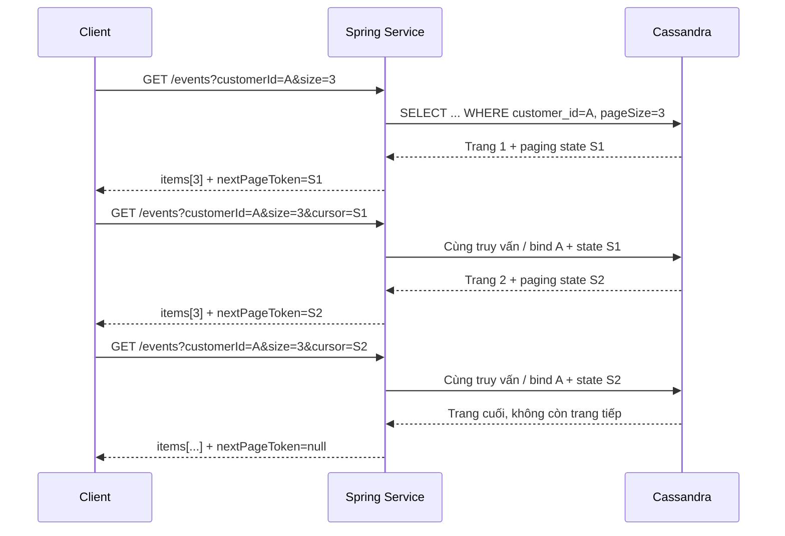

# Kiểm thử paging state qua nhiều trang và dữ liệu rỗng trong Spring Data Cassandra

Khi đọc một partition có hàng nghìn bản ghi từ **Apache Cassandra**, ứng dụng **Spring Data Cassandra** thường không tải toàn bộ kết quả trong một lần. Driver và Cassandra chia kết quả thành các trang; ứng dụng có thể tiếp tục từ trang trước bằng **paging state**. Vì vậy, kiểm thử chỉ xác nhận “trang đầu trả đúng 10 bản ghi” là chưa đủ. Cần chứng minh rằng hệ thống đi qua được nhiều trang, không mất hoặc lặp bản ghi, dừng đúng lúc và xử lý được partition hoàn toàn rỗng.

Bài này nằm trong phần **Kiểm thử** của module Spring Data Cassandra: kết hợp cách ánh xạ entity, truy cập qua repository / `CassandraTemplate` hoặc CQL, thiết kế bảng theo truy vấn, partition key, consistency level và giới hạn hiệu năng của hệ dữ liệu phân tán. Trọng tâm là kiểm thử **paging state thực tế trên Cassandra**, không giả lập phân trang kiểu SQL bằng `OFFSET`.

## 1. Paging state là gì và điều gì cần kiểm thử?

### 1.1. Khác biệt với phân trang theo số trang

Trong hệ quản trị quan hệ, cách tiếp cận quen thuộc là `LIMIT 10 OFFSET 20`. Cassandra không có cơ chế offset tùy ý tương đương cho mọi truy vấn CQL. Thay vào đó, một request có thể chỉ nhận **một phần** kết quả kèm trạng thái cho phép đọc tiếp.

**Paging state** là token opaque do cơ chế Cassandra/driver tạo, đại diện cho vị trí tiếp tục đọc của **cùng một truy vấn**. Ứng dụng không được tự phân tích, sửa byte hoặc giả định token là số trang. Nó có thể được giữ trong bộ nhớ khi driver tự chuyển trang, hoặc được mã hóa và trả về dưới dạng `nextPageToken` cho API lấy trang tiếp theo.



Những thuộc tính quan trọng cần xác minh:

1. **Tính đầy đủ:** khi duyệt tất cả trang trên dữ liệu cố định, tổng bản ghi bằng tập đã seed.
2. **Không trùng lặp:** mỗi khóa bản ghi xuất hiện đúng một lần trong chuỗi trang.
3. **Đúng thứ tự:** kết quả theo clustering order đã khai báo, nếu truy vấn có thứ tự ổn định.
4. **Tiếp nối đúng:** token nhận từ trang trước đưa đến trang sau của **cùng truy vấn và cùng tham số**.
5. **Dừng đúng:** hết kết quả thì `nextPageToken == null` hoặc dấu hiệu hết trang tương đương; vòng lặp không chạy vô hạn.
6. **Dữ liệu rỗng:** partition không có hàng phải trả danh sách rỗng và tín hiệu đã hết, không ném lỗi chỉ vì không có `Row`.
7. **Trạng thái không hợp lệ:** token lỗi/khác ngữ cảnh phải được xử lý như input không hợp lệ, không dùng nó để đọc ngoài phạm vi người gọi được phép xem.

**Lưu ý:** page size là tham số điều chỉnh lượng dữ liệu Cassandra trả mỗi lần và không phải cam kết mọi trang luôn có đúng từng ấy hàng. Trên dữ liệu có tombstone hoặc điều kiện truy vấn phức tạp, trang trung gian có thể có ít hàng, thậm chí không có hàng được trả về dù vẫn còn `hasMorePages()`. Vì vậy không được dùng `items.isEmpty()` làm điều kiện duy nhất để kết thúc.

## 2. Thiết kế bảng và dữ liệu kiểm thử theo truy vấn

Giả sử ứng dụng liệt kê sự kiện của một khách hàng theo thời gian mới nhất trước:

```sql
CREATE TABLE events_by_customer (
    customer_id uuid,
    occurred_at timestamp,
    event_id uuid,
    event_type text,
    PRIMARY KEY ((customer_id), occurred_at, event_id)
) WITH CLUSTERING ORDER BY (occurred_at DESC, event_id ASC);
```

- `customer_id` là **partition key**: truy vấn chỉ lấy sự kiện thuộc một khách hàng, tránh quét toàn bảng.
- `occurred_at` và `event_id` là **clustering columns**: tạo thứ tự xác định ngay cả khi có hai sự kiện cùng timestamp.
- Khi kiểm thử, tạo timestamp rõ ràng và event ID xác định để đối chiếu **toàn bộ thứ tự**, không chỉ số lượng.
- Bảng và ví dụ giả sử keyspace phù hợp đã được chọn trong `CqlSession` hoặc cấu hình Spring Boot. Trong dự án thật, tạo schema bằng migration/fixture dành riêng cho kiểm thử.

Truy vấn dùng trong toàn bộ ví dụ:

```sql
SELECT event_id, occurred_at, event_type
FROM events_by_customer
WHERE customer_id = ?;
```

**Không dùng** `SELECT * FROM events_by_customer` để kiểm thử đường đọc của một khách hàng rồi suy ra kết quả cho ứng dụng thực. Kiểm thử phải đi theo cùng partition key, bảng và kiểu truy vấn mà production sử dụng.

### Ma trận dữ liệu nên seed

Giả sử kích thước trang yêu cầu là `3`:

| Số bản ghi trong partition | Điều cần xác minh |
|---:|---|
| `0` | Trang đầu rỗng, không có token tiếp; không có ngoại lệ do `null`. |
| `1` | Có một bản ghi rồi dừng, không đòi trang tiếp vô nghĩa. |
| `2` | Ít hơn page size; bảo toàn toàn bộ dữ liệu. |
| `3` | Đúng ranh giới một trang; xử lý đúng kể cả khi driver cần một lần fetch bổ sung để biết đã hết. |
| `4` | Qua ranh giới trang; lấy đủ trang kế tiếp. |
| `6` | Đúng bội số page size; không giả định trang cuối phải thiếu hàng. |
| `7` | Nhiều trang và trang cuối ngắn hơn trang đầy. |
| Khách hàng A rỗng, khách hàng B có dữ liệu | Không rò rỉ bản ghi giữa các partition. |
| Có tombstone / hàng bị xóa | Có thể gặp trang ít hoặc không có row; cần dựa vào token để tiếp tục. |

Ở các test xác nhận thứ tự và tổng số hàng, **đóng băng tập dữ liệu trong thời gian duyệt trang**: không để job khác thêm/xóa/sửa cùng partition. Phân trang Cassandra không cung cấp snapshot giao dịch của tất cả trang; khi có ghi đồng thời, số hàng và thứ tự quan sát được có thể thay đổi.

## 3. API lấy một trang bằng CqlSession do Spring quản lý

Spring Data Cassandra vận hành trên Cassandra Java Driver. Để kiểm thử token cụ thể, nên xây dựng một đường đọc nhỏ sử dụng `CqlSession` được Spring quản lý, với API trả `items` và `nextToken` rõ ràng. Ví dụ dưới đây sử dụng driver 4.x, Java 17+ và truy vấn đã chuẩn bị:

```java
import java.util.ArrayList;
import java.util.List;
import java.util.UUID;

import com.datastax.oss.driver.api.core.CqlSession;
import com.datastax.oss.driver.api.core.cql.AsyncResultSet;
import com.datastax.oss.driver.api.core.cql.BoundStatement;
import com.datastax.oss.driver.api.core.cql.PagingState;
import com.datastax.oss.driver.api.core.cql.PreparedStatement;
import com.datastax.oss.driver.api.core.cql.Row;
import org.springframework.stereotype.Service;

@Service
public class CustomerEventPagingService {

    public record EventPage(List<UUID> eventIds, String nextToken) {}

    private static final String SELECT_EVENTS =
        "SELECT event_id, occurred_at, event_type " +
        "FROM events_by_customer WHERE customer_id = ?";

    private final CqlSession session;
    private final PreparedStatement selectEvents;

    public CustomerEventPagingService(CqlSession session) {
        this.session = session;
        this.selectEvents = session.prepare(SELECT_EVENTS);
    }

    public EventPage load(UUID customerId, int pageSize, String pageToken) {
        if (customerId == null) {
            throw new IllegalArgumentException("customerId is required");
        }
        if (pageSize < 1 || pageSize > 100) {
            throw new IllegalArgumentException("pageSize must be 1..100");
        }

        BoundStatement statement = selectEvents.bind(customerId)
            .setPageSize(pageSize);

        if (pageToken != null && !pageToken.isBlank()) {
            // Token opaque: parse bằng API của driver, không tự sửa dữ liệu.
            statement = statement.setPagingState(
                PagingState.fromString(pageToken));
        }

        // Chỉ nhận một trang; KHÔNG tự fetch tất cả các trang ở đây.
        AsyncResultSet result = session.executeAsync(statement)
            .toCompletableFuture()
            .join();

        List<UUID> ids = new ArrayList<>();
        for (Row row : result.currentPage()) {
            ids.add(row.getUuid("event_id"));
        }

        String nextToken = result.hasMorePages()
            ? result.getExecutionInfo().getSafePagingState().toString()
            : null;

        return new EventPage(List.copyOf(ids), nextToken);
    }
}
```

**Giải thích các điểm dễ sai:**

- `setPageSize(3)` xác định fetch size mong muốn; nó **không** chuyển truy vấn thành `LIMIT 3` trên toàn bộ tập kết quả.
- `currentPage()` chỉ đọc các row của trang hiện tại; không gọi `fetchNextPage()` trong hàm trả một trang.
- `hasMorePages()` là điều kiện điều khiển con trỏ, kể cả khi `currentPage()` rỗng.
- `getSafePagingState()` tạo dạng state có kiểm tra tính tương thích với statement khi dùng lại qua API driver. Token vẫn cần được coi là dữ liệu bên ngoài không đáng tin cậy.
- `PagingState.fromString(...)` và `setPagingState(...)` có thể từ chối token không đúng; controller cần ánh xạ token không hợp lệ thành lỗi client phù hợp, tránh trả stack trace.
- Với API công khai, nên đặt token trong một envelope đã ký, gắn người dùng, loại truy vấn, filter, page size và hạn sử dụng. Bảo vệ truy cập vẫn phải dựa vào xác thực/ủy quyền độc lập, **không coi token là quyền truy cập**.

Nếu đang dùng `CassandraRepository` hoặc `CassandraTemplate` thay vì CQL ở service, nguyên tắc kiểm thử vẫn vậy: kết quả của nhiều page phải khớp dữ liệu đã seed. Với repository trả `Slice<T>`, dùng `CassandraPageRequest` và `slice.nextPageable()` để chuyển sang trang tiếp, không tự dựng `PageRequest.of(1, size)` như offset. Cách lấy hoặc mã hóa paging state cụ thể phụ thuộc API Spring Data Cassandra ở phiên bản dự án; khi cần cursor công khai, hãy viết lớp chuyển đổi rõ ràng thay vì để controller phụ thuộc trực tiếp vào kiểu của driver.

Ví dụ đường duyệt với repository đã khai báo phương thức truy vấn phù hợp:

```java
// Ví dụ ý tưởng: repository.findByCustomerId(...) trả về Slice<EventEntity>.
Slice<EventEntity> slice =
    repository.findByCustomerId(customerId, CassandraPageRequest.first(3));

while (true) {
    for (EventEntity entity : slice) {
        process(entity);
    }
    if (!slice.hasNext()) {
        break;
    }
    slice = repository.findByCustomerId(customerId, slice.nextPageable());
}
```

`Slice` thích hợp khi yêu cầu chỉ là “còn trang tiếp không?”. Không nên bắt Cassandra đếm toàn bộ tập kết quả để giả lập `Page` có `totalPages` hay nhảy thẳng đến trang N. Điều này đi ngược thiết kế phân trang theo cursor và có thể gây truy vấn rất đắt.

## 4. Kiểm thử tích hợp với Cassandra thật

**Paging state là hành vi của Cassandra và driver**, vì thế unit test dùng mock repository trả sẵn hai danh sách không đủ để chứng minh token được phát hành và tiêu thụ đúng. Nên kiểm thử tích hợp bằng Cassandra thật, chẳng hạn **Testcontainers Cassandra** hoặc cluster test chuyên dụng. Có thể tách thêm unit test để kiểm tra logic vòng lặp hay lỗi input, nhưng phần luồng nhiều trang cần Cassandra chạy thật.

Ví dụ sau giả sử Spring Boot test profile đã cấu hình `CqlSession` kết nối đến keyspace kiểm thử và có dependency JUnit Jupiter / Parameterized Tests. Schema được tạo để ví dụ tự minh họa; dự án thực nên chạy migration test một lần:

```java
import static org.junit.jupiter.api.Assertions.*;

import java.time.Instant;
import java.util.ArrayList;
import java.util.HashSet;
import java.util.List;
import java.util.UUID;

import com.datastax.oss.driver.api.core.CqlSession;
import com.datastax.oss.driver.api.core.cql.PreparedStatement;
import org.junit.jupiter.api.BeforeEach;
import org.junit.jupiter.api.Test;
import org.junit.jupiter.params.ParameterizedTest;
import org.junit.jupiter.params.provider.ValueSource;
import org.springframework.beans.factory.annotation.Autowired;
import org.springframework.boot.test.context.SpringBootTest;

@SpringBootTest
class CustomerEventPagingIntegrationTest {

    @Autowired CqlSession session;

    private CustomerEventPagingService service;

    @BeforeEach
    void setUp() {
        session.execute(
            "CREATE TABLE IF NOT EXISTS events_by_customer (" +
            " customer_id uuid, occurred_at timestamp, event_id uuid," +
            " event_type text," +
            " PRIMARY KEY ((customer_id), occurred_at, event_id)" +
            ") WITH CLUSTERING ORDER BY (occurred_at DESC, event_id ASC)");
        service = new CustomerEventPagingService(session);
    }

    /** Trả về thứ tự mong đợi theo occurred_at DESC. */
    private List<UUID> seed(UUID customerId, int count) {
        PreparedStatement insert = session.prepare(
            "INSERT INTO events_by_customer (" +
            "customer_id, occurred_at, event_id, event_type)" +
            " VALUES (?, ?, ?, ?)");

        List<UUID> expected = new ArrayList<>();
        for (int i = 0; i < count; i++) {
            UUID eventId = UUID.randomUUID();
            Instant at = Instant.parse("2026-01-01T00:00:00Z")
                .plusSeconds(i);
            session.execute(insert.bind(customerId, at, eventId, "VIEW"));
            expected.add(0, eventId);
        }
        return expected;
    }

    private List<UUID> readAll(UUID customerId, int pageSize) {
        List<UUID> actual = new ArrayList<>();
        String token = null;
        int fetches = 0;

        do {
            CustomerEventPagingService.EventPage page =
                service.load(customerId, pageSize, token);

            assertTrue(page.eventIds().size() <= pageSize,
                "Một trang không được vượt quá pageSize");
            actual.addAll(page.eventIds());
            token = page.nextToken();

            // Guard giúp test thất bại thay vì mắc vòng lặp vô hạn.
            assertTrue(++fetches <= 100,
                "Paging state không hội tụ về trang cuối");
        } while (token != null);

        return actual;
    }

    @ParameterizedTest
    @ValueSource(ints = {0, 1, 2, 3, 4, 6, 7})
    void readsAllRowsAcrossPageBoundaries(int count) {
        UUID customerId = UUID.randomUUID();
        List<UUID> expected = seed(customerId, count);

        List<UUID> actual = readAll(customerId, 3);

        assertEquals(expected, actual,
            "Thiếu, lặp hoặc sai thứ tự giữa các trang");
        assertEquals(actual.size(), new HashSet<>(actual).size(),
            "Không được trả trùng event_id");
    }

    @Test
    void emptyPartitionMustNotLeakOtherCustomersRows() {
        UUID emptyCustomer = UUID.randomUUID();
        UUID otherCustomer = UUID.randomUUID();
        seed(otherCustomer, 5);

        var page = service.load(emptyCustomer, 3, null);

        assertTrue(page.eventIds().isEmpty());
        assertNull(page.nextToken());
        assertTrue(readAll(emptyCustomer, 3).isEmpty());
    }

    @Test
    void resumeWithReturnedTokenStartsAfterFirstPage() {
        UUID customerId = UUID.randomUUID();
        List<UUID> expected = seed(customerId, 7);

        var first = service.load(customerId, 3, null);
        assertFalse(first.eventIds().isEmpty());
        assertNotNull(first.nextToken(),
            "Bảy dòng với pageSize=3 phải có trang tiếp");

        var second = service.load(customerId, 3, first.nextToken());
        assertFalse(second.eventIds().isEmpty());
        assertTrue(
            first.eventIds().stream().noneMatch(second.eventIds()::contains),
            "Trang kế tiếp không lặp lại trang đầu");

        // Đối chiếu toàn bộ đường đọc với tập dữ liệu mong đợi.
        assertEquals(expected, readAll(customerId, 3));
    }
}
```

Ở ví dụ này, mỗi test tạo một `customerId` ngẫu nhiên để tách partition. Schema có thể dùng chung, còn dữ liệu của test khác không ảnh hưởng kết quả vì tất cả truy vấn đều ràng buộc partition key. Nếu test có cơ chế dọn dữ liệu, hãy dọn **sau khi** tất cả trang đã được đọc; tránh xóa/ghi đồng thời trong lúc duyệt.

**Vì sao không assert “luôn có đúng 3 hàng ở trang đầu”?** Thử nghiệm với dữ liệu đơn giản thường thấy đủ 3 hàng, nhưng hợp đồng tổng quát của Cassandra không hứa kích thước chính xác cho mọi trang trong mọi tình huống. Các assertion quan trọng hơn là tổng tập, thứ tự, không trùng và trạng thái kết thúc.

## 5. Kiểm thử dữ liệu rỗng: không chỉ là một danh sách trống

Cần phân biệt ít nhất ba dạng “rỗng”:

| Tình huống | `items` | `hasMorePages/nextToken` | Ứng xử mong muốn |
|---|---|---|---|
| Partition không có hàng ngay từ đầu | Rỗng | Không còn trang tiếp | Trả mảng rỗng, `nextToken = null`. |
| Vừa đọc xong tất cả dữ liệu | Có thể rỗng hoặc có hàng | Cuối cùng phải hết trang | Dừng bằng tín hiệu hết trang, không dựa vào kích thước hàng. |
| Trang trung gian không trả hàng do tombstone/filtering | Có thể rỗng | **Có thể** vẫn còn trang tiếp | Tiếp tục với token tiếp, có guard chống vòng lặp bất thường. |

### Một unit test bổ sung cho vòng lặp qua trang rỗng trung gian

Không nên cố phụ thuộc vào việc Cassandra chắc chắn tạo ra một trang có 0 row bằng cách xóa một số bản ghi: hành vi đó phụ thuộc trạng thái tombstone, compaction, giới hạn dữ liệu đã scan và phiên bản server/driver. Để kiểm tra **logic tiêu thụ API**, dùng một fake page source trả chuỗi kết quả:

```text
Trang 1: [A, B], next=T1
Trang 2: [],     next=T2  <-- trang trung gian rỗng
Trang 3: [C],    next=null
Kết quả mong đợi: [A, B, C]
```

Test này giúp bắt lỗi phổ biến:

```java
// Sai: nhìn thấy trang rỗng thì dừng, làm mất bản ghi C.
if (page.eventIds().isEmpty()) {
    break;
}

// Đúng: dựa vào tín hiệu cursor đã hết (kèm guard số vòng lặp).
if (page.nextToken() == null) {
    break;
}
```

Tương tự, test nhận trang rỗng đầu tiên phải xác nhận không phát sinh `NullPointerException` khi gọi `getSafePagingState()`: chỉ lấy state khi thực sự có trang tiếp.

## 6. Kiểm thử cursor không hợp lệ và tính toàn vẹn truy vấn

Paging state thuộc về **ngữ cảnh truy vấn** đã tạo ra nó. Đừng viết test kỳ vọng rằng token của customer A dùng được cho customer B, hoặc một token từ truy vấn `WHERE customer_id = ?` có thể tiếp tục cho truy vấn `WHERE customer_id = ? AND occurred_at >= ?`.

Nên có các trường hợp:

1. **Token bị cắt, ký tự lỗi, quá dài:** API bắt lỗi parse/validation và trả 400/422 theo hợp đồng, không làm rơi stack trace hoặc gây tải bất thường.
2. **Token hợp lệ nhưng người dùng khác:** xác thực và kiểm tra quyền trên `customerId` trước khi truy vấn; nếu dùng envelope, chữ ký phải gắn với người dùng/filter để chống tái sử dụng chéo.
3. **Đổi điều kiện truy vấn giữa các request:** không nhận token cũ cho query shape hoặc tham số khác; trả lỗi rõ ràng và hướng dẫn tải lại trang đầu.
4. **Đổi page size khi đang duyệt:** quy ước API nên cố định page size trong một chuỗi cursor; nếu cho phép đổi phải được kiểm thử cụ thể và nắm giới hạn driver/server.
5. **Token hết hạn hoặc không còn tương thích sau nâng cấp:** không bảo đảm state lưu được vĩnh viễn. API nên có thời hạn và cách khởi đầu lại an toàn.
6. **Token phát hành sau trang cuối:** phải là `null` / không có token, tránh client tiếp tục gửi cùng cursor vô tận.

`getSafePagingState()` hỗ trợ kiểm tra tính tương thích với statement ở phía driver, nhưng không thay thế chữ ký/HMAC, giới hạn TTL, xác thực người gọi hay kiểm tra quyền truy cập ở API. Không ghi toàn bộ cursor vào log truy cập công khai; token có thể chứa thông tin nội bộ và tạo ra dữ liệu nhạy cảm khi bị tái sử dụng.

## 7. Kiểm thử khi dữ liệu đổi giữa các lần đọc

Giả sử trang đầu đã lấy được 3 sự kiện mới nhất. Trước khi dùng token trang sau, một tiến trình khác thêm, xóa hoặc cập nhật bản ghi trong cùng partition. Cassandra không giữ một snapshot bất biến xuyên suốt tất cả các lần lấy trang. Vì vậy:

- Tập kết quả thực tế có thể khác dữ liệu tại thời điểm lấy trang đầu.
- Không thể dùng kỳ vọng “đọc hết tất cả trang = snapshot tại T0” như một bảo đảm giao dịch.
- Khi thay đổi clustering key hoặc timestamp do tái ghi, thứ tự có thể biến đổi.
- Kiểm thử tính đầy đủ chính xác cần bộ dữ liệu tĩnh; kiểm thử tải thực cần quan sát và xác định quy ước xử lý với dữ liệu thay đổi.

Nên tách thành hai lớp test:

**Kiểm thử chức năng xác định:** seed cố định, không có writer đồng thời, so sánh chính xác toàn bộ danh sách khóa và thứ tự.

**Kiểm thử tính bền vững:** đồng thời thêm/xóa bản ghi, hủy request, restart client hoặc chuyển node. Mục tiêu là không crash, không vòng lặp vô hạn, không trả dữ liệu trái quyền và phục hồi được theo hợp đồng API. Không áp assertion snapshot mạnh hơn những gì Cassandra thực sự bảo đảm.

Nếu sản phẩm đòi kết quả ổn định như snapshot, cần cơ chế ở tầng dữ liệu/nghiệp vụ: gắn watermark/thời điểm đóng tập, lưu danh sách khóa phiên truy vấn, hoặc xây dựng mô hình dữ liệu với thứ tự/phiên bản bất biến. Chỉ thay đổi `consistencyLevel` không tự tạo snapshot giữa nhiều trang.

## 8. Tính nhất quán và hiệu năng của bài test

### Consistency level

Khi chạy các test tích hợp, cần xác định consistency level của cả thao tác **seed** và thao tác **đọc**. Với RF phù hợp trong cùng datacenter, lựa chọn write/read như `LOCAL_QUORUM` có thể giúp test đọc thấy các ghi vừa được xác nhận. Tuy nhiên, trên môi trường Cassandra một node với RF = 1, `LOCAL_QUORUM` vẫn tương đương yêu cầu một replica; nó **không kiểm chứng khả năng chịu lỗi của cluster nhiều node**.

Gắn CL theo policy test hoặc statement thay vì dựa vô thức vào default; ghi lại RF, số node, datacenter và cấu hình timeout trong báo cáo test. Nếu chỉ cần kiểm thử cơ chế paging, một Cassandra container có thể đủ. Kiểm thử failover/retry/node mất cần môi trường nhiều node phù hợp.

### Những điều cần đo

| Chỉ số/hiện tượng | Lý do cần quan sát |
|---|---|
| Tổng số row nhận và số khóa duy nhất | Bắt mất/trùng dữ liệu. |
| Số lần fetch page | Phát hiện vòng lặp vô hạn hoặc extra round trip bất thường. |
| Kích thước trang thực tế | Phát hiện kỳ vọng sai về page size. |
| P95/P99 latency mỗi page | Nhận biết partition lớn và truy vấn nặng. |
| Tombstone warnings, timeouts | Cảnh báo cấu trúc dữ liệu hoặc truy vấn có vấn đề. |
| Bộ nhớ khi lấy nhiều trang | Tránh materialize tất cả kết quả trong API trả một trang. |

Đừng nhầm **kích thước trang** với giới hạn tổng kết quả. Một API trả từng trang chỉ giữ danh sách một trang trong bộ nhớ; một job xuất toàn bộ dữ liệu có thể đọc nhiều trang nối tiếp nhưng cần giới hạn số hàng hoặc stream sang đầu ra thay vì cộng dồn vô hạn.

Các quy tắc hiệu năng:

- Luôn ràng buộc partition key hoặc sử dụng bảng được thiết kế cho truy vấn; tránh `ALLOW FILTERING` để bù cho sai mô hình.
- Chọn page size dựa trên kích thước row, latency và tải; không đặt cực lớn chỉ để giảm số request.
- Không materialize `Iterable` nhiều trang bằng một thao tác vô ý khi code kỳ vọng chỉ đọc trang hiện tại.
- Không dùng `COUNT(*)` trên tập dữ liệu lớn chỉ để cung cấp `totalPages` cho UI.
- Giới hạn số page hoặc thời gian duyệt trong job kiểm thử để bắt lỗi vô hạn, nhưng chọn ngưỡng cao hơn số page hợp lệ.

## 9. Lỗi thường gặp khi viết test

**Chỉ kiểm thử trang đầu.** Lỗi binding token, duplicate row và vòng lặp tiếp tục chỉ lộ ra ở trang thứ hai trở đi.

**Dừng khi danh sách rỗng.** Cassandra có thể trả ít hoặc 0 row ở trang trung gian; phải xem `hasMorePages()` hoặc token tiếp.

**Tự tạo token hoặc so sánh chuỗi token với giá trị hardcoded.** Paging state là opaque và có thể thay đổi theo phiên bản hay dữ liệu. Test nên xác minh **hành vi của trang tiếp theo**, không kiểm tra nội dung byte của state.

**Dùng token của một câu CQL cho câu CQL khác.** Token có quan hệ với statement, tham số, thứ tự và ngữ cảnh. Test cần bảo vệ cả API contract.

**Mong có thể nhảy trực tiếp đến trang số 10.** Cursor cần tiến qua các trang trước (hoặc có state đã lưu); `PageRequest` offset tùy ý không phản ánh paging của Cassandra.

**Kỳ vọng `totalElements` chính xác từ `Slice`.** `Slice` nói được còn trang nữa hay không, không tự hứa biết tổng số bản ghi.

**Đồng thời seed và kiểm thử paging.** Writer chạy song song khiến assertion về snapshot chập chờn dù paging implementation đúng.

**Mock hết phần Cassandra.** Mock đủ để test controller chọn HTTP status hoặc vòng lặp, nhưng không thể chứng minh driver phát/nhận token thật qua nhiều page.

## 10. Checklist nghiệm thu bài kiểm thử paging

- [ ] Có test với `0, 1, pageSize - 1, pageSize, pageSize + 1, 2 × pageSize, 2 × pageSize + 1` bản ghi.
- [ ] Dữ liệu kiểm thử có clustering key và thứ tự dự kiến xác định.
- [ ] Mọi trang cộng lại đúng số bản ghi, đúng khóa và đúng thứ tự; không trùng.
- [ ] Token trang trước được truyền nguyên vẹn cho cùng truy vấn/partition trên request kế tiếp.
- [ ] Vòng lặp kết thúc dựa trên dấu hiệu hết trang, có guard phát hiện vòng lặp bất thường.
- [ ] Partition rỗng không phát sinh lỗi, không lẫn dữ liệu partition khác, token cuối là `null`.
- [ ] Logic tiêu thụ không dừng nhầm khi có trang trung gian rỗng nhưng vẫn còn token.
- [ ] Token sai, cũ, đổi query/filter hoặc dùng sai người dùng được xử lý rõ ràng.
- [ ] Các test xác định không có writer chạy đồng thời; test concurrency được tách riêng.
- [ ] Có ít nhất một integration test với Cassandra thật; cấu hình RF, CL và schema rõ ràng.
- [ ] Không phụ thuộc vào `COUNT(*)`, offset hoặc giá trị byte cụ thể của paging state.

**Ghi nhớ:** Khi kiểm thử phân trang với **Spring Data Cassandra**, mục tiêu không phải chứng minh rằng Cassandra trả đúng *N* row trong mọi trang. Mục tiêu là chứng minh ứng dụng **duyệt đúng toàn bộ chuỗi paging state** trên dữ liệu cố định, **không bỏ sót hoặc lặp bản ghi**, và **xử lý đúng việc không còn hàng hoặc không còn trang**. Các giới hạn của mô hình dữ liệu phân tán — nhất là trang trung gian rỗng và dữ liệu thay đổi giữa các request — phải được thể hiện rõ trong hợp đồng API và kịch bản kiểm thử.
