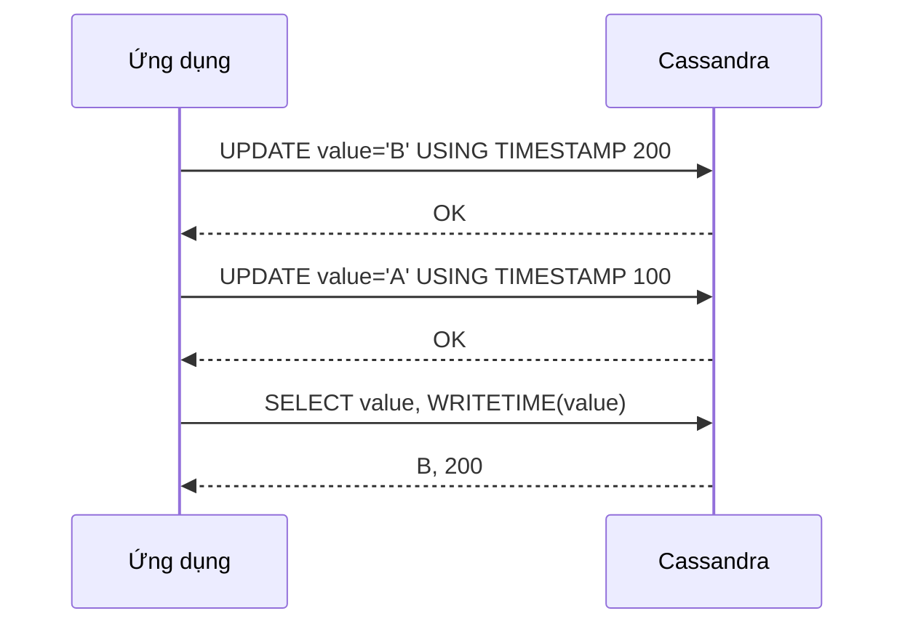
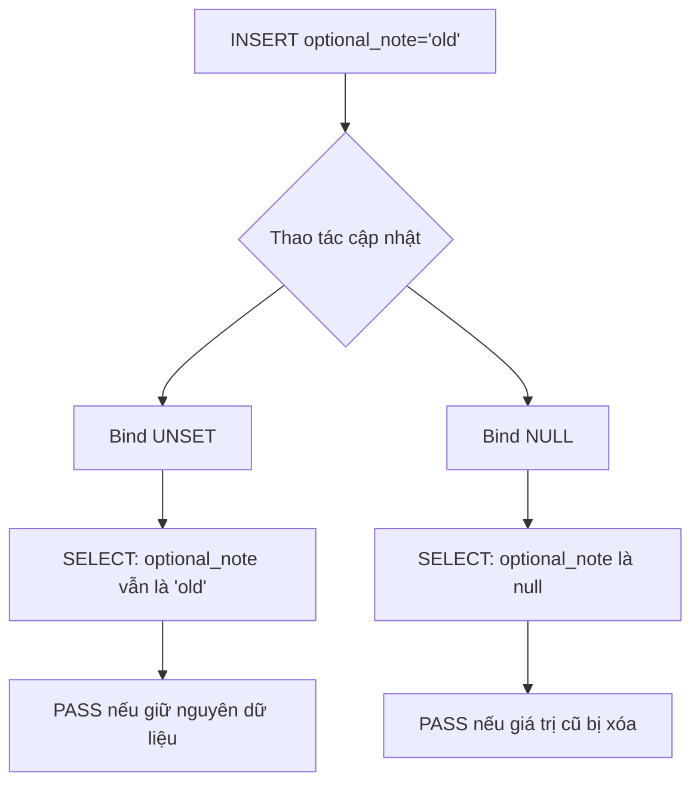
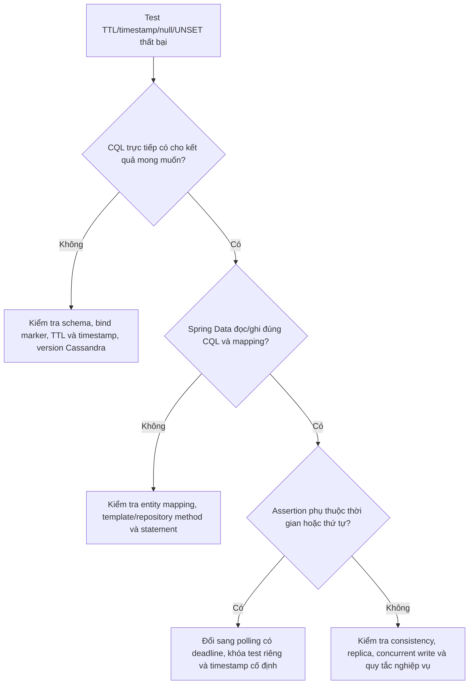

# Kiểm thử TTL, timestamp, null và UNSET

Trong **Spring Data Cassandra**, các thao tác lưu qua `CassandraRepository`, `CassandraTemplate` hoặc truy vấn CQL đều đi đến **Apache Cassandra**, nơi dữ liệu được quản lý theo từng ô (*cell*) với timestamp và có thể có thời gian sống (TTL). Bốn khái niệm **TTL**, **timestamp**, **`null`** và **`UNSET`** ảnh hưởng trực tiếp đến kết quả ghi/đọc, xung đột giữa các bản ghi và hành vi khi cập nhật từng trường.

Vì Cassandra là hệ cơ sở dữ liệu phân tán, một bài test chỉ xác nhận “`save()` không ném exception” chưa đủ. Bài thuộc chương **Kiểm thử** này hướng dẫn xây dựng kiểm thử tích hợp cho các ngữ nghĩa đó, từ câu CQL đến entity mapping của Spring Data Cassandra. Chúng ta sử dụng khóa phân vùng rõ ràng, quan sát `TTL(...)`/`WRITETIME(...)`, phân biệt giá trị rỗng với cập nhật bị bỏ qua, và hạn chế những assertion dễ lỗi do thời gian hoặc cấu hình cluster.

Sau bài học, bạn có thể:

- Kiểm tra một cột có TTL, hết hạn đúng kỳ vọng và không ảnh hưởng các cột không được cập nhật.
- Kiểm chứng thứ tự ghi theo **write timestamp** thay vì dựa vào thứ tự thực thi lời gọi Java.
- Viết test phân biệt **CQL `null`** (xóa giá trị/tạo tombstone) với **`UNSET`** (không gửi cập nhật cho cột).
- Kiểm thử hành vi mapping của Spring Data Cassandra trên cluster thật, xác định giới hạn của unit test và mock.

## 1. Nắm đúng ngữ nghĩa trước khi viết test

| Khái niệm | Khi ghi | Khi đọc hoặc kiểm tra | Lỗi thường gặp |
| --- | --- | --- | --- |
| **TTL** | Giới hạn thời gian sống của cell, thường truyền bằng `USING TTL` hoặc cấu hình mặc định ở bảng | `TTL(column)` trả số giây còn lại của cell có TTL, nếu cell còn tồn tại | Assertion phải bằng chính xác TTL vừa gán; ngủ đúng N giây rồi giả định đã hết hạn |
| **Write timestamp** | Cassandra dùng timestamp của mutation để phân xử giá trị cạnh tranh, thường tính bằng **microsecond** | `WRITETIME(column)` trả timestamp của cell hiện còn hiển thị | Nhầm với `createdAt` hoặc `Instant` trong entity; nhầm mili giây và micro giây |
| **CQL `null`** | Ghi `null` vào cột thông thường biểu diễn xóa giá trị, tạo **tombstone** | `SELECT` không cho thấy dữ liệu cũ; cột được đọc là `null` | Tưởng `null` nghĩa là “không sửa trường này” |
| **`UNSET`** | Driver truyền trạng thái “không cung cấp giá trị” cho một bind marker; Cassandra bỏ qua cập nhật cột tương ứng ở ngữ cảnh được hỗ trợ | Giá trị cũ của cột được giữ nguyên | Tưởng `UNSET` tương đương `null` hoặc có thể dùng cho mọi vị trí bind |

**Phạm vi của các phép thử:** dùng cột kiểu vô hướng như `text`, không thuộc primary key, không phải counter. `TTL()` và `WRITETIME()` không dùng như phép đo tương đương cho mọi kiểu cột (ví dụ primary key và counter). Với collection không frozen, thao tác mutation và timestamp/TTL có thể có ngữ nghĩa theo phần tử; cần bộ test riêng.

### 1.1. Bảng mẫu thiết kế cho từng phép thử

```sql
CREATE KEYSPACE IF NOT EXISTS lesson_testing
WITH replication = {
  'class': 'SimpleStrategy',
  'replication_factor': 1
};

CREATE TABLE IF NOT EXISTS lesson_testing.cell_probe (
    id uuid PRIMARY KEY,
    value_text text,
    optional_note text
);
```

Đây là schema **chỉ dành cho kiểm thử trên cluster một node**. Trong ứng dụng thật, keyspace và chiến lược replication phải tuân theo topology (ví dụ `NetworkTopologyStrategy` cho nhiều datacenter); bảng nghiệp vụ phải được thiết kế từ truy vấn, partition key và đặc tính tải. Mỗi test dùng một `UUID` mới để không bị dữ liệu của test trước ảnh hưởng.

## 2. Chọn mức kiểm thử phù hợp

Không phải mọi điều kiện cần khởi động Cassandra, nhưng các ngữ nghĩa được thực thi bên trong Cassandra phải được kiểm chứng trên database thật.

| Mức kiểm thử | Có thể chứng minh | Không thể chứng minh đầy đủ |
| --- | --- | --- |
| Unit test service với mock repository | Service chọn thao tác nào, xử lý kết quả hoặc exception ra sao | Cassandra tạo tombstone hay không; TTL hết hạn; luật timestamp |
| Test mapping và statement | Tên bảng/cột, khóa, truy vấn CQL và cách bind tham số | Cell thật trong cluster đã nhận mutation và trả kết quả ra sao |
| **Integration test với Cassandra thật** | TTL, `WRITETIME`, `null`/`UNSET`, đọc lại qua Spring Data | Hành vi khi một số replica mất kết nối, clock skew lớn hoặc sự cố nhiều DC nếu chỉ dùng một node |
| Test cluster nhiều node và fault injection | Consistency level, replica divergence, thời gian hội tụ, failure mode | Không cần chạy trong mọi vòng unit-test nhanh |

Một cấu hình thực tế là dùng **JUnit 5 + Testcontainers Cassandra** để tạo cluster riêng cho suite. Kiểm tra phiên bản Testcontainers và Spring Boot đang dùng: vị trí package `CassandraContainer`, API service connection và cách khởi tạo keyspace có thể thay đổi theo phiên bản. Ví dụ dưới đây dùng dạng API phổ biến của **Testcontainers 1.x** (`org.testcontainers.containers.CassandraContainer`), **Java Driver 4.x** (`com.datastax.oss.driver.api...`), JUnit Jupiter và Awaitility.

Dependency kiểm thử thường cần: `org.testcontainers:cassandra`, `org.testcontainers:junit-jupiter`, `org.junit.jupiter:junit-jupiter` và `org.awaitility:awaitility`. Cần Docker có thể chạy container. Không dùng H2 hoặc mock để thay thế kiểm thử ngữ nghĩa CQL.

## 3. Kiểm thử tích hợp trực tiếp ngữ nghĩa CQL

Đoạn mã sau sử dụng Driver trực tiếp để tách bạch hành vi của **Cassandra** khỏi cơ chế mapping của Spring Data. Sau khi nhóm test này chạy thành công, ta mới thêm test thông qua repository/template để kiểm tra adapter của ứng dụng.

```java
import static org.awaitility.Awaitility.await;
import static org.junit.jupiter.api.Assertions.*;

import java.time.Duration;
import java.util.UUID;

import com.datastax.oss.driver.api.core.CqlSession;
import com.datastax.oss.driver.api.core.cql.PreparedStatement;
import com.datastax.oss.driver.api.core.cql.Row;
import com.datastax.oss.driver.api.core.cql.SimpleStatement;
import org.junit.jupiter.api.AfterAll;
import org.junit.jupiter.api.BeforeAll;
import org.junit.jupiter.api.Test;
import org.testcontainers.containers.CassandraContainer;
import org.testcontainers.junit.jupiter.Container;
import org.testcontainers.junit.jupiter.Testcontainers;

@Testcontainers
class CassandraCellSemanticsIT {

    @Container
    static final CassandraContainer<?> cassandra =
        new CassandraContainer<>("cassandra:4.1");

    private static CqlSession session;

    @BeforeAll
    static void createSchema() {
        session = CqlSession.builder()
            .addContactPoint(cassandra.getContactPoint())
            .withLocalDatacenter(cassandra.getLocalDatacenter())
            .build();

        session.execute("""
            CREATE KEYSPACE IF NOT EXISTS lesson_testing
            WITH replication = {
                'class': 'SimpleStrategy',
                'replication_factor': 1
            }
            """);
        session.execute("""
            CREATE TABLE IF NOT EXISTS lesson_testing.cell_probe (
                id uuid PRIMARY KEY,
                value_text text,
                optional_note text
            )
            """);
    }

    @AfterAll
    static void closeSession() {
        if (session != null) {
            session.close();
        }
    }

    @Test
    void ttlCellExpiresWithoutAssertingExactCountdown() {
        UUID id = UUID.randomUUID();
        session.execute(SimpleStatement.newInstance(
            "INSERT INTO lesson_testing.cell_probe " +
            "(id, value_text) VALUES (?, ?) USING TTL 5",
            id, "short-lived"));

        Row initial = session.execute(SimpleStatement.newInstance(
            "SELECT value_text, TTL(value_text) AS remaining " +
            "FROM lesson_testing.cell_probe WHERE id = ?", id)).one();

        assertNotNull(initial);
        assertEquals("short-lived", initial.getString("value_text"));
        assertFalse(initial.isNull("remaining"));
        assertTrue(initial.getInt("remaining") > 0);
        assertTrue(initial.getInt("remaining") <= 6);

        await().atMost(Duration.ofSeconds(12))
            .pollInterval(Duration.ofMillis(250))
            .untilAsserted(() -> {
                Row expired = session.execute(SimpleStatement.newInstance(
                    "SELECT value_text FROM lesson_testing.cell_probe " +
                    "WHERE id = ?", id)).one();
                assertNull(expired);
            });
    }

    @Test
    void higherWriteTimestampWinsEvenWhenSentFirst() {
        UUID id = UUID.randomUUID();
        long higher = 1_750_000_000_000_100L; // microseconds
        long lower = higher - 1_000L;

        session.execute(SimpleStatement.newInstance(
            "UPDATE lesson_testing.cell_probe USING TIMESTAMP ? " +
            "SET value_text = ? WHERE id = ?",
            higher, "newer", id));
        session.execute(SimpleStatement.newInstance(
            "UPDATE lesson_testing.cell_probe USING TIMESTAMP ? " +
            "SET value_text = ? WHERE id = ?",
            lower, "older", id));

        Row row = session.execute(SimpleStatement.newInstance(
            "SELECT value_text, WRITETIME(value_text) AS written_at " +
            "FROM lesson_testing.cell_probe WHERE id = ?", id)).one();

        assertNotNull(row);
        assertEquals("newer", row.getString("value_text"));
        assertEquals(higher, row.getLong("written_at"));
    }

    @Test
    void unsetKeepsOldValueWhereasNullDeletesIt() {
        UUID id = UUID.randomUUID();
        session.execute(SimpleStatement.newInstance(
            "INSERT INTO lesson_testing.cell_probe " +
            "(id, value_text, optional_note) VALUES (?, ?, ?)",
            id, "anchor", "keep-me"));

        PreparedStatement update = session.prepare(
            "UPDATE lesson_testing.cell_probe " +
            "SET optional_note = ? WHERE id = ?");

        // UNSET: bỏ qua cập nhật cột optional_note.
        session.execute(update.boundStatementBuilder()
            .unset(0)
            .setUuid(1, id)
            .build());

        Row afterUnset = session.execute(SimpleStatement.newInstance(
            "SELECT optional_note FROM lesson_testing.cell_probe " +
            "WHERE id = ?", id)).one();
        assertNotNull(afterUnset);
        assertEquals("keep-me", afterUnset.getString("optional_note"));

        // NULL: yêu cầu xóa giá trị optional_note, tạo tombstone.
        session.execute(update.boundStatementBuilder()
            .setToNull(0)
            .setUuid(1, id)
            .build());

        Row afterNull = session.execute(SimpleStatement.newInstance(
            "SELECT value_text, optional_note " +
            "FROM lesson_testing.cell_probe WHERE id = ?", id)).one();
        assertNotNull(afterNull); // value_text vẫn tồn tại.
        assertEquals("anchor", afterNull.getString("value_text"));
        assertTrue(afterNull.isNull("optional_note"));
    }
}
```

**Tại sao thiết kế như vậy?**

1. **Khóa phân vùng mới cho từng test:** không cần `TRUNCATE` bảng chung và tránh tác động ngẫu nhiên giữa các test chạy song song.
2. **Kiểm thử TTL có điều kiện đợi:** kết quả dựa vào đồng hồ/tiến trình trong Cassandra thật. `await()` đợi cho tới khi query phản ánh hết hạn, thay vì giả định `Thread.sleep(5_000)` đúng tuyệt đối.
3. **Timestamp cố định:** bỏ phụ thuộc vào thời điểm gọi `System.currentTimeMillis()`; test khẳng định timestamp lớn hơn thắng ngay cả khi statement có timestamp nhỏ hơn được gửi sau.
4. **Một cột “anchor” không đổi:** sau khi `optional_note` thành `null`, hàng vẫn tồn tại nhờ `value_text`. Điều này cho phép phân biệt “cột đã bị xóa” với “không có hàng”.
5. **UNSET/NULL trên cùng prepared statement:** cô lập khác biệt giữa hai cách bind; không tự suy luận từ một entity Java có property `null`.

Lưu ý: test `afterNull.isNull(...)` cho thấy **kết quả logic** sau khi xóa. Nó **không đo trực tiếp số tombstone trong SSTable**; muốn quan sát chi phí tombstone, cần công cụ/metric phù hợp và bài test hiệu năng riêng. Expired TTL cũng có thể để lại tombstone cho đến khi Cassandra thực hiện cơ chế dọn dẹp thích hợp.

## 4. Kiểm thử TTL chi tiết

### 4.1. TTL là thời gian sống của cell

Ví dụ hai cột được ghi tại những thời điểm khác nhau:

```sql
INSERT INTO lesson_testing.cell_probe (id, value_text, optional_note)
VALUES (11111111-1111-1111-1111-111111111111, 'active', 'stable');

UPDATE lesson_testing.cell_probe USING TTL 30
SET value_text = 'temporary'
WHERE id = 11111111-1111-1111-1111-111111111111;

SELECT value_text, optional_note,
       TTL(value_text) AS value_ttl,
       TTL(optional_note) AS note_ttl
FROM lesson_testing.cell_probe
WHERE id = 11111111-1111-1111-1111-111111111111;
```

Ngay sau mutation thứ hai, kỳ vọng:

- `value_text` bằng `temporary` và `value_ttl` dương, đang giảm dần.
- `optional_note` vẫn là `stable`; `note_ttl` bằng `null` nếu cell đó không có TTL.
- Sau khi TTL của `value_text` hết, `value_text` biến mất khi đọc; `optional_note` vẫn còn, nên hàng có thể vẫn xuất hiện.

**Không kết luận TTL của cả hàng chỉ từ TTL của một cột.** `INSERT ... USING TTL` và `UPDATE ... USING TTL` có thể áp TTL cho các cell được ghi trong statement; việc cập nhật một cột không nhất thiết làm mới TTL của các cột khác. Với bảng cấu hình `default_time_to_live`, phải kiểm tra cả mặc định của bảng và TTL đặt trên statement. `TTL(column)` là phép quan sát thích hợp với cột thường còn tồn tại; không lấy TTL của partition key.

### 4.2. Những assertion nên và không nên viết

| Không bền vững | Nên viết |
| --- | --- |
| `assertEquals(30, row.getInt("ttl"))` ngay sau ghi | `assertTrue(ttl > 0 && ttl <= 31)`, với biên dung sai hợp lý |
| `Thread.sleep(30_000); assertNull(...)` | Poll đến trạng thái cuối trong giới hạn `atMost` có dự phòng |
| Giả định xóa vật lý khỏi SSTable ngay khi TTL hết | Chỉ khẳng định dữ liệu không còn nhìn thấy ở mức query |
| Dựa vào đồng hồ JVM để ước lượng TTL chính xác | Xem `TTL(column)` từ Cassandra, kiểm tra dạng khoảng/thay đổi |
| Cho các test TTL dùng chung một hàng | Mỗi test một khóa riêng; cleanup theo vòng đời môi trường |

Trường hợp cần bổ sung tùy nghiệp vụ: ghi lại giá trị với TTL mới, ghi một cột có TTL và một cột không TTL, TTL mặc định ở bảng, TTL bằng 0 theo phiên bản Cassandra đang chạy, và đọc sau khi TTL hết bằng consistency level thực tế. Với thao tác cập nhật TTL, luôn kiểm tra *cột nào* được cập nhật; đừng mặc định mỗi lần gọi `save()` đều làm mới TTL của toàn entity.

## 5. Kiểm thử timestamp và luật ghi thắng

### 5.1. Phân biệt ba loại thời gian

| Giá trị | Được dùng để làm gì? | Đơn vị thường gặp |
| --- | --- | --- |
| `Instant createdAt` hoặc `updatedAt` của entity | Thông tin nghiệp vụ, chỉ là một cột dữ liệu nếu được mapping | Java `Instant` có độ chính xác nanosecond ở API |
| Timestamp của CQL mutation | Cassandra xác định giá trị nào thắng khi nhiều mutation cạnh tranh cùng cell | **Microsecond** từ epoch |
| `WRITETIME(column)` | Quan sát write timestamp của cell đã đọc | **Microsecond** từ epoch |

Trong Java, `System.currentTimeMillis()` trả **millisecond**. Nếu muốn chủ động truyền một timestamp mang nghĩa thời gian thực, phép đổi cơ bản là:

```java
long timestampMicros = Math.multiplyExact(
    System.currentTimeMillis(), 1_000L);
```

Đừng dùng phép đổi này để tạo “timestamp luôn duy nhất” khi nhiều ghi xảy ra trong cùng một millisecond hoặc trên nhiều tiến trình. Với kiểm thử luật phân xử, **chọn hai hằng số microsecond cố định, khác nhau**, như ví dụ `higher` và `lower` ở phần 3. Một giá trị `WRITETIME` có thể không bằng thời điểm tường thực tại JVM do độ trễ mạng, đồng hồ coordinator và việc dùng timestamp client cung cấp.

### 5.2. Vì sao cần kiểm tra thứ tự timestamp?

Giả sử message A mang trạng thái cũ nhưng được xử lý sau message B. Nếu hệ thống ghi Cassandra với timestamp đến từ event, Cassandra có thể giữ B khi B có timestamp cao hơn. Test nên mô phỏng đúng thứ tự gửi/nhận:



Các số `100`/`200` trong sơ đồ chỉ diễn tả thứ tự tương đối; trong code thực, CQL timestamp có đơn vị microsecond. Test phải đọc lại **giá trị và `WRITETIME`**, không chỉ khẳng định hai `UPDATE` đều thành công. Cũng cần test khi một cột bị xóa với timestamp cạnh tranh: tombstone có timestamp và ảnh hưởng đến giá trị nào còn hiển thị. Trường hợp timestamp **bằng nhau** có quy tắc giải quyết xung đột riêng, vì vậy không nên dựa vào thứ tự request khi hai mutation cùng timestamp.

Không dùng `USING TIMESTAMP` cho thao tác mà Cassandra không cho phép, chẳng hạn một số dạng câu lệnh đặc biệt. Hãy kiểm tra loại statement, phiên bản server và API Spring Data hỗ trợ trước khi đưa timestamp tùy chỉnh vào sản phẩm.

## 6. Kiểm thử `null` và `UNSET`

### 6.1. Bốn trạng thái cần tách biệt

Trong Java và Cassandra, “không có giá trị” có thể mang nhiều nghĩa:

1. **Không có hàng:** `SELECT ... WHERE id = ?` trả không có bản ghi.
2. **Có hàng, cột không tồn tại hoặc đã bị xóa:** row có thể được trả về nhờ các cột khác, nhưng cột đích đọc ra `null`.
3. **`SET col = null` hoặc bind `setToNull`:** tạo mutation xóa giá trị cũ, thường tương ứng với tombstone.
4. **Bind marker ở trạng thái `UNSET`:** khi được phép, cột đích không bị mutation bởi statement đó, giữ lại giá trị trước đó.

Hai trạng thái (3) và (4) có thể cùng làm property Java trông như “thiếu dữ liệu”, nhưng tác động ở Cassandra khác nhau. `UNSET` chỉ là trạng thái bind của Driver ở vị trí được hỗ trợ; không được dùng tùy tiện thay cho mọi giá trị trong `WHERE`, primary key, điều kiện LWT hay các biểu thức không chấp nhận UNSET.

### 6.2. Luồng kiểm thử nên bắt đầu bằng dữ liệu cũ



**Đừng test UNSET trên một cột vốn đã `null`.** Khi đó cả “giữ nguyên” và “xóa” đều có thể đọc lại thành `null`, test vẫn xanh dù logic sai. Phải seed một giá trị cũ khác `null`, thực hiện mutation rồi quan sát giá trị sau đó. Với kiểm thử xóa cột, giữ một cột “anchor” để hàng không biến mất hoàn toàn.

### 6.3. Spring Data Cassandra mapping có thể làm khác với suy đoán

Giả sử entity:

```java
import java.util.UUID;
import org.springframework.data.annotation.Id;
import org.springframework.data.cassandra.core.mapping.Column;
import org.springframework.data.cassandra.core.mapping.Table;

@Table("cell_probe")
public class CellProbe {
    @Id
    private UUID id;

    @Column("value_text")
    private String valueText;

    @Column("optional_note")
    private String optionalNote;

    // Constructor không tham số, getters và setters theo dự án.
}
```

Một property `optionalNote == null` không tự cho biết SQL cuối cùng sẽ **bỏ cột**, bind `UNSET` hay bind `NULL`. Cách tạo statement có thể khác giữa `insert`, `update`, `save`, repository query, CQL tùy chỉnh, và giữa các phiên bản/framework configuration. Bởi vậy, cần **test hành vi thực tế của con đường ứng dụng đang dùng** thay vì suy luận từ trạng thái object.

Một ví dụ kiểm thử qua Spring Data (giả định `CassandraTemplate` trỏ đến keyspace `lesson_testing` và schema đã tạo):

```java
// Dữ liệu được seed bằng CQL hoặc một fixture đã xác nhận.
UUID id = UUID.randomUUID();
cqlSession.execute(SimpleStatement.newInstance(
    "INSERT INTO lesson_testing.cell_probe " +
    "(id, value_text, optional_note) VALUES (?, ?, ?)",
    id, "anchor", "before"));

// Gọi đúng API Spring Data mà service thực sự sử dụng.
CellProbe entity = cassandraTemplate.selectOneById(id, CellProbe.class);
assertNotNull(entity);
assertEquals("before", entity.getOptionalNote());

// Sau khi thực hiện một update qua repository/template của hệ thống:
// 1) Đọc trực tiếp CQL để biết cell thực tế thay đổi ra sao.
// 2) Đọc lại entity để xác minh kết quả mapping.
// 3) So sánh với ngữ nghĩa mong muốn: giữ nguyên (UNSET) hay xóa (NULL).
```

Muốn chứng minh một code path dùng `UNSET`, hãy tạo entity có giá trị cũ, gọi đúng thao tác cập nhật, rồi kiểm chứng dữ liệu vẫn còn; nếu cần bằng chứng về cách bind, quan sát statement/query execution theo cơ chế logging/driver test đã được kiểm soát. Với thao tác xóa, cần khẳng định dữ liệu cũ không còn hiển thị. Hai phép thử này phát hiện khác biệt giữa kỳ vọng nghiệp vụ và mapping mà mock không thể phát hiện.

Khi dùng `@DataCassandraTest`, nên nối test context với **cùng Cassandra Testcontainer** và tạo schema/keyspace trước khi test repository. Cách dùng `@ServiceConnection` (Spring Boot phiên bản hỗ trợ) hoặc `@DynamicPropertySource` phụ thuộc phiên bản Boot/Testcontainers; đừng để test vô tình trỏ sang Cassandra đang chạy ở môi trường phát triển. Một test đúng phải chứng minh cả kết quả ở tầng **Spring Data** và tầng **CQL**, khi cần khẳng định TTL hoặc tombstone semantics.

## 7. Những trường hợp biên dễ bỏ sót

| Tình huống | Điều cần kiểm tra | Vì sao quan trọng |
| --- | --- | --- |
| Ghi một cột có TTL rồi cập nhật lại cột đó | TTL sau mutation có được thay thế/làm mới đúng yêu cầu không | Retry hoặc `save()` có thể kéo dài thời gian sống ngoài ý muốn |
| Hai cột có TTL khác nhau | Cột thứ nhất hết hạn không làm cột thứ hai mất theo | Cassandra quản lý TTL ở mức cell |
| Cột không có TTL trong cùng hàng | `TTL(column)` trả `null`, giá trị vẫn tồn tại | Tránh hiểu `null` TTL là “đã hết hạn” |
| Viết timestamp thấp hơn timestamp cũ | Giá trị mới gửi không thắng giá trị đang có | Cassandra không lấy “request cuối” làm chuẩn |
| Viết timestamp bằng nhau | Không khẳng định thứ tự request là thứ tự thắng | Quy tắc hòa timestamp không dựa trên arrival order |
| Ghi `NULL` sau khi cột có dữ liệu | Dữ liệu cũ không còn hiển thị; không khẳng định đã dọn vật lý | Tombstone và compaction có vòng đời riêng |
| Ghi `UNSET` sau khi cột có dữ liệu | Dữ liệu cũ còn nguyên | Phân biệt bỏ qua cập nhật với xóa |
| Ghi `UNSET` vào thành phần khóa | Driver/server báo lỗi thay vì lặng lẽ tạo dữ liệu | Chỉ dùng UNSET ở vị trí được hỗ trợ |
| Đọc qua repository sau TTL | Không còn entity, hoặc cột thiếu theo các cell còn sống | Mapper có thể trả `Optional.empty()` hoặc entity với cột `null` tùy trường hợp |
| Reactive repository và test TTL | Assertion chờ Cassandra thật thay đổi, không dùng thời gian ảo để “đẩy nhanh TTL” | `StepVerifier.withVirtualTime` chỉ điều khiển scheduler Reactor, không điều khiển đồng hồ Cassandra |

Đặc biệt với **paging** và các bảng được thiết kế theo truy vấn, TTL có thể khiến số hàng còn sống trong các partition thay đổi trong lúc duyệt trang. Test paging nên mô phỏng dữ liệu hết hạn để xác minh xử lý trang rỗng/ít bản ghi mà không đánh đồng với lỗi phân trang. Với **consistency level** khác nhau, kiểm thử một node chỉ xác nhận logic cơ bản; test nhiều replica mới kiểm chứng được hành vi đọc/ghi khi node chậm hoặc không đồng bộ.

## 8. Tránh flaky test và cô lập dữ liệu

Các bài test trên có thời gian thực và phụ thuộc hạ tầng. Những nguyên tắc sau giúp suite đáng tin hơn:

1. **Dùng Testcontainers với phiên bản Cassandra được pin:** tránh môi trường developer và CI chạy khác phiên bản server. Khi cần kiểm chứng các phiên bản hỗ trợ khác nhau, chạy một ma trận CI có chủ đích.
2. **Tạo keyspace/bảng ở setup, mỗi test dùng UUID riêng:** giảm xung đột khi test song song. Không chia sẻ cùng hàng giữa test TTL, timestamp và null.
3. **Cấu hình timeout/polling có giới hạn:** kiểm thử TTL đủ thời gian dự phòng cho scheduler và độ trễ cluster. Không biến test thành vòng chờ vô hạn.
4. **Không dùng đồng hồ giả của JVM thay cho đồng hồ Cassandra:** clock giả hữu ích để unit test service, nhưng không làm thời gian TTL ở Cassandra trôi nhanh.
5. **Test bằng CQL trước, mapping sau:** khi một assertion về repository thất bại, biết được nguyên nhân đến từ CQL semantics hay converter/mapper.
6. **Giảm phụ thuộc vào thứ tự test:** không yêu cầu `@TestMethodOrder` để một test ghi dữ liệu cho test khác; fixture phải tự tạo trạng thái cần thiết.
7. **Phân biệt timeout với kết quả không xác định:** một phép ghi timeout có thể đã được áp dụng. Nếu thêm test retry, cần cùng idempotency key và xác minh trạng thái cuối, tránh tạo dữ liệu trùng.

### Ví dụ về cấu trúc bộ test

```text
Unit
 └─ ServiceUpdatePolicyTest
     └─ null input được hiểu là xóa hay bỏ qua theo nghiệp vụ?

Integration — Cassandra Testcontainer
 ├─ CassandraCellSemanticsIT
 │   ├─ ttlCellExpiresWithoutAssertingExactCountdown
 │   ├─ higherWriteTimestampWinsEvenWhenSentFirst
 │   └─ unsetKeepsOldValueWhereasNullDeletesIt
 └─ SpringDataCellMappingIT
     ├─ repositoryReadAfterTtlExpiry
     ├─ templateUpdateNullBehavior
     └─ customQueryUnsetBehavior

Cluster/multi-node (suite riêng)
 ├─ readAtConfiguredConsistencyAfterMutation
 └─ behaviorDuringReplicaFailureAndClockSkew
```

Lịch kiểm thử nên phân biệt bộ test nhanh cho pull request và bộ test hạ tầng nhiều node chạy theo kế hoạch CI phù hợp. Tính đúng đắn của null/UNSET cần được kiểm tra qua API thực tế của hệ thống, nhất là khi chuyển phiên bản Spring Data Cassandra hoặc Java Driver.

## 9. Quy trình kiểm tra lỗi khi test thất bại



Các lỗi nên được phân loại cụ thể: `TTL` đã hết trước khi kiểm tra; `WRITETIME` đo bằng microsecond nhưng test so với millisecond; test `UNSET` không seed dữ liệu cũ; thao tác `null` chỉ khiến cột trống nhưng hàng vẫn còn; hoặc Spring Data bỏ qua property `null` theo cơ chế tạo statement đang dùng.

## 10. Câu hỏi tự kiểm tra

1. Vì sao kiểm thử `TTL(column)` cần khoảng giá trị thay vì khẳng định chính xác số giây đã ghi?
2. Sau `UPDATE value_text ... USING TTL`, vì sao `optional_note` có thể tiếp tục tồn tại lâu hơn `value_text`?
3. Một mutation được gửi sau nhưng có write timestamp thấp hơn có chắc ghi đè mutation trước không? Tại sao?
4. Giá trị do `WRITETIME(column)` trả về khác gì với property `updatedAt` của entity?
5. Nếu cột ban đầu là `null`, vì sao test so sánh `setToNull` với `unset` sẽ không phát hiện được bug?
6. Khi một lần lưu entity `optionalNote == null`, cần xác minh điều gì trước khi kết luận Cassandra đã nhận tombstone?
7. Vì sao một test dùng `StepVerifier.withVirtualTime` không thể tự khiến TTL ở Cassandra hết hạn?
8. Test Testcontainers một node chứng minh được điều gì, và cần thêm test gì nếu ứng dụng có nhiều replica hoặc datacenter?

**Ghi nhớ:** Kiểm thử Cassandra phải khẳng định **trạng thái cell sau mutation**, không chỉ kết quả trả về của phương thức Spring Data. Với TTL, kiểm tra thời gian sống bằng polling có giới hạn; với timestamp, kiểm tra `WRITETIME` bằng microsecond; với `null` và `UNSET`, luôn bắt đầu bằng giá trị cũ khác `null` để chứng minh thao tác **xóa** hay **giữ nguyên** dữ liệu.
