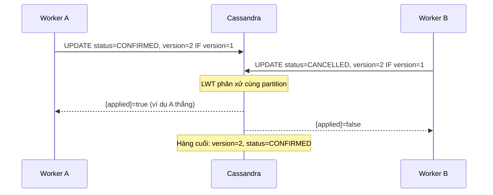
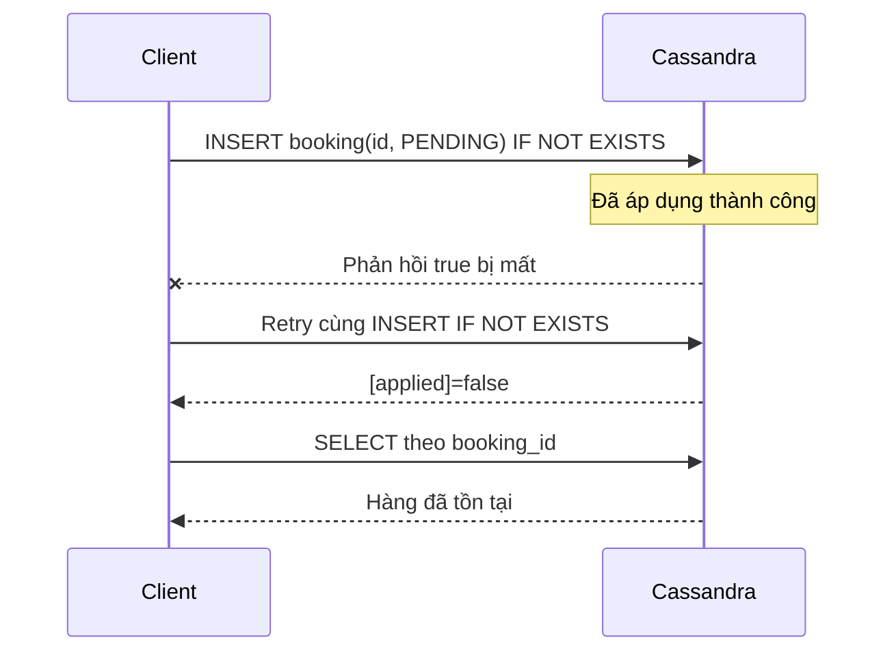

# Kiểm thử xung đột LWT, `@Version` và kết quả `applied`

## 1. Mục tiêu và bối cảnh

Trong **Spring Data Cassandra**, entity mapping, repository và `CassandraTemplate` giúp thao tác với bảng Cassandra theo mô hình truy vấn. Tuy nhiên, các thao tác đọc rồi ghi có thể bị hai client thực hiện đồng thời. Cassandra không cung cấp giao dịch quan hệ tổng quát cho mọi bảng và partition; để thực hiện **ghi có điều kiện**, Cassandra sử dụng *lightweight transaction* (**LWT**) dựa trên cơ chế đồng thuận Paxos.

Chương **Kiểm thử** cần trả lời ba câu hỏi riêng biệt:

1. Khi hai yêu cầu cùng kỳ vọng một phiên bản dữ liệu, **có đúng chỉ một yêu cầu thành công** không?
2. Khi dùng `@Version` của Spring Data Cassandra, **bản sao entity đã cũ có bị từ chối** và dữ liệu của người ghi trước có được giữ lại không?
3. Khi CQL trả `[applied] = false` hoặc kết nối timeout, **ứng dụng có phân biệt đúng xung đột với kết quả chưa rõ** không?

Sau bài này, bạn sẽ thiết kế kiểm thử tích hợp cho LWT, kiểm thử optimistic locking qua repository, kiểm tra trạng thái sau xung đột, dựng tình huống tranh chấp có kiểm soát bằng `CountDownLatch`, và hiểu giới hạn của test một node so với cụm phân tán thực tế.

> **Nguyên tắc quan trọng:** `applied = false` là kết quả hợp lệ của một câu lệnh có điều kiện không thỏa; timeout là tình huống client **chưa biết chắc** lệnh đã được áp dụng hay chưa. Hai trạng thái này không thể xử lý giống nhau.

## 2. Ba lớp cần hiểu trước khi viết test

| Khái niệm | Cơ chế | Quan sát được trong test |
|---|---|---|
| LWT trong CQL | `INSERT ... IF NOT EXISTS`, `UPDATE ... IF ...`, `DELETE ... IF ...` | Trả kết quả có cột `[applied]` cho biết điều kiện có được áp dụng trong lần thực thi đã nhận phản hồi hay không. |
| `@Version` của Spring Data Cassandra | Optimistic locking trên entity; Spring Data dùng ghi có điều kiện khi lưu entity có version | Ghi phiên bản hợp lệ thành công; ghi từ bản sao đã cũ bị từ chối, thường qua `OptimisticLockingFailureException`. |
| `applied` ở Java Driver | Trường kết quả của conditional CQL | `ResultSet.wasApplied()` hoặc đọc `Row.getBoolean("[applied]")` trong kết quả LWT. |

`@Version` là cách **Spring Data** áp dụng kiểm soát xung đột ở mức entity. `[applied]` là tín hiệu **Cassandra/driver** trả về cho câu lệnh CQL có điều kiện. Chúng liên quan nhưng ở hai tầng khác nhau: khi Spring Data tự thực hiện LWT cho optimistic locking, lỗi điều kiện có thể được chuyển thành ngoại lệ Spring thay vì trả về một `ResultSet` cho mã ứng dụng.

### 2.1. Ví dụ bản ghi chịu tranh chấp

Giả sử bảng được thiết kế để tra cứu booking theo `booking_id`:

```sql
CREATE KEYSPACE IF NOT EXISTS lwt_test
WITH replication = {
  'class': 'SimpleStrategy',
  'replication_factor': 1
};

CREATE TABLE IF NOT EXISTS lwt_test.booking_by_id (
    booking_id uuid PRIMARY KEY,
    status text,
    version bigint
);
```

Keyspace `lwt_test` với một replica chỉ phù hợp cho **test chức năng trong môi trường cục bộ**. Môi trường kiểm thử chịu lỗi và đánh giá tính nhất quán nhiều replica cần cấu hình replication phù hợp với cụm và số node của môi trường đó.

Trong ví dụ kiểm thử bằng CQL trực tiếp, ta chủ động khởi tạo `version = 1`. Khi kiểm thử `@Version`, **không giả định phiên bản đầu tiên là 1**: để Spring Data tự quản lý giá trị khởi tạo, đọc lại phiên bản thực tế rồi so sánh ở các lần lưu tiếp theo.

## 3. LWT hoạt động ra sao trong tình huống xung đột?

### 3.1. Tạo một hàng nếu chưa tồn tại

```sql
INSERT INTO lwt_test.booking_by_id (booking_id, status, version)
VALUES (?, 'PENDING', 1)
IF NOT EXISTS;
```

Với cùng `booking_id`, khi không có hàng, lệnh đầu tiên có thể nhận:

```text
[applied]
---------
true
```

Một lệnh tạo trùng nhận phản hồi bình thường có thể thấy `[applied] = false`. Điều này xác nhận **điều kiện của lần gọi vừa nhận phản hồi không được áp dụng**; để biết hàng do ai tạo hoặc thao tác trước đã thành công hay chưa, cần đối chiếu thêm ID yêu cầu và trạng thái lưu trữ.

### 3.2. Cập nhật theo phiên bản mong đợi

```sql
UPDATE lwt_test.booking_by_id
SET status = 'CONFIRMED', version = 2
WHERE booking_id = ?
IF version = 1;
```

Giả sử hai worker đều đọc `version = 1`, sau đó một worker muốn đặt `CONFIRMED` và worker khác muốn đặt `CANCELLED`. Nếu cả hai cùng phát lệnh điều kiện `IF version = 1`, chỉ một lệnh được phép thay đổi hàng từ phiên bản 1 sang 2 khi cả hai yêu cầu hoàn tất bình thường. Lệnh còn lại không thỏa điều kiện và trả `applied = false`.



Sơ đồ mô tả **một kết quả có thể xảy ra**. Worker B hoàn toàn có thể thắng; test phải khẳng định tính chất “đúng một người thắng”, không cố định người thắng theo thứ tự tạo thread.

### 3.3. `SERIAL` và `LOCAL_SERIAL` không thay `@Version`

LWT dùng *serial consistency* (`SERIAL` hoặc `LOCAL_SERIAL`, tùy cấu hình) cho giai đoạn đồng thuận, bên cạnh consistency của phần ghi/đọc thông thường. Cấu hình này ảnh hưởng phạm vi phối hợp replica và độ sẵn sàng; nó **không thay thế điều kiện `IF`**, không tự tăng `version`, cũng không làm mọi thao tác thường trở thành ghi có điều kiện.

Nếu ứng dụng trộn ghi `UPDATE` không điều kiện với LWT trên cùng hàng, quy tắc optimistic locking có thể bị phá vỡ. Khi kiểm thử, cần kiểm soát đường ghi nào tham gia cơ chế version và đường ghi nào có thể ghi đè trực tiếp.

## 4. Những gì phải kiểm tra từ `applied`

Ở Java Driver 4.x, có thể thực thi statement có điều kiện như sau:

```java
import java.util.UUID;

import com.datastax.oss.driver.api.core.CqlSession;
import com.datastax.oss.driver.api.core.cql.PreparedStatement;
import com.datastax.oss.driver.api.core.cql.ResultSet;

public boolean createIfAbsent(CqlSession session, UUID bookingId) {
    PreparedStatement insert = session.prepare("""
        INSERT INTO lwt_test.booking_by_id
            (booking_id, status, version)
        VALUES (?, ?, ?)
        IF NOT EXISTS
        """);

    ResultSet result = session.execute(insert.bind(bookingId, "PENDING", 1L));
    return result.wasApplied();
}
```

`result.wasApplied()` là cách tiện lợi để đọc cờ của câu lệnh điều kiện; cũng có thể đọc cột bằng `result.one().getBoolean("[applied]")` nếu xử lý `Row` trực tiếp. Không nên gọi hàm này để diễn giải kết quả của một lệnh `UPDATE` thông thường không có `IF`.

Khi `applied = false`:

- Đây **không phải ngoại lệ do timeout**; câu lệnh đã nhận phản hồi và không vượt qua điều kiện ở lần gọi đó.
- Kết quả LWT có thể chứa thêm giá trị cột/điều kiện hiện hữu, nhưng **không dựa vào đó như một ảnh chụp đầy đủ** nếu truy vấn, phiên bản server hoặc mapping không bảo đảm. Đọc lại hàng theo khóa khi cần dữ liệu hiện tại.
- Cần quyết định rõ tầng nghiệp vụ: trả `409 Conflict`, làm mới entity rồi hỏi người dùng, hoặc tính lại lệnh trên phiên bản mới nếu hợp lệ. Không được tự động ghi đè trạng thái mà không xét chính sách xung đột.

Khi driver ném ngoại lệ do timeout, lỗi mạng hoặc mất phản hồi, **không có giá trị `applied` đáng tin cậy để diễn giải**. Cassandra có thể đã áp dụng thao tác trước khi client mất kết nối. Việc thử lại LWT có thể cho `false` do điều kiện đã thay đổi bởi chính lần gọi đầu tiên.

## 5. Tạo môi trường kiểm thử tích hợp

Unit test sử dụng mock `CqlSession` có thể xác minh code phân nhánh theo `applied`, nhưng không kiểm tra được đồng thuận, cạnh tranh thật hoặc hành vi của Cassandra. Với bài này, nên ưu tiên **JUnit 5 + Testcontainers + một Cassandra thật** cho kiểm thử chức năng LWT.

Tùy phiên bản Testcontainers, package của `CassandraContainer` có thể khác nhau; ví dụ sau minh họa API thường gặp ở dòng Testcontainers 1.x. Dùng Docker để chạy container và bổ sung dependency tương ứng với phiên bản dự án đang dùng.

```java
import java.util.UUID;

import com.datastax.oss.driver.api.core.CqlSession;
import com.datastax.oss.driver.api.core.cql.SimpleStatement;
import org.junit.jupiter.api.AfterAll;
import org.junit.jupiter.api.BeforeAll;
import org.junit.jupiter.api.BeforeEach;
import org.junit.jupiter.api.Test;
import org.testcontainers.containers.CassandraContainer;
import org.testcontainers.junit.jupiter.Container;
import org.testcontainers.junit.jupiter.Testcontainers;

import static org.junit.jupiter.api.Assertions.*;

@Testcontainers
class LwtCqlIntegrationTest {

    @Container
    static final CassandraContainer<?> cassandra =
        new CassandraContainer<>("cassandra:4.1");

    static CqlSession session;

    @BeforeAll
    static void connectAndCreateSchema() {
        session = CqlSession.builder()
            .addContactPoint(cassandra.getContactPoint())
            .withLocalDatacenter(cassandra.getLocalDatacenter())
            .build();

        session.execute("""
            CREATE KEYSPACE IF NOT EXISTS lwt_test
            WITH replication = {
                'class': 'SimpleStrategy', 'replication_factor': 1
            }
            """);

        session.execute("""
            CREATE TABLE IF NOT EXISTS lwt_test.booking_by_id (
                booking_id uuid PRIMARY KEY,
                status text,
                version bigint
            )
            """);
    }

    @BeforeEach
    void resetData() {
        session.execute("TRUNCATE lwt_test.booking_by_id");
    }

    @AfterAll
    static void close() {
        if (session != null) session.close();
    }

    @Test
    void insertIfNotExistsAppliesOnce() {
        UUID id = UUID.randomUUID();
        var insert = session.prepare("""
            INSERT INTO lwt_test.booking_by_id
                (booking_id, status, version)
            VALUES (?, ?, ?) IF NOT EXISTS
            """);

        assertTrue(session.execute(insert.bind(id, "PENDING", 1L)).wasApplied());
        assertFalse(session.execute(insert.bind(id, "PENDING", 1L)).wasApplied());

        var row = session.execute(SimpleStatement.newInstance(
            "SELECT status, version FROM lwt_test.booking_by_id WHERE booking_id = ?",
            id)).one();

        assertNotNull(row);
        assertEquals("PENDING", row.getString("status"));
        assertEquals(1L, row.getLong("version"));
    }
}
```

Ví dụ dùng **Java 17 trở lên** (text block). Môi trường CI cần Docker sẵn sàng và phải nối đúng địa chỉ/port, local datacenter và keyspace; nếu dùng Spring Boot, cấu hình kết nối Spring Data Cassandra phải trỏ tới **cùng container và keyspace** trong bài test repository.

`TRUNCATE` giúp cô lập test chạy tuần tự trong một class. Không cho nhiều bài test chạy song song rồi cùng `TRUNCATE` một bảng; với test chạy song song, dùng keyspace/bảng riêng hoặc mã khóa riêng và quản lý dọn dẹp phù hợp.

## 6. Kiểm thử hai writer cùng tranh chấp một phiên bản

Một lỗi thường gặp là viết hai lệnh liên tiếp rồi gọi đó là “kiểm thử đồng thời”. Chúng vẫn có thể kiểm tra điều kiện thất bại, nhưng **không mô phỏng** hai lời gọi chồng thời gian. Dùng `CountDownLatch` để cả hai task bắt đầu gần nhau và dùng **cùng phiên bản mong đợi**.

Ví dụ: thêm các `import` vào đầu file và đặt phương thức test bên trong class `LwtCqlIntegrationTest` ở phần trước:

```java
import java.util.Set;
import java.util.concurrent.Callable;
import java.util.concurrent.CountDownLatch;
import java.util.concurrent.ExecutorService;
import java.util.concurrent.Executors;
import java.util.concurrent.Future;
import java.util.concurrent.TimeUnit;

@Test
void onlyOneConcurrentUpdateCanWin() throws Exception {
    UUID id = UUID.randomUUID();
    session.execute(SimpleStatement.newInstance("""
        INSERT INTO lwt_test.booking_by_id (booking_id, status, version)
        VALUES (?, ?, ?)
        """, id, "PENDING", 1L));

    var update = session.prepare("""
        UPDATE lwt_test.booking_by_id
        SET status = ?, version = ?
        WHERE booking_id = ?
        IF version = ?
        """);

    CountDownLatch ready = new CountDownLatch(2);
    CountDownLatch go = new CountDownLatch(1);
    ExecutorService pool = Executors.newFixedThreadPool(2);

    try {
        Callable<Boolean> confirm = () -> {
            ready.countDown();
            if (!go.await(10, TimeUnit.SECONDS)) {
                throw new IllegalStateException("Start gate timed out");
            }
            return session.execute(update.bind("CONFIRMED", 2L, id, 1L))
                .wasApplied();
        };

        Callable<Boolean> cancel = () -> {
            ready.countDown();
            if (!go.await(10, TimeUnit.SECONDS)) {
                throw new IllegalStateException("Start gate timed out");
            }
            return session.execute(update.bind("CANCELLED", 2L, id, 1L))
                .wasApplied();
        };

        Future<Boolean> first = pool.submit(confirm);
        Future<Boolean> second = pool.submit(cancel);
        assertTrue(ready.await(10, TimeUnit.SECONDS));
        go.countDown();

        boolean a = first.get(20, TimeUnit.SECONDS);
        boolean b = second.get(20, TimeUnit.SECONDS);
        assertEquals(1, (a ? 1 : 0) + (b ? 1 : 0));

        var row = session.execute(SimpleStatement.newInstance(
            "SELECT status, version FROM lwt_test.booking_by_id WHERE booking_id = ?",
            id)).one();

        assertNotNull(row);
        assertEquals(2L, row.getLong("version"));
        assertTrue(Set.of("CONFIRMED", "CANCELLED")
            .contains(row.getString("status")));
        assertEquals(a ? "CONFIRMED" : "CANCELLED", row.getString("status"));
    } finally {
        go.countDown(); // Giải phóng các task nếu một assert thất bại.
        pool.shutdownNow();
    }
}
```

**Vì sao test này có giá trị?** Hai task cùng dùng `IF version = 1`; nếu cả hai có thể trả `true`, ứng dụng không đạt bất biến optimistic concurrency. Nếu cả hai trả `false` nhưng hàng vẫn ở phiên bản 1, cần kiểm tra lỗi chuẩn bị dữ liệu/điều kiện. Khi chỉ một task thành công, hàng phải có `version = 2` và `status` tương ứng với task thắng.

`CountDownLatch` giúp tạo tình huống tranh chấp **có kiểm soát**, nhưng không bảo đảm hai request tới tất cả replica tại cùng một thời điểm. Bất biến “chỉ một thành công với cùng điều kiện” mới là thứ nên assert; không nên dựa vào thứ tự scheduling.

## 7. Kiểm thử `@Version` qua Spring Data Cassandra repository

Trong Spring Data Cassandra, `@Version` đánh dấu thuộc tính được dùng cho optimistic locking. Spring Data quản lý giá trị version khi ghi entity qua đường mapping/repository được hỗ trợ. Khi hai instance đọc cùng một phiên bản, instance ghi sau với version cũ phải bị phát hiện xung đột.

### 7.1. Entity và repository

```java
import java.util.UUID;

import org.springframework.data.annotation.Version;
import org.springframework.data.cassandra.core.mapping.PrimaryKey;
import org.springframework.data.cassandra.core.mapping.Table;
import org.springframework.data.cassandra.repository.CassandraRepository;

@Table("booking_by_id")
public class Booking {
    @PrimaryKey("booking_id")
    private UUID bookingId;
    private String status;

    @Version
    private Long version;

    public Booking() {}

    public Booking(UUID bookingId, String status) {
        this.bookingId = bookingId;
        this.status = status;
    }

    public UUID getBookingId() { return bookingId; }
    public String getStatus() { return status; }
    public void setStatus(String status) { this.status = status; }
    public Long getVersion() { return version; }
}

public interface BookingRepository extends CassandraRepository<Booking, UUID> {}
```

Đây là hai khai báo Java để minh họa; khi đưa vào dự án thật, đặt `Booking` và `BookingRepository` trong **hai file Java riêng** đúng package. Spring Data Cassandra phải được cấu hình trỏ tới keyspace chứa bảng `booking_by_id`. Các đường ghi bằng CQL thủ công không tự áp dụng quy tắc tăng/check `@Version` của repository.

### 7.2. Test cập nhật từ bản sao đã cũ

Ví dụ tiếp theo được đặt trong một bài `@SpringBootTest` (hoặc test slice tương ứng) mà `BookingRepository` đã kết nối với Cassandra test:

```java
import java.util.UUID;

import org.junit.jupiter.api.Test;
import org.springframework.beans.factory.annotation.Autowired;
import org.springframework.boot.test.context.SpringBootTest;
import org.springframework.dao.OptimisticLockingFailureException;

import static org.junit.jupiter.api.Assertions.*;

@SpringBootTest
class BookingVersionIntegrationTest {

    @Autowired
    BookingRepository repository;

    @Test
    void staleEntityMustNotOverwriteNewerVersion() {
        UUID id = UUID.randomUUID();
        Booking created = repository.save(new Booking(id, "PENDING"));
        assertNotNull(created.getVersion());

        Booking firstReader = repository.findById(id).orElseThrow();
        Booking secondReader = repository.findById(id).orElseThrow();

        Long original = firstReader.getVersion();
        assertEquals(original, secondReader.getVersion());

        firstReader.setStatus("CONFIRMED");
        Booking updated = repository.save(firstReader);
        assertNotEquals(original, updated.getVersion());

        secondReader.setStatus("CANCELLED");
        assertThrows(OptimisticLockingFailureException.class,
            () -> repository.save(secondReader));

        Booking persisted = repository.findById(id).orElseThrow();
        assertEquals("CONFIRMED", persisted.getStatus());
        assertEquals(updated.getVersion(), persisted.getVersion());
    }
}
```

Ví dụ dùng `@SpringBootTest` để khởi tạo context và yêu cầu cấu hình Testcontainers thích hợp cho datasource Cassandra của ứng dụng. Chỉ `@Autowired` trong một class JUnit thuần **không đủ** để Spring inject dependency; hãy dùng Spring Test extension do Spring Boot test starter hỗ trợ.

**Không lấy cùng một object Java làm hai bản sao.** Phải gọi `findById` hai lần (hoặc tạo hai detached instance với version giống nhau) để giữ hai ảnh chụp cũ độc lập. Nếu sửa cùng một object đã được `save` làm mới version, test sẽ không đại diện cho xung đột.

Spring Data có thể gán giá trị version khởi tạo khác nhau tùy kiểu số nguyên và phiên bản framework; bài test chỉ kiểm tra `version` ban đầu **khác null**, được thay đổi sau lưu thành công và không cho bản cũ ghi đè. Ngoại lệ trong ứng dụng có thể được một tầng khác chuyển thành HTTP status; test repository trực tiếp nên kiểm tra `OptimisticLockingFailureException`.

## 8. Kiểm thử `applied = false` không sửa dữ liệu

Ngoài tranh chấp đồng thời, một ca test đơn giản cần chứng minh điều kiện không thỏa sẽ giữ nguyên dữ liệu:

```sql
-- Chuẩn bị dữ liệu với version = 3.
INSERT INTO lwt_test.booking_by_id (booking_id, status, version)
VALUES (?, 'CONFIRMED', 3);

-- Client vẫn tưởng version = 2.
UPDATE lwt_test.booking_by_id
SET status = 'CANCELLED', version = 3
WHERE booking_id = ?
IF version = 2;
```

Kết quả mong đợi: `[applied] = false`, `status` vẫn là `CONFIRMED`, `version` vẫn là `3`. Trong test, cần assert **cả cờ áp dụng lẫn trạng thái cuối**, vì chỉ assert ngoại lệ hoặc chỉ assert false không đủ phát hiện mã vô tình phát thêm một `UPDATE` không điều kiện sau đó.

Một tình huống khác là `IF status = 'PENDING'`. Khi hàng đã chuyển sang `CONFIRMED`, yêu cầu chuyển lần nữa với điều kiện cũ phải trả `false`. Điều kiện theo trạng thái hữu ích cho luồng nghiệp vụ đơn giản, nhưng nếu trạng thái có thể chuyển đi rồi quay về `PENDING`, nó có thể gặp vấn đề **ABA**: điều kiện lại đúng dù bản ghi đã thay đổi nhiều lần. `@Version`/version đơn điệu giúp phát hiện vòng thay đổi đó tốt hơn nếu **mọi đường ghi đều duy trì version đúng cách**.

## 9. Kiểm thử timeout sau khi ghi đã được áp dụng

Đây là ca khó nhất và thường bị bỏ qua. Trong hệ phân tán, timeout có thể xảy ra **sau khi Cassandra đã commit LWT nhưng trước khi client nhận phản hồi**. Không thể kết luận `applied = false` hoặc `true` cho lần gọi mất phản hồi.

Ví dụ một yêu cầu tạo booking dùng `IF NOT EXISTS`:



Nếu ứng dụng coi `false` ở lượt retry là bằng chứng lần tạo đầu thất bại, nó sẽ trả sai kết quả. Nếu một booking khác cùng khóa tồn tại từ trước, việc đọc thấy hàng cũng **chưa chứng minh** yêu cầu của chính client đã tạo hàng đó.

Để test quy trình đối soát, có thể lưu thêm `operation_id`/`request_id` ổn định cùng dữ liệu nghiệp vụ:

```sql
-- Minh họa thêm cột để định danh yêu cầu tạo.
ALTER TABLE lwt_test.booking_by_id ADD operation_id uuid;

INSERT INTO lwt_test.booking_by_id
    (booking_id, status, version, operation_id)
VALUES (?, 'PENDING', 1, ?)
IF NOT EXISTS;
```

Thiết kế test theo hai pha: (1) thực sự gửi lệnh lần đầu và bảo đảm nó đã được áp dụng; (2) **giả lập phía ứng dụng không nhận phản hồi** rồi phát lại cùng key, payload và `operation_id`. Sau đó kiểm tra lệnh thứ hai có thể trả `false` nhưng hàng lưu `operation_id` trùng yêu cầu ban đầu. Ở một ca khác, chuẩn bị hàng với `operation_id` khác trước khi gửi; hệ thống phải nhận biết xung đột thật.

Một unit test có thể mô phỏng lớp giao tiếp ném exception **sau khi đã gửi thành công** để thử thuật toán đối soát, còn kiểm thử rớt kết nối thực sự cần công cụ gây lỗi mạng như proxy có thể ngắt luồng phản hồi đúng thời điểm. Không nên dùng `Thread.sleep()` rồi hy vọng tái tạo timeout ổn định.

**Giới hạn:** đọc lại `operation_id` ở hàng hiện tại chỉ đủ chứng minh quan hệ với lần ghi đó nếu không có writer khác làm mất thông tin. Với nhiều vòng cập nhật cạnh tranh hoặc tác dụng phụ ngoài Cassandra, cần thiết kế receipt/event log bất biến và cơ chế đối soát theo nghiệp vụ; một bảng marker ở partition khác không tự trở thành giao dịch nguyên tử cùng dữ liệu chính.

## 10. Ma trận kịch bản kiểm thử bắt buộc

| Mã | Tình huống | Kết quả cần assert |
|---|---|---|
| T01 | `INSERT ... IF NOT EXISTS` với khóa mới | `applied = true`; đọc lại đúng một hàng và giá trị khởi tạo. |
| T02 | Gửi lại `INSERT ... IF NOT EXISTS` cùng khóa | `applied = false`; hàng hiện hữu không bị thay đổi ngoài mong đợi. |
| T03 | `UPDATE ... IF version = v` khi version khớp | `applied = true`; `status` mới và version mới được lưu. |
| T04 | `UPDATE ... IF version = v` khi version đã khác | `applied = false`; trạng thái và version giữ nguyên. |
| T05 | Hai writer cập nhật với cùng version cũ | Chỉ **một** lời gọi trả `true`; kết quả lưu trữ khớp bên thắng. |
| T06 | Hai entity repository đọc cùng version; save tuần tự | Save đầu thành công và tăng version; save bản cũ gặp `OptimisticLockingFailureException`. |
| T07 | LWT đầu đã ghi nhưng phản hồi bị mất; client retry | Retry có thể trả `false`; logic đối soát nhận diện đúng yêu cầu bằng operation ID. |
| T08 | Hàng tồn tại với operation ID khác | Không diễn giải hàng có sẵn thành kết quả thành công của yêu cầu hiện tại. |
| T09 | Writer dùng `UPDATE` không điều kiện ngoài repository | Chỉ ra nguy cơ phá vỡ quy tắc version; quyết định chính sách chặn hoặc kiểm soát đường ghi này. |
| T10 | Hai test chạy đồng thời hoặc CI chạy lại nhiều lần | Không phụ thuộc thứ tự thắng; test độc lập dữ liệu và hoàn tất trong timeout định trước. |

Các ca T01–T06 xác minh chức năng concurrency/locking. T07–T09 kiểm tra cách hệ thống **diễn giải kết quả** và duy trì bất biến nghiệp vụ. T10 kiểm tra độ tin cậy của bộ test.

## 11. Những bẫy dễ khiến bài test cho kết quả sai

### 11.1. Chỉ mock repository rồi kết luận LWT hoạt động

```java
when(repository.save(any(Booking.class)))
    .thenReturn(new Booking(id, "CONFIRMED"));
```

Mock chỉ xác nhận logic test đã dựng lên. Nó không kiểm tra driver thực thi `IF`, không kiểm tra version được tăng, và không quan sát đồng thuận khi có hai request. Dùng mock cho mã chuyển ngoại lệ thành phản hồi API; dùng Cassandra thật cho hành vi LWT.

### 11.2. Assert người thắng cố định

Khi có hai task `CONFIRMED` và `CANCELLED`, đừng assert luôn `CONFIRMED` thắng. Scheduling thay đổi theo CPU và môi trường CI. Assert số thao tác thành công bằng một và trạng thái cuối **khớp người thắng**.

### 11.3. Dùng cùng entity đã được cập nhật version

Nếu hai biến cùng tham chiếu đến một object, save đầu có thể thay đổi version mà biến thứ hai nhìn thấy. Khi đó save sau không còn dùng bản sao stale. Trong test, đọc hai object độc lập và lưu lại version ban đầu trước lần save đầu.

### 11.4. Chỉ kiểm tra ngoại lệ, không đọc dữ liệu sau lỗi

Một API trả lỗi xung đột vẫn có thể vô tình phát thêm thao tác không điều kiện trong nhánh xử lý lỗi. Sau `applied = false` hoặc `OptimisticLockingFailureException`, phải đọc lại hàng để chắc chắn trạng thái của writer thắng được bảo toàn.

### 11.5. Coi `applied = false` là timeout

`false` là phản hồi hợp lệ cho điều kiện không thỏa. Timeout là ngoại lệ/không nhận được phản hồi; thao tác có thể đã thành công. Bộ test cần **hai nhánh riêng** cho hai trường hợp.

### 11.6. Coi một node là kiểm thử chịu lỗi phân tán

Testcontainers một node có thể kiểm tra syntax, `IF`, optimistic locking và mapping. Nó **không đủ** để kiểm thử mất quorum, split brain, consistency nhiều replica hoặc độ trễ/Paxos dưới sự cố mạng. Cần cụm kiểm thử nhiều node và fault injection cho các yêu cầu chịu lỗi đó; không suy rộng kết quả một node ra toàn bộ hệ phân tán.

### 11.7. Phát lại LWT với version mới sau xung đột

Ứng dụng có thể đọc lại version và thử gửi lệnh mới để hoàn thành mục tiêu nghiệp vụ. Đây là **quyết định nghiệp vụ mới** chứ không phải retry nguyên trạng an toàn. Nếu trạng thái đã được một người dùng khác thay đổi, tự ghi đè có thể làm mất cập nhật hợp lệ. Cần giới hạn số lần, kiểm tra chuyển trạng thái được phép và trả conflict khi cần người dùng quyết định.

## 12. Khi nào dùng LWT và cách kiểm soát hiệu năng

LWT đòi hỏi các vòng phối hợp/đồng thuận và có chi phí lớn hơn mutation thông thường. Bảng Cassandra vẫn nên được thiết kế theo **truy vấn cần phục vụ** và partition key phù hợp; LWT không thay cho việc thiết kế đúng mô hình dữ liệu phân tán.

- Dùng LWT ở chỗ cần điều kiện cạnh tranh rõ ràng: tạo khóa duy nhất, chuyển trạng thái theo version, giữ bất biến tại partition phù hợp.
- Dùng `@Version` khi thao tác qua entity/repository cần optimistic locking nhất quán, và kiểm tra rằng các đường ghi khác không bỏ qua cơ chế này.
- Không lạm dụng LWT cho mọi truy cập hoặc dùng nó như một giao dịch đa bảng/đa hệ thống.
- Theo dõi độ trễ P95/P99, timeout, tỷ lệ `applied = false`, số xung đột phiên bản, số lần retry và tải coordinator/replica trong môi trường gần thực tế.
- Khi retry lỗi tạm thời, dùng deadline và ngân sách số lần gửi phù hợp. Lỗi xung đột điều kiện thường cần **giải quyết tranh chấp**, không lặp lại vô hạn cùng một yêu cầu.
- Với query phân trang, xử lý batch hay luồng sự kiện, giữ nguyên định danh nghiệp vụ và không tự nhân đôi tác dụng phụ khi ứng dụng gửi lại yêu cầu.

Đặc biệt, một lệnh LWT trên một partition không cung cấp giao dịch nguyên tử cho các thao tác ở partition khác hoặc đối với HTTP, message broker, thanh toán hay email.

## 13. Bài tập áp dụng

### Bài tập A — Điều kiện theo trạng thái

Thiết kế test cho `UPDATE ... SET status = 'SHIPPED' WHERE booking_id = ? IF status = 'CONFIRMED'` với hai trường hợp: hàng đang `CONFIRMED` và hàng đã `CANCELLED`. Assert `applied` và trạng thái cuối. Giải thích tại sao state-based condition có thể không phát hiện ABA nếu trạng thái quay lại `CONFIRMED`.

### Bài tập B — Tranh chấp ba client

Mở rộng test `CountDownLatch` thành ba writer cùng mong đợi `version = 4` và cùng muốn đặt `version = 5`. Assert chỉ một writer thắng, trạng thái cuối khớp writer thắng và không phụ thuộc thứ tự thread.

### Bài tập C — Lỗi sau khi commit

Lần đầu tạo booking với `operation_id = X` đã được áp dụng, nhưng giả lập mất phản hồi. Retry nhận `applied = false`. Thiết kế hàm đọc lại hàng và phân biệt ba trường hợp: `operation_id = X`, `operation_id = Y`, và không thể xác minh do dữ liệu bị thay đổi tiếp. Với trường hợp cuối, hãy nêu trạng thái trả về an toàn để chờ đối soát.

### Bài tập D — Repository và CQL thủ công

Đưa ra một ví dụ trong đó repository kiểm tra `@Version` nhưng một service khác dùng `CqlSession` ghi `status` không điều kiện. Viết test chứng minh bất biến version có thể không còn đại diện cho toàn bộ lịch sử cập nhật; đề xuất cách chuẩn hóa đường ghi.

## 14. Ghi nhớ

1. **LWT** dùng điều kiện `IF` để phân xử tranh chấp; test phải quan sát cả `applied` lẫn dữ liệu sau lệnh.
2. **`@Version`** giúp Spring Data Cassandra phát hiện ghi từ entity stale; test cần hai bản sao đọc độc lập và kiểm tra ngoại lệ cùng trạng thái cuối.
3. **Hai writer cùng version** phải có nhiều nhất một thành công cho cùng một điều kiện chuyển phiên bản. Không assert bên thắng cố định.
4. **`applied = false` khác timeout.** Khi mất phản hồi, thao tác có thể đã áp dụng; retry LWT cần chiến lược đối soát bằng khóa và ID yêu cầu ổn định.
5. **Test tích hợp với Cassandra thật** xác minh concurrency/LWT tốt hơn mock. Test một node xác minh chức năng cơ bản; kiểm thử chịu lỗi phân tán cần nhiều replica và fault injection.

Một bộ kiểm thử tốt cho Spring Data Cassandra phải chứng minh được **dữ liệu cuối cùng đúng sau xung đột**, đồng thời bảo đảm ứng dụng không báo nhầm thất bại hay ghi đè dữ liệu khi kết quả của một thao tác có điều kiện chưa rõ.
