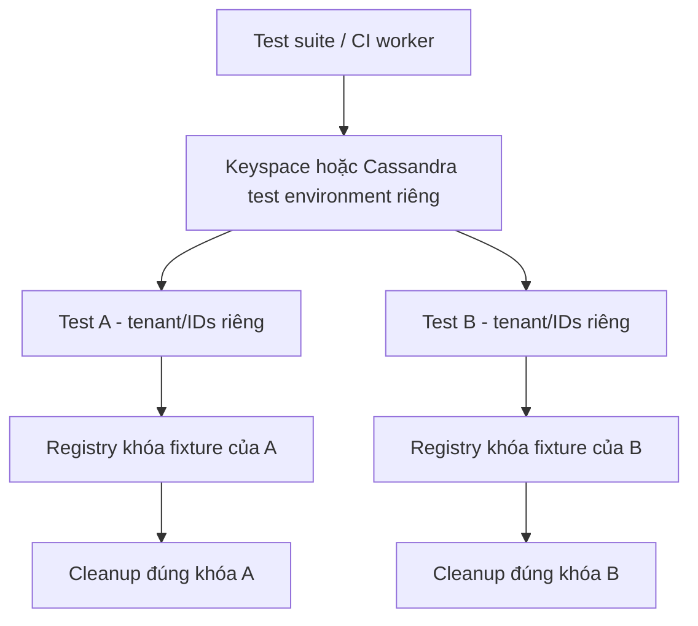

# Cô lập dữ liệu, khả năng chạy lại và dọn dẹp đúng phạm vi

Một bài kiểm thử **Spring Data Cassandra** chỉ đáng tin cậy khi có thể chạy một mình, chạy cùng các bài khác và chạy lại nhiều lần mà vẫn cho kết quả nhất quán. Với Apache Cassandra, điều này đòi hỏi nhiều hơn việc gọi `repository.deleteAll()` sau mỗi test: dữ liệu nằm trong các partition phân tán; cùng một nghiệp vụ có thể được ghi vào nhiều bảng theo truy vấn; thao tác xóa tạo tombstone; và các tác vụ bất đồng bộ có thể tiếp tục ghi sau khi test kết thúc.

Bài học thuộc phần **Kiểm thử** của module Spring Data Cassandra, tập trung vào ba năng lực:

1. **Cô lập dữ liệu:** mỗi test chỉ nhìn thấy dữ liệu thuộc phạm vi mình sở hữu và không làm thay đổi fixture của test khác.
2. **Có thể chạy lại:** chạy lại trên cùng môi trường, đổi thứ tự hoặc chạy song song không làm kết quả phụ thuộc dữ liệu cũ.
3. **Dọn dẹp đúng phạm vi:** xóa chính xác những gì test tạo ra, giữ nguyên dữ liệu của test khác và ghi nhận lỗi cleanup.

Các kỹ thuật áp dụng cho test sử dụng `CassandraRepository`, `CassandraTemplate` và CQL trực tiếp. Thiết kế phải tôn trọng **primary key/partition key**, mức **consistency**, paging và giới hạn hiệu năng của cơ sở dữ liệu phân tán.

## 1. Ba loại lỗi mà test Cassandra thường gặp

Giả sử hai test cùng dùng bảng `orders_by_tenant`:

- Test A tạo đơn `PENDING` cho khách hàng, sau đó kiểm tra số đơn.
- Test B tạo đơn `PAID` và gọi `deleteAll()` trong `@AfterEach`.
- Khi chạy song song, B có thể xóa đơn của A; A thất bại không ổn định dù logic sản phẩm hoàn toàn đúng.

Ngược lại, nếu không cleanup, lần chạy kế tiếp của A có thể đọc thêm đơn cũ và thất bại vì số lượng không còn bằng một. Một trường hợp khó hơn là test đã xóa dữ liệu nhưng consumer nền tiếp tục xử lý message và **tạo lại hàng** sau cleanup.

| Triệu chứng | Nguyên nhân khả dĩ | Biện pháp |
| --- | --- | --- |
| Pass riêng, fail khi chạy cả suite | Dùng chung ID, tenant, keyspace hoặc dữ liệu nền | Mỗi test có phạm vi dữ liệu độc lập |
| Fail ở lần chạy thứ hai | Fixture cũ chưa được xóa hoặc ID cố định va chạm | Tạo ID theo lần chạy và cleanup có kiểm tra |
| Fail ngẫu nhiên khi chạy song song | Một test xóa/sửa dữ liệu của test khác | Xóa theo khóa đầy đủ, tránh cleanup toàn bảng |
| Assertion đọc chưa thấy hàng vừa ghi | Consistency không phù hợp, ghi chưa hoàn tất hoặc có xử lý bất đồng bộ | Đồng bộ đúng điểm; chọn consistency theo mục tiêu test |
| Test đã xong nhưng dữ liệu xuất hiện lại | Background job vẫn chạy hoặc message được phát lại | Chặn/đợi worker trước cleanup; bảo đảm idempotency |
| Suite càng chạy càng chậm | Nhiều tombstone, partition lớn, quét dữ liệu và retry | Chọn vòng đời dữ liệu, table/keyspace phù hợp, theo dõi hiệu năng |

Một test **độc lập** không có nghĩa là mọi test bắt buộc sử dụng cluster riêng. Nó có nghĩa là quyền sở hữu dữ liệu, kết quả quan sát và thao tác dọn dẹp được xác định đủ rõ để không ảnh hưởng lẫn nhau.

## 2. Chọn mức cô lập phù hợp

Có thể cô lập ở nhiều tầng; tầng càng cao thường càng dễ bảo vệ dữ liệu, nhưng chi phí khởi tạo càng lớn.

| Mức cô lập | Cách thực hiện | Phù hợp khi | Lưu ý |
| --- | --- | --- | --- |
| Không có Cassandra thật | Mock repository, template hoặc service | Unit test của logic nghiệp vụ | Không xác minh ánh xạ entity, CQL hoặc consistency thật |
| Khóa bản ghi riêng | UUID riêng cho test/fixture, lưu danh sách khóa đã tạo | Integration test đọc/ghi ít hàng trên bảng dùng chung | Cleanup bắt buộc dùng đúng primary key |
| Tenant hoặc namespace dữ liệu riêng | Tạo `tenant_id` riêng nếu schema có khóa phân vùng theo tenant | Nhiều test cùng bảng có thể chạy song song | Không thêm tenant giả vào schema production chỉ để tiện test |
| Keyspace riêng cho suite/worker | Mỗi suite/CI worker có keyspace do nó quản lý | Test schema migration hoặc cần dọn sạch toàn bộ dữ liệu test | DDL/keyspace tốn tài nguyên; chỉ drop keyspace do suite tạo |
| Cassandra container/cluster riêng | Testcontainers hoặc môi trường Cassandra tạm thời | Integration test cần cô lập cao, kiểm tra schema/driver | Container một node không mô phỏng đầy đủ cluster đa replica |

**Chiến lược thực tế:** ưu tiên Cassandra tạm thời cho một nhóm integration test, đồng thời sử dụng **ID/partition key riêng cho từng test** trong nhóm đó. Nếu nhiều CI worker dùng chung một cluster, tách keyspace theo worker hoặc tạo namespace/key đủ duy nhất để tránh va chạm.

Không dùng cluster production hoặc dữ liệu của người dùng thật để chạy bài kiểm thử có lệnh ghi/xóa. Nếu môi trường test chia sẻ với nhiều nhóm, cần có quy ước sở hữu keyspace, thời hạn lưu và cách dọn dẹp.

## 3. Cô lập phải dựa trên truy vấn và primary key

Cassandra tối ưu cho các truy vấn đã biết trước. Vì thế, cách cô lập dữ liệu test phải phù hợp với **schema thực**, không phụ thuộc vào khả năng lọc tùy ý ở cuối bài test.

Ví dụ bảng phục vụ truy vấn đơn hàng theo tenant:

```sql
CREATE TABLE orders_by_tenant (
    tenant_id uuid,
    order_id uuid,
    customer_id uuid,
    status text,
    created_at timestamp,
    PRIMARY KEY ((tenant_id), order_id)
);
```

Trong ví dụ này, `tenant_id` là **partition key**, `order_id` là **clustering column**. Hai hàng có cùng tenant nằm trong cùng partition; hàng được xác định đầy đủ bằng `(tenant_id, order_id)`. Đây là schema minh họa cho test với tập dữ liệu nhỏ. Ở hệ thống có tenant rất lớn, cần xem xét bucketing và giới hạn kích thước partition theo truy vấn production, không tùy tiện gom mọi đơn vào một partition không giới hạn.

Để test độc lập, mỗi test có thể tạo `tenant_id = UUID.randomUUID()` và tạo các `order_id` riêng. Sau đó ghi/đọc/xóa bằng khóa đầy đủ:

```sql
INSERT INTO orders_by_tenant (
    tenant_id, order_id, customer_id, status, created_at
) VALUES (?, ?, ?, ?, ?);

SELECT order_id, status
FROM orders_by_tenant
WHERE tenant_id = ? AND order_id = ?;

DELETE FROM orders_by_tenant
WHERE tenant_id = ? AND order_id = ?;
```

Các thao tác này có phạm vi cụ thể. Tránh chiến lược “tìm tất cả hàng của test” bằng `ALLOW FILTERING` hoặc quét bảng sau khi test xong: vừa tốn tài nguyên, vừa có nguy cơ xóa nhầm khi không gắn định danh test vào khóa truy vấn.

Nếu bảng production dùng khóa ghép như `PRIMARY KEY ((tenant_id, month_bucket), order_id)`, fixture và cleanup phải lưu cả `tenant_id`, `month_bucket` lẫn `order_id`. Không được bỏ qua một thành phần khóa chỉ vì test “biết chắc” dữ liệu thuộc tenant nào.

### Phân biệt khóa riêng và khóa lũy đẳng

- **Khóa cô lập giữa các test:** mỗi lần chạy một test độc lập có namespace hoặc ID riêng, tránh va chạm với lần chạy khác.
- **Khóa giữ ổn định trong cùng test:** nếu test cố tình gửi lại một yêu cầu logic để kiểm tra retry/idempotency, mọi lần gửi lại phải dùng **cùng request key và cùng resource ID**, không tạo UUID mới cho từng attempt.

Có thể tạo `run_id` ngẫu nhiên khi bắt đầu test và tạo ID nghiệp vụ ổn định từ `run_id + tên fixture`. Khi chạy lại test, `run_id` thay đổi; khi retry nội bộ của **cùng lần chạy**, ID vẫn giữ nguyên. Như vậy vừa cô lập lần chạy, vừa kiểm tra đúng semantics của retry.

## 4. Tổ chức test theo lớp: unit, integration và end-to-end

Mỗi lớp test cần phương pháp cô lập khác nhau.

**Unit test:** kiểm tra nhánh xử lý ở service bằng mock/fake `CassandraRepository` hoặc `CassandraTemplate`. Dữ liệu chỉ sống trong bộ nhớ test; không cần cleanup Cassandra. Tuy nhiên mock không bắt được lỗi ánh xạ `@Table`, `@PrimaryKey`, sai tên cột, truy vấn CQL hoặc hành vi consistency.

**Integration test:** kết nối Cassandra thật, thực thi migration/schema setup trong keyspace dành riêng và kiểm tra CRUD, mapping, repository query, CassandraTemplate, paging hoặc LWT. Testcontainers hữu ích vì có thể tạo môi trường tạm thời cho suite. Một container một node giúp kiểm tra phần lớn tính đúng của truy vấn, nhưng **không xác nhận** hành vi khi replica bị lỗi, mức `QUORUM` trên nhiều node hoặc topology đa datacenter.

**End-to-end test:** đi qua HTTP API, consumer, event broker và Cassandra. Ngoài hàng Cassandra, còn phải cô lập request key, topic/queue, các dịch vụ ngoài hoặc sandbox thanh toán. Cleanup chỉ bảng Cassandra là chưa đủ nếu job nền vẫn có thể ghi sau đó.

Ví dụ cấu trúc trách nhiệm:



Chỉ suite sở hữu keyspace test được phép tạo/xóa keyspace đó. Test đơn lẻ không được tự xóa một keyspace mà các test khác đang dùng.

## 5. Ví dụ JUnit 5: fixture riêng và cleanup bằng khóa chính xác

Ví dụ dưới đây giả định môi trường integration test đã tạo bảng `orders_by_tenant` bằng migration hoặc script khởi tạo, và đã cấu hình `CqlSession` của Spring để trỏ tới **Cassandra test**. Ta dùng CQL trực tiếp để thấy rõ khóa; nguyên tắc tương tự áp dụng khi test với repository hoặc template.

```java
import static org.junit.jupiter.api.Assertions.assertEquals;
import static org.junit.jupiter.api.Assertions.assertNotNull;

import java.time.Instant;
import java.util.ArrayList;
import java.util.List;
import java.util.UUID;

import com.datastax.oss.driver.api.core.CqlSession;
import com.datastax.oss.driver.api.core.DefaultConsistencyLevel;
import com.datastax.oss.driver.api.core.cql.Row;
import com.datastax.oss.driver.api.core.cql.SimpleStatement;
import org.junit.jupiter.api.AfterEach;
import org.junit.jupiter.api.BeforeEach;
import org.junit.jupiter.api.Test;
import org.springframework.beans.factory.annotation.Autowired;
import org.springframework.boot.test.context.SpringBootTest;

@SpringBootTest
class OrderIsolationIT {
    @Autowired
    CqlSession session;

    private UUID tenantId;
    private final List<UUID> orderIdsToDelete = new ArrayList<>();

    @BeforeEach
    void setUp() {
        tenantId = UUID.randomUUID(); // Mỗi test có partition riêng.
        orderIdsToDelete.clear();
    }

    @Test
    void createOrder_canReadItWithinTheSameTest() {
        UUID orderId = UUID.randomUUID();
        UUID customerId = UUID.randomUUID();

        // Đăng ký khóa TRƯỚC khi ghi: nếu ghi thành công nhưng phản hồi lỗi,
        // cleanup vẫn biết chính xác khóa cần xóa.
        orderIdsToDelete.add(orderId);

        session.execute(SimpleStatement.builder("""
                INSERT INTO orders_by_tenant (
                    tenant_id, order_id, customer_id, status, created_at
                ) VALUES (?, ?, ?, ?, ?)
                """)
            .addPositionalValues(
                tenantId, orderId, customerId, "PENDING", Instant.now())
            .setConsistencyLevel(DefaultConsistencyLevel.LOCAL_QUORUM)
            .build());

        Row row = session.execute(SimpleStatement.builder("""
                SELECT status FROM orders_by_tenant
                WHERE tenant_id = ? AND order_id = ?
                """)
            .addPositionalValues(tenantId, orderId)
            .setConsistencyLevel(DefaultConsistencyLevel.LOCAL_QUORUM)
            .build()).one();

        assertNotNull(row);
        assertEquals("PENDING", row.getString("status"));
    }

    @AfterEach
    void cleanOnlyThisTestData() {
        RuntimeException firstFailure = null;

        for (UUID orderId : orderIdsToDelete) {
            try {
                session.execute(SimpleStatement.builder("""
                        DELETE FROM orders_by_tenant
                        WHERE tenant_id = ? AND order_id = ?
                        """)
                    .addPositionalValues(tenantId, orderId)
                    .setConsistencyLevel(DefaultConsistencyLevel.LOCAL_QUORUM)
                    .build());
            } catch (RuntimeException ex) {
                // Cố cleanup những khóa còn lại, nhưng không nuốt lỗi.
                if (firstFailure == null) {
                    firstFailure = ex;
                } else {
                    firstFailure.addSuppressed(ex);
                }
            }
        }
        if (firstFailure != null) {
            throw firstFailure; // Test không được báo xanh nếu cleanup lỗi.
        }
    }
}
```

**Điểm chính của ví dụ:**

- `@BeforeEach` tạo tenant riêng; hai test song song không có cùng partition trong ví dụ.
- `orderIdsToDelete` chỉ chứa khóa mà test này dự kiến ghi. Ghi khóa vào registry **trước** khi gửi CQL giúp đối phó trường hợp Cassandra ghi thành công nhưng driver báo timeout.
- `@AfterEach` chạy cả khi assertion ném exception trong luồng kiểm thử thông thường; nó không bảo đảm chạy khi tiến trình bị kill hoặc máy CI sập.
- Cleanup dùng đầy đủ `tenant_id` và `order_id`, không dùng `deleteAll()` hay `TRUNCATE`.
- Cả ghi và đọc đều dùng `LOCAL_QUORUM` trong cùng datacenter để phù hợp một số kiểm tra đọc sau ghi; trong môi trường một node, điều này **không kiểm thử** đầy đủ quorum nhiều replica.
- Lỗi cleanup được báo ra, đồng thời tiếp tục thử xóa các khóa khác. Đó là tín hiệu hạ tầng test cần xử lý, không được bỏ qua.

Với `CassandraRepository`, có thể dùng khóa entity để gọi `save`/`findById`/`deleteById`. Nếu `@PrimaryKeyClass` chứa cả partition key và clustering key, registry nên lưu chính đối tượng khóa đó. Với `CassandraTemplate`, có thể xóa theo entity/ID, nhưng phải chắc chắn mapping cung cấp **đầy đủ khóa**, và không dùng các truy vấn “dọn theo điều kiện” không gắn chủ sở hữu test.

## 6. Registry fixture khi một nghiệp vụ ghi vào nhiều bảng

Hệ thống Cassandra thường **phi chuẩn hóa dữ liệu** theo nhu cầu truy vấn. Một thao tác tạo đơn có thể ghi vào các bảng:

```text
orders_by_tenant
orders_by_customer
order_status_history
idempotency_requests
```

Xóa mỗi hàng ở `orders_by_tenant` không xóa dữ liệu ở ba bảng còn lại. Cassandra không có cơ chế foreign key cascade delete kiểu RDBMS. Test cần ghi nhận các khóa đã tạo trong **tất cả projection/bảng** bị tác động.

Một registry đơn giản có thể lưu:

| Bảng/đối tượng | Khóa cần lưu để dọn | Cách xử lý |
| --- | --- | --- |
| `orders_by_tenant` | `(tenant_id, order_id)` | `DELETE` theo đầy đủ primary key |
| `orders_by_customer` | `(customer_id, order_id)` hoặc khóa thực của bảng | `DELETE` đúng projection |
| `order_status_history` | `(order_id, event_id)` theo schema thực | Xóa từng event hoặc partition chỉ khi test sở hữu trọn partition |
| `idempotency_requests` | `(tenant_id, operation, request_key)` | Xóa marker của request test, giữ marker của test khác |
| Event queue, cache hoặc blob | ID/namespace của test | Cleanup tại hệ thống tương ứng, không chỉ Cassandra |

Nếu một nghiệp vụ ghi nhiều bảng không nguyên tử, registry nên ghi nhận **ý định tạo khóa trước khi thao tác**. Khi gặp timeout, không biết chắc dữ liệu đã tồn tại; cleanup theo khóa đã đăng ký vẫn hợp lệ. Đừng dựa vào một câu `SELECT` tổng hợp xuyên bảng để phát hiện toàn bộ những gì test có thể đã ghi.

Khi có quan hệ phụ thuộc và luồng bất đồng bộ, thường nên **dừng producer, đợi worker hoàn thành**, rồi xóa projection/event trước khi xóa bản ghi gốc theo thứ tự rõ ràng. Cassandra không ép foreign key; thứ tự này là quy ước bảo vệ luồng ứng dụng khỏi việc đọc thấy trạng thái nửa dọn dẹp.

## 7. Dọn dẹp đúng phạm vi: những lệnh cần đặc biệt thận trọng

| Thao tác | Khi nào hợp lý? | Nguy cơ |
| --- | --- | --- |
| `DELETE ... WHERE` đầy đủ primary key | Xóa fixture cụ thể trong bảng chia sẻ | Ít ảnh hưởng ngoài phạm vi đã xác định |
| `DELETE ... WHERE partition_key = ?` | Khi **toàn bộ partition** do test sở hữu và schema cho phép partition deletion | Xóa luôn mọi clustering row trong partition; tạo partition tombstone |
| `TRUNCATE table` | Chỉ khi suite sở hữu **toàn bộ bảng** trên môi trường test riêng và không có test khác đang dùng | Xóa dữ liệu toàn bảng, dễ phá parallel tests |
| `DROP KEYSPACE` | Chỉ khi worker/suite tạo và sở hữu keyspace tạm riêng | Xóa toàn bộ schema và dữ liệu của keyspace |
| `repository.deleteAll()` | Chỉ trong phạm vi độc quyền có bảo đảm rõ ràng; kiểm tra semantics triển khai | Có thể ảnh hưởng tất cả bản ghi; không phải giải pháp isolation an toàn trong bảng chia sẻ |
| TTL ngắn cho fixture | Hỗ trợ dọn dữ liệu mồ côi theo chính sách lưu giữ | Không bảo đảm xóa tức thì, có tombstone, có thể hết hạn giữa bài test |

**Không đặt cleanup kiểu toàn bảng trong `@AfterEach` khi các test khác có thể đang dùng bảng đó.** Nếu cần kiểm thử lệnh `TRUNCATE` hoặc migration phá hủy schema, dùng một keyspace/container thuộc quyền riêng của test hoặc tắt khả năng chia sẻ có kiểm soát.

### Cleanup thành công chưa có nghĩa dữ liệu biến mất vật lý

Trong Cassandra, xóa thường tạo **tombstone**. Bản ghi có thể không còn được trả về bởi truy vấn bình thường sau khi xóa đã được áp dụng, nhưng tombstone vẫn tồn tại cho đến khi quá trình compaction và điều kiện an toàn cho phép thu gom. Tạo/xóa hàng triệu fixture nhỏ trên một keyspace dùng lâu dài có thể làm tăng chi phí đọc và compaction.

Vì vậy:

- Với test suite nhỏ trên bảng chia sẻ, xóa đúng khóa là lựa chọn dễ kiểm soát.
- Với bài test tải lớn hoặc sinh rất nhiều hàng, cân nhắc dùng keyspace/cluster tạm thời rồi **hủy toàn bộ tài nguyên cô lập** khi kết thúc suite.
- Không giảm bừa `gc_grace_seconds` hoặc chỉnh quy tắc compaction của Cassandra production để “dọn test nhanh hơn”.
- TTL là biện pháp hỗ trợ hạn chế dữ liệu mồ côi, không thay thế registry hay cleanup có kiểm chứng.

## 8. Khả năng chạy lại: thiết kế fixture không phụ thuộc trạng thái cũ

Để test rerun an toàn, nên tách **dữ liệu cần cho assertion** khỏi **dữ liệu đã có sẵn trong môi trường**:

1. Mỗi test tự tạo đúng fixture mà nó cần. Không giả định một test khác đã tạo hàng trước.
2. Mỗi lần chạy độc lập tạo namespace hoặc ID mới để không va chạm dữ liệu từ lần chạy bị crash.
3. Trong **cùng lần chạy**, nếu cần retry theo nghiệp vụ, giữ nguyên ID và request key để kiểm tra tính lũy đẳng.
4. Không phụ thuộc thứ tự chạy test; suite có thể chạy ngẫu nhiên hoặc song song mà không làm thay đổi kết quả.
5. Tránh assertion kiểu “bảng hiện có đúng một hàng” trên bảng chia sẻ. Thay bằng kiểm tra “có đúng một hàng cho tenant/ID thuộc test”.
6. Cô lập cả thời gian, clock, event queue và cache nếu chúng ảnh hưởng kết quả. Với logic thời gian, dùng injectable `Clock` thay vì dựa vào `Thread.sleep` theo giờ thực.

Ví dụ cùng một test kiểm tra xử lý lặp:

```java
UUID testTenant = UUID.randomUUID();
UUID orderId = UUID.randomUUID();
String idempotencyKey = "create-order-" + orderId;

// Hai lần gọi này phải mô tả MỘT ý định nghiệp vụ.
// Không thay orderId/idempotencyKey giữa hai lần gửi.
sendCreateOrder(testTenant, orderId, idempotencyKey);
sendCreateOrder(testTenant, orderId, idempotencyKey);

// Assertion phải truy vấn đúng khóa và kiểm tra chỉ một kết quả nghiệp vụ.
```

Đoạn trên minh họa dữ liệu đầu vào của test; `sendCreateOrder` là hàm giả định trong ứng dụng cần kiểm thử. Không thể kết luận ứng dụng lũy đẳng chỉ vì hai lần gọi đều trả thành công; phải truy vấn trạng thái cuối cùng và kiểm tra không có hai tác động phụ.

### Trạng thái còn sót sau khi tiến trình bị kill

`@AfterEach` hoặc `try/finally` không thể chạy nếu JVM/máy CI đột ngột dừng. Cần lớp bảo vệ thứ hai:

- Với Testcontainers: hủy môi trường Cassandra thuộc suite/worker khi hoàn tất vòng đời CI. Cơ chế thu hồi tài nguyên của nền tảng CI là điểm quan trọng nếu tiến trình chết bất thường.
- Với cluster chia sẻ: lưu **manifest các khóa fixture/namespace do run sở hữu** ở nơi có thể truy vấn an toàn; dùng job janitor để dọn các run quá hạn theo manifest đó.
- Nếu dùng keyspace theo run, tạo tên có tiền tố rõ ràng và gắn ownership/retention trong hệ thống điều phối. Chỉ dọn keyspace xác định là do run đã kết thúc sở hữu; không “quét và drop” theo tiền tố mơ hồ.
- Không phụ thuộc vào việc `SELECT ... ALLOW FILTERING` toàn bảng tìm những bản ghi cũ để xóa: đó là thao tác đắt đỏ và có thể không xác định đủ phạm vi.

## 9. Đồng bộ, consistency và kiểm thử bất đồng bộ

Cassandra là cơ sở dữ liệu phân tán, nên test cũng cần chỉ rõ **khi nào ghi đã hoàn tất** và **mức quan sát cần bảo đảm**.

### Đọc sau ghi

Nếu assertion cần thấy dữ liệu ngay sau `INSERT` thành công, dùng read/write consistency phù hợp với thiết kế và topology test. Trong cùng datacenter, sự kết hợp `LOCAL_QUORUM` cho đọc và ghi thường phù hợp với kiểm tra đọc sau ghi khi điều kiện về replication và replica đáp ứng được thỏa mãn. Không suy rộng kết quả của cluster một node thành bảo đảm cho môi trường nhiều replica hoặc đa datacenter.

Nếu kiểm thử chủ đích là `ONE`, eventual consistency hoặc sự cố node, hãy xác định tiêu chí chấp nhận riêng. Không thêm `Thread.sleep(2000)` tùy tiện để che một lỗi consistency hoặc lỗi đồng bộ.

### Consumer/event bất đồng bộ

Trong luồng async, lời gọi API trả về trước khi consumer ghi projection. Khi đó phải đợi **điều kiện nghiệp vụ** thay vì đợi một khoảng thời gian cố định:

```java
// Ví dụ dạng giả mã dùng Awaitility;
// predicate phải truy vấn đúng khóa của test.
await()
    .atMost(Duration.ofSeconds(10))
    .pollInterval(Duration.ofMillis(100))
    .untilAsserted(() -> {
        assertEquals(
            "PAID",
            findOrderStatus(tenantId, orderId)
        );
    });
```

Đoạn này yêu cầu thư viện Awaitility và các hàm test `findOrderStatus` tương ứng; nó minh họa kỹ thuật polling có deadline. Nếu hết thời hạn, bài test phải thất bại với thông tin chẩn đoán thay vì cố lặp vô hạn.

**Trước cleanup**, phải chặn hoặc chờ producer/consumer còn xử lý dữ liệu thuộc test. Nếu worker có thể retry message sau khi test kết thúc, cần test namespace riêng, hook kiểm soát vòng đời hoặc cơ chế idempotency để không tái tạo dữ liệu.

### LWT và paging

- Với LWT (`IF NOT EXISTS`, `IF state = ...`), kiểm tra `[applied]` và trạng thái cuối cùng. `[applied] = false` là điều kiện không thỏa, không đồng nghĩa driver gặp lỗi.
- Với paging, không chỉ đếm số hàng của một trang rồi cho là toàn bộ kết quả. Nếu test tạo N hàng, truy vấn đúng partition, đi qua các trang cần thiết và kiểm tra tập khóa đúng. Không dùng dữ liệu của test khác để lấp trang.
- Khi thử timeout/retry, không đổi ID giữa các attempt. Nếu ghi timeout, đối soát theo khóa đầy đủ; không giả định write thất bại chỉ vì chưa nhận phản hồi.

## 10. Test chạy song song và kiểm soát quyền sở hữu tài nguyên

Để chạy parallel test ổn định:

- Mỗi test dùng `tenant_id` hoặc tập primary key riêng; nếu bảng không có tenant, tạo ID riêng cho tất cả bản ghi và lưu registry.
- Mỗi CI worker có keyspace riêng khi cần migration DDL; hai worker không được đồng thời `CREATE/DROP/ALTER` cùng một schema test chung nếu không có cơ chế điều phối.
- Fixture dùng chung chỉ nên là dữ liệu **bất biến** và được quản lý bên ngoài từng test. Test không cập nhật hoặc xóa fixture chung.
- Phần phụ thuộc ngoài Cassandra (cache, Redis, queue, HTTP mock, object storage) phải được namespace tương tự; việc cô lập Cassandra một mình chưa đủ cho end-to-end test.
- Nếu test dùng cluster nhiều node để mô phỏng lỗi, giới hạn tài nguyên và tách bài test phá topology khỏi các bài CRUD thông thường.

Một bảng quyết định đơn giản:

| Câu hỏi | Nếu câu trả lời là “có” |
| --- | --- |
| Test có thể xóa dữ liệu không do nó tạo? | Thiết kế lại cleanup theo khóa/namespace |
| Test có thể đụng schema hoặc `TRUNCATE`? | Dùng keyspace/cluster riêng, có ownership rõ ràng |
| Test có tạo message hoặc job nền? | Gắn run ID và đợi/dừng worker trước cleanup |
| Test có thể bị chạy lại cùng lúc bởi CI? | Đảm bảo khóa fixture duy nhất giữa các run/worker |
| Test cần kiểm chứng replica failure/consistency thực? | Dùng topology nhiều node phù hợp thay vì chỉ container một node |

## 11. Kịch bản kiểm tra chiến lược isolation và cleanup

| Kịch bản | Kết quả mong đợi |
| --- | --- |
| Chạy test lần thứ nhất, sau đó chạy lại trên cùng cluster | Cả hai lần pass; lần hai không đọc fixture của lần một |
| Chạy song song hai test có thao tác ghi/xóa | Cleanup của test A không xóa dữ liệu test B |
| Assertion thất bại giữa chừng | `@AfterEach` vẫn xóa những khóa đã đăng ký, nếu JVM còn chạy |
| Write thành công nhưng driver báo timeout | Registry đã có khóa; cleanup/đối soát vẫn xử lý được |
| Ghi nhiều bảng theo truy vấn | Mọi projection được dọn đúng khóa, không còn dấu vết nghiệp vụ của run |
| Consumer xử lý chậm hơn HTTP response | Test đợi điều kiện có deadline; không cleanup khi worker còn ghi |
| JVM/CI bị kill trước `@AfterEach` | Lần chạy sau không va chạm ID; có kế hoạch thu hồi môi trường/manifest |
| Test dùng paging với số hàng lớn hơn page size | Assertion chỉ đếm đúng hàng thuộc run và đọc đủ các trang cần thiết |
| Cleanup một khóa gặp lỗi Cassandra | Test báo lỗi cleanup và vẫn thử xóa các khóa còn lại |
| Test sử dụng `TRUNCATE` trên keyspace riêng | Không có tác động tới suite/worker khác |

Một phép thử mạnh cho tính độc lập là **chạy ngẫu nhiên thứ tự test và lặp lại nhiều lần**, trong khi một suite khác cũng chạy trên cùng hạ tầng test. Kết quả cần được đánh giá bằng primary key/namespace của từng run, không bằng số hàng toàn cục.

## 12. Checklist trước khi đưa test Cassandra vào CI

- [ ] Xác định rõ unit, integration hay end-to-end test; mỗi loại có môi trường và phạm vi sở hữu phù hợp.
- [ ] Có ID/partition key duy nhất cho từng test, không dựa vào thứ tự chạy hoặc dữ liệu test khác để lại.
- [ ] Có phương án keyspace/container riêng khi test sửa schema hoặc thực hiện thao tác toàn bảng.
- [ ] Fixture được ghi nhận vào registry trước thao tác ghi để cleanup được cả khi phản hồi timeout.
- [ ] Cleanup dùng đầy đủ primary key và bao phủ mọi bảng denormalized, idempotency marker cùng tác động phụ ngoài Cassandra.
- [ ] Không dùng `deleteAll()`, `TRUNCATE` hay `DROP KEYSPACE` trên tài nguyên có thể đang được test khác sử dụng.
- [ ] Có deadline cho các chờ đợi bất đồng bộ, dừng worker trước cleanup và không dùng sleep tùy ý để che lỗi.
- [ ] Read/write consistency và số replica của môi trường test phù hợp điều cần xác minh.
- [ ] Test lũy đẳng giữ nguyên resource ID/request key qua các lần retry trong cùng một yêu cầu logic.
- [ ] Cleanup failure làm test/CI báo lỗi; có cơ chế thu hồi dữ liệu còn sót nếu JVM chết đột ngột.
- [ ] Theo dõi tombstone, partition lớn và chi phí DDL nếu suite tạo/xóa nhiều fixture.

**Kết luận:** Kiểm thử Spring Data Cassandra có khả năng chạy lại dựa trên **quyền sở hữu dữ liệu rõ ràng**, **khóa phù hợp mô hình truy vấn**, **fixture độc lập** và **cleanup theo đúng phạm vi**. Khi test dùng Cassandra thật, cần kiểm soát cả consistency, xử lý bất đồng bộ, dữ liệu phi chuẩn hóa và vòng đời của keyspace/cluster. Một test đáng tin phải chạy lại được mà không cần xóa dữ liệu của test khác hoặc phụ thuộc vào trạng thái còn sót từ lần chạy trước.
