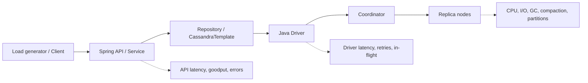

# Xác định mục tiêu độ trễ, thông lượng và mức sử dụng tài nguyên

Một ứng dụng dùng **Spring Data Cassandra** có thể trả kết quả đúng khi chạy vài request thử nghiệm, nhưng vẫn chậm hoặc quá tải khi số người dùng tăng. Cassandra là cơ sở dữ liệu phân tán: một lời gọi `Repository`, `CassandraTemplate` hoặc CQL có thể đi qua Java Driver, coordinator, nhiều replica, mạng và cơ chế đọc/ghi của storage engine. Vì vậy, tối ưu hiệu năng cần bắt đầu bằng **mục tiêu đo được** cho độ trễ (*latency*), thông lượng (*throughput*) và mức sử dụng tài nguyên (*resource utilization*), gắn với truy vấn và dữ liệu thực tế.

Bài học thuộc chương **Hiệu năng** của `SPRING_DATA_CASSANDRA`. Sau bài này, bạn có thể đặt mục tiêu kiểm thử tải theo từng loại truy vấn, tính tương quan giữa lưu lượng và số request đồng thời, chọn chỉ số giám sát ở ứng dụng/driver/Cassandra, và phân biệt hệ thống **trả lời nhanh** với hệ thống **duy trì được tốc độ đó khi có tải**.

## 1. Ba mục tiêu phải được xét cùng nhau

| Đại lượng | Câu hỏi cần trả lời | Đơn vị thường gặp | Ví dụ biểu hiện vấn đề |
| --- | --- | --- | --- |
| **Độ trễ** | Một request mất bao lâu để hoàn thành? | ms, `p50`, `p95`, `p99` | `p99` tăng mạnh dù trung bình vẫn thấp. |
| **Thông lượng** | Có bao nhiêu thao tác **hoàn thành thành công** trong một giây? | request/s, operation/s, CQL statement/s | Tăng số client nhưng số thao tác hoàn thành không tăng. |
| **Tài nguyên** | Để đạt độ trễ và thông lượng đó, cluster và ứng dụng tiêu tốn bao nhiêu tài nguyên? | CPU, RAM/heap, GC, IOPS, MB/s, queue depth | CPU hoặc disk bão hòa, pending compaction tích lũy. |

Ba đại lượng có quan hệ chặt chẽ. Cassandra vẫn có thể đạt `p95 = 60 ms` ở `50 requests/s`, nhưng không giữ được con số đó ở `1.000 requests/s`. Ngược lại, một bài stress test có thể đạt thông lượng cao nhưng tỷ lệ timeout hoặc độ trễ đuôi quá lớn, nên **không đạt mục tiêu phục vụ người dùng**.

Trong hệ thống phân tán, hiệu năng còn phụ thuộc vào **cấu trúc bảng theo truy vấn**, partition key, kích thước partition, replication factor, consistency level, paging, mô hình dữ liệu và sự phân bố lưu lượng trên các node. Không có một mức `p99` hoặc CPU tối ưu chung cho mọi ứng dụng Cassandra.

## 2. Bắt đầu từ workload và truy vấn thực tế

Trước khi đặt ngưỡng, cần mô tả tải sẽ đo. Đơn vị nghiệp vụ (một lần mở trang, một lần tạo đơn) có thể tương ứng với **nhiều câu CQL**, không nhất thiết là một request tới Cassandra.

Ví dụ hệ thống đặt hàng dùng Spring Data Cassandra có hai đường truy cập chính:

```sql
-- Truy vấn danh sách đơn theo một partition khách hàng:
SELECT order_id, created_at, status, total
FROM orders_by_customer
WHERE customer_id = ?;

-- Ghi đơn hàng theo khóa đầy đủ:
INSERT INTO orders_by_customer
    (customer_id, created_at, order_id, status, total)
VALUES (?, ?, ?, ?, ?);
```

Giả định bảng `orders_by_customer` được thiết kế với `customer_id` làm partition key và `created_at`, `order_id` làm clustering key. Với danh sách đơn hàng, cần kiểm soát **số dòng và số byte được trả về**, thường bằng phân trang; một `SELECT` lấy toàn bộ partition rất lớn có đặc tính tải khác một trang 50 dòng.

Một bản mô tả workload nên ghi rõ:

| Thuộc tính | Ví dụ cụ thể cần xác định |
| --- | --- |
| Loại thao tác | Đọc đơn theo khách, ghi đơn, đọc một đơn, cập nhật trạng thái, lấy trang kế tiếp. |
| Tỷ lệ đọc/ghi | Chẳng hạn 80% đọc, 20% ghi ở giờ cao điểm. |
| Query shape | Truy vấn có đủ partition key không? Có index, collection, `ALLOW FILTERING` hay truy vấn nhiều partition không? |
| Dữ liệu mỗi lần | 50 dòng/trang, kích thước hàng, độ rộng partition, số bản ghi trong mỗi partition. |
| Tính phân bố | Bao nhiêu khách hàng, phân phối hot partition, mức lệch giữa các node. |
| Mức nhất quán | `LOCAL_ONE`, `LOCAL_QUORUM` hoặc mức được ứng dụng yêu cầu. |
| Hình dạng tải | Mức bình thường, mức cao điểm, burst ngắn, tăng trưởng theo tháng. |
| Môi trường | Số node, loại ổ đĩa, RAM, CPU, số datacenter, replication factor. |

**Quy tắc:** benchmark phải chạy với cấu trúc câu CQL, cách paging và consistency level mà ứng dụng thật sử dụng. So sánh một test `LOCAL_ONE` với sản phẩm đang chạy `LOCAL_QUORUM` có thể đưa ra kết luận sai về độ trễ.

## 3. Đặt mục tiêu độ trễ bằng percentile

Độ trễ là thời gian từ một điểm bắt đầu đến một điểm kết thúc được định nghĩa trước. Có ít nhất ba góc nhìn:

1. **End-to-end latency:** từ khi API nhận yêu cầu đến khi trả phản hồi cho người dùng; bao gồm business logic, mạng, serialization và tất cả lệnh Cassandra.
2. **Ứng dụng → Cassandra latency:** từ trước khi gọi `Repository`/`CassandraTemplate`/`CqlSession` đến khi nhận/tiêu thụ dữ liệu cần thiết. Với paging, cần nói rõ đo **trang đầu** hay **toàn bộ các trang**.
3. **Driver/Cassandra request latency:** khoảng thời gian được driver hoặc server ghi nhận cho một request ở tầng tương ứng; không đồng nghĩa với độ trễ API.

Chọn và ghi rõ **điểm đo**. Ví dụ API `GET /customers/{id}/orders` cần SLO end-to-end, còn tối ưu CQL cần đo riêng từng operation truy cập Cassandra.

### Vì sao không chỉ dùng số trung bình?

Giả sử 100 request có 95 request hoàn thành trong `20 ms`, còn 5 request mất `600 ms`. Trung bình là khoảng `49 ms`, dễ khiến ta tin rằng hệ thống khá nhanh; nhưng nhóm người dùng chậm nhất phải đợi lâu hơn nhiều.

| Chỉ số | Ý nghĩa | Cách dùng |
| --- | --- | --- |
| `p50` | Khoảng 50% phép đo có độ trễ không vượt quá giá trị này. | Trải nghiệm phổ biến. |
| `p95` | Khoảng 95% phép đo không vượt quá giá trị này. | SLO cho phần lớn request, phát hiện đuôi chậm. |
| `p99` | Khoảng 99% phép đo không vượt quá giá trị này. | Phát hiện các trường hợp rất chậm; cần đủ mẫu. |
| `max` | Độ trễ lớn nhất quan sát được trong cửa sổ đo. | Hữu ích khi điều tra nhưng dễ bị nhiễu, không nên thay percentile. |

Percentile phải đi kèm **số lượng mẫu** và **cửa sổ thời gian**. Với số request quá ít, `p99` không ổn định. Nếu hệ thống timeout ở `800 ms`, không được chỉ đo percentile của request thành công rồi bỏ qua các timeout; làm vậy có thể khiến báo cáo trông tốt hơn khi hệ thống thực tế đang hỏng.

Hai cách diễn đạt mục tiêu cần phân biệt:

- **SLO theo percentile:** `p95 latency <= 150 ms` cho thao tác đọc, tính trên các request thành công theo quy ước đo được công bố; phải kèm một SLO lỗi/timeout độc lập.
- **SLO kết hợp tốc độ và thành công:** ít nhất `99,9%` request hợp lệ **thành công trong 300 ms** trong một cửa sổ thời gian xác định. Request lỗi, quá hạn hoặc chưa hoàn thành không được tính là đạt.

Cách kết hợp thứ hai phản ánh trải nghiệm phục vụ tốt hơn cho báo cáo ở tầng API. Phải xác định rõ cách xử lý request do client chủ động hủy, lỗi xác thực và truy vấn bất hợp lệ để tránh làm sai mẫu số SLI.

## 4. Mục tiêu thông lượng: phân biệt request tới API và CQL thật

Thông lượng có thể được đo tại nhiều lớp:

- **Logical requests/s:** số request nghiệp vụ ứng dụng nhận, chẳng hạn số lần lấy danh sách đơn mỗi giây.
- **Successful operations/s (goodput):** số thao tác **hoàn thành đúng** mỗi giây; đây là kết quả phục vụ hữu ích.
- **CQL requests/s:** số câu CQL thực gửi tới Cassandra, có thể cao hơn số request nghiệp vụ vì một API gọi nhiều repository hoặc có retry/speculative execution.
- **Rows/s và MB/s:** lượng dữ liệu đọc/ghi thực, giúp giải thích tại sao hai workload có cùng requests/s nhưng tải rất khác nhau.

Ví dụ giả định giờ cao điểm có `300 API đọc/s`, mỗi API chạy hai câu `SELECT`; đồng thời có `100 API ghi/s`, mỗi API chạy một câu `INSERT`. Tải ban đầu tới Cassandra xấp xỉ:

\[
300 \times 2 + 100 \times 1 = 700\ \text{CQL requests/s}
\]

Nếu có các lần thực thi bổ sung do retry hoặc speculative execution, lượng request vật lý thực tế có thể còn cao hơn. Vì vậy, **không đặt mục tiêu cluster là 400 requests/s chỉ vì API nhận tổng cộng 400 requests/s**.

### Định luật Little và số request đang xử lý

Ở trạng thái tương đối ổn định, định luật Little cho phép ước lượng:

\[
L = \lambda \times W
\]

Trong đó `L` là số yêu cầu trung bình cùng đang xử lý, `λ` là thông lượng trung bình (requests/s), `W` là thời gian trung bình mỗi yêu cầu (giây), với các đại lượng được đo trên **cùng một ranh giới hệ thống**.

Ví dụ `500 requests/s` và thời gian xử lý trung bình `80 ms = 0,08 s` tương ứng khoảng `40` request đồng thời đang xử lý. Nếu độ trễ tăng khi mức đến vẫn là `500 requests/s`, số request chờ và in-flight có xu hướng tăng; khi hàng đợi tiếp tục phình ra, hệ thống có thể tiến đến bão hòa.

Không dùng công thức trên để suy ra rằng chỉ cần đặt connection pool có đúng 40 kết nối, vì Java Driver multiplex nhiều request trên kết nối và luồng xử lý còn phụ thuộc coordinator, pool, giới hạn in-flight và backpressure.

## 5. Xác định ngân sách tài nguyên

Một mục tiêu hiệu năng hữu ích nói rõ **mức tải nào phải phục vụ được và mức tài nguyên tối đa nào được phép sử dụng**. Tài nguyên phải được đo ở cả ứng dụng Java lẫn các node Cassandra:

| Vị trí | Chỉ số nên quan sát | Khi chỉ số xấu đi, cần kiểm tra gì? |
| --- | --- | --- |
| Ứng dụng Spring | CPU, heap/RSS, GC pause, thread pool, queue, thời gian serialization | Logic ứng dụng, batch xử lý, phân trang, áp lực bộ nhớ. |
| Java Driver | Request in-flight, connection/pool, timeout, retry, speculative execution, latency mỗi loại CQL | Driver bị nghẽn, chọn coordinator, policy retry hoặc giới hạn client. |
| Cassandra node | CPU, RAM/heap, GC pause, pending read/write tasks | Node quá tải hoặc có phân bố request không đều. |
| Ổ đĩa/storage | IOPS, throughput MB/s, disk latency, dung lượng, compaction pending | Đọc SSTable, flush memtable, compaction, thiếu tài nguyên I/O. |
| Truy vấn/dữ liệu | Read/write latency, tombstones scanned, kích thước partition, số hàng/byte trả về | Mô hình bảng theo truy vấn chưa phù hợp, đọc quá nhiều dữ liệu. |
| Mạng và replication | Network throughput, lỗi kết nối, chậm giữa node/DC, tải theo replica | Chi phí nhất quán, replication và ảnh hưởng cross-DC. |

Ví dụ một ngưỡng nội bộ **chỉ mang tính minh họa**: dưới workload bình thường, CPU node Cassandra không vượt `70%` trong thời gian kéo dài, ổ đĩa còn đủ headroom cho compaction, không có hàng đợi tăng liên tục, và tỷ lệ timeout thấp hơn SLO lỗi. Không có quy tắc Cassandra chung rằng `70%` luôn an toàn: CPU, ổ đĩa và GC có đặc tính khác nhau giữa phần cứng, phiên bản và mô hình truy vấn.

Đặc biệt cần để ý:

- **Hot partition:** một số partition key nhận phần lớn lưu lượng khiến một nhóm replica quá tải dù CPU trung bình cluster còn thấp.
- **Wide partition:** truy vấn có thể tạo nhiều SSTable read, bộ nhớ và lượng byte trả về lớn, nhất là khi đọc toàn bộ partition.
- **Tombstones:** nhiều dữ liệu đã xóa/hết TTL có thể làm truy vấn đọc chậm do phải quét và bỏ qua tombstone.
- **Compaction:** benchmark ngắn có thể trông tốt trước khi tải compaction tích lũy; cần chạy ổn định đủ lâu để quan sát xu hướng.
- **Mất cân bằng đọc/ghi:** workload ghi cao có thể tăng pending compaction, làm hiệu năng đọc suy giảm về sau.
- **Consistency level:** yêu cầu xác nhận từ nhiều replica có thể tác động độ trễ và tính sẵn sàng; phải là điều kiện đo được giữ cố định.

## 6. Mẫu mục tiêu SLI/SLO cho Spring Data Cassandra

Giả sử nhóm vận hành hệ thống đặt hàng có workload rõ ràng và cần tiêu chí đánh giá trước khi mở rộng người dùng. Một bộ mục tiêu **ví dụ để luyện tập, không phải chuẩn mặc định**:

| Thao tác ở tầng API | Tải cần phục vụ | Độ trễ mục tiêu | Thành công | Điều kiện quan sát |
| --- | --- | --- | --- | --- |
| Lấy trang đầu 50 đơn theo `customer_id` | `500 API requests/s` liên tục | `p95 <= 150 ms`, `p99 <= 300 ms` | `>= 99,9%` trong cửa sổ công bố | Kích thước trang, dữ liệu và `LOCAL_QUORUM` cố định. |
| Tạo một đơn hàng | `200 API requests/s` liên tục | `p95 <= 200 ms`, `p99 <= 400 ms` | `>= 99,9%` | Primary key đủ, payload cố định, ghi thành công theo consistency yêu cầu. |
| Giờ cao điểm | Burst `800 requests/s` tổng trong 5 phút | Duy trì SLO của đường nghiệp vụ ưu tiên | Không vượt ngân sách lỗi | Có giới hạn admission/backpressure khi cần. |

Thêm tiêu chí vận hành như: không tăng queue hoặc compaction tồn đọng liên tục khi chạy tải ổn định; resource headroom đủ để xử lý giờ cao điểm và hoạt động nền. Đưa ra ngưỡng resource dựa trên kết quả benchmark của chính cluster rồi ghi chúng vào dashboard/runbook.

Khi dùng bảng mục tiêu, cần định nghĩa thêm:

1. **Cửa sổ SLO:** 5 phút để cảnh báo tức thời, 1 giờ hoặc 28/30 ngày để đánh giá mục tiêu dịch vụ, tùy yêu cầu nghiệp vụ.
2. **Phạm vi tính:** một endpoint hay một loại CQL, vùng triển khai nào, giờ bình thường hay tất cả thời điểm.
3. **Mức tải hợp lệ:** lưu lượng tối đa đã cam kết; không thể yêu cầu độ trễ bất biến ở mọi mức tải không giới hạn.
4. **Định nghĩa thành công:** có đúng dữ liệu và đúng mức consistency, không chỉ nhận một mã HTTP thành công giả.
5. **Ngân sách lỗi:** tỷ lệ request lỗi, timeout hoặc quá thời gian mục tiêu được chấp nhận trong cửa sổ.

## 7. Sơ đồ đo lường từ API tới Cassandra



Đo ở cả ba vị trí giúp phân tích nguyên nhân. Nếu API latency tăng nhưng driver latency ổn định, điểm nghẽn có thể ở Java thread pool, serialization hoặc logic nghiệp vụ. Nếu driver timeout tăng, kiểm tra coordinator, cluster load và network. Nếu mỗi truy vấn chậm dần cùng với tombstone scan và disk read tăng, ưu tiên xem lại mô hình bảng hoặc vòng đời dữ liệu.

## 8. Ví dụ đo một thao tác đọc bằng Micrometer

Spring Boot Actuator và Micrometer có thể ghi thời gian cho một đường đọc cụ thể. Ví dụ Java dưới đây đo lời gọi `CqlSession` có phân trang theo partition key. `Timer` đo **đúng phạm vi phương thức** (truy vấn và việc lấy tối đa 50 hàng), không đại diện tự động cho độ trễ end-to-end của API.

```java
import com.datastax.oss.driver.api.core.CqlSession;
import com.datastax.oss.driver.api.core.cql.Row;
import com.datastax.oss.driver.api.core.cql.SimpleStatement;
import io.micrometer.core.instrument.MeterRegistry;
import io.micrometer.core.instrument.Timer;
import java.util.ArrayList;
import java.util.List;
import java.util.UUID;
import org.springframework.stereotype.Service;

@Service
public class OrderReadGateway {
    private final CqlSession session;
    private final MeterRegistry meters;

    public OrderReadGateway(CqlSession session, MeterRegistry meters) {
        this.session = session;
        this.meters = meters;
    }

    public List<UUID> firstPage(UUID customerId) {
        Timer.Sample sample = Timer.start(meters);
        String outcome = "error";
        try {
            SimpleStatement statement = SimpleStatement.builder("""
                    SELECT order_id FROM orders_by_customer
                    WHERE customer_id = ?
                    """)
                .addPositionalValue(customerId)
                .setPageSize(50)
                .setIdempotent(true)
                .build();

            List<UUID> ids = new ArrayList<>();
            for (Row row : session.execute(statement)) {
                ids.add(row.getUuid("order_id"));
                if (ids.size() == 50) {
                    break;
                }
            }

            outcome = "success";
            return ids;
        } finally {
            sample.stop(Timer.builder("cassandra.order_read.duration")
                .tag("operation", "first_page_by_customer")
                .tag("outcome", outcome)
                .publishPercentileHistogram()
                .register(meters));
        }
    }
}
```

**Giải thích và giới hạn của ví dụ:**

- `setPageSize(50)` là gợi ý số hàng mỗi trang ở driver; không phải điều kiện `LIMIT 50` của CQL. Vòng lặp dừng sau 50 hàng nên phép đo là **trang đầu tiên**; khi cần đọc nhiều trang, hãy đo thêm thời gian toàn bộ quá trình.
- `setIdempotent(true)` phù hợp với truy vấn `SELECT` này theo giả định chỉ đọc; không tự động áp dụng cho counter update hoặc thao tác ghi có tác dụng phụ.
- Tag Micrometer chỉ dùng `operation` và `outcome` có số giá trị hữu hạn. **Không gắn `customerId`, `orderId`, câu CQL đầy đủ hoặc UUID làm metric tag**, vì cardinality quá cao sẽ gây áp lực bộ nhớ và hệ thống giám sát.
- `publishPercentileHistogram()` tạo dữ liệu histogram cho backend tương thích; cách tính percentile tổng hợp giữa instance và cấu hình bucket tùy backend. Kiểm tra cả count và phân phối lỗi khi đọc dashboard.
- Với Spring Data `Repository`, có thể bọc chính phương thức service gọi repository bằng timer tương tự. Giữ nguyên điểm bắt đầu/kết thúc qua các lần thử nghiệm để kết quả so sánh được.

Hệ thống thực tế nên thu thập cả metric HTTP ở controller/gateway, metric driver và metric của node Cassandra; không chỉ dựa vào timer trong một method.

## 9. Thiết kế bài kiểm thử tải có thể tái lập

Một bài kiểm thử đáng tin cậy cần cùng query shape, dữ liệu, cluster và cấu hình ở các lần chạy. Quy trình gợi ý:

1. **Chốt môi trường:** ghi phiên bản Cassandra, Java Driver, Spring Boot/Spring Data, số node, datacenter, RF, consistency, CPU/RAM/disk và giới hạn container. Không so sánh các lần chạy ở cấu hình khác nhau như thể cùng một bài test.
2. **Tạo dữ liệu đại diện:** đủ hàng và phân bố partition gần production; trộn partition nhỏ/lớn và hot key theo thống kê thật. Dataset quá ít có thể nằm hoàn toàn trong cache, che khuất disk I/O và compaction.
3. **Xác định workload:** tỷ lệ đọc/ghi, tập truy vấn CQL, payload, số hàng/trang, mức đến theo thời gian, timeout, retry policy và tỷ lệ traffic giữa các endpoint.
4. **Warm-up:** cho kết nối, JIT, cache và hệ thống ổn định ở mức tải đã định. Ghi rõ thời gian warm-up, không lẫn số liệu khởi động vào kết luận steady state.
5. **Ramp-up có kiểm soát:** tăng dần lượng request đến và ghi `p50/p95/p99`, goodput, error, CPU, disk latency, GC và pending tasks ở mỗi mức.
6. **Chạy steady state:** giữ tải mục tiêu đủ lâu để xem queue, compaction và tài nguyên có ổn định hay tích lũy; thêm một lượt soak test dài hơn khi đánh giá rủi ro vận hành.
7. **Kiểm tra burst và quá tải:** đo khả năng hồi phục sau burst, hành vi timeout, queue/backpressure và giới hạn tải, thay vì chỉ ghi thông lượng đỉnh.
8. **Xác minh kết quả:** kiểm tra dữ liệu đọc/ghi đúng, tỷ lệ lỗi, số request chưa hoàn tất và trường hợp client timeout. Không đánh dấu "PASS" chỉ vì load generator đã gửi đủ số request.

Tùy mục tiêu, có thể dùng k6/Gatling/JMeter ở tầng HTTP hoặc công cụ chuyên Cassandra ở tầng CQL. Hai loại đo trả lời câu hỏi khác nhau: test tầng HTTP kiểm chứng đường đi của ứng dụng; test CQL trực tiếp giúp cô lập chi phí phía Cassandra. Dù dùng công cụ nào, phải **giữ ổn định tốc độ request đến** khi so sánh độ trễ ở các mức tải, và nhận biết *coordinated omission* nếu công cụ sinh tải chậm lại mỗi khi server chậm.

## 10. Nhận biết điểm bão hòa và đưa ra quyết định

Giả sử chạy một chuỗi thử nghiệm trên cùng cluster; các số sau **chỉ là ví dụ minh họa**, không phải đo thực tế:

| Tốc độ gửi | Goodput | `p95` đọc | CPU node cao nhất | Lỗi/timeout | Nhận định |
| --- | --- | --- | --- | --- | --- |
| 200 req/s | 200 req/s | 55 ms | 35% | 0% | Còn dư năng lực. |
| 500 req/s | 498 req/s | 120 ms | 65% | 0,4% | Có thể đạt một số SLO; cần so với mục tiêu chính xác. |
| 800 req/s | 715 req/s | 350 ms | 94% | 10,6% | Bão hòa: tăng tải không tạo goodput tương ứng. |

Ở mức `800 req/s`, điều đáng lo không chỉ là CPU tăng: goodput không theo kịp lượng đến, `p95` phình ra và lỗi/timeout tăng. Cần xác định bottleneck thực trước khi tăng số node hoặc thay đổi driver. Ví dụ:

| Dấu hiệu | Hướng điều tra trước tiên |
| --- | --- |
| Một số node quá nóng, các node khác nhàn rỗi | Hot partition, token distribution, truy vấn tập trung theo partition key. |
| Disk read latency, tombstone scan và `p99` cùng tăng | Query shape, TTL/delete, kích thước partition, compaction. |
| CPU ứng dụng cao nhưng Cassandra còn nhàn rỗi | Serialization, business logic, đối tượng lớn, blocking threads. |
| Timeout tăng khi retry/speculative execution tăng | Retry policy, ngưỡng timeout, quá tải cluster; giảm request bổ sung không cần thiết. |
| Query trả quá nhiều hàng hoặc tự động fetch nhiều trang | Phân trang, chọn cột cần thiết, giới hạn đầu ra và mô hình bảng. |

Với mục tiêu phải đạt `p95 <= 150 ms` ở mức `500 req/s`, một lần chạy có `p95 = 120 ms` **chưa đủ** để kết luận pass nếu SLO thành công là `>= 99,9%`: ví dụ trên có lỗi `0,4%`, tương ứng chỉ `99,6%` thành công. Độ trễ và lỗi luôn phải được xét cùng nhau.

## 11. Các sai lầm phổ biến

| Sai lầm | Vì sao dẫn đến quyết định sai | Cách sửa |
| --- | --- | --- |
| Chỉ đặt mục tiêu "query nhanh dưới 100 ms" | Thiếu percentile, throughput, tải và cửa sổ đo. | Viết mục tiêu đầy đủ theo operation, `p95/p99`, goodput và điều kiện tải. |
| Chỉ báo cáo độ trễ trung bình | Che khuất tail latency. | Theo dõi histogram, percentile, số mẫu và timeout. |
| Đếm request gửi đi là thông lượng hoàn thành | Khi hệ thống quá tải, nhiều request timeout hoặc bị bỏ dở. | Phân biệt offered load và successful goodput. |
| Benchmark Cassandra với dữ liệu nhỏ, truy vấn không có partition key như production | Không phản ánh kích thước partition, SSTable, tombstone và disk. | Tạo dữ liệu/phân bố thực, kiểm tra query plan và CQL. |
| Thay `LOCAL_QUORUM` thành `LOCAL_ONE` chỉ để benchmark đẹp | Đổi điều kiện nhất quán so với yêu cầu nghiệp vụ. | Cố định consistency level theo sản phẩm. |
| Chỉ theo dõi CPU trung bình cả cluster | Bỏ sót hot node, disk bottleneck, pending compaction. | Quan sát per-node và các chỉ số storage/GC. |
| Lấy số liệu của page đầu rồi suy ra chi phí đọc toàn bộ kết quả | Fetching các trang tiếp theo có thể phát sinh nhiều request và byte. | Đo riêng first page, next page, whole traversal. |
| Bật retry/speculative execution mà không tính tải bổ sung | Logical request/s không còn bằng physical CQL/s. | Theo dõi request vật lý, retry, idempotence và in-flight. |
| Benchmark ngắn rồi kết luận đủ năng lực dài hạn | Chưa thấy compaction, tích tụ queue hoặc biến động GC. | Kết hợp ramp, steady state, soak và burst. |

## 12. Bảng ghi mục tiêu và kết quả để dùng trong dự án

Khi lập kế hoạch hiệu năng cho một module Spring Data Cassandra, có thể dùng mẫu sau để tránh thiếu dữ kiện:

| Trường | Nội dung cần điền |
| --- | --- |
| Operation | Tên API, phương thức `Repository`/`CassandraTemplate`, hoặc câu CQL tương ứng. |
| Dữ liệu & schema | Bảng, partition key, kích thước hàng/partition, số hàng mỗi trang. |
| Consistency & topology | CL đọc/ghi, RF, datacenter, số node và loại ổ đĩa. |
| Mức tải mục tiêu | Requests/s trung bình, peak và burst; tỷ lệ read/write. |
| SLI/SLO | `p95`, `p99`, thành công trong deadline, timeout/error budget. |
| Tài nguyên cho phép | CPU/heap/GC, IOPS, disk latency, compaction, in-flight và headroom. |
| Dữ liệu quan sát | Dashboard/metrics, khoảng đo, số mẫu, tỷ lệ lỗi, phiên bản và commit triển khai. |
| Kết luận | Đạt/không đạt, bottleneck, thay đổi đề xuất và kết quả chạy lại. |

Một mục tiêu viết rõ có dạng: **"Trong giờ cao điểm với 500 yêu cầu đọc trang đầu mỗi giây, trên cluster ba node được cấu hình như môi trường kiểm thử và `LOCAL_QUORUM`, ít nhất 99,9% yêu cầu hợp lệ phải thành công trong 300 ms; `p95` của request thành công không quá 150 ms; tài nguyên không tạo backlog tăng liên tục trong 30 phút đo."** Các con số này chỉ là ví dụ; phải thay bằng yêu cầu nghiệp vụ và số liệu khả năng thực tế.

### Câu hỏi tự kiểm tra

Một API nhận `400 requests/s`, mỗi API gọi `3` câu CQL và trung bình `2%` request CQL phát sinh thêm **một** lần gửi do retry. Nếu mỗi lần gửi xử lý lượng dữ liệu tương tự nhau, số lần gửi CQL dự kiến xấp xỉ bao nhiêu mỗi giây?

<details>
<summary>Đáp án và cách nghĩ</summary>

Ban đầu có `400 × 3 = 1.200` câu CQL/s. Với giả định mỗi CQL có xác suất 2% phát sinh chính xác một lần gửi thêm, dự kiến có `1.200 × 0,02 = 24` lần gửi bổ sung/s, tức khoảng **1.224 lần gửi CQL/s**. Đây là ước lượng tải, không phải số goodput; retry trên thực tế có thể phân bố không đều theo loại câu CQL và lỗi.

</details>

## 13. Checklist xác định mục tiêu hiệu năng

- [ ] Mỗi API quan trọng đã được ánh xạ tới các câu CQL và đường truy cập theo partition key.
- [ ] Đã định nghĩa mức tải bình thường, cao điểm, burst, tỷ lệ đọc/ghi, kích thước trang và phân bố dữ liệu.
- [ ] Có SLI/SLO cho `p95/p99`, deadline, tỷ lệ thành công và cửa sổ thời gian; lỗi/timeout không bị loại khỏi báo cáo khả dụng.
- [ ] Phân biệt offered load, goodput ở tầng API và CQL requests/s thực tại driver/cluster.
- [ ] Mức consistency, replication, topology và cấu hình driver được ghi và giữ cố định giữa các lượt so sánh.
- [ ] Có số liệu tài nguyên theo từng Cassandra node cùng metric của Spring/Java Driver.
- [ ] Có benchmark trên dữ liệu đại diện, đủ thời gian cho warm-up, steady state, compaction và burst.
- [ ] Kết luận dựa trên cả độ trễ, thông lượng **thành công** và headroom; không dựa vào một số trung bình đơn lẻ.

**Ghi nhớ:** mục tiêu hiệu năng cho Spring Data Cassandra phải gắn với **một workload cụ thể, một điều kiện tải cụ thể và một định nghĩa thành công cụ thể**. Hãy đo end-to-end latency, driver/CQL latency, goodput và tài nguyên theo node để hiểu hệ thống còn bao nhiêu khả năng phục vụ, thay vì chỉ tối ưu một truy vấn chạy nhanh trong môi trường ít tải.
