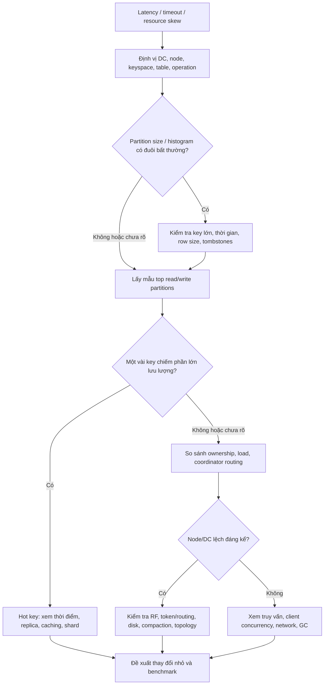

# Phát hiện partition lớn, khóa nóng và phân bố lệch

Trong **SPRING_DATA_CASSANDRA**, một truy vấn thông qua repository hoặc `CassandraTemplate` có thể đúng cú pháp CQL, dùng đúng **partition key**, nhưng vẫn chậm hoặc làm một số node Apache Cassandra quá tải. Ba hiện tượng cần phân biệt là **partition lớn** (*large/wide partition*), **khóa nóng** (*hot partition key*) và **phân bố lệch** (*skew*). Chúng liên quan đến thiết kế bảng theo truy vấn, tốc độ đọc/ghi, replication, paging và hiệu năng của cụm phân tán.

Bài học thuộc chương **Hiệu năng**. Mục tiêu là nhận diện tín hiệu đo lường, lần theo nguyên nhân và chọn phương án điều chỉnh schema/truy vấn có thể kiểm chứng. Không có một ngưỡng kích thước partition hoặc tỷ lệ lưu lượng nào phù hợp cho mọi ứng dụng; kết luận phải dựa trên tải và cấu hình thật.

## 1. Ba vấn đề giống nhau ở triệu chứng, khác nhau ở bản chất

Một bảng Cassandra có khóa chính như sau:

```sql
CREATE TABLE shop.events_by_tenant (
    tenant_id uuid,
    occurred_at timestamp,
    event_id uuid,
    event_type text,
    payload text,
    PRIMARY KEY ((tenant_id), occurred_at, event_id)
) WITH CLUSTERING ORDER BY (occurred_at DESC, event_id ASC);
```

`tenant_id` là **partition key**, còn `occurred_at` và `event_id` là **clustering columns**. Toàn bộ sự kiện của một tenant nằm trong cùng một partition logic. Cassandra xác định token từ partition key để đặt các replica theo token ring. Các clustering columns chỉ sắp xếp dữ liệu **bên trong** partition; chúng không phân tán các hàng có cùng `tenant_id` qua các token khác nhau.

| Hiện tượng | Định nghĩa | Dấu hiệu dễ gặp | Có bắt buộc đi cùng nhau không? |
| --- | --- | --- | --- |
| **Partition lớn** | Một partition chứa quá nhiều hàng/byte, làm chi phí đọc, ghi, compaction hoặc repair tăng. | Kích thước partition cực đại cao, truy vấn theo một khóa đọc nhiều dữ liệu, GC hoặc latency tăng khi xử lý partition. | Có thể là dữ liệu cũ ít được truy cập, chưa chắc đang nóng. |
| **Khóa nóng** | Một partition key hoặc nhóm rất nhỏ key nhận lưu lượng đọc/ghi vượt trội trong thời gian ngắn. | Một số replica có CPU, request rate, pending tasks, p99 latency cao; top-partition sampler chỉ ra key nổi bật. | Partition có thể **nhỏ** nhưng ghi/đọc rất thường xuyên. |
| **Phân bố lệch** | Dung lượng, token ownership, lưu lượng hoặc vai trò coordinator/replica không được phân bổ đều giữa node/DC. | Có node tải cao hoặc bị timeout trong khi node khác còn dư tài nguyên. | Có thể do hot keys, khác biệt phần cứng/replication, token placement hoặc routing. |

> **Phân biệt quan trọng:** “Partition lớn” là về **kích thước tích lũy**; “khóa nóng” là về **lưu lượng theo thời gian**; “phân bố lệch” là về **mức tải/dung lượng giữa các vị trí trong cluster**. Một lỗi có thể gây ra cả ba, nhưng không thể chẩn đoán chỉ từ một biểu đồ CPU.

Một hot key vẫn được **replicate** tới nhiều node theo replication factor (RF), nhưng không vì vậy mà tải được trải tới mọi node trong cụm. Những replica giữ partition đó vẫn có thể bị áp lực tập trung; coordinator có thể chịu thêm tải tùy cách driver định tuyến và consistency level.

## 2. Vì sao partition lớn gây vấn đề?

Với bảng `events_by_tenant`, nếu một tenant phát sinh hàng triệu sự kiện mỗi ngày và không có giới hạn thời gian trong partition key, dữ liệu của tenant ấy tiếp tục tăng trong **một partition logic**. Các thao tác sau có thể trở nên tốn kém:

- Đọc danh sách hàng dài với nhiều page, scan một khoảng clustering key quá rộng hoặc tính `COUNT(*)` trên một partition lớn.
- Nhiều SSTable chứa các phần của cùng partition, khiến read amplification, compaction và bảo trì dữ liệu khó dự đoán.
- Cập nhật/xóa nhiều hàng trong cùng partition, tạo tombstone cần quét qua khi đọc và phải chờ các điều kiện compaction/garbage collection thích hợp mới được dọn.
- Ghi dữ liệu mới vào partition đang được truy cập liên tục: vừa gây tăng kích thước, vừa có thể gây nóng replica.
- Repair/streaming hoặc khởi động lại node phải xử lý dữ liệu có phân bố không đều.

**Partition size không đồng nhất với row count.** Một triệu hàng nhỏ có thể nhẹ hơn nhiều hàng có collection/payload lớn; TTL, tombstone, phân bố qua SSTables và compaction strategy cũng ảnh hưởng chi phí thực tế. Một bảng có mean partition size thấp nhưng **maximum** cực lớn là dấu hiệu cần xem xét phân bố đuôi.

Ví dụ tính nhẩm: một tenant phát sinh 2 triệu sự kiện, mỗi sự kiện trung bình 512 byte dữ liệu ứng dụng thì riêng payload đã xấp xỉ 1 GB, **chưa** tính khóa, metadata, compression, tombstone hoặc SSTable overhead. Đây là minh họa, không phải con số dùng làm ngưỡng cảnh báo cứng.

## 3. Bắt đầu từ dấu hiệu quan sát được trong hệ thống

### 3.1. Ghép triệu chứng ứng dụng với dấu hiệu cluster

| Biểu hiện phía Spring Data Cassandra/API | Nên kiểm tra tại Cassandra | Gợi ý giả thuyết |
| --- | --- | --- |
| Truy vấn `findByTenantId(...)` lúc nhanh lúc chậm, p99 tăng khi trả nhiều hàng | Partition size histogram, kích thước kết quả, số page, read latency, tombstones | Wide partition hoặc truy vấn đọc quá rộng. |
| Ghi của một tenant tăng đột biến gây timeout, các tenant khác vẫn bình thường | Request rate theo mẫu khóa, replica đang giữ token, write latency và pending tasks | Hot partition key. |
| Vài node CPU/disk/network cao liên tục trong khi node khác thấp | `nodetool status`, load theo node, token ownership, replica placement, coordinator và client routing | Skew giữa node hoặc khác biệt tài nguyên. |
| Chỉ có một nhóm bảng chậm, node nhìn chung khỏe | Table-level metrics, compaction, SSTables per read, partition histograms | Vấn đề tập trung ở table hoặc truy vấn. |
| Read timeout sau khi thêm bộ lọc / số hàng trả về tăng | CQL `WHERE`, `ALLOW FILTERING`, số partition bị chạm, paging | Thiết kế truy vấn không còn phù hợp với schema. |
| Latency tăng khi có nhiều xóa/TTL hết hạn | Tombstone warnings, tombstone scan metrics, compaction backlog | Read amplification bởi tombstones, có thể đi kèm partition lớn. |

**Đừng đánh đồng timeout với hot key.** Timeout còn có thể do mạng, GC pause, consistency level, node unavailable, disk saturation, driver pool, sự cố ở coordinator hoặc truy vấn đọc quá rộng. Cần so sánh nhiều lớp dữ liệu trong cùng khoảng thời gian.

### 3.2. Thiết lập khoảng đo và đường cơ sở

Trước khi phân tích, cố định:

1. **Khoảng thời gian:** ví dụ 15–60 phút bao phủ đợt p99 tăng; đối chiếu với thời điểm bình thường có lưu lượng tương tự.
2. **Phạm vi:** cluster, datacenter, keyspace, table, thao tác API và phiên bản triển khai.
3. **Đường cơ sở:** p50/p95/p99 latency, request/s, read/write timeout rate, CPU, disk I/O, network, GC pauses, pending compactions, backlog của thread pool.
4. **Thay đổi gần đây:** tăng lưu lượng của một tenant, batch import, TTL/delete, migration, thay đổi query, cluster scaling, compaction hoặc consistency configuration.
5. **Định nghĩa tải:** phân biệt coordinator requests, replica operations và số lượt đọc/ghi logic. Với RF lớn hơn 1, một request có thể tạo nhiều công việc ở replica; không cộng các metric một cách ngây thơ rồi gọi đó là request của client.

Các metric cần nhãn có tập giá trị hữu hạn: tên bảng, loại thao tác, nhóm lỗi, node/datacenter. **Không** gắn trực tiếp mọi `tenant_id`/`event_id` vào tag của Micrometer/Prometheus vì sẽ gây bùng nổ cardinality. Khi cần tìm nghi phạm theo khóa, dùng sampling hoặc log điều tra chuyên biệt với kiểm soát dữ liệu.

## 4. Công cụ chẩn đoán: từ tổng quan đến partition cụ thể

Các lệnh `nodetool` dưới đây là ví dụ chạy bởi người vận hành trên máy có quyền truy cập cluster. Tên tùy chọn, nội dung output và metric thay đổi theo **phiên bản Apache Cassandra/distribution**; kiểm tra `nodetool help <command>` trước khi dùng.

### 4.1. Kiểm tra dung lượng và token ownership giữa node

```bash
nodetool status
nodetool ring
```

- `nodetool status` cho biết trạng thái node, load và ownership (nếu có; ownership hiệu dụng phụ thuộc keyspace/RF). Đây là bức tranh phân bổ dữ liệu và khả dụng, **không phải** biểu đồ request theo partition.
- `nodetool ring` giúp kiểm tra token/range placement. Với virtual nodes (vnodes), cùng một node có thể sở hữu nhiều token ranges.
- So sánh các node trong **cùng datacenter và cùng vai trò/phần cứng**, vì so sánh thô giữa DC hoặc disk khác nhau dễ gây kết luận sai.
- Nếu dung lượng lệch, xác minh dung lượng theo **từng keyspace/table**. Node có load lớn không nhất thiết do hot key; repair, compaction, bootstrap và các bảng khác cũng làm thay đổi load.

Khi nghi ngờ mất cân bằng token, kiểm tra RF, NetworkTopologyStrategy, số vnode/token, trạng thái node, data center placement và lịch sử mở rộng cluster trước khi đề xuất thay đổi topology. Di chuyển token/streaming dữ liệu có ảnh hưởng lớn và cần kế hoạch vận hành riêng.

### 4.2. Tìm phân bố kích thước và độ trễ ở mức bảng

```bash
# Tùy phiên bản, tablestats có thể lọc theo keyspace/table.
nodetool tablestats shop

# Xem thống kê histogram của một bảng cụ thể.
nodetool tablehistograms shop events_by_tenant
```

Quan sát các trường có sẵn như partition size trung bình/cực đại, số SSTables, read/write latency, pending flushes/compactions, live disk space và tombstones. Một số thống kê partition trong `tablestats` được ước lượng từ SSTables hoặc dữ liệu đã compaction; chúng **không phải phép tính chính xác tức thời** của mọi partition logic. `tablehistograms` hỗ trợ nhìn phân bố/độ trễ dạng histogram nhưng mức độ chi tiết phụ thuộc phiên bản.

Khi cluster lớn, thu thập kết quả từ **nhiều node** và so sánh đúng phạm vi. Một node có maximum cao cần được liên hệ với replica placement và bảng gây tải; không suy ra một key cụ thể chỉ từ con số max.

Cassandra có thể phát ra dấu hiệu large partition, tombstone hoặc truy vấn chậm trong log/metric, nhưng thông điệp/ngưỡng/cách bật phụ thuộc phiên bản và cấu hình. Thu thập log có mốc thời gian, kiểm tra ngữ cảnh đi kèm và tương quan với latency. Không bật log chi tiết toàn cụm liên tục trong giờ cao điểm.

### 4.3. Ước lượng phân bố theo token range

Ở các phiên bản có bảng hệ thống `system.size_estimates`, người vận hành có thể tham khảo:

```sql
SELECT range_start, range_end, mean_partition_size, partitions_count
FROM system.size_estimates
WHERE keyspace_name = 'shop'
  AND table_name = 'events_by_tenant';
```

Các số này là **ước lượng theo token range**, có thể trễ và không đầy đủ; không cung cấp danh sách exact hot keys, cũng không phản ánh request rate. Chúng giúp hình thành giả thuyết về **dung lượng lệch**, sau đó đối chiếu với `nodetool`, thống kê SSTable và metrics từng node.

### 4.4. Khoanh vùng hot partitions theo lượt đọc/ghi

Một số phiên bản Cassandra có **top partitions sampling** qua `nodetool toppartitions`; hãy kiểm tra:

```bash
nodetool help toppartitions
```

Cú pháp, thời lượng, dung lượng sampler và mode read/write có thể khác nhau theo bản Cassandra. Sampling có sai số và chi phí quan sát; chọn **cửa sổ ngắn, có chủ đích**, đọc kết quả trên các node/replica liên quan rồi đối chiếu với request metrics. Không chạy lấy mẫu nặng liên tục trong giờ cao điểm.

Nếu không hỗ trợ sampler, bổ sung **cơ chế đo phân bố truy cập tại application**: ví dụ log các slow operations có gắn mã tenant đã được ẩn danh theo chính sách, hoặc duy trì top-N key count trong hệ đo chuyên biệt. Không đưa partition key có dữ liệu nhạy cảm vào metric tags.

### 4.5. Những cách điều tra cần tránh

- Không chạy `SELECT COUNT(*)` không giới hạn trên nhiều partition để “đo nhanh” toàn bảng; bản thân thao tác có thể tạo scan đắt đỏ.
- Không tự ý dùng `ALLOW FILTERING` hoặc truy vấn `token(...)` quét rộng toàn ring để tìm key nóng trong production.
- Không suy ra một node nóng chỉ bởi token ownership: cần đo **request rate, replica operations, latency và resource usage**.
- Không coi p99 tăng là bằng chứng duy nhất của partition lớn; so sánh với GC, disk, network và workload concurrent.
- Không thay đổi topology, RF, compaction strategy hoặc tăng timeout chỉ dựa trên một ảnh chụp metrics.

## 5. Chẩn đoán: partition lớn, khóa nóng hay lệch node?

Dùng trình tự suy luận:



Ví dụ có ba dấu hiệu đồng thời:

- Partition size max cao trong bảng `events_by_tenant`: nghi vấn lịch sử dữ liệu một tenant tích tụ nhiều năm.
- Trong 10 phút, một `tenant_id` nhận phần lớn yêu cầu đọc: đây là **hot key** trong cửa sổ đo, kể cả khi partition không quá lớn.
- Hai node cùng DC bị read latency cao hơn các node còn lại: cần xác nhận chúng có phải replica của key nóng không, hay đang giữ nhiều dữ liệu/đang compaction.

Phân tích theo **chuỗi bằng chứng**: từ request pattern, partition key, token/replicas đến tài nguyên và latency. Khi chưa biết phạm vi replica hoặc chưa có sampling, báo là giả thuyết, không khẳng định nguyên nhân.

## 6. Sửa partition lớn bằng time bucketing

Nếu ứng dụng chủ yếu truy vấn sự kiện theo tenant trong khoảng thời gian, có thể đưa **bucket thời gian** vào partition key:

```sql
CREATE TABLE shop.events_by_tenant_day (
    tenant_id uuid,
    bucket_day date,
    occurred_at timestamp,
    event_id uuid,
    event_type text,
    payload text,
    PRIMARY KEY ((tenant_id, bucket_day), occurred_at, event_id)
) WITH CLUSTERING ORDER BY (occurred_at DESC, event_id ASC);
```

Với một tenant, mỗi ngày tạo một partition logic. Ứng dụng tính `bucket_day` theo quy tắc thống nhất (ví dụ UTC) và đọc đúng các bucket cần thiết:

```sql
SELECT tenant_id, bucket_day, occurred_at, event_id, event_type, payload
FROM shop.events_by_tenant_day
WHERE tenant_id = ?
  AND bucket_day = ?
  AND occurred_at >= ?
  AND occurred_at < ?;
```

Dấu `?` là bind marker khi dùng prepared statement/driver; trong `cqlsh` cần dùng literal tương thích kiểu CQL. Truy vấn xác định **đủ thành phần partition key** và giới hạn clustering column đầu tiên, không cần ép `ALLOW FILTERING`.

**Chọn độ rộng bucket bằng dữ liệu đo:**

- Ước lượng sự kiện/bucket theo **tenant nặng nhất**, không chỉ giá trị trung bình toàn bảng.
- Tính kích thước hàng và tốc độ phát sinh theo peak, kết hợp retention/TTL, số SSTables và p99 mục tiêu.
- Bắt đầu từ day/week/month tùy workload; bucket ngắn làm tăng số partition và số lượt đọc khi truy vấn dài, bucket dài dễ tiếp tục lớn.
- Với sự kiện đến muộn, định nghĩa rõ bucket theo **event time** hay ingestion time; đọc và ghi phải cùng quy tắc. Nếu theo event time, sự kiện backfill phải cập nhật bucket lịch sử.
- Không đổi quy tắc bucket ở client mới mà bỏ mặc dữ liệu cũ: cần đọc song song layout hoặc migration có kiểm soát.

### 6.1. Bucket theo ngày vẫn có thể nóng

Nếu một tenant tạo hàng triệu sự kiện **trong ngày hiện tại**, partition của ngày ấy vẫn nhận toàn bộ ghi và đọc. Time bucketing chủ yếu giới hạn **kích thước tích lũy theo thời gian**; nó không tự chia tải của bucket đang nóng giữa nhiều token. Có thể cần **thêm shard** trong partition key, nhưng đổi lại phải đọc nhiều partition và trộn kết quả ở ứng dụng.

## 7. Giảm hot key bằng bucket + shard

Một thiết kế dành cho tenant có lưu lượng lớn:

```sql
CREATE TABLE shop.events_by_tenant_bucket (
    tenant_id uuid,
    bucket_day date,
    shard smallint,
    occurred_at timestamp,
    event_id uuid,
    event_type text,
    payload text,
    PRIMARY KEY (
        (tenant_id, bucket_day, shard),
        occurred_at,
        event_id
    )
) WITH CLUSTERING ORDER BY (occurred_at DESC, event_id ASC);
```

Mỗi giá trị `(tenant_id, bucket_day, shard)` tạo một partition; các partition này thường nằm ở các token khác nhau nên tải **có thể** dàn ra những tập replica khác nhau. Cassandra không tự sinh shard: service/producer phải tính cùng một `shard` khi ghi, còn service đọc phải biết phạm vi shard.

Ví dụ Java tính bucket theo ngày UTC và shard dựa trên ID sự kiện:

```java
import java.time.Instant;
import java.time.LocalDate;
import java.time.ZoneOffset;
import java.util.UUID;

public record EventPartition(LocalDate day, short shard) {}

public final class EventPartitioning {
    private static final int SHARD_COUNT = 16; // Cấu hình có version.

    private EventPartitioning() {}

    public static EventPartition forEvent(UUID eventId, Instant occurredAt) {
        LocalDate day = occurredAt.atZone(ZoneOffset.UTC).toLocalDate();
        short shard = (short) Math.floorMod(eventId.hashCode(), SHARD_COUNT);
        return new EventPartition(day, shard);
    }
}
```

`UUID.hashCode()` chỉ là quy tắc minh họa khi mọi producer thống nhất theo Java. Với nhiều ngôn ngữ lập trình, định nghĩa thuật toán hash chuẩn theo bytes của UUID. **Không tự đổi SHARD_COUNT** sau khi đã ghi dữ liệu mà không có kế hoạch version/migration; nếu không, reader sẽ bỏ sót các partition được ghi theo cấu hình cũ.

Truy vấn một partition hợp lệ:

```sql
SELECT *
FROM shop.events_by_tenant_bucket
WHERE tenant_id = ?
  AND bucket_day = ?
  AND shard = ?
  AND occurred_at >= ?
  AND occurred_at < ?;
```

Nếu cần toàn bộ sự kiện một ngày, ứng dụng đọc các shard `0..15`, **phân trang riêng** trên từng shard, rồi merge theo `occurred_at` và `event_id`. Cassandra không thực hiện `ORDER BY` toàn cục xuyên nhiều partition. Đọc song song cải thiện latency trong một số tải, nhưng tăng fan-out/requests; phải giới hạn concurrency, page size và số bucket/shard mỗi request.

| Phương án | Partition size | Hot key | Chi phí/giới hạn |
| --- | --- | --- | --- |
| Time bucket | Giới hạn dữ liệu tích lũy nếu bucket đủ nhỏ | Không chia tải trong bucket hiện tại | Phải đọc nhiều bucket khi truy vấn dài. |
| Time bucket + shard | Giới hạn thêm kích thước theo shard | Có thể chia traffic giữa nhiều replica | Fan-out, merge/sort, nhiều paging states, chi phí duy trì. |
| Cache đọc cho khóa nóng | Không làm partition nhỏ đi | Giảm lượt đọc khi cache hit cao | Invalidation, dữ liệu cũ, cache stampede. |
| Bảng truy vấn riêng | Tùy thiết kế khóa mới | Tùy cách phân vùng | Ghi nhân bản và bảo đảm tính nhất quán nghiệp vụ. |
| Thêm node | Không đổi partition logic | Chưa chắc khắc phục một hot key | Thêm chi phí và công việc vận hành/streaming. |

Đừng chọn partition key ngẫu nhiên chỉ để phân bố dữ liệu nếu API không còn cách truy cập theo tenant/time. Mục tiêu là **phân tán tải trong khi vẫn đáp ứng mẫu truy vấn chủ đạo**.

## 8. Ánh xạ và truy vấn bằng Spring Data Cassandra

Spring Data Cassandra giúp làm việc với entity mapping, repository và `CassandraTemplate`; thư viện **không tự quyết định** quy tắc bucket/shard, cũng không tự ghép kết quả của nhiều partition thành danh sách có thứ tự toàn cục. Những phần này thuộc tầng service.

Ánh xạ minh họa khóa tổng hợp của bảng trên (lược bỏ import, constructor, getter/setter, `equals` và `hashCode`):

```java
@PrimaryKeyClass
public class EventKey implements java.io.Serializable {
    @PrimaryKeyColumn(name = "tenant_id", ordinal = 0,
                      type = PrimaryKeyType.PARTITIONED)
    private UUID tenantId;

    @PrimaryKeyColumn(name = "bucket_day", ordinal = 1,
                      type = PrimaryKeyType.PARTITIONED)
    private LocalDate bucketDay;

    @PrimaryKeyColumn(name = "shard", ordinal = 2,
                      type = PrimaryKeyType.PARTITIONED)
    private Short shard;

    @PrimaryKeyColumn(name = "occurred_at", ordinal = 3,
                      type = PrimaryKeyType.CLUSTERED,
                      ordering = Ordering.DESCENDING)
    private Instant occurredAt;

    @PrimaryKeyColumn(name = "event_id", ordinal = 4,
                      type = PrimaryKeyType.CLUSTERED,
                      ordering = Ordering.ASCENDING)
    private UUID eventId;
}

@Table("events_by_tenant_bucket")
public class EventByTenantBucket {
    @PrimaryKey
    private EventKey key;

    @Column("event_type")
    private String eventType;

    @Column("payload")
    private String payload;
}
```

Các kiểu Java `UUID`, `LocalDate`, `Short` và `Instant` lần lượt tương ứng với `uuid`, `date`, `smallint` và `timestamp`; keyspace `shop` được giả định đã chọn trong cấu hình Cassandra. Dùng `CassandraTemplate` để truy cập một partition:

```java
Query query = Query.query(Criteria.where("tenant_id").is(tenantId))
    .and(Criteria.where("bucket_day").is(day))
    .and(Criteria.where("shard").is(shard))
    .and(Criteria.where("occurred_at").gte(fromInclusive))
    .and(Criteria.where("occurred_at").lt(toExclusive));

List<EventByTenantBucket> rows =
    cassandraTemplate.select(query, EventByTenantBucket.class);
```

Đây là minh họa `WHERE`, **chưa phải triển khai đầy đủ cho pagination**. Với production, không tải hết kết quả lớn vào `List`; dùng cơ chế paging/fetch size phù hợp với API và phiên bản Spring Data/driver. Mỗi shard có paging state riêng, gắn với đúng query và bind values. `LIMIT` giới hạn kết quả chứ không thay thế paging, và cũng không sửa được một partition nóng.

Trước và sau khi thêm shard, đo số CQL requests/API call, số page được fetch, bytes trả về, p95/p99 latency và timeout/retry rate. Consistency level ảnh hưởng độ trễ, tính nhất quán và khả dụng nhưng **không sửa thiết kế partition key sai**. Không thay việc thiết kế bảng bằng `ALLOW FILTERING` hoặc scan mọi partition rồi lọc tại service.

## 9. Khi phân bố lệch do topology hoặc hoạt động nền

Ngay cả khi partition size hợp lý, cluster có thể lệch tải bởi:

1. **Token/replica placement:** RF, vnodes, NetworkTopologyStrategy, token ownership thực tế theo keyspace, datacenter placement.
2. **Node không đồng nhất:** CPU, heap, disk IOPS, network hoặc giới hạn môi trường ảo hóa khác nhau.
3. **Coordinator routing:** driver không định tuyến token-aware đúng cách, phân bố connection không đều, hoặc tập trung vào một datacenter.
4. **Lưu lượng không đối xứng:** một vài partition được đọc/ghi rất thường xuyên và các replica giữ chúng chịu áp lực.
5. **Công việc nền:** compaction, repair, streaming, bootstrap, backup, GC gây biến động trong cửa sổ đo.
6. **Mẫu dữ liệu:** TTL/tombstones, large collections, nhiều SSTables và truy vấn khoảng dài.

Phải đối chiếu **load/storage**, **coordinator/replica request rate**, **latency** và **resource saturation** theo cùng khoảng thời gian. Một node chứa nhiều dữ liệu hơn nhưng có request rate bình thường có thể là skew dung lượng; một node có request rate cao nhưng load vừa phải có thể là routing hoặc hot key. Hai trường hợp cần can thiệp khác nhau.

Các lệnh vận hành như `nodetool cleanup`, repair, di chuyển token hoặc thêm node có thể tốn I/O và làm thay đổi dữ liệu giữa replica. Không dùng chúng như phản xạ đầu tiên để “chữa” một partition nóng, và không chạy khi chưa có kế hoạch phù hợp với cluster thật.

## 10. Đo lường hiệu quả trước và sau thay đổi

Một thử nghiệm có kiểm soát nên tiến hành theo thứ tự:

1. **Viết giả thuyết đo được:** “Tenant lớn nhất có partition size cực đại vượt xa median; giờ cao điểm hai replica nhận write rate cao bất thường”, thay vì chỉ nói “Cassandra chậm”.
2. **Đo baseline:** p50/p95/p99 read/write latency, timeout rate, partition size histogram, max/median traffic per node, SSTables per read, tombstone scans, CPU/disk và số CQL requests cho một API call.
3. **Tái hiện tải:** số tenant, phân bố heavy-tail, tốc độ ghi đỉnh, thời gian giữ dữ liệu, TTL, row size và các truy vấn dài.
4. **Đổi một yếu tố chính:** chuyển từ partition/tenant sang tenant/day, kiểm tra kết quả, rồi chỉ thêm shard khi bucket vẫn nóng.
5. **Đánh giá hai chiều:** write throughput có thể tốt hơn nhưng đọc toàn tenant có thể chậm hơn do nhiều partition, merge và paging.
6. **Lập kế hoạch migration:** backfill/dual-write hoặc cutover có kiểm soát; tránh bỏ sót ngày hoặc đọc sai dữ liệu khi shard count/bucket rule đổi.
7. **Theo dõi sau triển khai:** so sánh cùng mức tải, cảnh báo nếu p99, timeout, fan-out hoặc đuôi partition size tăng trở lại.

| Chỉ số | Kỳ vọng sau thay đổi |
| --- | --- |
| Partition size p95/max | Được kiểm soát theo tuổi bucket và ngân sách thực nghiệm. |
| Traffic/latency giữa node | Chênh lệch giảm ở cùng hardware/DC, không có node quá tải kéo dài. |
| Request p99, timeout rate | Đạt SLO ở giờ cao điểm và truy vấn nhiều ngày. |
| Số partition / CQL request mỗi API call | Fan-out có giới hạn và có khả năng dự đoán. |
| Paging, thứ tự kết quả | Không bỏ sót/trùng bản ghi khi chuyển trang và merge shard. |
| CPU/disk/compaction/GC/network | Không tạo áp lực mới vượt ngân sách vận hành. |

Một dashboard nên kết hợp:

```text
API:     GET /tenants/{id}/events | p99 | requests/s | pages/request
TABLE:   events_by_tenant_bucket  | partition size histogram | tombstones
CLUSTER: node CPU/disk/read-write latency/coordinator & replica operations
SKEW:    max(node request rate) / median(node request rate), theo DC
EVENT:   deploy / backfill / repair / compaction / timeout spike
```

Tỷ số `max/median` là tín hiệu tương đối; nếu median gần 0 thì tỷ số mất ý nghĩa. Đừng đọc tỷ số này khi chưa biết tổng lượng request hoặc replica placement.

## 11. Tình huống thực hành

Hệ thống ghi sự kiện của hàng nghìn tenant vào `events_by_tenant`. Phần lớn tenant tạo vài nghìn sự kiện/ngày, nhưng một tenant lớn phát sinh hàng triệu sự kiện/ngày. API `GET /tenants/{id}/events` trả theo thời gian và có paging. Sau sáu tháng, p99 ở tenant lớn tăng; một số node thường xuyên có CPU và read latency cao.

**Các bước điều tra:**

1. Kiểm tra CQL: `WHERE tenant_id = ?` đã đúng partition key nhưng mỗi query có thể đọc quá nhiều hàng/SSTables và nhiều page.
2. Đọc `tablestats`/`tablehistograms`, tombstone/compaction metrics; tìm bằng chứng partition max cao hơn hẳn phân bố chung.
3. Trong cửa sổ tải cao, dùng top-partition sampling nếu cluster hỗ trợ; chứng minh tenant lớn **có đang nóng hay không**.
4. Đối chiếu token/replicas của partition nghi phạm với các node chậm, kiểm tra thêm compaction/repair/network.
5. Thử time bucket theo ngày/giờ dựa trên peak per-tenant; chỉ bổ sung shard nếu partition hiện tại vẫn nóng.
6. Benchmark p99 API, số fan-out queries, paging, tính đúng kết quả và chi phí ghi/đọc trước khi chuyển production.

**Bài học rút ra:** truy vấn dùng đúng partition key là điều kiện cần nhưng chưa đủ cho hiệu năng. Nếu khóa chứa quá nhiều dữ liệu hoặc nhận quá nhiều lưu lượng, chính thiết kế partition phải thay đổi.

## Ghi nhớ

- **Partition lớn:** xem kích thước, số hàng, tombstone và chi phí theo thời gian; time bucket có thể giới hạn kích thước tích lũy.
- **Khóa nóng:** xem top read/write keys trong cửa sổ tải; cân nhắc shard, cache và giảm tần suất truy cập.
- **Phân bố lệch:** xem cả storage, token ownership, replica placement, coordinator và resource usage; một biểu đồ CPU không đủ.
- **Spring Data Cassandra:** repository/`CassandraTemplate` quản lý CQL và mapping, còn ứng dụng phải chủ động tính bucket/shard, phân trang và merge nhiều partition.
- **Hiệu quả:** chỉ coi là khắc phục khi p99/timeout cải thiện ở tải thực và không tạo fan-out hoặc sai lệch dữ liệu vượt mức chấp nhận.

