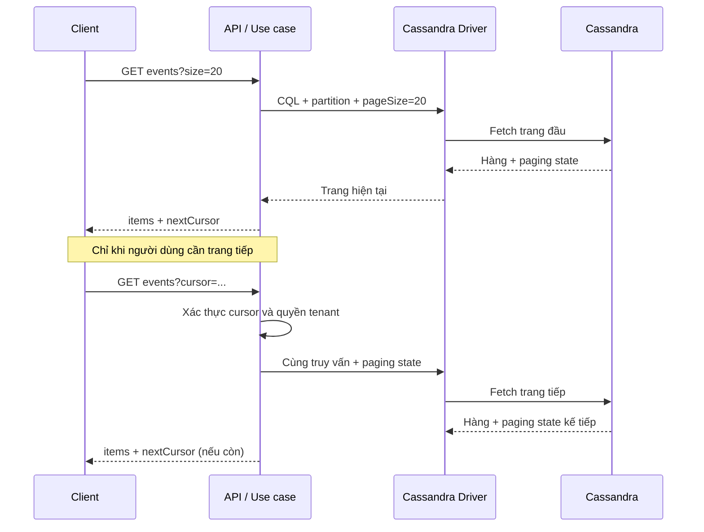

# Điều chỉnh fetch size, giới hạn kết quả và đọc tiếp có kiểm soát

Một endpoint liệt kê lịch sử giao dịch có thể chỉ hiển thị 20 dòng trên màn hình, nhưng nếu tầng lưu trữ đọc cả hàng trăm nghìn bản ghi rồi mới cắt danh sách trong Java, ứng dụng vẫn chịu chi phí mạng, CPU, bộ nhớ và độ trễ rất lớn. Với **Spring Data Cassandra**, vấn đề còn nghiêm trọng hơn khi dữ liệu nằm trên nhiều replica và được phân vùng theo partition key: thao tác đọc sai có thể đẩy tải lên các partition quá lớn hoặc gây nhiều round trip tới Cassandra.

Trong chương **Hiệu năng**, bài này tập trung vào ba nút điều khiển có ý nghĩa khác nhau:

1. **Fetch size / page size:** mỗi lượt truy xuất từ Cassandra chuyển về tối đa bao nhiêu hàng, tùy giới hạn thực tế của driver/server.
2. **Giới hạn kết quả:** một truy vấn và một HTTP request được phép đọc, trả tối đa bao nhiêu hàng.
3. **Đọc tiếp có kiểm soát:** chỉ tải trang tiếp theo khi thật sự cần, bảo toàn paging state, phân vùng và điều kiện truy vấn, đồng thời chặn các vòng lặp đọc vô hạn.

Mục tiêu không phải cứ chọn fetch size càng nhỏ càng tốt. Cần cân bằng giữa thời gian phản hồi, số chuyến mạng, bộ nhớ, độ lớn của mỗi hàng, mức độ song song và đặc tính phân tán của Apache Cassandra.

## 1. Bắt đầu từ truy vấn và partition key

Giả sử ứng dụng lưu hoạt động của tài khoản theo tháng. API cần lấy các sự kiện mới nhất của **một tài khoản trong một tháng**, có thể bấm “Xem thêm”.

Một bảng được thiết kế theo truy vấn này:

```sql
CREATE TABLE events_by_account_month (
    tenant_id text,
    account_id uuid,
    month_bucket text,
    occurred_at timestamp,
    event_id uuid,
    event_type text,
    summary text,
    PRIMARY KEY (
        (tenant_id, account_id, month_bucket),
        occurred_at,
        event_id
    )
) WITH CLUSTERING ORDER BY (occurred_at DESC, event_id ASC);
```

Ý nghĩa của schema:

- `(tenant_id, account_id, month_bucket)` là **composite partition key**. Phần lọc dữ liệu phải cung cấp đầy đủ ba giá trị này.
- `occurred_at` và `event_id` là **clustering columns**, giúp dữ liệu sắp xếp theo thời gian giảm dần, sau đó theo ID để xác định thứ tự giữa các sự kiện trùng thời điểm.
- `month_bucket`, ví dụ `2026-11`, hạn chế một tài khoản tăng trưởng thành partition vô hạn. Tháng vẫn có thể quá lớn nếu tài khoản có lưu lượng đặc biệt cao; cần theo dõi kích thước partition để cân nhắc bucket nhỏ hơn.
- `summary` là dữ liệu trả về; không dùng `SELECT *` nếu API chỉ cần vài cột.

Truy vấn đọc theo đúng khóa:

```sql
SELECT occurred_at, event_id, event_type, summary
FROM events_by_account_month
WHERE tenant_id = ?
  AND account_id = ?
  AND month_bucket = ?
LIMIT 120;
```

Thứ tự mặc định trong partition là thứ tự clustering đã khai báo. Ví dụ này không cần quét toàn bảng, cũng không cần `ALLOW FILTERING`.

**Cần phân biệt:** truy vấn lấy trang đầu của *một partition* khác hẳn việc “lấy 20 sự kiện mới nhất trên toàn hệ thống”. Truy vấn thứ hai là access pattern khác, thường cần bảng đọc riêng hoặc lớp tổng hợp. Thay fetch size không thể sửa một mô hình partition key sai.

## 2. Phân biệt bốn loại giới hạn

| Cơ chế | Phạm vi tác động | Công dụng | Không bảo đảm |
| --- | --- | --- | --- |
| CQL `LIMIT 120` | Tổng số hàng truy vấn được phép trả về | Ngăn một truy vấn trả quá nhiều hàng qua các trang | Không giới hạn toàn bộ tài nguyên Cassandra đã tiêu tốn để tìm hàng hợp lệ |
| Driver `setPageSize(20)` | Kích thước trang được yêu cầu | Điều chỉnh lượng dữ liệu trong mỗi lần fetch và số round trip | Không chắc mỗi trang có đúng 20 hàng; server có thể trả ít hơn |
| HTTP `size=20`, giới hạn máy chủ | Số phần tử API cung cấp mỗi lần | Giữ hợp đồng response và ngân sách tải | Không tự giảm số hàng database đã đọc nếu code vẫn duyệt hết `ResultSet` |
| Ngân sách toàn quy trình | Số trang, số hàng, bytes, thời gian và số truy vấn | Chặn job/consumer đọc không giới hạn hoặc retry vô tận | Không thay thế thiết kế partition và query phù hợp |

Ví dụ: `LIMIT 120` kết hợp `setPageSize(20)` cho phép **tối đa 120 hàng trên toàn truy vấn**, được lấy qua các trang. Với một tập 55 hàng đủ điều kiện, số trang thường xấp xỉ ba, nhưng việc chia trang có thể phụ thuộc ngưỡng kích thước dữ liệu và cách server phục vụ. `LIMIT` **không phải** “120 hàng trên mỗi trang”.

Ngược lại, chỉ đặt `setPageSize(20)` **không có nghĩa** tổng truy vấn bị giới hạn ở 20 hàng. Nếu ứng dụng liên tục đọc trang kế tiếp, nó vẫn có thể đi qua toàn bộ partition.

### Câu hỏi phải xác định trước khi chọn giá trị

1. Endpoint cần hiển thị **một trang** hay thực sự phải xử lý **tất cả** kết quả?
2. Trung bình và p95 kích thước mỗi hàng là bao nhiêu byte? Hàng chứa collection hoặc text lớn không?
3. Truy vấn có luôn giữ trong một partition đã bucket hợp lý không?
4. Độ trễ mạng giữa ứng dụng và Cassandra là bao nhiêu; người dùng có thường bấm “Xem thêm”?
5. Có bao nhiêu request đồng thời cùng fetch? Worker chạy song song có giới hạn không?

Tối ưu một câu truy vấn bằng cách tăng fetch size, trong khi để 500 request đồng thời tự tải mọi trang, có thể khiến áp lực lên cụm tăng mạnh.

## 3. Vòng đời paging trong Cassandra

Cassandra paging hoạt động theo **paging state** do server/driver trao đổi. Ứng dụng dùng trạng thái đó để đọc tiếp cùng câu truy vấn, thay vì gửi số trang và yêu cầu bỏ qua `offset` hàng.



Hai kiểu sử dụng driver cần hiểu rõ:

- **Đồng bộ (`ResultSet`):** Java Driver có thể tự động yêu cầu trang tiếp khi ứng dụng tiếp tục duyệt các hàng. Code gọi `resultSet.all()` hoặc `for (Row row : resultSet)` đến hết sẽ kéo toàn bộ kết quả khả dụng qua nhiều lần fetch. Việc đặt page size không chặn hành vi này.
- **Bất đồng bộ (`AsyncResultSet`):** `currentPage()` chỉ cung cấp các hàng thuộc trang hiện tại. Chỉ gọi `fetchNextPage()` khi ứng dụng thật sự muốn tiếp tục, hoặc sử dụng paging state của trang hiện tại để phục vụ request sau.

Đây là lỗi hiệu năng thường gặp:

```java
// DỄ GÂY TẢI LỚN: kích thước trang là 20,
// nhưng .all() vẫn có thể tự lấy tiếp các trang còn lại.
// Các biến tenantId, accountId, monthBucket do use case cung cấp.
ResultSet resultSet = session.execute(
        SimpleStatement.builder("""
                SELECT occurred_at, event_id, event_type, summary
                FROM events_by_account_month
                WHERE tenant_id = ? AND account_id = ? AND month_bucket = ?
                LIMIT 120
                """)
                .addPositionalValues(tenantId, accountId, monthBucket)
                .setPageSize(20)
                .build());
List<Row> everything = resultSet.all();
List<Row> first20 = everything.subList(0, Math.min(20, everything.size()));
```

Lỗi nằm ở việc **duyệt hết trước rồi cắt**, chứ không phải ở con số `20`. Để endpoint chỉ cần một trang, hãy dùng API phân trang của driver/framework và trả đúng trang hiện tại.

## 4. Ví dụ Java Driver 4.x: chỉ đọc một trang

Đây là ví dụ cốt lõi có thể đặt trong adapter lưu trữ bên dưới ứng dụng Spring Data Cassandra. Nó dùng `CqlSession` bất đồng bộ để tránh tự động duyệt hết nhiều trang. Phần token trả ra bên ngoài HTTP sẽ được xử lý riêng ở mục tiếp theo.

```java
import com.datastax.oss.driver.api.core.CqlSession;
import com.datastax.oss.driver.api.core.cql.AsyncResultSet;
import com.datastax.oss.driver.api.core.cql.PagingState;
import com.datastax.oss.driver.api.core.cql.Row;
import com.datastax.oss.driver.api.core.cql.SimpleStatement;
import java.time.Instant;
import java.util.ArrayList;
import java.util.List;
import java.util.UUID;
import java.util.concurrent.CompletionStage;

record EventView(
        UUID eventId,
        Instant occurredAt,
        String eventType,
        String summary
) {}

record EventPage(List<EventView> items, PagingState nextState) {}

final class CassandraEventReader {
    private static final int PAGE_SIZE = 20;
    private static final String CQL = """
            SELECT occurred_at, event_id, event_type, summary
            FROM events_by_account_month
            WHERE tenant_id = ?
              AND account_id = ?
              AND month_bucket = ?
            LIMIT 120
            """;

    private final CqlSession session;

    CassandraEventReader(CqlSession session) {
        this.session = session;
    }

    CompletionStage<EventPage> readOnePage(
            String tenantId,
            UUID accountId,
            String monthBucket,
            PagingState state
    ) {
        SimpleStatement statement = SimpleStatement.builder(CQL)
                .addPositionalValues(tenantId, accountId, monthBucket)
                .setPageSize(PAGE_SIZE)
                .build();

        if (state != null) {
            statement = statement.setPagingState(state);
        }

        // Không gọi fetchNextPage() trong request này.
        return session.executeAsync(statement).thenApply(result -> {
            List<EventView> items = new ArrayList<>();
            for (Row row : result.currentPage()) {
                items.add(new EventView(
                        row.getUuid("event_id"),
                        row.getInstant("occurred_at"),
                        row.getString("event_type"),
                        row.getString("summary")));
            }

            PagingState next = result.hasMorePages()
                    ? result.getExecutionInfo().getPagingState()
                    : null;
            return new EventPage(List.copyOf(items), next);
        });
    }
}
```

Đoạn code chỉ chuyển các hàng từ **trang hiện tại** thành DTO. `EventPage.nextState()` là trạng thái **nội bộ** của driver; endpoint không nên gửi trực tiếp giá trị này nếu chưa đóng gói và bảo vệ. Bên ngoài, API chỉ nên trả những trường cần thiết như:

```json
{
  "items": [
    {
      "eventId": "a76d40dc-b4da-4b1d-b05c-b478a7438d4e",
      "occurredAt": "2026-11-25T03:10:00Z",
      "eventType": "LOGIN",
      "summary": "Đăng nhập thành công"
    }
  ],
  "nextCursor": "<opaque-signed-token-or-null>"
}
```

Đây là **response minh họa**, nên số lượng phần tử chỉ là ví dụ. Khi `nextState == null`, trả `nextCursor: null` và dừng. Nếu client không yêu cầu trang tiếp theo, không cần giữ thread chờ hoặc tự fetch thêm.

**Chú ý:** `pageSize` là yêu cầu với driver/server, không phải cam kết tuyệt đối về số hàng nhận. Những điều kiện như giới hạn bytes trên trang, hàng quá lớn hoặc tombstone có thể ảnh hưởng kích thước thực tế. API phải xử lý trang ít hơn 20 hàng nhưng **vẫn còn paging state**; không suy ra “hết dữ liệu” chỉ vì `items.size() < 20`.

## 5. Cursor phải gắn với truy vấn và phạm vi truy cập

Paging state là token **opaque**: ứng dụng không nên tự phân tích nội dung hoặc chế ra token mới. Token đọc tiếp phải tương ứng với cùng câu CQL và các tham số ràng buộc. Nếu đổi `tenant_id`, `account_id`, `month_bucket`, giới hạn, bộ lọc hoặc thứ tự, token cũ không còn là cursor hợp lệ cho truy vấn mới.

Đối với HTTP API stateless, có thể xây dựng cursor gồm:

| Thuộc tính cursor ở lớp ứng dụng | Mục đích |
| --- | --- |
| Phiên bản định dạng cursor | Cho phép thay đổi cách mã hóa mà không hiểu sai token cũ |
| ID tenant và danh tính/principal đã xác thực | Ràng buộc cursor vào phạm vi được cấp quyền |
| Hash của câu truy vấn và tham số lọc | Ngăn dùng lại cursor cho truy vấn khác |
| Page size và ngân sách giới hạn | Ngăn client sửa kích thước và mở rộng chi phí truy vấn |
| Thời điểm hết hạn | Giới hạn vòng đời của token và sự phụ thuộc vào trạng thái cũ |
| Paging state do driver tạo | Tiếp tục vị trí đang đọc |

Đóng gói và **ký toàn vẹn bằng HMAC hoặc cơ chế ký tương đương**; nếu token chứa dữ liệu nhạy cảm, cần mã hóa hoặc lưu trạng thái ở server rồi trả ID tra cứu. Chữ ký không thay cho bước kiểm tra quyền truy cập ở từng request. Không log nguyên văn token vào hệ thống theo dõi nếu không có nhu cầu và biện pháp kiểm soát rõ ràng.

Một luồng xử lý hợp lý:

1. Xác thực người gọi và kiểm tra quyền xem tài khoản/tenant **trước khi đọc Cassandra**.
2. Với trang đầu, tạo query có tham số lọc và page size do máy chủ giới hạn.
3. Với trang tiếp, kiểm tra chữ ký, thời hạn, danh tính, hash truy vấn và giới hạn được phép; trích paging state.
4. Gửi lại **cùng** câu CQL, tham số và limit; chỉ thay paging state.
5. Trả trang hiện tại và cursor mới nếu driver cho biết còn dữ liệu.

Ví dụ `GET /events?page=5000` không thích hợp nếu API phải đọc/bỏ qua 4.999 trang để trả trang cuối. Ưu tiên `GET /events?cursor=...` và “Xem thêm”. Nếu yêu cầu nhảy tới một thời điểm, có thể thiết kế endpoint nhận mốc thời gian làm **keyset query**, chẳng hạn `occurred_at < ?` trong một partition, cùng khóa phụ để xử lý thời điểm trùng. Keyset và paging state là hai cơ chế khác nhau, cần test riêng.

## 6. Giới hạn tại ba điểm: truy vấn, request và luồng đọc nhiều trang

API nên thiết lập giới hạn bằng cấu hình server, không tin trực tiếp giá trị do client đưa vào:

```java
static int normalizePageSize(int requested) {
    if (requested < 1) {
        throw new IllegalArgumentException("page size phải dương");
    }
    return Math.min(requested, 100);
}
```

Ví dụ này đặt **page size tối đa 100**, nhưng ngưỡng cụ thể phải lấy từ dữ liệu đo. Trong hệ thống sản xuất, có thể chọn mặc định 20 và tối đa 50 nếu mỗi hàng lớn; hoặc mức khác nếu bản ghi nhỏ và độ trễ mạng cao.

Đối với job xuất báo cáo thực sự phải duyệt nhiều trang, ngoài giới hạn tổng số hàng nên có:

- **Số trang tối đa** cho một job hoặc một lượt xử lý; stop ngay khi đã hết ngân sách.
- **Deadline tổng** cho tất cả các trang, không chỉ timeout của từng câu CQL.
- **Giới hạn bytes và bộ nhớ**: xử lý từng batch rồi ghi ra đích thay vì tích toàn bộ vào một `List`.
- **Giới hạn số request Cassandra đồng thời** và cơ chế backpressure khi downstream xử lý chậm.
- **Checkpoint** được lưu ở ranh giới đáng tin cậy nếu job được phép khởi động lại; phải chấp nhận rằng paging state có vòng đời và phụ thuộc câu truy vấn, không coi nó là khóa lưu trữ bền vững vĩnh viễn.

Pseudo-code cho một consumer đọc có kiểm soát:

```text
remainingRows = 2000
remainingPages = 50
cursor = null
deadline = now + processingBudget

while remainingRows > 0 and remainingPages > 0 and now < deadline:
    page = readOnePage(cursor)          # Chỉ truy vấn một trang
    processAndPersist(page.items)       # Hoàn tất downstream trước khi đọc tiếp
    remainingRows -= page.items.size
    remainingPages -= 1
    if page.nextState is null:
        break
    cursor = page.nextState

if cursor is not null and budgetExhausted:
    return PARTIAL_WITH_RESUME_POLICY
return COMPLETE
```

Nếu dữ liệu nghiệp vụ yêu cầu xử lý **đúng một lần**, chỉ lưu cursor sau khi xử lý và ghi nhận thành công các hàng của trang. Tuy nhiên tiến trình có thể crash giữa thao tác downstream và checkpoint: cần **idempotency/deduplication** theo `event_id` hoặc thiết kế xử lý lại an toàn. Một paging token tự nó không tạo transaction giữa Cassandra và hệ thống nhận dữ liệu.

## 7. Spring Data Cassandra: repository, Slice và CassandraTemplate

Trong Spring Data Cassandra, có thể sử dụng `CassandraRepository` hoặc `CassandraTemplate` để làm việc với entity và query được thiết kế theo partition key. Khi cần trả danh sách qua nhiều trang, hãy ưu tiên **trang tiếp theo dựa trên paging state**, thay vì giả lập pagination theo offset.

Với repository query hỗ trợ phân trang trong phiên bản Spring Data đang dùng, luồng khái niệm như sau:

```text
firstPageable = CassandraPageRequest.first(20)
slice = repository.findByPartitionKey(..., firstPageable)

return slice.getContent(), slice.hasNext()
    ? slice.nextPageable()
    : noNextPage
```

Đây là **pseudo-code minh họa**, không phải một method signature có thể sao chép nguyên vẹn: tên phương thức repository phụ thuộc entity, annotation và phiên bản Spring Data Cassandra. `CassandraPageRequest` và `Slice.nextPageable()` dùng cơ chế đi tiếp trên trang đã có; nên đọc tài liệu đúng phiên bản dự án trước khi quyết định cách đóng gói token cho API.

Phân biệt các kiểu kết quả:

- **`List<T>`:** phù hợp nếu dữ liệu được giới hạn rõ ràng bằng query và có quy mô nhỏ; không mặc nhiên có cursor để đọc tiếp.
- **`Slice<T>`:** phù hợp với giao diện “Xem thêm”, vì chủ yếu cần biết có trang sau mà không bắt buộc phải tính tổng số bản ghi.
- **`Page<T>`:** thường gắn với khái niệm tổng số phần tử/tổng trang; trên Cassandra, tính tổng có thể tốn kém hoặc không phù hợp với dữ liệu phân tán. Đừng tự thêm `COUNT(*)` trên partition lớn chỉ để hiển thị “trang 1/5000”.
- **`Stream`/reactive `Flux`:** hữu ích cho xử lý từng phần tử, nhưng `collectList()` hoặc đọc đến hết vẫn có thể gom toàn bộ dữ liệu. Backpressure và fetch size phải được kiểm chứng với API thực tế.

Với `CassandraTemplate`, các API `Query`/`Slice` và tùy chọn paging thay đổi theo các phiên bản Spring Data. Khi framework không cung cấp chính xác hợp đồng trang mong muốn, có thể giới hạn adapter sử dụng `CqlSession` cho câu truy vấn này; miền nghiệp vụ vẫn gọi qua cùng một interface đọc dữ liệu.

**Một lỗi thiết kế phổ biến** là trả `Page<T>` chỉ để có metadata tổng số trang, trong khi Cassandra không có cách thực hiện `OFFSET/LIMIT` tương đương cơ sở dữ liệu quan hệ với chi phí ổn định. Hãy ưu tiên trả `items + nextCursor`.

## 8. Chọn fetch size dựa trên đo đạc, không dựa trên trực giác

Với cùng một tập 200 hàng:

| Page size | Số lần fetch về mặt lý thuyết | Ưu điểm | Chi phí tiềm ẩn |
| --- | ---: | --- | --- |
| 10 | Khoảng 20 | Bộ nhớ mỗi trang nhỏ, trả nhanh cho màn hình ít hàng | Nhiều round trip nếu phải đọc hết |
| 25 | Khoảng 8 | Cân bằng cho màn hình danh sách phổ biến | Vẫn phải tải thêm nếu người dùng cuộn liên tục |
| 100 | Khoảng 2 | Ít round trip khi xử lý batch | Tăng dữ liệu đỉnh mỗi lượt, độ trễ trang đầu có thể lớn |
| 200 | Khoảng 1 | Thích hợp trong vài tác vụ batch và hàng nhỏ | Có thể tạo áp lực memory/network khi concurrency cao |

Số lần fetch trong bảng chỉ là **ước lượng** trong điều kiện mỗi trang đạt kích thước yêu cầu. Không nên viết test kiểm tra “phải đúng 8 round trip” vì server có thể giới hạn page theo bytes hoặc kết quả thực tế.

Ví dụ 100 request đồng thời, mỗi request nhận 50 hàng có payload trung bình 4 KiB: riêng dữ liệu thô của các trang đang ở trong bộ nhớ có thể xấp xỉ `100 × 50 × 4 KiB = 20.000 KiB` (gần 19,5 MiB), **chưa tính** object Java, deserialization, buffer của driver và dữ liệu downstream. Nếu tăng page size gấp bốn lần mà không hạ concurrency, tải bộ nhớ đỉnh có thể tăng đáng kể.

Một phương pháp benchmark có ích:

1. Xây dựng dữ liệu đại diện với phân phối row size, partition size và lưu lượng truy cập giống thực tế.
2. Giữ nguyên query, consistency level, số request đồng thời và môi trường; thử vài mức page size, chẳng hạn 20/50/100.
3. Đo **thời gian trang đầu**, p95/p99 latency, số round trip/truy vấn, lưu lượng byte, CPU/heap, GC, timeout và tỷ lệ retry.
4. Tách bài toán “người dùng thường chỉ xem trang đầu” khỏi “batch cần duyệt toàn bộ”, vì hai luồng thường cần fetch size khác nhau.
5. Chọn giá trị tạo tổng chi phí chấp nhận được, sau đó kiểm tra lại với tải đồng thời cao và dữ liệu p95/p99.

Không có một `fetch size = 100` tối ưu chung cho tất cả bảng và truy vấn. Các giá trị mặc định của driver chỉ là điểm khởi đầu.

## 9. Các yếu tố làm phân trang chậm dù đã đặt giới hạn

### 9.1 Partition lớn và truy vấn không khớp khóa

Một partition chứa hàng triệu hàng có thể tạo điểm nóng và kéo dài truy vấn, nhất là khi nhiều client cùng đọc. Thay `pageSize` không giải quyết mô hình phân vùng sai. Dùng bucket có giới hạn theo thời gian/nguồn dữ liệu; đo phân phối kích thước partition thay vì chỉ tính trung bình.

### 9.2 Tombstone và TTL

Xóa nhiều dữ liệu hoặc dùng TTL có thể tạo tombstone, ảnh hưởng chi phí đọc ngay cả khi số hàng *trả về* ít. `LIMIT 20` không đảm bảo Cassandra chỉ phải xem đúng 20 hàng vật lý. Theo dõi cảnh báo tombstone và thiết kế chính sách TTL/xóa phù hợp với kiểu truy vấn.

### 9.3 Hàng hoặc collection quá lớn

20 hàng với một cột `summary` dài vài megabyte hoàn toàn khác 20 hàng chỉ có mã trạng thái ngắn. Giới hạn số hàng nên đi cùng việc chỉ chọn cột cần thiết, kích thước payload và kiểm soát dữ liệu bất thường.

### 9.4 Fan-out sang nhiều partition

Endpoint cần gộp 12 tháng có thể chạy 12 truy vấn độc lập. Fetch size áp dụng cho **từng truy vấn**, không tự kiểm soát tổng concurrency hay tổng bytes. Cần fan-out có giới hạn, merge theo thứ tự rõ ràng và ngân sách đọc chung; hoặc thiết kế bảng/materialized view ở mức ứng dụng cho truy vấn xuyên tháng nếu lưu lượng lớn.

### 9.5 Đọc thêm ẩn trong code

Các thao tác như `ResultSet.all()`, terminal operation trên stream, `Flux.collectList()` hoặc vòng lặp tự gọi `fetchNextPage()` có thể xóa bỏ lợi ích của việc trả trang nhỏ. Kiểm tra **đường đi thực tế của dữ liệu**, không chỉ nhìn cấu hình fetch size trong connection settings.

### 9.6 Đọc đồng thời với ghi

Paging state không tạo một snapshot cô lập của toàn bộ kết quả qua nhiều request. Dữ liệu thêm/sửa/xóa trong lúc người dùng xem trang sau có thể ảnh hưởng danh sách hiển thị; nếu cần ảnh chụp bất biến cho báo cáo hoặc kiểm toán, phải thiết kế dữ liệu có mốc cố định hay snapshot nghiệp vụ phù hợp. Đừng hứa “không trùng, không thiếu” trong mọi tình huống chỉ nhờ paging state.

## 10. Kiểm thử phân trang và giới hạn tải

### Test tích hợp với Cassandra thật

Sử dụng Testcontainers Cassandra (hoặc môi trường test nhiều node nếu yêu cầu consistency) cùng schema thật của ứng dụng. Các kịch bản có giá trị:

| Kịch bản | Điều cần khẳng định |
| --- | --- |
| Partition rỗng | Trả danh sách rỗng, không có cursor tiếp |
| Ít hơn page size | Trả dữ liệu đúng, không tự tạo trang ảo |
| Hàng vượt page size | Đọc nhiều trang đến khi hết state, không thiếu/trùng **khi tập dữ liệu tĩnh** |
| Hai partition khác tenant/account | Cursor không được truy cập dữ liệu ngoài phạm vi cho phép |
| Thay đổi tham số query khi dùng cursor | API từ chối token sai ràng buộc |
| Page size client quá lớn hoặc âm | Chuẩn hóa/từ chối trước khi gửi query |
| Timeout một trang | Không tự duyệt vô hạn; có quy tắc retry và phản hồi lỗi rõ |
| Hàng lớn/TTL/tombstone | Đo latency và chi phí đọc, không chỉ kiểm tra số hàng trả về |

Ví dụ test logic bằng driver cho bộ 53 sự kiện đã được thêm vào cùng một partition (mã giả thể hiện **bất biến**, không ràng buộc số trang phải chính xác):

```text
seenEventIds = empty set
state = null
pages = 0

do:
    page = readOnePage(tenant, account, bucket, state)
    assert page.items.size <= configuredPageSize
    for event in page.items:
        assert event.eventId is not in seenEventIds
        seenEventIds.add(event.eventId)
    pages += 1
    assert pages <= testSafetyBound
    state = page.nextState
while state != null

assert seenEventIds.size == 53
```

Nếu page size được yêu cầu là 20, **không** nên khẳng định mọi trang trừ trang cuối luôn chứa đúng 20 hàng. Ngoài ra, bài test này giả định không có ghi/xóa đồng thời, cùng truy vấn và limit đủ lớn để duyệt 53 hàng.

### Test đơn vị cho chính sách API

Không cần Cassandra để kiểm tra `normalizePageSize`, thời hạn cursor, giới hạn số trang, từ chối token không đúng tenant hoặc việc không gọi fetch sau khi hết deadline. Chỉ integration test mới chứng minh được cursor của driver hoạt động với CQL thật.

### Test hiệu năng theo baseline

Đo riêng “time to first page” và “time to consume all pages” với các giá trị page size; ghi lại p95, p99, bytes nhận, số request CQL và bộ nhớ. Một container Cassandra một node xác minh chức năng paging, nhưng **không** đại diện cho đường truyền và tải của cụm production nhiều replica.

## 11. Checklist trước khi đưa API phân trang vào sản xuất

1. Truy vấn cung cấp đúng partition key và có thứ tự xác định theo clustering columns; không dựa vào `ALLOW FILTERING` hoặc quét toàn bảng.
2. Schema bucket dữ liệu có giới hạn, có theo dõi partition lớn/hot partition.
3. API giới hạn page size, tổng kết quả và số truy vấn; không dùng giá trị client nhập để cấp phát tài nguyên vô hạn.
4. Phân biệt `LIMIT` của CQL, page size của driver và ngân sách tổng của một request/job.
5. Mỗi request “Xem thêm” chỉ lấy trang cần thiết, không gọi `all()`/`collectList()` để duyệt toàn bộ rồi cắt.
6. Cursor có thời hạn, được bảo vệ toàn vẹn, gắn với tenant, quyền truy cập, tham số query và page size.
7. Có cơ chế dừng khi hết paging state, hết số trang, hết hàng hoặc chạm deadline; retry hữu hạn và xử lý timeout rõ.
8. Có test tích hợp với dữ liệu tĩnh, test cursor sai phạm vi, kiểm tra trang thiếu hàng và test hiệu năng dựa trên kích thước hàng thực tế.
9. Thiết kế chính sách khi dữ liệu thay đổi giữa các trang; không mặc định paging tạo snapshot.
10. Theo dõi latency, số trang được fetch, dữ liệu trả về, lỗi CQL, retry và memory theo từng query quan trọng.

**Nguyên tắc kết luận:** trên Spring Data Cassandra, `fetch size` điều chỉnh lượng dữ liệu **mỗi lượt**, `LIMIT` và giới hạn API điều chỉnh lượng dữ liệu **được phép trả**, còn `paging state` cho phép **đọc tiếp đúng vị trí** khi có nhu cầu. Kết hợp ba cơ chế với partition key phù hợp, giới hạn concurrency và đo đạc thực tế mới giúp phân trang ổn định trên hệ lưu trữ phân tán.
