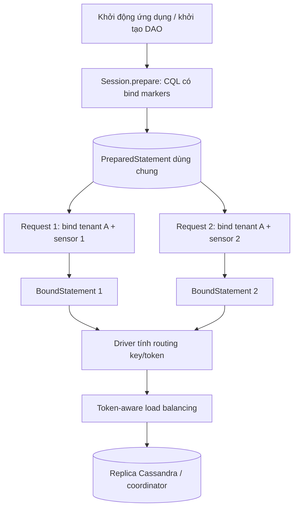

# Tái sử dụng prepared statement và kiểm tra thông tin định tuyến

Trong **SPRING_DATA_CASSANDRA**, chúng ta truy cập Apache Cassandra bằng entity mapping, repository, `CassandraTemplate` và truy vấn CQL. Để ứng dụng đạt hiệu năng tốt trên dữ liệu phân tán, tối ưu câu lệnh thôi chưa đủ: còn cần **tái sử dụng prepared statement**, **gắn đúng giá trị partition key**, để driver có thể **định tuyến truy vấn đến replica thích hợp**, đồng thời quan sát độ trễ và phân bố tải thực tế.

Bài học thuộc chương **Hiệu năng**, giải quyết hai câu hỏi thường bị xem nhẹ:

1. Vì sao không nên tạo hàng nghìn biến thể CQL rồi `prepare` lại theo từng request?
2. Làm thế nào xác định statement đã có đủ **thông tin định tuyến** (keyspace, routing key/token), thay vì chỉ thấy truy vấn trả kết quả đúng?

Nội dung dùng **Spring Data Cassandra với Java Driver 4.x** làm nền, kết hợp thiết kế bảng theo truy vấn, partition key, consistency level và paging. Hành vi cụ thể có thể khác theo phiên bản Spring Data, Java driver và Apache Cassandra, nên cần đối chiếu với dependency đang chạy.

## 1. Tình huống thực tế: truy vấn đúng nhưng chậm không ổn định

Giả sử một hệ thống giám sát nhận nhiều bản ghi cảm biến mỗi giây. Trang chi tiết thiết bị thường xuyên hiển thị 100 phép đo mới nhất của một thiết bị trong một ngày.

Một cách viết dễ gặp:

```java
public List<Row> load(String tenantId, String sensorId, String day) {
    String cql = "SELECT * FROM measurements_by_sensor_day "
            + "WHERE tenant_id = " + tenantId
            + " AND sensor_id = " + sensorId
            + " AND event_day = '" + day + "'";

    return session.execute(cql).all();
}
```

Đây là **ví dụ phản diện**: nó ghép dữ liệu đầu vào trực tiếp vào CQL, có rủi ro injection/lỗi quoting, tạo chuỗi truy vấn khác nhau và đọc không giới hạn số hàng. Nếu dữ liệu của mỗi partition tăng nhanh, `all()` còn có thể âm thầm kéo nhiều trang dữ liệu về bộ nhớ.

Cách tốt hơn là:

- Thiết kế bảng theo truy vấn cần phục vụ và giới hạn kích thước partition.
- Viết CQL có **bind markers** (`?`), prepare ở nơi có vòng đời dài.
- Mỗi request tạo `BoundStatement` mới, chỉ bind giá trị; đặt timeout, consistency level, page size theo yêu cầu.
- Kiểm tra statement có routing key/token và keyspace phù hợp; xem phân bố coordinator, latency và số lần prepare ở cluster.

Prepared statement và token-aware routing là **hai lớp tối ưu khác nhau nhưng phối hợp với nhau**: prepared giúp giảm công việc phân tích câu lệnh lặp lại, còn thông tin partition key giúp driver chọn coordinator phù hợp hơn.

## 2. Ba khái niệm phải phân biệt

| Khái niệm | Vai trò | Vòng đời nên dùng |
| --- | --- | --- |
| `CqlSession` | Quản lý kết nối, metadata topology, load balancing và việc thực thi CQL. | Thường là bean singleton của ứng dụng, tái sử dụng xuyên request. |
| `PreparedStatement` | Dạng đã được chuẩn bị của một **mẫu CQL cố định**, gồm metadata biến bind và kết quả cần thiết. | Prepare một lần cho mỗi mẫu truy vấn ổn định rồi dùng lại qua nhiều request. |
| `BoundStatement` | Một lần sử dụng mẫu prepared với các **giá trị bind cụ thể** và execution options. | Tạo mới cho mỗi thao tác logic; có thể chia sẻ mẫu prepared, không chia sẻ giá trị giữa request. |

Ví dụ hai truy vấn có mẫu giống nhau:

```sql
SELECT measured_at, event_id, value
FROM measurements_by_sensor_day
WHERE tenant_id = ?
  AND sensor_id = ?
  AND event_day = ?
  AND measured_at < ?
LIMIT ?;
```

Request A bind `tenant_id=A`, `sensor_id=S1`; request B bind `tenant_id=A`, `sensor_id=S2`. **Cùng một `PreparedStatement`** có thể được dùng để tạo hai `BoundStatement` khác nhau.



**Không hiểu nhầm:** `PreparedStatement` là object và metadata để thực thi CQL, không phải kết quả truy vấn được cache. Query A và B vẫn phải đọc dữ liệu Cassandra. Một statement được prepare thành công cũng **không** chứng minh cách đặt partition key hoặc truy vấn là hiệu quả.

## 3. Tại sao tái sử dụng prepared statement?

### 3.1. Chi phí chuẩn bị câu lệnh

Khi chuẩn bị một CQL statement, driver và server xử lý mẫu truy vấn, kiểu bind variables, metadata bảng/cột và nhận diện các thông tin có thể dùng cho định tuyến. Cassandra quản lý các prepared statement phía server theo cơ chế và giới hạn của nó.

Nếu ứng dụng liên tục tạo mẫu CQL khác nhau hoặc cố prepare cùng một mẫu trong luồng request, ta có thể gặp:

- Overhead khi tra cứu/chuẩn bị statement trong driver.
- Traffic và CPU do các đợt `PREPARE` trên server, nhất là lúc cache lạnh, node mới xuất hiện hoặc statement bị evict.
- Nhiều prepared statement khác nhau chỉ vì CQL gắn giá trị literal, không dùng bind markers.
- Áp lực metadata/cache và thời gian khởi động sau khi cluster/restart hồi phục.
- Độ trễ spike trên đường xử lý request nếu việc prepare chưa hoàn tất.

Java Driver 4 có cơ chế cache prepared statement và hỗ trợ tự prepare lại khi server báo chưa biết statement, với các chi tiết phụ thuộc cấu hình và phiên bản. Tuy nhiên, việc **quản lý số lượng mẫu CQL** và **tránh gọi `prepare` lặp không cần thiết trong code nghiệp vụ** vẫn là nguyên tắc tốt. Không nên khẳng định mọi lần gọi `session.prepare(...)` đều gửi thêm một request mạng: có thể gặp cache hit.

### 3.2. So sánh cách dùng

| Cách dùng | Vấn đề | Khuyến nghị |
| --- | --- | --- |
| Ghép `WHERE id = 'giá trị'` thành CQL mới cho mỗi request | Mẫu truy vấn biến thiên, rủi ro injection, khó tận dụng prepared statement. | Dùng marker `?` và bind theo kiểu dữ liệu. |
| Gọi `session.prepare(cql)` trong mỗi hàm xử lý request | Có thể có cache hit nhưng vẫn tăng đường đi xử lý và khó kiểm soát số mẫu. | Đặt `PreparedStatement` trong DAO/repository adapter có vòng đời dài. |
| Tạo `CqlSession` cho từng request | Tốn tài nguyên kết nối, metadata và thread; phá khả năng tái sử dụng. | Dùng `CqlSession` được Spring quản lý. |
| Giữ một `BoundStatement` rồi thay giá trị cho nhiều request | Dễ gây nhầm dữ liệu request và execution option; không đúng mô hình chia sẻ. | Chia sẻ `PreparedStatement`, tạo `BoundStatement` theo từng lần dùng. |
| Tạo CQL thay đổi theo thứ tự cột, whitespace, `IN` list hay số lượng marker | Số mẫu/metadata tăng, cache hit giảm. | Chuẩn hóa các mẫu thực sự dùng, chỉ biến thiên dữ liệu bind. |

Prepared statement không khắc phục **hot partition**, bảng không đúng query pattern, full scan, tombstone nặng hay query xuyên nhiều partition. Những vấn đề đó phải giải quyết ở schema, truy vấn, TTL/compaction và phân phối khóa.

## 4. Thiết kế bảng làm tiền đề cho routing

Token-aware routing bắt đầu từ **partition key**, không phải từ tên repository hay loại annotation.

Giả sử hệ thống lưu phép đo theo tenant, sensor và ngày. Chọn phân vùng theo ba thuộc tính để các request cần xem cùng sensor/ngày vào cùng partition nhưng không để một sensor lưu toàn bộ lịch sử trong một partition vô hạn:

```sql
CREATE TABLE measurements_by_sensor_day (
    tenant_id   uuid,
    sensor_id   uuid,
    event_day   date,
    measured_at timestamp,
    event_id    timeuuid,
    value       double,
    PRIMARY KEY ((tenant_id, sensor_id, event_day), measured_at, event_id)
) WITH CLUSTERING ORDER BY (measured_at DESC, event_id DESC);
```

Cách đọc cấu trúc khóa:

- **Partition key** là bộ ba `(tenant_id, sensor_id, event_day)`. Cùng một bộ ba giá trị đưa dữ liệu vào cùng partition logic.
- **Clustering key** là `(measured_at, event_id)`, xác định thứ tự và tính duy nhất của hàng trong partition.
- Truy vấn danh sách phép đo theo ngày cần cung cấp **đủ ba thành phần partition key**.
- `event_day` là bucket giới hạn quy mô partition, nhưng nếu tốc độ ghi quá lớn trong ngày thì vẫn phải đánh giá chia nhỏ hơn theo giờ/shard phù hợp. Không được chia shard tùy tiện làm mất khả năng truy vấn mong muốn.

Truy vấn hợp với bảng:

```sql
SELECT measured_at, event_id, value
FROM measurements_by_sensor_day
WHERE tenant_id = ?
  AND sensor_id = ?
  AND event_day = ?
  AND measured_at < ?
LIMIT ?;
```

Các dấu `?` ở ba điều kiện đầu là **các giá trị partition key** mà driver có thể sử dụng để tính routing key. Giá trị `measured_at` và `LIMIT` là điều kiện/lựa chọn trong partition, **không quyết định token**. Thay thời gian hoặc limit không có nghĩa là di chuyển truy vấn sang một partition khác.

Ngược lại, nếu dùng truy vấn chỉ theo `sensor_id` khi bảng có partition key ba phần, truy vấn đó không còn phù hợp với cấu trúc khóa. Cassandra có thể từ chối CQL, hoặc truy vấn đòi hỏi cơ chế index/filtering không phù hợp mục tiêu. **Đừng thêm `ALLOW FILTERING` chỉ để câu lệnh chạy được:** routing key của bảng gốc vẫn không tự xuất hiện khi không biết đủ khóa.

### 4.1. Partition key khác với routing key

- **Partition key** là giá trị ở mức mô hình dữ liệu, ví dụ ba trường UUID–UUID–date.
- **Routing key** là dạng byte được mã hóa theo quy tắc protocol/codec của partition key. Với khóa ghép, driver phải mã hóa từng thành phần theo đúng thứ tự và định dạng.
- **Token** là giá trị sinh từ routing key qua partitioner của Cassandra; driver kết hợp token với metadata ring để xác định replica của partition.

Không nên tự nối chuỗi `tenantId + sensorId + date` rồi coi đó là routing key. Phép nối như vậy không tương đương cách codec Cassandra mã hóa khóa ghép.

## 5. Mẫu Java: prepare một lần, bind mỗi request

Ví dụ dưới dùng **Java 17, Java Driver 4.x**, `CqlSession` do Spring Boot/Spring Data Cassandra quản lý. Để tập trung vào việc kiểm tra routing metadata, lớp DAO dùng driver trực tiếp. Lớp này có thể sống cạnh `CassandraRepository` và `CassandraTemplate` trong cùng một ứng dụng.

```java
package example.telemetry;

import java.time.Instant;
import java.time.LocalDate;
import java.util.ArrayList;
import java.util.List;
import java.util.UUID;

import com.datastax.oss.driver.api.core.CqlSession;
import com.datastax.oss.driver.api.core.DefaultConsistencyLevel;
import com.datastax.oss.driver.api.core.cql.BoundStatement;
import com.datastax.oss.driver.api.core.cql.PreparedStatement;
import com.datastax.oss.driver.api.core.cql.ResultSet;
import com.datastax.oss.driver.api.core.cql.Row;
import org.springframework.stereotype.Repository;

@Repository
public class MeasurementReadDao {

    private static final int MAX_RESULTS = 100;

    private final CqlSession session;
    private final PreparedStatement selectMeasurements;

    public MeasurementReadDao(CqlSession session) {
        this.session = session;
        this.selectMeasurements = session.prepare("""
            SELECT measured_at, event_id, value
            FROM measurements_by_sensor_day
            WHERE tenant_id = ?
              AND sensor_id = ?
              AND event_day = ?
              AND measured_at < ?
            LIMIT ?
            """);
    }

    public List<Measurement> findBefore(
            UUID tenantId,
            UUID sensorId,
            LocalDate eventDay,
            Instant before,
            int requestedLimit) {

        if (tenantId == null || sensorId == null
                || eventDay == null || before == null) {
            throw new IllegalArgumentException(
                    "Partition key và thời điểm lọc không được null");
        }
        if (requestedLimit < 1 || requestedLimit > MAX_RESULTS) {
            throw new IllegalArgumentException("Limit phải từ 1 đến 100");
        }

        // Mỗi request tạo BoundStatement riêng từ mẫu đã prepare.
        BoundStatement statement = selectMeasurements.bind(
                        tenantId, sensorId, eventDay, before, requestedLimit)
                .setConsistencyLevel(DefaultConsistencyLevel.LOCAL_QUORUM)
                .setPageSize(MAX_RESULTS)
                .setIdempotent(true);

        // Kiểm tra thông tin có thể phục vụ token-aware routing.
        if (statement.getRoutingKey() == null) {
            // Trong hệ thống thật, ghi metric/cảnh báo có kiểm soát;
            // đừng log toàn bộ dữ liệu khóa chứa thông tin nhạy cảm.
            throw new IllegalStateException(
                    "Không suy ra được routing key cho truy vấn theo partition");
        }

        ResultSet resultSet = session.execute(statement);
        List<Measurement> result = new ArrayList<>();

        for (Row row : resultSet) {
            result.add(new Measurement(
                    row.getInstant("measured_at"),
                    row.getUuid("event_id"),
                    row.getDouble("value")));
        }
        return result;
    }

    public record Measurement(
            Instant measuredAt, UUID eventId, double value) {
    }
}
```

**Những điều ví dụ muốn chứng minh:**

1. `selectMeasurements` chỉ được prepare khi tạo DAO, không lặp trong `findBefore`.
2. `PreparedStatement` là mẫu dùng chung; `bind(...)` tạo câu lệnh mang giá trị riêng của request.
3. Thứ tự giá trị bind trùng với thứ tự `?` trong CQL: `tenant_id`, `sensor_id`, `event_day`, `measured_at`, `LIMIT`.
4. Query đã ràng buộc đủ partition key, nên `getRoutingKey()` thường trả thông tin định tuyến hữu ích.
5. `LOCAL_QUORUM` là ví dụ consistency cho một local data center đã được cấu hình đúng RF/topology. Nó không phải lựa chọn bắt buộc cho mọi sản phẩm.
6. `setIdempotent(true)` chỉ phù hợp vì ví dụ là một truy vấn `SELECT` không có tác dụng phụ. **Không gắn cờ idempotent cho một mutation có thể tạo tác dụng phụ lặp** nếu chưa chứng minh an toàn retry.
7. `LIMIT` tối đa 100 hạn chế kết quả. Trong ví dụ này, `ResultSet` được lặp hết vì số hàng đã giới hạn; ở truy vấn lớn cần phân trang chủ động để không kéo mọi trang vào bộ nhớ.

**Điều kiện triển khai:** Keyspace và table phải tồn tại trước khi constructor chạy `session.prepare`. Nếu schema chỉ được tạo sau khi context khởi động, hãy thay đổi thứ tự migration/khởi tạo bean; không giải quyết bằng cách âm thầm tạo table trong mỗi request. Nếu dùng hơn một keyspace hoặc tên bảng fully qualified, cũng phải bảo đảm metadata keyspace khớp query đang prepare.

### 5.1. Vì sao không dùng `BoundStatement` dạng singleton?

Ở Java Driver 4, statement API cung cấp các thao tác trả về statement đã cấu hình mới; cách an toàn và dễ suy luận là tạo một `BoundStatement` cho mỗi thao tác, áp dụng giá trị và options, rồi gọi `session.execute`. Không đưa `BoundStatement` chứa dữ liệu request A vào biến field để request B tiếp tục dùng.

```java
// Nên làm: cùng một PreparedStatement, các lần bind độc lập.
BoundStatement a = prepared.bind(tenantA, sensorA, day, beforeA, 50);
BoundStatement b = prepared.bind(tenantB, sensorB, day, beforeB, 50);

// Không nên: giữ một bound statement ở field rồi tái sử dụng
// với các giá trị logic khác nhau xuyên nhiều request.
```

Việc prepare ở constructor minh họa vòng đời. Trong ứng dụng có migration dài hoặc container lifecycle phức tạp, có thể prepare ở một giai đoạn khởi tạo có kiểm soát sau khi schema sẵn sàng; vẫn phải tránh khởi tạo lặp theo request.

## 6. Kiểm tra thông tin định tuyến: cần nhìn những gì?

**Token-aware load balancing** là một khả năng của Java driver: khi biết routing key/token, driver có thể ưu tiên replica thích hợp làm coordinator cho truy vấn, kết hợp với load-balancing policy và trạng thái các node. Driver **không gửi lệnh CQL thẳng vào một hàng cụ thể**; Cassandra vẫn xử lý request qua coordinator.

| Thông tin | Để làm gì? | Kiểm tra ra sao? |
| --- | --- | --- |
| Keyspace của statement | Chọn đúng replication metadata và token map. | Xác nhận keyspace được cấu hình và query không bị thực thi nhầm keyspace. |
| Routing key | Xác định partition logic từ giá trị bind. | Kiểm tra `BoundStatement.getRoutingKey()` khác `null` khi truy vấn được kỳ vọng là single-partition. |
| Routing token | Xác định vị trí khóa trên token ring. | Dùng API/token metadata phù hợp với phiên bản driver; tránh tự băm chuỗi khóa. |
| Local data center | Chọn node theo chính sách locality. | Kiểm tra `basic.load-balancing-policy.local-datacenter` / cách Boot cấp cấu hình tương đương. |
| Query plan / coordinator | Biết request thực tế được giao cho node nào. | Kết hợp driver metrics, request tracing hoặc observability đang triển khai. |
| Partition key đầy đủ | Cho phép driver suy ra routing key với prepared statement. | Đối chiếu schema, marker và các giá trị bind. |
| Consistency và paging | Quy định replica phản hồi và số lượng row lấy mỗi page. | Kiểm tra execution options và đặc tính workload, không suy luận từ routing key. |

### 6.1. Cách driver biết partition key của prepared query

Với prepared CQL, server cung cấp metadata của các bind markers. Khi câu lệnh có các marker xác định partition key, driver có thể tính routing key từ chính các giá trị đã bind.

Trong truy vấn ví dụ:

```text
WHERE tenant_id = ?     -- partition key component 1
  AND sensor_id = ?     -- partition key component 2
  AND event_day = ?     -- partition key component 3
  AND measured_at < ?   -- clustering range; không tham gia token
LIMIT ?                 -- giới hạn số hàng; không tham gia token
```

Nếu điều kiện không cung cấp đủ partition key, hoặc CQL/metadata không cho phép driver xác định một partition duy nhất, driver có thể **không suy ra routing key**. Khi đó load-balancing policy thường chọn coordinator theo các tiêu chí chung thay vì ưu tiên replica dựa trên token.

**Không đồng nhất “không có routing key” với “CQL nhất định sai”.** Có những request đọc metadata hoặc truy vấn nhiều partition vốn không có một routing key duy nhất. Điều đáng cảnh báo là **mất routing key ở một truy vấn vốn được thiết kế để truy cập một partition**.

### 6.2. Routing key có thể xuất hiện nhưng truy vấn vẫn chậm

Routing key giúp chọn coordinator tốt hơn, song nó không làm biến mất các nguyên nhân sau:

- Một partition quá lớn hoặc trở thành **hot partition**.
- Tồn tại nhiều tombstone do TTL/xóa dữ liệu, khiến đọc tốn công.
- Query buộc lọc nhiều hàng trong partition trước khi trả kết quả.
- Consistency level đòi hỏi nhiều replica chậm; node gặp GC, disk I/O hoặc network congestion.
- Ứng dụng kéo nhiều trang hoặc tất cả hàng qua `all()`.
- Contention do lightweight transaction (LWT) hoặc số request đồng thời vượt khả năng cluster.
- Bảng bị thiết kế khác với query pattern thực tế.

Đừng coi “`getRoutingKey() != null`” là một KPI hiệu năng đầy đủ. Đó là **điều kiện hữu ích để điều tra routing**, còn hiệu năng phải đo trên tải và topology thực.

### 6.3. Token-aware không bảo đảm coordinator luôn là replica

Chính sách load balancing còn xét data center, trạng thái node, khả năng kết nối, các request đang chờ, failover/retry và phiên bản driver. Khi replica không phù hợp hoặc không sẵn sàng, driver có thể chọn coordinator khác. Một request thực tế có thể đi đến node không phải replica gần nhất; vì thế việc kiểm tra một lần không đủ để kết luận tất cả request đều được local-token routing.

Thực hành tốt là đo **phân bố coordinator và độ trễ theo node** cùng với token/routing metadata ở môi trường có topology gần production. Nếu token awareness hoạt động mà hầu hết request vẫn dồn vào một node, có thể dữ liệu thật có hot partition hoặc policy/cluster topology có vấn đề.

## 7. Những nguyên nhân thường làm mất hoặc sai thông tin định tuyến

### 7.1. Không bind đủ thành phần partition key

Với bảng:

```sql
PRIMARY KEY ((tenant_id, sensor_id, event_day), measured_at, event_id)
```

Chỉ `tenant_id` và `sensor_id` không xác định được partition. Driver không thể suy ra routing key đơn nhất từ hai giá trị này, và nhiều CQL thiếu khóa sẽ bị Cassandra từ chối. Hãy thiết kế bảng truy vấn khác nếu cần tra cứu toàn bộ ngày của một sensor.

### 7.2. Query thay đổi liên tục

Một số đội phát triển xây dựng CQL bằng cách nối điều kiện tuỳ ý:

```java
// Ví dụ phản diện: mỗi tổ hợp điều kiện/sắp xếp có thể tạo mẫu khác nhau.
String cql = "SELECT * FROM measurements_by_sensor_day WHERE "
        + dynamicWhere + " ORDER BY " + dynamicOrder;
PreparedStatement ps = session.prepare(cql);
```

Bind markers chỉ thay được **giá trị**, không thay tên bảng, cột hoặc cấu trúc `ORDER BY`. Nếu ứng dụng thực sự có nhiều hình dạng query, hãy thiết kế số lượng mẫu hữu hạn phù hợp query pattern và tránh tạo CQL từ chuỗi không kiểm soát. Với Cassandra, mỗi query pattern mới đôi khi cần một **bảng chuyên cho truy vấn**, chứ không chỉ một chuỗi `WHERE` dài hơn.

### 7.3. Nhiều partition trong một request

Truy vấn dùng `IN` trên partition key hoặc thực hiện thao tác qua nhiều partition không thể được xem như một query đơn partition. Khả năng suy ra routing token và hiệu quả token-aware routing có thể khác theo hình dạng truy vấn và phiên bản driver. Không ép gán một token của phần tử đầu rồi giả định điều đó tối ưu cho toàn bộ kết quả.

Khi cần đọc nhiều partition, cân nhắc nhiều truy vấn có giới hạn concurrency, chia batch nghiệp vụ, hoặc thiết kế bảng tổng hợp theo query pattern. Đo số partition truy cập và tổng dữ liệu thực tế, không chỉ thời gian CPU tạo statement.

### 7.4. Nhầm keyspace

Chuỗi `SELECT ... FROM measurements_by_sensor_day` phụ thuộc keyspace mặc định của session hoặc ngữ cảnh thực thi. Nếu query được prepare trên keyspace khác với keyspace ứng dụng kỳ vọng, metadata/routing có thể không khớp với bảng thực. Khi có nhiều keyspace, dùng định danh fully qualified hoặc cấu hình session/keyspace một cách nhất quán; không dựa vào `USE` thay đổi ngữ cảnh dùng chung giữa request.

### 7.5. Bind sai kiểu hoặc vị trí

`tenant_id` kiểu UUID, `event_day` kiểu `date`. Bind chuỗi text vào vị trí UUID hoặc đảo `tenant_id` với `sensor_id` đều có thể gây lỗi hoặc truy vấn sai. Trường hợp hai cột cùng UUID đặc biệt nguy hiểm vì mã vẫn chạy được.

Việc đặt tên marker (`:tenantId` trong cú pháp CQL hỗ trợ) và bind theo tên có thể giảm rủi ro nhầm vị trí trong một số mẫu truy vấn; bất kể cách bind nào, cần kiểm thử rằng giá trị đầu vào được gắn đúng cột. Không tự dựa vào thứ tự field trong entity Java để suy thứ tự bind của một câu CQL riêng.

## 8. Tích hợp với Spring Data Cassandra: repository và template

Ứng dụng thường không viết trực tiếp DAO bằng driver cho mọi truy vấn. Spring Data Cassandra cung cấp ba cấp độ làm việc:

| API | Dùng khi nào | Điều nên kiểm tra |
| --- | --- | --- |
| `CassandraRepository` | CRUD, query method và `@Query` theo mô hình entity. | CQL cuối cùng có dùng khóa đúng không, phân trang hợp lý không, framework có đang prepare/cache theo đường này không. |
| `CassandraTemplate` | Thao tác với entity, Criteria/Query và dữ liệu động trong phạm vi Spring Data. | CQL được sinh ra, keyspace, conversion, query options, số request. |
| `CqlSession` + `PreparedStatement` | Cần kiểm soát một mẫu CQL cụ thể, execution options và quan sát routing metadata ở tầng driver. | Vòng đời prepared, bind variables, routing key/token, retry, CL, page size. |

Đừng giả định mọi thao tác của repository/template luôn dùng một `PreparedStatement` giống nhau qua mọi phiên bản Spring Data. Đường thực thi và khả năng dùng prepared statement tùy API, cấu hình và version; hãy quan sát/kiểm tra trên dependency thực. Cũng không cần thay mọi repository bằng `CqlSession` chỉ vì lo hiệu năng: nên bắt đầu từ query nóng đã được đo.

### 8.1. Repository theo khóa truy vấn

Ví dụ entity có composite key đúng với partition:

```java
@Table("measurements_by_sensor_day")
public class MeasurementEntity {

    @PrimaryKey
    private MeasurementKey key;

    private double value;

    // constructors, getters, setters...
}

@PrimaryKeyClass
public class MeasurementKey {

    @PrimaryKeyColumn(
        name = "tenant_id",
        ordinal = 0,
        type = PrimaryKeyType.PARTITIONED)
    private UUID tenantId;

    @PrimaryKeyColumn(
        name = "sensor_id",
        ordinal = 1,
        type = PrimaryKeyType.PARTITIONED)
    private UUID sensorId;

    @PrimaryKeyColumn(
        name = "event_day",
        ordinal = 2,
        type = PrimaryKeyType.PARTITIONED)
    private LocalDate eventDay;

    @PrimaryKeyColumn(
        name = "measured_at",
        ordinal = 3,
        type = PrimaryKeyType.CLUSTERED)
    private Instant measuredAt;

    @PrimaryKeyColumn(
        name = "event_id",
        ordinal = 4,
        type = PrimaryKeyType.CLUSTERED)
    private UUID eventId;

    // constructors, getters, setters...
}

public interface MeasurementRepository
        extends CassandraRepository<MeasurementEntity, MeasurementKey> {
}
```

Đây là bản rút gọn để thấy rõ annotation mapping; import từ `org.springframework.data.cassandra.core.mapping` và các kiểu Java tương ứng, cùng `CassandraRepository`. Trong dự án thật phải cấu hình constructor, `equals/hashCode` và mapping phù hợp với thư viện/version. Đặc biệt, nếu clustering order vật lý được tạo bằng CQL, đảm bảo entity key metadata và schema nhất quán.

Một repository có thể cho cảm giác “mọi thứ đều là object”, nhưng CQL và partition key không mất đi. Với dữ liệu lớn, một truy vấn thiếu partition key vẫn bị Cassandra xử lý theo khả năng thật của cluster.

### 8.2. Đo hiệu năng ở tầng driver ngay cả khi gọi qua Spring Data

Nếu dùng repository/template, hãy bật observability phù hợp và so sánh:

- Số lệnh `PREPARE` phát sinh theo thời gian.
- Thời gian khởi tạo session và thời điểm query bắt đầu chạy.
- Mức sử dụng connection và số request đồng thời.
- Request latency p50/p95/p99 theo query pattern.
- Phân bố coordinator, host errors, retries, timeouts và speculative executions.
- Request rate theo partition key/nhóm partition key sau khi ẩn hoặc tổng hợp thông tin nhạy cảm.

Log mọi bind value ở production có thể gây lộ định danh tenant/user và tạo lượng log rất lớn. Ưu tiên **query shape**, metric tổng hợp và sampling có giới hạn.

## 9. Prepared statement, retry, schema và vòng đời cluster

### 9.1. Node mới, restart và lỗi `UNPREPARED`

Prepared metadata tồn tại ở cả client và server theo cơ chế cache/chuẩn bị. Khi node được khởi động lại, statement chưa tồn tại trên server đó hoặc metadata đã bị thay đổi. Java Driver thường có khả năng tự reprepare theo cấu hình/phiên bản.

Điều này dẫn đến hai hệ quả:

1. Một đối tượng `PreparedStatement` ở ứng dụng vẫn có thể được tái sử dụng trong suốt vòng đời session; nhưng một node mới có thể phải chuẩn bị lại phía server.
2. Sau failover, deploy hoặc thay đổi schema, latency tạm thời và số lần prepare có thể tăng. Cần theo dõi thay vì kết luận “đã cache từ lúc khởi động nên sẽ không bao giờ prepare nữa”.

Không đưa hàng nghìn `prepare` đồng loạt vào startup nếu không cần thiết. Với các query nóng, có thể warm up có kiểm soát, nhưng phải cân bằng thời gian khởi động, bộ nhớ/cache và tần suất sử dụng thực tế.

### 9.2. Thay đổi schema có thể làm metadata cũ không còn phù hợp

Khi đổi tên cột, kiểu dữ liệu, partition key hoặc bảng, một prepared statement được tạo trên schema cũ có thể bị từ chối hoặc không còn đúng với metadata mới. Quy trình deploy cần quản lý migration, version tương thích và thời điểm khởi tạo prepared statements.

Không dùng “reprepare tự động” để che giấu migration phá vỡ hợp đồng giữa code và schema. Hãy test CQL và mapping với đúng schema của phiên bản đang triển khai.

### 9.3. Đừng tạo ra quá nhiều mẫu truy vấn

Một câu query chuẩn bị cho mọi `tenant_id` và `sensor_id` tốt hơn hàng nghìn câu với literal khác nhau. Nhưng cũng không nên biến toàn bộ ứng dụng thành hàng vạn prepared statements “đề phòng sẽ dùng”.

Nên có **bộ mẫu CQL có giới hạn** theo use case. Xem lại nếu số mẫu tăng nhanh khi thêm bộ lọc động, bucket, bảng theo tháng hoặc các biến thể `IN`. Số lượng prepared statement và chi phí bộ nhớ không phải vô hạn.

## 10. Prepared statement không thay consistency level và paging

### 10.1. Consistency level

Prepared statement quyết định cách driver/server xử lý một **mẫu CQL**, còn consistency level quyết định điều kiện phản hồi replica.

Ví dụ query đọc dùng:

```java
BoundStatement statement = prepared.bind(tenantId, sensorId, day, before, 100)
        .setConsistencyLevel(DefaultConsistencyLevel.LOCAL_QUORUM);
```

`LOCAL_QUORUM` có thể phù hợp với replica factor và yêu cầu đọc ở local DC nhất định, nhưng tăng yêu cầu số replica phản hồi so với `LOCAL_ONE`. Nếu câu query nóng bị chậm, không nên tự giảm CL để “tăng tốc” trước khi hiểu yêu cầu nhất quán của sản phẩm. Ngược lại, tăng CL không biến một thao tác thành transaction hoặc sửa được hot partition.

### 10.2. Page size không phải tổng số kết quả

`setPageSize(100)` chỉ điều khiển **số hàng mục tiêu trong mỗi page** của driver/protocol; nó không tương đương tổng số hàng trả về. Ngược lại, `LIMIT 100` trong truy vấn ví dụ giới hạn tối đa số hàng của toàn bộ kết quả CQL.

Nếu query cần 10.000 kết quả:

- Dùng API paging của driver/Spring Data để lấy từng page.
- Truyền paging state theo cơ chế được hỗ trợ, tránh tự dựng `OFFSET` kiểu SQL quan hệ.
- Giữ query shape, bind values và consistency phù hợp giữa các page; paging state liên quan đến chính truy vấn.
- Chấp nhận rằng paging trên Cassandra không tự tạo snapshot ACID của dữ liệu thay đổi đồng thời.

**Cảnh báo:** Gọi `resultSet.all()` hoặc duyệt mọi row có thể khiến client tải tiếp nhiều page. Prepared statement không làm kết quả vô hạn trở nên rẻ.

### 10.3. Keyset và phân trang theo thời gian

Truy vấn `measured_at < ?` giúp lấy bản ghi trước một thời điểm, nhưng nếu nhiều hàng cùng `measured_at`, chỉ lưu cursor dạng timestamp có thể bỏ sót một số hàng ở biên. Với clustering key ghép, phải thiết kế cursor bao gồm đủ thành phần phân thứ tự, hoặc dùng paging state do driver cung cấp theo đúng API.

Thiết kế này không thuộc trách nhiệm của `prepare`: cùng một mẫu CQL được prepare có thể chạy nhanh nhưng trả thiếu dữ liệu nếu business logic phân trang không đúng.

## 11. Cách kiểm chứng trong kiểm thử và vận hành

### 11.1. Kiểm tra CQL và giá trị bind trên Cassandra thật

Đối với query mẫu, cần có test dữ liệu xác thực:

1. Tạo schema với composite partition key như thiết kế.
2. Ghi các bản ghi thuộc ít nhất hai tenant, hai sensor và hai ngày.
3. Prepare mẫu CQL rồi bind đúng từng khóa.
4. Kiểm tra kết quả chỉ thuộc partition mong muốn và đúng thứ tự thời gian.
5. Kiểm tra `getRoutingKey() != null` cho query đơn partition (nếu API/version hỗ trợ).
6. Bind nhầm vị trí hoặc thiếu thành phần khóa trong một test tiêu cực để chắc chắn không có sự phụ thuộc ngầm vào một partition khác.

**Không đủ:** unit test mock `CqlSession` chỉ xác minh `prepare` được gọi đúng một lần nhưng không thể xác nhận Cassandra phân tích câu lệnh, metadata partition key hay routing thực tế. Bài test này nên dùng Cassandra test thực như Testcontainers hoặc cluster test.

### 11.2. Kiểm tra metadata và phối hợp với driver

Ở tầng Java Driver 4, có thể kiểm tra trực tiếp:

```java
PreparedStatement ps = session.prepare("""
    SELECT measured_at, event_id, value
    FROM measurements_by_sensor_day
    WHERE tenant_id = ? AND sensor_id = ? AND event_day = ?
      AND measured_at < ? LIMIT ?
    """);

BoundStatement bound = ps.bind(
        tenantId, sensorId, eventDay, before, 50);

assert bound.getRoutingKey() != null;
```

Đây là phép kiểm tra **khả năng suy ra routing key**, không phải chứng minh coordinator cuối cùng chính là replica hay latency đã tối ưu. Trong test JUnit, dùng assertion có thông báo rõ thay vì dựa vào Java `assert` vì JVM thường không bật assertion khi chạy thông thường.

Đối với token/ring và các node replica, có thể quan sát metadata của driver (ví dụ metadata token map và node map) theo API của phiên bản đang chạy. Khả năng tính token chịu ảnh hưởng partitioner, keyspace và metadata của cluster; không tự viết một hàm hash rồi kết luận giống Cassandra nếu không xác minh đầy đủ.

### 11.3. Theo dõi điều gì ở production?

| Tín hiệu | Diễn giải | Hướng điều tra |
| --- | --- | --- |
| Latency p95/p99 của một query shape tăng | Có thể là data size, replica, network, CL, tombstone hoặc prepare/reprepare spike. | So sánh metrics theo query, host và khoảng thời gian. |
| `PREPARE` request tăng đột ngột | Có thể xuất hiện query shape mới, node restart hoặc cache churn. | Kiểm tra deploy, schema migration, cache và số mẫu CQL. |
| Nhiều request cùng một coordinator | Có thể do hot partition hoặc load balancing/topology không cân. | Phân tích routing key group, node health, token ownership. |
| Một số read query không có routing key | Có thể thiếu partition key, dùng query nhiều partition hoặc metadata không đủ. | Kiểm tra CQL và bind marker theo schema. |
| Throughput cao nhưng queue/in-flight tăng | Hệ thống bị bão hòa, có thể là quá nhiều truy vấn đồng thời. | Throttle/concurrency limit, điều chỉnh partitioning và query cost. |
| Số row/page tăng liên tục | Truy vấn bị “kéo hết dữ liệu”, paging không được xử lý đúng. | Giới hạn query, phân trang, bỏ `all()` không kiểm soát. |
| Timeout sau failover | Node mới có thể chưa có prepared metadata; replica/connection chưa ổn định. | Kiểm tra reprepare, retries, request tracing và node recovery. |

Tên metric cụ thể của driver và cách xuất qua Micrometer/Actuator thay đổi theo phiên bản. Nên bắt đầu từ một bộ chỉ số có nghĩa vận hành, gắn nhãn **query shape** thay vì toàn bộ CQL có literal hoặc dữ liệu cá nhân.

## 12. Thực nghiệm đo ảnh hưởng của việc tái sử dụng

Một benchmark nhỏ có thể giúp tránh tối ưu theo cảm giác. Chuẩn bị hai biến thể ứng dụng trên cùng schema và tập dữ liệu:

- **A — mẫu chuẩn:** Một `PreparedStatement` ổn định cho query nóng, chỉ tạo `BoundStatement` mỗi request.
- **B — mẫu gây biến thiên:** Nhiều query shape/literal hoặc prepare lại theo một đường code không có cache hiệu quả.

Không biến thể B thành cách viết chứa injection trong production. Chỉ dùng benchmark cô lập để thấy chi phí query cardinality và cache churn; kiểm soát kích thước mẫu và công cụ tạo tải.

Trong cả hai phép đo, giữ cố định:

- Phiên bản Java Driver, Spring Data Cassandra và Cassandra.
- Cùng keyspace, RF, schema, data size, phân bố hot/cold partition.
- Cùng consistency level, page size, request concurrency, timeout và số replica.
- Cùng thời gian warm-up, kịch bản node ổn định hoặc failover.
- Cùng giới hạn tải và số hàng trả về.

Đo **p50/p95/p99 latency**, throughput, lỗi/timeouts, số lần prepare, coordinator distribution, CPU/GC, lượng request đang chờ và lượng network. Nếu B có cache hit hoàn toàn và cùng mẫu CQL, khác biệt có thể rất nhỏ; bài benchmark lúc ấy xác nhận rằng cache driver đang làm việc. Khi kết quả không cải thiện, hãy xem hot partition, truy vấn thiếu khóa hoặc paging trước khi tinh chỉnh thêm prepared statement.

### Ví dụ bảng ghi kết quả thực nghiệm

| Chỉ số | A: reuse | B: biến thể nhiều mẫu | Kết luận cần kiểm chứng |
| --- | --- | --- | --- |
| Số mẫu CQL khác nhau | Đếm thực tế | Đếm thực tế | B có tăng cardinality không? |
| `PREPARE` / phút | Đo thực tế | Đo thực tế | Có cache churn hoặc node warm-up không? |
| Latency p95/p99 | Đo thực tế | Đo thực tế | Khác biệt có vượt biến thiên môi trường không? |
| Request/s thành công | Đo thực tế | Đo thực tế | Có cải thiện throughput dưới cùng tải không? |
| Coordinator/host distribution | Đo thực tế | Đo thực tế | Query có bị tập trung vào một node không? |
| Error/timeout rate | Đo thực tế | Đo thực tế | Tối ưu có đổi mức ổn định không? |

Bảng này để **điền số liệu**, không mặc định A luôn nhanh hơn mọi cách gọi CQL. Hiệu quả thực tế phụ thuộc workload và khả năng caching của driver.

## 13. Checklist áp dụng vào dự án

Khi kiểm tra một query Cassandra đang chậm, thực hiện theo thứ tự:

1. **Xác định mẫu truy vấn.** Viết lại CQL với bind markers; đếm số mẫu khác nhau từ cùng use case.
2. **Đọc primary key trong schema.** Cột nào là partition key, cột nào là clustering key, các giá trị được bind có đủ không?
3. **Kiểm tra vòng đời.** `CqlSession` là bean sống dài; `PreparedStatement` được quản lý theo mẫu; `BoundStatement` là object theo request.
4. **Xác minh routing.** Kiểm tra keyspace, routing key/token và local data center; đối chiếu phân bố coordinator thực tế.
5. **Soát execution options.** Consistency, retry, idempotence, timeout, page size và tổng số row.
6. **Kiểm tra đặc tính dữ liệu.** Kích thước partition, số tombstone, tỷ lệ hot key, tỷ lệ đọc chéo partition.
7. **Đo với tải đại diện.** Chạy benchmark có warm-up và so sánh p95/p99, throughput, errors cùng chi phí prepare.
8. **Giải quyết đúng nút thắt.** Nếu prepared cache đã tốt, ưu tiên sửa query pattern hoặc partitioning trước khi thêm tối ưu phức tạp.

### Câu hỏi tự kiểm tra

1. `PreparedStatement` khác gì `BoundStatement`? Object nào nên được dùng chung giữa nhiều request?
2. Tại sao hai query khác literal nhưng giống cấu trúc logic có thể gây lãng phí khi không dùng bind markers?
3. Với khóa `((tenant_id, sensor_id, event_day), measured_at, event_id)`, những biến bind nào đóng góp vào routing key?
4. Vì sao `getRoutingKey() != null` chưa chứng minh request thực tế đi đến replica mong muốn?
5. Điều gì xảy ra khi node Cassandra mới khởi động và chưa biết một prepared statement mà client đã cache?
6. Vì sao `LIMIT 100` và `setPageSize(100)` mang ý nghĩa khác nhau?
7. Nếu repository query chạy chậm dù driver có routing key, nên kiểm tra những nguyên nhân nào tiếp theo?
8. Vì sao kiểm thử bằng mock session không đủ chứng minh token-aware routing và hiệu quả truy vấn trên cluster?

**Điểm cần nắm:** Trong Spring Data Cassandra, hiệu năng đến từ việc **giữ mẫu CQL ổn định, chuẩn bị và tái sử dụng hợp lý, bind đủ partition key, xác minh routing metadata và đo hành vi cluster thực tế**. Prepared statement giúp giảm công việc chuẩn bị lặp lại; token-aware routing giúp chọn coordinator phù hợp hơn; cả hai vẫn cần một mô hình bảng theo truy vấn, consistency level đúng mục tiêu và phân trang có giới hạn.
