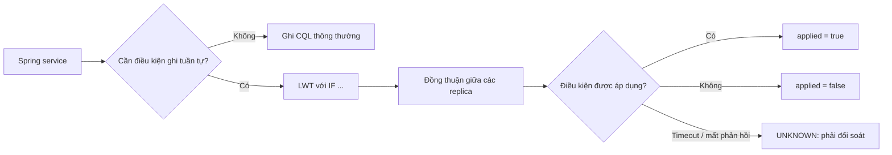
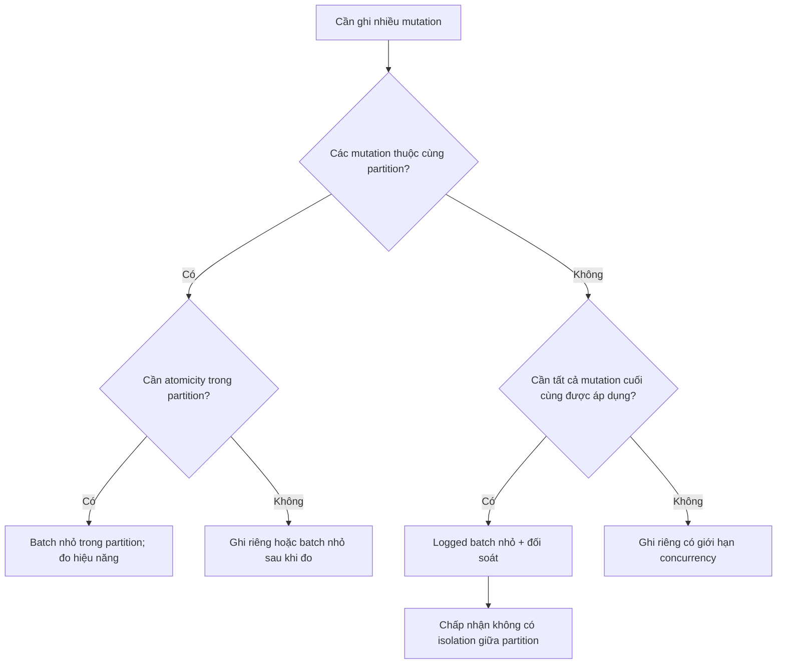
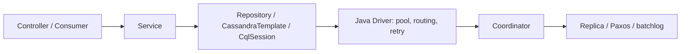

# Đánh giá chi phí LWT, batch qua nhiều partition và mức nhất quán trong Spring Data Cassandra

Khi sử dụng **Spring Data Cassandra** để lưu dữ liệu vào **Apache Cassandra**, ba lựa chọn thường làm thay đổi rõ rệt độ trễ và khả năng chịu tải là:

1. Dùng **lightweight transaction (LWT)** như `INSERT ... IF NOT EXISTS` hay `UPDATE ... IF ...` để thực hiện ghi có điều kiện.
2. Gom nhiều câu lệnh vào **CQL BATCH**, đặc biệt khi chúng chạm tới **nhiều partition key**.
3. Chọn **consistency level (CL)** cho đọc/ghi, ví dụ `LOCAL_ONE`, `LOCAL_QUORUM` hoặc `ALL`.

Ba lựa chọn này không chỉ ảnh hưởng đến hiệu năng. Mỗi lựa chọn còn tạo ra một **cam kết đúng đắn khác nhau**. Mục tiêu của bài là biết khi nào đáng trả thêm chi phí mạng/CPU/độ trễ cho LWT, khi nào batch thực sự có ích, và phải đo/so sánh CL thế nào trước khi quyết định cấu hình production. Nội dung gắn với phạm vi Spring Data Cassandra: entity mapping, repository, `CassandraTemplate`, CQL, **thiết kế bảng theo truy vấn**, partition key, tính nhất quán, paging và kiểm soát hiệu năng trên hệ phân tán.

## 1. Xác định yêu cầu đúng đắn trước khi tối ưu

Giả sử ứng dụng nhận yêu cầu tạo đơn hàng. Giao diện cần tra cứu đơn theo `order_id` và liệt kê đơn gần đây theo `customer_id`. Cassandra thường yêu cầu **hai bảng được thiết kế cho hai truy vấn**:

```sql
CREATE TABLE orders_by_id (
    order_id uuid PRIMARY KEY,
    customer_id uuid,
    created_at timestamp,
    status text
);

CREATE TABLE orders_by_customer (
    customer_id uuid,
    created_at timestamp,
    order_id uuid,
    status text,
    PRIMARY KEY ((customer_id), created_at, order_id)
) WITH CLUSTERING ORDER BY (created_at DESC, order_id ASC);

CREATE TABLE request_claim_by_id (
    request_id uuid PRIMARY KEY,
    payload_hash text,
    state text
);
```

- `orders_by_id` cho phép lấy một đơn bằng `order_id` (partition key).
- `orders_by_customer` cho phép liệt kê theo một khách hàng mà không quét toàn bảng.
- `request_claim_by_id` có thể dùng để chống tiếp nhận trùng một yêu cầu bằng LWT trên **một khóa cố định**.

Việc một đơn được ghi vào hai bảng làm xuất hiện bài toán cập nhật nhiều partition. Nhưng không phải cứ có hai câu `INSERT` thì nên đặt chúng trong một batch: cần quyết định **yêu cầu atomicity, khả năng nhìn thấy dữ liệu tạm thời, và cách khắc phục khi một phần ghi thất bại**.

### Bốn câu hỏi dẫn đường

| Câu hỏi nghiệp vụ | Tính chất cần có | Cơ chế Cassandra nên cân nhắc |
|---|---|---|
“Ghi đè trạng thái đơn bằng dữ liệu mới” | Upsert có thể thực hiện lại | Ghi CQL thông thường, chọn CL theo SLA. |
“Chỉ tạo yêu cầu nếu mã này chưa tồn tại” | Điều kiện được xét tuần tự trên khóa | LWT `IF NOT EXISTS`, cùng `request_id` cho mọi retry. |
“Các bảng truy vấn phải cuối cùng nhận đủ thay đổi của một lệnh” | Ghi nhiều partition với bảo đảm áp dụng cuối cùng | Có thể cân nhắc **logged batch nhỏ**; vẫn phải thiết kế đối soát và chấp nhận không có isolation giữa bảng. |
“Nhiều hệ thống phải commit đồng thời và rollback cùng nhau” | Transaction ACID xuyên Cassandra và dịch vụ ngoài | LWT và CQL BATCH **không đáp ứng**; cần thiết kế workflow, idempotency, outbox/saga hoặc cơ chế khác. |

Hãy dùng yêu cầu nghiệp vụ làm **tiêu chí đánh giá**. Một benchmark ghi đơn hàng nhanh hơn nhưng làm lộ đơn thiếu dữ liệu hoặc nhân đôi thanh toán không thể coi là tối ưu thành công.

## 2. LWT: chi phí của ghi có điều kiện

### 2.1. LWT bảo đảm điều gì?

CQL hỗ trợ **conditional mutation**:

```sql
INSERT INTO request_claim_by_id (request_id, payload_hash, state)
VALUES (?, ?, 'RECEIVED')
IF NOT EXISTS;
```

Ở lần thành công đầu tiên, Cassandra trả cột đặc biệt `[applied] = true`. Nếu bản ghi đã tồn tại, điều kiện không được áp dụng và `[applied] = false`. Điều này giúp nhiều client cùng tranh chấp **cùng một khóa** không đồng thời thắng điều kiện tạo đầu tiên.

LWT dựa trên **giao thức đồng thuận Paxos** trong Cassandra truyền thống. So với ghi thường, nó phải thực hiện thêm các bước trao đổi/đồng thuận với replica để kiểm tra và thống nhất điều kiện trước khi cam kết thay đổi. Vì vậy LWT thường có:

- Nhiều lượt trao đổi mạng hơn và latency cao hơn ghi thường.
- Thêm công việc cho coordinator và replica.
- Chi phí **contention** khi nhiều request tranh cùng partition/điều kiện, có thể cần thử lại trong giao thức đồng thuận.
- Tỷ lệ thông lượng thấp hơn khi cùng cluster bị giới hạn bởi round trip, CPU, coordinator hoặc tranh chấp.

Chi phí **không có một hệ số cố định** kiểu “LWT chậm gấp N lần”. Nó phụ thuộc phiên bản Cassandra, RF, topology, latency mạng, tải, kích thước row, dữ liệu và tỷ lệ tranh chấp. Cần đo trên hệ thống đủ giống production.



**Phạm vi bảo đảm:** LWT thích hợp cho điều kiện trên partition đang thao tác. Nó không tự tạo transaction nguyên tử xuyên nhiều partition, bảng hay API bên ngoài. Một `IF NOT EXISTS` thành công ở `request_claim_by_id` không đồng nghĩa các hàng trong `orders_by_id` và `orders_by_customer` đã được ghi xong.

### 2.2. Serial consistency và regular consistency là hai khía cạnh khác nhau

Khi chạy LWT, cần xét cả:

- **Serial consistency** (`SERIAL` hoặc `LOCAL_SERIAL`): liên quan pha đồng thuận của thao tác có điều kiện. `LOCAL_SERIAL` giới hạn phạm vi pha serial vào datacenter cục bộ; lựa chọn phải phù hợp replication, yêu cầu đa datacenter và mô hình truy cập.
- **Regular consistency** (ví dụ `LOCAL_QUORUM`): điều chỉnh mức xác nhận của pha ghi/đọc thông thường gắn với request.

Không thể xem `LOCAL_SERIAL` như cách viết khác của `LOCAL_QUORUM`. Chúng phục vụ hai mục đích khác nhau và được cấu hình riêng trên statement/driver.

Ví dụ với **Java Driver 4.x** được Spring quản lý:

```java
import java.util.UUID;

import com.datastax.oss.driver.api.core.CqlSession;
import com.datastax.oss.driver.api.core.DefaultConsistencyLevel;
import com.datastax.oss.driver.api.core.cql.BoundStatement;
import com.datastax.oss.driver.api.core.cql.PreparedStatement;
import com.datastax.oss.driver.api.core.cql.Row;
import org.springframework.stereotype.Service;

@Service
public class RequestClaimService {
    private final CqlSession session;
    private final PreparedStatement claimStatement;

    public RequestClaimService(CqlSession session) {
        this.session = session;
        this.claimStatement = session.prepare(
            "INSERT INTO request_claim_by_id " +
            "(request_id, payload_hash, state) " +
            "VALUES (?, ?, ?) IF NOT EXISTS");
    }

    public boolean tryClaim(UUID requestId, String payloadHash) {
        BoundStatement statement = claimStatement
            .bind(requestId, payloadHash, "RECEIVED")
            .setConsistencyLevel(DefaultConsistencyLevel.LOCAL_QUORUM)
            .setSerialConsistencyLevel(DefaultConsistencyLevel.LOCAL_SERIAL);

        Row result = session.execute(statement).one();
        if (result == null) {
            throw new IllegalStateException("Missing LWT result");
        }
        return result.getBoolean("[applied]");
    }
}
```

Đoạn code minh họa đường CQL rõ ràng. `CassandraRepository.save(entity)` và `CassandraTemplate.insert(entity)` thông thường là thao tác lưu dữ liệu; **không tự trở thành LWT** chỉ vì gọi qua Spring Data. Khi cần CAS, hãy sử dụng thao tác có điều kiện mà phiên bản Spring Data hỗ trợ hoặc thực thi CQL điều kiện qua `CqlSession`.

Khi nhận `[applied] = false`, phải đọc và kiểm tra giá trị đã tồn tại nếu định trả lời “yêu cầu này đã được xử lý”. Cùng `request_id` nhưng khác `payload_hash` là **xung đột**, không phải retry thành công. Đồng thời, **timeout sau LWT có thể là kết quả chưa xác định**, vì điều kiện có thể đã được áp dụng nhưng phản hồi không về client. Không tạo request ID mới khi thử lại; cần đối soát theo khóa ban đầu.

### 2.3. Khi nào chi phí LWT đáng trả?

**Nên cân nhắc LWT** khi cần loại trừ tranh chấp thực sự: một mã yêu cầu chỉ được claim một lần, phân bổ slot giới hạn, chuyển trạng thái theo phiên bản điều kiện, hoặc bảo vệ một ràng buộc trên khóa được thiết kế phù hợp. Phải kiểm tra câu điều kiện có thực sự bao phủ **cùng partition/khóa** mà các writer cạnh tranh hay không.

**Không nên dùng LWT làm mặc định cho mọi ghi** nếu upsert thông thường đã đủ: ghi telemetry, cập nhật event bất biến bằng ID cố định, lưu bảng truy vấn có thể tái xây dựng. LWT trên **hot partition** có thể trở thành cổ chai ngay cả khi các request còn lại rất nhẹ.

## 3. CQL BATCH: gom câu lệnh không đồng nghĩa tăng tốc hàng loạt

### 3.1. Batch trong cùng partition và batch qua nhiều partition

Xét hai hoạt động ghi:

**Cùng partition key:** nhiều thay đổi đến hàng thuộc **cùng partition**. Cassandra có thể xử lý hiệu quả hơn việc gởi nhiều request riêng tùy trường hợp, và một batch unlogged trong cùng partition có bảo đảm atomicity ở phạm vi partition. Vẫn nên đo kích thước mutation thực tế thay vì mặc định batch luôn nhanh hơn.

**Khác partition key:** ví dụ ghi `orders_by_id` theo `order_id` và `orders_by_customer` theo `customer_id`. Các partition có thể nằm trên **những tập replica khác nhau**; coordinator phải phân phối nhiều mutation và có thể phát sinh tải mạng/CPU tập trung.

```sql
BEGIN LOGGED BATCH
    INSERT INTO orders_by_id (order_id, customer_id, created_at, status)
    VALUES (11111111-1111-1111-1111-111111111111,
            22222222-2222-2222-2222-222222222222,
            '2026-01-01T10:00:00Z', 'CREATED');

    INSERT INTO orders_by_customer
      (customer_id, created_at, order_id, status)
    VALUES (22222222-2222-2222-2222-222222222222,
            '2026-01-01T10:00:00Z',
            11111111-1111-1111-1111-111111111111, 'CREATED');
APPLY BATCH;
```

Đây là **hai partition ở hai bảng khác nhau**, cho dù cùng phục vụ một đơn hàng.

### 3.2. Logged và unlogged batch khác nhau thế nào?

| Thuộc tính | `BEGIN LOGGED BATCH` | `BEGIN UNLOGGED BATCH` |
|---|---|---|
| Cơ chế | Với batch chạm nhiều partition, coordinator dùng **batchlog** để hỗ trợ hoàn tất các mutation nếu xảy ra sự cố. | Không có batchlog cho bảo đảm hoàn tất giữa các partition. |
| Đảm bảo khi chạm nhiều partition | Các mutation của batch có tính **atomicity theo nghĩa cuối cùng được áp dụng đầy đủ**, không có isolation giao dịch tức thời. | Có thể chỉ áp dụng được một phần khi lỗi; không có atomicity xuyên partition. |
| Chi phí | Thêm ghi/trao đổi liên quan batchlog và phân phối tới nhiều replica; thường tăng latency và tải. | Tránh chi phí batchlog nhưng vẫn có fan-out/network/coordinator overhead. |
| Phù hợp | Nhóm nhỏ các mutation có quan hệ nghiệp vụ, thực sự cần bảo đảm áp dụng cuối cùng. | Các mutation trong cùng partition; hoặc trường hợp chấp nhận xử lý độc lập và đã đo rõ lợi ích. |
| Không phù hợp | Dùng thay batch import hàng nghìn partition hoặc thay transaction ACID xuyên dịch vụ. | Dùng để “cam kết cùng lúc” nhiều partition; batch lớn lấy cớ giảm số lệnh API. |

**Logged batch không có isolation xuyên partition.** Một reader có thể nhìn thấy bảng thứ nhất đã đổi trong khi bảng thứ hai chưa đổi; khi lỗi, batchlog có thể phát lại để hoàn tất, và tiến trình phục hồi không tức thời. Nó cũng không đưa ra khả năng rollback tổng quát nếu workflow ngoài Cassandra thất bại. Thời điểm client nhận lỗi không đủ để khẳng định các mutation chưa/đã áp dụng; cần thiết kế retry idempotent và đối soát.

**Unlogged batch qua nhiều partition không bảo đảm atomicity.** Nếu có cảnh báo “batch spanning multiple partitions” hoặc batch lớn, đừng giải quyết bằng cách bỏ logging rồi tiếp tục gộp toàn bộ workload. Cần xem lại thiết kế bảng và cách gửi request.

### 3.3. Vì sao batch lớn thường làm chậm?

Một batch ghi vào hàng trăm partition không biến các partition đó thành một thao tác lưu trữ tuần tự. Hệ thống vẫn phải định tuyến và ghi vào các replica phù hợp. Batch càng lớn càng có thể:

- Dồn tải và chiếm bộ nhớ tại coordinator.
- Tăng thời gian chờ, kích thước mutation và tải trên đường mạng.
- Tăng chi phí batchlog khi batch có logging.
- Làm nhiều request khác bị chậm do tranh CPU, connection và hàng đợi.
- Gây cảnh báo giới hạn kích thước batch, thậm chí bị từ chối nếu vượt ngưỡng cấu hình.

Khi cần nhập lượng lớn dữ liệu **không cần atomicity giữa các partition**, nên chia thành các lệnh ghi riêng theo khóa, dùng prepared statements và **đồng thời có giới hạn** (bounded concurrency), theo dõi backpressure. Nhóm theo partition có thể có ích, nhưng chỉ nên batch khi loại mutation và yêu cầu đúng đắn phù hợp.



### 3.4. Batch và LWT không tự kết hợp thành transaction tổng quát

CQL hỗ trợ một số **conditional batch** nhưng có hạn chế đối với phạm vi partition và cấu trúc điều kiện. Không thể giả định rằng ghép `IF NOT EXISTS` vào batch của hai bảng khác partition sẽ được Cassandra xử lý như transaction serializable toàn cục. Nếu nghiệp vụ phải đảm bảo “claim request rồi cập nhật nhiều view”, cần tách **điểm quyết định duy nhất** (ví dụ LWT tại request ID) và **quy trình hoàn tất/đối soát các view**. Khi có lỗi, trạng thái workflow phải đủ để tiếp tục cùng yêu cầu, không thực thi lại tác dụng phụ thiếu idempotency.

## 4. Consistency level: đổi độ trễ lấy mức xác nhận

Một mutation ghi qua coordinator được gửi đến các replica sở hữu partition. **Write CL** cho biết bao nhiêu replica phải xác nhận trước khi request được coi thành công; **read CL** mô tả yêu cầu phản hồi của lượt đọc. Ví dụ một keyspace dùng `NetworkTopologyStrategy` với **RF = 3 full replicas trong datacenter cục bộ**:

| CL | Ghi cần bao nhiêu ACK cục bộ (RF=3) | Tác động điển hình |
|---|---:|---|
| `LOCAL_ONE` | 1 | Thường có đường thành công nhanh hơn, chịu được việc nhiều replica chưa phản hồi; mức xác nhận thấp hơn. |
| `LOCAL_QUORUM` | 2 | Chờ quorum trong local DC, tăng yêu cầu về replica đáp ứng. |
| `ALL` | 3 (với RF=3 như giả định) | Chờ mọi replica cần thiết, nhạy hơn với replica chậm/mất kết nối. |

Mốc 1/2/3 chỉ đúng với giả định RF và topology cụ thể. Trong nhiều datacenter, cần phân biệt `QUORUM` với `LOCAL_QUORUM` và cấu hình **local datacenter** chính xác cho Java Driver.

Với RF=3, quorum là `floor(3/2)+1 = 2`. Một cặp đọc/ghi cùng datacenter có tổng yêu cầu replica `R + W > RF` (ví dụ đọc `LOCAL_QUORUM` và ghi `LOCAL_QUORUM`: 2+2>3) tạo tập replica giao nhau trong mô hình phù hợp. Tuy nhiên, điều này **không biến mọi lượt đọc/ghi thành transaction tuần tự hóa**; concurrent writes, timestamp, last-write-wins và nhiều datacenter vẫn phải được xem xét.

### Những đánh đổi thực tế

- **Latency:** CL cao có thể phải chờ replica chậm hơn; ảnh hưởng đặc biệt rõ ở **p95/p99**.
- **Availability:** khi replica cần thiết không hoạt động, CL cao có thể trả `UnavailableException` hoặc timeout; CL thấp hơn có thể vẫn phục vụ được.
- **Độ mới dữ liệu:** CL thấp có thể đọc một replica chưa bắt kịp thay đổi. Với yêu cầu đọc ngay sau ghi, cần thiết kế phối hợp CL và xem xét concurrent writes.
- **Khả năng chịu tải:** tăng số ACK có thể làm lộ bottleneck replica/đường mạng sớm hơn; không có một CL tốt cho tất cả API.

Đừng tự hạ CL khi thấy timeout nếu điều đó làm mất bảo đảm nghiệp vụ. Hãy tìm nguyên nhân: replication, phân bố dữ liệu, hotspot, GC, I/O, traffic hay network. Cassandra vẫn là hệ cuối cùng có thể phục hồi replica qua các cơ chế sửa chữa/đồng bộ, nhưng CL không thay thế quy trình chống ghi trùng hoặc đối soát.

### Timeout không đồng nghĩa ghi chưa diễn ra

Ở bất kỳ CL nào, phản hồi từ coordinator có thể bị trễ/mất sau khi một số replica đã ghi dữ liệu. `WriteTimeoutException`, lỗi kết nối hoặc timeout ở driver có thể để lại **unknown write outcome**. Khi đo hiệu năng, ghi riêng **tỉ lệ thành công**, **timeout**, **lỗi**, **số lần retry**; không chỉ tính throughput của các request đã thành công và bỏ qua các yêu cầu còn trạng thái chưa xác định.

## 5. So sánh LWT, batch và consistency level trên cùng trục chi phí

| Cơ chế | Điều giải quyết | Chi phí quan trọng | Cạm bẫy |
|---|---|---|---|
| Ghi thường `INSERT/UPDATE`, `LOCAL_ONE` | Upsert cần mức ACK thấp trong local DC | Một lần phối hợp ghi và ACK mức thấp, tùy tải | Có thể đọc dữ liệu chưa cập nhật ở replica khác; thiếu điều kiện chống tranh chấp. |
| Ghi thường, `LOCAL_QUORUM` | Upsert cần xác nhận quorum cục bộ | Chờ nhiều replica hơn | Không ngăn lost update giữa writer đồng thời. |
| LWT `IF NOT EXISTS`, regular `LOCAL_QUORUM` và serial `LOCAL_SERIAL` | Claim có điều kiện trên khóa | Đồng thuận, nhiều lượt mạng, contention | Không bao trùm cả workflow/bảng khác; timeout vẫn có thể unknown. |
| Logged batch **nhỏ**, nhiều partition | Các mutation cùng batch cuối cùng được áp dụng đầy đủ | Batchlog, fan-out, tải coordinator | Không isolation/rollback transaction giữa nhiều partition. |
| Unlogged batch, nhiều partition | Giảm chi phí giao thức từ góc nhìn client trong một số trường hợp | Fan-out và rủi ro partial writes | Không atomicity cross-partition; có thể chậm hơn ghi riêng. |
| Nhiều prepared writes riêng, có giới hạn song song | Nhập dữ liệu vào nhiều partition độc lập | Số request và áp lực concurrency cần kiểm soát | Không có atomicity giữa các lệnh; cần retry/idempotency. |

Trong hệ thống thực, một request có thể vừa dùng LWT vừa ghi nhiều bảng. Khi đánh giá tổng chi phí, phân tách latency theo **claim → ghi dữ liệu chính → cập nhật bảng phục vụ truy vấn → phản hồi**, vì nếu chỉ nhìn latency của lệnh `save` sẽ bỏ sót phần workflow đắt nhất.

## 6. Thiết kế benchmark có khả năng ra quyết định

### 6.1. Cố định môi trường và giả thuyết

Không có ý nghĩa nếu so sánh LWT trên cluster ba node với upsert trên Cassandra một node, hoặc so `LOCAL_QUORUM` ở datacenter gần với `LOCAL_ONE` ở vùng mạng khác.

Ghi lại tối thiểu:

| Biến kiểm soát | Ví dụ cấu hình benchmark |
|---|---|
| Cassandra, Java Driver, Spring Data | Ghi **phiên bản thực tế**, không để “latest” không rõ. |
| Topology | 3 node, một datacenter, cùng loại máy và network; bổ sung kịch bản đa DC nếu production dùng. |
| Replication | RF=3, full replicas, keyspace và schema giống nhau giữa các nhánh so sánh. |
| Mô hình dữ liệu | Kích thước row, số row/partition, clustering key, TTL/tombstone và số partition được đo. |
| Workload | Tỉ lệ read/write, số key mới/cũ, phân bố hot key, tỷ lệ LWT trúng/thất bại điều kiện. |
| Client | Cùng service JVM, connection pool, prepared statements, timeout, retry policy, số kết nối đang dùng. |
| Tải | Request/s mục tiêu hoặc concurrency cố định, thời gian warm-up và cửa sổ đo ổn định. |
| CL | Cố định CL cho các phép so cùng ngữ nghĩa; khi khảo sát CL thì chỉ thay CL. |

Benchmark này phải chạy **Cassandra thực**, không dùng mock repository hay H2 rồi suy ra hiệu năng LWT/batch. Testcontainers phù hợp để kiểm thử tích hợp và tính đúng đắn; quyết định năng lực chịu tải nên dựa vào môi trường topology gần production.

### 6.2. Các phép thử nên tách riêng

1. **Upsert thường, cùng schema và dữ liệu:** so `LOCAL_ONE` với `LOCAL_QUORUM` rồi cân nhắc `ALL` nếu nghiệp vụ cần. Phép thử này cô lập ảnh hưởng của CL.
2. **LWT không tranh chấp:** các request dùng key riêng, chủ yếu `[applied]=true`. So với ghi thường để thấy chi phí CAS trong điều kiện thuận lợi.
3. **LWT tranh chấp:** nhiều request dùng **cùng key**, hoặc một phần nhỏ key nóng; đo contention, timeout, tỷ lệ `[applied]=false` và retry. Phân biệt điều kiện không thỏa với lỗi kỹ thuật.
4. **Logged batch qua hai partition:** hai mutation trên hai bảng, kích thước nhỏ và cố định; so với hai lệnh thường gửi riêng. Các cách này **khác cam kết atomicity**, nên không diễn giải kết quả chỉ dựa vào p99.
5. **Batch tăng số partition:** lặp với số partition/batch tăng dần để quan sát ngưỡng latency, memory, cảnh báo và throughput. Đừng đẩy kích thước đến mức ảnh hưởng môi trường chia sẻ.
6. **Nhiều ghi độc lập có bounded concurrency:** thay batch lớn bằng prepared statements, cùng số mutation thực tế; so sánh thông lượng cuối cùng và tỉ lệ lỗi.
7. **Đọc sau ghi:** kiểm tra dữ liệu hiển thị dưới CL đọc cụ thể và khi một replica chậm/ngắt; không chỉ đo ghi.

**Tách throughput khỏi concurrency.** Tăng số request đồng thời có thể đẩy throughput cao hơn đến một ngưỡng, nhưng sau đó p99, hàng đợi và timeout tăng mạnh. Cần quét nhiều mức tải, xác định ngưỡng cluster đạt SLA chứ không chỉ tìm đỉnh throughput trong một phép đo ngắn.

### 6.3. Những chỉ số phải thu thập

| Nhóm | Chỉ số nên đo | Đọc kết quả thế nào? |
|---|---|---|
| Từ client | p50, p95, p99 latency theo **từng loại thao tác** | Phát hiện tail latency của LWT, batch và CL cao. |
| Kết quả request | Success, `[applied]=false`, timeout, unavailable, driver errors | Không nhầm condition-not-met với server failure. |
| Retry | Số attempt/operation, retry rate, exhausted retries | Throughput “request” có thể che việc gửi nhiều CQL attempt. |
| Khả năng chịu tải | Mutations/s, requests/s, concurrency, queue depth | Batch chứa nhiều mutation; không so trực tiếp requests/s giữa hai phương án. |
| Coordinator/replica | CPU, heap, GC, network, disk I/O, pending tasks | Tìm node nóng hoặc chi phí phân phối batch. |
| Cassandra | Read/write latency, CAS/LWT latency, contention, batch warnings, dropped messages | Phân biệt bottleneck Paxos, batchlog và storage. |
| Đúng đắn | Số record thiếu/trùng, view lệch, thời gian đối soát | Hiệu năng cao hơn không biện minh cho sai lệch nghiệp vụ. |

Với batch, hai chỉ số thường bị nhầm:

- **Batch requests/s:** số câu `BEGIN ... BATCH ... APPLY` hoàn thành mỗi giây.
- **Logical mutations/s:** tổng số câu ghi/row mutation hữu ích mỗi giây.

Một batch chứa 50 mutation và một request đơn chứa 1 mutation không thể so trực tiếp theo requests/s mà bỏ qua độ lớn công việc và atomicity khác nhau.

### 6.4. Mẫu kết quả benchmark để điền

Giữ cùng điều kiện môi trường và thể hiện số đo **thực tế** sau khi chạy:

| Workload | CL thường | CL serial | p95 (ms) | p99 (ms) | Mutation/s | Lỗi/timeout (%) | Ghi chú |
|---|---|---|---:|---:|---:|---:|---|
| Upsert 1 partition | LOCAL_ONE | — | đo | đo | đo | đo | Baseline. |
| Upsert 1 partition | LOCAL_QUORUM | — | đo | đo | đo | đo | Cô lập chi phí CL. |
| LWT key phân tán | LOCAL_QUORUM | LOCAL_SERIAL | đo | đo | đo | đo | Ghi rõ applied true/false. |
| LWT hot key | LOCAL_QUORUM | LOCAL_SERIAL | đo | đo | đo | đo | Ghi contention. |
| Logged batch 2 partition | LOCAL_QUORUM | — | đo | đo | đo | đo | Batchlog và fan-out. |
| 2 ghi riêng có giới hạn song song | LOCAL_QUORUM | — | đo | đo | đo | đo | Không cùng atomicity. |

Giá trị “đo” trong bảng là **ô cần thu thập**, không phải kết quả hay cam kết tốc độ. Sau đó đối chiếu cùng yêu cầu độ trễ và mức đúng đắn. Ví dụ: nếu LWT là điều kiện bắt buộc để chống claim trùng thì tối ưu nên tập trung vào tránh tranh chấp, giảm số CAS và shard dữ liệu phù hợp — không loại bỏ điều kiện chỉ vì baseline upsert nhanh hơn.

## 7. Đo đúng trong ứng dụng Spring Data Cassandra

### 7.1. Phân biệt chi phí framework, driver và Cassandra

Luồng điển hình:



Độ trễ end-to-end có thể gồm validation, mapping entity, serialization, queueing ở app, round trip driver, coordinator, replica và retry. Để xác định nguyên nhân, gắn metric/tracing ở **service operation** và thu thêm metric driver/server. Không nên kết luận “Spring Data chậm” chỉ vì một endpoint dùng LWT chậm hơn endpoint khác dùng `repository.save`.

### 7.2. Đặt tên metric theo thao tác và tránh cardinality cao

Nên phân biệt các nhóm như `order.upsert`, `request.claim_lwt`, `order.views_logged_batch`, tag kết quả `applied`/`not_applied`/`timeout` và loại CL đang thử. **Không gắn** `request_id`, `order_id`, `partition_key` hay full CQL vào tag metric vì cardinality tăng không kiểm soát. ID có thể đặt vào trace/log theo quy định bảo mật và sampling phù hợp.

Ví dụ dùng `CqlSession` cho một lời gọi LWT rồi đo thời gian qua service:

```java
long started = System.nanoTime();
try {
    boolean applied = requestClaimService.tryClaim(requestId, payloadHash);
    // Ghi metric kết quả "applied" hoặc "not_applied".
    return applied;
} finally {
    long elapsedNanos = System.nanoTime() - started;
    // Ghi elapsedNanos vào timer theo operation và CL.
    // Không đưa requestId vào metric tag.
}
```

Với tác vụ reactive, phải đo từ lúc subscribe tới lúc có kết quả thực tế, không chỉ đo thời gian xây dựng `Mono`/`Flux`. Với `Slice`, `CassandraPageRequest` và paging theo cursor, việc iterate toàn bộ các trang cũng phát sinh nhiều request: tổng latency của endpoint còn phụ thuộc fetch size và số trang. Khi so LWT/batch/CL, giữ điều kiện paging tương đương hoặc đo riêng phần đọc để tránh nhầm.

### 7.3. Tách retry, timeout và kết quả chưa xác định

Một request gặp timeout có thể đã được ghi tại một phần hoặc đủ replica nhưng phản hồi đến ứng dụng bị mất. Tương tự, LWT có thể áp dụng điều kiện thành công rồi client mất phản hồi; logged batch có thể còn hoàn tất nhờ batchlog sau khi caller hết thời gian chờ.

Khi triển khai retry ở driver hoặc Spring (ví dụ `@Retryable` / Reactor `retryWhen`), chỉ tự thử lại khi thao tác **thực sự idempotent**, có giới hạn attempt và backoff/jitter. Đừng coi `setIdempotent(true)` là một phép biến mọi thao tác thành an toàn: nó chỉ mô tả một tính chất do ứng dụng cam kết. Đo **tác dụng nghiệp vụ** sau retry, không chỉ đếm response thành công.

## 8. Thí nghiệm đúng đắn cần chạy song song với benchmark

Kiểm thử hiệu năng nên đi cùng những bài test sau:

| Kịch bản | Điều cần xác minh |
|---|---|
| Hai client `INSERT ... IF NOT EXISTS` cùng `request_id` | Chỉ một request claim đầu tiên được áp dụng; request còn lại quan sát điều kiện không thỏa hoặc trạng thái chưa xác định cần đối soát. |
| Hai client cùng request ID nhưng `payload_hash` khác | Không chấp nhận payload thứ hai như yêu cầu giống hệt; báo conflict. |
| Coordinator hoặc đường mạng lỗi sau khi gửi LWT | Caller không tạo request ID mới; có thể đọc/truy vấn lại trạng thái. |
| Logged batch ghi hai bảng rồi mất kết nối | Xác nhận chính sách phục hồi/đối soát, không giả định hai bảng luôn hiện ra cùng thời điểm. |
| Unlogged batch nhiều partition gặp node lỗi | Ứng dụng nhận diện được khả năng partial writes và xử lý theo quy trình riêng. |
| Một replica chậm khi ghi `LOCAL_QUORUM` so với `LOCAL_ONE` | Quan sát latency, tỉ lệ timeout/availability thực tế khi thay CL. |
| Hot partition chịu concurrent LWT | Đo p95/p99, contention, retry; phát hiện bottleneck từ thiết kế partition. |
| Ghi và đọc hai bảng theo các mức CL dự kiến | Đảm bảo API không hứa consistency mạnh hơn mức Cassandra thực tế cung cấp. |

Không dùng bài test trên **một Cassandra container** để kết luận về failover nhiều replica hoặc Paxos ở topology thật. Container đơn có ích cho chức năng mapping/conditional result; bài đo phân tán cần môi trường nhiều node và topology được ghi rõ.

## 9. Cách chọn giải pháp theo từng nhu cầu

**Trường hợp A — Event log bất biến, ID đã sinh ổn định.** Upsert/insert thông thường vào bảng được partition theo truy vấn, CL lựa chọn theo mức xác nhận/đọc lại cần thiết. Tránh LWT nếu nghiệp vụ không cần CAS.

**Trường hợp B — Nhận một request tạo đơn duy nhất.** Dùng `request_id` bất biến và LWT `IF NOT EXISTS` trên bản ghi claim. Sau đó xử lý workflow bằng các bước có thể retry và đối soát. Điều này tránh trả chi phí LWT trên mọi bản ghi view.

**Trường hợp C — Cập nhật một số hàng trong cùng partition.** Cân nhắc batch nhỏ nếu cần atomicity ở partition, đo với ghi riêng và xác minh không làm partition phình quá lớn.

**Trường hợp D — Ghi hai bảng denormalized thuộc hai partition.** Chọn logged batch **chỉ khi** bảo đảm hoàn tất toàn bộ mutation theo nghĩa cuối cùng là yêu cầu và chấp nhận chi phí batchlog/không isolation. Nếu các view có thể tái dựng từ nguồn dữ liệu chuẩn, có thể dùng các ghi idempotent riêng cùng cơ chế sửa dữ liệu.

**Trường hợp E — Import hàng triệu bản ghi vào hàng triệu partition.** Dùng các ghi riêng đã chuẩn bị, giới hạn concurrency, giới hạn kích thước payload và theo dõi backpressure. Không dùng batch khổng lồ như công cụ tăng tốc bulk load.

**Trường hợp F — Read-after-write nhạy cảm.** Thiết kế cặp CL ghi/đọc, RF và local DC phù hợp; kiểm thử đồng thời và vấn đề timestamp. LWT chỉ cần thiết nếu có **điều kiện ghi**, không phải chỉ vì muốn đọc được bản ghi ngay.

## 10. Checklist đánh giá trước khi đưa vào production

- [ ] Đã phân biệt rõ yêu cầu **đúng đắn**: upsert, conditional CAS, atomicity cuối cùng, isolation và transaction xuyên hệ thống.
- [ ] Truy vấn đi theo partition key và bảng phục vụ truy vấn; không dùng LWT/batch để che thiết kế dữ liệu không phù hợp.
- [ ] Mọi LWT có lý do nghiệp vụ, key tranh chấp xác định và xử lý `[applied] = false` đúng.
- [ ] Đã kiểm thử timeout LWT và ghi thường như **unknown outcome**; retry dùng khóa/payload cố định.
- [ ] Biết batch là logged hay unlogged, có bao nhiêu partition/mutation và vì sao cần gom.
- [ ] Không dùng unlogged cross-partition batch khi yêu cầu atomicity.
- [ ] Không lầm logged batch với isolation hoặc rollback ACID giữa nhiều bảng/dịch vụ.
- [ ] Đã ghi rõ CL thường, CL serial (nếu dùng LWT), RF và datacenter.
- [ ] Kết quả benchmark phân biệt **requests/s** với **mutations/s**, p95/p99, retry và error rate.
- [ ] Đã benchmark cả key phân tán lẫn hot key, các mức concurrency và các ngưỡng tải.
- [ ] Có số liệu coordinator/replica, CAS contention, batch warnings, network và I/O.
- [ ] Mọi thay đổi cấu hình đều được kiểm chứng bằng integration test đúng đắn và tải gần production.

**Kết luận:** Chi phí của LWT đến từ việc phải đồng thuận trước khi ghi có điều kiện; chi phí của batch qua nhiều partition đến từ phân phối mutation và, với logged batch, việc ghi batchlog; chi phí của consistency level cao hơn đến từ số replica phải xác nhận. Trong **Spring Data Cassandra**, hãy tối ưu theo **truy vấn, partition key và cam kết nghiệp vụ** trước, sau đó chọn cơ chế nhỏ nhất đáp ứng điều kiện đúng đắn và đo độ trễ, thông lượng, lỗi trên cluster phù hợp. Một giải pháp nhanh hơn chỉ đáng chọn khi vẫn giữ được các bảo đảm mà hệ thống cần.
