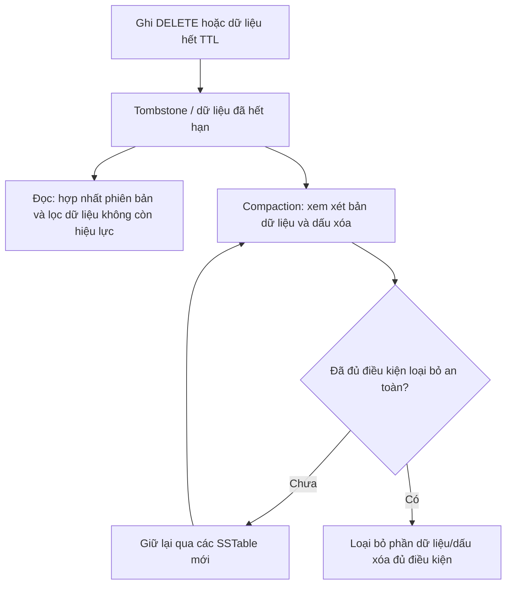
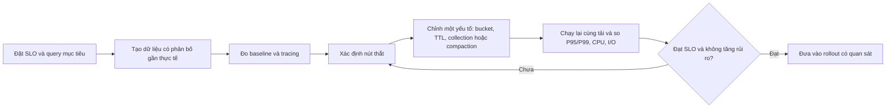

# Ảnh hưởng của tombstone, collection lớn và dữ liệu hết hạn

## 1. Vì sao một bảng có ít dữ liệu hiển thị vẫn có thể chậm?

Trong **Spring Data Cassandra**, repository, `CassandraTemplate` và `CqlSession` giúp ứng dụng đọc/ghi Cassandra thông qua entity mapping hoặc CQL. Tuy nhiên, thời gian trả lời truy vấn không chỉ phụ thuộc vào **số hàng còn nhìn thấy**. Cassandra là hệ cơ sở dữ liệu phân tán với cơ chế ghi vào memtable/SSTable và compaction. Các dấu xóa (**tombstone**), dữ liệu hết hạn (**TTL expiration**) và collection tăng không giới hạn có thể làm khối lượng công việc thực tế lớn hơn nhiều so với số bản ghi được trả về.

Ví dụ, một ứng dụng lưu lịch sử thông báo của người dùng. API chỉ yêu cầu 20 thông báo còn hiệu lực, nhưng phần lớn thông báo cũ đã hết TTL. Để tìm được 20 bản ghi sống, Cassandra có thể phải duyệt và bỏ qua nhiều dữ liệu đã hết hạn. Nếu toàn bộ lịch sử còn bị nhét trong một `list` lớn của một hàng, quá trình đọc, tuần tự hóa và cập nhật cũng trở nên tốn kém.

Bài học thuộc chương **Hiệu năng**, tập trung vào ba câu hỏi:

1. Tombstone hình thành, được đọc và được loại bỏ khi nào?
2. Vì sao `list`, `set`, `map` quá lớn gây áp lực lên heap, I/O, mạng và compaction?
3. Làm sao thiết kế bảng theo truy vấn, partition key, TTL và paging để tránh vấn đề ngay từ đầu?

Mục tiêu không phải xóa sạch mọi tombstone. Tombstone là thành phần cần thiết để Cassandra duy trì tính đúng đắn của thao tác xóa trên các replica. Điều cần tối ưu là **số tombstone phải quét trên mỗi truy vấn, kích thước partition và chi phí giữ dữ liệu đã hết hạn**.

## 2. Tombstone là gì?

Khi xóa dữ liệu, Cassandra không nhất thiết tìm và xóa vật lý mọi bản sao trong các SSTable ngay lập tức. Thay vào đó, một **tombstone** thể hiện rằng dữ liệu tương ứng đã bị xóa tại một timestamp nhất định. Dấu xóa này giúp replica vừa hoạt động trở lại biết rằng dữ liệu cũ không còn hợp lệ.

Các thao tác thường tạo hoặc dẫn đến tombstone gồm:

| Nguồn | Ví dụ | Điều cần lưu ý |
|---|---|---|
| Xóa hàng hoặc partition | `DELETE FROM event_by_user WHERE ...` | Tạo dấu xóa theo phạm vi khóa, được xét khi đọc/compaction. |
| Xóa cột hoặc phần tử collection | `DELETE labels['obsolete'] ...` | Ghi dấu xóa cho ô dữ liệu hoặc phần tử tương ứng. |
| Ghi `null` thông qua mapping hoặc CQL phù hợp | Cập nhật cột thành giá trị null | Trong Cassandra, null thường mang ý nghĩa xóa cột; cần xem cách mapper sinh CQL. |
| Giá trị có TTL hết hạn | `INSERT ... USING TTL 3600` | Dữ liệu không còn hiển thị sau thời điểm hết hạn; phần lưu trữ cũ còn phải được xử lý an toàn. |
| Ghi đè/xóa các phần tử trong collection | Thay thế hoặc xóa một phần của collection | Có thể làm tăng số ô/dấu xóa cần hợp nhất khi đọc. |

Ví dụ:

```sql
-- Xóa một hàng theo khóa đầy đủ.
DELETE FROM notification_by_user
WHERE user_id = ?
  AND notification_id = ?;

-- Ghi mới với thời hạn sống một giờ.
INSERT INTO notification_by_user (
    user_id, notification_id, message
) VALUES (?, ?, ?)
USING TTL 3600;
```

Ở lệnh thứ nhất, dấu xóa được ghi để các bản sao cũ không tự xuất hiện lại. Ở lệnh thứ hai, khi TTL hết, dữ liệu trở nên không còn hợp lệ theo thời gian; việc thu hồi không gian lưu trữ không diễn ra đồng thời với thời điểm hết hạn.

### 2.1. Luồng sống của một tombstone



**Điểm quan trọng:** “không còn xuất hiện khi `SELECT`” và “không còn chiếm chỗ trên đĩa” là hai mốc khác nhau. Một tombstone có thể tiếp tục tham gia công việc đọc hoặc compaction cho tới khi đủ điều kiện bị loại bỏ.

### 2.2. Tại sao không thể xóa tombstone ngay?

Cassandra phân phối bản sao dữ liệu. Giả sử một replica bị ngắt mạng:

1. Replica A và B có bản ghi `status = ACTIVE`.
2. Ứng dụng xóa bản ghi; replica A thấy thao tác xóa, nhưng replica B đang offline.
3. Nếu replica A loại bỏ tombstone quá sớm và replica B quay lại với giá trị cũ, giá trị đã xóa có thể được đưa trở lại trong quá trình đồng bộ.

Hiện tượng này thường được gọi là **zombie data**. Vì thế, việc loại bỏ tombstone liên quan đến thời gian giữ dấu xóa, quá trình repair và các điều kiện compaction; không thể coi tombstone là một loại rác an toàn để dọn ngay khi xuất hiện.

## 3. Tombstone ảnh hưởng hiệu năng truy vấn như thế nào?

Cassandra tối ưu truy vấn theo partition key và clustering key. Khi truy vấn một partition, hệ thống có thể phải đọc/hợp nhất thông tin từ memtable và nhiều SSTable, xét timestamp để quyết định dữ liệu nào còn hợp lệ rồi loại bỏ các ô hoặc hàng bị xóa.

Một truy vấn trả 20 dòng có thể quét nhiều hơn 20 dòng logic:

```text
Partition của user A (thứ tự đọc theo clustering key)
[đã hết TTL] [đã xóa] [sống] [đã hết TTL] [đã hết TTL]
[đã xóa] [sống] [đã xóa] ... [sống]

SELECT ... LIMIT 20
=> Phải tìm đủ 20 dòng sống; LIMIT không bảo đảm chỉ xét 20 vị trí.
```

Chi phí có thể xuất hiện ở:

- **CPU:** hợp nhất nhiều phiên bản của ô dữ liệu, kiểm tra tombstone và TTL.
- **I/O:** mở/đọc nhiều SSTable hoặc vùng dữ liệu để tìm các phần tử còn sống.
- **Bộ nhớ và cấp phát:** xử lý tập kết quả trung gian hoặc partition lớn.
- **Độ trễ cuối đuôi (P95/P99):** một số partition chứa nhiều tombstone hơn hẳn phần còn lại.
- **Compaction:** cần xử lý thêm dữ liệu đã xóa và các phiên bản cũ.
- **Tính sẵn sàng:** truy vấn quét quá nhiều tombstone có thể bị cảnh báo hoặc thất bại theo ngưỡng bảo vệ của phiên bản/cấu hình Cassandra.

Cassandra có các thiết lập như `tombstone_warn_threshold` và `tombstone_failure_threshold` ở những phiên bản hỗ trợ. Chúng cảnh báo hoặc giới hạn một số truy vấn quét quá nhiều tombstone; **không phải giới hạn tổng số tombstone được phép tồn tại trong bảng**. Giá trị và hành vi cụ thể cần kiểm tra trên phiên bản Cassandra đang vận hành.

### 3.1. Vì sao partition key quyết định mức độ ảnh hưởng?

Xét một bảng lưu thông báo với primary key `((user_id), created_at)`. Nếu một người dùng có hàng triệu thông báo, tất cả nằm trong cùng partition. Truy vấn các thông báo mới nhất có thể phải đối diện partition rộng và nhiều bản ghi đã xóa/hết hạn.

Nếu chia dữ liệu theo **user + bucket thời gian**, truy vấn theo từng khoảng thời gian sẽ có phạm vi rõ ràng hơn. Đổi lại, ứng dụng phải biết bucket cần đọc và có thể cần ghép kết quả từ nhiều bucket. Kích thước bucket cần dựa trên lưu lượng ghi, số lượng bản ghi và yêu cầu truy vấn; không có một số ngày hay số hàng tối ưu cho tất cả hệ thống.

### 3.2. Tombstone không phải nguyên nhân duy nhất của truy vấn chậm

Một truy vấn có thể chậm do hot partition, truy vấn phân vùng không phù hợp, nhiều SSTable, compaction backlog, tải CPU, nghẽn mạng, GC, consistency level hoặc retry. Việc nhìn thấy tombstone trong tracing **chưa đủ** để kết luận toàn bộ độ trễ do tombstone. Cần đối chiếu khối lượng tombstone quét, kích thước partition, kết quả trả về, hoạt động compaction và độ trễ thực tế.

## 4. Dữ liệu hết hạn theo TTL: đúng chức năng nhưng có chi phí

TTL giúp Cassandra tự coi dữ liệu đã hết hạn là không còn hiệu lực. TTL có thể đặt ở mức lệnh ghi hoặc mặc định cho bảng, tùy mô hình dữ liệu.

```sql
CREATE TABLE session_by_id (
    session_id uuid PRIMARY KEY,
    user_id uuid,
    state text
) WITH default_time_to_live = 86400;

-- Ghi với TTL 600 giây cho các giá trị được ghi bởi câu lệnh.
INSERT INTO session_by_id (session_id, user_id, state)
VALUES (?, ?, 'ACTIVE')
USING TTL 600;

-- Xem TTL còn lại của một cột còn tồn tại.
SELECT state, TTL(state)
FROM session_by_id
WHERE session_id = ?;
```

Trong ví dụ, `default_time_to_live = 86400` là TTL mặc định 24 giờ; `USING TTL 600` của câu lệnh ghi được dùng để đặt TTL cho dữ liệu được ghi theo câu lệnh đó. TTL tính bằng giây và được áp dụng cho các giá trị/cell phù hợp, không gắn vào thành phần primary key như một bộ đếm sống độc lập.

### 4.1. Ba thời điểm khác nhau

Giả sử ứng dụng ghi một sự kiện lúc 09:00, TTL là một giờ:

| Thời điểm | Trạng thái nghiệp vụ | Trạng thái lưu trữ có thể xảy ra |
|---|---|---|
| 09:00 | Sự kiện còn hiệu lực | Dữ liệu được ghi vào hệ thống lưu trữ. |
| 10:00 | Sự kiện hết TTL, không còn được trả về như dữ liệu sống | Dữ liệu hết hạn vẫn có thể còn trong SSTable. |
| Sau 10:00 | Sự kiện tiếp tục không hiển thị | Compaction loại bỏ dữ liệu/dấu xóa khi đáp ứng điều kiện an toàn. |

Không nên suy luận rằng “TTL một giờ” đồng nghĩa đĩa được giải phóng chính xác sau một giờ. Số byte trên đĩa còn phụ thuộc compaction strategy, tuổi SSTable, tỷ lệ dữ liệu đã hết hạn, sửa chữa replica và phân bố dữ liệu theo thời gian.

### 4.2. Ghi lại có thể làm thay đổi thời điểm hết hạn

```sql
UPDATE session_by_id
USING TTL 600
SET state = 'ACTIVE'
WHERE session_id = ?;
```

Nếu client phát lại lệnh sau timeout, TTL trên dữ liệu ghi lại có thể được tính lại từ lần ghi mới. Điều này có thể gia hạn phiên ngoài ý muốn. Nếu nghiệp vụ yêu cầu “hết hạn vào đúng 10:00”, hãy lưu **deadline tuyệt đối** và áp dụng quy tắc kiểm tra deadline khi đọc/xử lý; không chỉ dựa vào việc hai lần ghi có cùng nội dung.

### 4.3. TTL không thay thế mọi chính sách lưu trữ

TTL phù hợp với cache, sự kiện có thời hạn rõ ràng và dữ liệu cần tự hết hiệu lực. Nhưng cần cân nhắc:

- Các loại dữ liệu trong cùng bảng có cần TTL khác nhau không?
- Có sửa dữ liệu cũ hoặc ghi đến trễ làm xáo trộn nhóm SSTable không?
- Có yêu cầu truy xuất lịch sử, kiểm toán hoặc phục hồi sau khi hết TTL không?
- Việc đọc có thường xuyên quét qua dải thời gian dài chứa phần lớn dữ liệu đã hết hạn không?
- Có phù hợp để chia partition theo bucket hoặc chuyển dữ liệu lịch sử sang mô hình khác không?

TTL hạn chế tồn đọng dữ liệu sống về mặt logic; nó không sửa được partition key sai hoặc truy vấn phải duyệt nhiều dữ liệu cũ.

## 5. Collection lớn: vấn đề không chỉ là kích thước dữ liệu

Cassandra có các collection `list`, `set` và `map`. Chúng hữu ích khi một collection **nhỏ, có giới hạn rõ ràng** và được truy xuất cùng entity. Vấn đề xuất hiện khi ứng dụng dùng collection làm nơi tích lũy nhật ký, thông báo, lịch sử thay đổi hoặc toàn bộ danh sách theo thời gian.

Ví dụ thiết kế rủi ro:

```sql
CREATE TABLE user_activity_by_id (
    user_id uuid PRIMARY KEY,
    recent_actions list<text>,
    labels set<text>,
    attributes map<text, text>
);
```

Nếu `recent_actions` được nối phần tử mới liên tục mà không có giới hạn, một hàng có thể phình to qua thời gian.

### 5.1. Các loại collection có đặc điểm khác nhau

| Kiểu | Cách dùng hợp lý | Rủi ro khi tăng không giới hạn |
|---|---|---|
| `list<text>` | Danh sách thứ tự nhỏ, có giới hạn | Append/prepend kéo dài lịch sử, đọc nhiều ô, xóa phần tử có thể tạo tombstone; thao tác theo vị trí còn thêm chi phí truy cập. |
| `set<text>` | Một nhóm tag nhỏ, không trùng | Số phần tử quá lớn khiến đọc/so sánh/tồn trữ tốn kém; xóa phần tử tạo dấu xóa. |
| `map<text,text>` | Thuộc tính nhỏ, tương đối ổn định | Dùng key động cho từng sự kiện khiến map thành kho dữ liệu không giới hạn; xóa key và ghi đè phát sinh thêm công việc. |
| `frozen<...>` | Một giá trị composite nhỏ, cập nhật nguyên khối | Cassandra xem là giá trị đơn; thay đổi một phần thường cần ghi lại toàn bộ giá trị, không phù hợp với tập lớn thay đổi thường xuyên. |

Với collection **không frozen**, Cassandra có thể lưu các phần tử như nhiều cell. Chi phí không chỉ nằm ở số byte được trả về, mà còn ở số cell, metadata, phiên bản và tombstone phải xử lý. Với `frozen`, giá trị được quản lý như một đơn vị, nên không có lợi thế cập nhật riêng từng phần tử.

### 5.2. Xóa phần tử vẫn có thể sinh tombstone

```sql
UPDATE user_activity_by_id
SET labels = labels + {'spring-data', 'cassandra'}
WHERE user_id = ?;

-- Loại phần tử khỏi set.
UPDATE user_activity_by_id
SET labels = labels - {'deprecated'}
WHERE user_id = ?;

-- Loại phần tử khỏi map.
DELETE attributes['obsolete']
FROM user_activity_by_id
WHERE user_id = ?;
```

Gỡ phần tử khỏi collection không có nghĩa Cassandra tìm và dọn sạch ngay các bản sao cũ trong SSTable. Việc thêm/xóa liên tục trên collection có thể làm tích lũy các dấu xóa cần hợp nhất.

### 5.3. Vì sao không nên dùng list làm event log?

```sql
UPDATE user_activity_by_id
SET recent_actions = recent_actions + ['opened-booking']
WHERE user_id = ?;
```

Những vấn đề có thể gặp:

1. Kích thước một hàng và collection tăng theo tuổi người dùng, gây lệch tải.
2. API chỉ cần 20 sự kiện mới nhưng phải xử lý cấu trúc collection lớn hơn mức cần thiết.
3. Retry sau timeout không chắc lũy đẳng: cùng một phần tử có thể bị append nhiều lần.
4. Không có partition/bucket theo thời gian để giới hạn truy vấn lịch sử.
5. Muốn phân trang sự kiện theo thời gian trở nên khó và kém tự nhiên so với mô hình một sự kiện một hàng.

**Quy tắc thực dụng:** Khi dữ liệu có thể tăng theo số sự kiện/ngày/tháng, ưu tiên **một hàng cho một sự kiện** với clustering key phục vụ truy vấn, thay vì một list không giới hạn trong một hàng.

## 6. Thiết kế lại bảng theo truy vấn và thời gian

Giả sử yêu cầu nghiệp vụ là: “Hiển thị 100 thông báo mới nhất của người dùng, có thể đọc tiếp các trang cũ; chỉ giữ dữ liệu trong 30 ngày”.

Đây là truy vấn theo `user_id`, thứ tự thời gian, có retention. Thay vì một collection, có thể dùng bảng:

```sql
CREATE TABLE notification_by_user_day (
    user_id uuid,
    bucket_day date,
    created_at timestamp,
    notification_id uuid,
    category text,
    message text,
    PRIMARY KEY ((user_id, bucket_day), created_at, notification_id)
) WITH CLUSTERING ORDER BY (created_at DESC, notification_id DESC)
  AND default_time_to_live = 2592000;
```

Ở đây:

- `(user_id, bucket_day)` là **partition key kép**: mọi thông báo của một người trong một ngày nằm trong một partition.
- `created_at` và `notification_id` là **clustering key**: hỗ trợ thứ tự mới trước; ID phân biệt các sự kiện cùng timestamp.
- `default_time_to_live = 2592000` tương đương 30 ngày cho các giá trị được ghi với TTL mặc định, phù hợp retention của ví dụ.
- Mỗi thông báo là một hàng độc lập; hệ thống có thể thêm sự kiện mà không cập nhật một collection khổng lồ.

Truy vấn một bucket:

```sql
SELECT notification_id, created_at, category, message
FROM notification_by_user_day
WHERE user_id = ?
  AND bucket_day = ?
LIMIT 100;
```

Truy vấn trên nhắm đúng một partition và đọc theo thứ tự clustering. Nếu một ngày không đủ 100 thông báo, service có thể đọc các bucket ngày trước đó cho đến khi đủ số lượng. Cần thiết kế trạng thái paging gồm bucket hiện hành và cursor của trang tương ứng; không nên dựa vào một `OFFSET` toàn cục.

**Đánh đổi:** Bucket một ngày phù hợp một số hệ thống nhưng có thể vẫn quá lớn nếu một user tạo hàng triệu sự kiện/ngày; ngược lại bucket quá nhỏ làm tăng số partition và số lần truy vấn khi đọc lịch sử. Chọn ngày/giờ/nhóm khác dựa trên kích thước partition thực tế, tần suất ghi và pattern đọc.

### 6.1. Khi nào cần làm rõ giới hạn kích thước partition?

Đo các yếu tố:

- Số hàng và số cell tối đa trên một partition.
- Dung lượng partition ở P50/P95/P99 và trường hợp lớn nhất.
- Tốc độ tăng theo thời gian, số sự kiện theo một user nóng nhất.
- Số ngày/bucket một API cần đọc để trả trang kết quả.
- Tỷ lệ hàng còn sống trong mỗi bucket và tombstone quét trên mỗi truy vấn.

Một partition lớn dù có ít tombstone vẫn có thể chậm; ngược lại có nhiều tombstone trong bảng chưa chắc gây vấn đề nếu truy vấn không quét qua vùng đó. Cần đánh giá **workload thật**.

### 6.2. Hạn chế xóa hàng loạt để dọn dữ liệu cũ

Nếu retention đã xác định và có thể dùng TTL, việc để dữ liệu tự hết hạn thường đơn giản hơn công việc chạy định kỳ:

```sql
DELETE FROM notification_by_user_day
WHERE user_id = ?
  AND bucket_day = ?;
```

Lệnh `DELETE` theo partition cũng sinh tombstone. Nó không lập tức thu hồi dung lượng và có thể ảnh hưởng tới truy vấn đọc bucket nếu còn bản sao cũ. Tuy vậy, các yêu cầu xóa theo yêu cầu người dùng, bảo mật hoặc nghiệp vụ có thể bắt buộc; khi đó hãy thiết kế đường xóa, repair và đo chi phí thay vì tránh xóa bằng mọi giá.

## 7. Compaction và thời điểm thu hồi dữ liệu

Cassandra ghi dữ liệu bất biến vào SSTable, sau đó compaction hợp nhất các SSTable và có cơ hội dọn dữ liệu cũ/dấu xóa khi đủ điều kiện. Hiệu quả phụ thuộc **compaction strategy**, phân bố timestamp, SSTable chồng lấn, `gc_grace_seconds` và tình trạng các replica.

### 7.1. `gc_grace_seconds`: khoảng giữ an toàn, không phải lịch dọn rác

Tham số `gc_grace_seconds` liên quan tới thời gian Cassandra phải giữ tombstone để hỗ trợ replica có thể đã bỏ lỡ thao tác xóa. Đây **không phải bộ hẹn giờ** nói rằng tombstone sẽ biến mất chính xác khi hết khoảng đó.

Ví dụ cấu hình minh họa:

```sql
ALTER TABLE notification_by_user_day
WITH gc_grace_seconds = 864000;
```

Giá trị ở trên là 10 ngày, chỉ dùng để minh họa ý nghĩa cú pháp. **Không sao chép cấu hình này như khuyến nghị chung**. Chọn giá trị cần xét lịch repair, thời gian replica có thể offline, topology và đặc điểm phiên bản Cassandra. Đặt `gc_grace_seconds = 0` chỉ để dọn tombstone nhanh có thể dẫn đến rủi ro xuất hiện lại dữ liệu đã xóa nếu hệ thống chưa đáp ứng điều kiện an toàn.

Ngay cả khi đã quá grace period, dữ liệu vẫn có thể chiếm chỗ cho đến khi compaction thích hợp được thực hiện và các ràng buộc an toàn cho phép loại bỏ.

### 7.2. Khi nào TimeWindowCompactionStrategy (TWCS) phù hợp?

Với dữ liệu **time-series gần như chỉ append**, có TTL tương đối đồng nhất và bản ghi cùng khoảng thời gian được ghi gần nhau, `TimeWindowCompactionStrategy` (**TWCS**) có thể giúp sắp xếp SSTable theo cửa sổ thời gian, hỗ trợ loại bỏ những SSTable mà dữ liệu đã hết hạn đầy đủ.

Ví dụ cấu hình để nghiên cứu và đo thử:

```sql
ALTER TABLE notification_by_user_day
WITH compaction = {
    'class': 'TimeWindowCompactionStrategy',
    'compaction_window_unit': 'DAYS',
    'compaction_window_size': '1'
};
```

**Điều kiện cần xem lại trước khi áp dụng:**

1. Dữ liệu phần lớn là append-only, ít cập nhật/xóa ngẫu nhiên.
2. TTL và pattern thời gian ghi tương đối đồng nhất trong cùng cửa sổ.
3. Có ít ghi dữ liệu cũ đến trễ, ít repair/ghi lại khiến timestamp/SSTable của nhiều thời kỳ bị trộn.
4. Cửa sổ phù hợp tốc độ ghi và retention; theo dõi compaction backlog và kích thước SSTable thực tế.

TWCS không phải công thức mặc định cho mọi bảng dùng TTL. Với workload cập nhật dữ liệu liên tục hoặc ghi đè ô cũ, cần so sánh với compaction strategy khác trong môi trường đại diện; việc chỉnh strategy có thể ảnh hưởng mạnh tới read amplification/write amplification.

### 7.3. Vì sao không nên vội chạy major compaction để giải quyết?

Major compaction có thể tiêu tốn nhiều I/O, CPU và dung lượng tạm thời; với một số strategy và kiểu tải, nó còn làm thay đổi việc tổ chức SSTable ngoài dự tính. Chỉ nên xem xét thao tác quản trị compaction sau khi đã xác định nguyên nhân, đánh giá hiệu ứng và có kế hoạch vận hành phù hợp. Cách chữa bền vững thường bắt đầu từ **mô hình dữ liệu, TTL, đường truy vấn và phân bố partition**.

## 8. Triệu chứng và phương pháp quan sát

Khi truy vấn đọc chậm dần sau vài tuần hoạt động, cần thu thập bằng chứng cả ở ứng dụng lẫn Cassandra.

| Quan sát | Tín hiệu gợi ý | Kiểm tra tiếp |
|---|---|---|
| Độ trễ P99 tăng, số hàng trả về ít | Có thể đọc nhiều tombstone hoặc partition nóng | Query tracing, số tombstone quét, partition size. |
| Dung lượng không giảm ngay sau TTL | Data hết hạn còn trong SSTable | Compaction strategy, SSTable, grace/repair. |
| Cảnh báo tombstone scan | Có truy vấn phải duyệt nhiều dữ liệu đã xóa/hết hạn | CQL cụ thể, partition key, range, lịch sử TTL/delete. |
| Một số user chậm hơn hẳn | Dữ liệu lệch vào hot/large partition | Kích thước và số cell của partition, số bucket. |
| Đọc entity có collection rất lớn chậm | Dữ liệu/cell trả về hoặc giải mã quá nhiều | Bản ghi có bao nhiêu phần tử; có thực sự cần trả toàn bộ không. |
| Compaction backlog, I/O tăng | Chi phí hợp nhất SSTable lớn | Pending compaction, tốc độ ghi, TTL distribution. |

### 8.1. Các công cụ thường dùng

Trong môi trường thử nghiệm có thể bắt đầu với:

```bash
# Thống kê bảng; cú pháp tùy bản phát hành Cassandra.
nodetool tablestats my_keyspace.notification_by_user_day

# Tình trạng compaction đang diễn ra và đang chờ.
nodetool compactionstats

# Thống kê luồng xử lý nội bộ.
nodetool tpstats
```

Có thể dùng cqlsh tracing có kiểm soát:

```sql
TRACING ON;

SELECT notification_id, created_at
FROM my_keyspace.notification_by_user_day
WHERE user_id = ?
  AND bucket_day = ?
LIMIT 100;

TRACING OFF;
```

Trong cqlsh thực tế, cần thay placeholder bằng literal UUID/date hợp lệ hoặc dùng statement có bind qua driver; đoạn trên minh họa hình thức truy vấn cần đo. Query tracing tạo thêm chi phí, vì vậy chỉ bật có chọn lọc trong môi trường test/staging hoặc theo hướng dẫn vận hành production.

Các nguồn đo khác tùy phiên bản gồm bảng thống kê Cassandra, JMX/metrics về **tombstone scanned per read**, read latency, SSTable count và thông tin compaction; kết hợp metric từ Java Driver như latency, timeout, retry và yêu cầu đang chờ. Tên metric/đường dẫn cụ thể có thể thay đổi theo phiên bản Cassandra và driver.

### 8.2. Cách đọc một dấu hiệu chính xác

Nếu query trả 20 hàng trong 800 ms, đừng vội quy cho tombstone. Ghi lại:

- Query và các bind parameter, đặc biệt partition/bucket.
- Số dòng sống trả về, số tombstone/cell quét nếu tracing hỗ trợ.
- Số lượng/kích thước SSTable và mức phân mảnh dữ liệu.
- Độ trễ P50, P95, P99 ở nhiều lượt sau warm-up.
- Mức độ đồng thời, read consistency, CPU, I/O, GC, compaction khi đo.

Chỉ khi thấy quan hệ giữa khối lượng dữ liệu đã xóa và chi phí thực thi, mới có cơ sở để điều chỉnh TTL, bucket hoặc đường đọc.

## 9. Spring Data Cassandra: tác động ở repository, template và paging

Spring Data Cassandra giúp mapping bảng thành entity, repository và sử dụng `CassandraTemplate`. Tuy nhiên, mapper **không tự biến một collection lớn thành dữ liệu phân trang hợp lý**, cũng không tự bỏ qua chi phí tombstone ở storage.

Ví dụ entity gắn với bảng một thông báo một hàng:

```java
import java.time.Instant;
import java.time.LocalDate;
import java.util.UUID;

import org.springframework.data.cassandra.core.mapping.PrimaryKey;
import org.springframework.data.cassandra.core.mapping.PrimaryKeyClass;
import org.springframework.data.cassandra.core.mapping.PrimaryKeyColumn;
import org.springframework.data.cassandra.core.mapping.PrimaryKeyType;
import org.springframework.data.cassandra.core.mapping.Table;

@PrimaryKeyClass
public class NotificationKey {
    @PrimaryKeyColumn(name = "user_id", ordinal = 0,
        type = PrimaryKeyType.PARTITIONED)
    private UUID userId;

    @PrimaryKeyColumn(name = "bucket_day", ordinal = 1,
        type = PrimaryKeyType.PARTITIONED)
    private LocalDate bucketDay;

    @PrimaryKeyColumn(name = "created_at", ordinal = 2,
        type = PrimaryKeyType.CLUSTERED)
    private Instant createdAt;

    @PrimaryKeyColumn(name = "notification_id", ordinal = 3,
        type = PrimaryKeyType.CLUSTERED)
    private UUID notificationId;

    // Getter/setter và equals/hashCode cần được triển khai phù hợp.
}

@Table("notification_by_user_day")
public class Notification {
    @PrimaryKey
    private NotificationKey key;

    private String category;
    private String message;

    // Getter/setter/constructor cho Spring Data mapping.
}
```

Các lớp trên là ví dụ sơ đồ mapping; trong dự án Java thật, đặt mỗi public class vào file riêng, hoàn thiện constructor/getter/setter/equals/hashCode và cấu hình keyspace. Field name của entity phải khớp chiến lược đặt tên/mapping đang dùng, hoặc khai báo `@Column(name = "...")` rõ ràng.

### 9.1. Repository `findAll()` không phù hợp để lấy lịch sử không giới hạn

Nếu API chỉ cần trang 100 thông báo mới nhất, không nên tải toàn bộ partition/history qua `findAll()` rồi `subList(0, 100)` trong JVM. Cách đó chuyển chi phí sang Cassandra, mạng và heap mà vẫn không giải quyết collection/tombstone.

Thay vào đó:

1. Xác định partition key từ request: `user_id` và `bucket_day`.
2. Truy vấn CQL theo đúng khóa và thứ tự clustering.
3. Giới hạn kết quả trả về và sử dụng paging state/fetch size thích hợp; giữ nguyên query và bind parameters giữa các trang dùng paging state.
4. Khi vượt qua ranh giới ngày, ứng dụng chủ động chuyển sang bucket khác và ghép luồng kết quả theo yêu cầu.
5. Theo dõi số bucket phải đọc để trả một trang; đây là chỉ báo quan trọng của thiết kế phân vùng.

Cassandra không hỗ trợ pagination theo OFFSET hiệu quả như nhiều cơ sở dữ liệu quan hệ; paging state của driver giúp tiếp tục quét kết quả, nhưng không biến truy vấn thiếu partition key thành truy vấn rẻ. Nếu cần tổng số trang, tránh dựa vào `COUNT(*)` trên tập dữ liệu rất lớn trong mỗi request.

### 9.2. Gắn page size cho statement ở Java Driver

Ví dụ mức driver, khi cần kiểm soát CQL và kích thước page:

```java
import java.time.LocalDate;
import java.util.UUID;

import com.datastax.oss.driver.api.core.CqlSession;
import com.datastax.oss.driver.api.core.cql.ResultSet;
import com.datastax.oss.driver.api.core.cql.SimpleStatement;

public ResultSet loadRecentNotifications(
        CqlSession session, UUID userId, LocalDate day) {

    SimpleStatement statement = SimpleStatement.builder("""
            SELECT notification_id, created_at, category, message
            FROM notification_by_user_day
            WHERE user_id = ? AND bucket_day = ?
            """)
        .addPositionalValues(userId, day)
        .setPageSize(100)
        .build();

    return session.execute(statement);
}
```

`setPageSize(100)` là **kích thước page mà driver yêu cầu**; không phải giới hạn tổng số bản ghi trả về. Với driver đồng bộ, `ResultSet` có thể tự tải các trang tiếp khi ứng dụng duyệt kết quả. Nếu API chỉ được phép xuất 100 item, phải có logic dừng/giới hạn rõ ràng; không lặp qua toàn bộ `ResultSet` ngoài nhu cầu. Với reactive API, cần kiểm soát backpressure và lượng kết quả được yêu cầu ở tầng subscriber.

Trong Spring Data Cassandra, khi chọn repository/template hay CQL trực tiếp, cần xác minh cách API cụ thể hỗ trợ paging/slice/limit theo phiên bản đang dùng. Công cụ truy cập dữ liệu không thay thế cho thiết kế partition và định nghĩa giới hạn đọc.

## 10. Quy trình kiểm thử hiệu năng có thể lặp lại

Không nên đánh giá chiến lược chỉ bằng “chạy thử một lần thấy nhanh”. Hãy chuẩn bị bộ dữ liệu mô phỏng sự phân bố thật và so sánh định lượng.

### 10.1. Ba tình huống dữ liệu

| Tình huống | Tập dữ liệu | Điều cần chứng minh |
|---|---|---|
| A — Ít tombstone | Nhiều hàng sống, partition/bucket hợp lý | Độ trễ cơ sở của truy vấn đúng partition. |
| B — Nhiều TTL hết hạn và xóa | Cùng số lượng hàng sống như A nhưng có lịch sử lớn bị xóa/hết hạn | Chênh lệch tombstone scanned, latency và compaction. |
| C — Collection phình to | Mỗi user tích lũy nhiều phần tử `list/map`; đối chứng bằng một sự kiện một hàng | Chi phí đọc/ghi, kích thước kết quả, heap/GC, phân trang. |

Giữ các điều kiện giống nhau khi so sánh: số node/replication, consistency, phần cứng, concurrency, payload, traffic đọc/ghi, số lượng partition và cấu hình driver. Chạy đủ lượt sau warm-up, đo phân vị thay vì chỉ trung bình.

### 10.2. Chỉ số nên thu thập

- **Read latency:** P50, P95, P99 theo truy vấn và theo partition có độ lớn khác nhau.
- **Tombstone scanned:** số dấu xóa hoặc cell đã hết hạn phải xét cho một lần đọc, nếu metrics/tracing cung cấp.
- **Rows scanned vs rows returned:** độ chênh lệch giữa công việc thực tế và số item API cần.
- **SSTable count / bytes / compaction pending:** đánh giá sức ép lưu trữ.
- **Allocation, GC, CPU, I/O và network:** nhận diện nghẽn không nằm riêng ở Cassandra.
- **Write latency, timeout và retry:** để phát hiện thay đổi thiết kế làm tăng tải ghi ngoài ý muốn.
- **Partition size/cell count phân vị cao:** đặc biệt quan trọng với user nóng hoặc bucket quá rộng.

Không dùng một ngưỡng P99 hoặc kích thước partition tuyệt đối cho mọi ứng dụng; mục tiêu phụ thuộc SLO, giới hạn hạ tầng và workload. Bất cứ thay đổi compaction hay TTL nào cũng cần đánh giá cả **độ trễ đọc lẫn chi phí ghi**.

### 10.3. Đo trước và sau khi chỉnh



Thứ tự ưu tiên thường là kiểm tra query/partition và giới hạn dữ liệu trước, rồi mới cân nhắc thay đổi vận hành phức tạp như compaction.

## 11. Các tình huống thực tế và cách xử lý

### 11.1. “Chúng tôi xóa 80% dữ liệu nhưng dung lượng đĩa gần như không giảm”

**Diễn giải:** Cassandra có thể đã đánh dấu dữ liệu là bị xóa nhưng SSTable cũ vẫn tồn tại; việc thu hồi chờ điều kiện compaction và an toàn. Mỗi lần xóa còn tạo thêm công việc ghi.

**Cách điều tra:** kiểm tra thời điểm xóa, `gc_grace_seconds`, lịch repair, compaction pending, strategy, tuổi SSTable và độ phân bố dữ liệu. Không vội đặt grace về 0 hoặc kích hoạt major compaction trên production chỉ để làm giảm biểu đồ disk usage.

**Thay đổi bền vững:** nếu dữ liệu vốn có retention cố định, đánh giá TTL cùng partition bucket và compaction phù hợp. Nếu cần xóa theo yêu cầu, thiết kế quá trình xóa có kiểm soát và cân đối tác dụng phụ.

### 11.2. “Query `LIMIT 20` vẫn timeout dù chỉ cần 20 thông báo”

**Diễn giải:** `LIMIT 20` hạn chế số hàng sống được trả về, không bảo đảm Cassandra chỉ phải quét 20 vị trí. Nếu toàn bộ các hàng gần đầu dải thời gian đều hết TTL, truy vấn phải bỏ qua nhiều hàng.

**Cách xử lý:** đo tombstone scanned, xem partition có quá rộng hay không; query theo `user_id + bucket` hoặc tránh đọc qua dải thời gian đã hết hiệu lực. Nếu cần lịch sử rất dài, cân nhắc lưu/tra cứu theo thời gian và chính sách archive.

### 11.3. “Mọi thao tác đều nhanh, trừ khi user có quá nhiều tag”

**Diễn giải:** `set` hoặc `map` của user có thể phát triển không kiểm soát. API đang đọc toàn bộ entity trong khi màn hình chỉ cần một phần.

**Cách xử lý:** xác định giới hạn nghiệp vụ cho tag nhỏ. Nếu đây là danh sách mục liên tục tăng, chuyển sang bảng quan hệ bằng primary key thích hợp như `tag_by_user` hoặc bảng lookup theo pattern truy vấn. Tránh một collection chứa hàng chục nghìn phần tử chỉ để tiện mapping.

### 11.4. “Bật TTL rồi nhưng truy vấn ngày càng chậm”

**Diễn giải:** TTL làm dữ liệu hết hạn về mặt logic, không đảm bảo ngay lập tức dọn SSTable; truy vấn qua vùng dữ liệu đã hết TTL vẫn tốn chi phí. Với nhiều ghi cập nhật trên dữ liệu cũ, SSTable còn có thể chồng lấn theo thời gian.

**Cách xử lý:** phân nhóm theo bucket thời gian, xác minh chính sách compaction và sự tương thích với mô hình ghi; đo dữ liệu hết hạn theo cửa sổ và theo partition. Đặt TTL chỉ khi retention phù hợp nghiệp vụ, không chỉ như một “nút tối ưu hiệu năng”.

## 12. Những ngộ nhận cần tránh

**“Tombstone là lỗi thiết kế nên phải xóa hết.”** Sai. Tombstone giúp replica biết dữ liệu đã bị xóa. Vấn đề là truy vấn phải quét nhiều tombstone hoặc hệ thống tích lũy chi phí vượt SLO.

**“TTL hết là đĩa được giải phóng ngay.”** Sai. TTL quyết định tính hiển thị của dữ liệu; thu hồi lưu trữ phụ thuộc compaction và điều kiện an toàn.

**“`LIMIT 10` luôn chỉ đọc 10 hàng.”** Sai. Cassandra có thể phải duyệt dữ liệu bị xóa/hết hạn hoặc nhiều phiên bản để tìm đủ hàng sống.

**“Collection nằm trong một cột nên đọc luôn rẻ.”** Sai. Collection có thể có nhiều cell, kích thước lớn và dấu xóa; đặc biệt không phù hợp với lịch sử vô hạn.

**“Chuyển mọi collection sang `frozen` sẽ giải quyết hiệu năng.”** Sai. `frozen` quản lý cả giá trị như một đơn vị và thường đòi hỏi ghi lại toàn bộ giá trị khi thay đổi; đây là đánh đổi, không phải cách chia nhỏ dữ liệu.

**“Chỉ cần tăng `tombstone_failure_threshold` là truy vấn hết chậm.”** Sai. Việc nới ngưỡng chỉ thay đổi cơ chế cảnh báo/bảo vệ ở một số phiên bản, không giảm số dữ liệu phải quét.

**“Chỉnh `gc_grace_seconds = 0` là tối ưu mặc định cho bảng TTL.”** Không an toàn như một quy tắc chung. Cần hiểu repair, replica offline, dạng dữ liệu đã xóa và điều kiện an toàn trước mọi thay đổi.

**“TWCS tối ưu tất cả bảng.”** Sai. TWCS hiệu quả nhất cho những workload thời gian tương thích; ghi đè dữ liệu cũ hoặc TTL lẫn lộn có thể làm hiệu quả khác kỳ vọng.

**“Spring Data repository tự xử lý partition lớn và paging.”** Không. Repository/template giúp thao tác nhưng không thay thế trách nhiệm thiết kế partition key, clustering key và giới hạn truy vấn.

## 13. Bảng kiểm khi review tính năng trước production

| Câu hỏi | Hành động nếu câu trả lời chưa rõ |
|---|---|
| Mỗi API có truy vấn CQL cụ thể và dùng đúng partition key chưa? | Viết rõ query từ nhu cầu đọc, tránh `ALLOW FILTERING` để bù thiết kế thiếu khóa. |
| Số hàng và số cell của partition có bị tăng vô hạn không? | Đặt bucket phù hợp, giới hạn/kế hoạch archive, đo partition lớn nhất. |
| Collection có giới hạn nghiệp vụ cụ thể không? | Nếu lưu lịch sử, chuyển thành các hàng có clustering key. |
| Tỷ lệ dữ liệu sống/hết TTL tại vùng thường đọc là bao nhiêu? | Đo trong workload thực tế; tránh truy vấn đi qua dải hết hạn lớn. |
| TTL có làm thay đổi deadline khi retry hoặc cập nhật lại không? | Dùng deadline nghiệp vụ khi cần hết hạn tuyệt đối. |
| `gc_grace_seconds` phù hợp lịch repair và mức offline tối đa? | Trao đổi với vận hành, không hạ grace theo cảm tính. |
| Compaction strategy có phù hợp kiểu ghi, TTL và timestamp? | Thử nghiệm có dữ liệu đại diện trước khi điều chỉnh. |
| Chỉ số P95/P99, tombstone scanned, partition size được giám sát? | Bổ sung metric và cảnh báo theo SLO. |
| Paging có giới hạn lượng dữ liệu thật sự được tiêu thụ? | Dùng fetch size, limit và luồng trang phù hợp; tránh `findAll()` toàn bảng. |
| Thay đổi thiết kế có được benchmark dưới tải ghi/đọc đồng thời? | Chạy test lặp lại với cùng điều kiện và xét cả read/write amplification. |

## 14. Bài tập tự thực hành

### Bài tập A — TTL và số hàng trả về

Tạo bảng sự kiện có `created_at` làm clustering key, ghi 100 sự kiện với TTL ngắn và 20 sự kiện mới không hết hạn. Sau khi nhóm đầu hết TTL, truy vấn `LIMIT 20` theo partition. So sánh thời gian và tracing với một partition khác chỉ chứa 20 hàng sống. Giải thích vì sao số bản ghi trả về bằng nhau nhưng chi phí có thể khác.

**Điểm cần kiểm chứng:** tỷ lệ tombstone scanned, vị trí trong thứ tự clustering, SSTable/compaction tại thời điểm đo. Không suy ra quan hệ nhân quả chỉ từ một lần chạy.

### Bài tập B — `list` lớn và bảng theo bucket

Tạo hai mô hình cùng chứa lịch sử thông báo: một `list<text>` trong một hàng và một bảng `notification_by_user_day` với một hàng cho mỗi thông báo. Mô phỏng người dùng nhiều thông báo; đo chi phí thêm sự kiện, lấy 50 sự kiện mới và đọc trang tiếp.

**Câu hỏi:** mô hình nào có giới hạn dữ liệu trả về tự nhiên hơn? Cái nào cho phép chia partition theo thời gian và truy vấn một khoảng rõ ràng?

### Bài tập C — Xóa và compaction

Ghi dữ liệu vào bảng, xóa một phần đáng kể, đo disk usage và độ trễ trước/sau khi xóa. Ghi nhận rằng lượng dữ liệu hiển thị đã thay đổi ngay, nhưng dung lượng đĩa có thể không giảm tương ứng. Phân tích vì sao điều đó hợp lý và tại sao không nên vội sửa `gc_grace_seconds`.

### Bài tập D — Chọn compaction strategy

Hai workload có cùng TTL 30 ngày: (1) log append-only theo ngày; (2) hồ sơ người dùng cập nhật lại nhiều lần, dữ liệu cũ thường bị ghi đè. Với mỗi workload, nêu các giả định cần kiểm tra trước khi chọn TWCS, metric cần đo và rủi ro nếu compaction gom dữ liệu theo thời gian không phù hợp.

## 15. Ghi nhớ

- **Tombstone** là cơ chế xóa cần thiết trong Cassandra phân tán; quá nhiều tombstone trên **đường đọc** làm tăng công việc quét và độ trễ.
- **TTL** làm dữ liệu hết hiệu lực theo thời gian nhưng không bảo đảm thu hồi đĩa ngay. Compaction và `gc_grace_seconds` liên quan đến thời điểm có thể loại bỏ an toàn.
- **Collection lớn** phù hợp kém với lịch sử hoặc tập dữ liệu không giới hạn; `frozen` cũng không giải quyết vấn đề tăng trưởng vô hạn.
- **Thiết kế theo truy vấn** với partition key, clustering key, bucket thời gian, giới hạn kích thước và paging thường là đòn bẩy lớn nhất.
- **Tối ưu có đo lường:** kết hợp tracing, tombstone scanned, kích thước partition, P95/P99, SSTable/compaction và tải thực tế trước khi điều chỉnh cấu hình.
- **Spring Data Cassandra** đơn giản hóa mapping và truy cập; ứng dụng vẫn phải chịu trách nhiệm về cách tổ chức dữ liệu và truy vấn đúng với mô hình phân tán.

Khi gặp một truy vấn chậm trên bảng có nhiều dữ liệu đã xóa hoặc hết hạn, hãy bắt đầu từ câu hỏi: **để trả đúng số dòng mà API cần, Cassandra đã phải duyệt bao nhiêu dữ liệu và tại partition nào?** Câu trả lời dẫn trực tiếp tới quyết định thiết kế hoặc tối ưu hiệu năng có căn cứ.

