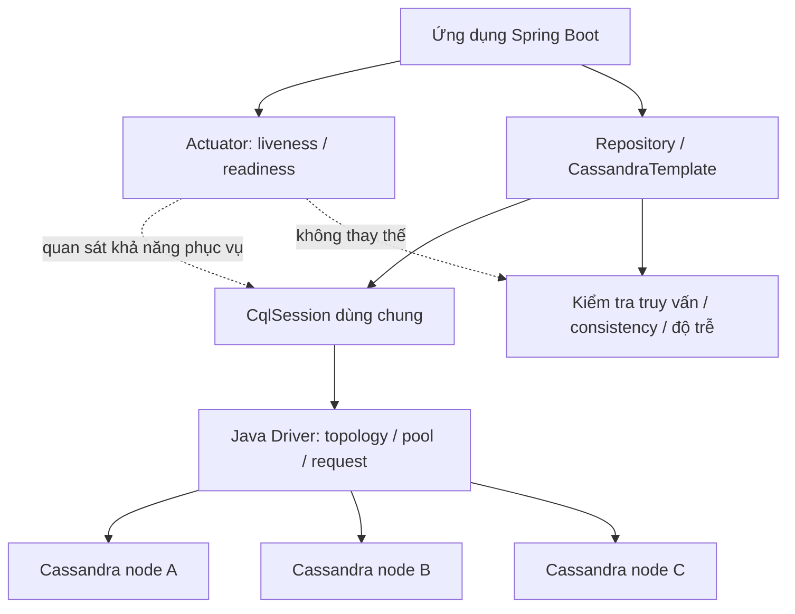

# Trạng thái session, node và mức sẵn sàng của ứng dụng trong Spring Data Cassandra

## 1. Vì sao ứng dụng “đang chạy” vẫn có thể không phục vụ được?

Trong **Spring Data Cassandra**, ứng dụng truy cập Apache Cassandra qua `CqlSession` của Cassandra Java Driver. Repository, `CassandraTemplate` và những câu CQL tường minh cùng phụ thuộc vào khả năng driver tìm được node phù hợp, mở kết nối và thực hiện yêu cầu với mức nhất quán đã chọn.

Khi vận hành một dịch vụ, ba câu hỏi sau **khác nhau**:

1. **Session còn hoạt động không?** Ứng dụng đã tạo `CqlSession` thành công chưa, và session có bị đóng không?
2. **Driver nhìn thấy những node nào?** Metadata của session báo node nào `UP`, `DOWN` hay chưa xác định; kết nối thực tế và khả năng chọn coordinator đang ra sao?
3. **Ứng dụng có sẵn sàng nhận lưu lượng không?** Các thao tác thiết yếu với keyspace, bảng, replication và consistency hiện tại có đủ điều kiện thành công trong thời gian chấp nhận được không?

Ví dụ, một ứng dụng có `CqlSession` chưa đóng và vẫn thấy một node đang `UP`. Tuy nhiên, nếu một partition có replication factor 3 và request yêu cầu `QUORUM`, chỉ một replica khả dụng sẽ không đủ để đáp ứng mức nhất quán này. Tương tự, session và node có thể bình thường nhưng một truy vấn repository theo cột không được hỗ trợ hoặc một hot partition vẫn làm nghiệp vụ lỗi hay chậm.

Trong chương **Quan sát và vận hành**, cần phân tách tín hiệu quan sát ở ba tầng để tránh đánh đồng “process còn sống” với “dịch vụ thực hiện được truy vấn”.



## 2. Phân biệt session, node và trạng thái ứng dụng

| Phạm vi | Tín hiệu | Cho biết điều gì? | Không chứng minh được điều gì? |
| --- | --- | --- | --- |
| Tiến trình ứng dụng | Process chạy, HTTP server nhận kết nối | JVM và HTTP stack hoạt động | Cassandra có thể truy cập được |
| `CqlSession` | Đã khởi tạo, chưa `close()` | Đối tượng driver vẫn trong vòng đời sử dụng | Có node phù hợp hoặc truy vấn sẽ thành công |
| Metadata node | `NodeState.UP / DOWN / UNKNOWN` | Góc nhìn hiện tại của driver về node đã biết | Mọi replica của partition đều khả dụng |
| Kết nối và request | Pool, request in-flight, timeout, lỗi chọn coordinator | Khả năng trao đổi với node ở thời điểm yêu cầu | CQL đúng hoặc dữ liệu phù hợp schema |
| CQL theo nghiệp vụ | Truy vấn đọc/ghi đại diện thành công | Một đường xử lý thực tế hoạt động | Mọi bảng/partition và mọi mức consistency đều khỏe |
| Readiness | Ứng dụng tự công bố có thể nhận lưu lượng | Quyết định định tuyến ở mức ứng dụng | Hiệu năng luôn đạt SLO dưới mọi tải |
| Liveness | Ứng dụng còn có thể tự phục hồi không | Có lý do tiếp tục chạy hay cần khởi động lại | Các dịch vụ phụ thuộc đều sẵn sàng |

**Nguyên tắc quan trọng:** không lấy `!session.isClosed()` làm bằng chứng duy nhất cho readiness; cũng không dùng một phép thử truy vấn Cassandra thất bại để kết luận JVM đã mất liveness.

## 3. Vòng đời `CqlSession` trong Spring Data Cassandra

### 3.1. Tạo một session dùng chung

Trong ứng dụng Spring Boot được cấu hình với Spring Data Cassandra, session thường được quản lý như một bean dùng chung. Repository và `CassandraTemplate` sử dụng hạ tầng kết nối do Spring cấu hình, thay vì tự tạo phiên kết nối cho từng request.

Ví dụ cấu hình kết nối ở môi trường phát triển (Spring Boot 3.x; đặt các giá trị theo môi trường thực tế):

```yaml
spring:
  cassandra:
    contact-points:
      - cassandra-1.internal.example
      - cassandra-2.internal.example
    port: 9042
    local-datacenter: dc1
    keyspace-name: commerce
```

Các tên máy trong ví dụ là minh họa. `contact-points` là điểm bootstrap để driver khám phá cluster; đây không phải danh sách cố định mọi node có thể sử dụng trong suốt vòng đời. `local-datacenter` cần khớp datacenter được triển khai và chính sách định tuyến của driver.

Không tự tạo `CqlSession.builder().build()` trong mỗi lần gọi repository hoặc ở mỗi HTTP request. Session quản lý topology, pool kết nối, prepared statement và nhiều tác vụ nền; tạo/đóng liên tục làm tăng chi phí và gây khó khăn cho việc giám sát.

### 3.2. Phân biệt các giai đoạn

- **Chưa kết nối:** ứng dụng chưa tạo được session; có thể do contact point sai, xác thực/TLS, local datacenter sai hoặc cluster không thể truy cập.
- **Đã khởi tạo:** `CqlSession` tồn tại. Driver đã hoàn tất quá trình bootstrap cần thiết, nhưng không có nghĩa tất cả node hoặc replica đều khả dụng.
- **Đang phục vụ:** session chưa đóng, driver tìm được coordinator và các truy vấn phù hợp hoàn thành theo độ trễ/consistency yêu cầu.
- **Suy giảm:** session vẫn tồn tại nhưng một số node, pool hoặc đường truy vấn đang lỗi/chậm; driver có thể tự cập nhật topology và tái kết nối.
- **Đang đóng/đã đóng:** ứng dụng shutdown hoặc đóng session; không tiếp tục nhận request mới cần session đó.

Trong vận hành, “session tồn tại” và “session có thể thực hiện truy vấn thành công” là hai thuộc tính khác nhau. Sau mất kết nối tạm thời, driver thường có cơ chế reconnect/topology refresh. Đừng giải quyết mọi timeout bằng cách tự `close()` rồi tạo lại session: làm vậy có thể phá hủy pool và tăng tải trong lúc cluster đang bất ổn.

### 3.3. Thao tác đóng session khi shutdown

Spring nên quản lý vòng đời của bean `CqlSession` và đóng tài nguyên khi ApplicationContext kết thúc. Nếu tự cấu hình session, phải bảo đảm bean có phương thức destroy hoặc cơ chế shutdown phù hợp; tránh đóng session từ một component trong khi repository khác vẫn sử dụng.

Khi triển khai rolling update, ứng dụng nên ngừng nhận request mới, cho request đang chạy hoàn tất trong khoảng thời gian hợp lý, rồi đóng tài nguyên. Một readiness probe chuyển sang trạng thái không nhận lưu lượng trước khi process dừng sẽ giúp load balancer ngừng gửi thêm request, nhưng vẫn cần cơ chế graceful shutdown và giới hạn thời gian phù hợp.

## 4. Quan sát node qua metadata của Cassandra Java Driver

### 4.1. Đọc trạng thái node do driver nhìn thấy

Với **Apache Cassandra Java Driver 4.x** (các lớp thường nằm dưới `com.datastax.oss.driver.api.core`), có thể xem node đã biết thông qua metadata của session:

```java
@Component
public class CassandraTopologySnapshot {
    private final CqlSession session;

    public CassandraTopologySnapshot(CqlSession session) {
        this.session = session;
    }

    public Snapshot snapshot() {
        if (session.isClosed()) {
            return new Snapshot(false, 0, 0, 0, 0);
        }

        Collection<Node> nodes =
            session.getMetadata().getNodes().values();

        long up = nodes.stream()
            .filter(node -> node.getState() == NodeState.UP)
            .count();
        long down = nodes.stream()
            .filter(node -> node.getState() == NodeState.DOWN)
            .count();
        long unknown = nodes.size() - up - down;

        return new Snapshot(
            true, nodes.size(), up, down, unknown
        );
    }

    public record Snapshot(
        boolean sessionOpen,
        long knownNodes,
        long upNodes,
        long downNodes,
        long unknownNodes
    ) {}
}
```

Các import chính gồm `CqlSession`, `Node` và `NodeState` của driver 4, `java.util.Collection` và `org.springframework.stereotype.Component`; ví dụ dùng Java 17+ để có `record`. Đoạn mã chỉ lấy **ảnh chụp trạng thái metadata**, không thực hiện truy vấn CQL và không kiểm tra mức consistency của một partition.

Cần hiểu các trạng thái:

- **UP:** driver hiện coi node là khả dụng theo cơ chế theo dõi của nó; không đảm bảo request đến mọi bảng đều thành công.
- **DOWN:** driver nhận định node không khả dụng; có thể xuất phát từ mất kết nối, sự cố tiến trình hoặc quan sát của driver.
- **UNKNOWN:** driver chưa đủ thông tin hoặc chưa xác định trạng thái; không được tự coi là UP.

Thống kê `knownNodes` phụ thuộc khả năng khám phá topology, cấu hình driver và thời điểm lấy snapshot. Tín hiệu này có thể thay đổi sau khi node được thêm/bỏ hoặc sau một sự cố mạng. Không dùng số node UP như một phép tính quorum trực tiếp: để biết một request đáp ứng được consistency hay không còn cần keyspace, replication, datacenter, partition và số replica có khả năng phản hồi.

### 4.2. Đối chiếu thêm từ phía cluster

Metadata Java Driver phản ánh **góc nhìn của một ứng dụng**. Để chẩn đoán, người vận hành còn cần so với thông tin từ Cassandra:

```text
nodetool status
nodetool info
```

`nodetool status` cung cấp trạng thái các node theo góc nhìn của cluster, còn `nodetool info` hỗ trợ xem thông tin cục bộ của node đang được truy vấn. Những công cụ này cần quyền truy cập và cấu hình Cassandra phù hợp; không nên gọi `nodetool` theo từng HTTP request hoặc trực tiếp từ health endpoint của ứng dụng.

Một trường hợp đáng chú ý: `nodetool status` cho thấy nhiều node UP, nhưng một pod ứng dụng chỉ nhìn thấy một phần do DNS, firewall, TLS, local datacenter hoặc chính sách định tuyến. Khi đó, vấn đề có thể nằm trên đường kết nối ứng dụng → cluster, không phải do toàn cluster bị hỏng.

### 4.3. Không suy diễn quá mức từ node count

Giả sử keyspace dùng replication factor 3 và thao tác ghi yêu cầu consistency `QUORUM`. Với ba replica liên quan tới partition, một request cần đủ hai phản hồi xác nhận theo semantics của Cassandra. Nếu chỉ một replica có thể đáp ứng, request có thể thất bại dù session còn mở và driver nhận ra một node `UP`.

Ngược lại, trong cluster có nhiều node, một node `DOWN` không nhất thiết làm mọi request lỗi: driver có thể định tuyến sang coordinator khác và replication vẫn đủ điều kiện phục vụ. Vì vậy cảnh báo “một node down” nên được đánh giá cùng sự phân bố replica, mức nhất quán, độ trễ và tỷ lệ lỗi, thay vì tự động kết luận toàn ứng dụng mất sẵn sàng.

## 5. Readiness và liveness trong Spring Boot Actuator

Spring Boot Actuator cung cấp health endpoint và, khi bật availability probes, hai nhóm trạng thái thường gặp:

- **Liveness:** ứng dụng còn ở trạng thái có thể tiếp tục chạy hay cần khởi động lại? Một lỗi kết nối Cassandra tạm thời **không nên** mặc định khiến liveness thất bại và tạo vòng lặp restart.
- **Readiness:** ứng dụng đã sẵn sàng nhận lưu lượng mới? Cần cân nhắc các dependency thiết yếu, bao gồm Cassandra khi các đường xử lý chính không thể phục vụ nếu không có nó.

Các trạng thái liveness/readiness của Spring Boot phản ánh vòng đời ứng dụng; health contributor của Cassandra phản ánh khả năng truy cập dịch vụ dữ liệu. Hai nguồn tín hiệu này cần được kết hợp có chủ đích.

### 5.1. Bật health probes

Ví dụ cấu hình cho **Spring Boot 3.x** có `spring-boot-starter-actuator`:

```yaml
management:
  endpoint:
    health:
      probes:
        enabled: true
      group:
        readiness:
          include: "readinessState,cassandra"
  endpoints:
    web:
      exposure:
        include: "health,info"
```

Khi có contributor `cassandra` được Spring Boot tự cấu hình, endpoint thông dụng là:

```text
GET /actuator/health/liveness
GET /actuator/health/readiness
```

Theo quy ước HTTP Actuator, health trạng thái `UP` trả phản hồi thành công; `DOWN` và một số trạng thái lỗi trả mã HTTP không thành công, thường 503. Kiểm tra chính xác cấu hình status-to-HTTP mapping nếu hệ thống đã tùy chỉnh.

**Điểm thường bị bỏ sót:** trong nhiều cấu hình, nhóm readiness mặc định chỉ phản ánh `readinessState`; các dependency như Cassandra không tự được thêm vào readiness. Dòng `include: "readinessState,cassandra"` thể hiện một quyết định vận hành: Cassandra là điều kiện để nhận lưu lượng mới. Nếu contributor `cassandra` không được đăng ký do phiên bản/dependency/cấu hình khác, cần kiểm tra các health contributors thực tế trước khi áp dụng cấu hình nhóm; không giả định endpoint luôn có cùng tên trong mọi dự án.

Không đưa `cassandra` vào nhóm liveness chỉ vì muốn “phát hiện DB down”: khi cluster gặp sự cố chung, restart hàng loạt pod không sửa được Cassandra và có thể làm tình hình xấu hơn.

### 5.2. Readiness phụ thuộc loại ứng dụng

Không phải mọi ứng dụng đều nên có cùng quy tắc readiness:

| Ứng dụng | Khi Cassandra không truy cập được | Lựa chọn readiness cần xem xét |
| --- | --- | --- |
| API đồng bộ chỉ có thao tác đọc/ghi Cassandra | Các endpoint chính không phục vụ được | Có thể `DOWN` để ngừng nhận request mới |
| API có nhiều chức năng, một phần không dùng Cassandra | Một số endpoint vẫn hoạt động | Cân nhắc kiểm tra theo tuyến, thiết kế degrade hoặc endpoint riêng |
| Worker xử lý queue có cơ chế retry | Có thể tạm dừng tiêu thụ mà không cần restart | Phân biệt readiness với trạng thái tiêu thụ message |
| Ứng dụng dùng cache và có chế độ đọc hạn chế | Có thể tiếp tục phục vụ dữ liệu cũ với giới hạn | Xác định contract degraded mode, tránh công bố `UP` quá mức |

Có một đánh đổi quan trọng: nếu **tất cả** pod đều trả readiness `DOWN` vì một dependency chung lỗi, load balancer có thể không còn backend khả dụng và toàn bộ traffic bị từ chối. Điều này có thể phù hợp nếu mọi request chắc chắn thất bại; nếu ứng dụng còn chức năng độc lập hoặc fallback đáng tin cậy, readiness nên thể hiện khả năng phục vụ thực tế đó. Quyết định cần dựa trên SLO và hành vi nghiệp vụ, không chỉ dựa trên tình trạng của một node.

### 5.3. Giới hạn của một health check Cassandra

Health contributor có thể dùng một truy vấn nhẹ để xác định khả năng giao tiếp với Cassandra, tùy phiên bản implementation. Một phép kiểm tra kết nối thành công **không đảm bảo**:

- Keyspace/bảng nghiệp vụ tồn tại và schema đã đúng.
- Query theo partition key, clustering key và mức consistency cụ thể sẽ thành công.
- Một partition nóng hay replica cần dùng không bị quá tải.
- Hệ thống đạt độ trễ và throughput theo SLO.

Nếu cần readiness nghiệp vụ sâu hơn, hãy thiết kế một **truy vấn đại diện có chi phí thấp, khóa cố định, thời gian chờ hữu hạn**. Truy vấn này phải tương thích với schema và consistency của workload, không scan toàn bảng, không ghi dữ liệu mới sau mỗi health probe và không tạo điểm nóng vì tần suất quá cao. Đừng dùng `SELECT COUNT(*)` trên bảng lớn, `ALLOW FILTERING` hoặc kiểm tra toàn bộ node trong mỗi probe.

Một health check rất sâu có thể trở thành nguồn tải hoặc tạo cảnh báo giả khi Cassandra có nhiễu nhất thời. Có thể dùng readiness nhanh để ra quyết định định tuyến và dùng synthetic transaction/monitoring riêng với chu kỳ thưa hơn để kiểm tra nghiệp vụ đầu cuối.

## 6. Khi nào cần health indicator tùy chỉnh?

Nếu ứng dụng cần hiển thị thống kê node ở mức phù hợp, có thể tạo health indicator chỉ tổng hợp trạng thái session/metadata. Ví dụ:

```java
@Component("cassandraNodes")
public class CassandraNodesHealthIndicator implements HealthIndicator {
    private final CassandraTopologySnapshot topology;

    public CassandraNodesHealthIndicator(
            CassandraTopologySnapshot topology) {
        this.topology = topology;
    }

    @Override
    public Health health() {
        CassandraTopologySnapshot.Snapshot state =
            topology.snapshot();

        if (!state.sessionOpen() || state.upNodes() == 0) {
            return Health.down()
                .withDetail("knownNodes", state.knownNodes())
                .withDetail("upNodes", state.upNodes())
                .build();
        }

        return Health.up()
            .withDetail("knownNodes", state.knownNodes())
            .withDetail("upNodes", state.upNodes())
            .build();
    }
}
```

Ở ví dụ trên, `Health`/`HealthIndicator` thuộc `org.springframework.boot.actuate.health`; Spring sẽ đăng ký indicator với tên `cassandraNodes`. Có thể hiển thị nó trong health endpoint để phục vụ chẩn đoán nếu chính sách truy cập cho phép.

**Không coi indicator này là phép đo mức sẵn sàng đầy đủ.** Logic `upNodes() > 0` chỉ kiểm tra metadata có ít nhất một node đang UP. Nó chưa kiểm tra consistency, auth/schema của keyspace hoặc khả năng hoàn thành truy vấn. Nếu đưa `cassandraNodes` vào readiness group, cần có quyết định rõ ràng về ý nghĩa và giới hạn; có thể giữ nó như tín hiệu chẩn đoán và dùng contributor `cassandra` cùng các phép kiểm tra nghiệp vụ phù hợp để quyết định readiness.

Tránh công khai host, IP nội bộ, token, user, raw CQL hoặc dữ liệu hàng hóa/khách hàng trong `withDetail(...)`. Health details, metrics và tracing nên được giới hạn quyền truy cập, nhất là trong môi trường production.

## 7. Cấu hình probe khi triển khai bằng Kubernetes

Kubernetes có thể dùng các endpoint Actuator làm HTTP probes. Ví dụ khung cấu hình:

```yaml
startupProbe:
  httpGet:
    path: /actuator/health/liveness
    port: 8080
  periodSeconds: 10
  failureThreshold: 30

livenessProbe:
  httpGet:
    path: /actuator/health/liveness
    port: 8080
  periodSeconds: 10
  failureThreshold: 3

readinessProbe:
  httpGet:
    path: /actuator/health/readiness
    port: 8080
  periodSeconds: 5
  failureThreshold: 3
```

Đây là các trường trong cấu hình container của Pod, không phải một Kubernetes manifest hoàn chỉnh. Cổng, đường dẫn, timeout, failure threshold và startup budget cần được điều chỉnh theo dịch vụ. Nếu Actuator dùng management port riêng, hãy cân nhắc việc một management port vẫn nhận probe dù cổng ứng dụng chính không còn đáp ứng; cấu hình probe trên cổng phù hợp với điều muốn kiểm tra.

Các tình huống cần phân biệt:

- **Khởi động lâu do bootstrap/khởi tạo schema:** `startupProbe` cho ứng dụng thời gian hoàn tất khởi động mà không kích hoạt liveness restart quá sớm.
- **Cassandra mất kết nối tạm thời:** readiness có thể giảm, nhưng liveness vẫn khỏe; driver và ứng dụng có cơ hội tự phục hồi.
- **JVM deadlock hoặc ứng dụng không phản hồi:** liveness có thể thất bại, giúp orchestrator khởi động lại process.
- **Shutdown có kiểm soát:** ứng dụng ngừng nhận lưu lượng mới rồi hoàn tất request đang xử lý, tránh cắt ngang các tác vụ ghi đang diễn ra.

Đừng cấu hình liveness như một bản sao của readiness. Sự cố chung ở Cassandra có thể khiến toàn bộ nhóm pod restart cùng lúc, làm tăng áp lực kết nối khi cluster phục hồi.

## 8. Tín hiệu observability cần theo dõi ngoài health endpoint

Health là tín hiệu ngắn gọn; để chẩn đoán nguyên nhân, cần thêm **metrics, logs và traces**. Với Spring Data Cassandra, hữu ích nhất là quan sát theo đường đi: API → repository/`CassandraTemplate` → `CqlSession` → driver → Cassandra nodes.

| Nhóm quan sát | Tín hiệu cần có | Ý nghĩa vận hành |
| --- | --- | --- |
| HTTP/API | Request rate, error rate, p95/p99 latency | Khách hàng đang chịu ảnh hưởng thế nào |
| Nghiệp vụ Cassandra | Latency đọc/ghi theo loại thao tác, tỷ lệ lỗi, timeout | Đường xử lý nào bị ảnh hưởng |
| Session/driver | Session lifecycle, node UP/DOWN, request in-flight, pool connections | Khả năng kết nối, định tuyến và nghẽn phía client |
| Cassandra server | Read/write latency, dropped messages, pending compactions, tài nguyên CPU/disk/GC | Cluster có chậm hoặc quá tải không |
| Dữ liệu/truy vấn | Partition size, kiểu truy vấn, paging, consistency, retry | Hiệu năng xấu do mô hình dữ liệu hay mức nhất quán |
| Triển khai | Thay đổi schema, release version, rolling restart, node maintenance | Liên hệ triệu chứng với thay đổi hệ thống |

### 8.1. Phân biệt ba dạng latency

1. **HTTP latency:** thời gian từ khi request vào đến khi trả kết quả; có thể gồm validation, logic nghiệp vụ và serialization.
2. **Driver request latency:** thời gian xử lý một yêu cầu CQL ở client, gồm các pha định tuyến, chờ/trao đổi với coordinator theo cách driver đo; xem định nghĩa chính thức của metric đang dùng.
3. **Cassandra server latency:** số đo từ node/cluster; không nhất thiết bằng HTTP hoặc client request latency.

Nếu HTTP p99 tăng nhưng driver request latency ổn định, nên kiểm tra logic ứng dụng và hạ tầng HTTP. Nếu driver request latency và client timeout cùng tăng, tiếp tục kiểm tra pool, network, coordinator và server metrics. Nếu chỉ một query pattern chậm, kiểm tra partition key, kích thước partition, paging và dữ liệu thay vì chỉ đếm số node UP.

### 8.2. Metrics của driver và Spring Boot

Cassandra Java Driver 4 có khả năng xuất session/node metrics qua các module và backend phù hợp, ví dụ Micrometer. Cần bảo đảm đúng dependency, phiên bản driver và cấu hình bật các metric mong muốn. Các nhóm thường có ích gồm:

- Số request CQL, phân phối latency và các loại timeout ở client.
- Số kết nối pool đang mở, số request đang xử lý hoặc chờ.
- Số node đang có thể sử dụng theo cách driver báo cáo.
- Retry, throttling và trạng thái thất bại theo loại request, nếu phiên bản driver hỗ trợ metric tương ứng.

Không nên giả định một tên metric cụ thể tồn tại trên mọi bản driver hoặc mọi exporter: tên, đơn vị và scope `session`/`node` phụ thuộc dependency cùng cấu hình. Hãy xác nhận bằng endpoint metrics và tài liệu của **phiên bản đang chạy**.

Nếu dùng Spring Boot Actuator với Micrometer và Prometheus registry, có thể bật xuất metrics trong môi trường được cấp quyền:

```yaml
management:
  endpoints:
    web:
      exposure:
        include: "health,info,metrics,prometheus"
```

Đoạn này là ví dụ **bổ sung** cho cấu hình Actuator ở mục 5, không phải yêu cầu bật endpoint `prometheus` công khai ra Internet. Muốn xuất Prometheus thực tế cần registry dependency và cấu hình bảo vệ endpoint/collector phù hợp.

### 8.3. Log có ngữ cảnh nhưng tránh cardinality cao

Một bản ghi chẩn đoán tốt nên có:

- Correlation/request ID và service instance/release version.
- Loại thao tác, ví dụ `ordersByCustomer.read` hoặc `ordersByCustomer.write`.
- Keyspace/table và nhãn loại truy vấn đã được kiểm soát.
- Latency, outcome, tên exception và nguyên nhân gốc phù hợp.

Không dùng raw partition key, `customerId`, UUID từng đơn hàng, full CQL có tham số thật hoặc địa chỉ node chi tiết làm **metric label**: độ phân mảnh cardinality có thể gây quá tải hệ thống quan sát và rò rỉ dữ liệu. Khi cần theo dấu một trường hợp cụ thể, đưa dữ liệu đã được xử lý/masking vào log có quyền truy cập chặt chẽ; metrics chỉ dùng nhãn có số lượng giá trị hữu hạn.

### 8.4. Tracing: tách lỗi gọi CQL và lỗi xử lý dữ liệu

Nếu ứng dụng đã dùng distributed tracing, span có thể cho thấy thời gian tại API, service, repository hoặc driver. Hữu ích nhất là so sánh:

- Truy vấn có được gửi tới Cassandra hay bị từ chối ngay ở tầng mapping/conversion?
- Request đang chờ kết nối/pool, đã tới coordinator hay thất bại ở một replica cần cho consistency?
- Retry có làm tăng tổng latency và số lần thao tác không?

Tracing phải được cấu hình theo khả năng instrumentation của stack đang dùng; không mặc định mọi method repository đều có span chi tiết. Giữ sampling và thông tin CQL an toàn để không tạo quá nhiều trace hoặc lộ tham số truy vấn.

## 9. Đọc exception đúng theo góc độ vận hành

Một HTTP 500 hoặc health `DOWN` chỉ là triệu chứng. Cần xem cause chain từ Spring Data và Cassandra Java Driver:

| Triệu chứng / exception thường gặp | Khả năng cần kiểm tra | Hành động ưu tiên |
| --- | --- | --- |
| Không khởi tạo được `CqlSession` | Contact points, DNS, TLS, auth, local DC | Xác minh cấu hình và kết nối bootstrap |
| `AllNodesFailedException` | Không thể hoàn tất yêu cầu qua những node driver thử | Kiểm tra các lỗi theo node, pool và mạng |
| `UnavailableException` | Không đủ replica khả dụng cho consistency yêu cầu | Xem RF, CL, DC và trạng thái các replica liên quan |
| `ReadTimeoutException` / `WriteTimeoutException` | Không nhận đủ phản hồi đúng hạn | Xem latency, overload, network, hot partition, CL |
| Query CQL invalid | Sai cột, query không hợp lệ theo partition/clustering key | Kiểm tra schema và câu CQL, không restart session |
| Conversion/mapping error | Entity/codec/schema không khớp | So Java type, annotation, CQL type và dữ liệu |
| Session mở nhưng request chậm | Pool nghẽn, coordinator chậm, GC, truy vấn nặng | Kết hợp client metrics, server metrics và trace |

Tên và cách bọc exception có thể khác giữa các phiên bản Spring Data Cassandra và driver. Ở tầng API, Spring có thể chuyển lỗi driver sang nhóm `DataAccessException`; vì vậy phải xem **root cause** và điều kiện phát sinh.

Đặc biệt, `UnavailableException` không tương đương với “mọi node DOWN”. Cluster có thể còn nhiều node UP nhưng không đủ **replica cần thiết** cho một thao tác cụ thể. Tương tự, timeout không nhất thiết là “không kết nối”: coordinator có thể đã nhận yêu cầu nhưng phản hồi không kịp thời, hoặc một vài replica quá tải.

Với thao tác ghi, timeout **không chắc** dữ liệu hoàn toàn chưa được ghi. Việc retry cần dựa trên tính idempotent và ngữ nghĩa nghiệp vụ, tránh tạo tác dụng phụ trùng lặp.

## 10. Runbook xử lý tình huống: readiness giảm nhưng liveness vẫn UP

**Bối cảnh:** API đọc đơn hàng theo `customer_id` bắt đầu lỗi; `/actuator/health/liveness` vẫn `UP`, trong khi readiness trả `DOWN` hoặc tỷ lệ HTTP 5xx tăng.

### Bước 1 — Xác nhận phạm vi ảnh hưởng

Quan sát tỷ lệ request lỗi, latency và số pod không ready. Xác minh các endpoint đều lỗi hay chỉ một nhóm truy vấn Cassandra. Đối chiếu thời điểm lỗi với deploy ứng dụng, thay đổi schema, bảo trì node hoặc thay đổi mạng.

### Bước 2 — Đọc health contributors và trạng thái session

Xem liệu `readinessState`, `cassandra` hay health indicator tùy chỉnh nào đang DOWN. Kiểm tra `CqlSession` đã tạo thành công, đã bị đóng hay vẫn mở. Nếu session còn mở nhưng không truy vấn được, chuyển sang metadata node và driver errors; không kết luận session hoạt động tốt chỉ dựa trên `isClosed() == false`.

### Bước 3 — Đối chiếu node theo hai góc nhìn

Xem snapshot metadata từ session và các số đo driver; đối chiếu `nodetool status`/metrics từ Cassandra. Nếu một pod thấy ít node hơn các pod khác, kiểm tra network policy, DNS, firewall, TLS hoặc route tới datacenter. Nếu toàn cluster giảm replica, xác minh replication và mức consistency của truy vấn bị lỗi.

### Bước 4 — Phân biệt lỗi kết nối với lỗi truy vấn

- Nếu lỗi `AllNodesFailedException` xảy ra nhiều pod, kiểm tra khả năng truy cập coordinator, pool và địa chỉ node.
- Nếu `UnavailableException`, kiểm tra replica đáp ứng CL; việc có node khác UP không đủ kết luận.
- Nếu timeout tập trung vào một bảng/partition, xem phân bố tải, partition size, filtering, paging và độ trễ server.
- Nếu `InvalidQueryException` hoặc conversion exception xuất hiện sau deploy, kiểm tra migration, annotation entity và kiểu CQL.

### Bước 5 — Phục hồi có kiểm soát

Tùy nguyên nhân, phục hồi node/network hoặc sửa schema/truy vấn/cấu hình; điều chỉnh tải và retry có giới hạn khi cluster phục hồi. Không tăng timeout, thêm `ALLOW FILTERING` hay restart toàn bộ pod như biện pháp mặc định. Những cách đó có thể che lỗi thiết kế hoặc làm cluster quá tải hơn.

### Bước 6 — Xác nhận mức sẵn sàng thực tế

Khi health phục hồi, kiểm tra một số truy vấn đại diện theo partition key và consistency sử dụng trong sản phẩm. Đối chiếu tỷ lệ lỗi và p95/p99 latency trở lại ngưỡng SLO, không chỉ số node UP. Đảm bảo các pod sẵn sàng nhận traffic ổn định và không có retry storm sau khi khôi phục.

## 11. Kiểm thử các trạng thái sẵn sàng

Health check cần được kiểm thử như một tính năng vận hành, không chỉ được viết rồi tin rằng endpoint sẽ luôn đúng.

| Kịch bản | Môi trường phù hợp | Kỳ vọng cần xác minh |
| --- | --- | --- |
| Khởi động, Cassandra chưa sẵn sàng | Testcontainers/integration | Readiness không báo phục vụ trước khi dependency cần thiết sẵn sàng |
| Session tồn tại, query bình thường | Testcontainers một node | Health contributor được cấu hình báo UP; repository đọc/ghi thành công |
| Sai keyspace, credentials hoặc TLS | Môi trường tích hợp | Lỗi bootstrap/health rõ ràng, không báo ready giả |
| Node không thể truy cập sau bootstrap | Tích hợp/chaos test | Driver ghi nhận lỗi/reconnect; readiness và metric phản ánh đúng chính sách |
| Chỉ một replica còn khả dụng với CL QUORUM | Staging nhiều node, RF phù hợp | Khả năng truy vấn giảm dù session còn mở |
| Một partition quá lớn, query chậm | Kiểm thử tải | Latency và timeout được cảnh báo, dù node count không đổi |
| Dependency tạm thời DOWN | Tích hợp/staging | Liveness không bị ràng buộc khiến pod restart liên tục |
| Rolling shutdown | Staging/Kubernetes | Readiness giảm trước khi hoàn tất drain request |

Testcontainers một node phát hiện lỗi CQL, mapping, bootstrap và một số tình huống mất kết nối. Nó không đại diện được cho các điều kiện replica, multi-datacenter hay quorum của một cluster production. Các bài test consistency và failure mode thực tế cần môi trường nhiều node với topology và replication phù hợp.

### 11.1. Bài tập phân tích

Giả sử dịch vụ có những số liệu sau:

| Quan sát | Giá trị |
| --- | --- |
| `CqlSession.isClosed()` | `false` |
| Driver metadata | 1 node UP, 2 node DOWN |
| Bảng đơn hàng | RF = 3, yêu cầu ghi `QUORUM` |
| Liveness | UP |
| Readiness | DOWN |
| Error logs | Nhiều `UnavailableException` |

**Câu hỏi:** có nên restart ứng dụng và đổi health indicator thành `UP` vì session còn mở không?

**Phân tích:** Không. Với ba replica và consistency `QUORUM`, cần ít nhất hai replica đáp ứng điều kiện cần thiết; một replica khả dụng thường không đủ cho thao tác ghi. Session chưa đóng không giải quyết thiếu replica. Ưu tiên phục hồi các replica/đường mạng liên quan và kiểm tra keyspace, topology, consistency cùng request path. Liveness UP là hợp lý vì process vẫn hoạt động và có thể phục hồi khi Cassandra trở lại; readiness DOWN phù hợp nếu API không thể hoàn thành chức năng cốt lõi. Sau khi phục hồi, đo tỷ lệ ghi thành công và latency để xác nhận, thay vì chỉ chuyển trạng thái thủ công.

Nếu yêu cầu nghiệp vụ cho phép giảm consistency trong một tình huống đặc biệt, đó là quyết định thiết kế về độ nhất quán và rủi ro dữ liệu, cần được đánh giá rõ; không đổi CL tùy tiện chỉ để health chuyển xanh.

## 12. Checklist trước khi đưa dịch vụ vào vận hành

- [ ] Sử dụng `CqlSession` do container Spring quản lý, không tạo/đóng theo từng request.
- [ ] Xác nhận contact points, local datacenter, keyspace, TLS/auth và cấu hình driver theo môi trường.
- [ ] Phân biệt session open, node UP và khả năng thực hiện query theo consistency.
- [ ] Có health probes cho liveness/readiness; Cassandra chỉ tham gia readiness khi phù hợp với contract dịch vụ.
- [ ] Có startup budget và graceful shutdown phù hợp, không khiến outage Cassandra dẫn đến restart loop.
- [ ] Có metric HTTP/API, latency/timeout của CQL, pool và node; có server metrics từ Cassandra.
- [ ] Có dashboard/alert dựa trên tỷ lệ lỗi, p95/p99 và các tín hiệu cluster, không chỉ tổng số node UP.
- [ ] Log/trace có correlation ID và loại thao tác; không lộ dữ liệu nhạy cảm hoặc dùng metric labels có cardinality cao.
- [ ] Có runbook đối chiếu driver metadata, Cassandra server, CL/RF và truy vấn thực tế.
- [ ] Đã thử các kịch bản cluster lỗi và phục hồi, đặc biệt consistency và retry có giới hạn.
- [ ] Không dùng truy vấn nặng, scan toàn bảng hoặc ghi mới vào mỗi health probe.
- [ ] Xác minh health và metrics được giới hạn truy cập trong production.

**Ghi nhớ:** trong Spring Data Cassandra, **session mở** là điều kiện về vòng đời, **node UP** là quan sát cục bộ của driver, còn **ứng dụng sẵn sàng** là cam kết phục vụ workload cụ thể. Một hệ thống quan sát tốt kết hợp cả ba tầng với thành công của truy vấn, mức consistency và độ trễ thực tế; nhờ đó nhóm vận hành tìm đúng nguyên nhân và khôi phục dịch vụ mà không tạo thêm tải hoặc đánh mất tính đúng đắn dữ liệu.
