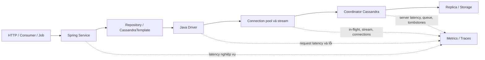
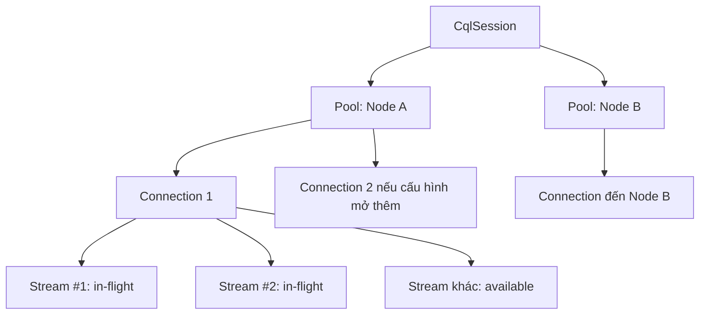
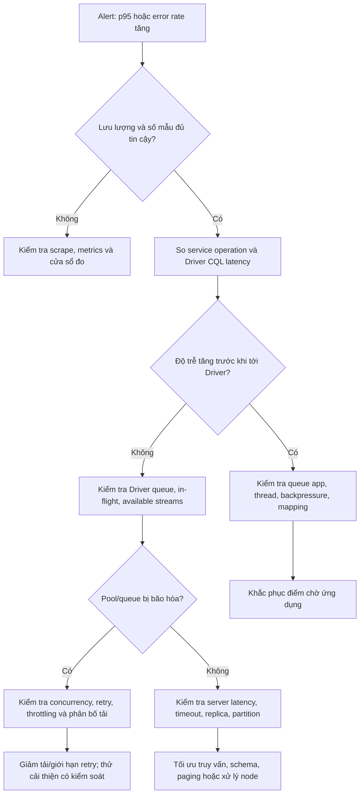

# Đo độ trễ, lỗi, số yêu cầu đang chờ và mức sử dụng kết nối

Khi một API sử dụng **Spring Data Cassandra** bắt đầu chậm, thông báo “database timeout” chưa cho biết nút thắt nằm ở đâu. Câu CQL có thể quét nhiều dữ liệu, coordinator có thể chờ replica, Java Driver có thể thiếu stream kết nối, hoặc yêu cầu đang xếp hàng ngay trong ứng dụng. Muốn vận hành **Apache Cassandra** đáng tin cậy, cần đo được **độ trễ, lỗi, số yêu cầu đang chờ và mức sử dụng kết nối** ở đúng tầng.

Bài học thuộc chương **Quan sát và vận hành** của module `SPRING_DATA_CASSANDRA`. Những phép đo này được đặt trong bối cảnh truy cập Cassandra qua **entity mapping**, `CassandraRepository`, `CassandraTemplate` và CQL; đồng thời liên hệ đến thiết kế bảng theo truy vấn, partition key, consistency level, paging và giới hạn hiệu năng của cơ sở dữ liệu phân tán.

Sau bài học, bạn sẽ có thể:

- Phân biệt độ trễ API, độ trễ truy vấn ở tầng service/Driver và độ trễ phía Cassandra.
- Đếm lỗi theo lớp nguyên nhân, theo dõi tỉ lệ lỗi thay vì chỉ xem số lượng tuyệt đối.
- Phân biệt **request đang thực thi (in-flight)** với **request đang xếp hàng (queued/pending)**.
- Quan sát pool kết nối và mức chiếm dụng stream của Java Driver thay vì suy luận rằng mỗi query cần một kết nối riêng.
- Dựng dashboard, thiết lập cảnh báo và điều tra sự cố dựa trên metric có ý nghĩa nghiệp vụ.

## 1. Đo theo đường đi của một yêu cầu

Một lần gọi `repository.findById(...)` không nhất thiết tương ứng với đúng một request CQL được gửi tới Cassandra. Driver có thể thử lại một số lỗi, speculative execution có thể tạo yêu cầu bổ sung nếu được bật, và ứng dụng cũng có thể chủ động retry. Các tầng vì vậy có số lần gọi và độ trễ khác nhau.



| Tầng | Đơn vị quan sát | Giúp trả lời |
| --- | --- | --- |
| **HTTP/service** | Một lần xử lý yêu cầu nghiệp vụ, kể cả mapping, retry và chờ | Người dùng chờ bao lâu? Có bao nhiêu yêu cầu thất bại? |
| **Spring Data / CQL operation** | Một thao tác repository/template được gọi | Thao tác đọc/ghi nào gây độ trễ hoặc lỗi? |
| **Java Driver – session** | Các yêu cầu CQL từ một session, client timeout, throttling | Driver phát bao nhiêu request? Có queue ở client không? |
| **Java Driver – node** | Request và stream đang sử dụng theo node/connection pool | Node nào bị dồn tải? Pool có còn khả năng tiếp nhận? |
| **Cassandra server** | Coordinator/replica, storage, request latency, dropped messages | Cluster có quá tải, tombstone nhiều hay partition nóng không? |

Ví dụ API có `p95 = 700 ms`, nhưng timer CQL thường chỉ `p95 = 80 ms`. Phần chênh lệch có thể đến từ chờ trong ứng dụng, xử lý kết quả, thực hiện nhiều truy vấn tuần tự hoặc retry. Không thể kết luận Cassandra chậm chỉ từ latency đầu cuối. Ngược lại, một truy vấn CQL chậm có thể chỉ ảnh hưởng một phần nhỏ API nhưng gây áp lực lớn lên pool.

## 2. Bốn nhóm chỉ số và ý nghĩa thực tế

### 2.1. Độ trễ (*latency*)

Độ trễ là thời gian từ khi bắt đầu đến khi hoàn tất một đơn vị công việc. Với cùng một truy vấn, cần định nghĩa **điểm bắt đầu và kết thúc** trước khi đo:

- **API latency:** toàn bộ thời gian server xử lý một request đến khi tạo phản hồi.
- **Operation latency:** thời gian service gọi một method `CassandraRepository`/`CassandraTemplate`, bao gồm hành vi retry nếu việc đo bao lấy retry.
- **Driver request latency:** thời gian Driver xử lý một logical request CQL; tùy metric, có thể bao gồm các lượt thử lại hoặc không phản ánh đúng một lần gửi lên node.
- **Server-side read/write latency:** khoảng thời gian Cassandra quan sát tại coordinator/replica; không phải thời gian mạng và ứng dụng.

Nên quan sát **p50**, **p95** và **p99** để thấy phân bố, đặc biệt là *tail latency*. Trung bình `20 ms` không loại trừ tình huống 1% truy vấn mất hơn một giây. Percentile có ý nghĩa khi được tính trên cửa sổ và số lượng mẫu đủ lớn. Khi tổng hợp từ nhiều instance, **không lấy trung bình p95 của từng instance**; nên gộp histogram rồi tính percentile từ histogram đã gộp.

### 2.2. Lỗi (*errors*)

Theo dõi cả **số lỗi mỗi giây** và **tỉ lệ lỗi trên tổng request**:

```text
error_rate = failed_operations / total_operations
```

Cần tách `not_found` hợp lệ của `findById` khỏi lỗi hạ tầng; đừng coi `Optional.empty()` tự động là Cassandra lỗi. Với phép ghi bị timeout, kết quả cuối cùng có thể chưa chắc chắn dù ứng dụng nhận exception. Không mặc định retry ghi an toàn.

Các nhóm lỗi nên phân biệt: read timeout, write timeout, client-side timeout, unavailable/thiếu replica đáp ứng consistency level, overloaded, lỗi kết nối, lỗi cấu hình/CQL và các lỗi khác. Driver exception có thể được Spring Data chuyển thành `DataAccessException`; khi phân nhóm, cần xét **cause chain** thực tế của phiên bản đang dùng.

### 2.3. Đang thực thi và đang chờ (*in-flight vs queued*)

- **In-flight:** request đã được chuyển vào đường thực thi, chẳng hạn đã sử dụng stream trên kết nối tới node nhưng chưa hoàn tất.
- **Queued/pending:** request đang đợi một nguồn lực hoặc giới hạn concurrency trước khi có thể chạy.
- **Throttled/rejected:** request bị hoãn hoặc từ chối do chính sách giới hạn tải.

Ba trạng thái này **không phải cùng một chỉ số**. Driver có thể có nhiều request in-flight nhưng queue ở throttler vẫn bằng 0. Ngược lại, ứng dụng có thể xếp hàng trên executor hoặc semaphore trong khi pool của Driver vẫn còn nhiều stream trống. Phải đo **tại nơi thực sự có hàng đợi**.

### 2.4. Kết nối và stream (*connection utilization*)

Java Driver sử dụng **kết nối lâu dài với nhiều stream đồng thời** cho mỗi node. Nhiều yêu cầu CQL có thể cùng sử dụng một kết nối TCP nhờ multiplexing. Vì vậy:

- Số **open connections** phản ánh số kết nối đang mở, không phải số request đồng thời.
- Số **in-flight** phản ánh công việc đang đi qua pool của node.
- Số **available streams** phản ánh khả năng phân bổ stream còn lại trên các kết nối đang mở.
- Tỉ lệ `in_flight / (in_flight + available_streams)` là **ước lượng độ chiếm dụng stream tại thời điểm đo**, không phải “% CPU”, không phải “% số socket được dùng” và không phải bảo đảm về throughput.

Pool chưa hết stream vẫn có thể chậm do Cassandra phía server, hotspot partition, GC, mạng hoặc consistency level. Tăng số kết nối trước khi xác định nguyên nhân dễ làm tăng tải hệ thống mà không cải thiện tốc độ.

## 3. Bật quan sát tại Spring Boot và Micrometer

Với ứng dụng Spring Boot, một cấu hình thông dụng là **Spring Boot Actuator + Micrometer + Prometheus**. Bộ công cụ cụ thể tùy tổ chức, nhưng các nguyên tắc đo và định nghĩa metric vẫn giữ nguyên.

Các dependency thường dùng:

```text
org.springframework.boot:spring-boot-starter-actuator
io.micrometer:micrometer-registry-prometheus
```

Trong `application.yml`, ví dụ:

```yaml
management:
  endpoints:
    web:
      exposure:
        include: "health,info,metrics,prometheus"
  metrics:
    distribution:
      percentiles-histogram:
        app.cassandra.operation.duration: true
      slo:
        app.cassandra.operation.duration: 50ms,100ms,250ms,500ms,1s
```

Lưu ý:

1. Cấu hình trên là **ví dụ cho timer tự định nghĩa** `app.cassandra.operation.duration`. Định dạng cấu hình và tên meter được hỗ trợ có thể khác nhau theo bản Spring Boot/Micrometer; cần kiểm tra cấu hình thực tế.
2. `/actuator/prometheus` chỉ hoạt động khi registry Prometheus có trên classpath và endpoint được expose. Bảo vệ endpoint bằng mạng nội bộ hoặc xác thực; không vô tình đưa metric vận hành lên Internet.
3. Histogram tạo thêm time series và tiêu thụ bộ nhớ. Chỉ bật cho operation cần quan sát, đặt bucket theo SLO hợp lý và hạn chế tag có cardinality cao.
4. Spring Boot có thể phát sinh metric HTTP/JVM/connection pool của **các thư viện khác**. Không mặc định `jdbc.connections.*` hay `hikaricp.*` mô tả Cassandra Java Driver: Cassandra dùng mô hình pool riêng.

### 3.1. Đo một operation ở service

Ví dụ dưới đây dùng một repository đã được khai báo trong dự án: `OrderRepository extends CassandraRepository<Order, UUID>`. Mỗi lần gọi được ghi vào một **Timer**, kể cả khi lỗi, để so sánh latency giữa thành công và thất bại.

```java
import java.util.Optional;
import java.util.UUID;

import io.micrometer.core.instrument.Counter;
import io.micrometer.core.instrument.MeterRegistry;
import io.micrometer.core.instrument.Timer;
import org.springframework.dao.DataAccessException;
import org.springframework.dao.DataAccessResourceFailureException;
import org.springframework.dao.QueryTimeoutException;
import org.springframework.stereotype.Service;

@Service
public class OrderLookupService {
    private final OrderRepository repository;
    private final MeterRegistry metrics;

    public OrderLookupService(OrderRepository repository,
                              MeterRegistry metrics) {
        this.repository = repository;
        this.metrics = metrics;
    }

    public Optional<Order> findOrder(UUID id) {
        Timer.Sample sample = Timer.start(metrics);
        String outcome = "success";

        try {
            Optional<Order> order = repository.findById(id);
            if (order.isEmpty()) {
                outcome = "not_found";
            }
            return order;
        } catch (RuntimeException ex) {
            outcome = "error";
            Counter.builder("app.cassandra.operation.errors")
                .description("Failed application Cassandra operations")
                .tag("operation", "order.findById")
                .tag("category", classify(ex))
                .register(metrics)
                .increment();
            throw ex;
        } finally {
            sample.stop(
                Timer.builder("app.cassandra.operation.duration")
                    .description("Cassandra operation duration at service boundary")
                    .tag("operation", "order.findById")
                    .tag("outcome", outcome)
                    .register(metrics)
            );
        }
    }

    private static String classify(RuntimeException ex) {
        // Bộ phân loại minh họa; điều chỉnh theo cause chain Driver/Spring.
        if (ex instanceof QueryTimeoutException) {
            return "timeout";
        }
        if (ex instanceof DataAccessResourceFailureException) {
            return "resource";
        }
        if (ex instanceof DataAccessException) {
            return "data_access";
        }
        return "other";
    }
}
```

Tại đây, `operation` và `outcome` lấy giá trị từ **tập hữu hạn**, tránh tag chứa `id`, customer ID, partition key, nguyên văn CQL hoặc exception message. `classify` chỉ minh họa cách tạo category ít giá trị; nhiều timeout và lỗi quá tải có thể được bọc qua các exception khác, vì vậy trong dự án thật cần kiểm tra cause chain và test trên chính Driver/Spring Data đang sử dụng.

Với `ReactiveCassandraRepository`, timer phải bao trọn **chu kỳ subscribe đến terminal signal**, đồng thời xử lý riêng trường hợp cancel. Đừng bắt đầu timer trước khi tạo `Mono` rồi dừng ngay sau khi trả publisher, vì lúc đó CQL có thể chưa thực thi. Có thể dùng khả năng quan sát của Reactor/Micrometer phù hợp phiên bản hoặc `defer` và các signal hook có kiểm soát.

### 3.2. Mỗi phương thức có thể sinh nhiều statement

Một method service có thể gọi nhiều bảng phục vụ những truy vấn khác nhau:

```text
GET /orders/{id}                1 HTTP request
    -> orders_by_id             1 SELECT
    -> order_items_by_order     1 SELECT (có thể paging)
    -> customer_by_id           1 SELECT
    -> retry 1 SELECT           1 request thêm nếu có retry
```

Vì thế không so tổng số `GET /orders` với tổng request CQL theo tỉ lệ 1:1. Với repository có paging, một thao tác có thể tiếp tục lấy trang từ Cassandra trong quá trình tiêu thụ kết quả. Nên đo riêng **operation** và **lượng request CQL**, đồng thời quan sát page size và số trang nếu nghiệp vụ thường đọc nhiều hàng.

## 4. Theo dõi Java Driver: session, node và pool

Java Driver 4.x có các metric cấp **session** và cấp **node**; tên, module hỗ trợ và cách đăng ký với Micrometer phụ thuộc phiên bản Driver. Khi dùng driver có module Micrometer, có thể cấu hình qua `application.conf` theo mẫu:

```hocon
datastax-java-driver {
  advanced.metrics {
    factory.class = MicrometerMetricsFactory

    session.enabled = [
      cql-requests,
      cql-client-timeouts,
      throttling.queue-size,
      throttling.errors
    ]

    node.enabled = [
      pool.open-connections,
      pool.in-flight,
      pool.available-streams
    ]
  }
}
```

Đây là mẫu cho họ **Java Driver 4.x** có metric factory tương ứng, không phải cấu hình phổ quát cho mọi bản Driver. Ứng dụng cần module hỗ trợ metrics phù hợp (thường là `java-driver-metrics-micrometer`) và cần bảo đảm factory dùng **MeterRegistry mà hệ thống giám sát scrape được**. Đừng giả định chỉ bật tên metric là Prometheus tự thấy chúng; phải xác minh meter thực tế tại `/actuator/metrics` hoặc `/actuator/prometheus`. Một số runtime tự cấu hình tích hợp, runtime khác cần đăng ký registry hoặc builder theo tài liệu phiên bản.

| Driver metric (tên cấu hình thường gặp ở 4.x) | Loại/phạm vi | Ý nghĩa cần quan sát |
| --- | --- | --- |
| `cql-requests` | Session timer | Phân bố thời gian thực thi CQL quan sát từ Driver |
| `cql-client-timeouts` | Session counter | Request hết hạn ở phía client; cần phân biệt timeout server |
| `throttling.queue-size` | Session gauge | Số request chờ nếu request throttler đang dùng cơ chế xếp hàng |
| `throttling.errors` | Session counter | Request bị từ chối do throttling; thường liên quan giới hạn tải |
| `pool.open-connections` | Node gauge | Số kết nối mở đến node |
| `pool.in-flight` | Node gauge | Số request đang thực thi qua pool/stream đến node |
| `pool.available-streams` | Node gauge | Số stream còn có thể phân bổ trên những kết nối hiện tại |

Các metric này **có thể bị tắt theo mặc định** để giảm overhead; tên được export sang Prometheus có thể được chuẩn hóa dấu chấm/thay đổi hậu tố và bổ sung tag. Không viết dashboard dựa trên một tên Prometheus suy đoán. Hãy tìm chính xác metric thực tế trong registry sau khi bật, rồi xác nhận nó biến động khi gửi tải thử.

### 4.1. Hiểu số yêu cầu đang chờ

Không có một “pending requests của Cassandra” duy nhất áp dụng cho mọi ứng dụng:

- Nếu dùng **Driver request throttler** có queue, `throttling.queue-size` phản ánh queue **ở Driver**; nếu không dùng throttler có queue, metric có thể bằng 0 hoặc không xuất hiện.
- Nếu service dùng **`ThreadPoolTaskExecutor`, semaphore, bounded scheduler hoặc hàng đợi riêng**, đo `queue.size`, `active` và số bị từ chối ở **chính thành phần đó**; metric Driver không thấy công việc còn đứng trước Driver.
- `pool.in-flight` phản ánh request **đang thực thi**, không phải số request xếp hàng.
- Cassandra server cũng có hàng đợi và các chỉ số trạng thái của executor/stage; chúng không đồng nhất với queue phía client.

Để đánh giá áp lực, cần đặt `queue depth` cùng với **request arrival rate, completion rate, số lỗi, latency và thời gian đợi**. Nếu request đến nhanh hơn khả năng hoàn tất trong thời gian đủ dài, queue sẽ tăng. Tăng dung lượng queue chỉ kéo dài thời gian chờ và nguy cơ timeout nếu không giải quyết được năng lực xử lý.

### 4.2. Hiểu giới hạn kết nối và stream



Với cùng một node, có thể ước lượng:

```text
stream_occupancy ~= in_flight / (in_flight + available_streams)
```

Chỉ tính khi mẫu số dương. Giá trị là **chỉ báo gần đúng**, vì định nghĩa gauge và trạng thái mở/đóng kết nối còn phụ thuộc Driver; không diễn giải như một chỉ số capacity bảo đảm. Khi stream available liên tục rất thấp và request bị từ chối/timeout tăng, cần kiểm tra pool, request concurrency và tốc độ phản hồi của node. Khi available còn nhiều mà p99 cao, ưu tiên kiểm tra truy vấn, partition nóng, network, GC và Cassandra server.

### 4.3. Vì sao số connection không phải “mức sử dụng kết nối”?

Giả sử node mở `1` connection nhưng có `150` request in-flight và còn `1000` stream có thể dùng. Không thể kết luận pool đã “100% sử dụng” chỉ vì tất cả **1/1 connection** đều mở. Ngược lại, pool có `2` connection và rất ít request nhưng độ trễ cao có thể do một truy vấn đọc quá nhiều dữ liệu. Hãy dùng **open connections + in-flight + available streams + latency + error** cùng nhau.

## 5. Quan sát phía Cassandra server để tìm nguyên nhân

Metric của client cho biết **ứng dụng nhìn thấy điều gì**; chỉ số server giúp tìm nguyên nhân bên trong cluster. Nên kết hợp với hệ thống giám sát Cassandra đang sử dụng (JMX exporter, metric endpoint phù hợp bản phân phối, Prometheus/Grafana hoặc dịch vụ quản trị cluster).

| Chỉ số server hoặc thông tin vận hành | Khi tăng bất thường, cần xem xét |
| --- | --- |
| Coordinator read/write latency và phân bố độ trễ | Nút thắt xử lý request, replica chậm hoặc ảnh hưởng consistency level |
| Request timeout, failure, unavailable, dropped messages | Quá tải, mất kết nối, lỗi replica hoặc cấu hình không phù hợp |
| Pending tasks/queue của executor/stage Cassandra | Tác vụ tại server bị tồn đọng |
| CPU, heap, GC pause, disk I/O và network | Hạn chế tài nguyên trên node |
| Compaction backlog, SSTable, tombstone scans | Mẫu dữ liệu/TTL/xóa có thể tăng chi phí đọc và nền |
| Partition size, partition nóng, read amplification | Thiết kế bảng và partition key không phù hợp truy vấn |
| Thread/connection metrics phía server | Mức nhận kết nối và tải, có thể khác số pool connection của Driver |

Ví dụ một API dùng `CassandraRepository` đọc từ bảng `events_by_user`. Latency tăng đột ngột ở một nhóm user, trong khi `pool.available-streams` vẫn dồi dào. Điều tra partition key có thể cho thấy một partition rất lớn, nhiều tombstone từ TTL hoặc truy vấn trả quá nhiều hàng. Khi đó hướng xử lý là **thiết kế truy vấn, giới hạn số bản ghi, partition/bucket và paging**, không chỉ tăng kích thước pool.

Nhớ rằng metrics và tên JMX bean phụ thuộc phiên bản/distribution Cassandra. Xác nhận đơn vị (µs, ms, ns), kiểu metric và phạm vi node/cluster trước khi kết hợp biểu đồ từ nhiều nguồn.

## 6. Dashboard: kết hợp latency, lỗi, queue và kết nối

Một dashboard tối thiểu nên chia theo **environment, service instance, operation, kết nối đến node/datacenter** khi hệ thống hỗ trợ; không thêm `partition_key`, user ID hoặc câu CQL đầy đủ vào tag vì cardinality và nguy cơ lộ dữ liệu.

| Khung dashboard | Đồ thị nên có | Câu hỏi vận hành |
| --- | --- | --- |
| Traffic | Request/giây ở API, operation/giây ở service, CQL/giây ở Driver | Tải đang tăng hay số request bị nhân do retry/paging? |
| Latency | p50/p95/p99 theo operation và read/write | Chậm là phổ biến hay chỉ tail latency? |
| Errors | Tỉ lệ lỗi tổng, timeout, unavailable, overloaded, lỗi connection | Lỗi xuất hiện ở đâu, từ khi nào? |
| Pending | Queue depth và thời gian đợi ở app/throttler, rejected count | Hệ thống có đang tích nợ request? |
| Connections | Open connections, in-flight, available streams theo node | Có node/pool nào gần giới hạn? |
| Server health | Read/write latency, dropped messages, GC, compaction, CPU, disk | Server có giải thích được triệu chứng ở client không? |

### 6.1. PromQL cho timer tự định nghĩa ở phần 3

Các ví dụ sau áp dụng **khi đã bật Prometheus histogram** cho `app.cassandra.operation.duration`. Tên series được minh họa theo cách xuất meter Micrometer phổ biến; phải xác nhận tên thực tế bằng scrape.

**Số operation/giây theo outcome:**

```promql
sum by (operation, outcome) (
  rate(app_cassandra_operation_duration_seconds_count[5m])
)
```

**Tỉ lệ lỗi theo operation (0 đến 1):**

```promql
sum by (operation) (
  rate(app_cassandra_operation_duration_seconds_count{outcome="error"}[5m])
)
/
sum by (operation) (
  rate(app_cassandra_operation_duration_seconds_count[5m])
)
```

Trong khoảng không có traffic, mẫu số có thể không tồn tại hoặc bằng 0; dashboard cần hiển thị “không có dữ liệu” thay vì diễn giải thành error rate 0%. Nếu hệ thống có nhiều loại outcome, cần chủ động quyết định `not_found` có nằm trong denominator hay không theo SLI đã thống nhất.

**p95 operation latency, theo operation:**

```promql
histogram_quantile(
  0.95,
  sum by (le, operation) (
    rate(app_cassandra_operation_duration_seconds_bucket[5m])
  )
)
```

**Tốc độ lỗi theo category:**

```promql
sum by (operation, category) (
  rate(app_cassandra_operation_errors_total[5m])
)
```

Các biểu thức này dùng tên metric được định nghĩa trong ví dụ service. Đối với Driver 4.x, tên Prometheus của metric như `pool.in-flight`, `throttling.queue-size` hoặc `cql-requests` phải được **đọc từ registry đang chạy** trước khi viết câu PromQL cụ thể. Không nhân chia những metric chưa cùng đơn vị, phạm vi, tag node hoặc khoảng thời gian.

### 6.2. Chọn alert theo SLO và trạng thái kéo dài

Các ngưỡng minh họa dưới đây **không phải chuẩn chung cho Cassandra**:

| Tín hiệu | Ví dụ điều kiện cần xem xét | Hướng phản ứng |
| --- | --- | --- |
| p95 service operation vượt SLO | p95 `> 250 ms` liên tục `10 phút` khi traffic đủ lớn | So sánh CQL timer, retry, server latency |
| Error rate vượt ngân sách | Lỗi hạ tầng `> 1%` trong `5–10 phút` | Phân loại timeout/unavailable/overload |
| Queue tăng liên tục | Queue depth liên tục tăng cùng latency và timeout | Giảm tải, giới hạn concurrency, kiểm tra throughput |
| Stream availability rất thấp | `available-streams` thấp đồng thời `in-flight` cao và có lỗi/rejection | Kiểm tra node/pool, độ trễ request và giới hạn concurrency |
| Chênh lệch theo node | Một node có timeout/p99 vượt hẳn các node khác | Kiểm tra node, GC, network, hotspot và topology |

Alert nên tính trên một **cửa sổ đủ dài**, có điều kiện lưu lượng mẫu và có mức nghiêm trọng dựa trên ảnh hưởng đến người dùng. Queue depth tăng trong một đợt tải ngắn không nhất thiết là sự cố; queue tăng **bền vững** khi tốc độ hoàn tất thấp mới đáng báo động.

## 7. Chẩn đoán bằng cách kết hợp bốn loại metric

| Mẫu quan sát | Nguyên nhân cần kiểm tra | Bước xác minh |
| --- | --- | --- |
| API latency cao, CQL operation latency thấp | Chờ thread, mapping, serialize, CPU ứng dụng, xử lý nhiều bước | Trace từ HTTP tới repository, thời gian executor và các bước ứng dụng |
| Operation latency cao, server latency thấp | Retry, network, Driver queue/throttler, kết nối/định tuyến | Xem retry count, client timeout, queue và các node được chọn |
| p99 cao, in-flight cao, available streams thấp | Client concurrency đang áp lực lên node/pool | So sánh request rate, latency, lỗi và giới hạn pool |
| Queue app cao nhưng in-flight Driver thấp | Executor/semaphore/backpressure trước Driver | Đo thời gian chờ hàng đợi và mức sử dụng worker thread |
| Open connections ổn định, available streams nhiều, server latency cao | Query/partition, tombstone, GC, disk hoặc replica | Xem execution plan, bảng theo truy vấn, server metrics |
| Write timeout tăng mà error API giảm sau retry | Kết quả ghi có thể không xác định, retry có thể che lỗi nền | Kiểm tra idempotency, số lần CQL thực tế và trạng thái dữ liệu |
| Chỉ một node có in-flight và p99 tăng | Load balancing, topology, node chậm, hotspot | So metric per-node, network, GC và tình trạng replica |

### Ví dụ điều tra sự cố đọc theo partition key

Giả sử `OrderRepository.findByCustomerId(...)` đang đọc nhiều hàng trong một partition:

1. Dashboard cho thấy `p95` tăng từ `80 ms` lên `900 ms` sau khi traffic gấp đôi.
2. Tỉ lệ timeout cũng tăng; `pool.in-flight` của một số node tăng nhưng `available-streams` chưa cạn.
3. Cassandra server ghi nhận độ trễ đọc và lượng dữ liệu quét tăng.
4. Xem truy vấn thấy partition theo `customer_id` ngày càng lớn, trong khi API không giới hạn số kết quả và không dùng paging phù hợp.
5. Hướng giải quyết có thể là **bucket dữ liệu theo thời gian, truy vấn theo partition key + clustering key, page size/giới hạn kết quả phù hợp**, sau khi đánh giá lại yêu cầu truy xuất.

Điểm quan trọng: chỉ số connection chỉ là một mảnh thông tin. Trong trường hợp này, tăng connections không trực tiếp khắc phục việc đọc partition quá lớn.

## 8. Kiểm soát overhead và tính chính xác của metrics

### 8.1. Tránh nhãn có số lượng giá trị không giới hạn

**Nên dùng tag:** tên operation cố định, loại thao tác `read`/`write`, outcome, nhóm exception, environment, tên service và danh tính node đã được hệ thống giám sát chuẩn hóa.

**Không nên dùng tag:** customer ID, `orderId`, raw CQL với bind values, toàn bộ stack trace, request ID, partition key cụ thể. Những giá trị này tạo hàng triệu time series và có thể lộ dữ liệu nhạy cảm. Dùng trace/log có truy cập phù hợp để tra cứu một yêu cầu cụ thể, thay vì nhét định danh vào Prometheus label.

### 8.2. Đồng bộ ranh giới đo và đơn vị

| Kiểm tra | Nếu sai sẽ gây ra |
| --- | --- |
| Timer service dừng sau khi truy vấn hoàn thành | Đo thời gian tạo `Mono` thay vì thực thi CQL reactive |
| Microsecond, millisecond, nanosecond được đổi chính xác | CQL `WRITETIME` hoặc timer hiển thị lệch hàng nghìn/hàng triệu lần |
| Histogram có bucket bao phủ vùng SLO | p95 suy ra không hữu ích hoặc độ phân giải kém |
| Counter chỉ tăng một lần cho sự kiện cần đo | Double count do retry và instrument lồng nhau |
| Cùng cửa sổ thời gian và cùng phạm vi khi so metric | So instance này với cả cluster, so khoảng 1 phút với 15 phút |
| Metrics scrape ổn định, không thiếu mẫu | Alert sai khi exporter mất kết nối |

Không dùng `Timer.mean()` hoặc “trung bình latencies” để thay cho p95/p99. Nếu muốn tính throughput và tỉ lệ lỗi, dùng **counter/timer count** dạng rate trên cùng khoảng. Với các gauge in-flight/queue, dùng giá trị hiện thời và xu hướng; tuyệt đối không dùng `rate()` cho gauge như một counter.

### 8.3. Metrics, logs và traces bổ trợ nhau

- **Metrics** trả lời “sự cố có rộng không, tăng từ lúc nào, ảnh hưởng operation/node nào?”.
- **Logs** cung cấp nguyên nhân lỗi, retry decision, timeout và các chi tiết đã được lọc dữ liệu nhạy cảm.
- **Traces** cho biết một lần xử lý đi qua bao nhiêu repository call, chờ bao lâu ở từng span và có retry hay không.

Không bật logging từng câu CQL cùng bind values vô hạn trong production. Khi cần chẩn đoán, có thể bật log có giới hạn/sampling và ẩn trường nhạy cảm. Tracing cũng cần sampling và chính sách retention phù hợp, nhất là với ứng dụng có lượng CQL request lớn.

## 9. Quy trình vận hành khi latency, lỗi hoặc queue tăng



Một runbook ngắn có thể đi theo thứ tự:

1. **Xác nhận ảnh hưởng:** API/operation nào chậm, tỉ lệ lỗi và thời điểm bắt đầu; so với SLO và traffic.
2. **Tách tầng:** service timer so với Driver timer và server-side read/write latency.
3. **Kiểm tra hàng đợi:** queue app, queue throttler, in-flight node và available streams có tăng/giảm đồng thời không?
4. **Phân loại lỗi:** read timeout, write timeout, unavailable, overloaded, connection; xem có retry amplification hay không.
5. **Đi đến nguyên nhân:** query pattern/partition key, dữ liệu lớn, tombstone, paging, consistency level, GC, disk, network, topology hoặc cấu hình concurrency.
6. **Khôi phục an toàn:** hạn chế traffic, giảm retry, tạm giới hạn thao tác đắt và điều chỉnh code/schema theo mức độ ảnh hưởng; quan sát lại độ trễ, lỗi, queue và stream availability sau thay đổi.

Đặc biệt, khi lỗi ghi timeout, **không tự phát lại tất cả write** để “tăng thành công”: Cassandra có thể đã áp dụng mutation. Cần xác định tính idempotent và trạng thái nghiệp vụ trước khi retry.

## 10. Bài thực hành theo lộ trình

### Bài thực hành A — Dashboard cho một operation đọc

1. Với một ứng dụng Spring Boot dùng `CassandraRepository`, thêm timer `app.cassandra.operation.duration` như ví dụ và bật Actuator/Prometheus.
2. Gọi `findById` nhiều lần với khóa tồn tại và khóa không tồn tại.
3. Kiểm tra số operation theo `outcome`, p95 và latency trung bình trên cửa sổ phù hợp.
4. Cố tình tạo lỗi có kiểm soát ở môi trường thử nghiệm; xác minh counter `app.cassandra.operation.errors` tăng đúng một lần cho mỗi lỗi tại boundary đang đo.
5. Đảm bảo metric không chứa khóa phân vùng, ID đơn hàng hoặc query parameters.

### Bài thực hành B — Quan sát queue và pool

1. Bật metric Driver phù hợp phiên bản, xác nhận những series thực sự xuất hiện trong registry.
2. Chạy workload thử nghiệm có giới hạn concurrency; theo dõi `pool.in-flight`, `pool.available-streams` và `pool.open-connections` theo từng node.
3. Nếu ứng dụng có hàng đợi riêng, instrument queue depth tại đó; nếu dùng Driver throttler có queue, thêm `throttling.queue-size`.
4. Tăng tải có kiểm soát, ghi lại thời điểm p95 tăng, queue bắt đầu tích tụ, client timeout hoặc rejection xuất hiện.
5. Giảm tải và xác minh queue cạn, in-flight hạ và latency trở lại bình thường. Không thực hiện thử tải gây bão hòa trên cluster production.

### Bài thực hành C — Phân biệt nguyên nhân

Cho ba tình huống: **(a)** queue app tăng nhưng pool còn rảnh, **(b)** pool in-flight cao với available streams thấp, **(c)** pool còn rảnh nhưng server read latency tăng. Hãy đề xuất metric tiếp theo phải xem, một giả thuyết nguyên nhân và một hành động xác minh. Đây là cách luyện thói quen **đi từ triệu chứng đến giả thuyết**, thay vì luôn tăng connection hoặc timeout.

## 11. Câu hỏi tự kiểm tra

1. Vì sao p95 của API và p95 của Driver `cql-requests` có thể khác nhau đáng kể?
2. Số yêu cầu **in-flight** khác gì số yêu cầu **queued**? Với mỗi loại, bạn đo ở đâu?
3. Vì sao `pool.open-connections = 1` không có nghĩa node chỉ phục vụ được một CQL request tại một thời điểm?
4. Khi available streams còn nhiều nhưng p99 tăng, bạn nên kiểm tra điều gì trước khi tăng kích thước pool?
5. Tại sao `Optional.empty()` từ repository thường không được tính là lỗi hạ tầng?
6. Vì sao nhiều application retry có thể khiến lượng CQL request tăng nhanh hơn lượng HTTP request?
7. Để tính p95 trên nhiều instance, vì sao nên gộp histogram thay vì lấy trung bình từng p95?
8. Có nên đưa `customer_id`, partition key hoặc raw CQL vào Prometheus label không? Vì sao?
9. Khi Cassandra trả `WriteTimeoutException`, metric “write failed” có khẳng định mutation chưa được áp dụng không?
10. Khi `throttling.queue-size` bằng 0, có thể chắc chắn ứng dụng không có hàng đợi nào khác không?

**Ghi nhớ:** Đo Cassandra hiệu quả là đo **đúng tầng, đúng đơn vị và đúng ranh giới**. Kết hợp độ trễ và lỗi với **queued**, **in-flight**, **available streams** và chỉ số server để xác định nơi phát sinh áp lực. Các con số connection riêng lẻ không giải thích hết vấn đề; thường cần xem thêm thiết kế truy vấn, partition key, paging, consistency level và hành vi retry.
