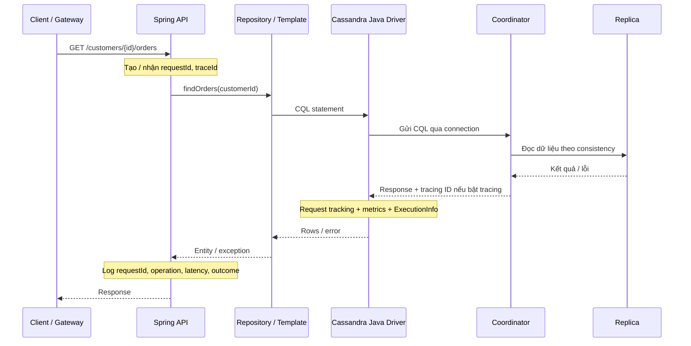

# Request tracking, truy vết truy vấn và log chẩn đoán

Một API sử dụng **Spring Data Cassandra** có thể gọi `CassandraRepository`, `CassandraTemplate` hoặc `CqlSession` rồi nhận lỗi timeout. Nếu chỉ có dòng log `Query timed out`, đội vận hành khó biết request của người dùng nào gặp vấn đề, câu CQL thuộc thao tác nghiệp vụ nào, coordinator nào đã xử lý và độ trễ phát sinh tại tầng ứng dụng, Java Driver hay cluster Cassandra. **Request tracking, query tracing và log chẩn đoán** giúp nối các thông tin này thành một chuỗi sự kiện có thể kiểm chứng.

Bài thuộc chương **Quan sát và vận hành** của `SPRING_DATA_CASSANDRA`. Trọng tâm là theo dõi request qua các lớp ứng dụng–driver–Cassandra, chẩn đoán truy vấn theo **partition key**, consistency level, paging và tài nguyên cluster, đồng thời tránh biến hệ thống quan sát thành nguồn gây quá tải hoặc rò rỉ dữ liệu nhạy cảm.

## 1. Phân biệt ba cơ chế quan sát

| Cơ chế | Quan sát từ đâu? | Thông tin trả lời được | Giới hạn |
| --- | --- | --- | --- |
| **Application correlation / distributed tracing** | Spring API, service và các lời gọi liên quan | Request nghiệp vụ nào gọi thao tác Cassandra nào, mất bao lâu qua các service? | Không tự động cho thấy chi tiết coordinator/replica nếu chưa instrument các lớp đó. |
| **Java Driver request tracking** | Phía client Cassandra, tại `CqlSession` | Một câu CQL kết thúc thành công/lỗi thế nào, latency client quan sát, execution metadata và thông tin điều phối nào có sẵn? | Không tự giải thích toàn bộ bước thực thi bên trong replica. |
| **Cassandra server-side query tracing** | Coordinator và replica của cluster Cassandra | Những hoạt động nội bộ nào đã diễn ra với **request được bật tracing**? | Tốn chi phí, chỉ bao phủ request được bật; không thay thế tracing end-to-end. |
| **Diagnostic logging và metrics** | Ứng dụng, driver, node Cassandra | Phân bố lỗi/latency theo thời gian, biến động CPU/I/O, sự kiện bất thường | Log riêng lẻ thiếu ngữ cảnh nếu không có ID tương quan, nhãn ổn định và thời gian đồng bộ. |

Các khái niệm cùng có chữ *trace* nhưng **không dùng chung một định danh**. `requestId` của API, `traceId` của hệ thống observability như OpenTelemetry và `tracingId` do Cassandra trả về khi bật query tracing là những ID phục vụ các lớp khác nhau. Muốn nối chúng phải **ghi rõ mối liên hệ** ở thời điểm xử lý request.

## 2. Luồng request qua Spring Data Cassandra



Trong một API, một lời gọi repository có thể dẫn đến nhiều page request. Retry hoặc speculative execution có thể tạo thêm lần gửi CQL đến coordinator khác. Vì vậy:

- **Một HTTP request** không nhất thiết tương đương **một CQL request**.
- **Một lời gọi driver** không bảo đảm chỉ có **một lần gửi trên mạng** trong mọi cấu hình.
- `p95` ở API và `p95` ở driver đo **hai phạm vi thời gian khác nhau**; không cộng hoặc so sánh chúng như cùng một phép đo.
- `ResultSet.getExecutionInfo()` phản ánh execution metadata cho một phần thực thi/kết quả tương ứng; khi tiêu thụ nhiều trang, cần chú ý metadata của **từng lần fetch**, thay vì giả định trang đầu đại diện cho toàn bộ truy vấn.

## 3. Chuẩn hóa thông tin cần theo dõi

Để so sánh được các request, định nghĩa một tập trường thống nhất cho log và dashboard:

| Trường | Ví dụ | Mục đích |
| --- | --- | --- |
| `request_id` | UUID của một lời gọi API | Ghép log ứng dụng cho cùng request. |
| `trace_id` / `span_id` | ID do hệ thống distributed tracing cấp | Xem đường đi qua nhiều service/span. |
| `cassandra_tracing_id` | UUID trả về khi bật server-side tracing | Tra cứu `system_traces` cho một CQL request cụ thể. |
| `operation` | `orders.find_page_by_customer` | Tên thao tác **ổn định**, không phụ thuộc tham số thực tế. |
| `table` / `query_shape` | `orders_by_customer` / `by_partition_key` | Khoanh vùng thiết kế bảng và truy vấn. |
| `consistency` | `LOCAL_QUORUM` | Hiểu yêu cầu replica và đánh giá latency phù hợp. |
| `page_size` | `50` | Phân biệt kết quả trang nhỏ và truy vấn nhiều hàng. |
| `latency_ms` | `83` | Độ trễ từ điểm đo xác định ở ứng dụng/driver. |
| `coordinator` | Host theo `ExecutionInfo` | Xem request được xử lý qua node nào; lưu ở log khi cần. |
| `outcome` / `error_type` | `success` / `ReadTimeoutException` | Phân tích tỷ lệ lỗi và loại lỗi. |

Chỉ ghi những trường **thực sự sẵn có**; không suy đoán coordinator hoặc số lần retry nếu lớp đo không cung cấp thông tin. Khi cần log ID người dùng/khách hàng để điều tra một trường hợp, áp dụng cơ chế bảo vệ dữ liệu và giới hạn truy cập thích hợp. Với metric, tránh đưa UUID, user ID, địa chỉ IP, nội dung CQL chứa giá trị thật hoặc exception message tự do vào **tag/label** vì sẽ làm tăng cardinality rất nhanh.

## 4. Gắn `requestId` vào log ứng dụng Spring

Ở ứng dụng Spring MVC, có thể tạo một correlation ID tại biên HTTP rồi đưa vào **MDC** (Mapped Diagnostic Context) để các log phát ra trên cùng thread có cùng `requestId`.

```java
import jakarta.servlet.FilterChain;
import jakarta.servlet.ServletException;
import jakarta.servlet.http.HttpServletRequest;
import jakarta.servlet.http.HttpServletResponse;
import java.io.IOException;
import java.util.UUID;
import org.slf4j.MDC;
import org.springframework.stereotype.Component;
import org.springframework.web.filter.OncePerRequestFilter;

@Component
public class RequestIdFilter extends OncePerRequestFilter {
    @Override
    protected void doFilterInternal(HttpServletRequest request,
                                    HttpServletResponse response,
                                    FilterChain chain)
            throws ServletException, IOException {
        String requestId = UUID.randomUUID().toString();
        MDC.put("requestId", requestId);
        response.setHeader("X-Request-Id", requestId);
        try {
            chain.doFilter(request, response);
        } finally {
            MDC.remove("requestId");
        }
    }
}
```

Ví dụ trên chủ động sinh UUID để tránh tin tưởng mù quáng một header do client cung cấp. Nếu hệ thống dùng `X-Request-Id` từ gateway tin cậy, hãy xác thực độ dài/định dạng, chính sách tin cậy, rồi mới chấp nhận. Một layout Logback có thể chứa `%X{requestId}`:

```text
2026-11-25T08:10:21Z INFO requestId=... operation=orders.find_page_by_customer latencyMs=82 outcome=success
```

**Giới hạn:** MDC dựa trên thread-local context. Với `@Async`, `CompletableFuture`, Reactor và `ReactiveCassandraTemplate`, thread có thể thay đổi. Cần dùng cơ chế context propagation của nền tảng (ví dụ Reactor Context/Micrometer Context Propagation) và kiểm thử việc truyền `requestId`; không giả định MDC tự đi xuyên qua mọi chuỗi reactive. Trong Spring Boot có Micrometer Tracing/OpenTelemetry, nên ưu tiên cơ chế tạo và truyền trace/span context đã được cấu hình của hệ thống, tránh sinh một distributed trace ID riêng không liên thông.

## 5. Request tracking từ Cassandra Java Driver

Trong Java Driver 4.x, lớp quan sát phía client có thể sử dụng **`RequestTracker` SPI**, cơ chế logging/metrics và `ExecutionInfo`. Tùy phiên bản và cấu hình, request tracker nhận callback khi request hoàn thành thành công hoặc lỗi, kèm latency và execution metadata. Thông tin này hữu ích khi cần tổng hợp các truy vấn theo `operation`, consistency, success/error và phân bố độ trễ ngay tại tầng driver.

Spring Data Cassandra không yêu cầu code ứng dụng phải tạo một `CqlSession` riêng cho mỗi repository. Thông thường framework sử dụng session được quản lý; cấu hình request tracking cần áp dụng trên **chính session** mà `Repository`/`CassandraTemplate` thực sự dùng, nếu không metric/log thu được sẽ thiếu phần lớn traffic.

Khi triển khai, cần xác minh khả năng của **đúng phiên bản Java Driver** trong dự án:

1. Cách đăng ký một `RequestTracker` vào session hoặc cấu hình driver.
2. Metadata nào được cung cấp khi thành công và khi lỗi; ví dụ coordinator được chọn, warning và retry/speculative execution.
3. Metric nào đã có sẵn và metric nào cần bổ sung; tránh tạo hai bộ histogram giống nhau với tag khác biệt.
4. Tính an toàn của logger: mặc định chỉ log **tên operation**, loại statement và thông tin kỹ thuật cần thiết; không log bound parameter hoặc toàn bộ dữ liệu trả về.

`RequestTracker` giúp quan sát **lời gọi ở phía client**. Nó không phải bằng chứng rằng mutation chỉ được chạy một lần tại cluster; timeout hoặc retry có thể dẫn tới trạng thái kết quả chưa xác định. Với thao tác ghi không idempotent như tăng counter, cần thiết kế retry và cơ chế chống trùng riêng.

### Ví dụ lấy metadata bằng `ExecutionInfo`

Để hiểu dữ liệu sẵn có mà driver có thể ghi, đoạn code sau chạy một truy vấn đọc có phân trang và log kết quả trang đầu. Việc bật tracing được kiểm soát bằng tham số `traceSampled` để **không tracing mọi request**:

```java
import com.datastax.oss.driver.api.core.CqlSession;
import com.datastax.oss.driver.api.core.cql.ExecutionInfo;
import com.datastax.oss.driver.api.core.cql.ResultSet;
import com.datastax.oss.driver.api.core.cql.SimpleStatement;
import java.util.UUID;
import org.slf4j.Logger;
import org.slf4j.LoggerFactory;

public final class OrderQueryProbe {
    private static final Logger log = LoggerFactory.getLogger(OrderQueryProbe.class);
    private final CqlSession session;

    public OrderQueryProbe(CqlSession session) {
        this.session = session;
    }

    public void readFirstPage(UUID customerId, boolean traceSampled) {
        SimpleStatement statement = SimpleStatement.builder("""
                SELECT order_id, created_at, status
                FROM orders_by_customer
                WHERE customer_id = ?
                """)
            .addPositionalValue(customerId)
            .setPageSize(50)
            .setIdempotent(true)
            .setTracing(traceSampled)
            .build();

        long started = System.nanoTime();
        try {
            ResultSet rs = session.execute(statement);
            ExecutionInfo info = rs.getExecutionInfo();
            // Mục đích ví dụ là đo thời gian nhận kết quả và metadata trang đầu.
            long elapsedMs = (System.nanoTime() - started) / 1_000_000;

            log.info("cassandra_query operation={} outcome={} latencyMs={} " +
                     "coordinator={} tracingId={} warnings={}",
                     "orders.find_page_by_customer", "success", elapsedMs,
                     info.getQueriedHost(), info.getTracingId(),
                     info.getWarnings().size());
        } catch (RuntimeException ex) {
            long elapsedMs = (System.nanoTime() - started) / 1_000_000;
            log.warn("cassandra_query operation={} outcome={} latencyMs={} errorType={}",
                     "orders.find_page_by_customer", "failure", elapsedMs,
                     ex.getClass().getSimpleName());
            throw ex;
        }
    }
}
```

Đoạn code minh họa dùng **Java Driver 4.x** và `CqlSession` có keyspace mặc định phù hợp. `ResultSet` đồng bộ có thể tải page đầu khi `session.execute` chạy; nếu sau đó iterate qua rows và các page tiếp theo, thời gian tiêu thụ/tải trang có thể khác. Để đặt SLO cho việc **trả 50 bản ghi cho người dùng**, cần đo đủ phần đọc rows, mapping và serialization của API, không dùng duy nhất `elapsedMs` ở ví dụ để tuyên bố đã đạt end-to-end latency.

`getTracingId()` thường chỉ hữu ích khi tracing của statement được bật và server trả ID. Giá trị có thể vắng mặt; code vận hành phải xử lý trường hợp không có ID. Nên giới hạn log per-request ở thời gian điều tra hoặc trên mẫu có chọn lọc: log INFO cho mọi câu CQL ở lưu lượng cao có thể gây I/O log lớn.

## 6. Cassandra query tracing phía server

**Server-side query tracing** ghi các bước thực thi CQL ở coordinator và replica. Dữ liệu trace được Cassandra ghi vào các bảng `system_traces`, thường có độ trễ ghi/hiển thị ngắn và thời gian lưu trữ hữu hạn. Đây là công cụ phân tích **request cụ thể**, không phải cơ chế thu thập toàn bộ truy vấn liên tục.

### Cách 1: bật tracing tạm thời trong `cqlsh`

```sql
TRACING ON;

SELECT order_id, created_at, status
FROM test_orders.orders_by_customer
WHERE customer_id = 2b06b38a-3d2c-4aad-93c2-95bd8bac960b;

TRACING OFF;
```

`cqlsh` sẽ hiển thị trace session ID và các sự kiện nếu có. `TRACING ON` là lệnh của `cqlsh` trong phiên làm việc đó; không thay đổi mặc định cho toàn bộ ứng dụng Spring. Các tên keyspace/bảng/UUID trong ví dụ chỉ là minh họa, cần thay bằng schema dữ liệu kiểm thử thực tế.

### Cách 2: bật tracing cho một statement ở Java Driver

```java
SimpleStatement traced = SimpleStatement.builder("""
        SELECT order_id FROM orders_by_customer
        WHERE customer_id = ?
        """)
    .addPositionalValue(customerId)
    .setTracing(true)
    .setIdempotent(true)
    .build();

ResultSet result = session.execute(traced);
UUID cassandraTracingId = result.getExecutionInfo().getTracingId();
```

Trong tình huống debug, ghi `cassandraTracingId` cùng `requestId`/`traceId` ứng dụng để kết nối hành vi phía client và server. Việc bật tracing cho request ghi cần cân nhắc chi phí và tính nhạy cảm; **không chạy lại một lệnh ghi nguy hiểm chỉ để lấy trace**, đặc biệt counter, list append hoặc nghiệp vụ có tác dụng bên ngoài Cassandra.

### Đọc các sự kiện trong `system_traces`

```sql
-- Đổi UUID bằng tracing ID thật nhận được.
SELECT session_id, coordinator, duration, started_at
FROM system_traces.sessions
WHERE session_id = 8f1a4b39-68d9-47a4-aafc-2fe11b919c15;

SELECT event_id, activity, source, source_elapsed, thread
FROM system_traces.events
WHERE session_id = 8f1a4b39-68d9-47a4-aafc-2fe11b919c15;
```

Vì metadata trace có thể được ghi **bất đồng bộ**, hai truy vấn đầu tiên có thể chưa thấy đủ sự kiện. Nếu cần, đợi ngắn và thử đọc lại có giới hạn; tránh polling liên tục lên `system_traces`. Các bảng/field và chính sách TTL cần được đối chiếu với phiên bản Cassandra đang chạy. Chỉ sử dụng cơ chế query tracing để điều tra có mục tiêu, không xem bảng `system_traces` là kho observability lâu dài.

### Đọc trace như thế nào?

| Dấu hiệu trong trace | Giả thuyết cần kiểm tra tiếp |
| --- | --- |
| Coordinator đợi phản hồi từ replica lâu | Độ trễ replica, network, consistency level, GC hoặc I/O tại node đích. |
| Nhiều hoạt động đọc dữ liệu cho một request nhỏ | Partition quá rộng, SSTable reads, tombstones, thiết kế bảng hoặc truy vấn chưa tối ưu. |
| Chi phí replica bất thường ở một node | Hot partition, disk bottleneck hoặc khác biệt tải giữa các node. |
| Tổng thời gian ở Cassandra nhỏ nhưng API vẫn chậm | Driver/network phía client, nhiều lời gọi CQL, mapping/serialization hoặc thread pool ứng dụng. |
| Trace bị thiếu/một số event chưa có | Tracing không được bật, sự kiện chưa ghi xong hoặc đã hết thời gian lưu. |

Trace là **dữ kiện hỗ trợ chẩn đoán**, không chứng minh nguyên nhân chỉ bằng một mẫu. Cần so sánh với các metric cùng khoảng thời gian và kiểm tra nhiều request đại diện trước khi kết luận.

## 7. Log chẩn đoán an toàn và có cấu trúc

Log tốt giúp trả lời bốn câu hỏi: **request nào**, **thao tác nào**, **mất bao lâu**, **thất bại tại đâu**. Nên dùng event name/tên operation cố định và JSON structured logging hoặc pattern nhất quán để hệ thống phân tích có thể lọc và nhóm chính xác.

Ví dụ log minh họa (ID, thời gian và host là giá trị giả):

```json
{
  "time": "2026-11-25T08:12:31Z",
  "level": "WARN",
  "service": "order-api",
  "request_id": "71e68354-eec9-473a-876d-8796c988090a",
  "trace_id": "d302adf5fa984586a11e393ac2b4e415",
  "operation": "orders.find_page_by_customer",
  "table": "orders_by_customer",
  "consistency": "LOCAL_QUORUM",
  "page_size": 50,
  "elapsed_ms": 410,
  "outcome": "timeout",
  "error_type": "ReadTimeoutException",
  "cassandra_tracing_id": null
}
```

Ở đây `cassandra_tracing_id` bằng `null` vì request chưa bật Cassandra query tracing; không được bịa ID từ trace của OpenTelemetry. Lỗi timeout có thể xảy ra mà **không thể biết chính xác** request trước đã thực thi đến đâu; đặc biệt phải cẩn trọng khi retry thao tác ghi.

**Không ghi vào log mặc định:**

- Mật khẩu, token, connection secrets, nội dung hàng dữ liệu và toàn bộ object entity.
- Bound values chứa dữ liệu cá nhân hoặc thông tin nghiệp vụ nhạy cảm; chỉ giữ **query shape**/operation name.
- Raw CQL không kiểm soát nếu câu lệnh có literal nhúng dữ liệu thật.
- Stack trace lặp đi lặp lại cho mọi lần timeout khi đang quá tải; dùng sampling/rate limiting kèm một số mẫu đầy đủ để điều tra.

Đặt log level theo nhu cầu: `INFO` cho các sự kiện dịch vụ thiết yếu, `WARN`/`ERROR` cho bất thường cần hành động và `DEBUG` chỉ trong khoảng thời gian, phạm vi logger, môi trường phù hợp. Có thể tăng mức log tạm thời cho những package liên quan Cassandra Java Driver, nhưng phải kiểm tra **dạng dữ liệu được logger phiên bản đang dùng phát ra** trước khi bật ở production. Việc bật `DEBUG` toàn bộ driver hoặc tracing cho mọi query có thể làm chi phí xử lý/log vượt lợi ích điều tra.

## 8. Kết hợp metric, log và trace để tìm nguyên nhân

Ba loại tín hiệu có vai trò khác nhau:

| Tín hiệu | Ví dụ | Sử dụng |
| --- | --- | --- |
| **Metrics** | `p95` đọc tăng từ 70 ms lên 450 ms; timeout rate tăng | Phát hiện phạm vi, thời điểm và quy mô bất thường. |
| **Logs** | `request_id`, `operation`, lỗi, coordinator khi có sẵn | Tìm các request và thao tác cụ thể bị ảnh hưởng. |
| **Traces** | Application span và Cassandra tracing ID được nối qua log | Hiểu request mất thời gian ở tầng nào và hoạt động server nào có vấn đề. |

Với Spring Boot, có thể dùng Micrometer để ghi `Timer` theo operation, outcome và exception class **được chuẩn hóa**. Việc tự tạo metric mới nên bổ sung những khoảng trống quan sát cụ thể, tránh đếm trùng với Actuator hoặc metric driver đã có. Metric nên có cardinality thấp, ví dụ:

```text
cassandra_operation_duration_seconds{operation="orders.find_page_by_customer",outcome="success"}
cassandra_operation_duration_seconds{operation="orders.find_page_by_customer",outcome="timeout"}
```

Đây là **tên/nhãn minh họa**, không phải tên metric mặc định được mọi phiên bản Spring Data Cassandra xuất ra. Cần kiểm tra instrumentation, backend Prometheus/OpenTelemetry và quy tắc đổi tên metric trong hệ thống thực tế.

Ở node Cassandra, nên đối chiếu với CPU, memory/GC pause, disk I/O, read/write latency, pending tasks, compaction backlog, tombstone scan, phân bố request theo node và tình trạng kết nối. Không thể kết luận Cassandra chậm chỉ từ một log timeout của ứng dụng; có thể nguyên nhân nằm ở queue phía client, thread blocking, network hoặc tham số timeout không phù hợp.

## 9. Quy trình điều tra request chậm hoặc timeout

Ví dụ API liệt kê đơn hàng theo khách xuất hiện nhiều timeout sau một lần triển khai. Có thể tiến hành theo trình tự:

1. **Chốt mốc thời gian và phạm vi.** Tìm khoảng bắt đầu lỗi, phiên bản ứng dụng, nhóm endpoint, tỷ lệ timeout và `p95/p99`. Xem lỗi xảy ra với mọi truy vấn hay chỉ một operation.
2. **Lấy request mẫu qua `request_id` hoặc `trace_id`.** Tìm log API, service và gọi Cassandra tương ứng; xác định số lần gọi CQL, số page, consistency và loại exception. Không dựa duy nhất vào một log cuối cùng.
3. **So latency giữa các tầng.** Nếu API mất 900 ms nhưng thời gian CQL ghi nhận 60 ms, điều tra mapping/serialization, chờ thread hoặc các lời gọi khác. Nếu driver latency tăng cùng timeout, mở rộng điều tra network/coordinator/replica.
4. **Kiểm tra query shape và schema.** Câu CQL có đủ partition key không? Có index/`ALLOW FILTERING`, hot partition, phân trang không giới hạn hay tải quá nhiều byte? `Repository` method name không bảo đảm query phù hợp Cassandra nếu mapping sai.
5. **Đối chiếu metric per-node.** Xem CPU, GC, disk latency, compaction, tombstone scan, pending tasks, imbalance và sự kiện thay đổi topology trong cùng khung thời gian.
6. **Lấy Cassandra query tracing có chọn lọc.** Bật tracing cho **truy vấn đọc idempotent** đại diện trên môi trường kiểm soát hoặc một tỷ lệ rất nhỏ khi được phép. Ghi `cassandra_tracing_id` và tra `system_traces`; tránh tracing trên mọi request lúc cluster đang quá tải.
7. **Hình thành giả thuyết và kiểm chứng.** Chẳng hạn: partition của một khách quá lớn khiến số SSTable read tăng. Thử điều chỉnh query/page, thay đổi thiết kế partition hoặc giảm dữ liệu quét trên môi trường thử nghiệm; so sánh lại SLI và metric cluster.
8. **Ghi kết luận vận hành.** Lưu query shape, nguyên nhân được xác minh, cách khắc phục, tác động tới consistency và kết quả kiểm thử tải. Không coi tăng timeout hoặc bật retry đại trà là sửa lỗi gốc.

### Ví dụ phân tích nhanh hai tình huống

**Tình huống A — `p99` tăng nhưng Cassandra read latency không tăng:** xem số lệnh Cassandra trên mỗi API (N+1 calls), pagination làm fetch nhiều trang, blocking thread, serialization và contention ở tầng Spring. Không tối ưu compaction chỉ vì endpoint chậm.

**Tình huống B — timeout chỉ tập trung ở một vài partition:** phân tích partition key, kích thước partition, lượt đọc cùng khóa, tombstone và chênh tải giữa node. Thay đổi partition key/bucketing có thể là giải pháp đúng hơn tăng connection pool hoặc số thread của Java Driver.

## 10. Chi phí quan sát, sampling và bảo mật

Quan sát có chi phí thật: log tạo I/O và chi phí lưu trữ; metrics cardinality cao tốn bộ nhớ; server-side tracing thêm công việc cho coordinator/replica; collect toàn bộ span có thể gây tải cho collector. Một chiến lược thực tế:

| Tín hiệu | Cách sử dụng đề xuất |
| --- | --- |
| Metric latency/count/error theo operation | Thu thập thường xuyên; tag số lượng hữu hạn và histogram phù hợp. |
| Log bất thường với correlation ID | Ghi rõ failure/timeout; sampling hoặc giới hạn log lặp ở đợt lỗi lớn. |
| Diagnostic log chi tiết theo request | Bật trong cửa sổ điều tra, theo một nhóm request/operation đã chọn. |
| Distributed tracing ở ứng dụng | Sampling phù hợp tải; có chiến lược ưu tiên những request lỗi/chậm nếu stack hỗ trợ. |
| Cassandra server query tracing | Chỉ bật cho request cụ thể hoặc mẫu rất nhỏ; tắt ngay khi đủ dữ kiện. |

Các ID dùng để truy dấu có thể xuất hiện trong log nhiều hệ thống; cần áp dụng chính sách retention, kiểm soát quyền xem log, mã hóa đường truyền và loại bỏ dữ liệu nhạy cảm. Không đặt `request_id`, `customer_id` hoặc `cassandra_tracing_id` làm label Prometheus; chúng hữu ích như **thuộc tính log/trace** có giới hạn quyền truy cập hơn là metric tag.

Trong Spring WebFlux/ReactiveCassandraTemplate, chú ý chuỗi xử lý **không đồng bộ**, cancellation và context propagation. Phân biệt thời gian tạo `Mono`/`Flux` với thời gian **subscribe và tiêu thụ rows**; nếu chỉ đo thời gian tạo publisher, phép đo gần như không phản ánh CQL thực thi.

## 11. Các lỗi thường gặp khi triển khai observability

| Lỗi | Hệ quả | Cách xử lý |
| --- | --- | --- |
| Gộp `requestId`, OpenTelemetry `traceId` và Cassandra `tracingId` làm một | Không thể tra đúng trace phía server hoặc correlating sai | Lưu các field riêng, chỉ liên kết khi có thông tin thực. |
| Bật `TRACING ON` trong `cqlsh` rồi mong mọi `Repository` call được tracing | Trace chỉ áp dụng cho session/lệnh bật tracing | Bật sampling tracing trên statement thực cần điều tra. |
| Ghi nguyên CQL với bound value hoặc in cả entity | Rò rỉ dữ liệu nhạy cảm, log quá lớn | Log operation/query shape, redaction, giới hạn truy cập. |
| Gắn UUID/user ID vào metric tag | Cardinality nổ, tăng chi phí và độ trễ metric backend | Dùng tag thấp cardinality; đưa ID vào log/trace. |
| Chỉ xem log ERROR khi `p99` tăng | Bỏ qua request thành công nhưng rất chậm | Kết hợp histogram, latency theo operation và sampling trace. |
| Cho rằng một timeout đồng nghĩa không có mutation | Có thể retry sai và tạo tác dụng phụ lặp | Dùng idempotency key, kiểm tra trạng thái, xem lại retry policy. |
| Chỉ đo `execute()` nhưng API phải đọc nhiều trang | Không tính thời gian tải trang/mapping | Đo riêng từng page và toàn bộ thời gian tiêu thụ kết quả. |
| Mất MDC khi qua Reactor/async | Log thiếu request ID | Kiểm tra propagation theo môi trường thực tế. |
| Bật debug/trace đại trà lúc cluster đang quá tải | Tăng thêm I/O, CPU, log volume | Bật có chọn lọc, có thời hạn và quan sát overhead. |
| Quên kết hợp tracing với metric node | Đổ lỗi nhầm cho CQL/driver | So request sample với CPU, GC, disk, pending compaction theo cùng thời gian. |

## 12. Checklist vận hành

- [ ] Ứng dụng có correlation ID cho request và, nếu cần, distributed trace/span ID có truyền context đúng qua async/reactive.
- [ ] Mỗi đường truy cập Cassandra quan trọng có `operation` ổn định và phân biệt `Repository`, `CassandraTemplate` hoặc CQL cụ thể khi điều tra.
- [ ] Metrics thể hiện latency `p50/p95/p99`, số request, timeout/error rate và lượng query thực; metric tag có cardinality thấp.
- [ ] Driver request tracking/metrics được bật trên **session do Spring thực sự dùng**; version-specific API được xác minh.
- [ ] Log lỗi chứa thời gian, operation, outcome, exception type và request ID; dữ liệu bí mật và bound values được che hoặc không ghi.
- [ ] Có cách bật Cassandra query tracing chọn lọc, lấy `cassandra_tracing_id`, tra `system_traces` và tắt tracing sau điều tra.
- [ ] Dashboard đối chiếu ứng dụng/driver với chỉ số per-node Cassandra, nhất là CPU, I/O, GC, tombstone và compaction.
- [ ] Với paging, định nghĩa đo thời gian page đầu, page tiếp theo và cả luồng dữ liệu; với reactive, đo từ subscription đến lúc tiêu thụ.
- [ ] Runbook điều tra timeout không đưa ra giả định rằng thao tác ghi chưa thành công và không bật retry mù.
- [ ] Có sampling, retention, chính sách truy cập log và kiểm soát overhead observability.

**Ghi nhớ:** để chẩn đoán một truy vấn Cassandra, trước hết cần xác định **request nghiệp vụ** và **CQL operation** liên quan, rồi đối chiếu latency/log ở Java Driver với metric coordinator/replica. Chỉ dùng **server-side query tracing** cho request chọn lọc và lưu chính xác `cassandra_tracing_id`. Kết hợp các tín hiệu đó sẽ hữu ích hơn một kho log DEBUG lớn nhưng không có correlation ID, query shape và ngữ cảnh tài nguyên.
