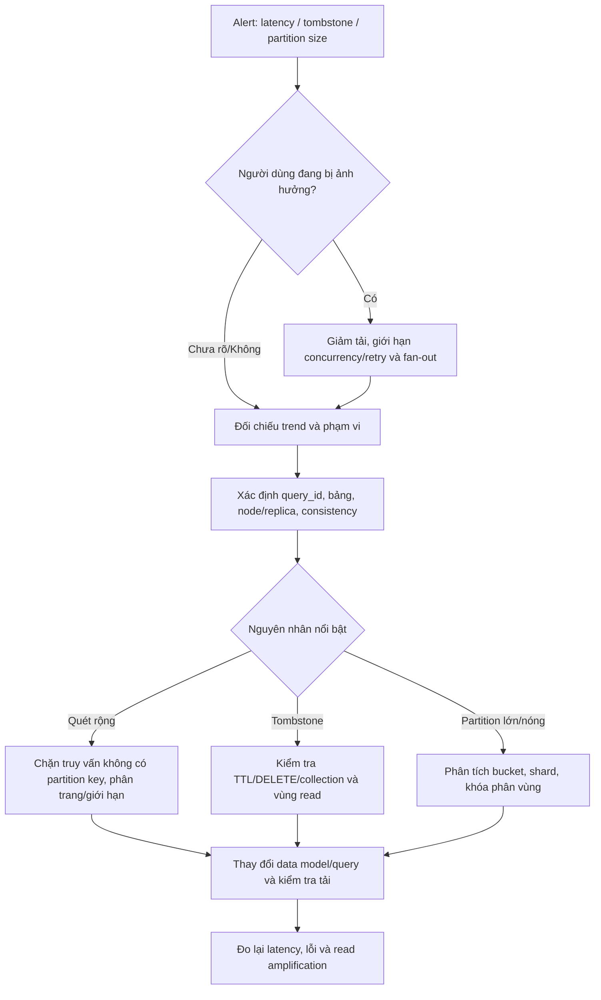

# Cảnh báo truy vấn rộng, tombstone và partition lớn

Trong ứng dụng **Spring Data Cassandra**, một endpoint có thể vẫn trả dữ liệu đúng nhưng độ trễ tăng dần khi lượng dữ liệu tích lũy. Nguyên nhân không nhất thiết nằm ở Java hay kết nối: truy vấn có thể đọc quá nhiều partition, phải quét qua hàng nghìn **tombstone** hoặc chạm vào một **partition quá lớn**. Khi tải tăng, các vấn đề này kéo theo timeout, retry, tăng áp lực lên CPU/đĩa/compaction và ảnh hưởng tới những truy vấn khác trên Apache Cassandra.

Bài học thuộc phần **Quan sát và vận hành** của module Spring Data Cassandra. Mục tiêu là xây dựng tín hiệu giám sát và cảnh báo có thể hành động được, xác định truy vấn gây vấn đề, rồi cải thiện mô hình dữ liệu theo truy vấn. Nội dung áp dụng cho **entity mapping, repository, CassandraTemplate và CQL**, đồng thời liên hệ với **partition key, consistency, paging** và giới hạn hiệu năng của cơ sở dữ liệu phân tán.

## 1. Ba dấu hiệu cần phân biệt

| Dấu hiệu | Bản chất | Hệ quả thường gặp |
| --- | --- | --- |
| **Truy vấn rộng** (*wide/broad query*) | Truy vấn đụng nhiều partition, quét nhiều hàng hoặc đọc vùng dữ liệu lớn hơn nhu cầu nghiệp vụ | Độ trễ tăng khi dữ liệu lớn; read amplification, tải mạng/đĩa cao |
| **Tombstone nhiều** | Bản ghi/cell/range đã bị xóa hoặc hết TTL cần được đọc và xử lý trong quá trình trả dữ liệu còn sống | Một truy vấn trả vài hàng vẫn phải quét nhiều dấu xóa; có thể chạm ngưỡng cảnh báo/thất bại |
| **Partition lớn** | Một khóa phân vùng chứa lượng dữ liệu quá lớn, hoặc trở thành điểm nóng do tập trung quá nhiều truy cập | Đọc/sửa/xóa chậm, compaction khó, tiêu thụ bộ nhớ và chênh lệch tải giữa các node |

Ba hiện tượng có thể xảy ra cùng lúc nhưng **không đồng nghĩa**:

- Partition lớn vẫn có thể đọc nhanh khi truy vấn lấy một lát cắt nhỏ theo clustering key và lượng dữ liệu chết ít.
- Partition không quá lớn vẫn có thể đọc chậm nếu lát cắt cần đọc chứa nhiều tombstone.
- Truy vấn thiếu điều kiện partition key có thể đụng rất nhiều partition nhỏ; giới hạn kích thước từng partition không tự giải quyết việc đọc quá rộng.

Một hệ thống giám sát tốt cần quan sát đồng thời **tác động lên người dùng** (latency, timeout, lỗi) và **tín hiệu nguyên nhân** (tombstone được quét, kích thước partition, loại truy vấn, compaction).

## 2. Nhận biết truy vấn rộng trong Cassandra

Cassandra được tối ưu cho truy vấn biết trước **partition key** và cách sắp xếp bằng **clustering column**. Tình huống đáng nghi:

1. `SELECT * FROM events_by_tenant_day` không giới hạn phạm vi dữ liệu.
2. Truy vấn theo cột không thuộc khóa chính rồi thêm `ALLOW FILTERING` để “chạy được”.
3. Truy vấn `IN` trên danh sách partition key dài, phát nhiều truy vấn phụ hoặc tạo fan-out lớn ở service.
4. Quét nhiều partition hoặc nhiều trang để tìm một vài bản ghi sau khi lọc ở tầng Java.
5. `SELECT` lấy cả cột payload lớn dù giao diện chỉ cần vài thuộc tính.
6. Truy vấn theo partition key hợp lệ nhưng lấy cả partition rất lớn thay vì có giới hạn theo clustering key và khoảng thời gian.

**Ví dụ cần tránh** khi bảng được thiết kế để đọc theo tenant và ngày:

```sql
-- Không có tenant_id/day_bucket: phạm vi đọc không được chặn bởi partition key.
SELECT * FROM events_by_tenant_day;

-- ALLOW FILTERING không tự tạo đường truy cập hiệu quả.
SELECT * FROM events_by_tenant_day
WHERE event_type = 'PAYMENT_FAILED'
ALLOW FILTERING;
```

Không có truy vấn kiểu `EXPLAIN` tương đương hệ quản trị quan hệ để dựa vào một execution plan duy nhất. Hãy kiểm tra **schema, CQL, khóa phân vùng, số partition được chạm, lượng hàng trả về và tài nguyên thực tế**. Có thể dùng tracing với số ít truy vấn trong môi trường được kiểm soát, nhưng tracing có chi phí và không nên bật tràn lan trên production.

### Thiết kế truy vấn điểm hoặc khoảng có giới hạn

Ví dụ bảng phục vụ tra cứu sự kiện của một tenant theo ngày:

```sql
CREATE TABLE events_by_tenant_day (
    tenant_id uuid,
    day_bucket date,
    occurred_at timestamp,
    event_id timeuuid,
    event_type text,
    payload text,
    PRIMARY KEY ((tenant_id, day_bucket), occurred_at, event_id)
) WITH CLUSTERING ORDER BY (occurred_at DESC, event_id DESC);
```

Truy vấn có phạm vi rõ ràng:

```sql
SELECT occurred_at, event_id, event_type
FROM events_by_tenant_day
WHERE tenant_id = ?
  AND day_bucket = ?
  AND occurred_at >= ?
  AND occurred_at < ?
LIMIT 100;
```

Ở đây `(tenant_id, day_bucket)` xác định partition; `occurred_at` là clustering column, cho phép đọc một khoảng thời gian trong partition. Chỉ lấy những cột cần thiết giúp giảm bytes truyền và decode.

**Lưu ý:** `LIMIT 100` chỉ giới hạn số hàng kết quả; nó **không bảo đảm Cassandra chỉ đọc 100 hàng vật lý**. Nếu vùng dữ liệu có quá nhiều tombstone hoặc partition cực lớn, Cassandra có thể cần quét nhiều hơn để tìm đủ 100 hàng còn sống. Nếu một tenant tạo quá nhiều sự kiện trong một ngày, cần xem lại kích thước bucket hoặc phân mảnh (`shard`) theo mẫu truy vấn thực tế.

## 3. Tombstone là gì và vì sao phải cảnh báo?

Trong Cassandra, thao tác `DELETE`, ghi `null` vào một số kiểu cột, cập nhật một số collection hoặc **hết hạn TTL** có thể sinh ra tombstone. Tombstone là dấu vết xóa được giữ để các replica biết dữ liệu cũ không được xuất hiện trở lại khi chúng đồng bộ. Dữ liệu bị đánh dấu xóa chỉ có thể được loại bỏ vật lý khi các điều kiện an toàn và compaction cho phép.

Ví dụ:

```sql
INSERT INTO events_by_tenant_day (
    tenant_id, day_bucket, occurred_at, event_id, event_type, payload
) VALUES (?, ?, ?, ?, 'SESSION_EXPIRED', ?)
USING TTL 3600;

-- Sau thời gian TTL, các cell hết hạn không lập tức biến mất khỏi SSTable.
-- Các lần đọc sau đó có thể phải xét tombstone tương ứng.
```

Giả sử một partition có hàng chục nghìn bản ghi đã hết TTL, nhưng query chỉ cần 20 bản ghi còn sống. Máy chủ có thể phải quét nhiều tombstone để tìm 20 hàng này. Điều đó tạo **read amplification** và tác động lên latency, ngay cả khi response nhỏ.

### Cần theo dõi gì?

| Tín hiệu | Ý nghĩa khi tăng | Giới hạn diễn giải |
| --- | --- | --- |
| Số tombstone được quét trong một truy vấn/read | Một request phải bỏ qua nhiều dữ liệu đã xóa | Cần biết thuộc bảng/truy vấn nào, không kết luận từ tổng tombstone toàn cluster |
| Phân bố tombstone scanned (p95/p99/max) theo bảng | Phát hiện một nhóm truy vấn bị ảnh hưởng nặng | Histogram có thể phản ánh nhiều mẫu truy vấn; kết hợp telemetry từ ứng dụng |
| Cảnh báo tombstone trong log Cassandra | Truy vấn đã chạm ngưỡng cảnh báo vận hành | Ngưỡng phụ thuộc phiên bản và cấu hình; cảnh báo không tự cho biết cách sửa |
| Read latency, read timeout và tỷ lệ lỗi cùng thời điểm | Xác nhận tác động tới người dùng | Chậm có thể còn do CPU, đĩa, mạng hoặc overload |
| Compaction backlog, disk utilization và lượng dữ liệu hết TTL | Cho biết khả năng dọn dữ liệu và áp lực lưu trữ | Không nên xem “đợi compaction” là cách chữa mọi mô hình dữ liệu sai |

Cassandra có các tham số cấu hình liên quan đến ngưỡng cảnh báo/thất bại khi quét tombstone, thường gặp như `tombstone_warn_threshold` và `tombstone_failure_threshold` trong `cassandra.yaml`. **Không coi một giá trị mặc định là bất biến cho mọi phiên bản**, và không tăng ngưỡng chỉ để làm log im lặng: query vẫn có thể quét cùng lượng tombstone, chỉ mất tín hiệu cảnh báo sớm.

Không tự ý rút ngắn `gc_grace_seconds` để dọn tombstone nhanh hơn. Chính sách này liên quan đến thời gian xóa an toàn, repair và khả năng replica bị bỏ lỡ deletion. Điều chỉnh sai có thể làm dữ liệu đã xóa xuất hiện trở lại trong những tình huống lỗi/replica trễ.

## 4. Partition lớn và partition nóng khác nhau thế nào?

**Partition lớn** là partition có nhiều dữ liệu trên đĩa hoặc quá nhiều row/cell. **Partition nóng** là partition nhận lượng đọc/ghi tập trung cao so với các partition khác. Một partition có thể:

- Lớn nhưng ít truy cập: vấn đề chủ yếu nằm ở bảo trì, scan khi đọc và compaction.
- Nhỏ nhưng rất nóng: gây mất cân bằng tải do lượng request tập trung vào cùng token/replica.
- Vừa lớn vừa nóng: rủi ro lớn nhất, đặc biệt khi lượng tombstone tăng.

Ví dụ `PRIMARY KEY ((tenant_id), event_id)` gom **mọi sự kiện của một tenant trong toàn bộ vòng đời** vào một partition có thể tăng mãi. Nếu dùng `PRIMARY KEY ((tenant_id, day_bucket), occurred_at, event_id)`, kích thước được giới hạn theo ngày, nhưng tenant tạo hàng triệu sự kiện/ngày vẫn có thể tạo partition lớn. Có thể xét bucket theo giờ, loại sự kiện hoặc shard, với điều kiện truy vấn đọc có thể định tuyến chính xác và fan-out vẫn bị giới hạn.

**Không có một ngưỡng MB duy nhất đúng cho mọi workload.** Nhiều đội đặt ngưỡng rà soát từ mức **vài chục MB** và coi khoảng **100 MB** là tín hiệu partition cần được đánh giá kỹ, nhưng ngưỡng thực tế phụ thuộc phiên bản Cassandra, loại cột, tỷ lệ tombstone, phần cứng, compaction strategy, latency SLO và mẫu truy vấn. Giá trị này là **mốc vận hành tham khảo**, không phải giới hạn cứng của Cassandra.

### Một phép ước lượng trước khi dữ liệu tăng lớn

Giả sử mỗi event lưu trung bình **2 KB** dữ liệu và metadata, tenant phát sinh **100.000 event/ngày**:

\[
\text{Partition/ngày} \approx 100{,}000 \times 2\ \text{KB}
                          \approx 200\ \text{MB}
\]

Đây là phép ước lượng thô theo kích thước logic, chưa tính overhead, index, compression hoặc SSTable. Nó đủ để thấy partition theo ngày có thể quá lớn. Với bucket theo giờ (phân bố đều), mỗi partition còn khoảng 8,3 MB; tuy nhiên nếu tải dồn trong một giờ, cần xét đỉnh thực tế. Việc chuyển bucket làm tăng số partition cần tra cứu khi API lấy một khoảng thời gian dài, nên phải cân bằng giữa **kích thước mỗi partition** và **số partition mỗi request phải đọc**.

## 5. Các lớp đo lường: ứng dụng, driver và Cassandra node

Quan sát chỉ một lớp thường không đủ. Một endpoint chậm có thể do waiting queue trong Java, số attempt retry tăng, truy vấn rộng hoặc một node đang compaction mạnh.

| Lớp | Nên thu thập | Giúp trả lời |
| --- | --- | --- |
| **HTTP/service Spring** | Throughput, p50/p95/p99, error rate, deadline exceeded; `query_id` ổn định cho mỗi kiểu truy vấn | Người dùng bị ảnh hưởng ở luồng nào? |
| **Spring Data / CQL call site** | Thời gian một thao tác, số hàng thực trả, page count, page size, số attempt và outcome | Repository/Template/CQL nào tạo truy vấn nặng? |
| **Java Driver** | Request latency, timeout/error, retry/speculative execution, in-flight requests, connection pool theo node | Client có bão retry hoặc chờ kết nối không? |
| **Cassandra theo bảng** | Read latency, tombstone scanned, live cells scanned, SSTables per read, ước lượng kích thước partition | Bảng nào có read amplification hoặc partition lớn? |
| **Cassandra theo node** | CPU, heap/GC, disk/IO, pending tasks, compaction, read/write timeout, dropped messages nếu có | Đang nghẽn vì tài nguyên hay dữ liệu? |
| **Log/tracing** | Tombstone warnings, large partition warnings, câu truy vấn/trace được lấy mẫu an toàn | Bằng chứng cụ thể để điều tra một hiện tượng |

Tên metric **không đồng nhất giữa các phiên bản Cassandra, Java Driver và JMX/Prometheus exporter**. Chẳng hạn ở Cassandra có các họ metric liên quan `TombstoneScannedHistogram`, `LiveScannedHistogram`, `EstimatedPartitionSizeHistogram` và `SSTablesPerReadHistogram`; cách chúng được xuất thành tên Prometheus và label tùy cấu hình exporter. Đọc metric thực tế trên cluster rồi xây bảng ánh xạ trong dashboard, tránh sao chép một tên PromQL chưa xác minh.

### Lệnh điều tra trên node

Các lệnh sau hữu ích trong phạm vi node/cluster được phép truy cập:

```bash
# Thống kê bảng trong keyspace.
nodetool tablestats app_keyspace.events_by_tenant_day

# Histogram độ trễ đọc/ghi, kích thước và cell count của partition.
nodetool tablehistograms app_keyspace events_by_tenant_day

# Kiểm tra tiến độ/tồn đọng compaction và trạng thái thread pool.
nodetool compactionstats
nodetool tpstats
```

Đọc kết quả **trên các node liên quan** và so sánh qua thời gian. Một node không đại diện cho toàn cluster; histogram kích thước partition thường là **ước lượng** dựa trên thông tin cục bộ, không phải phép đo chính xác tất cả partition. Cách hiển thị của `nodetool tablestats` và `tablehistograms` có thể khác giữa các phiên bản; trước khi tự động parse, xác nhận định dạng đang dùng.

### Log và tracing có mục tiêu

Khi Cassandra phát cảnh báo tombstone hoặc partition lớn, nên ghi lại thời gian, node, keyspace/table, số lượng/ước lượng được báo và mã truy vấn ứng dụng có liên quan. Không lưu **giá trị partition key, nội dung CQL chứa dữ liệu người dùng hoặc payload nhạy cảm** vào metric label.

Tracing CQL có thể chỉ ra các bước đọc/SSTable và replica xử lý yêu cầu, nhưng làm tăng chi phí hệ thống. Chỉ bật trên lượng truy vấn nhỏ, có thời hạn và quy trình kiểm soát thích hợp; **không bật tracing toàn bộ traffic production** để giải quyết một cảnh báo.

## 6. Gắn tên truy vấn ổn định vào Spring Data Cassandra

Một biểu đồ “Cassandra chậm” chưa đủ để biết phải sửa code ở đâu. Mỗi đường truy cập nên có **mã truy vấn ổn định**, ví dụ:

| `query_id` | Đường gọi | Mô tả phạm vi kỳ vọng |
| --- | --- | --- |
| `events.by_tenant_day.range` | `CassandraTemplate` / CQL | Một tenant, một ngày, khoảng clustering key, số hàng tối đa |
| `orders.by_id` | `CassandraRepository.findById` | Một primary key |
| `orders.by_customer.page` | Repository query theo khóa khách hàng | Một partition với paging state |
| `events.search_admin` | API quản trị có fan-out được giới hạn | Số bucket/partition tối đa được quy định rõ |

Những mã này được **khai báo cố định trong code hoặc cấu hình**, không lấy trực tiếp từ CQL động, user ID, token hoặc chuỗi filter do client gửi. Với lượng người dùng lớn, gắn partition key làm metric label sẽ gây bùng nổ cardinality và rủi ro lộ dữ liệu. Có thể lưu dấu khóa đã **băm/ẩn danh** trong log chẩn đoán lấy mẫu có quyền truy cập phù hợp, nhưng không dùng hàng triệu hash làm dimension của histogram.

### Ví dụ đo latency và outcome bằng Micrometer

Ví dụ wrapper dưới đây dùng được quanh thao tác repository, `CassandraTemplate` hoặc CQL đồng bộ. Nó ghi thời gian kể cả khi truy vấn ném lỗi:

```java
import java.util.function.Supplier;

import io.micrometer.core.instrument.MeterRegistry;
import io.micrometer.core.instrument.Timer;
import org.springframework.stereotype.Component;

@Component
public class CassandraQueryMetrics {
    private final MeterRegistry registry;

    public CassandraQueryMetrics(MeterRegistry registry) {
        this.registry = registry;
    }

    // queryId phải lấy từ danh sách hằng số đã kiểm soát.
    public <T> T record(String queryId, Supplier<T> operation) {
        Timer.Sample sample = Timer.start(registry);
        String outcome = "success";

        try {
            return operation.get();
        } catch (RuntimeException ex) {
            outcome = "error";
            throw ex;
        } finally {
            sample.stop(Timer.builder("app.cassandra.query.duration")
                .tag("query", queryId)
                .tag("outcome", outcome)
                .publishPercentileHistogram()
                .description("Duration of an application Cassandra query")
                .register(registry));
        }
    }
}
```

Ví dụ sử dụng:

```java
// ordersRepository là CassandraRepository đã được ứng dụng cung cấp.
return queryMetrics.record(
    "orders.by_id",
    () -> ordersRepository.findById(orderId)
);
```

Với Spring Boot, Micrometer/Actuator và registry tương ứng cần được cấu hình cho môi trường thật. Tên metric ở đây là **metric ứng dụng tự định nghĩa**, không phải metric có sẵn của Spring Data Cassandra. Histogram tiêu tốn bộ nhớ và sinh nhiều chuỗi thời gian; chỉ bật cho các `query_id` có cardinality thấp, điều chỉnh bucket theo SLO và ngân sách monitoring.

Nếu đang dùng Spring WebFlux hoặc driver reactive, dùng instrumentation bất đồng bộ đo đến khi publisher hoàn tất/đổ lỗi, thay vì đo thời gian **tạo publisher**. Với truy vấn paging, xác định đo thời gian cho **mỗi page** hay cho **toàn bộ quá trình lấy các page**; báo cáo cả hai nếu cần.

### Ví dụ CQL có phạm vi và page size

```java
var statement = com.datastax.oss.driver.api.core.cql.SimpleStatement
    .builder("""
        SELECT occurred_at, event_id, event_type
        FROM events_by_tenant_day
        WHERE tenant_id = ? AND day_bucket = ?
          AND occurred_at >= ? AND occurred_at < ?
        LIMIT 100
        """)
    .addPositionalValues(tenantId, dayBucket, from, to)
    .setPageSize(100)
    .setIdempotent(true)
    .build();

var rows = queryMetrics.record(
    "events.by_tenant_day.range",
    () -> session.execute(statement).all()
);
```

Trong ví dụ, `LIMIT 100` giới hạn tổng hàng trả về, `setPageSize(100)` xác định cỡ page phía driver, còn `setIdempotent(true)` phù hợp với đọc thuần không có tác động phụ. Không áp dụng `setIdempotent(true)` một cách máy móc cho ghi/counter. Một API cần nhiều page nên dùng paging state đúng cách; **page size không phải tổng giới hạn dữ liệu**.

## 7. Thiết kế cảnh báo theo mức độ ảnh hưởng và nguyên nhân

Cảnh báo chỉ hữu ích khi có **điều kiện rõ, thời gian duy trì, người nhận và hành động tiếp theo**. Các con số dưới đây minh họa cách tổ chức cảnh báo; phải hiệu chỉnh theo SLO, baseline, traffic và cấu hình Cassandra thực tế.

| Cảnh báo | Điều kiện gợi ý | Mức ưu tiên / hành động |
| --- | --- | --- |
| **Độ trễ truy vấn vượt SLO** | p99 của `query_id` vượt SLO trong 10 phút và có đủ số request trong cửa sổ đo | Ưu tiên cao nếu ảnh hưởng người dùng; xem truy vấn, node, page và tải |
| **Timeout/lỗi đọc tăng** | Tỷ lệ `ReadTimeout` / `Unavailable` tăng bền vững, đi kèm latency hoặc tải | Điều tra consistency, replica, hot partition, retry |
| **Tombstone scanned tăng** | p95/p99 tombstone scanned của một bảng tăng mạnh so với baseline, hoặc có log cảnh báo lặp | Xác định query_id, TTL/DELETE và vùng clustering key bị quét |
| **Partition kích thước bất thường** | Kích thước partition ước lượng tăng theo xu hướng, vượt ngưỡng rà soát đã chọn | Đánh giá bucket/shard, chọn chiến lược migration |
| **Partition nóng / node lệch tải** | Một tập replica có latency/CPU/in-flight vượt trội, traffic tăng tập trung | Tìm truy vấn/tenant nóng bằng log lấy mẫu an toàn; xét phân bổ dữ liệu |
| **Compaction không theo kịp** | Pending compactions, dung lượng đĩa hoặc read amplification tăng kéo dài | Kiểm tra TTL, tombstone, chiến lược compaction và tốc độ ghi |
| **Retry làm khuếch đại tải** | Số attempt/request hoặc speculative execution tăng cùng timeout | Giảm retry, áp dụng budget, giới hạn concurrency |

Không nên tạo cảnh báo khẩn cấp chỉ vì **một** lần vượt ngưỡng tombstone hoặc **một** partition lớn nhưng không ảnh hưởng dịch vụ. Có thể dùng cảnh báo mức *warning* để điều tra xu hướng, rồi nâng mức nghiêm trọng khi latency, error rate, tài nguyên node hoặc số lần cảnh báo đồng thời xấu đi. Ngược lại, cảnh báo node/partition cực đoan có thể cần xử lý trước khi người dùng thấy lỗi.

### PromQL minh họa từ metric ứng dụng ở phần trước

Với Micrometer Prometheus registry và histogram đã được phát hành, metric `app.cassandra.query.duration` ở ví dụ trên có thể được biểu diễn thành chuỗi `app_cassandra_query_duration_seconds_bucket`. Kiểm tra tên xuất thực tế trước khi đưa vào alert rule.

```promql
# p99 theo mã truy vấn trong 5 phút:
histogram_quantile(
  0.99,
  sum by (le, query) (
    rate(app_cassandra_query_duration_seconds_bucket[5m])
  )
)
```

```promql
# Tỷ lệ lỗi của mỗi mã truy vấn trong 5 phút:
sum by (query) (
  rate(app_cassandra_query_duration_seconds_count{outcome="error"}[5m])
)
/
sum by (query) (
  rate(app_cassandra_query_duration_seconds_count[5m])
)
```

Để hạn chế nhiễu, chỉ kích hoạt theo tỷ lệ lỗi/p99 khi lượng request đủ lớn, xét khoảng duy trì `for` thích hợp và bỏ qua nhóm không đủ mẫu. Nếu Prometheus không có chuỗi `outcome="error"` trong cửa sổ không lỗi, cách kết hợp/điền giá trị thiếu cần được xử lý trong alert rule cuối cùng. Các biểu thức trên mang tính **hướng dẫn điều tra**, chưa phải cấu hình alert production hoàn chỉnh.

Metric tombstone/partition của Cassandra phụ thuộc exporter nên không gán bừa một công thức PromQL với tên không chắc có tồn tại. Sau khi chọn exporter, hãy xác minh metric tương ứng qua dashboard/JMX và đặt alert dùng **số lần quét theo request hoặc phân bố kích thước** chứ không chỉ tổng số hàng của bảng.

## 8. Quy trình ứng cứu khi có cảnh báo



### Bước 1 — Xác định phạm vi và mức ảnh hưởng

Ghi lại thời điểm bắt đầu, SLO bị vượt, endpoint, traffic, `query_id` và tỉ lệ lỗi. Phân biệt **một nhóm query chậm** với **toàn node/cluster chậm**. Đối chiếu deployment gần đây, tăng dữ liệu, cron/batch/TTL expiration và các lần chạy backfill.

### Bước 2 — Khoanh vùng bảng và truy vấn

Với `query_id` gây chậm, xem source của repository/`CassandraTemplate`/CQL. Xác nhận câu truy vấn sử dụng **đủ partition key**, có lọc theo clustering key đúng thứ tự và chỉ lấy cột cần thiết. Kiểm tra số page, kích thước response, số partition fan-out và các lần retry do driver/service.

Không sử dụng một truy vấn `SELECT COUNT(*)` trên bảng lớn để “kiểm tra nhanh” trong lúc sự cố; bản thân nó có thể tạo thêm tải. Tương tự, không bật `ALLOW FILTERING` để chữa lỗi schema trong production.

### Bước 3 — Xem chứng cứ Cassandra

Trên node liên quan, đối chiếu log tombstone/large partition, `nodetool tablestats`, `tablehistograms`, CPU, GC, disk, pending task và compaction. Cần biết ngưỡng `tombstone_warn_threshold` hiện đang áp dụng thay vì suy luận từ lời cảnh báo chung.

Nếu có tình trạng một partition nóng, lấy mẫu chẩn đoán một cách **có giới hạn và ẩn danh hóa**, tránh tạo metric cardinality cao bằng partition key trực tiếp.

### Bước 4 — Giảm tác động tức thời

- Giới hạn đồng thời, giảm fan-out, chặn đường truy vấn không có phạm vi hoặc chuyển batch lớn sang job có kiểm soát.
- Giảm retry hoặc áp dụng retry budget nếu lỗi đang kích hoạt bão retry. Không tăng timeout vô hạn để che truy vấn chậm.
- Giới hạn khoảng thời gian mỗi yêu cầu, số partition/bucket được duyệt và lượng dữ liệu trả về; có thể dùng cache cho dữ liệu đọc lặp khi đúng consistency và TTL nghiệp vụ.
- Ưu tiên giữ an toàn dữ liệu và SLO; không vội tăng ngưỡng tombstone, chỉnh `gc_grace_seconds` hay chạy compaction thủ công trên toàn cluster khi chưa đánh giá ảnh hưởng.

### Bước 5 — Sửa nguyên nhân gốc và xác minh

Với **truy vấn rộng**, tạo bảng phục vụ đường truy cập đó hoặc thiết kế lại API để yêu cầu partition/bucket xác định. Với **tombstone dày đặc**, rà soát mô hình TTL, pattern `DELETE`/`UPDATE NULL`, collection, cách xóa dải rộng và chu kỳ lưu dữ liệu. Với **partition lớn/nóng**, thiết kế bucketing/sharding theo lưu lượng thực, có kế hoạch đọc nhiều bucket và migration/backfill an toàn.

Đo trước và sau bằng cùng một tập truy vấn và tải: latency p95/p99, tổng request, timeout, histogram tombstone, kích thước partition, compaction backlog và mức tiêu thụ tài nguyên. Không tuyên bố đã xử lý xong chỉ vì alert hết báo sau khi tăng threshold.

## 9. Bài toán thiết kế: từ partition tăng vô hạn đến time bucket

Giả sử ứng dụng lưu tất cả lịch sử của một tenant như sau:

```sql
-- Mô hình dễ tạo partition tăng mãi.
CREATE TABLE events_by_tenant (
    tenant_id uuid,
    occurred_at timestamp,
    event_id timeuuid,
    event_type text,
    payload text,
    PRIMARY KEY ((tenant_id), occurred_at, event_id)
);
```

API yêu cầu “lấy 100 sự kiện mới nhất của tenant”. Ban đầu có vài trăm hàng nên nhanh; sau vài tháng một tenant có hàng triệu hàng, nhiều hàng hết TTL. Khi đó:

- Partition của tenant tiếp tục tăng dù phần lớn lịch sử hiếm khi được xem.
- Một số khoảng đọc có nhiều tombstone; ngay cả `LIMIT 100` vẫn có thể mất thời gian để đi qua dữ liệu chết.
- Tenant nhiều traffic có thể dồn request lên tập replica lưu token đó.

Một hướng cải thiện là bảng `events_by_tenant_day` ở phần 2, truy vấn **ngày hiện tại trước**, sau đó ngày trước theo giới hạn rõ. Nếu số event/ngày vẫn quá lớn, cân nhắc bucket theo giờ hoặc thêm shard có kiểm soát.

Đổi schema không chỉ là thêm `day_bucket` vào entity:

1. Xác định workload: một request cần xem bao nhiêu ngày, số sự kiện/tenant/ngày p99, khả năng tải đỉnh.
2. Chọn bucket/shard để giới hạn kích thước partition **và** số partition mỗi query phải chạm.
3. Viết projection mới, dual-write hoặc backfill có đối soát, theo dõi tiến độ và lỗi.
4. Đổi repository/template/CQL đọc sang bảng mới bằng rollout có kiểm soát.
5. Đối chiếu số lượng, tập ID, kết quả paging và tính nhất quán theo yêu cầu ứng dụng.
6. Chỉ dừng bảng cũ/xóa dữ liệu theo kế hoạch retention và xác nhận đã có đường đọc thay thế.

**Không có foreign key hoặc transaction tổng quát** tự giữ hai bảng Cassandra nhất quán trong migration nhiều partition. Cần cơ chế ghi/đối soát và kế hoạch rollback phù hợp. Bucket quá nhỏ cũng gây vấn đề: API phải fan-out sang nhiều partition và hiệu năng có thể xấu đi dù mỗi partition không lớn.

## 10. Đặc thù của paging, consistency và retry khi vận hành

### Paging

Trong Cassandra, `page size` chủ yếu giới hạn lượng dữ liệu mỗi trang trả về. Đọc “tất cả các trang” của một truy vấn không giới hạn cuối cùng vẫn là quét rộng. Với `CassandraRepository`, `CassandraTemplate` hoặc truy vấn driver, thiết kế API dùng **paging state** phù hợp thay vì giả lập offset phân trang theo SQL quan hệ.

Theo dõi các tín hiệu sau: số page/request, số hàng trả về, thời gian từng page, tổng thời gian lấy đủ page và tỷ lệ request bỏ dở. Một endpoint luôn đọc 100 trang ở background có thể tạo tải lớn dù mỗi page chỉ 100 hàng.

### Consistency

`LOCAL_ONE`, `LOCAL_QUORUM` và các mức khác ảnh hưởng replica phải phản hồi và latency. Nếu một request ở `LOCAL_QUORUM` chậm do replica quá tải, **hạ consistency** chỉ để làm mất cảnh báo có thể vi phạm hợp đồng dữ liệu. Cần phân tích truy vấn, số replica còn hoạt động và mức nhất quán cần cho nghiệp vụ trước khi thay đổi.

### Retry và speculative execution

Timeout do truy vấn rộng có thể kích hoạt các lần retry ở gateway, Spring service hoặc Java Driver. Speculative execution có thể gửi thêm truy vấn song song trước khi lần đầu hoàn tất. Vì vậy phải so **request người dùng** với **lượt CQL thực tế** và giới hạn tổng ngân sách retry; nếu không, hệ thống tự khuếch đại tải khi Cassandra đã chậm.

Trước khi đánh dấu câu lệnh `setIdempotent(true)`, phải xác nhận retry có an toàn về nghiệp vụ. Với ghi không lũy đẳng, không retry mù khi timeout vì thao tác trước có thể đã thành công.

## 11. Kiểm thử cảnh báo và phòng ngừa tái diễn

Sau khi xây dashboard và alert, cần kiểm tra xem chúng có thực sự phát hiện các trường hợp mà hệ thống có thể gặp hay không.

| Kịch bản kiểm thử có kiểm soát | Điều cần quan sát |
| --- | --- |
| Truy vấn thiếu partition key trên bộ dữ liệu thử nghiệm | Độ trễ/tải bất thường hoặc đường kiểm soát truy vấn từ chối CQL |
| Lượng bản ghi theo một partition tăng dần | Kích thước partition ước lượng, latency và giới hạn bucket |
| Tạo nhiều bản ghi TTL ngắn rồi để hết hạn trên môi trường test | Histogram tombstone scanned và khả năng đọc hàng còn sống |
| Chạy nhiều request đọc cùng partition nóng | Phân bố latency theo node, in-flight, throughput và timeout |
| Đọc nhiều page của một tập dữ liệu lớn | Số page, tổng bytes, latency mỗi page và ngân sách request |
| Giả lập lỗi node/replica trên cluster test phù hợp | Tác động tới consistency, timeout/retry và SLO |
| Retry nhiều tầng trên truy vấn chậm | Tỷ lệ khuếch đại attempt và cơ chế giới hạn retry |
| Sau khi sửa bucketing/query | Cùng workload có latency, tombstone scanned và tài nguyên tốt hơn |

Không nên tạo hàng triệu tombstone hoặc quét toàn bảng production chỉ để thử alert. Dùng môi trường tải thử có số liệu đại diện, sau đó kiểm tra pipeline metric/alert trên production bằng điều kiện an toàn và có thể đảo ngược.

### Một dashboard nên trả lời được gì?

1. **Người dùng bị ảnh hưởng ở đâu?** Endpoint, operation, latency, tỷ lệ lỗi và thời gian bắt đầu.
2. **Query nào gây ra?** `query_id`, table, số page, row count, elapsed time.
3. **Cassandra bị gì?** Tombstone scanned, partition size estimate, pending compaction, CPU/IO, read timeout.
4. **Hiện tượng có đang tăng?** So với baseline cùng giờ/ngày, xu hướng một tuần, mức tăng partition và TTL churn.
5. **Ai xử lý và làm gì tiếp?** Owner, runbook, log/trace đã ẩn dữ liệu nhạy cảm và lịch sử thay đổi.

Đặt một biểu đồ p99 chung cho toàn Cassandra có thể che khuất trường hợp một `query_id` rất chậm nhưng ít traffic. Nên có cả **toàn dịch vụ** và **theo nhóm truy vấn đã giới hạn cardinality**. Với log/tombstone warnings, cần liên kết được tới thời gian, bảng và phiên bản ứng dụng để hỗ trợ điều tra nguyên nhân.

## 12. Checklist vận hành trước khi lên production

- [ ] Mỗi truy vấn quan trọng có `query_id` ổn định, kỳ vọng về partition key, giới hạn bucket và số hàng/page.
- [ ] Có latency p95/p99, throughput, error/timeout, retry và in-flight theo service/driver.
- [ ] Thu thập metric tombstone scanned, phân bố kích thước partition và read/compaction metrics tương ứng với phiên bản Cassandra.
- [ ] Xác minh cấu hình cảnh báo tombstone và partition lớn trên cluster hiện tại, không dựa vào giá trị mặc định chưa kiểm tra.
- [ ] Alert có threshold theo SLO/baseline, điều kiện lưu lượng tối thiểu, thời gian duy trì, owner và runbook.
- [ ] Không dùng giá trị partition key, raw CQL chứa dữ liệu, user ID hoặc request ID làm metric label.
- [ ] Truy vấn đọc có partition key phù hợp; `LIMIT` và page size được hiểu đúng, không coi là giải pháp cho truy vấn rộng.
- [ ] Có phương án giới hạn fan-out, concurrency và retry budget khi Cassandra bị quá tải.
- [ ] Chính sách TTL/DELETE, compaction và retention được xét cùng nguy cơ tombstone; không điều chỉnh `gc_grace_seconds` tùy tiện.
- [ ] Partition lớn/nóng có kế hoạch bucketing, sharding và migration theo dữ liệu thực, kiểm tra cả chi phí đọc nhiều bucket.
- [ ] Dashboard và alert được thử nghiệm bằng tải/fixture có kiểm soát, có so sánh chỉ số trước–sau khi sửa.

**Kết luận:** Cảnh báo **truy vấn rộng**, **tombstone** và **partition lớn** trong Spring Data Cassandra cần bắt đầu từ một mô hình dữ liệu được thiết kế theo truy vấn, sau đó nối chỉ số của service, driver và Cassandra node thành một chuỗi bằng chứng. Alert tốt cho biết **truy vấn nào**, **bảng/partition nào**, **tác động đến người dùng ra sao** và **bước điều tra tiếp theo**. Khi đã xác định nguyên nhân, giải pháp bền vững thường nằm ở giới hạn phạm vi đọc, chiến lược TTL/retention và phân bố partition hợp lý, chứ không chỉ tăng timeout hay thay ngưỡng cảnh báo.
