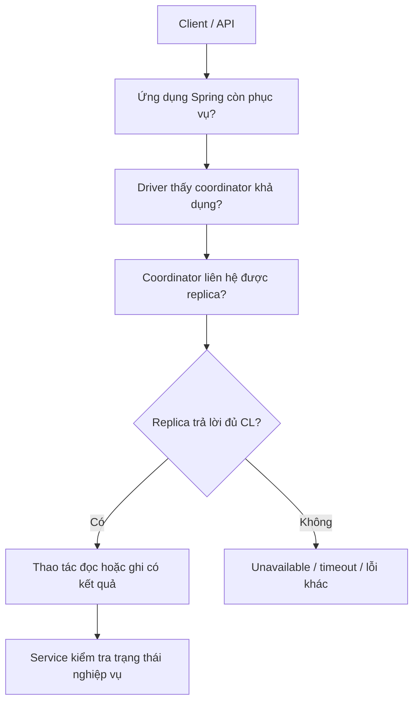
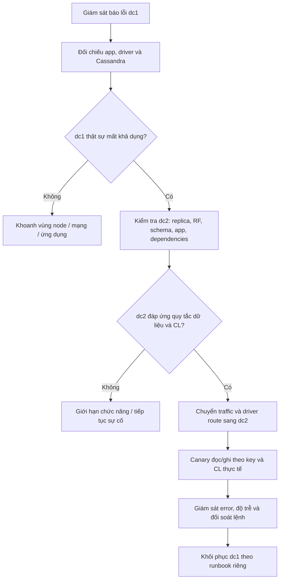

# Hành vi ứng dụng khi node rời cụm hoặc mất datacenter trong Spring Data Cassandra

Một ứng dụng dùng **Spring Data Cassandra** có thể tiếp tục đọc và ghi khi một node Apache Cassandra dừng, nhưng điều đó không tự động đúng trong mọi trường hợp. Kết quả phụ thuộc **replication factor (RF)**, **consistency level (CL)**, datacenter mà driver đang chọn, các replica còn truy cập được và kiểu thao tác đang thực hiện. Khi toàn bộ datacenter bị mất, hệ thống còn phải giải quyết định tuyến ứng dụng, mức mất dữ liệu chấp nhận được, trạng thái các lệnh đang chạy và quá trình phục hồi.

Bài thuộc chương **Quan sát và vận hành** của module `SPRING_DATA_CASSANDRA`. Nội dung kết nối entity mapping, repository, `CassandraTemplate`, truy vấn CQL, partition key, paging và tính nhất quán với các tình huống node rời cluster, lỗi datacenter, giám sát và xử lý sự cố ở ứng dụng Spring.

## 1. Phân loại sự kiện trước khi đánh giá ảnh hưởng

Không nên gọi chung mọi biến động topology là “Cassandra bị down”. Tác động lên ứng dụng khác nhau đáng kể:

| Sự kiện | Điều đang xảy ra | Điều ứng dụng cần quan sát |
| --- | --- | --- |
| **Node bị dừng đột ngột** | Một process/host mất khả dụng; replica trên node đó tạm thời không trả lời | Driver phát hiện host lỗi, thử node khác; truy vấn còn đủ replica theo CL hay không |
| **Node rời cụm có kế hoạch** | Thực hiện quy trình decommission, chuyển token range và dữ liệu trước khi rời | Streaming, thay đổi topology, độ trễ, khả năng phục vụ khi chuyển dữ liệu |
| **Node thay thế hoặc được khởi động lại** | Node quay lại, hoặc node mới tiếp quản phạm vi dữ liệu theo quy trình | Schema/topology hội tụ, dữ liệu được đồng bộ và node đủ điều kiện nhận tải |
| **Mất kết nối giữa một số node** | Network partition có thể khiến các phía nhìn cluster khác nhau | Timeout/unavailable, consistency, các lệnh ghi có kết quả chưa xác định |
| **Mất một datacenter** | Toàn bộ node, đường mạng hoặc hạ tầng trong DC đó không phục vụ được | App còn chạy ở đâu, remote DC có replica không, driver route ra sao và CL có khả dụng không |
| **Ứng dụng mất đường đến Cassandra** | Cluster có thể vẫn khỏe nhưng app sai DNS, TLS, credentials hoặc network | Connection errors từ phía app; không vội kết luận replica đã chết |

**Node còn tồn tại trong metadata nhưng tạm thời không trả lời** khác với **node đã rời ring và được thay đổi ownership đúng quy trình**. Ở tình huống thứ hai, kết quả phụ thuộc việc di chuyển dữ liệu và cấu hình RF sau thay đổi. Không suy luận mức chịu lỗi chỉ từ số container còn chạy.

### 1.1. Phân biệt các lớp “còn sống”

Một request chỉ thành công khi đồng thời có đường truy cập và đủ điều kiện ở nhiều lớp:



`nodetool status` hiển thị node `UN` (Up/Normal) là một tín hiệu về cluster, nhưng **không thay thế** kiểm tra yêu cầu thực tế từ app với đúng keyspace, partition key và consistency level. Một cluster có node `UN` vẫn có thể trả timeout do quá tải, GC hoặc mạng; ngược lại driver có thể chưa cập nhật ngay metadata dù gossip đã phát hiện thay đổi.

## 2. RF và CL quyết định còn phục vụ được hay không

### 2.1. Một datacenter, ba replica

Giả sử keyspace sử dụng `NetworkTopologyStrategy`, chỉ có `dc1` và RF=3. Partition đang kiểm tra có ba replica A, B, C. Quorum trong DC cần `floor(3/2) + 1 = 2` replica.

| Tình huống | `ONE` | `LOCAL_QUORUM` | `ALL` |
| --- | --- | --- | --- |
| Cả A/B/C khỏe | Có thể thành công | Có thể thành công | Có thể thành công |
| Một replica lỗi, còn A/B | Có thể thành công | Có thể thành công vì còn 2/3 | Không đủ 3 phản hồi |
| Hai replica lỗi, còn A | Có thể thành công nếu replica A và đường truy cập phù hợp | Không đủ 2 phản hồi | Không đủ 3 phản hồi |
| Không còn replica truy cập được | Không khả dụng | Không khả dụng | Không khả dụng |

“Có thể thành công” nghĩa là **đủ điều kiện số replica**, chưa bảo đảm thành công tuyệt đối: coordinator, timeout, tải và trạng thái cluster vẫn có thể làm request lỗi. Kết quả read/write trên RF=1 không phải bằng chứng chịu lỗi replica, vì quorum ở RF=1 chỉ cần một node.

Số replica **không phải** số node của toàn cluster. Với RF=3 và cluster 20 node, Cassandra chọn ba replica cho mỗi token range theo chiến lược placement. Cần kiểm tra đúng replica của partition đang thử, nhất là khi mô phỏng lỗi một node.

### 2.2. Hai datacenter, mỗi nơi ba replica

Ví dụ có `dc1` và `dc2`, mỗi DC được khai báo RF=3:

```sql
CREATE KEYSPACE booking_service
WITH replication = {
    'class': 'NetworkTopologyStrategy',
    'dc1': 3,
    'dc2': 3
};

CREATE TABLE booking_service.bookings_by_id (
    tenant_id uuid,
    booking_id uuid,
    status text,
    version bigint,
    last_command_id uuid,
    updated_at timestamp,
    PRIMARY KEY ((tenant_id, booking_id))
);
```

`dc1`/`dc2` là tên minh họa; phải khớp tên datacenter thực tế do snitch và metadata cluster công bố. Không thể tạo RF=3 có ý nghĩa ở `dc2` nếu DC đó không đủ node phù hợp. Hai keyspace có RF khác nhau sẽ chịu lỗi khác nhau dù cùng chạy trên một cluster.

Giả sử **toàn bộ `dc1` bị mất**, ba replica tại `dc2` vẫn hoạt động:

| CL hoặc giao thức | Kết quả kỳ vọng | Giải thích |
| --- | --- | --- |
| `LOCAL_ONE` từ ứng dụng định tuyến vào `dc2` | Có thể đọc/ghi | Chỉ cần một replica cục bộ ở `dc2` |
| `LOCAL_QUORUM` từ ứng dụng có local DC là `dc2` | Có thể đọc/ghi | Cần hai trong ba replica ở `dc2` |
| `QUORUM` toàn cluster với tổng RF=6 | Không đủ quorum khi chỉ còn 3/6 | Quorum toàn cục cần 4 replica |
| `EACH_QUORUM` cho ghi với hai DC | Không đáp ứng khi mất hoàn toàn `dc1` | Cần quorum trong từng DC được khai báo |
| `ALL` | Không đáp ứng | Cần đủ toàn bộ replica liên quan |

Điểm dễ nhầm: **`LOCAL_QUORUM` được tính theo datacenter cục bộ của coordinator/driver**; nếu toàn bộ đường phục vụ vẫn gắn với `dc1` đã chết, ứng dụng không tự nhiên chuyển sang `dc2` chỉ vì keyspace có bản sao ở đó. Ứng dụng và hạ tầng phải có chiến lược chuyển lưu lượng thật sự.

### 2.3. “Phục vụ lại được” khác “không mất dữ liệu”

Với ghi `LOCAL_QUORUM` ở `dc1`, một phản hồi thành công có thể đến trước khi các replica `dc2` cập nhật đầy đủ. Nếu `dc1` mất đột ngột sau đó, `dc2` **có thể chưa có mọi ghi đã được xác nhận ở `dc1`**. Chuyển app sang `dc2` và đọc `LOCAL_QUORUM` không tự bảo đảm recovery point objective (RPO) bằng 0.

Mức CL liên DC mạnh hơn có thể cải thiện bảo đảm ghi được sao chép qua DC, nhưng đánh đổi độ trễ và tính khả dụng khi lỗi. Chẳng hạn `EACH_QUORUM` đòi đủ quorum ở từng DC khi ghi nên khó tiếp tục ghi nếu một DC mất; việc chọn mức nào phải xuất phát từ yêu cầu nghiệp vụ. Không hứa “zero data loss” chỉ dựa vào RF cao hoặc một lần thử failover thành công.

## 3. Java Driver và Spring Data Cassandra phản ứng ra sao?

### 3.1. Driver theo dõi topology, chọn coordinator và quản lý kết nối

Spring Data Cassandra sử dụng Cassandra Java Driver bên dưới repository, `CassandraTemplate` và các lệnh CQL. Driver duy trì metadata về node, connection pool, load balancing và xử lý retry theo cấu hình. Khi một node ngừng phản hồi, request mới có thể được gửi qua coordinator khác được coi là khả dụng. Tuy nhiên:

- Request đang chạy có thể timeout hoặc trả lỗi; client **không thể suy ra** lệnh ghi chưa áp dụng chỉ vì không nhận được đáp ứng.
- Metadata topology, heartbeat và driver health cần thời gian để cập nhật. Có một khoảng ngắn lỗi/độ trễ tăng khi node mới rời cluster.
- Load-balancing policy thường ưu tiên node trong **local datacenter**; remote DC có bản sao dữ liệu chưa có nghĩa driver sẽ tự chuyển sang đó.
- Coordinator có thể đang khỏe nhưng không liên hệ được đủ replica cho CL đã chọn.
- Driver retry policy có giới hạn và không hiểu toàn bộ invariant nghiệp vụ; ứng dụng phải quản lý idempotency cho các lệnh quan trọng.

Một request `repository.findById(key)` có thể hoạt động ở một DC, trong khi một service khác gọi `CqlSession` với CL riêng và thất bại. Khi điều tra sự cố, kiểm tra **cấu hình thực tế của từng đường truy vấn**, không chỉ cấu hình session mặc định.

### 3.2. Cấu hình local datacenter và nhiều contact point

Ví dụ với Spring Boot có hỗ trợ nhóm thuộc tính `spring.cassandra.*` (tên cụ thể phụ thuộc phiên bản Boot):

```yaml
spring:
  cassandra:
    contact-points: cassandra-a.internal:9042,cassandra-b.internal:9042
    local-datacenter: dc1
    keyspace-name: booking_service
    request:
      timeout: 4s
```

Đây là cấu hình **minh họa**, không phải cấu hình failover đa DC hoàn chỉnh. Contact points giúp driver khám phá cluster, nhưng danh sách contact points có nhiều host không tự bảo đảm các replica còn đủ CL. Một số tham số, cách khai báo endpoint và key `request.timeout` thay đổi theo phiên bản Spring Boot/Java Driver; khi triển khai phải kiểm tra tài liệu đúng phiên bản và quan sát cấu hình runtime.

Nếu toàn bộ `dc1` mất và kiến trúc cho phép phục vụ từ `dc2`, thông thường cần app instance tại `dc2` hoặc một kế hoạch xây dựng lại session/router với local DC thích hợp, các contact points có thể kết nối và chính sách kết nối/tin cậy tương ứng. **Chỉ đổi một chuỗi `dc1` thành `dc2` trong file cấu hình mà không kiểm tra topology, replication, ứng dụng và dữ liệu là không đủ**.

### 3.3. Chỉ định consistency ngay ở truy vấn cần kiểm chứng

Để tránh phụ thuộc giá trị mặc định khó quan sát, có thể đặt CL rõ ràng khi dùng Java Driver 4:

```java
SimpleStatement read = SimpleStatement.builder(
        "SELECT status, version FROM booking_service.bookings_by_id " +
        "WHERE tenant_id = ? AND booking_id = ?")
    .addPositionalValues(tenantId, bookingId)
    .setConsistencyLevel(DefaultConsistencyLevel.LOCAL_QUORUM)
    .build();

Row current = cqlSession.execute(read).one();
```

Đoạn ví dụ thể hiện CL ở lệnh CQL. Repository hoặc `CassandraTemplate` cần được cấu hình theo cách phù hợp với phiên bản Spring Data Cassandra, execution profile hay API của dự án nếu muốn cùng mức nhất quán. Chạy CQL trực tiếp với `LOCAL_QUORUM` **không chứng minh** mọi repository method cũng dùng `LOCAL_QUORUM`.

## 4. Hành vi của các thao tác ứng dụng khi mất một node

### 4.1. Đọc theo khóa chính

Với bảng `bookings_by_id`, truy vấn đầy đủ `tenant_id` và `booking_id` định tuyến đến đúng partition. Khi một replica rời cluster:

1. Driver chọn một coordinator khả dụng theo load-balancing policy.
2. Coordinator xác định các replica phục vụ partition và gửi đọc theo CL.
3. Nếu nhận đủ phản hồi đúng thời gian, service nhận dữ liệu và tiếp tục kiểm tra quyền/trạng thái nghiệp vụ.
4. Nếu không đạt CL hoặc quá timeout, service nhận lỗi hạ tầng; **không chuyển lỗi đọc thành “booking không tồn tại”**.

`404 Not Found` có nghĩa khác với `503 Service Unavailable`. Không tìm thấy hàng sau một truy vấn thành công và không thể truy vấn thành công là hai tình huống phải được biểu diễn riêng ở API.

### 4.2. Ghi thường và nguy cơ kết quả chưa xác định

Cassandra có thể ghi một mutation lên vài replica trước khi client thấy timeout. Một `UPDATE` thông thường là kiểu upsert, không mang ý nghĩa giao dịch nghiệp vụ “một lần duy nhất”. Nếu API làm việc quan trọng như cấp vé, xác nhận đơn hoặc phát sự kiện, việc gửi lại ngay sau timeout có thể tạo hiệu ứng lặp trong hệ thống ngoài.

Những câu hỏi cần trả lời khi nhận timeout của thao tác ghi:

- Request đã được gửi đến coordinator chưa, và có thể đã đến replica nào?
- Lệnh có được định danh bằng `commandId`/idempotency key không?
- Ghi lặp cùng mutation có gây thay đổi thêm TTL, timestamp, counter hoặc hiệu ứng ngoài không?
- Có thể đọc trạng thái nguồn để **đối soát** lệnh đã áp dụng hay chưa không?

Một số lệnh `INSERT`/`UPDATE` cùng key và cùng giá trị có thể được thiết kế idempotent ở cấp dữ liệu, nhưng không mặc định coi toàn bộ workflow là idempotent. Ví dụ viết lại TTL có thể kéo dài thời hạn, tăng counter không phải thao tác lặp an toàn, và gửi thông báo có thể xảy ra hai lần.

### 4.3. Repository, template và bảng theo truy vấn

Spring Data Cassandra mapping và repository không tự động đổi thiết kế phân tán: bảng `bookings_by_id` có thể được ghi thành công trong khi bảng `bookings_by_customer` chưa kịp cập nhật. Dù hai bảng có cùng RF/CL, không có giao dịch nguyên tử tổng quát giữa những partition khác nhau.

Khi một node hoặc DC lỗi giữa hai mutation, danh sách và màn hình chi tiết có thể không thống nhất. Các thao tác nhạy cảm nên kiểm tra trạng thái từ **bảng nguồn**; các bảng đọc cần cơ chế retry, đối soát hoặc đồng bộ bằng sự kiện có idempotency.

### 4.4. Paging khi topology thay đổi

Paging state của Java Driver hoặc Spring Data chỉ mô tả vị trí tiếp tục truy vấn; nó **không phải snapshot nhất quán bất biến** qua nhiều request. Khi cluster thay đổi, dữ liệu được ghi/xóa trong lúc phân trang hoặc request chuyển coordinator:

- Một trang có thể timeout trong khi trang trước đã trả về.
- Kết quả giữa các trang có thể khác nếu dữ liệu được thêm/xóa/sửa.
- Nếu retry toàn bộ trang từ đầu không có hợp đồng continuation rõ ràng, ứng dụng có thể trả trùng hàng cho client.
- Cần giữ paging state gắn với đúng truy vấn/tham số tương thích và bảo vệ token khỏi bị dùng sai; không tự chế `OFFSET` để quét partition lớn.

Khi kiểm thử, tách **paging trên tập dữ liệu cố định** khỏi **paging trong lúc failover và mutation**; không coi việc đọc đủ trang trên một node là bằng chứng consistency trong cụm nhiều node.

## 5. LWT và `@Version` khi node hoặc DC gặp sự cố

### 5.1. LWT là giao thức có điều kiện, không phải ghi thường

Với booking `PENDING`, cần bảo đảm chỉ một trong hai lệnh `CONFIRM` hoặc `CANCEL` thắng. LWT dùng cú pháp `IF`:

```sql
UPDATE booking_service.bookings_by_id
SET status = 'CONFIRMED',
    version = 8,
    last_command_id = ?
WHERE tenant_id = ? AND booking_id = ?
IF status = 'PENDING' AND version = 7;
```

Các giá trị `7` và `8` chỉ minh họa một lần cập nhật; ở ứng dụng thực phải lấy từ version đã đọc và tăng có kiểm soát. LWT dùng pha đồng thuận với **serial consistency** (`SERIAL` hoặc `LOCAL_SERIAL`) và consistency thông thường. Khi thiếu replica tham gia hoặc timeout giữa các pha, client có thể **không biết chắc** thao tác đã được áp dụng hay chưa.

Ví dụ ghi rõ hai mức consistency bằng Java Driver 4:

```java
SimpleStatement confirm = SimpleStatement.builder(
        "UPDATE booking_service.bookings_by_id " +
        "SET status = ?, version = ?, last_command_id = ? " +
        "WHERE tenant_id = ? AND booking_id = ? " +
        "IF status = ? AND version = ?")
    .addPositionalValues("CONFIRMED", 8L, commandId,
                         tenantId, bookingId, "PENDING", 7L)
    .setConsistencyLevel(DefaultConsistencyLevel.LOCAL_QUORUM)
    .setSerialConsistencyLevel(DefaultConsistencyLevel.LOCAL_SERIAL)
    .build();

Row result = cqlSession.execute(confirm).one();
if (result == null) {
    throw new IllegalStateException("LWT không có hàng kết quả");
}
boolean applied = result.getBoolean("[applied]");
```

`[applied] = false` là **kết quả điều kiện được kiểm tra và không đạt**; có thể đọc lại để giải thích xung đột theo nghiệp vụ. Timeout, unavailable hoặc lỗi kết nối **không tương đương** với `[applied] = false`. Không đổi sang ghi không điều kiện để vượt qua LWT lỗi.

### 5.2. `@Version` cũng chịu giới hạn hạ tầng

`@Version` ở entity Spring Data Cassandra giúp phát hiện stale update trong luồng đọc-sửa-lưu có optimistic locking; phiên bản thay đổi có thể dẫn tới `OptimisticLockingFailureException`. Nhưng khi driver timeout hoặc không còn quorum, service có thể nhận exception hạ tầng thay vì xung đột version có kết quả xác định. Ngoài ra, CQL thủ công không tham gia kiểm soát `@Version` nếu không tự đưa điều kiện tương ứng.

Phân loại kết quả:

| Kết quả | Diễn giải an toàn | Hành động nghiệp vụ |
| --- | --- | --- |
| `[applied] = true` hoặc save version thành công | Lệnh đã thành công theo hợp đồng mutation | Trả thành công, xử lý side effect theo quy trình idempotent |
| `[applied] = false` hoặc optimistic-lock conflict rõ ràng | Điều kiện/version không còn phù hợp | Đọc lại và trả conflict hoặc kết quả idempotent của cùng command |
| Driver timeout trong lúc gửi CAS/save | Trạng thái thực hiện **chưa xác định** | Đối soát `commandId`, trạng thái nguồn; retry có giới hạn nếu an toàn |
| Không còn replica đáp ứng CL | Thao tác có thể không được phục vụ | Trả lỗi khả dụng phù hợp; xem xét đường recovery/failover |

### 5.3. `LOCAL_SERIAL` trong ứng dụng nhiều DC

`LOCAL_SERIAL` giới hạn phạm vi serial consistency cục bộ. Không nên lấy bài kiểm thử LWT thành công ở `dc1` rồi kết luận các chuyển trạng thái cạnh tranh được tuần tự hóa trên toàn bộ hai DC ở mọi cấu hình. Nếu nghiệp vụ cần một invariant xuyên DC, phải thiết kế mức serial consistency, chính sách route writer, failover và cơ chế chống split-brain như **một giao thức thống nhất**. Không để hai tập writer độc lập tự nhận quyền ghi cùng khóa sau sự cố mạng mà chưa giải quyết cách phân xử.

## 6. Mất datacenter: failover là quy trình ứng dụng và dữ liệu

### 6.1. Vì sao DC thứ hai có replica vẫn chưa đủ?

Một failover vận hành được đòi hỏi nhiều điều kiện đồng thời:

1. Dữ liệu cần thiết có replica trong DC sống sót, schema/keyspace và RF phù hợp.
2. Có app instance hoặc khả năng khởi động app ở DC sống sót; API gateway/DNS/load balancer chuyển lưu lượng tới đó.
3. Driver của app mới nhìn thấy các coordinator khả dụng và có **local datacenter đúng**.
4. CL của thao tác vẫn đáp ứng được trong DC đó, không vô tình giữ một mức đòi replica ở DC đã mất.
5. Các dependency khác của ứng dụng (authentication, event broker, cache, secret store) cũng hoạt động.
6. Business workflow chấp nhận tình trạng replica chưa kịp đồng bộ hoặc có cơ chế đối soát những lệnh đang xử lý.

Nếu `dc2` có dữ liệu nhưng toàn bộ máy chạy Spring API ở `dc1` đều tắt, người dùng vẫn thấy dịch vụ không khả dụng. Nếu app chuyển được nhưng message broker chính nằm ở `dc1`, endpoint ghi có thể phải chuyển sang trạng thái xử lý tạm thời thay vì báo thành công đầy đủ.

### 6.2. Lưu đồ xử lý failover



Trong khi failover, một quyết định quan trọng là **cho phép ghi ở DC dự phòng hay chỉ đọc**. Chế độ chỉ đọc có thể giảm rủi ro khi không đủ bằng chứng về dữ liệu mới nhất hoặc khả năng đối soát. Chế độ ghi cần định nghĩa rõ RPO, chính sách idempotency và cách giải quyết lệnh chưa xác định.

### 6.3. Khi DC cũ hoạt động trở lại

Không lập tức đưa toàn bộ traffic về DC cũ chỉ vì node đã lên `UN`. Cần kiểm tra đồng bộ schema/topology, backlog repair, dữ liệu mới ghi ở DC dự phòng, trạng thái LWT/command ledger và consistency từng bảng. Tùy kiểu outage và thời gian dài, có thể cần thủ tục repair hoặc thay node đúng theo hướng dẫn Cassandra phiên bản đang triển khai.

TTL và xóa dữ liệu cần quan tâm đặc biệt: replica ngừng quá lâu, lỡ các tombstone đã được thu gom theo cấu hình có thể tạo nguy cơ dữ liệu xóa xuất hiện lại. Không tùy tiện giảm `gc_grace_seconds` để “xóa tombstone nhanh” hoặc cho node cũ quay lại mà không kiểm tra quy trình repair và cửa sổ an toàn. **Độ sẵn sàng phục hồi** khác **đã hoàn tất khôi phục nhất quán dữ liệu**.

## 7. Phân loại lỗi và chính sách phản hồi của API

Driver Java và tầng Spring Data có thể ném các kiểu exception khác nhau tùy phiên bản. Thay vì bắt `Exception` và trả lỗi chung, service cần phân loại theo hành vi có thể cam kết:

| Nhóm lỗi/tín hiệu | Diễn giải | Phản hồi và hành động |
| --- | --- | --- |
| Không có hàng sau `SELECT` thành công | Dữ liệu không tồn tại ở kết quả đọc hợp lệ | `404` hoặc lỗi domain phù hợp |
| LWT trả `[applied] = false` | Điều kiện ghi không đạt | `409 Conflict` hoặc kết quả idempotent nếu đúng lệnh trước đó |
| `OptimisticLockingFailureException` | Xung đột optimistic locking đã xác định | Phân loại stale version và trạng thái mới, hạn chế retry tự động |
| `UnavailableException`/không đủ replica | Yêu cầu không đạt điều kiện khả dụng theo CL | `503`, điều tra RF/CL/topology; chỉ retry khi có lý do |
| `ReadTimeoutException` | Không nhận đủ kết quả đọc trước deadline | Có thể retry đọc theo giới hạn; không đổi thành `404` |
| `WriteTimeoutException` hoặc driver timeout khi ghi | Chưa chắc biết mutation đã thực hiện tới đâu | Đối soát trước khi tái gửi nghiệp vụ quan trọng |
| Không có coordinator kết nối được | App/driver không đến được cluster phù hợp | `503`, kiểm tra mạng, driver, TLS, DC và contact points |
| Lỗi mapping/CQL/schema | Vấn đề triển khai hoặc schema chưa phù hợp | Sửa nguyên nhân; retry không điều kiện thường vô ích |

Tên exception cụ thể có thể được Spring dịch sang lớp `DataAccessException` tùy API và phiên bản framework. Cần quan sát **cause gốc** và viết bộ phân loại có test theo stack đang sử dụng. Khi trả lỗi cho client, không phơi lộ địa chỉ node, keyspace nội bộ hoặc stack trace.

### 7.1. Retry nên có ngân sách và điều kiện

Chỉ tự retry khi vừa an toàn theo **ngữ nghĩa thao tác**, vừa không làm tình trạng cluster trầm trọng hơn. Một chính sách cần có số lần tối đa, deadline tổng, backoff kèm jitter và metric retry. Với outage diện rộng, circuit breaker/load shedding có thể hạn chế hàng đợi đổ dồn về Cassandra trong giai đoạn phục hồi.

- **Đọc idempotent:** có thể retry có giới hạn sau lỗi tạm thời, nhưng vẫn cần budget để tránh làm tăng tải.
- **Ghi thường:** đánh giá xem ghi lặp có thật sự an toàn; không giả định với TTL, counter hoặc side effect.
- **LWT trả false:** không lặp cùng điều kiện vô hạn; cần đọc lại và đưa ra quyết định nghiệp vụ.
- **LWT timeout:** trạng thái có thể chưa xác định; dùng `commandId`/ledger, kiểm tra kết quả đã áp dụng trước khi thử lại.
- **Thao tác nhiều bảng:** có kế hoạch đối soát các phần đã thành công và phần còn thiếu.

Đừng áp dụng retry ở cả driver, Spring service, API gateway và message consumer mà không tính **tổng số lần thực tế**. Ba lớp mỗi lớp retry ba lần có thể khuếch đại tải khi cluster đang yếu, tạo bão request đúng lúc node phục hồi.

## 8. Quan sát theo lớp để tìm đúng nguyên nhân

Một dashboard chỉ có số `500` trên HTTP không giúp phân biệt lỗi một replica, thiếu quorum, ứng dụng mất connection pool hay bảng dữ liệu có hot partition. Thu thập và liên hệ tín hiệu theo ba lớp:

| Lớp | Tín hiệu quan trọng | Câu hỏi vận hành |
| --- | --- | --- |
| **Ứng dụng Spring** | Request rate, error rate, p95/p99 latency, timeout, retry, circuit breaker, số lệnh trạng thái `UNKNOWN` | Người dùng đang lỗi API nào, có bị trùng lệnh hoặc hàng đợi tăng không? |
| **Java Driver** | Trạng thái node, reconnect, pool, in-flight requests, lỗi theo CL, coordinator và DC | Driver còn route được vào đâu, các request gửi với mức nhất quán nào? |
| **Cluster Cassandra** | Node UN/DN, dropped messages, read/write latency, pending tasks, compaction, GC, repair, network/streaming | Lỗi do replica, topology, quá tải, compaction hay quá trình rời cụm? |
| **Dữ liệu/nghiệp vụ** | Xung đột LWT, độ trễ cập nhật bảng đọc, lệch trạng thái, lệnh chưa đối soát, dữ liệu hết hạn | Dịch vụ có đáp ứng invariant và mức phục hồi đã cam kết không? |

Với Spring Boot, Micrometer/Actuator và hệ thống tracing có thể cung cấp metric request, lỗi và độ trễ; Driver 4 cũng có cơ chế metric riêng nếu bật/cấu hình phù hợp. Ở Cassandra, có thể thu thập JMX/Prometheus exporter và sử dụng lệnh đọc trạng thái để xác minh. Không giả định mọi metric đều được bật sẵn trong mọi phiên bản.

### 8.1. Cần gắn ngữ cảnh gì vào log/trace?

Mỗi sự kiện thất bại quan trọng nên có `requestId`, `commandId` (nếu có), tên thao tác nghiệp vụ, loại truy vấn, regular CL, serial CL khi là LWT, DC phục vụ, loại lỗi, số lần retry và thời gian thực hiện. `tenantId` hoặc primary key có thể được hash/anonymize theo chính sách bảo mật. Tránh log toàn bộ CQL với thông tin nhạy cảm, credential hay dữ liệu cá nhân.

Đừng sử dụng raw partition key làm nhãn metric có cardinality cao: có thể tạo hàng triệu chuỗi thời gian. Dùng nhãn hữu hạn như `operation=confirm`, `cluster=prod`, `dc=dc2`, `error=write_timeout`, `consistency=LOCAL_QUORUM`; dùng trace hoặc log có kiểm soát để chẩn đoán một key cụ thể.

### 8.2. Bộ cảnh báo có hành động

Ví dụ các nhóm cảnh báo cần có (ngưỡng do hệ thống thực tế đo và hiệu chỉnh):

1. **Khả dụng:** tỷ lệ API `5xx` và timeout tăng kéo dài cùng lúc Cassandra mất node hoặc driver không tìm được coordinator.
2. **Consistency:** `UnavailableException`, read/write timeout theo CL và DC tăng; kiểm tra RF và node state trước khi cân nhắc thay CL.
3. **LWT:** tỉ lệ xung đột và latency CAS tăng; phân biệt contention nghiệp vụ với lỗi Paxos/replica.
4. **Hàng đợi phục hồi:** số command có outcome chưa rõ, backlog đối soát, retry/dead-letter tăng.
5. **Sức khỏe dữ liệu:** compaction, tombstone, pending repair, streaming và dropped messages tăng vượt baseline.

Không báo động chỉ vì một node ngắt kết nối vài giây nếu cluster vẫn đáp ứng SLO; nhưng cũng không bỏ qua cảnh báo mất cả DC chỉ vì vài request đọc cũ vẫn thành công. Kết hợp **tác động người dùng** và **tín hiệu hạ tầng** để đánh giá mức nghiêm trọng.

## 9. Runbook khi một node rời cluster

### 9.1. Phân loại: planned decommission hay unexpected down

**Rời cụm có kế hoạch:** xác nhận mục tiêu giảm/thay node, nguồn lực còn đủ RF/CL, dữ liệu cần streaming, kế hoạch rollback/khôi phục và thông báo tới các hệ liên quan. Theo dõi streaming, CPU, network, latency và compaction trong quá trình vận hành. Sau khi thành công, kiểm tra membership, token ownership, các truy vấn ứng dụng và bảo đảm mới về mức chịu lỗi.

**Node mất đột ngột:** kiểm tra đây là mất host, mất đường mạng, OOM/GC hay chỉ lỗi kết nối của một ứng dụng. Ghi thời điểm, node/DC, token range bị ảnh hưởng, trạng thái replica và ảnh hưởng request. Không tùy tiện chạy decommission hoặc xóa node khỏi ring khi chưa xác định node chỉ tạm thời mất liên lạc.

### 9.2. Các bước xử lý sự cố

```text
1. Ghi nhận tác động: API nào lỗi, từ thời điểm nào, tỉ lệ lỗi và latency.
2. Xác minh trạng thái node/cluster: membership, datacenter, RF, CL.
3. Kiểm tra driver: coordinator, reconnect, pool, routing và timeout.
4. Phân loại request: đọc, ghi thường, LWT; đánh dấu các outcome chưa rõ.
5. Giảm tải nếu cần: rate limiting, queue, ngừng retry quá mức.
6. Khôi phục/thay node theo quy trình cluster được phê duyệt.
7. Kiểm tra schema, streaming/repair và khả năng đọc/ghi trên các key tiêu biểu.
8. Đối soát lệnh nghiệp vụ, cập nhật bảng đọc và kiểm tra side effect.
9. Chỉ đóng sự cố khi SLO và tính đúng dữ liệu được xác minh.
```

Các lệnh quan sát thường dùng trong môi trường có quyền vận hành là `nodetool status`, `nodetool describecluster`, `nodetool netstats` và các bảng metadata phù hợp; kết quả phải đối chiếu với metrics và query thực tế. Những lệnh làm thay đổi topology hay repair có thể tốn tài nguyên và cần runbook riêng theo phiên bản Cassandra. Không thực hiện thao tác phá hủy trên production để “thử một cảnh báo”.

## 10. Runbook khi mất toàn bộ datacenter

Thử nghiệm DR (disaster recovery) và sự cố thật cần phân vai rõ ai quyết định **failover**, ai xác nhận **dữ liệu đủ tin cậy**, ai chịu trách nhiệm **failback**. Các bước thực hành:

| Giai đoạn | Hành động | Điều kiện tiếp tục |
| --- | --- | --- |
| Nhận diện | Kiểm tra DC lỗi thật, tuyến mạng, app, các dependency ngoài Cassandra | Có dấu hiệu rõ, tránh switch nhầm vì lỗi DNS cục bộ |
| Đánh giá DC dự phòng | Kiểm tra app, Cassandra, RF/schema, CL, đường mạng, dữ liệu gần nhất và RPO | Có phương án phục vụ phù hợp tính đúng nghiệp vụ |
| Chuyển lưu lượng | Định tuyến API tới app tại DC sống; cấu hình local DC/contact points phù hợp | Canary endpoint quan trọng thành công |
| Kiểm soát ghi | Quyết định chế độ read-only hay read-write, idempotency và command reconciliation | Không có writer cạnh tranh thiếu kiểm soát ở DC khác |
| Giám sát trong failover | Theo dõi error rate, p95/p99, LWT, backlog và consistency errors | SLO tạm thời đạt mức được chấp nhận |
| Khôi phục DC cũ | Đối soát dữ liệu và repair theo runbook, kiểm tra app/driver và dependency | Không đưa traffic trở lại khi chưa xác minh |
| Failback và tổng kết | Chuyển traffic có kiểm soát, tiếp tục giám sát, đo RTO/RPO thực tế | Không còn lệnh chưa rõ outcome ngoài ngân sách cho phép |

**RTO (Recovery Time Objective)** là khoảng thời gian chấp nhận được để khôi phục dịch vụ; **RPO (Recovery Point Objective)** là mức dữ liệu có thể mất. Test chỉ nêu được RTO/RPO đo trong kịch bản đã chạy, không thể lấy từ replication factor rồi tự suy ra.

Khi DC cũ quay lại, cần đặc biệt tránh cùng lúc có hai phía tự coi mình là writer chính cho một invariant nghiệp vụ. Phải thống nhất quyền ghi, trạng thái command và mức serial consistency trước khi mở lại các endpoint thay đổi dữ liệu.

## 11. Kiểm thử sự cố có thể tái hiện

### 11.1. Hai môi trường thử nghiệm khác nhau

**Một Cassandra node** (ví dụ Testcontainers) phù hợp để kiểm tra entity mapping, repository, `CassandraTemplate`, câu CQL, LWT cơ bản, TTL và mapping exception. Nhưng RF=1 không có replica độc lập; một container dừng thì **không thể** chứng minh dịch vụ chịu lỗi một replica ở RF=3.

Để kiểm tra khả năng chịu lỗi node và DC, cần môi trường nhiều node thực sự cùng cluster:

- **Một DC, RF=3:** tối thiểu ba node để đo `ONE`, `LOCAL_QUORUM`, `ALL` khi một/hai node down.
- **Hai DC:** có replication theo từng DC, ứng dụng định tuyến được vào cả hai và có khả năng mô phỏng mất trọn một DC.
- **LWT nhiều coordinator:** tạo hai client có cùng snapshot/version và xác minh mỗi request đến coordinator dự kiến; kết quả thành công/xung đột, timeout và retry được phân loại.
- **Network partition:** tách khỏi kịch bản stop container; mô phỏng mất liên lạc một chiều/giữa DC nếu đó là rủi ro cần đánh giá.

Không dùng hai container Cassandra độc lập để kết luận đã kiểm thử “cluster hai node”. Phải xác minh cluster membership, `nodetool status`, datacenter và replication strategy. Dùng polling readiness có deadline, thay vì ngủ một khoảng cố định rồi giả định schema/topology đã hội tụ.

### 11.2. Ma trận thử nghiệm tối thiểu

| Ca | Fault và thao tác | Kỳ vọng kiểm tra | Phạm vi bằng chứng |
| --- | --- | --- | --- |
| A | RF=3, một node down, đọc/ghi `LOCAL_QUORUM` | Có thể hoàn tất với hai replica còn lại | Khả dụng khi mất một replica trong DC thử |
| B | RF=3, một node down, ghi `ALL` | Không nhận đủ phản hồi, lỗi được phân loại đúng | Mức đánh đổi khả dụng của `ALL` |
| C | RF=3, hai node down, đọc `ONE` và `LOCAL_QUORUM` | `ONE` có thể trả lời; quorum không đủ | Hành vi theo số replica thực sự còn |
| D | RF=3, hai CAS cùng version qua coordinator khác nhau | Một lệnh thắng nếu kết quả đều xác định | Invariant dưới cạnh tranh đã thử |
| E | Gây timeout sau khi gửi CAS | Không biến timeout thành conflict; có đối soát `commandId` | Xử lý outcome chưa xác định |
| F | Hai DC, RF=3 mỗi DC, mất `dc1`; app chuyển `dc2` | Endpoint canary dùng local CL phục vụ theo kế hoạch | Khả năng phục vụ của cấu hình failover đã thử |
| G | Hai DC, mất `dc1`; thử global `QUORUM` tổng RF=6 | Không đủ 4/6 replica | Giới hạn của global quorum khi mất một DC |
| H | DC cũ hồi phục sau ghi tại DC dự phòng | Kiểm tra đồng bộ, repair, invariant, không trùng side effect | Quy trình recovery/failback đã thử |

Mỗi ca cần ghi **topology, phiên bản Cassandra/driver/Spring, CL thường, serial CL, partition key, coordinator, thời gian fault, loại lỗi, retry, trạng thái cuối và giới hạn kết luận**. Với kết quả lỗi hạ tầng, không tự động gán một lần write timeout thành “ghi thất bại chắc chắn”; dùng kiểm tra `commandId` và đối soát.

### 11.3. Mẫu kiểm tra hành vi API

Một ví dụ có thể áp dụng cho endpoint `POST /bookings/{id}/confirm`:

```text
GIVEN:
  booking đang PENDING, version = 7
  commandId = C-123 không đổi giữa các lần retry
  RF = 3 tại dc1, request dùng LOCAL_QUORUM + LOCAL_SERIAL

WHEN:
  một replica dừng trước request

THEN:
  nếu còn đủ replica: LWT có kết quả xác định
  applied=true => booking CONFIRMED đúng một lần
  applied=false => domain conflict/idempotency result
  timeout => API/worker đưa lệnh vào nhánh đối soát, không kết luận rollback

AFTER RECOVERY:
  đọc trạng thái nguồn, version và commandId
  xác minh bảng đọc và side effect không nhân đôi
```

Kịch bản này vẫn phải ghi rõ phiên bản Cassandra, routing thực tế và điều kiện thử. Nếu chỉ thử một node, không được giữ câu kết luận về “đủ replica khi một node dừng” vì trường hợp đó không xảy ra trong môi trường thử.

## 12. Những ngộ nhận phổ biến

| Ngộ nhận | Điều đúng hơn |
| --- | --- |
| “Cassandra tự failover toàn bộ ứng dụng” | Cassandra và driver chỉ là một phần; app, traffic routing, credentials, dependencies và chính sách dữ liệu cũng phải chuyển được |
| “RF=3 thì chịu được mọi hai node lỗi” | Còn tùy những node nào là replica của partition, CL, đường mạng và tải |
| “`QUORUM` luôn sống khi một DC mất” | Với RF=3 ở mỗi DC, global quorum của 6 replica cần 4; một DC sống chỉ còn 3 |
| “`LOCAL_QUORUM` bảo đảm RPO=0 giữa hai DC” | Ghi local có thể thành công trước khi DC khác nhận đủ dữ liệu |
| “Node `UN` nghĩa là toàn bộ request khỏe” | Vẫn có thể timeout do tải, mạng, compaction và dependency |
| “Timeout nghĩa là ghi chắc chắn thất bại” | Mutation có thể đã áp dụng; outcome cần đối soát |
| “LWT false và timeout giống nhau” | `false` là điều kiện không đạt; timeout có thể chưa rõ kết quả |
| “Có `@Version` thì mọi CQL đều chống ghi đè” | CQL trực tiếp không tự dùng optimistic-lock protocol của Spring |
| “Đổi local DC của driver là đủ” | Phải đảm bảo replica, CL, app, routing và dữ liệu ở DC dự phòng |
| “Sau khi DC trở lại là có thể mở ghi ngay” | Cần kiểm tra hội tụ, lệnh còn treo, repair và tránh writer cạnh tranh |

## 13. Bài tập: thiết kế phản ứng cho một dịch vụ đặt chỗ

**Bối cảnh:** Dịch vụ Spring Data Cassandra dùng bảng `bookings_by_id` với composite partition key `(tenant_id, booking_id)`, `status`, `version` và `last_command_id`. Có hai DC, mỗi nơi RF=3. Endpoint đọc chi tiết dùng `LOCAL_QUORUM`; endpoint xác nhận booking dùng LWT với `LOCAL_QUORUM` và `LOCAL_SERIAL`. Bảng danh sách khách hàng được cập nhật sau bảng nguồn.

Hãy xây dựng kế hoạch theo ba tình huống:

1. **Mất một node trong `dc1`:** dự đoán đường đọc/ghi nào còn khả dụng, metric nào tăng, khi nào nên trả `503`, khi nào nên coi là xung đột trạng thái. Ghi rõ replica và CL.
2. **Mất toàn bộ `dc1`:** thiết kế chuyển API sang `dc2`, quyết định chỉ đọc hay tiếp tục ghi; nêu cách đo RTO/RPO và xử lý lệnh xác nhận đã gửi ngay trước outage.
3. **`dc1` phục hồi:** kiểm tra version, command ID, dữ liệu ở bảng danh sách, repair và quy trình mở lại traffic để không phát hành booking hai lần.

Trong báo cáo, phân tách **quan sát trực tiếp** (lệnh thực sự chạy, số node, kết quả, lỗi, log) và **suy luận có điều kiện** (khả năng mất dữ liệu, giới hạn failover, mức đáp ứng SLO). Đừng dùng trạng thái một node đang khỏe để chứng minh toàn bộ nghiệp vụ đã phục hồi.

## 14. Checklist vận hành

- Xác minh RF của đúng keyspace, DC, số replica của partition và CL cho từng đường đọc/ghi.
- Phân biệt node down, decommission, lỗi mạng, mất datacenter và lỗi kết nối chỉ ở ứng dụng.
- Quan sát cả Spring API, Java Driver và Cassandra; có metric cho retry, timeout, LWT và lệnh chưa rõ kết quả.
- Không coi lỗi read timeout là `404`, không coi write timeout là chắc chắn rollback, không coi LWT false là lỗi hạ tầng.
- Bảo đảm các writer cùng tham gia giao thức version/LWT và có idempotency cho hiệu ứng nghiệp vụ quan trọng.
- Có phương án app traffic failover, local DC, contact points, consistency và các dependency khác ngoài Cassandra.
- Định nghĩa RTO/RPO bằng yêu cầu nghiệp vụ và xác minh qua thử nghiệm nhiều DC.
- Có runbook repair, đối soát lệnh, đồng bộ bảng đọc và xử lý TTL/tombstone khi node/DC trở lại.
- Kiểm thử một node cho mapping/CQL; kiểm thử nhiều node để kết luận về quorum, lỗi replica và phục hồi datacenter.
- Lưu bằng chứng đủ tái hiện: phiên bản, topology, CL, fault, trạng thái trước/sau, metric và giới hạn kết luận.

**Kết luận:** khi node rời cụm hoặc datacenter mất khả dụng, hành vi của ứng dụng Spring Data Cassandra hình thành từ **RF, CL, routing của driver, kiểu truy vấn, trạng thái nghiệp vụ và quy trình vận hành**. Một ứng dụng được thiết kế tốt biết khi nào tiếp tục phục vụ, khi nào từ chối hoặc chuyển chế độ, khi nào kết quả ghi chưa rõ và cần đối soát. Quan sát đúng các lớp và kiểm thử trên topology thực tế là nền tảng để phục hồi mà vẫn giữ được tính đúng của dữ liệu phân tán.
